# PEAK-Wiki

Source: https://peak.wiki.gg  
Pages: 357  
License: CC BY-SA 4.0 — attribute the PEAK Wiki contributors.

# 1.0.b


This page is a [stub](https://support.wiki.gg/wiki/Stub). You can help **PEAK Wiki** by expanding it.

[](https://peak.wiki.gg/wiki/File%3APeak_Badge.png) Patch v1.0.b
Release date
June 16, 2025
Version chronology
[**←  Previous**
1.0](1.0.md)
[**Next  →**
 1.0.c](1.0.c.md)
[Version history](Version%20history.md)

**1.0.b** was a hotfix patch released on June 16, 2025.

---

# 1.0.c


This page is a [stub](https://support.wiki.gg/wiki/Stub). You can help **PEAK Wiki** by expanding it.

[](https://peak.wiki.gg/wiki/File%3APeak_Badge.png) Patch v1.0.c
Release date
June 17, 2025
Version chronology
[**←  Previous**
1.0.b](1.0.b.md)
[**Next  →**
 1.1.a](1.1.a.md)
[Version history](Version%20history.md)

**1.0.c** was a hotfix patch released on June 17, 2025.

---

# 1.0


This page is a [stub](https://support.wiki.gg/wiki/Stub). You can help **PEAK Wiki** by expanding it.

[](https://peak.wiki.gg/wiki/File%3APeak_Badge.png) Patch v1.0
Release date
June 16, 2025
Version chronology
[**Next  →**
 1.0.b](1.0.b.md)
[Version history](Version%20history.md)

*[PEAK](Peak%20%28game%29.md)* released on Steam.

---

# 1.1.a

[](https://peak.wiki.gg/wiki/File%3APeak_Badge.png) Patch v1.1.a
Release date
June 17, 2025
Steam link
[Go to Steam](https://store.steampowered.com/news/app/3527290/view/544486109101430694)
Discord link
[Go to Discord](https://discord.com/channels/1368870708335083650/1371457189709090836/1384576175892070501)
Version chronology
[**←  Previous**
1.0.c](1.0.c.md)
[**Next  →**
 1.2.a](1.2.a.md)
[Version history](Version%20history.md)

## Message from Landcrab

Hello Scouts! Our very first proper patch is live, adding some stability, bug fixes and balance to the game.

Thank you all for climbing with us! It's been an amazing 24h! Enjoy the new map and fixes.

## Patch Notes

**Critical Stuff:**

- *[PEAK](Peak%20%28game%29.md)* will now ask you to pick your graphics API on startup. If you have experienced crashes or instability, we recommend switching from DX12 to Vulkan (or vice versa) as your first step to try.
- Added a framerate cap to the settings menu. This should be your second step to try!

**Bug-Fixes:**

- Fixed an issue where certain badges would show the wrong cosmetic being unlocked during the endgame screen
- Fixed gamepad-only issue where pressing Sprint while climbing would not perform a lunge
- Removed [Warp Compass](Warp%20Compass.md) temporarily as it seems to send people to the void more often than not. Hopefully it comes back better than ever.
- Prevented the [Rope Shooter](Rope%20Cannon.md) from firing and being wasted on a target that's out of range, like the [Chain Shooter](Chain%20Launcher.md) does
- Fixed issue where guidebook pages on the ground could turn invisible
- Prevented scouts from walking into the ocean

**Balance Changes:**

- Increased the length of [Energy Drink](Energy%20Drink.md)'s buff, but reduced the amount it increases your speed. ALSO REDUCED THE DROWSY IT INFLICTS BY A LOT, SORRY TO ALL THE SCOUTS WHO LOST THEIR LIVES TO THIS ITEM
- Both [Lollipop](Big%20Lollipop.md) and [Energy Drink](Energy%20Drink.md) now have a "grace period" where they won't start their effect cooldown for a few seconds unless you begin climbing a wall
- Brought in item rarities slightly so you'll see rarer items a bit more, and the most common ones will be less over-represented
- Made the [bombshrooms](https://peak.wiki.gg/wiki/Bombshrooms) in the Tropics even more dangerous
- Made [jellyfish](https://peak.wiki.gg/wiki/Jellyfish) even harder to see
- [Morale Boosts](Morale%20Boost.md) no longer scale with number of nearby scouts
- Made the [Scoutmaster's Bugle](Scoutmaster%27s%20Bugle.md) even more terrifying
- [Cursed Skull](Cursed%20Skull.md) and [Scout Effigy](Scout%20Effigy.md) will no longer spawn when playing solo
- Cursed Skull will no longer spawn from [Scout Statues](https://peak.wiki.gg/wiki/Scout_Statues) (but can still spawn from [Ancient Luggage](https://peak.wiki.gg/wiki/Ancient_Luggage))
- Increased [vine](https://peak.wiki.gg/wiki/Vine) climb speed

**Quality of Life:**

- Added "controls" page to the pause menu, letting you review the game's controls at any time
- Added a message to spectators' UI to give a hint towards how to get revived
- Added a unique reticle for when a projectile item has a valid target
- Added UI for being boosted up from below by another scout
- [Guidebooks](Guidebook.md) are now synced across clients, allowing your friends to read over your shoulder
- Made the [Scout Statue](https://peak.wiki.gg/wiki/Scout_Statue) tower collider more accurate.

-The Landcrab Team

---

# 1.10.a

[](https://peak.wiki.gg/wiki/File%3APeak_Badge.png) Patch v1.10.a
Release date
July 30, 2025
Steam link
[Go to Steam](https://store.steampowered.com/news/app/3527290/view/498327923676161391)
Discord link
[Go to Discord](https://discord.com/channels/1368870708335083650/1371457189709090836/1399847480132370565)
Version chronology
[**←  Previous**
1.9.a](1.9.a.md)
[**Next  →**
 1.11.a](1.11.a.md)
[Version history](Version%20history.md)

## Message from Landcrab

Hey guys! Totally normal update to the game. Nothing to see here.

Although I will mention that Polish and Turkish translations are in!!

## Issues on our radar

We know some folks are experiencing issues with the game that this patch doesn't solve. Our ability to fix them heavily depends on our ability to reproduce them on our end, so detailed bug reports that include your hardware specs and graphics API are super useful. Your continued patience is appreciated <3

Below are just some of the issues we know about and we're working to solve:

- Ongoing issues with the [backpack](Backpack.md). We've resolved some of the weird edge cases but seems like we haven't caught them all. For now, try not to stand too close to a wall while dropping it.
- Alt-tabbing crashes the game. For now, default to Windowed Fullscreen instead of Exclusive Fullscreen.
- Microphone issues.
- Disconnect and rejoin issues.
- General performance issues.

## Patch Notes

FEATURES:

- Added [cannibalism](Cannibalism.md).

OPTIONS:

- Polish and Turkish translations are in!
- New Setting: "Climbing Extra Field Of View". This lets you adjust how the FOV changes while climbing.
- New Setting: PUSH TO MUTE. This works the opposite way of "Push To Talk." No more having to listen to your streamer friend talk to chat.
- Settings that were previously hidden outside of the Main Menu will now show up but be disabled. Hopefully this reduces some confusion!

BALANCE CHANGES:

- Fixed an issue where [Trail Mix](Trail%20Mix.md), [Granola Bar](Granola%20Bar.md), [Medicinal Root](Medicinal%20Root.md), and [Airline Food](Airline%20Food.md) would not give extra [hunger](https://peak.wiki.gg/wiki/Hunger) reduction after cooked.
- Fixed an issue where cooking something Well-Done and then stashing it would remove the buffs. For reference, the intended behavior is that Well-Done items give the same bonus as Cooked items. It's your warning before it burns :)
- [Remedy Fungus](Remedy%20Fungus.md) now also cures [poison](https://peak.wiki.gg/wiki/Poison) in addition to [injury](https://peak.wiki.gg/wiki/Injury), because it seems like it would.

MAJOR FIXES:

- We have a temporary solution to the [FALL DAMAGE](https://peak.wiki.gg/wiki/Fall_damage) BUG where you would take a signifcant amount of fall damage when falling a short distance, often from spamming the climb and lunge buttons. A more comprehensive improvement will come in a later patch. Let us know if you still see any weird fall damage behavior!- EDIT: It seems like this only addressed the issue when sliding down while holding the wall, but not the one where you are on a slope. Sorry about that folks, we'll continue to investigate.
- THE [NAPBERRY](Napberry.md) PLANT IS TEMPORARILY DISABLED. Some folks were having issues with lag and crashes due to our implementation of the Napberry Plant. Trust me its a weird one. While we work on a better implementation asap, the Napberry Plant won't show up in the level.
- Performance at the [PEAK](Peak%20%28biome%29.md) is greatly improved. It was the dang wildflowers.
- Fixed an issue where an item would get stuck in your "Hands" Item Slot. This issue happens when the server can't keep up with items that are swapped too rapidly, so a tiny delay has been added after swapping items before you're able to pick up a new item.

MINOR FIXES:

- You can no longer get the [Bookworm Badge](https://peak.wiki.gg/wiki/Bookworm_Badge) by simply reading the final page without the others.
- Fixed an issue where reading the guidebook pages out of order could result in inconsistent stat tracking for the Bookworm Badge.
- Removed an un-spatialized sound effect that would play when players landed from a fall.
- Fixed an issue where [Ticks](Tick.md) counted as [berries](https://peak.wiki.gg/wiki/Berries) toward the [Foraging Badge](https://peak.wiki.gg/wiki/Foraging_Badge), lol.
- Fixed an issue where an item in the temporary slot would display the wrong amount of Cooked.
- Fixed an issue where eating a [Scorchberry](Scorchberry.md) wouldn't contribute toward the [Forager Badge](https://peak.wiki.gg/wiki/Foraging_Badge),
- Fixed an issue where getting an [Anti-Rope Cannon](Anti-Rope%20Cannon.md) wouldn't get you the [Esoterica Badge](https://peak.wiki.gg/wiki/Esoterica_Badge).
- You can no longer obtain progress achievements (such as [Beachcomber Badge](https://peak.wiki.gg/wiki/Beachcomber_Badge)) while you are a [ghost](https://peak.wiki.gg/wiki/Ghost). Reaching a new area while alive should grant you achievements for all the areas completed that run.

---

# 1.11.a

[](https://peak.wiki.gg/wiki/File%3APeak_Badge.png) Patch v1.11.a
Release date
August 1, 2025
Steam link
[Go to Steam](https://store.steampowered.com/news/app/3527290/view/498328557405078729)
Discord link
[Go to Discord](https://discord.com/channels/1368870708335083650/1371457189709090836/1400932244989677699)
Version chronology
[**←  Previous**
1.10.a](1.10.a.md)
[**Next  →**
 1.20.a](1.20.a.md)
[Version history](Version%20history.md)

## Message from Landcrab

Glad you guys are enjoying eating each-other! Admittedly, it's a BIT much so now that you've all had your fun we're introducing some changes to [cannibalism](Cannibalism.md) to just make it a little less crazy.

There's also a couple nice fixes for performance and crashes, and fall damage adjustments!

## Patch Notes

OPTIONS

- Added an option called “ENABLE CANNIBALISM” which is on by default. For folks who don’t want to engage with this mechanic, simply turn it off at the Main Menu. By turning it off, you will no longer see other players become [chickens](Cooked%20Bird.md) or be able to eat them, and other players will not be allowed to see you as a chicken or eat you.

BALANCE

- Improved fall damage calculation while sliding to be more forgiving.
- Players will now become [cannibals](Cannibalism.md) at 70% Hunger instead of 60%.
- Players will now take 10% Curse status upon cannibalising, up from 5%.

FIXES

- Fixed an issue where players would experience reduced performance ever since the last patch. It’s because the chicken model was always active on your body, just invisible…I'm a bad programmer sometimes ok?
- Potential fix to the crashes some players would experience when halfway up the [volcano](The%20Kiln.md), and improved performance for those who don't crash!

---

# 1.2.a

[](https://peak.wiki.gg/wiki/File%3APeak_Badge.png) Patch v1.2.a
Release date
June 18, 2025
Steam link
[Go to Steam](https://store.steampowered.com/news/app/3527290/view/498324752822173723)
Version chronology
[**←  Previous**
1.1.a](1.1.a.md)
[**Next  →**
 1.3.a](1.3.a.md)
[Version history](Version%20history.md)

## Message from Landcrab

Thank you for an incredible launch for PEAK!
We’ve been tackling a bunch of bugs and responding to reports these past few days to allow as many players to peak as possible. We’ve just pushed another patch to address further issues that should help a variety of player reports!

Now, we’re gonna take a bit of a break to celebrate as a team and have a well-needed rest. Thank you for streaming our game, giving us feedback and taking your friends along with you. If you encounter any further bugs or issues, keep reporting in the Steam forums or through our email support@landfall.se .

Sweden’s celebrating Midsummer this weekend, so reports coming Fri-Sat will be replied to once we’ve taken some time to enjoy this launch as a team. Thank you again, this week truly was…peak

## Patch Notes

Important Stuff:

- Added new items that spawn on the island: [Shelf Fungus](Shelf%20Fungus.md), [Remedy Fungus](Remedy%20Fungus.md), and [Magic Bean](Magic%20Bean.md).
- Added Invert X and Y settings to the options menu.
- Added better backend logging to help us continue to diagnose crashes and performance issues.
- Reduced the intensity of the Poison screen effect to help photosensitive players.

Bug Fixes:

- Fixed an issue where [Cure-All](Cure-All.md) only worked on the third use.
- Fixed issue where [backpacks](Backpack.md) near the [campfire](Campfire.md) could despawn when lighting the campfire.
- Fixed issue where a cooked [Egg](Egg.md) wouldn't properly count towards the [Gourmand badge](https://peak.wiki.gg/wiki/Gourmand_Badge), making that badge impossible (my apologies to those who found this out!!)
- Cooked items will now show up as cooked in the backpack UI.
- Fixed bug where you could carry many players at once under certain circumstances.
- Fixed issue where push-to-talk could break when travelling to the island from the airport.

Balance Changes:

- The [bees](https://peak.wiki.gg/wiki/Bee)' reign of terror is over. Significantly adjusted beehavior:- [Poison](https://peak.wiki.gg/wiki/Poison) damage and bee speed are much more reduced when NOT angry (ie the hive has been stolen/destroyed)
  - Bees will no longer continue stinging you when your status is already over 100%
  - Bees will tend to leave unconscious players behind and return to the hive instead of guarding their bodies forever.
  - Bees will forgive you faster if you drop the hive and leave them alone
  - Reduced bee speed and aggro distance by a bit generally.
- Capped the max poison you receive from a [Tick](Tick.md) at 50%

Quality of Life:

- Boosted mic volumes a bit by default.
- The death timer will now speed up if you are in the fog if you’re unlikely to recover from your current injuries.
- Lowered the [Scout Statue](https://peak.wiki.gg/wiki/Scout_Statue) in the [Caldera](Caldera.md) temple.
- Added new ambient SFX to the [Tropics](Tropics.md) and the [Peak](Peak%20%28biome%29.md).

---

# 1.20.a

[](https://peak.wiki.gg/wiki/File%3APeak_Badge.png) Patch v1.20.a
Release date
August 11, 2025
Steam link
[Go to Steam](https://store.steampowered.com/news/app/3527290/view/498328557405079710)
Discord link
[Go to Discord](https://discord.com/channels/1368870708335083650/1371457189709090836/1404494578555293746)
Version chronology
[**←  Previous**
1.11.a](1.11.a.md)
[**Next  →**
 1.21.a](1.21.a.md)
[Version history](Version%20history.md)

## Patch Notes

**FEATURES**

- Added a new [biome](https://peak.wiki.gg/wiki/Biome) that replaces the [Alpine](Alpine.md): the [MESA](Mesa.md). **The MESA will be present in every run for the next week - after which future maps will rotate randomly between the Mesa and Alpine.**
- 10 new [badges](Badges.md) to collect!
- New [cosmetics](Cosmetics.md) as rewards for badges!
- Several new [items](Items.md) were added! (And a couple more we won’t tell you about!):- [Balloons](Balloon.md)
  - [Scout Cannon](Scout%20Cannon.md)
  - [Parasol](Parasol.md)
  - [Sunscreen](Sunscreen.md)
  - [Aloe Vera](Aloe%20Vera.md)
  - [Dynamite](Dynamite.md)
- There may be a surprise waiting for you in [The Kiln](The%20Kiln.md)…

**OPTIONS**

- There is now a “Bug Phobia Mode” option for players who don’t want to see arachnids and other creepy crawlies because, you guessed it, the Mesa has some of those.
- The Settings menu is now navigable via controller. Finally!

**BALANCE**

- The [fog](Fog.md) rises slightly slower in the [Tropics](Tropics.md).
- The [Heat](https://peak.wiki.gg/wiki/Heat) status will now decay faster, but it will take a bit longer to start decaying, and the hot rocks in the [Caldera](Caldera.md) will inflict more Heat on you.

**BUGFIXES**

- Improved performance across the board on the mountain.
- Fixed an issue where players could teleport after a rusty [piton](Piton.md) they were hanging onto breaks.
- Fixed players sometimes obtaining the [Naturalist Badge](https://peak.wiki.gg/wiki/Naturalist_Badge) despite eating [packaged food](https://peak.wiki.gg/wiki/Packaged_food).
- Prevented players from interacting with their [backpack](Backpack.md) while passed out.
- Adjusted [luggage](Luggage.md) collision to prevent players from getting their legs stuck in it
- Fixed an issue where the [Bugle of Friendship](Bugle%20of%20Friendship.md) would still play its audio and visual effects when out of juice.
- Fixed an issue where biome-specific loot could sometimes show up in [luggage](Luggage.md) in the wrong biome.

---

# 1.21.a

[](https://peak.wiki.gg/wiki/File%3APeak_Badge.png) Patch v1.21.a
Release date
August 11, 2025
Discord link
[Go to Discord](https://discord.com/channels/1368870708335083650/1368900196515446864/1404580334967984311)
Version chronology
[**←  Previous**
1.20.a](1.20.a.md)
[**Next  →**
 1.22.a](1.22.a.md)
[Version history](Version%20history.md)

## Patch Notes

- The invisible wall bug in the [MESA](https://peak.wiki.gg/wiki/MESA) is FIXED. SORRY!!

---

# 1.22.a

[](https://peak.wiki.gg/wiki/File%3APeak_Badge.png) Patch v1.22.a
Release date
August 11, 2025
Steam link
[Go to Steam](https://store.steampowered.com/news/app/3527290/view/498329191821870357)
Discord link
[Go to Discord](https://discord.com/channels/1368870708335083650/1371457189709090836/1404809075174408232)
Version chronology
[**←  Previous**
1.21.a](1.21.a.md)
[**Next  →**
 1.23.a](1.23.a.md)
[Version history](Version%20history.md)

## Patch Notes

**FIXES**

- Fixed “[Strange Gem](Strange%20Gem.md)” not having the correct name
- Fixed issue where [dynamite](Dynamite.md) would not explode if placed in a backpack
- Fixed issue where dynamite explosion caused performance issues
- Fixed issue where if the hosting player was dead, new [backpacks](Backpack.md) would sometimes de-spawn when lighting [campfires](Campfire.md)
- Fixed issue where [24 Karat badge](https://peak.wiki.gg/wiki/24_Karat_Badge) would not trigger correctly

---

# 1.23.a

[](https://peak.wiki.gg/wiki/File%3APeak_Badge.png) Patch v1.23.a
Release date
August 13, 2025
Steam link
[Go to Steam](https://store.steampowered.com/news/app/3527290/view/537736322372077260)
Discord link
[Go to Discord](https://discord.com/channels/1368870708335083650/1371457189709090836/1405297445214228531)
Version chronology
[**←  Previous**
1.22.a](1.22.a.md)
[**Next  →**
 1.23.b](1.23.b.md)
[Version history](Version%20history.md)

## Message from Landcrab

Hey scouts! We're hearing you loud and clear:

The [MESA](https://peak.wiki.gg/wiki/MESA) is really hard.

Part of me says….good. suffer. But it does seem like it's a bit unfair sometimes, so this patch is to adjust balance and fix bugs that are causing that!

## Patch Notes

**IMPORTANT:**
The [lava](Lava.md) rising in [THE KILN](The%20Kiln.md) has an issue where it is desynced across players. We've disabled this feature until we find a solution!

We are investigating the issue where some player's screens turn green-tinted or black. If you have info on this, please let us know!

**BALANCE:**

- [Tumbleweed](Tumbleweed.md) damage and knockback has been made more consistent.
- [Tumbleweeds](Tumbleweed.md) now deal [Thorns](https://peak.wiki.gg/wiki/Thorns) damage instead of [Injury](https://peak.wiki.gg/wiki/Injury).
- [Dynamite](Dynamite.md) now spawns in [luggage](Luggage.md) slightly less often.
- [Scorpions](Scorpion.md) will now deal less [Poison](https://peak.wiki.gg/wiki/Poison) damage depending on how close you already are to passing out.
- [Scorpions](Scorpion.md) will now require line-of-sight to aggro you.
- [Tumbleweed](Tumbleweed.md) damage and knockback now scales with the size of the tumbleweed.
- Weight of [[REDACTED]](Ancient%20Idol.md) reduced.
- Added 3 more seconds of [fall damage](https://peak.wiki.gg/wiki/Fall_damage) prevention when shooting from the [Scout Cannon](Scout%20Cannon.md).
- [Dynamite](Dynamite.md) will no longer damage you through walls.
- Reduced scorpion aggro radius and movement speed slightly.

**MAJOR FIXES:**

- Performance has been improved in the [MESA](https://peak.wiki.gg/wiki/MESA).
- Fixed an issue where [MESA](https://peak.wiki.gg/wiki/MESA)-specific items wouldn't spawn until the end of the [MESA](https://peak.wiki.gg/wiki/MESA).
- Fixed an issue where [The Fog](Fog.md) would continue to rise in the [Caldera](Caldera.md) onwards.
- Fixed [Scout](Scout.md) eye-look not working.
- Fixed an issue where [24 Karat badge](https://peak.wiki.gg/wiki/24_Karat_Badge) would not trigger
- Fixed an issue where settings dropdown wouldn't show up in Korean
- Fixed an issue where if the hosting player was dead, sometimes the new [backpack](Backpack.md) would de-spawn when lighting the [campfire](Campfire.md).
- Fixed an issue where the [Ultimate Badge](https://peak.wiki.gg/wiki/Ultimate_Badge) couldn't be completed.

**MINOR FIXES:**

- Fixed an issue where the fog wall behind you at the top of the [TROPICS](https://peak.wiki.gg/wiki/TROPICS) was misaligned.
- Eating a cooked [scorpion](Scorpion.md) will now properly restore your hunger.
- Fixed an issue where [tumbleweeds](Tumbleweed.md) wouldn't spawn.
- Bug Phobia mode now affects the [Antlion](Antlion.md)'s sounds as well.
- Fixed an issue where the fog walls in THE [KILN](https://peak.wiki.gg/wiki/KILN) were misaligned.
- Fixed an issue where [Balloon Bunch](Balloon%20Bunch.md) prompted "use on #TARGETCHAR"

**If you have a bug that has been reported but not addressed in this post, please know that we're still reading every bug report and feedback post that comes in** so thank you for sending those! Even if we don't reply, we're listening and noting it down! We really appreciate players who have taken the time to write respectful and descriptive feedback to help us improve PEAK <3

Thanks for all the continued support and patience, GOOD LUCK!

- Aggro Crab and Landfall

---

# 1.23.b

[](https://peak.wiki.gg/wiki/File%3APeak_Badge.png) Patch v1.23.b
Release date
August 14, 2025
Steam link
[Go to Steam](https://store.steampowered.com/news/app/3527290/view/834973992999715067)
Discord link
[Go to Discord](https://discord.com/channels/1368870708335083650/1371457189709090836/1405666166189592668)
Version chronology
[**←  Previous**
1.23.a](1.23.a.md)
[**Next  →**
 1.24.a](1.24.a.md)
[Version history](Version%20history.md)

**1.23.b** is a hotfix patch.[[1]](#cite_note-1)

## Message from Landcrab

No more green screen.

Hey guys!

This hotfix just fixes the bug where players screens would turn green/black/glitchy during the climb up the [MESA](Mesa.md).

Sorry about that!!

## References

- [↑](#cite_ref-1) <https://store.steampowered.com/news/app/3527290/view/834973992999715067?l=english>

---

# 1.24.a

[](https://peak.wiki.gg/wiki/File%3APeak_Badge.png) Patch v1.24.a
Release date
August 18, 2025
Steam link
[Go to Steam](https://store.steampowered.com/news/app/3527290/view/834973992999715363)
Discord link
[Go to Discord](https://discord.com/channels/1368870708335083650/1371457189709090836/1406982439326187581)
Version chronology
[**←  Previous**
1.23.b](1.23.b.md)
[**Next  →**
 1.25.a](1.25.a.md)
[Version history](Version%20history.md)

**1.24.a** is a patch. It improves performance and re-adds [Alpine](Alpine.md) to the rotation.

## Patch Notes

- The [Alpine](Alpine.md) has been re-added to the rotation. That's it!

Expect more fixes later this week!

---

# 1.25.a

[](https://peak.wiki.gg/wiki/File%3APeak_Badge.png) Patch v1.25.a
Release date
August 21, 2025
Steam link
[Go to Steam](https://store.steampowered.com/news/app/3527290/view/498330460301033661)
Discord link
[Go to Discord](https://discord.com/channels/1368870708335083650/1371457189709090836/1408187372390318182)
Version chronology
[**←  Previous**
1.24.a](1.24.a.md)
[**Next  →**
 1.26.a](1.26.a.md)
[Version history](Version%20history.md)

**1.25.a** is a patch. It is primarily a bugfix patch that also introduced some small balance changes as well as officially made the game Steam Deck verified.

## Message from Landcrab

Hey scouts!!

Back with another bugfix patch, this time to mainly address non-functional achievements.

**DECK VERIFIED!!!**

Finally.....the game is good on Steam Deck.

Deck players will know it's been good for a while! [The Mesa Update](1.20.a.md) added the last of controller support needed and with this patch we've added some text adjustments needed to get the Verified badge.

## Patch Notes

**OPTIONS:**

- There is now a setting to disable "[The Looker](https://peak.wiki.gg/wiki/The_Looker)."

**BALANCE:**

- The [Cure-All](Cure-All.md) now cures some [Thorns](https://peak.wiki.gg/wiki/Thorns).
- You can no longer put the [Beehive](Beehive.md) or a lit [Flare](Flare.md) in the [Backpack](Backpack.md).
- The [hot rocks](The%20Kiln.md#Hazards) in [THE KILN](https://peak.wiki.gg/wiki/THE_KILN) now properly deal more [damage](https://peak.wiki.gg/wiki/Heat) to you if you’re touching them directly.
- You now climb the [Magic Beanstalk](https://peak.wiki.gg/wiki/Magic_Beanstalk) twice as fast to make it more useful when placed vertically.

MAJOR FIXES:

- The [Plunderer](https://peak.wiki.gg/wiki/Plunderer_Badge), [Clutch](https://peak.wiki.gg/wiki/Clutch_Badge), and [First Aid Badges](https://peak.wiki.gg/wiki/First_Aid_Badge) should now work as intended.
- The [Cool Cucumber Badge](https://peak.wiki.gg/wiki/Cool_Cucumber_Badge) should now be more consistently obtainable.
- Made fog walls taller so you can't shoot over them to win the game in a minute with the [Scout Cannon](Scout%20Cannon.md) exploit. A lot of you asked us not to change the Scout Cannon but no promises were made about the map, 🙂
- Actually fixed the issue where biome-specific items such as the [Dynamite](Dynamite.md) and [Heat Pack](Heat%20Pack.md) could show up in the [CALDERA](https://peak.wiki.gg/wiki/CALDERA) onwards.
- Fixed an issue with the Scout Cannon’s colliders that would cause players to get stuck.
- Optimized performance of the [MESA](https://peak.wiki.gg/wiki/MESA), specifically by culling [scorpion](Scorpion.md) behavior and visuals past a certain distance.

**MINOR FIXES:**

- Fixed an issue where a gap would appear sometimes in the [MESA](https://peak.wiki.gg/wiki/MESA) floor.
- Fixed an issue where “[The Looker](https://peak.wiki.gg/wiki/The_Looker)” would not work properly sometimes, and made it a much more rare occurrence.
- Fixed an issue where you could see your own body in the [Airport](Airport.md) and cosmetics wouldn't work properly if another player was using mods that you weren’t.
- [Bees](https://peak.wiki.gg/wiki/Bees) now properly display their [Bug Phobia Mode](Bug%20Phobia%20Mode.md) texture (I wonder what it could bee….)
- Fixed an issue where bee SFX would not be affected by SFX volume.
- Fixed an issue where SFX for taking [Thorns](https://peak.wiki.gg/wiki/Thorns) damage was missing.
- Fixed an issue where “use on #targetchar” would appear in the UI when holding a [balloon](Balloon.md).

---

# 1.26.a

[](https://peak.wiki.gg/wiki/File%3APeak_Badge.png) Patch v1.26.a
Release date
August 25, 2025
Steam link
[Go to Steam](https://store.steampowered.com/news/app/3527290/view/498330460301034031)
Discord link
[Go to Discord](https://discord.com/channels/1368870708335083650/1371457189709090836/1409602543566323833)
Version chronology
[**←  Previous**
1.25.a](1.25.a.md)
[**Next  →**
 1.27.a](1.27.a.md)
[Version history](Version%20history.md)

## Message from Landcrab

For the last 7 days, every map has had the ALPINE. Players are starting to wonder if the [MESA](https://peak.wiki.gg/wiki/MESA) was a dream all along. A mirage. There are two possible explanations for this:

- It randomly rolled [ALPINE](https://peak.wiki.gg/wiki/ALPINE) 7 days in a row which has a 0.78% chance of happening.
- Orrrrrrrrrrrrrrrrrrrrrrrrrrr its a bug.

For now we're gonna force it to MESA for a bit while we work on a solution!

## Patch Notes

- The map is forced to [MESA](https://peak.wiki.gg/wiki/MESA) until further notice (later this week)

---

# 1.27.a

[](https://peak.wiki.gg/wiki/File%3APeak_Badge.png) Patch v1.27.a
Release date
August 27, 2025
Steam link
[Go to Steam](https://store.steampowered.com/news/app/3527290/view/498330460301034111)
Discord link
[Go to Discord](https://discord.com/channels/1368870708335083650/1371457189709090836/1410327039105568912)
Version chronology
[**←  Previous**
1.26.a](1.26.a.md)
[**Next  →**
 1.28.a](1.28.a.md)
[Version history](Version%20history.md)

## Message from Landcrab

Greetings [scouts](https://peak.wiki.gg/wiki/Scouts)! Do I have good news for you!

This patch comes with some much-requested features for players with low-end hardware or previously unsupported graphics cards. Namely the Texture Quality setting and the DX11 Graphics API option. If you've experienced low framerate, missing graphics, or crashes, please try these options out!

Additionally, we've added Photosensitive Mode for players averse to flashing lights and dramatic screen effects. This mode has a handful of changes to visuals listed below, but if we missed something that you'd find helpful please let us know!

Finally, the [MESA](Mesa.md) and [ALPINE](Alpine.md) will now alternate every day. When we patch and rotate the maps, you might still see two in a row. Keep in mind that if-and-when we add new replacement biomes, we’ll have to update this with a more sophisticated randomizer.

Happy climbing!

## Patch Notes

**OPTIONS**

- NEW [GRAPHICS SETTING](Settings.md): Texture Quality- This is actually huge. You can now lower the texture quality across the game, which is important for players with low VRAM. This can resolve issues with low framerate, missing graphics, and even crashes. Also it doesn’t even look much worse. Check it out!
- NEW GRAPHICS API: DX11- The game can now be launched in DX11 in addition to our DX12 and Vulkan options. For players who have had trouble with our previous two options, give this a try. It might be better, it might be worse. We can’t really confirm which exact configurations of graphics cards this will work better with, but if it can improve it for some of you that’s fantastic!
- Render Scale options are now more dramatic, you should see higher performance gains if you play on Medium or Low.
- NEW [ACCESSIBILITY SETTING](Settings.md): Photosensitive Mode.- This mode changes the following:- [Dynamite](Dynamite.md), [Flare](Flare.md), and [Scout Cannon](Scout%20Cannon.md) lit fuse effects are less flashy
    - Screenshake is lessened.
    - Bright lights from the dynamite explosion are disabled.
    - Fullscreen VFX from taking various sources of [damage](Stamina%20bar.md#Status_effects) are less intense and more gradual.
    - Fullscreen VFX from the [Energy Drink](Energy%20Drink.md), [Lollipop](Big%20Lollipop.md), and [Heat Pack](Heat%20Pack.md) are less intense.

**FEATURES**

- You can now change your [sash](Cosmetics.md#Sashes) in the [Passport](Passport.md) to any you’ve unlocked via [ascents](Ascents.md)!

**MAPS**

- The [ALPINE](https://peak.wiki.gg/wiki/ALPINE) and the [MESA](https://peak.wiki.gg/wiki/MESA) will now alternate every other day.
- A [secret entrance](Tomb.md) in the MESA is now open 50% of the time instead of 25%. Feels fair considering the MESA itself is now open 50% of the time as well.
- The [Lava](Lava.md) Rises again in THE [KILN](https://peak.wiki.gg/wiki/KILN). Admittedly, we didn't fix the issue with it--but since we weren't able to reproduce the issue on our end, we figured it would be helpful to put it back up and get more reports in. If the lava becomes desynced for you, please send us a video or logs!

**BALANCE**

- Wait time until the lava rises increased by 1 minute.
- The time for the lava to reach the top once it starts is increased by 3 minutes.

**MINOR FIXES**

- Fixed an issue where you could pocket unpocketable [items](Items.md) while climbing.
- Replaced [bees](Beehive.md) sounds in [Bug Phobia Mode](Bug%20Phobia%20Mode.md).
- [Fog](Fog.md) walls raised in height again because apparently you could still do [Cannon](Scout%20Cannon.md) exploit if you did it just right.

---

# 1.28.a

[](https://peak.wiki.gg/wiki/File%3APeak_Badge.png) Patch v1.28.a
Release date
September 8, 2025
Steam link
[Go to Steam](https://store.steampowered.com/news/app/3527290/view/498331728096528376)
Discord link
[Go to Discord](https://discord.com/channels/1368870708335083650/1371457189709090836/1414687394975842484)
Version chronology
[**←  Previous**
1.27.a](1.27.a.md)
[**Next  →**
 1.29.a](1.29.a.md)
[Version history](Version%20history.md)

## Message from Landcrab

*hey sorry about the [campfire](Campfire.md) on the tree yesterday...uhh...wont happen again!*

Scouts! We have yet another little update for you. This one adds the much requested Color Blindness Mode as well as some bugfixes and balance.

Meanwhile we're hard at work on the next [biome](https://peak.wiki.gg/wiki/Biome) >:) Stay tuned!

NOTE: We are still working on fixing the rare issue where the [lava](Lava.md) rising gets desynced. We have added better logging to detect this. Logs can be found at **C:\Users\*YOURNAME*\AppData\LocalLow\LandCrab\PEAK**. After a session with this issue, please close the game and send us your log files to support@aggrocrab.com or in our bug reports discord!

## Patch Notes

**FEATURES**

- [Color Blindness Mode](Color%20Blindness%20Mode.md)! This adds patterns to differently-colored [berries](https://peak.wiki.gg/wiki/Berries) to further differentiate them.

**BALANCE**

- Reduced the maximum time before the first [tornado](Tornado.md) can spawn.
- Slightly increased the minimum time before a tornado can spawn again.
- Slightly reduced the commonness of the "Tornado Hell" biome [variant](Mesa.md#Variants),
- It is now wayyy less likely that the maze is blocked after entering the [TOMB](https://peak.wiki.gg/wiki/TOMB).
- [Nest Eggs](Big%20Egg.md) now weigh more to match the weight of the [Egg](Egg.md) inside.

**MAJOR FIXES**

- Fixed an issue where players would be unable to obtain the [Endurance Badge](Badges.md#Endurance_Badge)!
- Fixed an issue where [The Scoutmaster](https://peak.wiki.gg/wiki/The_Scoutmaster) couldn't climb walls. This went unnoticed for a while because he can jump pretty high, but now he should be even scarier.
- Fixed an issue where [Scrolls](https://peak.wiki.gg/wiki/Scrolls) and [Berrynanas](https://peak.wiki.gg/wiki/Berrynana) and other objects that change form when used would drop the new item instead of putting it in your hands.
- Fixed a potential issue where playing a vanilla game after previously having visual [mods](Modifications.md) installed (or playing with a modded player while not having their same mods installed) could cause a variety of visual and functionality issues. This could include, but was not limited to, players permanently showing up as a default skin in the endgame screen even if not wearing modded cosmetics, as well as the endgame report breaking entirely and preventing certain achievements from being obtained.
- Fixed an issue where, rarely, getting caught in a [tornado](Tornado.md) would cause the game to freeze on the loading screen upon failing a run.
- We gave the [backpack](Backpack.md) new physics that should prevent more cases where people would lose their backpack.

**MINOR FIXES**

- Fixed an issue where the [Magic Bugle](Bugle%20of%20Friendship.md) and [Scoutmaster's Bugle](Scoutmaster%27s%20Bugle.md) play at a strangely low volume. (its not too loud now I promise)
- The [Guidebook](Guidebook.md) renders at a higher resolution if you set the [Render Scale](https://peak.wiki.gg/wiki/Render_Scale) to low.
- Fixed an issue where placing a [Scout Cannon](Scout%20Cannon.md) atop a [jellyfish](https://peak.wiki.gg/wiki/Jellyfish) could cause a softlock.
- A missing treetop has been added to a branch on the [giant tree](https://peak.wiki.gg/wiki/Giant_Tree).
- Removed the annoying flicker on the [end game countdown](Peak%20%28biome%29.md#The_Flag).
- Removed [Scoutmaster](Scoutmaster%20Myres.md) grain effect in [Photosensitive Mode](https://peak.wiki.gg/wiki/Photosensitive_Mode).
- Rainbow [stamina bar](Stamina%20bar.md) is now slower in [Photosensitive Mode](https://peak.wiki.gg/wiki/Photosensitive_Mode).
- Fixed an issue where it said "Move" instead of "Interact" on a prompt in the [Controls](https://peak.wiki.gg/wiki/Controls) page.

---

# 1.29.a

[](https://peak.wiki.gg/wiki/File%3APeak_Badge.png) Patch v1.29.a
Release date
September 16, 2025
Steam link
[Go to Steam](https://store.steampowered.com/news/app/3527290/view/576019638373057785)
Discord link
[Go to Discord](https://discord.com/channels/1368870708335083650/1371457189709090836/1417603912793325820)
Version chronology
[**←  Previous**
1.28.a](1.28.a.md)
[**Next  →**
 1.30.a](1.30.a.md)
[Version history](Version%20history.md)

## Message from Landcrab

This is just a quick patch to:

A. Regenerate the [maps](https://peak.wiki.gg/wiki/Maps)

Since map generation can't be done at runtime, we have to do this every few weeks until the end of time until we come up with a better solution lmao.

and

B. Re-disabled the [lava](Lava.md) rising.

Thanks to your reports, we've probably got enough logs to fix the situation soon, so for now we're re-disabling it.

New cool stuff is coming soon so keep your eyes peeled! ok bye

---

# 1.3.a

[](https://peak.wiki.gg/wiki/File%3APeak_Badge.png) Patch v1.3.a
Release date
June 19, 2025
Version chronology
[**←  Previous**
1.2.a](1.2.a.md)
[**Next  →**
 1.3.b](1.3.b.md)
[Version history](Version%20history.md)


This page is a [stub](https://support.wiki.gg/wiki/Stub). You can help **PEAK Wiki** by expanding it.

**1.3.a** was a patch. Fixed an issue where new Eye cosmetics unlocked at the end screen would say "New Hat" and feature the wrong shader

Fixed an issue where the "You are a ghost" message would display when not fully dead

Fixed some overlapping in the credits.

Fixed an issue where you couldn't interact with your backpack during the endgame countdown.

THEY FIXED THE TROPICS CRASH on AMD hardware. It was just…the grass. For now, grass will be disabled but maybe in the future we can properly reintroduce it.

Improved low framerate in the Caldera

The game will now default to a new fullscreen mode: “Fullscreen Windowed”. This will hopefully fix issues where people aren’t seeing the cursor in Fullscreen Exclusive mode as well as issues when alt-tabbing.

There is now a settings option called “Lobby Mode” The default is the same as it is now but you can change it to “Invite Only” which will prevent others from being able to join the game without an invite.

There is now an option to hold a key when passed out to “Give Up”

It will now prompt you to press the sprint button when almost out of stamina while climbing

---

# 1.3.b

[](https://peak.wiki.gg/wiki/File%3APeak_Badge.png) Patch v1.3.b
Release date
June 21, 2025
Discord link
[Go to Discord](https://discord.com/channels/1368870708335083650/1371457189709090836/1385962572511051787)
Version chronology
[**←  Previous**
1.3.a](1.3.a.md)
[**Next  →**
 1.4.a](1.4.a.md)
[Version history](Version%20history.md)

This patch was quickly rolled back, with Aggro Crab's Community Team stating "WE'RE ROLLING THE PATCH BACK AND WE'LL FIND A BETTER SOLUTION!!!! SORRY LOL"

## Patch Notes

Small patch out 1.3.b

- Changed Steam lobbies to be invite only instead of friends only.

We've changed lobbies to be invite-only to prevent randoms joining after a few reports.

**"Join Game" will no longer function so send your friends at the Invite Kiosk or Steam Overlay!**

---

# 1.30.a

[](https://peak.wiki.gg/wiki/File%3APeak_Badge.png) Patch v1.30.a
Release date
September 23, 2025
Steam link
[Go to Steam](https://store.steampowered.com/news/app/3527290/view/520850995978175752)
Discord link
[Go to Discord](https://discord.com/channels/1368870708335083650/1371457189709090836/1420111461392584805)
Version chronology
[**←  Previous**
1.29.a](1.29.a.md)
[**Next  →**
 1.31.a](1.31.a.md)
[Version history](Version%20history.md)

## Message from Landcrab

Finally,

The most highly requested feature since launch is here. ~~Chess in the Airport.~~ CONTROL REBINDING!! To go alongside this, we added some new features to tide you all over until our next major biome release.

Since it's PEAK WEEK on Twitch, we thought we'd focus on some low scope ways to enhance the roleplay experience and kill some time in the airport while you're waiting on your friends to boot up and have 1000 people in chat to entertain.

We also added another [badge](Badges.md) to go after, so hopefully you guys will be a little less disappointed when its an [Alpine](Alpine.md) day...

## Patch Notes

**OPTIONS**

- The "Controls" page is now "Rebind Controls" and you can rebind your controls there.

**FEATURES**

- Added [Chess](https://peak.wiki.gg/wiki/Chess) to the [Airport](Airport.md).
- Added [Basketball](Basketball.md) to the [Airport](Airport.md).
- Added a [Photobooth](https://peak.wiki.gg/wiki/Photobooth) to the [Airport](Airport.md).
- Added a new [badge](Badges.md#Bundled_Up_Badge).
- Added Ask [Bing Bong](Bing%20Bong.md) feature.
- Added [two new costumes](Cosmetics.md#Fits) for completing the new badge.

**BALANCE**

- The [Tomb](Tomb.md) maze is now less likely to be blocked off.

**FIXES**

- It's no longer possible for the [Capybara](Capybara.md) [oasis](Mesa.md#Oasis) to spawn in walls in the [MESA](https://peak.wiki.gg/wiki/MESA).
- It's no longer possible for the [Campfire](Campfire.md) to spawn on a tree at the top of the [TROPICS](https://peak.wiki.gg/wiki/TROPICS).
- It now takes less stamina to let go and regrab the wall at the same or lower position.
- Fixed an issue where the main menu played SFX when SFX was muted.
- Being passed out from [Thorns](https://peak.wiki.gg/wiki/Thorns) now will not cause the death timer to decay at a faster rate.
- FIxed an issue where a large piece of wall would sometimes be visible in the [Airport](Airport.md) mirror.

---

# 1.31.a

[](https://peak.wiki.gg/wiki/File%3APeak_Badge.png) Patch v1.31.a
Release date
September 25, 2025
Steam link
[Go to Steam](https://store.steampowered.com/news/app/3527290/view/520851629825589698)
Discord link
[Go to Discord](https://discord.com/channels/1368870708335083650/1371457189709090836/1420848634597085206)
Version chronology
[**←  Previous**
1.30.a](1.30.a.md)
[**Next  →**
 1.31.b](1.31.b.md)
[Version history](Version%20history.md)

## Message from Landcrab

Hey Scouts! Just a normal little patch today for you guys. In addition to bugfixes we've re-enabled [lava](Lava.md) rising and made a few improvements to rebindable controls.

Also it's been hilarious seeing all your posts on socials playing the new update!! Keep on dilly dallying!!!

## Patch Notes

**FEATURES**

- Re-enabled [Lava](Lava.md) rising in [The Kiln](The%20Kiln.md). If it still doesn't work that's really embarrassing for us. But we put it on the beta branch and you guys didn't say it was broken so it'll be embarrassing for you too!!

**SETTINGS**

- Added a "Jump to Grab Wall" option in General Settings that is on by default. Currently when you're midair you can press Jump to grab the wall in addition to the Climb button. Some players expressed not loving it so we're adding an option to disable it.
- You can now rebind to the Enter, Caps Lock, and Backspace keys.
- The Tab key is now properly bound to Stash Item and can be rebinded (rebound? idk).

**LEGENDARY FIXES**

- The [Basketball](Airport.md#Basketball_court) hoop will now count it as a bucket and play the corresponding effects even if you shoot an item that isn't a [basketball](Basketball.md).

**MAJOR FIXES**

- The [photobooth](https://peak.wiki.gg/wiki/Photobooth) camera now turns off when you're not near the booth to save on performance.- Additionally, the finished photo will not show up on your screen if you're not in the booth when it develops.
- Fixed an issue where the "RESTORE DEFAULTS" button in the Rebind Controls page did not persist controls changes after a game restart.

**MINOR FIXES**

- Fixed an issue where debug code would be displayed instead of the input glyphs to tab in the Settings screen.
- [Bing Bong](Bing%20Bong.md) in the [airport](Airport.md) now properly prompts you to Ask.

---

# 1.31.b

[](https://peak.wiki.gg/wiki/File%3APeak_Badge.png) Patch v1.31.b
Release date
September 25, 2025
Steam link
[Go to Steam](https://store.steampowered.com/news/app/3527290/view/520851629825589711)
Discord link
[Go to Discord](https://discord.com/channels/1368870708335083650/1371457189709090836/1420852414524821656)
Version chronology
[**←  Previous**
1.31.a](1.31.a.md)
[**Next  →**
 1.32.a](1.32.a.md)
[Version history](Version%20history.md)

## Message from Landcrab

HEY SCOUTS

We just fixed some sudden server outages that affected PEAK.

We thought the new patch broke it but thankfully we're not that scuffed at patching.

Update your game to 1.31.b to play!

Restart your Steam if the update doesn't appear right away.

Thanks for the patience while we work on this fix, can confirm we were only mildly crashing out lmao

---

# 1.32.a

[](https://peak.wiki.gg/wiki/File%3APeak_Badge.png) Patch v1.32.a
Release date
October 2, 2025
Steam link
[Go to Steam](https://store.steampowered.com/news/app/3527290/view/520851629825590797)
Version chronology
[**←  Previous**
1.31.b](1.31.b.md)
[**Next  →**
 1.33.a](1.33.a.md)
[Version history](Version%20history.md)

## Message from Landcrab

Hey scouts!

Last week the server died so we had to run the game off the beta branch server over the weekend. This patch puts things back to normal as we've resolved the issue.

## Patch Notes

**MINOR FIXES**

- It turns out you could use the helping hand to unstick YOURSELF from [cactuses](https://peak.wiki.gg/wiki/Cacti), not just your friends, so that's fixed lmao.

---

# 1.33.a

[](https://peak.wiki.gg/wiki/File%3APeak_Badge.png) Patch v1.33.a
Release date
October 6, 2025
Steam link
[Go to Steam](https://store.steampowered.com/news/app/3527290/view/520851629825591222)
Discord link
[Go to Discord](https://discord.com/channels/1368870708335083650/1371457189709090836/1424894448801677394)
Version chronology
[**←  Previous**
1.32.a](1.32.a.md)
[**Next  →**
 1.34.a](1.34.a.md)
[Version history](Version%20history.md)

## Message from Landcrab

This build resolves the Unity security issue that you may have heard about where Unity recently identified a security vulnerability extending back to games made in Unity 2017 and later.

As of now there have been no known instances of anyone using this vulnerability for nefarious purposes, but we have now patched the game with Unity's fix to this issue, so you can rest easy your game should remain functionally unaffected by this patch!

Also there's newly generated [maps](https://peak.wiki.gg/wiki/Maps).

---

# 1.34.a

[](https://peak.wiki.gg/wiki/File%3APeak_Badge.png) Patch v1.34.a
Release date
October 21, 2025
Steam link
[Go to Steam](https://store.steampowered.com/news/app/3527290/view/568141414092769556)
Discord link
[Go to Discord](https://discord.com/channels/1368870708335083650/1371457189709090836/1430249591957360670)
Version chronology
[**←  Previous**
1.33.a](1.33.a.md)
[**Next  →**
 1.35.a](1.35.a.md)
[Version history](Version%20history.md)

## Message from Landcrab

New [map](https://peak.wiki.gg/wiki/Map) rotation! Cool stuff soon I swear!!!

## Patch Notes

- added new generated [maps](https://peak.wiki.gg/wiki/Maps)!

---

# 1.35.a

[](https://peak.wiki.gg/wiki/File%3APeak_Badge.png) Patch v1.35.a
Release date
October 31, 2025
Steam link
[Go to Steam](https://store.steampowered.com/news/app/3527290/view/809085268448511063)
Version chronology
[**←  Previous**
1.34.a](1.34.a.md)
[**Next  →**
 1.40.a](1.40.a.md)
[Version history](Version%20history.md)

## Message from Landcrab

Hey scouts! Just a routine patch to rotate out the [maps](https://peak.wiki.gg/wiki/Maps).

Also the [airport](Airport.md) is spooky now.

...

[ROOTS](Roots.md) update in 5 days!!!!

---

# 1.4.a

[](https://peak.wiki.gg/wiki/File%3APeak_Badge.png) Patch v1.4.a
Release date
June 22, 2025
Steam link
[Go to Steam](https://store.steampowered.com/news/app/3527290/view/498324752822174152)
Discord link
[Go to Discord](https://discord.com/channels/1368870708335083650/1371457189709090836/1386315571485999194)
Version chronology
[**←  Previous**
1.3.b](1.3.b.md)
[**Next  →**
 1.5.a](1.5.a.md)
[Version history](Version%20history.md)

## Message from Landcrab

Hello everyone! Thank you for being patient while we work to fix these issues. We never anticipated the speed of player count and we can't thank you enough for all the support - we'll still continue to address further bugs but hopefully more of you can finally get back to PEAK.

## Patch Notes

MAJOR FIXES:

- WE FIXED THE [TROPICS](Tropics.md) CRASH on AMD hardware. It was just…the grass. For now, grass will be disabled but maybe in the future we can properly reintroduce it.
- Improved low framerate in the [Caldera](Caldera.md)
- The game will now default to a new fullscreen mode: "Fullscreen Windowed". This will hopefully fix issues where people aren’t seeing the cursor in Fullscreen Exclusive mode as well as issues when alt-tabbing.

FEATURES:

- There is now a settings option called "Lobby Mode" The default is the same as it is now but you can change it to "Invite Only" which will prevent others from being able to join the game without an invite.
- There is now an option to hold a key when passed out to "Give Up"
- It will now prompt you to press the sprint button when almost out of stamina. A lot of you were forgetting you could do this!

MINOR FIXES:

- Fixed an issue where new [Eye cosmetics](Cosmetics.md#Eyes) unlocked at the end screen would say "New Hat" and feature the wrong shader
- Fixed an issue where the "You are a ghost" message would display when not fully dead
- Fixed some overlapping in the [credits](Credits.md).
- Fixed an issue where you couldn't interact with your [backpack](Backpack.md) during the endgame countdown.

If you're still having issues please report them in the discord or email support@landfall.se - please also check out <http://landfall.se/troubleshooting> for some general things to try.

/Landcrab

---

# 1.40.a

[](https://peak.wiki.gg/wiki/File%3APeak_Badge.png) Patch v1.40.a
Release date
November 5, 2025
Steam link
[Go to Steam](https://store.steampowered.com/news/app/3527290/view/809085268448509962)
Discord link
[Go to Discord](https://discord.com/channels/1368870708335083650/1371457189709090836/1435690007586406420)
Version chronology
[**←  Previous**
1.35.a](1.35.a.md)
[**Next  →**
 1.41.a](1.41.a.md)
[Version history](Version%20history.md)

## Message from Landcrab

### THE ROOTS UPDATE

AT LONG LAST, our second [Biome](https://peak.wiki.gg/wiki/Biome) update has arrived!

Full patch notes can be found at the end of this post. Avoid it if you want to go in blind.

Delve into the [ROOTS](https://peak.wiki.gg/wiki/ROOTS): a shrouded redwood forest infested by [mushrooms](https://peak.wiki.gg/wiki/Mushrooms) and creepy-crawlies alike. This Biome replaces the [TROPICS](https://peak.wiki.gg/wiki/TROPICS), and will be present in every run until November 17 - after which, future maps will rotate randomly between [TROPICS](Tropics.md) and ROOTS.

Survive the harsh winds that threaten to knock you off the cliffside. Sample a new variety of mysterious edible [mushrooms](Shroomberry.md). Flee from [spiders](Roots.md#Hazards), [giant beetles](Roots.md#Hazards), and even... [zombies](https://peak.wiki.gg/wiki/Zombies)???

(Reminder that we have a [Bug-Phobia Mode](Bug%20Phobia%20Mode.md) in the options! This update got pretty freaky!)

Try out some new tools that appear in [luggage](Luggage.md), like the [Rescue Claw](Rescue%20Claw.md) and the [Checkpoint Flag](Checkpoint%20Flag.md), to help you survive your ordeal.

And of course, earn some new [badges](Badges.md) and try on the new [cosmetics](Cosmetics.md)!

...ok also some secret stuff we won't tell you about...

### COOKING OVERHAUL

Since the launch of PEAK, [cooking](Cooking.md) has been a pretty weird mechanic. In our quest to make it so everything can be cooked, we didn't stop to think if everything *should*.

So we've made the following changes:

- A lot more non-food items will now Actually Do Something when cooked. If it seems like a good idea to set something on fire, give it a try!
- Cooked usable but non-food items such as [bandages](Bandages.md) will no longer grant [Extra Stamina](https://peak.wiki.gg/wiki/Extra_Stamina).
- Cooked [poisonous](https://peak.wiki.gg/wiki/Poisonous) berries will now be safe to eat. You still cannot cook the poison out of [mushrooms](https://peak.wiki.gg/wiki/Mushrooms).

*NOTE: With any major update, players are bound to run into bugs. We've done our best to smash any bugs reported from our playtesting group and QA BUT if you encounter any issues, please report in either our [Discord](https://discord.gg/peakgame), [Steam Forums](https://steamcommunity.com/app/3527290/discussions/2/?snr=1_2108_9__2107) OR email us at support@landfall.se !*

**ALSO WE GOT NOMINATED FOR ANOTHER GOLDEN JOYSTICK AWARD - ULTIMATE GAME OF THE YEAR!**

We're super thankful to everyone who voted for us in the other categories! If you can spare a moment we would love for you to vote for us in this one too

[LINK TO VOTE](https://steamcommunity.com/linkfilter/?u=https%3A%2F%2Fwww.gamesradar.com%2Fgoldenjoystickawards%2F)

Enjoy the climb, scouts!
 /The PEAK team

## Patch Notes

### MAJOR FEATURES [Steam Emoticon - PEAKpoint](https://peak.wiki.gg/wiki/Steam_Emoticon_-_PEAKpoint)

- Added a new biome: the [ROOTS](https://peak.wiki.gg/wiki/ROOTS).
- 11 new [badges](Badges.md) to earn, each with associated [cosmetics](Cosmetics.md) to unlock as rewards!
- New Roots-specific Items:- [Shroomberries](https://peak.wiki.gg/wiki/Shroomberries)- Each color of [Shroomberry](Shroomberry.md) gives a random effect, which cycles out every day alongside the map. The best way to find out what they do is to try one! (Or feed one to an unsuspecting friend)
  - [Fortified Milk](Fortified%20Milk.md)
  - [Cloud Fungus](Cloud%20Fungus.md)
  - [Bounce Fungus](Bounce%20Fungus.md)
  - ...And some more we won't tell you about!
- New items that can spawn in every biome:- [Rescue Claw](Rescue%20Claw.md)
  - [Checkpoint Flag](Checkpoint%20Flag.md)
  - [Book of Bones](https://peak.wiki.gg/wiki/Book_of_Bones) (new [mystical item](https://peak.wiki.gg/wiki/Mystical_item)!!)
- [Cooking](Cooking.md) Overhaul
- 8 NEW [EMOTES](Emotes.md)!!!

### MINOR FEATURES [Steam Emoticon - PEAKbingbong](https://peak.wiki.gg/wiki/Steam_Emoticon_-_PEAKbingbong)

- Players can now join a game or be invited without first having the game open, provided Steam is open.
- The divorce court has allowed [Bing Bong](Bing%20Bong.md) to visit his kids on weekends.

### BUG FIXES [Steam Emoticon - PEAKsalute](https://peak.wiki.gg/wiki/Steam_Emoticon_-_PEAKsalute)

- Players can no longer point at stuff (ping) while unconscious
- Fixed an issue where [status](https://peak.wiki.gg/wiki/Status) over time ([hunger](https://peak.wiki.gg/wiki/Hunger), [poison](https://peak.wiki.gg/wiki/Poison), etc) could result in the [stamina bar](Stamina%20bar.md) being visually full of status, but the player would not pass out.
- [Extra stamina](https://peak.wiki.gg/wiki/Extra_stamina) will now reset to 0 when a [scout](Scout.md) is killed.
- Fixed an issue where a reconnecting player could spawn with a different player's statuses/inventory.
- The game will end properly if all living players disconnect, leaving only dead ones behind.
- Fixed an issue causing [items](Items.md) with limited uses to spontaneously regain all their uses sometimes.
- Improved the interaction highlight on several items where it was missing or partially missing.
- Updated a number of [badge](https://peak.wiki.gg/wiki/Badge) illustrations lightly for readability.
- The [Napberry](Napberry.md) Plant spawns again in the [Alpine](Alpine.md)!

Please make sure to restart Steam and verify the integrity of the game files to download the new update.

---

# 1.41.a

[](https://peak.wiki.gg/wiki/File%3APeak_Badge.png) Patch v1.41.a
Release date
November 5, 2025
Steam link
[Go to Steam](https://store.steampowered.com/news/app/3527290/view/612053330276909284)
Version chronology
[**←  Previous**
1.40.a](1.40.a.md)
[**Next  →**
 1.42.a](1.42.a.md)
[Version history](Version%20history.md)

## Patch Notes

Hotfix 1.41.a is now live.

### Major fixes

- Fixed a localization issue that caused text to display improperly on some items. ([Guidebook](Guidebook.md) and some others)

### Minor fixes

- Fixed blush kissing[[1]](#cite_note-1) on characters.

### Balance changes

- Increased the amount of [Curse](https://peak.wiki.gg/wiki/Curse) obtained by turning into a [skeleton](Skeleton.md).

## Notes

- [↑](#cite_ref-1) Seems to be a typo of "missing"

---

# 1.42.a

[](https://peak.wiki.gg/wiki/File%3APeak_Badge.png) Patch v1.42.a
Release date
November 5, 2025
Steam link
[Go to Steam](https://store.steampowered.com/news/app/3527290/view/612053330276909306)
Discord link
[Go to Discord](https://discord.com/channels/1368870708335083650/1371457189709090836/1435846925994688582)
Version chronology
[**←  Previous**
1.41.a](1.41.a.md)
[**Next  →**
 1.43.a](1.43.a.md)
[Version history](Version%20history.md)

## Message from Landcrab

ALRIGHT, what a day. Hope you've been enjoying the [ROOTS](Roots.md)!

We'll be continuing to balance things during the coming days, but the big immediate thing on our radar is tweaking the [zombies](Zombie.md)' stats. We want them to feel properly terrifying for, well, a zombie, but they're clearly feeling like too much of a constant run-ender in the area and deserve to be nerfed a bit and show up significantly less often.

But to those being mean to me, yes, we did playtest the zombies. I guess the playtesters were just too good at the game ;)

## Patch Notes

### Balance Changes

- Removed [zombies](https://peak.wiki.gg/wiki/Zombies) entirely from [Tenderfoot](Ascents.md#Tenderfoot) difficulty.
- Significantly reduced the number of zombie spawn points on the map.
- Slightly reduced zombie walk and sprint speed.
- Increased the amount of time a zombie will take to recover after a lunge.
- Reduced the radius at which a sleeping zombie will wake up and begin chasing the player.
- Reduced the distance at which a zombie will go from a walk to a sprint.
- BUT, zombies will now attack [skeletonized players](The%20Book%20of%20Bones.md#Skeleton_behavior). Good luck!

### Minor Fixes

- Fixed faulty text on the [Applied Esoterica Badge](https://peak.wiki.gg/wiki/Applied_Esoterica_Badge).

---

# 1.43.a

[](https://peak.wiki.gg/wiki/File%3APeak_Badge.png) Patch v1.43.a
Release date
November 7, 2025
Steam link
[Go to Steam](https://store.steampowered.com/news/app/3527290/view/612053330276909917)
Discord link
[Go to Discord](https://discord.com/channels/1368870708335083650/1371457189709090836/1436438211059515402)
Version chronology
[**←  Previous**
1.42.a](1.42.a.md)
[**Next  →**
 1.44.a](1.44.a.md)
[Version history](Version%20history.md)

## Message from Landcrab

Hey scouts! Another round of small changes and fixes. We're continuing to look at feedback and bug reports for [the ROOTS update](1.40.a.md) so keep it coming and have a fantastic, [zombie](Zombie.md)-filled weekend!

## Patch Notes

**BALANCE CHANGES**

- ~~If scouts have been infected by enough [spores](https://peak.wiki.gg/wiki/Spores), your death timer still decays when carried. So, they can now turn into [zombies](https://peak.wiki.gg/wiki/Zombies) while being carried by another scout!! Good luck!!~~ Sorry, this one actually didn't make it in. Expect it in the next patch.
- Added a tell on the [Death Bar](https://peak.wiki.gg/wiki/Death_Bar) for knowing when a player has enough spores to become a zombie,
- [Zombies](https://peak.wiki.gg/wiki/Zombies) will now recalculate their aggro target and begin chasing the closest player every ~10 seconds.

**MAJOR FIXES**

- Fixed a bug where throwing a [Cursed Skull](Cursed%20Skull.md) in the [lava](Lava.md) would crash the game.
- Fixed missing root collision on [redwood stumps](Roots.md#Redwood_Stumps).
- Fixed an issue where you would jump unnaturally high on [mushrooms](Roots.md#Giant_Bounce_Fungi) if falling with a [parasol](Parasol.md),
- Player-specific audio sliders will now properly save their settings after a player disconnects and reconnects.
- Fixed an issue where a player's [zombie](Zombie.md) could bite you on the first frame they turned into a zombie.,
- Re-allowed the [Scout Cannon](Scout%20Cannon.md) Glitch but only with the backpack.- Look, let's talk about this. We removed the glitch and you know why? It was never really a glitch. Cannons are supposed to shoot items with a force of 30. For some reason we typed in 5000 instead. It was literally just shooting them at Mach 10 for no reason. As a game developer it would hurt me not to just fix that. But hey we're reasonable. We know you want to skip the whole level for some reason. Great. This is our compromise. Only the [backpack](Backpack.md) will still shoot with a velocity of 5000. Let's never speak of this again.

**MINOR FIXES**

- The [Cursed Skull](Cursed%20Skull.md) and [Book of Bones](https://peak.wiki.gg/wiki/Book_of_Bones) ambient sfx are now muted when in the backpack.
- Fixed a typo in the description of [Applied Esoterica Badge](https://peak.wiki.gg/wiki/Applied_Esoterica_Badge).
- Fixed [Mandrake](Mandrake.md) scream volume not being affected by the SFX slider,
- Fixed rare cases where the [Mandrake](Mandrake.md) wouldn't stop screaming even when far away.
- Fixed an issue where the [extra stamina bar](https://peak.wiki.gg/wiki/Extra_stamina_bar) wouldn't update if you only had a sliver of extra stamina remaining

---

# 1.44.a

[](https://peak.wiki.gg/wiki/File%3APeak_Badge.png) Patch v1.44.a
Release date
November 13, 2025
Steam link
[Go to Steam](https://store.steampowered.com/news/app/3527290/view/631194362656588070)
Discord link
[Go to Discord](https://discord.com/channels/1368870708335083650/1371457189709090836/1438661085560307792)
Version chronology
[**←  Previous**
1.43.a](1.43.a.md)
[**Next  →**
 1.45.a](1.45.a.md)
[Version history](Version%20history.md)

## Message from Landcrab

Hey Scouts! The [Roots](Roots.md) weeks are almost over, and soon [Tropics](Tropics.md) will be back in rotation on November 17th! In the meantime, we've got a big variety of bugfixes and optimizations for you!

## Patch Notes

**BALANCE/GAMEPLAY CHANGES**

- The death timer now still ticks down even when carried by another [scout](Scout.md) if you have enough [spores](https://peak.wiki.gg/wiki/Spores) to become a [zombie](Zombie.md). Good luck...
- We're buffing the [Scout Cannon](Scout%20Cannon.md)!- [Scout Cannons](Scout%20Cannon.md) can launch zombies now.
  - [Scout Cannon](Scout%20Cannon.md) [weight](https://peak.wiki.gg/wiki/Weight) reduced 6 -> 4
  - [Scout Cannon](Scout%20Cannon.md) forced [ragdoll](Scout.md#Ragdoll_State) time reduced 2-> 1
  - Made the [Scout Cannon](Scout%20Cannon.md) slightly easier to jump out of.
- You will now be able to walk in the [Caldera lava](Caldera.md#Hazards) if you are invincible.
- Removed the ability to fly if you have the [wind walking](Wind%20walking.md) ability from a [Shroomberry](Shroomberry.md) and one [balloon](Balloon.md). You now need at least [three balloons](Balloon%20Bunch.md).
- [Lava](Lava.md) will no longer [cook](https://peak.wiki.gg/wiki/Cook) items that are being held in your hands. (This was getting a little too crazy now that several more items blow up when cooked)

**MAJOR FIXES**

- ‼️Okay, so this is pretty embarrassing. Turns out, gamepad sensitivity has been dependent on user framerate since we originally launched the game. (Remember how this was a game jam...?) That's fixed now, but because of that, If you play on gamepad, there's a good chance your look sensitivity will have changed when you next open the game and you'll need to tweak it a bit.
- Removed the prompts to swap your spectate target if your character is unconscious but not fully dead.
- Fixed visual issues relating to using [the Book of Bones](The%20Book%20of%20Bones.md) with the [Third Eye](https://peak.wiki.gg/wiki/Third_Eye) accessory equipped.
- Fixed visual issues on the player [ghost](https://peak.wiki.gg/wiki/Ghost) when the Third Eye accessory is equipped.
- The [Checkpoint Flag](Checkpoint%20Flag.md) now respawns [scouts](https://peak.wiki.gg/wiki/Scouts) slightly above the ground to reduce clipping/physics issues upon respawning.
- Fixed an issue where [zombie](Zombie.md) footsteps would play from the wrong position.
- Fixed an issue caused by the [cooking update](1.40.a.md) where [dynamite](Dynamite.md) would create two explosions.

**MINOR FIXES**

- Fixed an issue where [scouts](https://peak.wiki.gg/wiki/Scouts) in a [ragdoll](https://peak.wiki.gg/wiki/Ragdoll) state would bounce off [mushrooms](Roots.md#Giant_Bounce_Fungi) way too high.
- Fixed an issue where the [campfires](Campfire.md) would no longer [burn](https://peak.wiki.gg/wiki/Heat) players.
- Fixed [shroomberries](Shroomberry.md) spawning on the wrong side of the [vine](https://peak.wiki.gg/wiki/Vine).
- Fixed players not being able to grab a [piton](Piton.md) while hanging from a [vine](https://peak.wiki.gg/wiki/Vine).
- Fixed an issue where holding the [Ancient Idol](Ancient%20Idol.md) while having [thorns](https://peak.wiki.gg/wiki/Thorns) stuck on you could cause erratic stuff to happen to your [status bar](Stamina%20bar.md).
- Fixed an issue where a spawn point could spawn a [zombie](Zombie.md) more than once if an old one died, resulting in some comedic infinite spawns if the spawned [zombie](Zombie.md) [ragdolled](Scout.md#Ragdoll_State) off a cliff.
- Fixed an issue where a [frisbee](Flying%20Disc.md) that landed in the water would still be considered "in flight" for purposes of the [Ultimate Badge](https://peak.wiki.gg/wiki/Ultimate_Badge).
- The [Emote wheel](Emotes.md) can no longer be accessed as a [ghost](https://peak.wiki.gg/wiki/Ghost).
- Fixed an issue where you would take increased [fall damage](https://peak.wiki.gg/wiki/Fall_damage) if your [wind walking](Wind%20walking.md) from a [Shroomberry](Shroomberry.md) expired while in midair.
- [Dynamite](Dynamite.md) explosions slightly more optimized.
- Added a failsafe to [ropes](Rope.md) being destroyed while they were being climbed (in rare situations).

**OTHER THINGS**

- `PlayerHandler.OnCharacterRegistered` event re-instated (modders will know what this means)

---

# 1.45.a

[](https://peak.wiki.gg/wiki/File%3APeak_Badge.png) Patch v1.45.a
Release date
November 17, 2025
Steam link
[Go to Steam](https://store.steampowered.com/news/app/3527290/view/631194514248172536)
Discord link
[Go to Discord](https://discord.com/channels/1368870708335083650/1371457189709090836/1440129393589751919)
Version chronology
[**←  Previous**
1.44.a](1.44.a.md)
[**Next  →**
 1.46.a](1.46.a.md)
[Version history](Version%20history.md)

## Message from Landcrab

OK BEFORE ANYTHING ELSE:
PEAK IS NOMINATED FOR BEST MULTIPLAYER IN THE GAME AWARDS

omgomgomgomgomgomg??????????????????

This might just be the biggest award either of us have ever been nominated for. We are absolutely stoked and so thankful for this community's continued support <3

Please consider giving us your vote at <https://thegameawards.com/nominees>!!

You can also vote for us in The Streamer Awards for Stream Game of the Year!! <https://thestreamerawards.com/vote>

## Patch Notes

The [biome](https://peak.wiki.gg/wiki/Biome) you guys love to hate, the [TROPICS](https://peak.wiki.gg/wiki/TROPICS), is back in the rotation!!

Or do we all forgive the [TROPICS](https://peak.wiki.gg/wiki/TROPICS) now that [ROOTS](https://peak.wiki.gg/wiki/ROOTS) is out? lol...

**FEATURES**

- The [Tropics](Tropics.md) are back in the rotation. We now have a new [map rotation](Island.md) algorithm instead of just swapping between [MESA](https://peak.wiki.gg/wiki/MESA) and [ALPINE](https://peak.wiki.gg/wiki/ALPINE) every other day:- The [map](Island.md) cannot be the same exact configuration two days in a row.
  - You will never see the same [biome](https://peak.wiki.gg/wiki/Biome) three days in a row.
- The [Roots](Roots.md) now has [biome variants](Roots.md#Variants). You know how sometimes the [tropics](Tropics.md) is freaky and full of more [bombs](Tropics.md#Hazards) than usual? We did a pass like that to the [Roots](Roots.md).

**BALANCE CHANGES**

- [Fortified Milk](Fortified%20Milk.md) has gone from an [Uncommon](https://peak.wiki.gg/wiki/Uncommon) to a [Rare](https://peak.wiki.gg/wiki/Rare) loot.
- [Beetles](Beetle.md) knock you slightly less far and put you in [ragdoll](https://peak.wiki.gg/wiki/Ragdoll) state for less time, making it less likely they stunlock you.

**BUGFIXES**

- Fixed an issue where players could still become [zombies](Zombie.md) in [Tenderfoot](https://peak.wiki.gg/wiki/Tenderfoot), despite [zombies](Zombie.md) not spawning in the world.
- Thickened [giant mushroom](Roots.md#Giant_Bounce_Fungi) colliders to make it less likely to get stuck in them when falling from a great height

---

# 1.46.a

[](https://peak.wiki.gg/wiki/File%3APeak_Badge.png) Patch v1.46.a
Release date
November 17, 2025
Steam link
[Go to Steam](https://store.steampowered.com/news/app/3527290/view/631194514248172536)
Discord link
[Go to Discord](https://discord.com/channels/1368870708335083650/1371457189709090836/1440129393589751919)
Version chronology
[**←  Previous**
1.45.a](1.45.a.md)
[**Next  →**
 1.47.a](1.47.a.md)
[Version history](Version%20history.md)

**Patch 1.46.a** fixes an unspecified issue caused by the previous patch, [1.45.a](1.45.a.md).

EDIT: We had an issue that required rolling back the patch, but it's fixed now!

---

# 1.47.a

[](https://peak.wiki.gg/wiki/File%3APeak_Badge.png) Patch v1.47.a
Release date
December 1, 2025
Steam link
[Go to Steam](https://store.steampowered.com/news/app/3527290/view/507346541639369244)
Discord link
[Go to Discord](https://discord.com/channels/1368870708335083650/1371457189709090836/1445167584293945496)
Version chronology
[**←  Previous**
1.46.a](1.46.a.md)
[**Next  →**
 1.48.a](1.48.a.md)
[Version history](Version%20history.md)

## Message from Landcrab

Time for the biweekly maintenance patch, updating the game with new [maps](Island.md) to climb! Additionally, some small bugfixes.

As per usual please let us know if something's fishy. Patch notes are below!

**NEW MERCH??**
Last week, we also released a bunch of merch in collaboration with Mighty Merch, Fangamer and Youtooz! The perfect holiday gift for the PEAK obsessed person in your life (consult vendors for shipping estimates.)

- [Mighty Merch](https://mightymerch.store/collections/peak) - Stickers, T-shirt, notebook, pins and hat!
- Fangamer [Europe](https://www.fangamer.eu/collections/peak) or [Worldwide](https://www.fangamer.com/collections/peak) - T-shirts, hats and poster!
- [YouTooz](https://youtooz.com/collections/peak) pre-orders for a figurine and keychain! (limited time so act quickly!)

## Patch Notes

**MAJOR FIXES**

- Players playing in Offline Mode will now most likely get the same [map](Island.md) rotation as they would if they were playing online (based on their local system clock)
- Quitting from the pause menu during end-game credits will no longer break your game.
- Fixed an issue where unpocketable [items](Items.md) ([Mandrakes](Mandrake.md), [Scorpions](Scorpion.md), etc) could be pocketed while climbing under certain circumstances.
- Fixed an issue where pressing the Sprint input on controller while sprinting would not end the sprint.

**MINOR FIXES**

- Fixed an issue where [cooking](Cooking.md) [Fortified Milk](Fortified%20Milk.md) multiple times without putting it away would continue to stack the amount of [invincibility](https://peak.wiki.gg/wiki/Invincibility) it gave you.
- Fixed an issue where [lava pools](Lava.md) would not damage you unless you were over halfway submerged in them (careful!)
- Fixed an issue where certain weather conditions ([Rain](https://peak.wiki.gg/wiki/Rain), [Snowstorm](Blizzard.md)) could cause the player to regenerate stamina while holding still on a wall.

---

# 1.48.a

[](https://peak.wiki.gg/wiki/File%3APeak_Badge.png) Patch v1.48.a
Release date
December 10, 2025
Steam link
[Go to Steam](https://store.steampowered.com/news/app/3527290/view/507347176534312117)
Discord link
[Go to Discord](https://discord.com/channels/1368870708335083650/1371457189709090836/1448374226263478293)
Version chronology
[**←  Previous**
1.47.a](1.47.a.md)
[**Next  →**
 1.49.a](1.49.a.md)
[Version history](Version%20history.md)

## Message from Landcrab

Just a routine bugfix patch la-di-da nothing to see here.

## Patch Notes

**FIXES:**

- Climbing on [vines](Vines.md) and [chains](Chain.md) should do less Weird Stuff if the game lags- For a long time we've had an issue where, on rare occasion, a [chain launcher](Chain%20Launcher.md) could fire a [chain](Chain.md) that was so buggy that it would crash entire runs. We've dragged our feet on a fix for this because unfortunately neither us nor our QA team have been able to reproduce the issue. This patch introduces a bunch of refactor work to the chains and vines that we THINK will fix the bug, but if it still happens to you, please reach out at support@aggrocrab.com or on discord.
  - This also makes [vine](https://peak.wiki.gg/wiki/Vine)/[chain](Chain.md) climbing framerate-independent, because we realized it wasn't. That means this WHOLE time, the speed at which you climbed chains and vines was dependent on your FPS. This is a cardinal sin for any game developer and very embarrassing for us. points at sign reminding that this whole game was originally a 1 month game jam
  - You may notice that you go really fast on the [vines](Vines.md), we hope to balance it better but just wanted to get this fix out!
- The "[rope](Rope%20Spool.md) storage" [exploit](Exploits.md) has been brought back. Real PEAK heads will know what this means. Sorry, sometimes we just see a bug and we fix it, and then only after the fact realize the community wants us to leave it in. In this case, we're happy to! See? We listen!!
- The [Statue](PEAK%20x%20bbno%24%20concert.md) has been added to the [Shore](Shore.md).

---

# 1.49.a

[](https://peak.wiki.gg/wiki/File%3APeak_Badge.png) Patch v1.49.a
Release date
December 12, 2025
Steam link
[Go to Steam](https://store.steampowered.com/news/app/3527290/view/507347176534312119)
Discord link
[Go to Discord](https://discord.com/channels/1368870708335083650/1371457189709090836/1449098589531017319)
Version chronology
[**←  Previous**
1.48.a](1.48.a.md)
[**Next  →**
 1.50.a](1.50.a.md)
[Version history](Version%20history.md)

## Message from Landcrab

**Hey Scouts!**

You might've seen that mysterious [statue](PEAK%20x%20bbno%24%20concert.md) on the [shore](Shore.md) the past few days. Some of you thought it would finally give purpose to the [mysterious gem](Strange%20Gem.md) and well... nope that thing is still absolutley useless.

The statue will now be holding a [bugle](Bugle.md) which you can choose play after spawning on the [shore](Shore.md). Blowing the bugle will start your very own **[BBNO$ CONCERT](PEAK%20x%20bbno%24%20concert.md) FOR THIS WEEKEND ONLY!**

**Check out the announcement trailer:**

Load video
YouTube
YouTube might collect personal data. [Privacy Policy](https://www.youtube.com/howyoutubeworks/user-settings/privacy/)
Continue
Dismiss

If you don't know [bbno$](https://en.wikipedia.org/wiki/Bbno$), he's a rapper and songwriter who's collabed with almost everyone on the internet at this point. Most importantly, he's always down to mess around and find out - which you all know by this point that we are too! Bing Bong is a huge fan of bbno$ so we're hoping this concert will cheer him up from the divorce... and the recent loss at the game awards...

The [concert](PEAK%20x%20bbno%24%20concert.md) consists of 3 song performances with TWO MORE special guests, [Ironmouse](https://en.wikipedia.org/wiki/Ironmouse) and vanillamace !!

Gather your scout troop for a personal concert on The [Shore](Shore.md) before starting your adventure to the [peak](Peak%20%28biome%29.md). There's music, lights, and bbno$'s BIGGEST FAN [Bing Bong](Bing%20Bong.md) will be there with you for the party.

This concert is not just a shameless clout moment (ok it is a little), but it's also a thank you celebration for such an amazing year on PEAK! Thank you for all the awards and love on our goofy friendslop game- we couldn't have done it without our PEAK community backing us up <3

So grab your friends, and enjoy the concert! Stay tuned for a little festive fun next week as our final patch for the year (unless something breaks and we have to fix it).

...And if you DON'T like the idea of a fun silly concert - it's only available for this weekend so it'll be gone by Monday ;)

## Patch Notes

- Added BBNO$ concert to The [Shore](Shore.md).

---

# 1.5.a

[](https://peak.wiki.gg/wiki/File%3APeak_Badge.png) Patch v1.5.a
Release date
June 24, 2025
Steam link
[Go to Steam](https://store.steampowered.com/news/app/3527290/view/498324752822174367)
Discord link
[Go to Discord](https://discord.com/channels/1368870708335083650/1371457189709090836/1387000138949595137)
Version chronology
[**←  Previous**
1.4.a](1.4.a.md)
[**Next  →**
 1.6.a](1.6.a.md)
[Version history](Version%20history.md)

## Message from Landcrab

Hello Scouts! Small bug fix today, but ideally this will help user reports of random players joining your game - sorry about that!

Through default Steam settings, players can join your game by searching your Steam username and joining if you do not have the correct privacy settings enabled. For extra protection on how to do this:

Go to "View My Profile" > Edit Profile > Privacy Settings > Change to Friends Only (or Private).

We have pushed a fix to hopefully prevent players from bypassing this but please let us know if you still encounter problems!

## Patch Notes

- Lobby joining improvements
- Improved running/idle animations on sloped surfaces
- Fixed issue causing [Bookworm](https://peak.wiki.gg/wiki/Bookworm_Badge) achievement to be unobtainable
- Items that clear all statuses will no longer clear the Weight status
- [Cursed Skull](Cursed%20Skull.md) now gives all your friends some [bonus stamina](https://peak.wiki.gg/wiki/Bonus_Stamina), alongside its... other effects

We're continuing to bux fix larger problems too - including connection and performance issues. Thanks for your patience during this o7

- The Landcrab Team

---

# 1.50.a

[](https://peak.wiki.gg/wiki/File%3APeak_Badge.png) Patch v1.50.a
Release date
December 16, 2025
Steam link
[Go to Steam](https://store.steampowered.com/news/app/3527290/view/648085384362721905)
Discord link
[Go to Discord](https://discord.com/channels/1368870708335083650/1371457189709090836/1450581160328560740)
Version chronology
[**←  Previous**
1.49.a](1.49.a.md)
[**Next  →**
 1.51.a](1.51.a.md)
[Version history](Version%20history.md)

## Message from Landcrab

**Happy holidays scouts!**
We hope you enjoyed the [BBNO$ concert](PEAK%20x%20bbno%24%20concert.md) this weekend, and for those of you that don't like fun it's now safe to return to the game!

The amount of [scouts](https://peak.wiki.gg/wiki/Scouts) playing peak DOUBLED in the weekend to experience the concert, so thank you to everyone who joined in for the event! We saw all your clips, streams and reactions - it's really fulfilling for us as a team to celebrate such a hype year with you all.

We know a lot of you figured out how to get the [Ironmouse wig](PEAK%20x%20bbno%24%20concert.md#ironmouse_hair) we made for the concert **WHICH WAS MEANT FOR HER ONLY BUT YOU ARE ALL TOOOOO GOOD AT FINDING STUFF...** We've seen you all rejoice but sadly you don't get to keep it! We prefer cosmetics referencing creators to be temporary but we hope you took enough screenshots and recordings to remember the incredible event! We're pretty sure some nifty modders can make it come back for those who want it ***hint hint***

Thank you again to [bbno$](https://en.wikipedia.org/wiki/Bbno$), [Ironmouse](https://en.wikipedia.org/wiki/Ironmouse) and vanillamace for being part of the concert. Bing Bong really appreciated it <3

**WINTER UPDATE**
We just updated the game with some holiday cheer! You'll find the [airport](Airport.md) lobby is looking a little more festive BUT THAT'S NOT ALL...

[Biomes](https://peak.wiki.gg/wiki/Biomes) will now be snowed over where applicable! Obviously The [Caldera](Caldera.md) won't have snow because well....[lava](Lava.md).... BUT the rest of them should be snowed over for PEAK holiday vibes. If you live in the southern hemisphere like some of us do, just don't worry about it.

You should also be able to find snow mounds throughout the level, interact with them to form....a [snowball](Snowball.md). The ultimate weapon for enraging your friends.

**[STEAM POINTS SHOP ADDITIONS](Steam%20Community%20Items.md)**
New items have been added to the [Steam Points Shop](Steam%20Community%20Items.md)! Including some animated stickers, avatar profile frames, backgrounds, and a special loading screen for your Steam Deck!

Seriously look how cool the steam deck loading screen is...

**WHAT'S NEXT FOR PEAK?**
These last 6 months have been life-changing, and we're so happy you've all been on this journey to the peak with us.

The team will be taking a well-deserved holiday break to rest up and be with our loved ones, so this is the last content patch of the year. We have a couple of cool things in the works for 2026 but we do want to be transparent with the fact that **the frequency of [patches](https://peak.wiki.gg/wiki/Patch_notes) and updates will be slower.**

As you all know, we've always said that we're not turning PEAK into a live service game, and that is still true. Doing frequent updates with a team of just a few people takes it's toll, we've been running on pure adrenaline and hype for the last couple of months, and both [Aggro Crab](https://en.wikipedia.org/wiki/Aggro_Crab) and [Landfall](https://en.wikipedia.org/wiki/Landfall) also have two separate studios to keep running alongside Landcrab! So keep an eye out on both studios for new projects too ;)

That said, don't worry - there will be more PEAK in the future! Updates may just take a little longer.

OKAY! Thanks for a PEAK 2025 scouts. Enjoy the holiday season, and see you in 2026.

~ Aggro Crab & Landfall

## Patch notes

**FEATURES**

- [Winter Map](Winter%20Map.md)!!! (ok I know this is the most live-service game thing to do ever but I am so serious this is not a live-service game)

**HUGE FIXES**

- The [airport](Airport.md) and most of the [mountain](https://peak.wiki.gg/wiki/Mountain) should no longer disappear when using [DirectX12](https://en.wikipedia.org/wiki/DirectX) with an integrated graphics card.

**MAJOR FIXES**

- [Beetles](Beetle.md) and [scorpions](Scorpion.md) will no longer attempt to DDoS non-host players by sending 1 million data over the network.
- [Dynamite](Dynamite.md) should be less likely to blow up a player's entire computer when it goes off.
- Fixed a bug where controller players' [inventory](How%20to%20play.md#Inventory_&_Backpack) would sometimes be unresponsive after dropping an item.
- [Beetles](Beetle.md) shouldn't be able to stunlock and juggle a single player any more.
- Players on [Geforce NOW](https://en.wikipedia.org/wiki/GeForce_Now) should be able to join other Geforce NOW players' games. (probably. please help us confirm this)

**MINOR FIXES**

- Fixed bug where players were going 1/2 speed on [Chain Launcher](Chain%20Launcher.md) chains.
- The [Ancient Luggage](https://peak.wiki.gg/wiki/Ancient_Luggage) no longer one-shots you if you're a [skeleton](https://peak.wiki.gg/wiki/Skeleton_Scouts) from the [Book of Bones](https://peak.wiki.gg/wiki/Book_of_Bones).
- Fixed a bug where only the host would see the healing cloud from items that can break on impact such as [Cure-All](Cure-All.md) and [Antidote](Antidote.md).

---

# 1.51.a

[](https://peak.wiki.gg/wiki/File%3APeak_Badge.png) Patch v1.51.a
Release date
December 19, 2025
Steam link
[Go to Steam](https://store.steampowered.com/news/app/3527290/view/507348444540568928)
Discord link
[Go to Discord](https://discord.com/channels/1368870708335083650/1371457189709090836/1451657662226759741)
Version chronology
[**←  Previous**
1.50.a](1.50.a.md)
[**Next  →**
 1.52.a](1.52.a.md)
[Version history](Version%20history.md)

## Message from Landcrab

Some small last-second fixes before we sign off for real!

## Patch Notes

- Removed an exploit that would allow malicious players to force disconnect everyone in a game
- Handled some edge cases where [items](Items.md) would get stuck in a player's hands
- Fixed issue where players would sometimes time out when loading the next [biome](https://peak.wiki.gg/wiki/Biome)
- [Snowballs](Snowball.md) should be slightly less glitchy,
- Blocked [scouts](https://peak.wiki.gg/wiki/Scouts) from being able to leave [Kiln](https://peak.wiki.gg/wiki/Kiln) tunnel after the [campfire](Campfire.md) is lit (and getting stuck on the wrong side of an invisible wall)

---

# 1.52.a

[](https://peak.wiki.gg/wiki/File%3APeak_Badge.png) Patch v1.52.a
Release date
January 6, 2026
Steam link
[Go to Steam](https://store.steampowered.com/news/app/3527290/view/507348444540572152)
Discord link
[Go to Discord](https://discord.com/channels/1368870708335083650/1371457189709090836/1458160344982753361)
Version chronology
[**←  Previous**
1.51.a](1.51.a.md)
[**Next  →**
 1.53.a](1.53.a.md)
[Version history](Version%20history.md)

## Message from Landcrab

**Happy New Year Scouts!**

We have a small patch for you today adding more [maps](https://peak.wiki.gg/wiki/Maps) to the map rotation and removing the holiday stuff. If you liked making [snow balls](Snowball.md), don’t worry! The [snow piles](https://peak.wiki.gg/wiki/Snow_Pile) will remain on [Alpine](Alpine.md).

**The Steam Awards**

*[PEAK](Peak%20%28game%29.md)* won the [better with friends](https://store.steampowered.com/steamawards/2025) category!!! Thank you all so much, it’s the first steam award for both Landfall and Aggro Crab and it means a lot to us that it was voted on by all of you.

## Patch Notes

- Removed the holiday event changes (except [snow piles](https://peak.wiki.gg/wiki/Snow_Pile) which can still be found in [Alpine](Alpine.md))
- Added more [maps](https://peak.wiki.gg/wiki/Maps) into the rotation

Also, in our last patch we accidentally made the [scorpions](Scorpion.md) really mean. Unfortunately, because we all just got back from holiday, we haven't had a chance to verify a fixed build with QA. So, the scorpions are going to stay mean until next week's fixes. For this week, I would avoid trying to pick them up if I were you unless you enjoy getting stung in the face!!

---

# 1.53.a

[](https://peak.wiki.gg/wiki/File%3APeak_Badge.png) Patch v1.53.a
Release date
January 27, 2026
Steam link
[Go to Steam](https://store.steampowered.com/news/app/3527290/view/496092615849020639)
Discord link
[Go to Discord](https://discord.com/channels/1368870708335083650/1371457189709090836/1465772507511394466)
Version chronology
[**←  Previous**
1.52.a](1.52.a.md)
[**Next  →**
 1.54.a](1.54.a.md)
[Version history](Version%20history.md)

## Message from Landcrab

Hey [scouts](https://peak.wiki.gg/wiki/Scouts)!
You can now kick people in PEAK!

No, not actually kick them physically - this is a friendly game! But hosts can now kick other players from the lobby if they misbehave. We've also made fixes to the connection and reconnection issues, and we hope it will function better now.

## Patch Notes

- **Player Kicking**- Hosts will now see a little boot next to each audio slider in the pause menu. Clicking this boot will remove the indicated player from the current game. Kicked players will not be able to re-join a game they have been kicked from. The only way to "un-kick" a player is to start a new game from the main menu. Banlists reset every time a new game session starts
  - Mid-run Connect/Reconnect Overhaul
  - If a player connects to a game in a state that would normally cause them to spawn as a [ghost](https://peak.wiki.gg/wiki/Ghost), we now check if the [scouts](Scout.md) already in the game are close to a [campfire](Campfire.md) with a used [scout statue](Ancient%20Statue.md). If the scout statue was used to revive other scouts, the connecting player will get revived as well
  - Scouts should be less likely to spawn/revive with a broken ragdoll.
  - Reviving players will no longer send a bunch of network spam while respawning
  - Players connecting at the final [campfire](Campfire.md) should no longer get stuck behind the [fog](Fog.md) wall
- **Misc. Fixes**- [Scorpions](Scorpion.md) will stop stinging you immediately when picked up. You once again have enough time to throw them before they sting
  - Some players with newer Radeon graphics cards should get slightly better framerates
  - Players can no longer use rich text tags in their names to annoy their friends
  - Scouts can once again roll [snowballs](Snowball.md) to make them bigger in [Alpine](Alpine.md)
  - Fixed a bug which was making it unnecessarily difficult to adjust mic levels in the pause menu with a controller
  - The game now asks you "Are you sure?" if you hit Leave Game on the pause menu.
- **Modder Fixes**- Restored CharacterAfflictions.RPC_ApplyStatusesFromFloatArray (only the host may send this)
  - It is not longer possible to set yourself as host from within a mod

---

# 1.54.a

[](https://peak.wiki.gg/wiki/File%3APeak_Badge.png) Patch v1.54.a
Release date
February 17, 2026
Steam link
[Go to Steam](https://store.steampowered.com/news/app/3527290/view/598551508223525401)
Discord link
[Go to Discord](https://discord.com/channels/1368870708335083650/1371457189709090836/1473382152002342934)
Version chronology
[**←  Previous**
1.53.a](1.53.a.md)
[**Next  →**
 1.54.b](1.54.b.md)
[Version history](Version%20history.md)

## Message from Landcrab

**Heya scouts! Here's the biweekly patch adding more [maps](https://peak.wiki.gg/wiki/Maps) into rotation (that's why the patch is so big, they're full of maps, so stop asking). We also tightened up the lobby security and fixed the invisible player issue etc!** 

As we mentioned in our [holiday post](1.50.a.md), it will take a while between bigger updates. The next one we're working on right now focuses on some requested features, but there won't be another [biome](https://peak.wiki.gg/wiki/Biome) until later this year 

Enjoy!

## Patch Notes

**Added:**

- More generated [maps](https://peak.wiki.gg/wiki/Maps) for the map rotation

**Fixes:**

- Fixed some broken idle animations
- Tightened up lobby security so players who shouldn't be in there get kicked faster
- Fixed some cases where the [scout report](https://peak.wiki.gg/wiki/Scout_report) does Weird Stuff
- Fixed the issue where the lobby host would sometimes be invisible to players with slow computers

**Modder Notes**

- PEAK has been updated to build off of Unity 6.0.62f1

---

# 1.54.b

[](https://peak.wiki.gg/wiki/File%3APeak_Badge.png) Patch v1.54.b
Release date
February 18, 2026
Steam link
[Go to Steam](https://store.steampowered.com/news/app/3527290/view/532123949771784521)
Discord link
[Go to Discord](https://discord.com/channels/1368870708335083650/1371457189709090836/1473741327584727100)
Version chronology
[**←  Previous**
1.54.a](1.54.a.md)
[**Next  →**
 1.54.c](1.54.c.md)
[Version history](Version%20history.md)

## Message from Landcrab

Hey Scouts! Got a HUGE patch to follow up from yesterday...

## Patch Notes

- fixed the [wizard hat](https://peak.wiki.gg/wiki/Wizard_Hat), it's no longer invisible.

---

# 1.54.c

[](https://peak.wiki.gg/wiki/File%3APeak_Badge.png) Patch v1.54.c
Release date
March 3, 2026
Steam link
[Go to Steam](https://store.steampowered.com/news/app/3527290/view/532124583945307247)
Discord link
[Go to Discord](https://discord.com/channels/1368870708335083650/1371457189709090836/1478452126836592723)
Version chronology
[**←  Previous**
1.54.b](1.54.b.md)
[**Next  →**
 1.60.a](1.60.a.md)
[Version history](Version%20history.md)

## Message from Landcrab

Hey [scouts](https://peak.wiki.gg/wiki/Scouts)!!! Just a tiny patch today but we'll likely have a bug fix patch later this week.

## Patch Notes

- added a new batch of [maps](https://peak.wiki.gg/wiki/Maps)

---

# 1.6.a

[](https://peak.wiki.gg/wiki/File%3APeak_Badge.png) Patch v1.6.a
Release date
July 4, 2025
Steam link
[Go to Steam](https://store.steampowered.com/news/app/3527290/view/498325386812198363)
Discord link
[Go to Discord](https://discord.com/channels/1368870708335083650/1371457189709090836/1390591063126835242)
Version chronology
[**←  Previous**
1.5.a](1.5.a.md)
[**Next  →**
 1.7](1.7.md)
[Version history](Version%20history.md)

## Message from Landcrab

Patch v1.6.a for *[PEAK](Peak%20%28game%29.md)* was originally released on July 1, 2025 but had to be reverted due to bugs missed in testing. It was later re-released on July 4, 2025.

## Re-release Patch Notes

Hey scouts! Thanks to everyone who's helped with the beta branch! We're so back with this new patch. As usual, continue to report any bugs through forums or our Discord <3

Most importantly we've improved the stability of the reconnecting to games if you get disconnected. There's some other goodies in here too :)

Oh and new languages should be arriving SOON.

PEAK PATCH v1.6.a

MAJOR FIXES:

- Dramatically improved the stability of being able to reconnect to games after disconnecting.
- Fixed a bug where spamming the climb button when out of stamina kills you instantly. You now can't spam frequently enough to stay in place. Blame the Caseoh stream for getting me to actually fix this.
- Added a potential fix for the rare issue where [backpacks](Backpack.md) disappear when dropped. Please reach out if you still experience this after this patch!
- Fixed an issue where the Max Framerate setting wouldn't work.

MINOR FIXES:

- Fixed an issue where Invert X is displayed as Invert Y in the Settings
- Fixed an issue where the [Passport](Passport.md) wouldn't properly update your [cosmetics](Cosmetics.md) when returning to the airport after a win.
- Fixed bug where switching scenes didn't apply voice volume slider settings correctly
- Fixed [Bing Bong Badge](https://peak.wiki.gg/wiki/Bing_Bong_Badge) being referred to as [Volcanology](https://peak.wiki.gg/wiki/Volcanology_Badge) on the [Accolades menu](https://peak.wiki.gg/wiki/Accolades_menu).
- Fixed an issue where [scrolls](Scroll.md) wouldn't spawn properly at [campsites](https://peak.wiki.gg/wiki/Campsite), preventing players from more easily getting the [Bookworm badge](https://peak.wiki.gg/wiki/Bookworm_Badge).
- Fixed visual issues over the network when climbing on [vines](https://peak.wiki.gg/wiki/Vine) and [chains](Chain.md).
- Items can no longer be swapped or dropped while in the process of using them.
- Fixed an issue where a variety of effects (such as infinite stamina from the [Lollipop](Big%20Lollipop.md)) wouldn't trigger if you were carrying an unconscious scout
- Fixed Push To Talk disables itself on every loading screen
- Removed a weird thin green line in the [airport](Airport.md)
- Fixed an issue where eating a [lollipop](Big%20Lollipop.md) after using a [heat pack](Heat%20Pack.md) would cause a ton of cold damage over time
- Fixed an issue where certain items would remain suspended in the air when dropped from your inventory when you passed out.
- Fixed an issue where the rope anchor preview would spawn on walls at weird angles
- Fixed an issue causing [Mentorship badge](https://peak.wiki.gg/wiki/Mentorship_Badge) to sometimes not be awarded.
- Fixed an issue where scrolls wouldnt spawn properly at campsites, preventing players from getting the Bookworm badge

FEATURES:

- You now only need a majority of players (instead of all) to hit "Next" at the end screen to continue in lobbies of 3 or more.
- Select on controller can now be pressed to push-to-talk
- The end screen will no longer break hopefully in modded lobbies of greater than 4 players. Hi modders<3
- Your character will now point when pinging a location :)
- Can now "select" a carried player (on controller only) and then press Interact to drop them

PS: thanks to everyone who reached out about the EULA. Some parts of the EULA were included in error. We've removed it entirely for now until we can come back with a version that properly represents the game. Among other things, we don't have any issue with sharing video content, including modded stuff, and most certainly have no plans to add any anti-cheat DRM to the game. Super sorry for all the confusion!!!!

## OLD PATCH NOTES:

This patch has been reverted due to a variety of bug reports that was missed in testing - sorry everyone! We'll bring this back once it's more stable 💀

PEAK v1.6.a

Hey scouts! Another round of fixes for you!!! Most importantly we've improved the stability of the reconnecting to games if you get disconnected. There's some other goodies in here too :)

Oh and new languages should be arriving SOON.

MAJOR FIXES:

- Dramatically improved the stability of being able to reconnect to games after disconnecting.
- Fixed a bug where spamming the climb button when out of stamina kills you instantly. You now can't spam frequently enough to stay in place. Blame last night's Caseoh stream for getting me to actually fix this.
- Added a potential fix for the rare issue where backpacks disappear when dropped. Please reach out if you still experience this after this patch!
- Fixed an issue where the Max Framerate setting wouldn't work.

MINOR FIXES:

- Fixed an issue where Invert X is displayed as Invert Y in the Settings
- Fixed an issue where the Passport wouldn't properly update your cosmetics when returning to the airport after a win.
- Fixed bug where switching scenes didn't apply voice volume slider settings correctly
- Fixed Bing Bong Badge being referred to as Volcanology on the Accolades menu.

FEATURES:

- You now only need a majority of players (instead of all) to hit "Next" at the end screen to continue in lobbies of 3 or more.
- The end screen will no longer break hopefully in modded lobbies of greater than 4 players. Hi modders<3
- Your character will now point when pinging a location :)

---

# 1.60.a

[](https://peak.wiki.gg/wiki/File%3APeak_Badge.png) Patch v1.60.a
Release date
March 30, 2026
Steam link
[Go to Steam](https://store.steampowered.com/news/app/3527290/view/526495718648578104)
Discord link
[Go to Discord](https://discord.com/channels/1368870708335083650/1371457189709090836/1488223813148868849)
Version chronology
[**←  Previous**
1.54.c](1.54.c.md)
[**Next  →**
 1.60.b](1.60.b.md)
[Version history](Version%20history.md)

## Message from Landcrab

**THE PLAY IT YOUR WAY UPDATE IS HERE!**
Duck and cover, scouts! Major update coming your way with a lot of long-requested quality of life features … but we snuck in some weirder stuff, too.

**CUSTOM RUNS!**
You can now modify all sorts of things about your run, such as individual difficulty settings, the presence of certain gameplay hazards, which items spawn in luggage… and more! Explore this menu at the Boarding Kiosk in the Airport. There are a few fun surprises for you, and more to come!
**(Note: Achievements are disabled while using the Custom Run feature)**

**MINI RUNS!!**
As part of the Custom Run menu, we’ve introduced Mini Runs that let you play a single biome of today’s map. If you haven’t got time for a full run in the evenings, this mode is for you!

**CAMPFIRE AUTOSAVES**
Our top scientists have been hard at work figuring out how to let you continue from your most recent campfire. And we’re pleased to report we’ve finally cracked the code. You can now leave an expedition and continue it later! The campfire autosave lasts until you win, lose, or start a new expedition.

**(Note: If the game updates and we remove the map you were playing on, your save is gonna get erased. Sorry! Use it or lose it!)**

**CHILL CAMPFIRES**
You can now hang out as long as you like by a campfire without gaining hunger or the fog progressing. It will not extinguish until any scout leaves.

**Zombie Phobia Mode**
Everyone likes zombies… okay, maybe most people hate them. But some people really, really hate them. If you can’t stand the idea of your friend’s brain being taken over by mushrooms, we’ve introduced an alternative aesthetic for the mushroom enemies in the Roots that hopefully squicks you out less. As always, we’re very open to feedback on these sorts of accessibility options!

**(Note: Zombies can also be removed entirely in the new Custom Run settings, or, as always, by playing in Tenderfoot difficulty.)**

Load video
YouTube
YouTube might collect personal data. [Privacy Policy](https://www.youtube.com/howyoutubeworks/user-settings/privacy/)
Continue
Dismiss

## Patch Notes

**Added:**
 [Custom Runs](https://peak.wiki.gg/wiki/Custom_Runs)
 [Mini Runs](https://peak.wiki.gg/wiki/Mini_Runs)
 [Campfire](Campfire.md) Autosaves
 Chill [Campfires](https://peak.wiki.gg/wiki/Campfires)
 [Zombie Phobia Mode](Zombie%20Phobia%20Mode.md)

**Bugfixes and Balance**
 [Achievements](https://peak.wiki.gg/wiki/Achievements) that need to be done in a single run will now maintain their progress if a player disconnects/reconnects (such as Gourmand or Mycology badges)
 Fixed a long-standing issue where interacting with a [rope shooter](Rope%20Cannon.md)'s rope immediately after it was fired could cause a division by zero, causing chaotic behaviour, including locking the player's controls or sending them to the void.
 Fixed issue where sometimes scouts would not revive when reconnecting in cases where they should have.
 Made the endgame [scout report](https://peak.wiki.gg/wiki/Scout_report) work properly after disconnecting and reconnecting to a game.
 Audio sliders and kick button will now show up immediately when a new player joins without needing to re-open the menu.
 Scouts that were [skeletons](https://peak.wiki.gg/wiki/Skeleton_Scouts) when they disconnected will still be skeletons when they reconnect.
 Fixed a bug where Player 3 and Player 4 would spawn in the same location.
 [Rescue Hook](Rescue%20Claw.md) now doesn't put you in a [ragdolled](Scout.md#Ragdoll_State) state for as long, making it easier to use.

---

# 1.60.b

[](https://peak.wiki.gg/wiki/File%3APeak_Badge.png) Patch v1.60.b
Release date
March 30, 2026
Steam link
[Go to Steam](https://store.steampowered.com/news/app/3527290/view/533253197651772139)
Version chronology
[**←  Previous**
1.60.a](1.60.a.md)
[**Next  →**
 1.60.c](1.60.c.md)
[Version history](Version%20history.md)

## Patch Notes

- Fixed a bug where flares that were supposed to be at the Peak weren't spawning when loading a campfire save inside the Kiln

---

# 1.60.c

[](https://peak.wiki.gg/wiki/File%3APeak_Badge.png) Patch v1.60.c
Release date
April 1, 2026
Steam link
[Go to Steam](https://store.steampowered.com/news/app/3527290/view/533253197651772631)
Discord link
[Go to Discord](https://discord.com/channels/1368870708335083650/1371457189709090836/1488796599533699255)
Version chronology
[**←  Previous**
1.60.b](1.60.b.md)
[**Next  →**
 1.60.d](1.60.d.md)
[Version history](Version%20history.md)

## Message from Landcrab

Hey Scouts! Just a quick patch update!

## Patch Notes

- Fixed several scenarios where players could end up with mismatched custom run settings (such as joining a run for the first time after the run had already started).
- Fixed an issue where the Accolades menu would display the wrong Sash color and Scout Rank
- Fixed an issue where the Continue Run button could not be selected on controller
- Toned down the brightness of the pre-splash logo sequence.
- Expanded Kick functionality...

---

# 1.60.d

[](https://peak.wiki.gg/wiki/File%3APeak_Badge.png) Patch v1.60.d
Release date
April 2, 2026
Steam link
[Go to Steam](https://store.steampowered.com/news/app/3527290/view/533253650845270700)
Discord link
[Go to Discord](https://discord.com/channels/1368870708335083650/1371457189709090836/1489308979166183524)
Version chronology
[**←  Previous**
1.60.c](1.60.c.md)
[**Next  →**
 1.61.a](1.61.a.md)
[Version history](Version%20history.md)

## Message from Landcrab

***Sorry*** about that, everyone! I don't know what came over me. I forgot **Rule 0** for a moment and thought it was acceptable to kick your friends off a cliff to their death. Let's move it to the Custom Run menu and forget this ever happened.

## Patch Notes

- Moved the new "Kick" feature to the "Stupid Stuff" section in [Custom Runs](https://peak.wiki.gg/wiki/Custom_Runs).
- Added the ability to turn off [Scorpions](Scorpion.md) in Custom Runs. Not sure how we missed that one.
- Fixed an issue where the new "chill campfires" would not properly prevent the lava from rising in [The Kiln](The%20Kiln.md).
- Fixed an issue where the completed Ascent (as well as the player's highest completed Ascent) could display the wrong value and/or sash color.
- [Marshmallows](Marshmallow.md) will no longer spawn at the start of a [Mini Run](https://peak.wiki.gg/wiki/Mini_Run).

None of you actually broke rule 0 right?... Right scouts????

---

# 1.61.a

[](https://peak.wiki.gg/wiki/File%3APeak_Badge.png) Patch v1.61.a
Release date
April 13, 2026
Steam link
[Go to Steam](https://store.steampowered.com/news/app/3527290/view/494973688019421746)
Discord link
[Go to Discord](https://discord.com/channels/1368870708335083650/1371457189709090836/1493322014520246292)
Version chronology
[**←  Previous**
1.60.d](1.60.d.md)
[**Next  →**
 1.61.b](1.61.b.md)
[Version history](Version%20history.md)

## Message from Landcrab

Hey Scouts! Got some patches that should help with stability and commonly reported bugs.

## Patch Notes

- [Campfire](Campfire.md) saves will now correctly save the state of spawned items around the campfire, such as [marshmallows](Marshmallow.md).- ***NOTE:*** This refers to items that spawned there naturally! Restoring the state of items that have been dropped on the ground by players is NOT part of this feature! Make sure everything you need is in your pockets before disconnecting!
- Fixed some cases where the scout report would draw off-screen.
- Scout report now plays back at constant speed regardless of how long a run took.
- Fixed an issue where loading a campfire save could give you certain unearned badges related to previous biomes (such as the [Tread Lightly Badge](https://peak.wiki.gg/wiki/Tread_Lightly_Badge).
- Made some performance improvements related to disabling unneeded code when items are inert on the ground.
- Fixed bug where [Ascent 5+](https://peak.wiki.gg/wiki/Ascent_5) players loading from save or connecting to an ongoing run would get cold in the [Caldera](Caldera.md).
- We had to make some structural changes to the campfire saves, so your old save is gonna get deleted when you first launch this update. Sorry about that! Ideally this will happen less in the future outside of major updates.

---

# 1.61.b

[](https://peak.wiki.gg/wiki/File%3APeak_Badge.png) Patch v1.61.b
Release date
April 22, 2026
Steam link
[Go to Steam](https://store.steampowered.com/news/app/3527290/view/499478556610396682)
Discord link
[Go to Discord](https://discord.com/channels/1368870708335083650/1371457189709090836/1496556557037731950)
Version chronology
[**←  Previous**
1.61.a](1.61.a.md)
[**Next  →**
 1.62.a](1.62.a.md)
[Version history](Version%20history.md)

## Patch Notes

- Night will once again be cold in [Ascent 5+](https://peak.wiki.gg/wiki/Ascent_5) and on [custom runs](https://peak.wiki.gg/wiki/Custom_Runs) when the setting is active
- Players that disconnect in [Caldera](Caldera.md) and reconnect in the [Kiln](https://peak.wiki.gg/wiki/Kiln) will come back dead unless the revive statue was used to revive other scouts
- [Guidebook pages](Scroll.md) will no longer spawn in custom runs
- Progress towards multi-run [achievements](https://peak.wiki.gg/wiki/Achievements) won't accumulate in [Custom Runs](https://peak.wiki.gg/wiki/Custom_Runs) (where all achievements are supposed to be disabled)
- Fixed a case where reconnecting players would fail to spawn their scout
- [Campfires](Campfire.md)' lit status will now sync when a player joins after a campfire is lit but before it burnt out
- Fixed a major issue with [ropes](Rope.md) that was causing the game to hitch if many ropes were placed in the same biome
- Fixed some cases where items were not cooking in [lava](Lava.md) when they should
- Fixed a case where the [Mycoacrobatics Badge](https://peak.wiki.gg/wiki/Mycoacrobatics_Badge) would calculate your height wrong after multiple bounces
- Fixed a case where falling but taking 0 damage could still invalidate the [Balloon Badge](https://peak.wiki.gg/wiki/Balloon_Badge) requirements
- Fixed the SHORE title card not showing up when starting a new run

---

# 1.62.a

[](https://peak.wiki.gg/wiki/File%3APeak_Badge.png) Patch v1.62.a
Release date
May 12, 2026
Steam link
[Go to Steam](https://store.steampowered.com/news/app/3527290/view/653728111564687057?l=english)
Discord link
[Go to Discord](https://discord.com/channels/1368870708335083650/1371457189709090836/1503864245127876680)
Version chronology
[**←  Previous**
1.61.b](1.61.b.md)
[**Next  →**
 1.63.a](1.63.a.md)
[Version history](Version%20history.md)

## Patch Notes

- Added a new batch of maps for the daily rotation!

---

# 1.63.a

[](https://peak.wiki.gg/wiki/File%3APeak_Badge.png) Patch v1.63.a
Release date
June 3, 2026
Steam link
[Go to Steam](https://store.steampowered.com/news/app/3527290/view/653728111564687057)
Version chronology
[**←  Previous**
1.62.a](1.62.a.md)
[**Next  →**
 1.64.a](1.64.a.md)
[Version history](Version%20history.md)

## Patch Notes

IT'S A SMALL PATCH DON'T GET TOO EXCITED

Added a new batch of maps for the daily rotation! Fixed the lighting issue in the Kiln that showed up last time we tried to post this patch!

And on the main menu you'll see a shoutout to Aggro Crab's new game :)

people ask whenever we add new maps so as an fyi: we have to generate new maps every month or so and add them to the game ourselves for the daily rotation. We'll have a solution sorted whenever we finish development on peak!

also yes we are working on the final biome! no you can't know when it'll be finished.

---

# 1.64.a

[](https://peak.wiki.gg/wiki/File%3APeak_Badge.png) Patch v1.64.a
Release date
June 24, 2026
Steam link
[Go to Steam](https://store.steampowered.com/news/app/3527290/view/679628250084802935)
Discord link
[Go to Discord](https://discord.com/channels/1368870708335083650/1371457189709090836/1519443785837187283)
Version chronology
[**←  Previous**
1.63.a](1.63.a.md)
[**Next  →**
 1.65.a](1.65.a.md)
[Version history](Version%20history.md)

## Message from Landcrab

*(everyone else is in Sweden so you get programmer notes this week)*

This is just another small patch with some minor changes to map generation! Although most of our work continues to be on the final biome update, we'll be making some other updates in the coming weeks, prior to the final update, to address some pressing community concerns around game balance, performance, and mod support. Don't worry, we see your bug reports on Discord and are still working on them! We have some relatively big under-the-hood changes to the engine on the way as well, so the next big patch will be on the beta branch first to ensure it's extra stable and give modders an opportunity to update their mods before it goes live. If you'd like to help us test these changes, be sure to check in on ⁠⚙️beta-patch-notes from time to time!

## Patch Notes

Changes for this patch:

- Removed BombBeetles and TornadoHell from the list of potential variants for Roots and Mesa
- There should be slightly less spore clouds on some of the more challenging Roots variants (this is a temporary change to make these variants slightly less brutal while we look into making more holistic changes around Roots balance)

---

# 1.65.a

[](https://peak.wiki.gg/wiki/File%3APeak_Badge.png) Patch v1.65.a
Release date
July 23, 2026
Steam link
[Go to Steam](https://store.steampowered.com/news/app/3527290/view/674001285755699836)
Discord link
[Go to Discord](https://discord.com/channels/1368870708335083650/1371457189709090836/1529898409971028119)
Version chronology
[**←  Previous**
1.64.a](1.64.a.md)
[**Next  →**
 2.0.a](2.0.a.md)
[Version history](Version%20history.md)

## Message from Landcrab

Hey Scouts! The team is still cooking on the final biome BUT we've also been working on a bunch of bug fixes, try it out.

## Patch Notes

**Major Fixes:**

- Fixed MOST REMAINING CASES where taking an item out while facing a wall (especially the backpack) would cause it to clip through the world and disappear. IT SHOULD NOW BE SUPER HARD TO DO
- Bonking into the wall during a failed Helping Hand will no longer rapidly drain all your stamina
- Significantly reduced the number of cases where Helping Hand would fail to be helpful

**Minor Fixes:**

- Fixed issue where voice chat would break after leaving and rejoining a game
- Reconnecting to a game with an item in your hand will no longer sometimes cause the player to take fall damage
- Decreased patch install size slightly
- Improved randomization of map gen seeds
- Autosaves will now self-destruct AFTER a player successfully resumes the run, rather than when they start loading the map
- Fixed Magic Beanstalks not showing up for late-joining players
- Optimized a LOT of meshes (performance should be most improved in Roots)
- Fixed lava rivers never showing up inside the Kiln
- Mesa Oasis/Mirage will now appropriately randomize their trees and bushes
- Scouts will no longer sometimes get Mentorship Badge for no reason

**Modder Notes:**

- Updated Unity project version to 6.3.15f1
- Number of maps in build changed from 21 -> 42
- Raytrace shaders are now serialized into their respective fields in LightVolume
- LightVolume.Bake and PropGrouper.Run have been made async methods
- PropSpawner_* classes are now child classes of PropSpawner
- Added LevelGeneration.Run console command (doing this during a run will probably just break your game, though)
- The BiomeResults inside MapBaker.selectedBiomes now includes a list of the selected variantName for each respective biome

OK BYE

---

# 1.7

[](https://peak.wiki.gg/wiki/File%3APeak_Badge.png) Patch v1.7
Release date
July 10, 2025
Steam link
[Go to Steam](https://store.steampowered.com/news/app/3527290/view/498325386812199726)
Discord link
[Go to Discord](https://discord.com/channels/1368870708335083650/1371457189709090836/1393006072389963839)
Version chronology
[**←  Previous**
1.6.a](1.6.a.md)
[**Next  →**
 1.8](1.8.md)
[Version history](Version%20history.md)

## Message from Landcrab

FINALLY. THE LANGUAGES PATCH. You can now play *[PEAK](Peak%20%28game%29.md)* in WAY MORE LANGUAGES, so now you have no excuse for not learning Rule 0. We’re super thankful that everyone around the world has been playing the game even though it was just in English, but hopefully it's a better experience now. This is our language list for now but it doesn’t rule out the addition of more languages in the future.

We're also officially on GeForce NOW!!!

Patch notes are below with some other changes as well!

## Patch Notes

LOCALIZATION

- Translations are in! The game is now available in the following languages:- English
  - French
  - Italian
  - German
  - Spanish (Spain)
  - Spanish (LATAM)
  - Brazilian Portuguese
  - Russian
  - Ukrainian
  - Chinese (Simplified)
  - Japanese
  - Korean

FEATURES:

- Whole [coconuts](Coconut.md) will now bonk scouts when thrown at them. We were considering making every item bonk but then none of you would ever reach the [PEAK](Peak%20%28biome%29.md) again.
- Re-added the ability to throw items at [fruits](Food.md) and [beehives](Beehive.md) to knock them down. Not sure when that broke but we’re so back.

BALANCE CHANGES:

- [Bugle of Friendship](Bugle%20of%20Friendship.md) will no longer show up in Solo Play
- [Rope Spool](Rope%20Spool.md) now has a weight of 1 instead of 0. [Anti-Rope Spool](Anti-Rope%20Spool.md) and [Anti-Rope Shooter](Anti-Rope%20Cannon.md) now have a weight of -1
- [Chain Launchers](Chain%20Launcher.md) now cannot be shot above or below a certain angle past the horizon line. This is to remove unintended use cases where a chain launcher shot directly upwards would get you much further than other items – it’s intended to be used for lateral traversal!
- [Rope Shooters](Rope%20Cannon.md) and [Anti-Rope Shooters](Anti-Rope%20Cannon.md) shoot 50% more rope!
- [Anti-Rope Spool](Anti-Rope%20Spool.md) and [Anti-Rope Shooter](Anti-Rope%20Cannon.md) physics will now behave differently if you let go of them…
- Made [ticks](Tick.md) easier to remove in Solo Play

FIXES:

- Fixed an issue where [backpacks](Backpack.md) would become non-interactable. This was a tricky one to solve so thanks for your patience on it!!
- Fixed an issue where the [campfire](Campfire.md) would not be lightable if a friend reconnected to the game.
- We potentially solved the issue where [explosive spores](Tropics.md#Explosive_Bombshroom) crashed the game when triggered. Please try it out and let us know if it works now!
- Fixed a bug where an item held in the temporary item slot would not contribute to your weight
- Fixed an issue where [guidebook](Guidebook.md) SFX was not spatialized.
- Players will now fall off [pitons](Piton.md) when passed out, fixing an issue where, on revival, they don’t experience teleporting back to the [piton](Piton.md).
- Potentially fixed an issue where [Chain Shooters](Chain%20Launcher.md) would spawn with nothing in the chamber.
- Potentially fixed an issue where players screens would go black.

---

# 1.8

[](https://peak.wiki.gg/wiki/File%3APeak_Badge.png) Patch v1.8
Release date
July 21, 2025
Steam link
[Go to Steam](https://store.steampowered.com/news/app/3527290/view/498327545507219292)
Discord link
[Go to Discord](https://discord.com/channels/1368870708335083650/1371457189709090836/1396979481935216771)
Version chronology
[**←  Previous**
1.7](1.7.md)
[**Next  →**
 1.9.a](1.9.a.md)
[Version history](Version%20history.md)

## Message from Landcrab

Hey scouts! We got another update for ya. This one is mostly targeted at stability and quality of life, but we did throw in a little morsel of content with the "[Flying Disc](Flying%20Disc.md)" and [Binoculars](Binoculars.md) you can find at the crash site. Thank you to the beta testers for helping us get this patch out quickly!

What about larger content updates?
As for larger content updates...we're still working on it! Stay tuned because we've got some REALLY cool stuff on the way. Some of you meddling dataminers already have a clue of what it is ;)

If you've still got other burning PEAK questions, we did an AMA on the subreddit this morning you can check out!

## Patch Notes

FEATURES:

- REDUCE CAMERA BOBBING OPTION - You can now go into the settings (ON THE MAIN MENU) to enable this option to reduce camera bobbing...- Please note that since this game is entirely physics-based, we had to do a workaround solution that’s not entirely perfect. Hopefully this is enough to make the game more playable for those with motion sickness, so please try it out and give us your feedback!
  - [!!] NOTE: This had bugs when toggled during gameplay in beta, so for now it is only accessible via the main menu.
- OFFLINE PLAY PAUSE - The game now pauses in Offline Play!
- New [biome](https://peak.wiki.gg/wiki/Biome)-specific sunset/sunrise music!
- Added two new items to the crash site: the "[Flying Disc](Flying%20Disc.md)" and [Binoculars](Binoculars.md).
- The Flying Disc can bonk like the coconut if you throw it hard enough. The binoculars are binoculars.

BALANCE CHANGES:

- [Blowgun](Blowgun.md) no longer spawns in Solo Play.
- [Anti-Rope Cannon](Anti-Rope%20Cannon.md) now has a weight of 0, has no gravity at all, and the art/icon is updated. We just felt like it.
- Guidebook [Scrolls](Scroll.md) now spawn in chronological order, no matter where you are on the mountain. This should make the [Bookworm Badge](https://peak.wiki.gg/wiki/Bookworm_Badge) significantly less exhausting to get. Also, they now have a chance to spawn every time you play, instead of being determined by the daily seed. Sorry to everyone who did it the hard way...

MAJOR FIXES:

- YOU NO LONGER WIN IF YOU DIE. So, literally the code that checked if players PEAKED just checked for whether or not you were past the PEAK on the forward axis. It did not check for whether you were alive. This will now prevent players from doing the thing where, by throwing themselves off the cliff or glitching into the void, they would mysteriously win the game.
- We've improved performance in the [Caldera](Caldera.md) and [Kiln](https://peak.wiki.gg/wiki/Kiln). To folks noting the abnormally low framerate in these areas, please let us know if it's still happening. (We don't have access to a big variety of computer specs!)
- Total run time is now synced to the host’s time, making sure everyone either does or does not get the [Speedrun achievement](https://peak.wiki.gg/wiki/Speed_Climber_Badge) together.
- I saw a reddit post where one player got 1;00;00 and another got 1;00;01 and it made me sad.
- Fixed an issue where you could not reconnect properly from the top of the Alpine onwards.
- You can no longer get multiple [ticks](Tick.md) on you at once.- *See we're not that evil.*
- The [Napberry](Napberry.md) Plant should function properly again.
- Yet another potential fix for rare cases where the [campfire](Campfire.md) was unable to be lit. Hopefully it really works this time.
- Further reduced the intensity of the explosive spore visual effect to hopefully fix crashes related to explosions.- *Please tell us if this still happens.*
- Fixed an issue where the screen could turn black permanently if revived while swapping spectate targets.
- Fixed an issue where the [chain launcher](Chain%20Launcher.md) would sometimes spawn as a broken version that didn't launch a [chain](Chain.md) when used.
- Fixed an issue where being fed an item by a friend would instead count as them eating it for achievement purposes. (Affected [Mycology](https://peak.wiki.gg/wiki/Mycology_Badge), [Forager](https://peak.wiki.gg/wiki/Foraging_Badge), and [Gourmand](https://peak.wiki.gg/wiki/Gourmand_Badge) badges)
- Fixed an issue where, rarely, achievements might fail to trigger for no apparent reason.
- The Gourmand badge now properly requires the items to be cooked first before eating. Be careful!

MINOR FIXES:

- Removed access to the cinematic camera we use for recording trailers. Oops.
- Fixed an issue where the [guidebook](Guidebook.md) wouldn't disappear on your back in first-person if you put it in a [backpack](Backpack.md).
- Fixed an issue where your weight on the [stamina bar](Stamina%20bar.md) didn't update after placing a [piton](Piton.md) while climbing.
- Fixed an issue where your controls could get soft-locked if a held [Rope Spool](Rope%20Spool.md) was incinerated by [lava](Lava.md) while you tried to tie it off.
- PUSH-TO-TALK has been added to the Controls page so you can know what it is on gamepad.
- Weight will now properly update when dropping all your items after passing out.

---

# 1.9.a

[](https://peak.wiki.gg/wiki/File%3APeak_Badge.png) Patch v1.9.a
Release date
July 22, 2025
Steam link
[Go to Steam](https://store.steampowered.com/news/app/3527290/view/498327545507219364)
Version chronology
[**←  Previous**
1.8](1.8.md)
[**Next  →**
 1.10.a](1.10.a.md)
[Version history](Version%20history.md)

## Message from Landcrab

Hey scouts! A change we made to item weight when falling unconscious turned out to have Unintended Consequences!! Here's a patch to prevent your game from being soft locked once in a while, and a few other bug fixes while we're at it.

## Patch Notes

- Fixed an issue where reducing your status on the same frame you passed out could put the player in an immobile state forever. This already existed before the last patch, but changes made to dropping items when falling unconscious made it occur much more regularly.
- Added a failsafe that will return a dropped [backpack](Backpack.md) to its original position if it moves too far away too quickly (unless thrown). Also attempted to improve backpack stability generally.
- It's time to take drastic measures on this backpack. Hopefully this helps - trust me, this is pissing us off just as much as it is you.
- Fixed an issue where backpacks could disappear after a lengthy pause in Offline Mode.
- Undid a change to Fullscreen Windowed mode.
- Fixed an issue where backpack UI wouldn't respond to pressing the button to hold your backpack.
- Using a [Scout Effigy](Scout%20Effigy.md) will now count towards completion of the [Clutch Badge](https://peak.wiki.gg/wiki/Clutch_Badge).

---

# 2.0.a

[](https://peak.wiki.gg/wiki/File%3APeak_Badge.png) Patch v2.0.a
Release date
August 11, 2026
Steam link
[Go to Steam](https://store.steampowered.com/news/app/3527290/view/676254354515165309)
Discord link
[Go to Discord](https://discord.com/channels/1368870708335083650/1371457189709090836/1536780633421123744)
Version chronology
[**←  Previous**
1.65.a](1.65.a.md)
[**Next  →**
 2.1.a](2.1.a.md)
[Version history](Version%20history.md)

## Message from LandCrab

Hey Scouts! It’s finally time!!

**We’ve been hard at work crafting PEAK’s final Major Update, and can’t wait to share it with you. This update comes with new variant biomes: [GLOOM](https://peak.wiki.gg/wiki/GLOOM) and [THE CITADEL](https://peak.wiki.gg/wiki/THE_CITADEL), which will cycle out with [CALDERA](https://peak.wiki.gg/wiki/CALDERA) and [THE KILN](https://peak.wiki.gg/wiki/THE_KILN)!**

Alongside that, there are new items throughout the game, a variety of bug fixes and updated mechanics, and something SUPER SECRET, only for the most determined scouts…

As always with biome updates, the next TWO WEEKS will exclusively feature maps containing the GLOOM and THE CITADEL. After that, like other biomes, it will be random whether the CALDERA/KILN or the GLOOM/CITADEL spawns in a daily map.

## Patch Notes

**NEW BIOME:**

- Added [GLOOM](https://peak.wiki.gg/wiki/GLOOM) and [THE CITADEL](https://peak.wiki.gg/wiki/THE_CITADEL), randomly replacing [CALDERA](https://peak.wiki.gg/wiki/CALDERA) and [THE KILN](https://peak.wiki.gg/wiki/THE_KILN) on some maps.

**But wait, there’s more**

- Mysterious statues have begun appearing all over the island… no one is quite sure, but they seem to have a connection to the [Scoutmaster](https://peak.wiki.gg/wiki/Scoutmaster)’s original lost troop… and that’s all I’m gonna tell you! Have fun!

**Additional Features**

- **THE FINAL ASCENT**- [Ascent 8](https://peak.wiki.gg/wiki/Ascent_8) has been added. The description is a bit of a spoiler so we’re gonna let you guys discover it on your own 🙂
- **[Ascent 7](https://peak.wiki.gg/wiki/Ascent_7) has been changed.**- We felt that preventing players from reviving, while it did make it a challenge, made this Ascent less fun and was not in the spirit of the game (and its meaningless in a solo run!).
  - Instead of “You cannot revive the dead” it's now “Start cursed and take more curse from revival” to properly punish repeated deaths without locking players out of the rest of the run entirely.
- **New [Badges](Badges.md)**- There are 10 new [Badges](Badges.md) to unlock and new cosmetics to go with them! For you completionists, don't worry, this is the last time we’ll be messing up your 100%.
- **New [Luggage](Luggage.md) Type: [Clown Luggage](https://peak.wiki.gg/wiki/Clown_Luggage)!**- Open one to get a bunch of wacky items!
  - The [Lollipop](https://peak.wiki.gg/wiki/Lollipop), [Cannon](https://peak.wiki.gg/wiki/Cannon), and [Balloon Bunch](Balloon%20Bunch.md) will now spawn in [Clown Luggage](https://peak.wiki.gg/wiki/Clown_Luggage) instead of [Climber Luggage](https://peak.wiki.gg/wiki/Climber_Luggage).
- Loading an existing auto-save will no longer delete the save - they will now only delete when the run ends, regardless of winning or losing. Rejoice, save scummers!
- **New Items:**- **[Jetpack](Jetpack.md)**: Equip this in place of a [backpack](Backpack.md) and fuel it with assorted items to reach new heights!
  - **[Warp Fungus](Warp%20Fungus.md)**: A strange new form of fungus growing on the mountain. Try throwing it to see what happens!
  - **[Glider](Glider.md)**: Extremely effective at crossing horizontal distances. Just don’t run out of stamina!
  - And more we won’t tell you about…
- The game is now localized in Traditional Chinese!

**Major Fixes**

- The annoying bug that causes random fall damage when grabbing the wall with no [stamina](https://peak.wiki.gg/wiki/Stamina) has been fixed. Read more about the changes to sliding fall damage under Balance Changes!
- Heavily reduced the frequency that arms would twist unnaturally when holding an item in your hands.
- Fixed an issue where items from a previous run in the same session could sometimes spawn randomly for players who joined the game later.
- Fixed an issue where being prompted to grab [pitons](Piton.md) would sometimes not work, especially when directly on top of the piton.

**Minor Fixes**

- Fixed an issue where throwing an [egg](Egg.md) at a surface would only stick it to that surface for the host.
- Fixed an issue where some badges would clip into the sash and not be visible.
- Fixed an issue where, using controller, Player 1 becomes unresponsive after selecting an item in a [backpack](Backpack.md) while a Player 2 is equipping it.
- Fixed issues where players would receive [poison](https://peak.wiki.gg/wiki/Poison) damage after using a non-food cooked item.
- Fixed issues related to incinerated [Scout Cookies](Scout%20Cookies.md) giving [poison](https://peak.wiki.gg/wiki/Poison) damage incorrectly.
- The [Anti-Rope Spool](Anti-Rope%20Spool.md) no longer makes sound while it's in the backpack.
- Fixed issues with the blindness affliction duration.
- Carried scouts will now be affected by the [Remedy Fungus](Remedy%20Fungus.md) healing AoE.
- Dozens of other bits of polish that aren’t worth mentioning!

**Balance Changes**

**Several changes made to [ROOTS](https://peak.wiki.gg/wiki/ROOTS), with the goal of making it less of an outlier in terms of difficulty compared to [TROPICS](https://peak.wiki.gg/wiki/TROPICS):**

- Made several changes to [beetle](Beetle.md) behavior to make them slightly less aggressive and prevent them from conspiring to trap a scout in place.
- Decreased radius of spore mushrooms in ROOTS significantly.
- Decreased spore affliction of spore mushrooms slightly, but also decreased the falloff at distance (meaning you'll get more spores on the edge of the radius than you used to)
- [Wind](https://peak.wiki.gg/wiki/Wind) will now disable these for an extra 2 seconds after the wind ends.
- Increased the average time between windstorms a fair amount.

**Other Balance:**

- [Campfires](https://peak.wiki.gg/wiki/Campfires) now give [Morale Boosts](Morale%20Boost.md) to solo players.
- The [MESA](https://peak.wiki.gg/wiki/MESA) has been lowered in height to match the [ALPINE](https://peak.wiki.gg/wiki/ALPINE) better.
- [Ancient Luggage](https://peak.wiki.gg/wiki/Ancient_Luggage) spawns slightly more commonly in all biomes.
- Made [Fortified Milk](Fortified%20Milk.md) slightly rarer, but increased the amount of [hunger](https://peak.wiki.gg/wiki/Hunger) it cures to make it more useful as a food item. The [invincibility](https://peak.wiki.gg/wiki/Invincibility) effect remains unchanged.
- Made [Scout Cannon](Scout%20Cannon.md) slightly less common.
- Made [Scoutmaster's Bugle](Scoutmaster%27s%20Bugle.md) slightly more common, though still rarer than most other Mystical items.
- [Drowsy](https://peak.wiki.gg/wiki/Drowsy) decays slightly faster in all situations.
- The [Portable Stove](Portable%20Stove.md) no longer spawns in the fourth Biome.
- Made [Checkpoint Flag](Checkpoint%20Flag.md) a bit rarer & removed it from [Climber Luggage](https://peak.wiki.gg/wiki/Climber_Luggage).
- [Cursed Skull](Cursed%20Skull.md) bonus stamina gain increased to 100%.
- [Energy Drink](Energy%20Drink.md)- Previously removed all your [Drowsy](https://peak.wiki.gg/wiki/Drowsy) and then gave you back all the Drowsy + a flat 25% when it wore off.
  - Now removes a flat 50% Drowsy and gives a flat 25% Drowsy when it wears off. You cannot gain Drowsy when the effect is active.

We hope you enjoy this new update and the secrets within!

## The future of PEAK

Since this is the last major content update, we’d thought we’d answer some questions that are sure to come up. If you have more questions or issues with the game, please reach out to us at support@landfall.se

**Why is it the last major update?**

As we’ve said since the beginning, PEAK isn’t a live-service-game. We intended to release a game that was “finished” on launch, and any major content updates would be the cherry on top. Due to the game’s overwhelming success, we’ve already spent quite a bit more time on it than we originally expected, and added so much more to it! We don’t wish for it to become a “forever game” where we constantly add new things that bloat the experience, just to try to keep people’s attention.

A small team develops PEAK, made up of developers from two studios, Aggro Crab and Landfall. As much as we all love the game, we want to return to working on our own separate projects.

**But PEAK isn’t going anywhere!!! You’ll always be able to keep playing it, and we will continue to provide bug fixes and maintenance until we are satisfied with the game’s stability.**

**What about mod support?**

We love that people are making mods and adding what they want to see in the game, and we consider this an especially important part of the experience once we’re no longer pushing major updates ourselves.

After discussing it with the modding community, we decided not to implement tools like Steam Workshop, as many modders prefer other tools and it isn’t possible to use the Steam Workshop cross-platform (see below!). That said, we remain supportive of modders who want to create cool things for the community. We try to help when we can, and have been sharing some source code with modders to make it easier to mod the game.

If you want to play PEAK with mods, we recommend you check out the unofficial modding Discord to see the amazing work of modders!

<https://discord.gg/SAw86z24rB> (This discord is unofficial, and is not moderated by Aggro Crab or Landfall.)

**Other platforms?**

We’ve been slowly working on porting PEAK to other platforms. Now that the final update is out, we can really focus our attention on bringing the game to consoles!

And the big news… PEAK is going to be cross-platform, meaning that anyone who picks up the game on console will be able to play with the existing Steam community, as well as any other console platforms!!

More news will be coming later this year! If you’re reading this on Steam, you probably don’t care as much! But if you have friends who play games on console, get them hyped!!!

As always, thank you SO much to all the players who have enjoyed PEAK and continue to do so every day. To the players who have made fan art, mods, or stream the game to share with others, an extra special thank you for putting your heart into this fantastic community. We still appreciate any feedback you’ve got for the update or the game generally, and both Aggro Crab and Landfall hope to continue bringing you new fun experiences for a long time to come.

See you next expedition! <3 /The PEAK TEAM

**OH ALSO...**

Yeah, okay SUPER quick - We still have PEAK anniversary plushies available with Makeship! They're around until August 15th so scoop them up before you get too stun-locked into the new update :)

## *From 2.01.a patch notes*

We forgot to include changes to rope and chain behavior in the previous patch notes. Apologies! We've also seen some complaints about these changes so far so we'll take another look--but for now these are the changes currently in-game.

- Jumping off a rope or chain will now properly give you a vertical boost.
- Climbing a rope now costs sliiiiiiightly more stamina.
- There is now a small stamina penalty for "magnet-ing" from far away to a rope or chain.
- The chain you're currently climbing is no longer prompted as an interactable when you're on it.

---

# 2.1.a

[](https://peak.wiki.gg/wiki/File%3APeak_Badge.png) Patch v2.1.a
Release date
August 13, 2026
Steam link
[Go to Steam](https://store.steampowered.com/news/app/3527290/view/715661584899245075)
Discord link
[Go to Discord](https://discord.com/channels/1368870708335083650/1371457189709090836/1537567639277412353)
Version chronology
[**←  Previous**
2.0.a](2.0.a.md)
[**Next  →**
 2.2.a](2.2.a.md)
[Version history](Version%20history.md)

## Message from LandCrab

Hello Scouts! Thank you all for your feedback and bug reports for The Final Ascent. We wanted to get this quick patch out before the weekend, and yes, we nerfed the Frogs a bit!

## Patch Notes

BALANCE

[Frogs](https://peak.wiki.gg/wiki/Frogs) now have a global cooldown where no other frog can grab you if you’ve recently been grabbed.

Nerfed [Infinite Stamina](Stamina%20bar.md#Infinite_Stamina) across the board (specifically to target [Bugle of Friendship](Bugle%20of%20Friendship.md)). Gaining an infinite stamina buff will no longer immediately set your stamina to max. It will still prevent stamina from reducing and allow it to begin to regenerate like normal even while doing stamina-using actions like climbing. It will also let you do stamina-using actions even while your bar is visibly depleted. We know some people really like using the Bugle in its current state, but we feel that it’s just too good compared to basically all other [Mystical items](Equipment.md#Mystical_Items) when you understand how to use the mechanics efficiently.

FIXES

- Fixed issue where players would stay muffled after dying to a [Flytrap](Flytrap.md).
- Fixed an issue where the [Ritual Dagger](Ritual%20Dagger.md) could be used indefinitely.
- Fixed an issue where killing a player who had placed a [Checkpoint Flag](Checkpoint%20Flag.md) with the [Ritual Dagger](Ritual%20Dagger.md) could break their voice chat and mess up their character animations.
- Fixed an issue with the collision of the backpack-shaped rock in [[REDACTED]](Nadir.md).
- Fixed an issue where the level generation in [[REDACTED]](Nadir.md) could soft-lock a run by placing a rock in the wrong place.
- Improved level generation in [THE CITADEL](https://peak.wiki.gg/wiki/THE_CITADEL) to prevent floating obstacles.
- Picking up an [Amulet](Amulets.md) ([](Scout%27s%20Ambition.md) [Scout's Ambition](Scout%27s%20Ambition.md), etc.) now properly awards the [](https://peak.wiki.gg/wiki/Esoterica_Badge) [Esoterica Badge](https://peak.wiki.gg/wiki/Esoterica_Badge).
- [Skeleton Scouts](https://peak.wiki.gg/wiki/Skeleton_Scouts) are now affected by [spiders](Spider.md), [flytraps](Flytrap.md), and [arrow traps](The%20Citadel.md#Arrow_Traps). (Be especially careful around the arrow traps…)
- Capped how far forward the [Big Ghost](Big%20Ghost.md) can spawn in [GLOOM](https://peak.wiki.gg/wiki/GLOOM), to prevent it from appearing inside the stairs to [the Citadel](The%20Citadel.md) and ambushing you from below.
- [Glider](Glider.md) no longer ignores custom run and ascent level’s stamina usage modification.
- [Portable Stove](Portable%20Stove.md) cooking time restored to 60 seconds. Oops!
- Fixed an issue where you could be stuck with permanent anti-gravity if you exited an [anti-gravity sphere](Anti-Zooka.md) in specific ways.
- Fixed an issue where scouts would sometimes not get [achievements](Badges.md) for completing [biomes](https://peak.wiki.gg/wiki/Biomes) after loading an auto-save or reconnecting to an ongoing game.

A NOTE FROM THE PREVIOUS PATCH

We forgot to include changes to rope and chain behavior in the previous patch notes. Apologies! We've also seen some complaints about these changes so far so we'll take another look--but for now these are the changes currently in-game.

- Jumping off a rope or chain will now properly give you a vertical boost.
- Climbing a rope now costs sliiiiiiightly more stamina.
- There is now a small stamina penalty for "magnet-ing" from far away to a rope or chain.
- The chain you're currently climbing is no longer prompted as an interactable when you're on it.

---

# 2.2.a

[](https://peak.wiki.gg/wiki/File%3APeak_Badge.png) Patch v2.2.a
Release date
August 18, 2026
Steam link
[Go to Steam](https://store.steampowered.com/news/app/3527290/view/715661584899246642)
Discord link
[Go to Discord](https://discord.com/channels/1368870708335083650/1371457189709090836/1539328414392127528)
Version chronology
[**←  Previous**
2.1.a](2.1.a.md)
[**Next  →**
 2.3.a](2.3.a.md)
[Version history](Version%20history.md)

## Message from LandCrab

***Hey scouts!***
Apologies for the bugged amulet spawn location yesterday... This patch should prevent that from happening again! We also nerfed the frogs yet again, hopefully the last one?

## Patch Notes

### BALANCE CHANGES

- Reduced number of [Clown Luggages](https://peak.wiki.gg/wiki/Clown_Luggage) needed to complete the Jester Achievement from 3 -> 2. May rework this achievement entirely later.
- In the last patch we introduced a nerf to ropes by making it cost stamina to start grabbing them based on your distance from the rope. Since exploiting that lack of stamina cost is mostly a speedrunner technique and otherwise doesn't affect gameplay much, we've reverted this change. Go nuts!
- MORE [FROG](Frog.md) NERFS (fine you guys win)- Max Tongue Distance 22m->18m
  - Max Tongue Angle 16°->14°
  - Cooldown 10s->12s
- [](Pandora%27s%20Lunchbox.md) [Pandora's Lunchbox](Pandora%27s%20Lunchbox.md) can now add some [](Stamina%20bar.md#Curse) [Curse](Stamina%20bar.md#Curse) to you sometimes. Use at your own risk…
- Pandora's Lunchbox will ignore [](Stamina%20bar.md#Invincibility) [Invincibility](Stamina%20bar.md#Invincibility) when adding statuses to you. It was just a bit too good, sorry!!
- Cooking the [Book of Bones](https://peak.wiki.gg/wiki/Book_of_Bones) will no longer provide any benefit.

### FIXES

- Improved map generation to prevent [Amulet Statues](Amulet%20Statue.md) spawning inside of rocks and making the [Amulet](Amulets.md) unobtainable.
- Basic scout hats and berets should now be properly textured to match new costumes.
- The [](Scout%27s%20Generosity.md) [Scout's Generosity](Scout%27s%20Generosity.md) amulet can no longer clone [](Scout%20Effigy.md) [Scout Effigy](Scout%20Effigy.md). As a note, the [](Checkpoint%20Flag.md) [Checkpoint Flag](Checkpoint%20Flag.md) and other [Amulets](Amulets.md) are also not cloneable.
- [Color Blindness Mode](Color%20Blindness%20Mode.md) will now make the [Arrow Shooter](The%20Citadel.md#Arrow_Traps) “laser“ more visible for those with red-green color blindness.
- [Anti-gravity spheres](Anti-Zooka.md#Anti-gravity_spheres) shot from the [](Anti-Zooka.md) [Anti-Zooka](Anti-Zooka.md) now only last one minute to prevent soft-locks by placing one atop an unlit campfire.
- Fixed the sprite that appears when unlocking the [sash](Cosmetics.md#Sashes) after completing [Ascent 8](Ascents.md#Ascent_8).
- Fixed a localization issue where Traditional Chinese text would display in Simplified Chinese.
- Fixed the Bing Bong Airlines logo appearing backwards on the helicopter :)
- Thickened the colliders on wrought-iron [fences](Gloom.md#Wrought-Iron_Fences) to reduce the likelihood of the player [ragdoll](Scout.md#Ragdoll_State) getting stuck in them.
- Fixed another scenario where the [](Checkpoint%20Flag.md) [Checkpoint Flag](Checkpoint%20Flag.md) could leave scouts in a broken state on another player's screen.
- [Looker](https://peak.wiki.gg/wiki/The_Looker) rocks should once again match the biome they're in
- Fixed an issue where cloning the [](Jetpack.md) [jetpack](Jetpack.md) with [](Scout%27s%20Generosity.md) [Scout's Generosity](Scout%27s%20Generosity.md) created a jetpack with maximum fuel.
- [](Glider.md) [Glider](Glider.md) fixes:- The Glider no longer gives forward momentum when [ragdolled](Scout.md#Ragdoll_State), such as when using the [Play Dead](Emotes.md#Page_1) [emote](Emotes.md).
  - Fixed the Glider's networking so the positions of players using it are synced properly.
  - The glider now rotates forward in your hands when out of stamina as a visual indicator of its power being disabled.
  - The Glider now protects you from the sun's heat in [MESA](Mesa.md).
- [Big Ghosts](Big%20Ghost.md) will now avoid spawning directly underneath players better.
- Fixed an issue where Big Ghosts could sometimes spawn slightly too high underground, giving you less time to react to them after they spawned.

---

# 2.3.a

[](https://peak.wiki.gg/wiki/File%3APeak_Badge.png) Patch v2.3.a
Release date
August 27, 2026
Steam link
[Go to Steam](https://store.steampowered.com/news/app/3527290/view/716788653799506220)
Discord link
[Go to Discord](https://discord.com/channels/1368870708335083650/1371457189709090836/1542604244895408198)
Version chronology
[**←  Previous**
2.2.a](2.2.a.md)
[**Next  →**
 2.4.a](2.4.a.md)
[Version history](Version%20history.md)

## Patch Notes

- Added a new batch of maps with [Gloom](Gloom.md)/[Citadel](https://peak.wiki.gg/wiki/Citadel) to the daily rotation. These are just here to keep the maps fresh until we fold [Caldera](Caldera.md) and [the Kiln](The%20Kiln.md) back into the rotation next week!

---

# 2.4.a

[](https://peak.wiki.gg/wiki/File%3APeak_Badge.png) Patch v2.4.a
Release date
September 2, 2026
Steam link
[Go to Steam](https://store.steampowered.com/news/app/3527290/view/716788653799506284)
Discord link
[Go to Discord](https://discord.com/channels/1368870708335083650/1371457189709090836/1544812177628725378)
Version chronology
[**←  Previous**
2.3.a](2.3.a.md)
[**Next  →**
 2.4.b](2.4.b.md)
[Version history](Version%20history.md)

## Patch Notes

### The CALDERA and THE KILN

Have been re-added to the map rotation… with some extra goodies 

- [Condors](https://peak.wiki.gg/wiki/Condors) now fly around the [CALDERA](https://peak.wiki.gg/wiki/CALDERA). Ever wonder why those big nests were around? Don’t get kidnapped!
- [Petrifying rocks](https://peak.wiki.gg/wiki/Petrifying_rocks) have been added to [THE KILN](https://peak.wiki.gg/wiki/THE_KILN)
- [Hot rock bridges](https://peak.wiki.gg/wiki/Hot_rock_bridges) have been added to THE KILN
- Added 2 more [luggages](Luggage.md) in the spawner for THE KILN and removed 1 luggage from the statue area at the end of the CALDERA, but made it guaranteed to spawn better luggage.

### PREPARING FOR PORTS

Believe it or not, we’ve actually been putting in a lot of work behind the scenes to prepare the game for console ports! In this patch, we’ve merged in the porting work with the main Steam version of the game. This may introduce bugs or cause installed mods to stop working, but we wanted to get these issues out of the way before we actually launch on consoles. But on the bright side, we now have:

### ROOM CODES!

[PEAK](Peak%20%28game%29.md) has room codes!!! This is how players will be able to play cross-platform once our console ports are out.

- In a [lobby](https://peak.wiki.gg/wiki/Lobby), you should see a room code on the pause menu that can be copied and sent to your friends.
- They can enter that code by hitting “JOIN GAME” on the main menu.
- Existing ways to invite your friends to games will still work.
- In the [Settings](Settings.md) menu, there is an option to hide the room code (for streamers)

### BALANCE CHANGES

- [Fanny Pack](Fanny%20Pack.md) is now disabled in solo play.
- You can no longer duplicate a [Scout Effigy](Scout%20Effigy.md) with [Scout's Generosity](Scout%27s%20Generosity.md) (for real this time)
- Using the [Rescue Claw](Rescue%20Claw.md) on a friend will [ragdoll](Scout.md#Ragdoll_State) them for less time, making it easier for them to grab onto something once the claw completes.
- [Bouncy Mushroom](https://peak.wiki.gg/wiki/Bouncy_Mushroom) changes:- The max velocity you can get from bouncing off a mushroom from high up has been raised. This should make it more consistent to get the [Mycoacrobatics Badge](https://peak.wiki.gg/wiki/Mycoacrobatics_Badge).
  - Jump height will decay slightly faster on consecutive bounces.
  - Bouncing onto a mushroom from higher up will now make it less likely for you to bounce at an unpredictable off-angle that could lead to taking fall damage.
- Dislodging stuck-in arrows will no longer take priority over interacting with other things you might be looking at

### BUGFIXES

- Fixed “[evil bounce mushrooms](Roots.md#Evil_Bouncy_Mushrooms)” having the same coloring as normal ones in the mushroom hell variant of ROOTS.
- Fixed cooking a [Rescue Claw](Rescue%20Claw.md) leading to unintended behavior.
- Fixed [Frogs](https://peak.wiki.gg/wiki/Frogs) not turning into [Frog Legs](Frog%20Legs.md) when getting cooked by environmental situations such as explosions.
- Fixed an issue introduced in the last patch where [Pandora's Lunchbox](Pandora%27s%20Lunchbox.md) would only inflict one type of status.
- Fixed a case where the host's dropped items would sometimes disappear if they disconnected
- Rapidly dropping/picking up items in a laggy lobby should no longer have a chance of deleting the item
- [Spike traps](The%20Citadel.md#Spike_Traps) that have had terrain generate on top of them will not trigger.
- Fixed a case where your "Peaks Summitted" stat would get incremented several times when winning, instead of just once

### QUALITY OF LIFE

- There is now a HUD indicator for when you are muted when using PUSH TO TALK/PUSH TO MUTE settings.
- Your [campfire](Campfire.md) save will now remember all the items you've got around the campfire instead of just what you're carrying on you

### MODDER NOTES

- [Citadel](https://peak.wiki.gg/wiki/Citadel)'s TowerStacker code is no longer obfuscated

---

# 2.4.b

[](https://peak.wiki.gg/wiki/File%3APeak_Badge.png) Patch v2.4.b
Release date
September 2, 2026
Steam link
[Go to Steam](https://store.steampowered.com/news/app/3527290/view/716789287659504083)
Version chronology
[**←  Previous**
2.4.a](2.4.a.md)
[**Next  →**
 2.4.c](2.4.c.md)
[Version history](Version%20history.md)

## Patch Notes

- Fixed Render Scales looking REALLY BAD on anything lower than Native
- Fixed Steam Avatars not showing up at the right spot in the pause menu

---

# 2.4.c

[](https://peak.wiki.gg/wiki/File%3APeak_Badge.png) Patch v2.4.c
Release date
September 14, 2026
Steam link
[Go to Steam](https://store.steampowered.com/news/app/3527290/view/683012924902474844)
Discord link
[Go to Discord](https://discord.com/channels/1368870708335083650/1371457189709090836/1549136069272928297)
Version chronology
[**←  Previous**
2.4.b](2.4.b.md)
[**Next  →**
 2.5.a](2.5.a.md)
[Version history](Version%20history.md)

## Message from LandCrab

Hello Scouts! Here’s a new patch for you 

In the previous build, we had some issues with the Bookworm badge where the progress would be reset at the start of every run, and the Guidebook Scrolls would disappear when opened. This led to some people losing their badges and prevented others from achieving it. Super sorry about that!

To make this right, we’ve added a temporary fix so those of you who earned the badge can get it without having to redo it. Flip the guidebook to the second page (the one with the Scoutmaster and Rule 0 on it) and use the salute emote - this should grant you the badge. This is a CHEAT that will work for everyone, so only use it if you already earned the badge!!!

## Patch Notes

**GAMEPLAY**

- [Amulets](Amulets.md) can no longer be cooked.

**BUGFIXES**

- Fixed an issue where the [Bookworm Badge](https://peak.wiki.gg/wiki/Bookworm_Badge) would reset its progress at the start of every run
- Guidebook [scrolls](https://peak.wiki.gg/wiki/Scrolls) should no longer disappear when opened
- Fixed a case where longer runs would suddenly start lagging out of nowhere
- Attempting to join a room that doesn't exist should no longer cause the game to get stuck on a loading screen
- Fixed an issue where the [Aeronautics Badge](https://peak.wiki.gg/wiki/Aeronautics_Badge) could be acquired by someone else in your lobby performing its requirements.
- The [Daredevil Badge](https://peak.wiki.gg/wiki/Daredevil_Badge) unlock requirement should now work properly.
- Fixed [weight](https://peak.wiki.gg/wiki/Weight) not being updated when placing an item into a [backpack](Backpack.md) that is on the ground.
- Fixed being able to start climbing when being carried by a [condor](Condor.md) and teleporting you back to the wall once the condor releases you.
- The [Play Dead emote](Emotes.md) now locks you from item switching for its duration, preventing an exploit where players could drop from heights and receive no fall damage if they swapped items rapidly in this state.
- Fixed an issue where lava flows would give you [stamina](https://peak.wiki.gg/wiki/Stamina) when hitting you, which would let you exploit them for extended climbs with items that grant [invincibility](https://peak.wiki.gg/wiki/Invincibility).
- Fixed an issue where other players taking [poison](https://peak.wiki.gg/wiki/Poison) damage would not cause them to flash purple.

**QUALITY OF LIFE**

- Localization and text UI improvement pass throughout the game.
- Reduced the intensity of the snowstorm effect in [Photosensitive Mode](https://peak.wiki.gg/wiki/Photosensitive_Mode).
- The crosshair for the [Rescue Claw](Rescue%20Claw.md) will now turn yellow when hovering over a player as opposed to terrain.
- The title screen is back to the beach, this is how it's gonna look FOREVER.

Enjoy!

---

# 2.5.a

[](https://peak.wiki.gg/wiki/File%3APeak_Badge.png) Patch v2.5.a
Release date
September 28, 2026
Steam link
[Go to Steam](https://store.steampowered.com/news/app/3527290/view/688643694674315299)
Discord link
[Go to Discord](https://discord.com/channels/1368870708335083650/1371457189709090836/1554224095451947023)
Version chronology
[**←  Previous**
2.4.c](2.4.c.md)
[**Next  →**
 2.6.a](2.6.a.md)
[Version history](Version%20history.md)

## Message from LandCrab

Helloooooo here is a patch to address some of the more annoying bugs that popped up recently!

## Patch Notes

**Bug Fixes**

- Reconnecting players will no longer come back dead in cases where they should still be alive
- Fixed bug where players loading a save from the [Citadel](https://peak.wiki.gg/wiki/Citadel) campfire could not earn the [Medieval History badge](https://peak.wiki.gg/wiki/Medieval_History_Badge)
- Cloned items with fuel should no longer spontaneously recharge
- Fixed some visual artifacts with the lava streams in the [Kiln](https://peak.wiki.gg/wiki/Kiln)
- Optimized several meshes in the final biome
- Players attempting to connect to a game in a different part of the world will no longer get stuck on the Loading screen
- Fixed a case where attempting to join a room code that doesn't exist would break your menu buttons
- Fixed an issue where reconnecting or loading a save as a skeleton would sometimes instantly kill you

**Misc.**

- Reduced the amount of [fall damage](https://peak.wiki.gg/wiki/Fall_damage) a player takes when leaving an anti-sphere
- Restored original menu music

---

# 2.6.a

[](https://peak.wiki.gg/wiki/File%3APeak_Badge.png) Patch v2.6.a
Release date
October 2, 2026
Steam link
[Go to Steam](https://store.steampowered.com/news/app/3527290/view/672881728134579558)
Discord link
[Go to Discord](https://discord.com/channels/1368870708335083650/1371457189709090836/1555682597974188073)
Version chronology
[**←  Previous**
2.5.a](2.5.a.md)
[Version history](Version%20history.md)

## Patch Notes

**Map Pool**

You may have noticed this last week's maps have been weirdly consistent in terms of biome selection, with each day being either all old or all new maps. This patch will replace the current map pool with islands that are properly randomized.

**Bugfixes**

- Campfire saves should now properly track the state of the luggage and other objects around the campfire in the Citadel
- Made non-host game saves a little more consistent (players that aren't the host don't get complete world state in their game saves like the host does. When players other than the original Host decide to host a run from a save, they will still see a little weirdness around item spawning, sorry!)
- Fixed bug where the host's run-based achievement progress wouldn't save at a campfire (this affected things like the Gourmand badge; the game would forget what items the host had already eaten when Continuing a run from a save)
- Players reconnecting to a game after Continuing from a save should also not spawn dead when they should be alive
- Fixed a case where the [Bugle of Friendship](Bugle%20of%20Friendship.md) would magically recharge
- Fixed some more cases where trying to join a game with a bad room code would cause the game to get stuck at a loading screen
- Maybe made reviving less buggy who knows though tbh

When we started integrating the changes necessary to support PEAK on consoles, we created a lot of bugs having to do with how player and world state are saved. If you've been on PEAK in the last few weeks and have needed to reconnect to an ongoing game or save and come back later, you've probably seen some of these issues pop up in the form of coming back dead, losing items you had, etc. We're really sorry about that, and thanks for sticking with us as we track them all down! We've been working really hard to fix those bugs, and hopefully this patch sees most of the remaining cases solved, but as always, please let us know through our ⁠📝bug-reporting if you have more problems (BE NICE THO!!!)

---

# Airline Food

Airline Food
[](https://peak.wiki.gg/wiki/File%3AAirline_Food.png)
[Item type](Items.md)- [Food](Food.md)
- [Packaged food](https://peak.wiki.gg/wiki/Packaged_food)
Rarity
[Legendary](https://peak.wiki.gg/wiki/Legendary)
Source- [Regular Luggage](https://peak.wiki.gg/wiki/Regular_Luggage)
- [Big Luggage](https://peak.wiki.gg/wiki/Big_Luggage)
Weight
[](Stamina%20bar.md#Weight) **5**
Base Status Effects
[](Stamina%20bar.md#Hunger)Hunger
-40
[](Stamina%20bar.md#Bonus_stamina)Bonus Stamina
40
Cooked Bonuses
[](Stamina%20bar.md#Hunger)Hunger
-40 (-80 total)
[](Stamina%20bar.md#Bonus_stamina)Bonus Stamina
20 (60 total)

The **Airline Food** is a packaged [food](Food.md) in *[PEAK](Peak%20%28game%29.md)* found in regular or large [luggage](Luggage.md).

## Patch history

 **[1.0](1.0.md) (2025-06-16):** Introduced.
 **[1.10.a](1.10.a.md) (2025-07-30):** Fixed an issue where [Trail Mix](Trail%20Mix.md), [Granola Bar](Granola%20Bar.md), [Medicinal Root](Medicinal%20Root.md), and Airline Food would not give extra hunger reduction after cooked.

[Food](Food.md)
Natural food
Berries
Berrynanas- [](Yellow%20Berrynana.md) [Yellow Berrynana](Yellow%20Berrynana.md)
- [](Pink%20Berrynana.md) [Pink Berrynana](Pink%20Berrynana.md)
- [](Blue%20Berrynana.md) [Blue Berrynana](Blue%20Berrynana.md)
- [](Brown%20Berrynana.md) [Brown Berrynana](Brown%20Berrynana.md)
Clusterberries- [](Red%20Clusterberry.md) [Red Clusterberry](Red%20Clusterberry.md)
- [](Yellow%20Clusterberry.md) [Yellow Clusterberry](Yellow%20Clusterberry.md)
- [](Black%20Clusterberry.md) [Black Clusterberry](Black%20Clusterberry.md)
Crispberries- [](Green%20Crispberry.md) [Green Crispberry](Green%20Crispberry.md)
- [](Yellow%20Crispberry.md) [Yellow Crispberry](Yellow%20Crispberry.md)
- [](Red%20Crispberry.md) [Red Crispberry](Red%20Crispberry.md)
Kingberries- [](Green%20Kingberry.md) [Green Kingberry](Green%20Kingberry.md)
- [](Yellow%20Kingberry.md) [Yellow Kingberry](Yellow%20Kingberry.md)
- [](Purple%20Kingberry.md) [Purple Kingberry](Purple%20Kingberry.md)
Prickleberries- [](Red%20Prickleberry.md) [Red Prickleberry](Red%20Prickleberry.md)
- [](Gold%20Prickleberry.md) [Gold Prickleberry](Gold%20Prickleberry.md)
Shroomberries- [](Red%20Shroomberry.md) [Red Shroomberry](Red%20Shroomberry.md)
- [](Yellow%20Shroomberry.md) [Yellow Shroomberry](Yellow%20Shroomberry.md)
- [](Green%20Shroomberry.md) [Green Shroomberry](Green%20Shroomberry.md)
- [](Blue%20Shroomberry.md) [Blue Shroomberry](Blue%20Shroomberry.md)
- [](Purple%20Shroomberry.md) [Purple Shroomberry](Purple%20Shroomberry.md)
Winterberries- [](Orange%20Winterberry.md) [Orange Winterberry](Orange%20Winterberry.md)
- [](Yellow%20Winterberry.md) [Yellow Winterberry](Yellow%20Winterberry.md)
Other- [](Napberry.md) [Napberry](Napberry.md)
- [](Scorchberry.md) [Scorchberry](Scorchberry.md)
Campfire food- [](Marshmallow.md) [Marshmallow](Marshmallow.md)
- [](Hot%20Dog.md) [Hot Dog](Hot%20Dog.md)
Mushrooms- [](Bugle%20Shroom.md) [Bugle Shroom](Bugle%20Shroom.md)
- [](Button%20Shroom.md) [Button Shroom](Button%20Shroom.md)
- [](Chubby%20Shroom.md) [Chubby Shroom](Chubby%20Shroom.md)
- [](Cluster%20Shroom.md) [Cluster Shroom](Cluster%20Shroom.md)
Mystical food- [](Cure-All.md) [Cure-All](Cure-All.md)
- [](Pandora%27s%20Lunchbox.md) [Pandora's Lunchbox](Pandora%27s%20Lunchbox.md)
Other- [](Cooked%20Bird.md) [Cooked Bird](Cooked%20Bird.md)
- [](Egg.md) [Egg](Egg.md)
- [](Frog%20Legs.md) [Frog Legs](Frog%20Legs.md)
- [](Honeycomb.md) [Honeycomb](Honeycomb.md)
- [](Half-Coconut.md) [Half-Coconut](Half-Coconut.md)
- [](Medicinal%20Root.md) [Medicinal Root](Medicinal%20Root.md)
- [](Mandrake.md) [Mandrake](Mandrake.md)
- [](Scorpion.md) [Scorpion](Scorpion.md)
- [](Tick.md) [Tick](Tick.md)
- [](The%20Early%20Worm.md) [The Early Worm](The%20Early%20Worm.md)
Packaged food
All packaged foods- [](Airline%20Food.md) Airline Food
- [](Big%20Lollipop.md) [Big Lollipop](Big%20Lollipop.md)
- [](Energy%20Drink.md) [Energy Drink](Energy%20Drink.md)
- [](Fortified%20Milk.md) [Fortified Milk](Fortified%20Milk.md)
- [](Granola%20Bar.md) [Granola Bar](Granola%20Bar.md)
- [](Scout%20Cookies.md) [Scout Cookies](Scout%20Cookies.md)
- [](Sports%20Drink.md) [Sports Drink](Sports%20Drink.md)
- [](Trail%20Mix.md) [Trail Mix](Trail%20Mix.md)

---

# Airport

Airport
[](https://peak.wiki.gg/wiki/File%3AAirport_Location.png)
Details
Type
Lobby

The **Airport** is the lobby area in *[PEAK](Peak%20%28game%29.md)*. Players are brought here when starting a new game or finishing one. It is the only [location](https://peak.wiki.gg/wiki/Location) where players cannot receive any [status effects](Stamina%20bar.md) (except [](Stamina%20bar.md#Weight) [Weight](Stamina%20bar.md#Weight)).

Players in the Airport are given a [](Passport.md) [Passport](Passport.md) which allows them to [customize](Cosmetics.md) their [Scout](Scout.md)'s appearance, including their skin color and cosmetics. A number of numerous side-activities can also be done inside the Airport while waiting for a game to start.

The Airport belongs to a fictional company called "*[BingBong](Bing%20Bong.md) Airlines*".

## Features

### Elevators

---

[](https://peak.wiki.gg/wiki/File%3AAirport_elevator.png)

All players initially spawn in an elevator when entering the Airport. The elevator's doors are initially closed and open after a couple of seconds.

### Mirror

---

[](https://peak.wiki.gg/wiki/File%3AAirport_mirror.png)

The mirror located on the wall opposite to the Gate Kiosk allows players to see their [Scouts](Scout.md) and their emotes.

### Photobooth

---

- [](https://peak.wiki.gg/wiki/File%3AAirport_photo_booth_exterior.png)
  Exterior
- [](https://peak.wiki.gg/wiki/File%3AAirport_photo_booth_interior.png)
  Interior

The photobooth located to the right of the mirror allows players to take images of themselves by interacting with a special Kiosk inside. Once interacted with, a **3 second** countdown will begin before taking a picture. A total of four pictures are taken at a time and when presented to the player in-game a screenshot will automatically be taken.

There are also a few items that can be picked up and interacted with on the floor of the photobooth, including one of each:

- [](Binoculars.md) [Binoculars](Binoculars.md) (does not switch camera to look through the lenses)
- [](Bing%20Bong.md) [Bing Bong](Bing%20Bong.md) (will face away from the player holding it)
- [](Big%20Lollipop.md) [Big Lollipop](Big%20Lollipop.md) (cannot be licked, despite displaying the prompt to lick it)
- [](Bugle.md) [Bugle](Bugle.md) (does not produce sound)

### Conveyors

---

[](https://peak.wiki.gg/wiki/File%3AAirport_conveyor.png)

Two conveyor belts going in opposite directions are located in the middle of the room. [Scouts](Scout.md) standing or [ragdolling](Scout.md#Ragdoll_State) on them are slowly moved in the corresponding direction.

### Chess board

---

[](https://peak.wiki.gg/wiki/File%3AAirport_chess_board.png)

To the right of the conveyor belts is a large chess board that players may use to play chess. Two additional [](Queen.md) [Queens](Queen.md) can be found to the left of the chess board, one black and one white. Each [piece](https://peak.wiki.gg/wiki/Category%3AChess_pieces) can be picked up and dropped.

### Basketball court

---

- [](https://peak.wiki.gg/wiki/File%3AAirport_basketball_court.png)
  The court
- [](https://peak.wiki.gg/wiki/File%3AAirport_basketball_trays.png)
  The basketball trays

A miniature basketball court can be found at the opposite end of the airport, in the left corner. It features a basketball hoop with a row of four [](Basketball.md) [Basketballs](Basketball.md) placed in two small trays for the [Scouts](Scout.md) to pick up. Scouts will automatically dribble the basketballs when walking or running with them. When any object, not just the basketballs, is thrown into the hoop, a sound effect will play and confetti will rain down from the hoop.

### Kiosks

---

- [](https://peak.wiki.gg/wiki/File%3AKiosk_boarding.png)
  Gate Kiosk
- [](https://peak.wiki.gg/wiki/File%3AKiosk_invitation.png)
  Invite Kiosk
- [](https://peak.wiki.gg/wiki/File%3AAirport_photo_booth_kiosk.png)
  Photobooth Kiosk

The Airport houses three interactable **Kiosks**, each having their own purpose:

- The **Gate Kiosk** allows the player to start an expedition on the chosen [Ascent](https://peak.wiki.gg/wiki/Ascent) or a [Custom Expedition](Custom%20Expedition.md).
- The **Invite Kiosk** allows the host to invite their Steam friends to the lobby, bringing up Steam's friends list when interacted with. The Invite Kiosk does not appear in offline/solo mode.
- The **Photobooth Kiosk** allows any player to start the [photobooth](#Photobooth) timer.

### Climbing wall

---

[](https://peak.wiki.gg/wiki/File%3AAirport_tower.png)

To the right of the starting elevators is a white indoor climbing wall, allowing Scouts to practice their climbing while waiting for the run to begin. It also sports a rope to climb on as well.

## Trivia

[](https://peak.wiki.gg/wiki/File%3AAirport_schedule.png)

Morse code Easter egg- The rope will fail to spawn after having started a run and then returning back to the airport (via the run ending), causing it to appear only as a tiny static piece of rope attached to the top hook. Without the rope, it is only barely possible to scale the climbing wall from specific angles.
- Aesthetically, the time of the day is eternally noon in the Airport, as the sun is completely stationary. If you glitch out of the Airport and go out of bounds, the stationary sunset will switch back to the sky that changes based on the time of the day in-game.
- The departure times board shows [Morse Code](https://en.wikipedia.org/wiki/Morse_code) for the developers' names:- `--.. --- .-. .-. ---` "ZORRO"
  - `-.-. .- . .-.. .- -.` "CAELAN"
  - `.--. . - - . .-.` "PETTER"
  - `. .-. .. -.-` "ERIK"
  - `-. .. -.-. -.-` "NICK"
  - `--. .- .-.. . -.` "GALEN"
  - `.-- .. .-.. .... . .-.. --` "WILHELM"
- An A-posing model of [Scoutmaster Myres](Scoutmaster%20Myres.md) can be found in a normally inaccessible room.
- The Gate Kiosk and Invite Kiosk both show a flight number **1.8.13.6.1.14.13.6**. If the numbers are decoded using the [RFC 4648 Base32 alphabet](https://en.wikipedia.org/wiki/Base32#Base_32_Encoding_per_.C2.A76), the flight number spells out **BINGBONG**.
- The Boarding Pass that is displayed when interacting with the Gate Kiosk contains a few Easter Eggs:- On the left side of the Boarding Pass, the official [Peak website's URL](http://peakpeakpeak.com) is encoded as a [PDF417](https://en.wikipedia.org/wiki/PDF417) barcode.
  - The **From** airport code is **ACG**, a reference to [Aggro Crab Games](https://en.wikipedia.org/wiki/Aggro_Crab), one of developers of *[PEAK](Peak%20%28game%29.md)*.
  - The **To** airport code is **LFG**, a refence to [Landfall Games](https://en.wikipedia.org/wiki/Landfall_Games), the other developer of *[PEAK](Peak%20%28game%29.md)*.
- When you are here, your Steam Now Playing will say "In the Airport".

## Gallery

- [](https://peak.wiki.gg/wiki/File%3AAirport_photo_booth_photos.png)
  A four [Scout](Scout.md) troop and [](Bing%20Bong.md) [Bing Bong](Bing%20Bong.md) in a set of [photobooth](#Photobooth) photos.
- [](https://peak.wiki.gg/wiki/File%3ABing_Bong_being_held_at_Airport.png)
  Bing Bong being held on the airport floor.
- [](https://peak.wiki.gg/wiki/File%3AMyres_tpose.png)
  An A-posing model of [Scoutmaster Myres](Scoutmaster%20Myres.md) found out of bounds.

## Patch history

 **[1.0](1.0.md) (2025-06-16):** Introduced.
 **[1.2.a](1.2.a.md) (2025-06-18):** Fixed issue where push-to-talk could break when travelling to the [island](Island.md) from the airport.
 **[1.6.a](1.6.a.md) (2025-07-04):**

- Fixed an issue where the [Passport](Passport.md) wouldn't properly update your [cosmetics](Cosmetics.md) when returning to the airport after a win.
- Removed a weird thin green line in the airport

 **[1.30.a](1.30.a.md) (2025-09-23):**

- Added Chess to the Airport.
- Added Basketball to the Airport.
- Added a Photobooth to the Airport.

 **[1.31.a](1.31.a.md) (2025-09-25):**

- [Bing Bong](Bing%20Bong.md) in the airport now properly prompts you to Ask.
- The Basketball hoop will now count it as a bucket and play the corresponding effects even if you shoot an item that isn't a basketball.
- The photobooth camera now turns off when you're not near the booth to save on performance.- Additionally, the finished photo will not show up on your screen if you're not in the booth when it develops.

 **[1.35.a](1.35.a.md) (2025-10-31):** The airport is spooky now.
 **[1.40.a](1.40.a.md) (2025-11-05):** The airport is no longer spooky. **(Undocumented)**
 **[1.50.a](1.50.a.md) (2025-12-16):**

- The Airport lobby looks a little more festive.
- The airport and most of the mountain should no longer disappear when using DirectX12 with an integrated graphics card.

 **[1.52.a](1.52.a.md) (2026-01-06):** Removed the holiday event changes (except [snow piles](https://peak.wiki.gg/wiki/Snow_Pile) which can still be found in [Alpine](Alpine.md)).

---

# Airport/es-419

Aeropuerto
[](https://peak.wiki.gg/wiki/File%3AAirport_Location.png)
Detalles
Tipo
[Sala de Espera](Locations_es-419.md#Sala_de_Espera)

El **Aeropuerto** es la sala de espera en *[PEAK](Peak%20%28game%29_es-419.md)*. Los [Exploradores](Scout_es-419.md) son llevados aquí al iniciar una partida o al terminar una expedición. Esta es la única [ubicación](Locations_es-419.md) en la que los Exploradores no pueden recibir [Efectos de Estado](https://peak.wiki.gg/wiki/Status_Effects) (a excepción del [](Stamina%20bar.md#Weight) [Peso](Stamina%20bar.md#Weight)).

A los [Exploradores](Scout_es-419.md) se les otorga un [](Passport.md) [Pasaporte](Passport.md) en el Aeropuerto, lo que les permite [personalizar](Cosmetics_es-419.md) su apariencia, incluyendo su color y los cosméticos que usan.

El Aeropuerto pertenece a una compañía ficticia llamada "*Aerolíneas [BingBong](Bing%20Bong.md)*" (*BingBong Airlines*), y allí pueden realizarse diversas actividades mientras se espera a abordar el vuelo.

## Características

### Elevadores

---

[](https://peak.wiki.gg/wiki/File%3AAirport_elevator.png)

Los **elevadores** son el lugar en el que los [Exploradores](Scout_es-419.md) aparecen al llegar al Aeropuerto. Estos comienzan con sus puertas cerradas y, luego de unos segundos, se abren.

### Muro de escalada

---

[](https://peak.wiki.gg/wiki/File%3AAirport_tower.png)

A la derecha de los [elevadores](#Elevadores) se encuentra un **muro de escalada** blanco con rocas de varios tamaños y colores. Los [Exploradores](Scout_es-419.md) pueden practicar su habilidad para escalar mientras esperan a abordar el vuelo. También tiene una [cuerda](Rope%20Spool.md) atada arriba del muro, que puede usarse para subir rápidamente.

### Cintas transportadoras

---

[](https://peak.wiki.gg/wiki/File%3AAirport_conveyor.png)

En el medio del Aeropuerto se encuentran dos **cintas transportadoras** moviéndose en direcciones contrarias. Los [Exploradores](Scout_es-419.md) encima de ellas son transportados lentamente en la dirección correspondiente.

### Espejo

---

[](https://peak.wiki.gg/wiki/File%3AAirport_mirror.png)

Un **espejo** se encuentra del lado izquierdo de las [cintas transportadoras](#Cintas_transportadoras). Este permite a los [Exploradores](Scout_es-419.md) verse a sí mismos.

### Tablero de ajedrez

---

[](https://peak.wiki.gg/wiki/File%3AAirport_chess_board.png)

Del lado izquierdo de las [cintas transportadoras](#Cintas_transportadoras) se encuentra un **tablero de ajedrez**. Cada [pieza](https://peak.wiki.gg/wiki/Category%3AChess_pieces) puede recogerse, moverse y soltarse en cualquier lado, pero no puede guardarse en el inventario. Dos [](Queen.md) [Reinas](Queen.md) adicionales se pueden encontrar a la izquierda del tablero, una negra y otra blanca.

### Cabina fotográfica

---

- [](https://peak.wiki.gg/wiki/File%3AAirport_photo_booth_exterior.png)
  Exterior
- [](https://peak.wiki.gg/wiki/File%3AAirport_photo_booth_interior.png)
  Interior

Una **cabina fotográfica** se encuentra a la derecha del [espejo](#Espejo). En ella, los [Exploradores](Scout_es-419.md) pueden tomarse fotos interactuando con el [quiosco](#Quioscos) dentro. La cabina fotográfica tomará un total de 4 fotos, con una cuenta regresiva de **3 segundos** antes de cada una. Luego, las fotos se mostrarán a los Exploradores y se les tomará una captura de pantalla para que queden guardadas en [Steam](https://es.wikipedia.org/wiki/Steam).

También hay unos [objetos](Items_es-419.md) de utilería dentro de la cabina para usar en las fotos, aunque estos son diferentes a sus versiones normales y la mayoría no pueden usarse:

- [](Binoculars.md) [Binoculares](Binoculars.md) (no permite ver a través de ellos)
- [](Bing%20Bong.md) [Bing Bong](Bing%20Bong.md) (mirará en la misma dirección que el [Explorador](Scout_es-419.md) sosteniéndolo)
- [](Big%20Lollipop.md) [Paleta Grande](Big%20Lollipop.md) (no se puede lamer, por más de que la acción para hacerlo aparezca)
- [](Bugle.md) [Clarín](Bugle.md) (no produce sonido)

### Quioscos

---

- [](https://peak.wiki.gg/wiki/File%3AKiosk_invitation.png)
  Quiosco para invitaciones
- [](https://peak.wiki.gg/wiki/File%3AAirport_photo_booth_kiosk.png)
  Quiosco de la [cabina fotográfica](#Cabina_fotográfica)
- [](https://peak.wiki.gg/wiki/File%3AKiosk_boarding.png)
  Quiosco de la sala

El Aeropuerto tiene tres **quioscos** interactuables, cada uno con su función:

- El **quiosco para invitaciones** permite al anfitrión de la tropa invitar a otros [Exploradores](Scout_es-419.md) mediante el sistema de amigos de [Steam](https://es.wikipedia.org/wiki/Steam). Este quiosco no aparece al expedicionar en solitario.
- El **quiosco de la cabina fotográfica** permite a cualquier Explorador iniciar la cuenta regresiva de la [cabina fotográfica](#Cabina_fotográfica).
- El **quiosco de la sala** permite a los Exploradores comenzar una expedición en el [Ascenso](Ascents_es-419.md) elegido o una [expedición personalizada](Custom%20Expedition.md).

### Cancha de básquet

---

- [](https://peak.wiki.gg/wiki/File%3AAirport_basketball_court.png)
  La cancha
- [](https://peak.wiki.gg/wiki/File%3AAirport_basketball_trays.png)
  Los carritos de [](Basketball.md) [Básquetbol](Basketball.md)

Al final del Aeropuerto se encuentra una **cancha de básquet** miniatura. Tiene un aro de básquet y una hilera de cuatro [](Basketball.md) [Básquetbols](Basketball.md) en dos carritos para que los [Exploradores](Scout_es-419.md) las recojan. Los Exploradores driblearán automáticamente al caminar o correr con un Básquetbol en la mano. Cuando un [objeto](Items_es-419.md) entra en el aro de básquet, se reproducirá un efecto de sonido y lloverá confeti desde él.

## Curiosidades

[](https://peak.wiki.gg/wiki/File%3AAirport_schedule.png)

Nombres en [código morse](https://es.wikipedia.org/wiki/Código_morse)- La [cuerda](Rope%20Spool.md) del [muro de escalada](#Muro_de_escalada) no aparecerá al volver al Aeropuerto luego de una expedición, dejando únicamente un nudo de cuerda en el gancho arriba del muro.
- El [quiosco para invitaciones](#Quioscos) y el [quiosco de la sala](#Quioscos) muestran que el número de vuelo es **1.8.13.6.1.14.13.6**. Si los números se descifran con el [alfabeto de Base32](https://es.wikipedia.org/wiki/Base32#Alfabeto_de_Base32), el número de vuelo forma la palabra **BINGBONG**.
- El panel de horarios de salida muestra nombres de [desarrolladores](https://peak.wiki.gg/wiki/Developers) en [código morse](https://es.wikipedia.org/wiki/Código_morse):- `--.. --- .-. .-. ---` "ZORRO"
  - `-.-. .- . .-.. .- -.` "CAELAN"
  - `.--. . - - . .-.` "PETTER"
  - `. .-. .. -.-` "ERIK"
  - `-. .. -.-. -.-` "NICK"
  - `--. .- .-.. . -.` "GALEN"
  - `.-- .. .-.. .... . .-.. --` "WILHELM"
- El pase de abordar que se muestra al interactuar con el [quiosco de la sala](#Quioscos) contiene algunos secretos:- Del lado izquierdo, la [página de PEAK](http://peakpeakpeak.com) oficial está cifrada en un código de barras [PDF417](https://es.wikipedia.org/wiki/PDF417).
  - El vuelo parte desde **ACG**, las siglas de [Aggro Crab Games](https://en.wikipedia.org/wiki/Aggro_Crab), un desarrollador de *[PEAK](Peak%20%28game%29_es-419.md)*.
  - El vuelo va hasta **LFG**, que proviene de [Landfall Games](https://en.wikipedia.org/wiki/Landfall_Games), el otro desarrollador de *[PEAK](Peak%20%28game%29_es-419.md)*.
- Se puede encontrar un modelo en pose A del [Jefe de Tropa Myres](Scoutmaster%20Myres.md) en una sala normalmente inaccesible.

## Galería

- [](https://peak.wiki.gg/wiki/File%3AAirport_photo_booth_photos.png)
  Fotos de una tropa de cuatro [Exploradores](Scout_es-419.md) y [](Bing%20Bong.md) [Bing Bong](Bing%20Bong.md) en la [cabina fotográfica](#Cabina_fotográfica).
- [](https://peak.wiki.gg/wiki/File%3AMyres_tpose.png)
  El modelo en pose A del [Jefe de Tropa Myres](Scoutmaster%20Myres.md) en una sala inaccesible del Aeropuerto.

## Historial de versiones

 **[1.0](1.0.md) (2025-06-16):** Se introdujo el Aeropuerto, junto con los [elevadores](#Elevadores), el [muro de escalada](#Muro_de_escalada), las [cintas transportadoras](#Cintas_transportadoras), el [espejo](#Espejo), el [quiosco para invitaciones](#Quioscos) y el [quiosco de la sala](#Quioscos).

 **[1.2.a](1.2.a.md) (2025-06-18):** Se arregló un error por el cual el pulsa para hablar se podía romper al viajar a la [isla](Island_es-419.md) desde el aeropuerto.

 **[1.6.a](1.6.a.md) (2025-07-04):**

- Se arregló un error por el cual el [](Passport.md) [Pasaporte](Passport.md) no actualizaba tus [cosméticos](Cosmetics_es-419.md) correctamente al volver al aeropuerto luego de ganar.
- Se eliminó una extraña línea verde y fina en el Aeropuerto.

 **[1.30.a](1.30.a.md) (2025-09-23):**

- Se añadió el [Ajedrez](#Tablero_de_ajedrez) al Aeropuerto.
- Se añadió el [Básquet](#Cancha_de_básquet) al Aeropuerto.
- Se añadió una [Cabina fotográfica](#Cabina_fotográfica) al Aeropuerto.

 **[1.31.a](1.31.a.md) (2025-09-25):**

- El [Bing Bong](Bing%20Bong.md) del aeropuerto ahora muestra la acción de Preguntar correctamente.
- El aro de [básquet](#Cancha_de_básquet) ahora contará como una canasta y reproducirá los efectos correspondientes a cualquier [objeto](Items_es-419.md) que se enceste, incluso si no es un [](Basketball.md) [Básquetbol](Basketball.md).
- La cámara de la [cabina fotográfica](#Cabina_fotográfica) ahora se apaga cuando no estás cerca de la cabina para optimizar rendimiento.- Además, las fotos no se mostrarán en tu pantalla si no estás en la cabina en el momento en que se tomaron.

 **[1.35.a](1.35.a.md) (2025-10-31):** El aeropuerto es tenebroso ahora.

 **[1.40.a](1.40.a.md) (2025-11-05):** El aeropuerto ya no es tenebroso. **(Cambio no documentado)**

 **[1.50.a](1.50.a.md) (2025-12-16):**

- La sala de espera del Aeropuerto se ve un poco más festiva.
- El aeropuerto y gran parte de la [montaña](Island_es-419.md) ya no deberían desaparecer al usar DirectX12 con una tarjeta gráfica integrada.

 **[1.52.a](1.52.a.md) (2026-01-06):** Se eliminaron los cambios del evento festivo (a excepción de los [montículos de nieve](https://peak.wiki.gg/wiki/Snow_Pile), que todavía se pueden encontrar en la [Zona Alpina](Alpine.md)).

---

# Aloe Vera

Aloe Vera
[](https://peak.wiki.gg/wiki/File%3AAloe_Vera.png)
[Item type](Items.md)- [Consumable](https://peak.wiki.gg/wiki/Consumable)
Biome- [Mesa](Mesa.md)
Weight
[](Stamina%20bar.md#Weight) **2.5**
Base Status Effects
[](Stamina%20bar.md#Heat)Heat
-50
Cooked Bonuses
[](Stamina%20bar.md#Bonus_stamina)Bonus Stamina
10 (10 total)

The **Aloe Vera** is a [consumable](https://peak.wiki.gg/wiki/Consumable) item in *[PEAK](Peak%20%28game%29.md)* found growing in the [Mesa](Mesa.md). Using the Aloe Vera will remove [](Stamina%20bar.md#Heat) **50** [Heat](Stamina%20bar.md#Heat).

## Gallery

- [](https://peak.wiki.gg/wiki/File%3AAloe_vera.png)
  A close-up of an Aloe Vera.

## Patch history

 **[1.20.a](1.20.a.md) (2025-08-11):** Introduced.

---

# Alpine

Alpine
[](https://peak.wiki.gg/wiki/File%3AAlpine_Location.png)
Details
Type
[Biome](https://peak.wiki.gg/wiki/Biome)
Region
**3**/6

The **Alpine** is one of the two possible third [biomes](https://peak.wiki.gg/wiki/Biome) in *[PEAK](Peak%20%28game%29.md)*, replacing the [Mesa](Mesa.md) every second day. It follows the [Tropics](Tropics.md) or the [Roots](Roots.md) and precedes the [Caldera](Caldera.md) or [Gloom](Gloom.md). It is a snowy, hilly area with a cliffside full of caves.

Reaching the top and lighting the [campfire](Campfire.md) dispels the fog to the next biome and grants all living [Scouts](Scout.md) the [](https://peak.wiki.gg/wiki/Alpinist_Badge) [Alpinist Badge](https://peak.wiki.gg/wiki/Alpinist_Badge) if they haven't already obtained it. Additionally, players who have never had more than [](Stamina%20bar.md#Cold) **20** [Cold](Stamina%20bar.md#Cold) at any time during their climb through the Alpine receive the [](https://peak.wiki.gg/wiki/Bundled_Up_Badge) [Bundled Up Badge](https://peak.wiki.gg/wiki/Bundled_Up_Badge).

## Features

### Trees

---

#### Pine Trees

[](https://peak.wiki.gg/wiki/File%3AAlpine_tree_1.jpg)

**Pine Trees** can be found throughout the Alpine. Some of these trees are dead and lack foliage. Although some variants visually resemble the [Redwood Trees](Roots.md#Redwood_Trees) found in the [Roots](Roots.md), players cannot stand on any part of these trees' canopies.

#### Pine Shrubs

**Pine Shrubs** are small dome shaped bushes that can be stood on.

#### Winterberry Trees

[](https://peak.wiki.gg/wiki/File%3AAlpine_tree_2.jpg)

**Winterberry Trees** adorn the Alpine with their mycelium-like foliage. These trees have branches thick enough to be stood upon. Most of these trees are fruitless, but it is not uncommon to find trees with multiple [](Orange%20Winterberry.md) [Orange Winterberries](Orange%20Winterberry.md) hanging off their branches. Extremely rarely, a player might find a tree that bears [](Yellow%20Winterberry.md) [Yellow Winterberries](Yellow%20Winterberry.md).

### Caves

---

- [](https://peak.wiki.gg/wiki/File%3AAlpine_caves.jpg)
- [](https://peak.wiki.gg/wiki/File%3AAlpine_caves2.jpg)

The Alpine's cliffside can house large, open **Caves**. Trees with [Winterberries](https://peak.wiki.gg/wiki/Winterberry) on them can often be found growing in these caves.

### Hot Spring

---

[](https://peak.wiki.gg/wiki/File%3AAlpine_hot_spring.jpg)

A **Hot Spring** can be found higher up the Alpine's cliffside. It is a small pool of steaming water housing three [capybaras](Capybara.md). Standing in the water will remove [](Stamina%20bar.md#Cold) [Cold](Stamina%20bar.md#Cold) with time and protect you from [blizzards](https://peak.wiki.gg/wiki/Blizzards). One to three of the capybaras will have a [](Yellow%20Winterberry.md) [Yellow Winterberry](Yellow%20Winterberry.md) resting on their heads.

The Hot Spring is the Alpine's equivalent to the [Oasis](Mesa.md#Oasis) in the [Mesa](Mesa.md).

### Rusty Pitons

---

[](https://peak.wiki.gg/wiki/File%3ARusty_piton_alpine.png)

A rusty [Piton](Piton.md)

**[Rusty Pitons](Piton.md#Rusty_Pitons)** can be found embedded in the walls of the Alpine's caves. [Scouts](https://peak.wiki.gg/wiki/Scouts) can grab onto the handle of a Rusty Piton to recover stamina identical to a normal [](Piton.md) [Piton](Piton.md), but will break after being held onto for **6 seconds**.

The Rusty Pitons are the Alpine's equivalent to the [Pickaxes](Mesa.md#Pickaxes) found in the [Mesa](Mesa.md).

## Hazards

| Hazard | Image | Description |
| --- | --- | --- |
| **[Blizzards](Blizzard.md)** | [Blizzard 1.jpg](https://peak.wiki.gg/wiki/File%3ABlizzard_1.jpg) | **[Blizzards](Blizzard.md)** are the main hazard of the Alpine. Periodically, a blizzard will move through almost the entire biome (excluding deep caves), inflicting [Cold](Stamina%20bar.md#Cold) [Cold](Stamina%20bar.md#Cold) rapidly on any [Scout](Scout.md) caught in it. [Scouts](https://peak.wiki.gg/wiki/Scouts) can hide from the blizzard by hiding below the Alpine's surface or inside the caves. Blizzards also severely reduce visibility and have winds that slightly push you. |
| **Icicles** | [Alpine Icicle.png](https://peak.wiki.gg/wiki/File%3AAlpine_Icicle.png) | **Icicles** can be found hanging within the Alpine's caves. Climbing on one may cause it to shake before falling a short time later. |
| **[Ice Rocks](Ice%20Rocks.md)** | [Ice rock with piton.png](https://peak.wiki.gg/wiki/File%3AIce_rock_with_piton.png) | **[Ice Rocks](Ice%20Rocks.md)** are giant rocks in the walls of the Alpine's cliffside and caves that inflict [Cold](Stamina%20bar.md#Cold) [Cold](Stamina%20bar.md#Cold) on [Scouts](https://peak.wiki.gg/wiki/Scouts) standing on them or climbing them. Climbing inflicts much more [Cold](https://peak.wiki.gg/wiki/Cold) than simply standing on [Ice Rocks](Ice%20Rocks.md). |
| **[Flash Bulbs](Flash%20Bulbs.md)** | [Flashpod.png](https://peak.wiki.gg/wiki/File%3AFlashpod.png) | **[Flash Bulbs](Flash%20Bulbs.md)** are flowers found in the Alpine's caves. Upon making contact with a [Scout](Scout.md), the Flashpod will open up and cover all nearby [Scout's](Scout.md) screens with fog, effectively blinding them. |
| **[Geysers](https://peak.wiki.gg/wiki/Geysers)** | [Geyser.png](https://peak.wiki.gg/wiki/File%3AGeyser.png) | **[Geysers](https://peak.wiki.gg/wiki/Geysers)** can also be found on the cliffside, more often within the caves. They can spontaneously erupt when there are [Scouts](https://peak.wiki.gg/wiki/Scouts) nearby, inflicting [Heat](Stamina%20bar.md#Heat) [Heat](Stamina%20bar.md#Heat) on them and sending them flying if they are too close. |
| [Napberry Plants](https://peak.wiki.gg/wiki/Napberry_Plant) | [Napberry Plant.png](https://peak.wiki.gg/wiki/File%3ANapberry_Plant.png) | [Napberry plants](https://peak.wiki.gg/wiki/Napberry_Plant) will inflict [Drowsy](Stamina%20bar.md#Drowsy) [Drowsy](Stamina%20bar.md#Drowsy) onto any Scouts nearby until the [Napberry](Napberry.md) is picked. |

## Variants

The Alpine generates as one of the following variants, each with an equal chance of appearing:

- [](https://peak.wiki.gg/wiki/File%3AAlpine_Default.jpg)
  Default variant.
- [](https://peak.wiki.gg/wiki/File%3AAlpine_Geyser_Hell.jpg)
  **"Geyser Hell":**
  Significantly more geysers spawn.
- [](https://peak.wiki.gg/wiki/File%3AAlpine_Lava.jpg)
  **"Lava":**
  Generates with [Lava Tubes](https://peak.wiki.gg/wiki/Lava_Tube).
- [](https://peak.wiki.gg/wiki/File%3AAlpine_Spikes.jpg)
  **"Spikes":**
  Generates with giant ice spikes.

## Food

The following food items can be found in the Alpine, excluding packaged food from [luggage](Luggage.md):

- [](Orange%20Winterberry.md) [Orange Winterberry](Orange%20Winterberry.md)
- [](Yellow%20Winterberry.md) [Yellow Winterberry](Yellow%20Winterberry.md) ([](Stamina%20bar.md#Bonus_stamina) [Bonus stamina](Stamina%20bar.md#Bonus_stamina))
- [](Napberry.md) [Napberry](Napberry.md) ([](Stamina%20bar.md#Drowsy) [Drowsy](Stamina%20bar.md#Drowsy) among other effects)

## Natural Items

The following natural items can appear in the Alpine:

- [](Shelf%20Fungus.md) [Shelf Fungus](Shelf%20Fungus.md)
- [](Remedy%20Fungus.md) [Remedy Fungus](Remedy%20Fungus.md)
- [](Warp%20Fungus.md) [Warp Fungus](Warp%20Fungus.md)
- [](Magic%20Bean.md) [Magic Bean](Magic%20Bean.md)

## Tips & Tricks

- [Scouts](https://peak.wiki.gg/wiki/Scouts) can huddle up together to increase the speed at which [](Stamina%20bar.md#Cold) [Cold](Stamina%20bar.md#Cold) fades. When in a group, always find cover that can house everyone in the event of a [blizzard](Blizzard.md).
- If possible, bringing [](Scorchberry.md) [Scorchberries](Scorchberry.md) from the [Tropics](Tropics.md) can help with fighting the Blizzard's cold, especially alone, as the [](Stamina%20bar.md#Heat) [Heat](Stamina%20bar.md#Heat) gained from them will cancel out the [cold](https://peak.wiki.gg/wiki/Cold).
- A [geyser's](Geyser.md) imminent eruption can be foretold by the sound of steam building up and a shaking screen. Once this starts to happen, you have a short amount of time to get away from the [geyser](Geyser.md).

## Trivia

- This is the biome that [Scoutmaster Myres](Scoutmaster%20Myres.md) was left behind in, after he passed out from the effects of a [](Napberry.md) [Napberry](Napberry.md).
- When you are in this biome, your Steam Now Playing will say "Weathering the Alpine".

## Gallery

- [](https://peak.wiki.gg/wiki/File%3AAlpine_2.png)
  Alpine trees amidst giant stalagmites.
- [](https://peak.wiki.gg/wiki/File%3AAlpine_3.jpg)
  As before, closer to the clifftop.
- [](https://peak.wiki.gg/wiki/File%3ABlizzard_2.jpg)
  The Alpine during a [blizzard](Blizzard.md).
- [](https://peak.wiki.gg/wiki/File%3ABlizzard_3.jpg)
  As before, with more visible particles.
- [](https://peak.wiki.gg/wiki/File%3AAlpine_trees.jpg)
  Two alpine trees fused together.
- [](https://peak.wiki.gg/wiki/File%3AAlpine_tree_1.jpg)
  A lone alpine tree.
- [](https://peak.wiki.gg/wiki/File%3AAlpine_tree_2.jpg)
  A withered alpine tree bearing some [](Orange%20Winterberry.md) [Orange Winterberries](Orange%20Winterberry.md).
- [](https://peak.wiki.gg/wiki/File%3AAlpine_hot_spring_blizzard.jpg)
  The hot spring during a blizzard.
- [](https://peak.wiki.gg/wiki/File%3AAlpine_1.24.a.jpg)
  Alpine in [1.24.a](1.24.a.md).

## Patch history

 **[1.0](1.0.md) (2025-06-16):** Introduced.
 **[1.2.a](1.2.a.md) (2025-06-18):** Added new items that spawn on the island: [Shelf Fungus](Shelf%20Fungus.md), [Remedy Fungus](Remedy%20Fungus.md), and [Magic Bean](Magic%20Bean.md).
 **[1.20.a](1.20.a.md) (2025-08-11):** Added a new biome that replaces the Alpine: the [MESA](https://peak.wiki.gg/wiki/MESA). The MESA will be present in every run for the next week - after which future maps will [rotate](Island.md) randomly between the Mesa and Alpine.
 **[1.24.a](1.24.a.md) (2025-08-18):** The Alpine has been re-added to the rotation. That's it!
 **[1.27.a](1.27.a.md) (2025-08-27):** The ALPINE and the MESA will now alternate every other day.
 **[1.50.a](1.50.a.md) (2025-12-16):** Added [Snowballs](Snowball.md) as part of the Holiday update to all biomes preceding [Caldera](Caldera.md).
 **[1.52.a](1.52.a.md) (2026-01-06):** [Snowballs](Snowball.md) remained exclusively in Alpine permanently following the Holiday update.

---

# Alpine/ru

Высокогорье

---

# Amulet Statue


This page is a [stub](https://support.wiki.gg/wiki/Stub). You can help **PEAK Wiki** by expanding it.


Spoilers ahead!

This page contains **spoilers** for *[PEAK](Peak%20%28game%29.md)*. View at your own discretion.

Not to be confused with [Ancient Statues](https://peak.wiki.gg/wiki/Ancient_Statues).

The **Amulet Statues** are landmarks in *[PEAK](Peak%20%28game%29.md)*. They are four stone statues of faceless [Scouts](https://peak.wiki.gg/wiki/Scouts) with each holding one of the four Scout's [Amulets](Amulets.md). One appears in each [biome](https://peak.wiki.gg/wiki/Biome) (excluding [The Kiln](The%20Kiln.md) and [The Citadel](The%20Citadel.md)) in a random order determined by the map generation seed.

## Behavior

- To remove the [Amulet](Amulets.md) from a statue, a player must grab it directly.
- A statue's [Amulet](Amulets.md) cannot be removed from the statue by environmental hazards or items like [](Dynamite.md) [Dynamite](Dynamite.md) or the [](Rescue%20Claw.md) [Rescue Claw](Rescue%20Claw.md).
- Particles and long strands of blue light radiate from the base of an Amulet Statue, making it easy to spot from far away. Once a player removes the [Amulet](Amulets.md) from an Amulet Statue, the visual effects will slowly disappear.

## Trivia

- According to the patch notes of [2.0.a](2.0.a.md), the statues are tied to the Scouts of Troop 437, [Scoutmaster Myres](Scoutmaster%20Myres.md)' troop.[[1]](#cite_note-1) Whether they directly depict them or simply embody the traits they had is unclear.
- Each statue has a different pose that corresponds with the statue's held [Amulet](Amulets.md).

## Gallery

- [](https://peak.wiki.gg/wiki/File%3AAmulet_Statue_Effects.png)
  An Amulet Statue's visual effects visible from afar.
- [](https://peak.wiki.gg/wiki/File%3ATenacity_Statue.png)
  An Amulet Statue holding the [](Scout%27s%20Tenacity.md) [Scout's Tenacity](Scout%27s%20Tenacity.md)
- [](https://peak.wiki.gg/wiki/File%3AGenerosity_Statue.png)
  An Amulet Statue holding the [](Scout%27s%20Generosity.md) [Scout's Generosity](Scout%27s%20Generosity.md).
- [](https://peak.wiki.gg/wiki/File%3AAmbition_Statue.png)
  An Amulet Statue holding the [](Scout%27s%20Ambition.md) [Scout's Ambition](Scout%27s%20Ambition.md).
- [](https://peak.wiki.gg/wiki/File%3AInitiative_Statue.png)
  An Amulet Statue holding the [](Scout%27s%20Initiative.md) [Scout's Initiative](Scout%27s%20Initiative.md).

## Patch history

 **[2.0.a](2.0.a.md) (2026-08-11):** Introduced.
 **[2.2.a](2.2.a.md) (2026-08-18):** Improved map generation to prevent Amulet Statues spawning inside of rocks and making the Amulet unobtainable.

## References

- [↑](#cite_ref-1) ["Mysterious statues have begun appearing all over the island… no one is quite sure, but they seem to have a connection to the Scoutmaster’s original lost troop… and that’s all I’m gonna tell you! Have fun!"](2.0.a.md#Patch_notes)

---

# Amulets

**Amulets** are four special [Mystical items](https://peak.wiki.gg/wiki/Mystical_items) which can be found at [Amulet Statues](https://peak.wiki.gg/wiki/Amulet_Statues). One can be found in each of the first four biomes of the island (i.e. [Shore](Shore.md), [Tropics](Tropics.md)/[Roots](Roots.md), [Alpine](Alpine.md)/[Mesa](Mesa.md), and [Caldera](Caldera.md)/[Gloom](Gloom.md)). Each of them provides a beneficial effect at the cost of inflicting [](Stamina%20bar.md#Petrify) [Petrify](Stamina%20bar.md#Petrify) upon the user. Amulets do not have a usage limit.

## List

### Scout's Ambition.png Scout's Ambition

Main article: [Scout's Ambition](Scout%27s%20Ambition.md)

Generates an aura with a radius of **9.6 meters** around the user for **8 seconds**. Scouts within the aura gain [](Stamina%20bar.md#Infinite_Stamina) [Infinite Stamina](Stamina%20bar.md#Infinite_Stamina) while within the radius for the duration of the effect. The user is inflicted [](Stamina%20bar.md#Petrify) **30** [Petrify](Stamina%20bar.md#Petrify) per activation.

### Scout's Generosity.png Scout's Generosity

Main article: [Scout's Generosity](Scout%27s%20Generosity.md)

Duplicates a targeted item, inflicting [](Stamina%20bar.md#Petrify) [Petrify](Stamina%20bar.md#Petrify) based on the type of item; [](Stamina%20bar.md#Petrify) **25** for a regular item and [](Stamina%20bar.md#Petrify) **45** for a mystical item.

### Scout's Initiative.png Scout's Initiative

Main article: [Scout's Initiative](Scout%27s%20Initiative.md)

Lifts Scouts within **12.8 meters** of the user (including the user) into the air, then gives them [wind walking](Wind%20walking.md) for **3 seconds**. Inflicts [](Stamina%20bar.md#Petrify) **7** [Petrify](Stamina%20bar.md#Petrify) per use.

### Scout's Tenacity.png Scout's Tenacity

Main article: [Scout's Tenacity](Scout%27s%20Tenacity.md)

Heals up to a total of **60** of [](Stamina%20bar.md#Injury) [Injury](Stamina%20bar.md#Injury), [](Stamina%20bar.md#Spores) [Spores](Stamina%20bar.md#Spores), [](Stamina%20bar.md#Poison) [Poison](Stamina%20bar.md#Poison), [](Stamina%20bar.md#Cold) [Cold](Stamina%20bar.md#Cold), [](Stamina%20bar.md#Heat) [Heat](Stamina%20bar.md#Heat), and [](Stamina%20bar.md#Drowsy) [Drowsy](Stamina%20bar.md#Drowsy), then applies [](Stamina%20bar.md#Invincibility) [Invincibility](Stamina%20bar.md#Invincibility) for **10 seconds**. Afterwards inflicts **10-30** [](Stamina%20bar.md#Petrify) [Petrify](Stamina%20bar.md#Petrify), based on the amount healed. Can be used on oneself or another Scout.

## Other Uses

[](https://peak.wiki.gg/wiki/File%3AWarning_Icon.png) **Spoilers!** - The following section contains spoilers for *[PEAK](Peak%20%28game%29.md)*.- If all four Amulets are brought to the [Peak](Peak%20%28biome%29.md) they can be bestowed upon the [Stone Scout](https://peak.wiki.gg/wiki/Stone_Scout), to transform the [](Strange%20Gem.md) [Strange Gem](Strange%20Gem.md) into [](Scout%27s%20Honor.md) [Scout's Honor](Scout%27s%20Honor.md), granting access to [Nadir](Nadir.md).- Entering Nadir is required for the [](https://peak.wiki.gg/wiki/Rule_Zero_Badge) [Rule Zero Badge](https://peak.wiki.gg/wiki/Rule_Zero_Badge) and winning a run on [Ascent 8](https://peak.wiki.gg/wiki/Ascent_8).
- Picking up an Amulet counts towards the [](https://peak.wiki.gg/wiki/Esoterica_Badge) [Esoterica Badge](https://peak.wiki.gg/wiki/Esoterica_Badge).

## Gallery

- [](https://peak.wiki.gg/wiki/File%3AStone_Scout_Amulets.jpg)
  The Stone Scout, with all four Amulets.

---

# Ancient Idol


Spoilers ahead!

This page contains **spoilers** for *[PEAK](Peak%20%28game%29.md)*. View at your own discretion.

Ancient Idol
[](https://peak.wiki.gg/wiki/File%3AAncient_Idol.png)
[Item type](Items.md)- [Mystical item](https://peak.wiki.gg/wiki/Mystical_item)
Biome- [Mesa](Mesa.md)
Location- [Tomb](Tomb.md)
Weight
[](Stamina%20bar.md#Weight) **40**
Base Status Effects
[](Stamina%20bar.md#Invincibility)Invincibility
While being held

The **Ancient Idol** is a [mystical item](https://peak.wiki.gg/wiki/Mystical_item) in *[PEAK](Peak%20%28game%29.md)*. It is found inside of the [Mesa](Mesa.md)'s [Tomb](Tomb.md) after completing the challenge chamber.

Although the Ancient Idol cannot be found inside [Ancient Luggage](https://peak.wiki.gg/wiki/Ancient_Luggage) or obtained from [Ancient Statues](Ancient%20Statue.md), it is still considered mystical and grants the [](https://peak.wiki.gg/wiki/Esoterica_Badge) [Esoterica Badge](https://peak.wiki.gg/wiki/Esoterica_Badge) upon picking it up.

Actively holding the idol grants the player [](Stamina%20bar.md#Invincibility) [Invincibility](Stamina%20bar.md#Invincibility).

Throwing the Ancient Idol into the lava of [The Kiln](The%20Kiln.md) or the lava cauldron in [The Citadel](The%20Citadel.md) destroys the idol and unlocks the [](https://peak.wiki.gg/wiki/24_Karat_Badge) [24 Karat Badge](https://peak.wiki.gg/wiki/24_Karat_Badge).

The Ancient Idol cannot be cooked.

## Tips & Tricks

The Ancient Idol does not travel very far when thrown. However, when placed inside of a [](Backpack.md) [Backpack](Backpack.md), the idol can be thrown much farther. This can make transporting the heavy idol much more manageable.

## Trivia

- The Ancient Idol is a golden recreation of [](Bing%20Bong.md) [Bing Bong](Bing%20Bong.md) standing atop a small pedestal.
- The Ancient Idol is the heaviest item in the game.
- During the [2025 Holiday Season](1.50.a.md), the Ancient Idol wore a Santa hat that was not golden.

## Gallery

- [](https://peak.wiki.gg/wiki/File%3AAncient_statue_with_santa_hat.jpg)
  The Ancient Idol wearing a Santa hat during the [2025 Holiday Season](1.50.a.md).

## Patch history

 **[1.20.a](1.20.a.md) (2025-08-11):** Introduced.
 **[1.23.a](1.23.a.md) (2025-08-13):** Weight of [REDACTED] reduced from 50 to 40.
 **[1.44.a](1.44.a.md) (2025-11-13):** Fixed an issue where holding the Ancient Idol while having [thorns](https://peak.wiki.gg/wiki/Thorns) stuck on you could cause erratic stuff to happen to your [status bar](Stamina%20bar.md).

---

# Ancient Statue

Not to be confused with [Amulet Statue](Amulet%20Statue.md), [Stone Scout](https://peak.wiki.gg/wiki/Stone_Scout) or [Scout Effigy](Scout%20Effigy.md).
Ancient Statue
[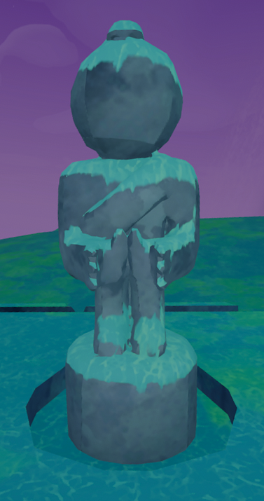](https://peak.wiki.gg/wiki/File%3AStatue_front_tropics.png)
General
Location- [Near Campfires](Campfire.md)

**Ancient Statues** are interactible objects found near the [Campfires](Campfire.md). They're sculpted in the likeness of a faceless [Scout](Scout.md) with its hands held out. Interacting with the statue makes it crumble apart and causes one of the following to happen:

- If there are any dead or unconscious [Scouts](https://peak.wiki.gg/wiki/Scouts), upon activation of the statue, they will be revived with [](Stamina%20bar.md#Hunger) **30** [Hunger](Stamina%20bar.md#Hunger) and [](Stamina%20bar.md#Curse) **+5** [Curse](https://peak.wiki.gg/wiki/Curse).- [](Stamina%20bar.md#Curse) **+15** on [Ascent 7](Ascents.md).
- If all Scouts are alive, the statue will spawn a random [Mystical Item](https://peak.wiki.gg/wiki/Mystical_Item) in its hands.

## Item Spawn Chances

[Co-op](#Co-op-0)[Solo](#Solo-0)

Ancient Statue Items - Co-op

| Item | Chance |
| --- | --- |
| [Anti-Rope Cannon](Anti-Rope%20Cannon.md) | 9.6% |
| [Anti-Rope Spool](Anti-Rope%20Spool.md) | 9.6% |
| [Anti-Zooka](Anti-Zooka.md) | 9.6% |
| [Book of Bones](https://peak.wiki.gg/wiki/Book_of_Bones) | 9.6% |
| [Bugle of Friendship](Bugle%20of%20Friendship.md) | 9.6% |
| [Cure-All](Cure-All.md) | 9.6% |
| [Faerie Lantern](Faerie%20Lantern.md) | 9.6% |
| [Pandora's Lunchbox](Pandora%27s%20Lunchbox.md) | 9.6% |
| [Ritual Dagger](Ritual%20Dagger.md) | 9.6% |
| [Scout Effigy](Scout%20Effigy.md) | 9.6% |
| [Scoutmaster's Bugle](Scoutmaster%27s%20Bugle.md) | 3.8% |

Ancient Statue Items - Solo

| Item | Chance |
| --- | --- |
| [Anti-Rope Cannon](Anti-Rope%20Cannon.md) | 13.5% |
| [Anti-Rope Spool](Anti-Rope%20Spool.md) | 13.5% |
| [Anti-Zooka](Anti-Zooka.md) | 13.5% |
| [Book of Bones](https://peak.wiki.gg/wiki/Book_of_Bones) | 13.5% |
| [Cure-All](Cure-All.md) | 13.5% |
| [Faerie Lantern](Faerie%20Lantern.md) | 13.5% |
| [Pandora's Lunchbox](Pandora%27s%20Lunchbox.md) | 13.5% |
| [Scoutmaster's Bugle](Scoutmaster%27s%20Bugle.md) | 5.4% |

- [](Cursed%20Skull.md) [Cursed Skull](Cursed%20Skull.md) is the only Mystical item that cannot be spawned by the Ancient Statue.
- Percentages are rounded to one decimal.

## Gallery

- [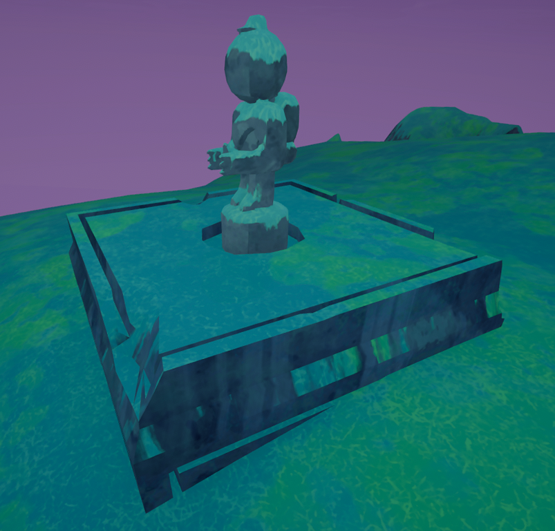](https://peak.wiki.gg/wiki/File%3AStatue_full_tropics.png)
  With platform
- [](https://peak.wiki.gg/wiki/File%3AStatue_front_tropics.png)
  Front view
- [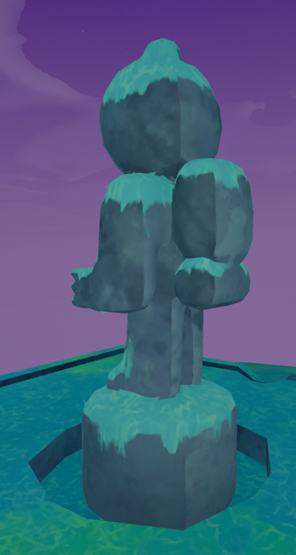](https://peak.wiki.gg/wiki/File%3AStatue_back_tropics.png)
  Back view

## Patch history

 **[1.0](1.0.md) (2025-06-16):** Introduced.
 **[1.1.a](1.1.a.md) (2025-06-17):**

- [](Cursed%20Skull.md) [Cursed Skull](Cursed%20Skull.md) will no longer spawn from Scout Statues (but can still spawn from [Ancient Luggage](https://peak.wiki.gg/wiki/Ancient_Luggage))
- Made the Scout Statue tower collider more accurate.

 **[1.2.a](1.2.a.md) (2025-06-18):** Lowered the Scout Statue in the [Caldera](Caldera.md) [temple](Temple.md).
 **[2.0.a](2.0.a.md) (2026-08-11):** Ancient Statues can now respawn Scouts in [Ascent 7](https://peak.wiki.gg/wiki/Ascent_7), but give more [Curse](https://peak.wiki.gg/wiki/Curse) to revived Scouts.

---

# Ancient


This is a disambiguation page for "Ancient".

The following is a list of links related to Ancient.

**Ancient** may refer to:

- [Ancient Statue](Ancient%20Statue.md) - A landmark which can revive players (on difficulties below [Ascent 7](Ascents.md)) or otherwise provide a [mystical item](https://peak.wiki.gg/wiki/Mystical_item).
- [Ancient Luggage](https://peak.wiki.gg/wiki/Ancient_Luggage) - A type of luggage that provides a mystical item at the cost of inflicting [](Stamina%20bar.md#Injury) [Injury](Stamina%20bar.md#Injury) on the opening Scout.
- [](Ancient%20Idol.md) [Ancient Idol](Ancient%20Idol.md) - An item that prevents negative [status effects](https://peak.wiki.gg/wiki/Status_effects) while actively held.

---

# Anti-Rope Cannon

Anti-Rope Cannon
[](https://peak.wiki.gg/wiki/File%3AAnti-Rope_Cannon.png)
[Item type](Items.md)- [Deployable](https://peak.wiki.gg/wiki/Deployable)
- [Mystical item](https://peak.wiki.gg/wiki/Mystical_item)
Rarity
[Legendary](https://peak.wiki.gg/wiki/Legendary)
Source- [Ancient Luggage](https://peak.wiki.gg/wiki/Ancient_Luggage)
- [Ancient Statue](Ancient%20Statue.md)
Weight
[](Stamina%20bar.md#Weight) **0**

The **Anti-Rope Cannon** is a [deployable](https://peak.wiki.gg/wiki/Deployable) [mystical item](https://peak.wiki.gg/wiki/Mystical_item) in *[PEAK](Peak%20%28game%29.md)*. Using an Anti-Rope Cannon attaches a **7.25 meter** anti-rope (see [](Anti-Rope%20Spool.md) [Anti-Rope Spool](Anti-Rope%20Spool.md)) to a surface up to **48 meters** away, embedding one end of it into the surface via a hook. It is the anti version of the [](Rope%20Cannon.md) [Rope Cannon](Rope%20Cannon.md). The Anti-Rope Cannon is a [mystical item](https://peak.wiki.gg/wiki/Mystical_item) and as such can only be found in [Ancient Statues](Ancient%20Statue.md) and inside [Ancient Luggage](https://peak.wiki.gg/wiki/Ancient_Luggage).

[Cooking](Cooking.md) an Anti-Rope Cannon immediately incinerates it, making it unusable.

## Physics

The Anti-Rope Cannon has zero weight and will float mid-air when dropped. It will retain its momentum, however, so care still has to be taken by players not to lose it.

The physics of ropes deployed by the Anti-Rope Cannon are identical to the [](Rope%20Cannon.md) [Rope Cannon](Rope%20Cannon.md), with the lone exception being that anti-ropes unspool upwards. The same tips present in said article apply, but vertically flipped.

## See also

- [](Rope%20Cannon.md) [Rope Cannon](Rope%20Cannon.md)

## Patch history

 **[1.0](1.0.md) (2025-06-16):** Introduced.
 **[1.7](1.7.md) (2025-07-10):**

- [Anti-Rope Spool](Anti-Rope%20Spool.md) and Anti-Rope Shooter now have a weight of -1
- [Rope Shooters](Rope%20Cannon.md) and Anti-Rope Shooters shoot 50% more rope!
- [Anti-Rope Spool](Anti-Rope%20Spool.md) and Anti-Rope Shooter physics will now behave differently if you let go of them…

 **[1.8](1.8.md) (2025-07-21):** Anti-Rope Cannon now has a weight of 0, has no gravity at all, and the art/icon is updated. We just felt like it.
 **[1.10.a](1.10.a.md) (2025-07-30):** Fixed an issue where getting an Anti-Rope Cannon wouldn't get you the [Esoterica Badge](https://peak.wiki.gg/wiki/Esoterica_Badge).

---

# Anti-Rope Spool

Anti-Rope Spool
[](https://peak.wiki.gg/wiki/File%3AAnti-Rope_Spool.png)
[Item type](Items.md)- [Deployable](https://peak.wiki.gg/wiki/Deployable)
- [Mystical item](https://peak.wiki.gg/wiki/Mystical_item)
Rarity
[Legendary](https://peak.wiki.gg/wiki/Legendary)
Source- [Ancient Luggage](https://peak.wiki.gg/wiki/Ancient_Luggage)
- [Ancient Statue](Ancient%20Statue.md)
Weight
[](Stamina%20bar.md#Weight) **−2.5**

The **Anti-Rope Spool** is a [deployable](https://peak.wiki.gg/wiki/Deployable) [mystical item](https://peak.wiki.gg/wiki/Mystical_item) in *[PEAK](Peak%20%28game%29.md)*. It provides a total of **12.5 meters** climbable anti-gravity rope, placeable in custom lengths measuring from **0.75m** to **10m** long. The rope will float upwards, allowing [Scouts](https://peak.wiki.gg/wiki/Scouts) to access hard to reach places.

Being a [mystical item](https://peak.wiki.gg/wiki/Mystical_item), the Anti-Rope Spool can only be found in [Ancient Statues](Ancient%20Statue.md) and inside [Ancient Luggage](https://peak.wiki.gg/wiki/Ancient_Luggage).

The Anti-Rope Spool has a negative weight and will reduce the total weight carried by the [Scout](Scout.md) (note that [Ascent 3's](Ascents.md) weight modification still applies to the Anti-Rope Spool). Dropping an Anti-Rope Spool will cause it to float up and away.

Cooking an Anti-Rope Spool immediately incinerates it, making it unusable (it retains its negative [](Stamina%20bar.md#Weight) [Weight](Stamina%20bar.md#Weight), however).

## Usage

When placing rope, first have the spool in hand and use the scroll wheel to unravel the rope to the desired length. To secure the rope, hold  for 2 seconds while aiming at the surface where the knot should be tied. A preview of the rope's anchor will shown in blue when the surface is valid, or red when the attempting to tie to an invalid surface.

Rope can be grabbed by using the interact key () on it, and climbing is done using forward and backward movement ( / ). To let go of the rope, simply jump ().

## See also

- [](Rope%20Spool.md) [Rope Spool](Rope%20Spool.md)

## Patch history

 **[1.0](1.0.md) (2025-06-16):** Introduced.
 **[1.7](1.7.md) (2025-07-10):**

- **Anti-Rope Spool** and [Anti-Rope Shooter](Anti-Rope%20Cannon.md) now have a weight of -1
- **Anti-Rope Spool** and [Anti-Rope Shooter](Anti-Rope%20Cannon.md) physics will now behave differently if you let go of them...

 **[2.0.a](2.0.a.md) (2026-08-11):** The **Anti-Rope Spool** no longer makes sound while it's in the backpack.

---

# Anti-Rope


This is a disambiguation page for "Anti-Rope".

The following is a list of links related to Anti-Rope.

**Anti-Rope** may refer to:

## Items

- [](Anti-Rope%20Spool.md) [Anti-Rope Spool](Anti-Rope%20Spool.md) - Provides up to a total of 12.5 meters of climbable rope that defies gravity.
- [](Anti-Rope%20Cannon.md) [Anti-Rope Cannon](Anti-Rope%20Cannon.md) - Fires 7.5 meters of gravity-defying rope that mounts to a surface up to 30 meters away.

---

# Anti-Zooka

Anti-Zooka
[](https://peak.wiki.gg/wiki/File%3AAnti-Zooka.png)
[Item type](Items.md)- [Deployable](https://peak.wiki.gg/wiki/Deployable)
- [Mystical item](https://peak.wiki.gg/wiki/Mystical_item)
Rarity
[Legendary](https://peak.wiki.gg/wiki/Legendary)
Source- [Ancient Luggage](https://peak.wiki.gg/wiki/Ancient_Luggage)
- [Ancient Statue](Ancient%20Statue.md)
Weight
[](Stamina%20bar.md#Weight) **0**

The **Anti-Zooka** is a [deployable](https://peak.wiki.gg/wiki/Deployable) [mystical item](https://peak.wiki.gg/wiki/Mystical_item) in *[PEAK](Peak%20%28game%29.md)*. Using an Anti-Zooka shoots an **Anti-Sphere** up to **40 meters** away in the air or against a surface, with a size of **16 meters** in diameter. Anything inside of the **Anti-Sphere** will experience reversed gravity. The Anti-Zooka can be used up to **3** times before becoming unusable.

**Anti-Spheres** last one minute in the environment, but do not count as placed, meaning the Anti-Zooka can be safely used when attempting to obtain the [](https://peak.wiki.gg/wiki/Leave_No_Trace_Badge) [Leave No Trace Badge](https://peak.wiki.gg/wiki/Leave_No_Trace_Badge).

When [cooked](https://peak.wiki.gg/wiki/Cooked), the Anti-Zooka explodes, creating an **Anti-Sphere** with an increased size of approximately **32 meters** in diameter.

## Physics

The Anti-Zooka has zero weight and will float mid-air when dropped. It will retain its momentum, however, so care still has to be taken by players not to lose it.

## Patch history

 **[2.0.a](2.0.a.md) (2026-08-11):** Introduced. **(Undocumented)**
 **[2.01.a](https://peak.wiki.gg/wiki/2.01.a) :** Fixed an issue where you could be stuck with permanent anti-gravity if you exited an anti-gravity sphere in specific ways.
 **[2.02.a](https://peak.wiki.gg/wiki/2.02.a) :** Anti-gravity spheres shot from the Anti-Zooka now only last one minute to prevent soft-locks by placing one atop an unlit campfire.

---

# Antidote

Antidote
[](https://peak.wiki.gg/wiki/File%3AAntidote.png)
[Item type](Items.md)- [Consumable](https://peak.wiki.gg/wiki/Consumable)
Rarity
[Rare](https://peak.wiki.gg/wiki/Rare)
Biome- [Tropics](Tropics.md)
- [Roots](Roots.md)
Source- [Regular Luggage](https://peak.wiki.gg/wiki/Regular_Luggage)
- [Big Luggage](https://peak.wiki.gg/wiki/Big_Luggage)
Uses
3
Weight
[](Stamina%20bar.md#Weight) **2.5**
Base Status Effects
[](Stamina%20bar.md#Heat)Heat
-10
[](Stamina%20bar.md#Poison)Poison
-35
[](Stamina%20bar.md#Spores)Spores
-35

The **Antidote** is a [consumable](https://peak.wiki.gg/wiki/Consumable) item in *[PEAK](Peak%20%28game%29.md)*. An Antidote can be used up to 3 times, removing [](Stamina%20bar.md#Poison) **35** [Poison](Stamina%20bar.md#Poison), [](Stamina%20bar.md#Spores) **35** [Spores](Stamina%20bar.md#Spores), [](Stamina%20bar.md#Heat) **10** [Heat](Stamina%20bar.md#Heat) and poison over time effects with each use.

[Cooking](Cooking.md) or throwing an antidote will cause it to shatter, removing up to [](Stamina%20bar.md#Poison) **20** [Poison](Stamina%20bar.md#Poison) and [](Stamina%20bar.md#Spores) [Spores](Stamina%20bar.md#Spores) from players within **4.8 meters** depending on their distance. This does not remove any existing poison over time effects that have not elapsed. Throwing an antidote directly at a player however will bonk them, causing them to enter a [ragdoll](https://peak.wiki.gg/wiki/Ragdoll) state.

Due to [](Stamina%20bar.md#Poison) [Poison](Stamina%20bar.md#Poison) mostly occurring in the [Tropics](Tropics.md) and [](Stamina%20bar.md#Spores) [Spores](Stamina%20bar.md#Spores) only appearing in the [Roots](Roots.md), Antidotes can only spawn in luggages in these biomes.

## Tips

- As a thrown Antidote removes [](Stamina%20bar.md#Poison) **20** [Poison](Stamina%20bar.md#Poison) and [](Stamina%20bar.md#Spores) [Spores](Stamina%20bar.md#Spores) from players regardless of how many times it was used it is ideal to throw a near-empty bottle directly on the ground where you and your poisoned/spored friends stand to make the most of it. This is pointless in a solo run due to the decreased amount of restoration however.
- This item is **essential** when confronting [Zombies](Zombie.md), as it is one of the ways to remove the zombie infection, as well as having multiple charges to do so.- You may also throw the bottle at a Zombie to bonk it, causing it to ragdoll as an emergency option.

## Gallery

- [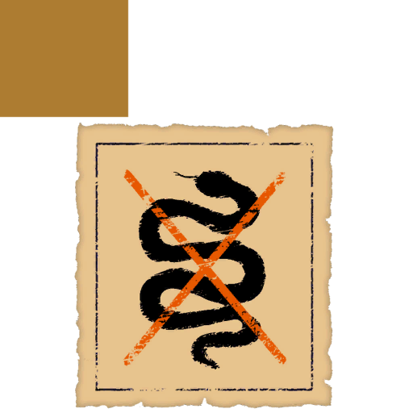](https://peak.wiki.gg/wiki/File%3AAntidote_0.png)
  Antidote texture

## Patch history

 **[1.0](1.0.md) (2025-06-16):** Introduced.
 **[1.40.a](1.40.a.md) (2025-11-05):** Cooking or throwing the Antidote now causes it to shatter.
 **[1.50.a](1.50.a.md) (2025-12-16):** Fixed a bug where only the host would see the healing cloud from items that can break on impact such as Cure-All and Antidote.

---

# Antlion

Antlion
[](https://peak.wiki.gg/wiki/File%3AAntlion.png)
General
Type
[Enemy](https://peak.wiki.gg/wiki/Enemy)
Biome- [Mesa](Mesa.md)

The **Antlion** is a hostile creature in *[PEAK](Peak%20%28game%29.md)*, exclusive to the [Mesa](Mesa.md). It hides at the bottom of a funnel-shaped trap, leaving a fake [Explorer's Luggage](https://peak.wiki.gg/wiki/Explorer%27s_Luggage) as bait for careless players.

## Mechanics

When a player comes within **19.2 meters** of the Antlion, it will activate, causing the fake luggage to disappear into the sands. The Antlion appears from the sand and attacks every **0.15 seconds**, dealing [](Stamina%20bar.md#Injury) **20** [Injury](Stamina%20bar.md#Injury) to the nearest player within **8 meters** and knocking them back.

While the Antlion is active, the sand within its trap flows downwards, pulling all players within towards the center of the funnel.

Once there are no players within **25.6 meters** of the Antlion, it will retreat back under the sand, ending the attack. The fake luggage does not return, but the Antlion will return if players head into the trap again.

Any player who takes damage in an Antlion attack and gets at least **48 meters** away from the Antlion without dying will receive the [](https://peak.wiki.gg/wiki/Megaentomology_Badge) [Megaentomology Badge](https://peak.wiki.gg/wiki/Megaentomology_Badge).

## Gallery

- [](https://peak.wiki.gg/wiki/File%3AAntlion_back.png)
  Back view.
- [](https://peak.wiki.gg/wiki/File%3AAntlion_trap.png)
  Antlion's trap. A fake [Explorer's Luggage](https://peak.wiki.gg/wiki/Explorer%27s_Luggage) can be seen in the middle.
- [](https://peak.wiki.gg/wiki/File%3AAntlion_bugphobia.png)
  Antlion with [Bug Phobia Mode](Bug%20Phobia%20Mode.md) enabled.

---

# Ascents

**Ascents** serve as the difficulty system for *[PEAK](Peak%20%28game%29.md)*. By default, only *Tenderfoot* and *Peak* Ascents are available. Completing an expedition on *Peak* unlocks the first Ascent, and each Ascent completed unlocks the next, with each Ascent adding compounding challenges to the expedition. The Ascents are selected at the Gate Kiosk in the [Airport](Airport.md) when starting the game.

Only one player in the group needs to have an Ascent unlocked to start the game, and all players receive the relevant rewards on completion, even if they haven't cleared the prior Ascents. For example, if a new player joins another player on an Ascent 5 run, they would unlock ascents 1-6 and ranks up to Owl Scout if their group escapes the island (even if the new player doesn't).

[Badges](Badges.md) can be earned regardless of the active Ascent, with the exception of [](https://peak.wiki.gg/wiki/Undead_Encounter_Badge) [Undead Encounter Badge](https://peak.wiki.gg/wiki/Undead_Encounter_Badge) and [](https://peak.wiki.gg/wiki/Mentorship_Badge) [Mentorship Badge](https://peak.wiki.gg/wiki/Mentorship_Badge), as [Zombies](Zombie.md) and [Scoutmaster Myres](Scoutmaster%20Myres.md) cannot spawn on Tenderfoot.

[Custom Expeditions](Custom%20Expedition.md) allow for more detailed customization, but do not allow you to earn [Badges](Badges.md) or Sashes.

## List of Ascents

List of Ascents, their description and rewards.

| Name | Description | Rewards for completion |
| --- | --- | --- |
| **Tenderfoot** | - Climbing takes less [Stamina](https://peak.wiki.gg/wiki/Stamina). (30% lower consumption) - [Hunger](Stamina%20bar.md#Hunger) [Hunger](Stamina%20bar.md#Hunger) grows more slowly. (30% slower growth) - No [time limit](Fog.md) nor [Zombies](Zombie.md). - No [Scoutmaster Myres](Scoutmaster%20Myres.md). - No [Big Ghost](Big%20Ghost.md). | None |
| **Peak** | - The [Island](Island.md)'s default difficulty. | [Tadpole Scout Sash](Cosmetics.md#Sashes) [Tadpole Scout Sash](Cosmetics.md#Sashes) |
| **Ascent 1** | - [Injury](Stamina%20bar.md#Injury) [Fall damage](Stamina%20bar.md#Injury) is greater. (all fall damage is multiplied by 2) | [Rabbit Scout Sash](Cosmetics.md#Sashes) [Rabbit Scout Sash](Cosmetics.md#Sashes) |
| **Ascent 2** | - [Hunger](Stamina%20bar.md#Hunger) [Hunger](Stamina%20bar.md#Hunger) grows faster. (60% faster growth) - *And all previous modifiers.* | [Raccoon Scout Sash](Cosmetics.md#Sashes) [Raccoon Scout Sash](Cosmetics.md#Sashes) |
| **Ascent 3** | - Items have increased [Weight](Stamina%20bar.md#Weight) [Weight](Stamina%20bar.md#Weight). (flat +2.5 weight for all items) - *And all previous modifiers.* | [Mule Scout Sash](Cosmetics.md#Sashes) [Mule Scout Sash](Cosmetics.md#Sashes) |
| **Ascent 4** | - There are no  [Flares](Flare.md) atop the [Peak](Peak%20%28biome%29.md). (You must bring your **own** Flare) - *And all previous modifiers.* | [Kangaroo Scout Sash](Cosmetics.md#Sashes) [Kangaroo Scout Sash](Cosmetics.md#Sashes) |
| **Ascent 5** | - The [Night](https://peak.wiki.gg/wiki/Night) is [Cold](Stamina%20bar.md#Cold) [Cold](Stamina%20bar.md#Cold). (~100 Cold damage total, or 2.5 Cold every 5 seconds) - *And all previous modifiers.* | [Owl Scout Sash](Cosmetics.md#Sashes) [Owl Scout Sash](Cosmetics.md#Sashes) |
| **Ascent 6** | - Climbing takes additional [stamina](https://peak.wiki.gg/wiki/Stamina). (40% higher consumption) - *And all previous modifiers.* | [Wolf Scout Sash](Cosmetics.md#Sashes) [Wolf Scout Sash](Cosmetics.md#Sashes) |
| **Ascent 7** | - Start [Curse](Stamina%20bar.md#Curse) [Cursed](Stamina%20bar.md#Curse) and take more curse from revival. (Players spawn with 10 Curse and get +15 when revived using the [Ancient statue](https://peak.wiki.gg/wiki/Ancient_statue)) - *And all previous modifiers.* | [Goat Scout Sash](Cosmetics.md#Sashes) [Goat Scout Sash](Cosmetics.md#Sashes)  [Goat Horns](https://peak.wiki.gg/wiki/Goat_Horns) |
| **Ascent 8** | - You must free [The Scoutmaster](https://peak.wiki.gg/wiki/The_Scoutmaster)'s soul to win. You must bring all [Amulets](Amulets.md) to the [Peak](Peak%20%28biome%29.md), and put the amulets on the ancient statue to go through [Nadir](Nadir.md) to escape the island. - *And all previous modifiers.* | [Scoutmaster Sash](Cosmetics.md#Sashes) [Scoutmaster Sash](Cosmetics.md#Sashes) |

## Tips

Below are tips for beating each of the game's Ascents. Most tips from lower ascents apply to those above.

### Tenderfoot

---

Carry less [food](Food.md). You'll usually only need at *most* around 2 food items per player if you take advantage of natural food. Oftentimes, a single box of the [](Scout%20Cookies.md) [Scout Cookies](Scout%20Cookies.md) can be enough to get through an entire [biome](https://peak.wiki.gg/wiki/Biome) solo because of its multiple uses.

Because there's no [fog](Fog.md), feel free to open any [Luggage](Luggage.md) you see if you deem it worth the effort. This is the best mode to have a casual run or memorize the environment before proceeding with harder challenges.

### Peak

---

**Check the [tutorial](How%20to%20play.md).**

Although the [Fog](Fog.md) is intimidating, don't rush things. It is quite generous for its slow speed, only triggering after you reach a certain height or when enough time has passed. A panicking player is more likely to fail from an irrational decision.

When playing with other [Scouts](Scout.md), remember to spread out your items across your team. This makes it so it isn't catastrophic if one of you dies. Have everyone carry a little food, a little [healing](https://peak.wiki.gg/wiki/Healing), and a little [equipment](Equipment.md). As the fog doesn't rise in [Shore](Shore.md) for a set amount of time, you can look around for [Luggage](Luggage.md) in the surface level before making it upward, which will then trigger the fog.

Don't hesitate to let the best of you carry higher value items like [](Chain%20Launcher.md) [Chain Launchers](Chain%20Launcher.md) and those less experienced carry items like the [](Fortified%20Milk.md) [Fortified Milk](Fortified%20Milk.md) or [](First%20Aid%20Kit.md) [First Aid Kit](First%20Aid%20Kit.md) to save them from an otherwise [lethal fall](Stamina%20bar.md#Fall_damage).

Sometimes instead of a difficult path, there's a far easier route you didn't notice. Whenever you feel stuck, try climbing sideways to a new spot.

### Ascent 1

---

The [Fog](Fog.md) will always be the same speed regardless of the Ascent moving forward, so you have plenty of time to plan things out.

Try to carry at least 1 item that can heal [](Stamina%20bar.md#Injury) [Injury](Stamina%20bar.md#Injury). The [](Remedy%20Fungus.md) [Remedy Fungus](Remedy%20Fungus.md) is great for this, as it can heal everyone within its radius. Try to make less risks when jumping, look around for safer spots to land if you can.

Using the [](https://peak.wiki.gg/wiki/Book_of_Bones) [Book of Bones](https://peak.wiki.gg/wiki/Book_of_Bones) is much riskier on Ascent 1+, since with the total of 16x fall damage, any amount of fall damage becomes instantly lethal.

### Ascent 2

---

Take advantage of [natural food](https://peak.wiki.gg/wiki/Natural_food). Hunger is the silent killer. Never leave food behind, it's better to recover [](Stamina%20bar.md#Hunger) **2.5** [Hunger](Stamina%20bar.md#Hunger) while "wasting" food than to recover nothing from the food. Consider eating [](Stamina%20bar.md#Poison) [poisonous](Stamina%20bar.md#Poison) foods occasionally, since [](Stamina%20bar.md#Poison) [Poison](Stamina%20bar.md#Poison) heals over time, while [](Stamina%20bar.md#Hunger) [Hunger](Stamina%20bar.md#Hunger) does not.

Instead of using foods that greatly reduce [](Stamina%20bar.md#Hunger) [Hunger](Stamina%20bar.md#Hunger) just to bolster your [](Stamina%20bar.md#Bonus_stamina) [Bonus stamina](Stamina%20bar.md#Bonus_stamina), save them and eat weaker, cooked foods instead like [](Yellow%20Crispberry.md) [Yellow Crispberries](Yellow%20Crispberry.md). You'll often find many of these at [campfires](Campfire.md).

### Ascent 3

---

While it may seem counterintuitive, prefer carrying [heavier](https://peak.wiki.gg/wiki/Weight) items over lighter ones as the weight penalty is a flat increase, rather than being based on the item's original weight. It can be helpful to check the hunger-to-weight ratio for [food](Food.md).

Keep in mind you don't necessarily have to fill every slot in your inventory. Many items often end up being thrown away, left unused, or used immediately. Dropping unneeded items is the best way to reduce your [](Stamina%20bar.md#Weight) [Weight](Stamina%20bar.md#Weight).

The [](Balloon%20Bunch.md) [Balloon Bunch](Balloon%20Bunch.md), while very rare, is extremely valuable, as it reduces your weight by 12.5 even after the weight penalty. Searching for [Clown Luggages](https://peak.wiki.gg/wiki/Clown_Luggage) is the best way to find them.

### Ascent 4

---

**Always** grab the [](Flare.md) [Flare](Flare.md) at the [crash site](https://peak.wiki.gg/wiki/Crash_site), and give it to the player who is the most likely to survive. If you forget, you may find another in a [Luggage](Luggage.md), but know the risk of not encountering a spare. With the flare equipped, you effectively lose an item slot for the entire game, so it is advised you use more items to make room for better ones. Being revived by a [](Checkpoint%20Flag.md) [Checkpoint Flag](Checkpoint%20Flag.md) while a flare is in your inventory or [](Backpack.md) [Backpack](Backpack.md) will prevent the item from being lost.

Don't drop the [](Flare.md) [Flare](Flare.md) or a [](Backpack.md) [Backpack](Backpack.md) containing one near [](Stamina%20bar.md#Heat) [Heat](Stamina%20bar.md#Heat) hazards or risky spots like near edges or very close to walls, as you could risk losing it or cooking it. If a [](Flare.md) [Flare](Flare.md) is cooked, it will explode, [](Stamina%20bar.md#Injury) [injuring](Stamina%20bar.md#Injury) nearby [Scouts](Scout.md).

Once you reach the [Peak](Peak%20%28biome%29.md), you must light your own [](Flare.md) [Flare](Flare.md) in that area. If you do not have one ready by then, you have **lost the run**.

If the player successfully traverses [Nadir](Nadir.md), they do not require a [](Flare.md) [Flare](Flare.md) to complete the Ascent, as there is always one at the top.

### Ascent 5

---

Try to always carry an item that can relieve you of [](Stamina%20bar.md#Cold) [Cold](Stamina%20bar.md#Cold), such as the [](Lantern.md) [Lantern](Lantern.md) at the [crash site](https://peak.wiki.gg/wiki/Crash_site). You should not be wasteful of the lantern, as it only lasts for 60 active seconds. Use it sparingly, just enough to last the night.

Take advantage of [huddling](https://peak.wiki.gg/wiki/Huddling), as it can heat players faster than the night chills, meaning you can focus less on heating items. If you can endure the rest of the night with high [stamina](https://peak.wiki.gg/wiki/Stamina), you can unequip your [](Backpack.md) [Backpack](Backpack.md) and items at a safe spot and intentionally fall unconscious from the cold, warming up in the morning.

Since [](Stamina%20bar.md#Heat) [Heat](Stamina%20bar.md#Heat) counteracts [](Stamina%20bar.md#Cold) [Cold](Stamina%20bar.md#Cold), you can burn yourself with hot [hazards](Hazards.md) like [campfires](Campfire.md), [geysers](Geyser.md), or the [Sun](https://peak.wiki.gg/wiki/Sun) in the [Mesa](Mesa.md) (during sunset) to ward off the cold. Inversely, avoid cold hazards during the night such as [Ice Rocks](Ice%20Rocks.md). Feel free to drop heating items once you enter the [Caldera](Caldera.md) or [Gloom](Gloom.md), as the night is no longer cold from that point onward.

### Ascent 6

---

Take advantage of tricks like using the [](Rope%20Spool.md) [Rope](Rope%20Spool.md) to boost you up before climbing, combining an [](Energy%20Drink.md) [Energy Drink](Energy%20Drink.md) and a [](Big%20Lollipop.md) [Big Lollipop](Big%20Lollipop.md), or learning advanced climbing techniques. Look out for items like [](Anti-Rope%20Spool.md) [Anti-Rope Spool](Anti-Rope%20Spool.md) and [](Anti-Zooka.md) [Anti-Zooka](Anti-Zooka.md) for their high mobility and low weight.

[Bonus stamina](https://peak.wiki.gg/wiki/Bonus_stamina) is a powerful tool, don't be afraid to use it to reach otherwise impossible locations.

Don't forget that you can boost your friends by letting them stand on your head while you're crouching and then jumping.

### Ascent 7

---

Try to get rid of the starting [](Stamina%20bar.md#Curse) [Curse](Stamina%20bar.md#Curse) and avoid accumulating more. The section on [](Stamina%20bar.md#Curse) [Curse](Stamina%20bar.md#Curse) lists ways of lifting it and the associated item pages provide usage tips.

In bigger teams, it's recommended to have the *best* players remove their starting [](Stamina%20bar.md#Curse) [Curse](Stamina%20bar.md#Curse) first because the less experienced players, being more likely to die, will keep getting more back upon revivals. This way it is more likely that at least one player makes it to the top and is thus able to revive others.

When available, instead of [Ancient Statues](Ancient%20Statue.md), take advantage of alternative ways to revive teammates. The [](Scout%20Effigy.md) [Scout Effigy](Scout%20Effigy.md) and [](Checkpoint%20Flag.md) [Checkpoint Flag](Checkpoint%20Flag.md) don't inflict any [](Stamina%20bar.md#Curse) [Curse](Stamina%20bar.md#Curse). Unfortunately, the [](https://peak.wiki.gg/wiki/Book_of_Bones) [Book of Bones](https://peak.wiki.gg/wiki/Book_of_Bones) inflicts the full [](Stamina%20bar.md#Curse) **15** [Curse](Stamina%20bar.md#Curse) when used on the skeleton of a dead scout to revive them.

### Ascent 8

---

[](https://peak.wiki.gg/wiki/File%3AWarning_Icon.png) **Spoilers!** - The following section contains spoilers for *[PEAK](Peak%20%28game%29.md)*.
The added challenge in this Ascent comes in the form of having to babysit multiple key items that bloat your inventory space and being forced to go to certain, sometimes undesirable, places to reach the [Scout Statues](https://peak.wiki.gg/wiki/Scout_Statue). You can alleviate this in multiple ways:- Bring more [Scouts](Scout.md) to carry more [items](Items.md).
- Prefer to keep the [Amulets](Amulets.md) in backpacks to make it less likely they are lost.
- Plan your routes around grabbing the Amulets from their statues **before** you start climbing the [biome](https://peak.wiki.gg/wiki/Biome).

Remember that the Amulets are not just bricks for you to lug to the summit. They have extremely useful abilities (shown below). Give them to the players who will make the best use of them. Know that using them comes at a [](Stamina%20bar.md#Petrify) [cost](Stamina%20bar.md#Petrify), however. Keep in mind that players will recover [](Stamina%20bar.md#Petrify) **20** [Petrify](Stamina%20bar.md#Petrify) whenever a campfire is lit.

- [](Scout%27s%20Ambition.md) [Scout's Ambition](Scout%27s%20Ambition.md): Assists climbing.
- [](Scout%27s%20Generosity.md) [Scout's Generosity](Scout%27s%20Generosity.md): Generates more items.
- [](Scout%27s%20Initiative.md) [Scout's Initiative](Scout%27s%20Initiative.md): Can be used to save yourself from falls or cross horizontal gaps.
- [](Scout%27s%20Tenacity.md) [Scout's Tenacity](Scout%27s%20Tenacity.md): Helps to recover from or momentarily prevent incoming damage.

*For full details, check the main articles for each Amulet.*

A [](Flare.md) [Flare](Flare.md) is not required to escape, as [Nadir](Nadir.md) triggers the ending cutscene immediately after interacting with the gate, freeing up an additional inventory slot compared to the other Ascents.

Lastly, teamwork is **paramount** in this Ascent. Losing a teammate could very well mean losing the run instantly. In the face of such an adversity, it's more important than ever to ***never abandon a friend in need!***

## Patch history

 **[1.0](1.0.md) (2025-06-16):** Introduced
 **[2.0.a](2.0.a.md) (2026-08-11):**

- Added Ascent 8.
- Changed Ascent 7.- No longer disables reviving, but start the run with Curse and increase amount of Curse from reviving.

---

# Ascents/es-419

Los **Ascensos** son el sistema de dificultad de *[PEAK](Peak%20%28game%29_es-419.md)*. Por defecto, solo los Ascensos *[Pies Blandos](https://peak.wiki.gg/wiki/Tenderfoot)* y *[Cima](Ascents.md#Peak)* están desbloqueados. Al completar un Ascenso, se desbloquea el siguiente, que agrega otro modificador a la expedición, y se consigue una [banda](Cosmetics_es-419.md#Bandas) como recompensa. El Ascenso de una expedición se elige en el [quiosco de la sala](Airport_es-419.md#Quioscos) del [Aeropuerto](Airport_es-419.md).

Solo un [Explorador](Scout_es-419.md) de la tropa debe tener un Ascenso desbloqueado para elegirlo, y todos los Exploradores recibirán las recompensas al completarlo, incluso si no completaron Ascensos anteriores.

Las [Insignias](Badges_es-419.md) se pueden conseguir en cualquier Ascenso, con la excepción de la [](https://peak.wiki.gg/wiki/Mentorship_Badge) [Mentorship Badge](https://peak.wiki.gg/wiki/Mentorship_Badge) y la [](https://peak.wiki.gg/wiki/Undead_Encounter_Badge) [Undead Encounter Badge](https://peak.wiki.gg/wiki/Undead_Encounter_Badge), ya que ni el [Jefe de Tropa Myres](https://peak.wiki.gg/wiki/Scoutmaster) ni los [Zombis](Zombie.md) pueden aparecer en *[Pies Blandos](#Pies_Blandos)*.

Las [expediciones personalizadas](Custom%20Expedition.md) permiten personalizar detalladamente una expedición, pero no puedes conseguir [Insignias](Badges_es-419.md) ni [bandas](Cosmetics_es-419.md#Bandas) participando en ellas.

## Lista de Ascensos

| Nombre | Descripción | Recompensas |
| --- | --- | --- |
| **Pies Blandos** | - Escalar requiere menos [Resistencia](https://peak.wiki.gg/wiki/Stamina). (30% menos consumo) - El [Hunger](Stamina%20bar.md#Hunger) [Hambre](Stamina%20bar.md#Hunger) aumenta más despacio. (30% menos aumento) - Sin [límite de tiempo](Fog.md). Sin [Zombis](Zombie.md) ni [Jefe de Tropa Myres](Scoutmaster%20Myres.md). | n/a |
| **Cima** | - La dificultad predeterminada de la [Isla](Island_es-419.md). | [Banda Renacuajo](Cosmetics.md#Sashes) [Banda Renacuajo](Cosmetics.md#Sashes) |
| **Ascenso 1** | - El [Injury](Stamina%20bar.md#Injury) [daño por caída](Stamina%20bar.md#Injury) es mayor. (El daño de caída se duplica) | [Banda Conejo](Cosmetics.md#Sashes) [Banda Conejo](Cosmetics.md#Sashes) |
| **Ascenso 2** | - El [Hunger](Stamina%20bar.md#Hunger) [Hambre](Stamina%20bar.md#Hunger) aumenta más rápido. (60% más aumento) - *Y todos los modificadores anteriores.* | [Banda Mapache](Cosmetics.md#Sashes) [Banda Mapache](Cosmetics.md#Sashes) |
| **Ascenso 3** | - Los objetos [Weight](Stamina%20bar.md#Weight) [pesan](Stamina%20bar.md#Weight) más. (+2.5 Peso para cada objeto) - *Y todos los modificadores anteriores.* | [Banda Mula](Cosmetics.md#Sashes) [Banda Mula](Cosmetics.md#Sashes) |
| **Ascenso 4** | - No hay  [Bengalas](Flare.md) en la [Cima](Peak%20%28biome%29.md). (Deberás llevar tu propia Bengala) - *Y todos los modificadores anteriores.* | [Banda Canguro](Cosmetics.md#Sashes) [Banda Canguro](Cosmetics.md#Sashes) |
| **Ascenso 5** | - La [noche](https://peak.wiki.gg/wiki/Night) es [Cold](Stamina%20bar.md#Cold) [Fría](Stamina%20bar.md#Cold). (2.5 Frío cada 5 segundos, para un total de ~100 Frío por noche) - *Y todos los modificadores anteriores.* | [Banda Búho](Cosmetics.md#Sashes) [Banda Búho](Cosmetics.md#Sashes) |
| **Ascenso 6** | - Escalar requiere más [Resistencia](https://peak.wiki.gg/wiki/Stamina). (40% más consumo) - *Y todos los modificadores anteriores.* | [Banda Lobo](Cosmetics.md#Sashes) [Banda Lobo](Cosmetics.md#Sashes) |
| **Ascenso 7** | - Inicia con una [Curse](Stamina%20bar.md#Curse) [Maldición](Stamina%20bar.md#Curse). Recibe una Maldición adicional cada vez que revivas. (Comienza la expedición con 10 Maldición y recibe +15 Maldición al ser revivido con una [Estatua Antigua](https://peak.wiki.gg/wiki/Ancient_statue)) - *Y todos los modificadores anteriores.* | [Banda Cabra](Cosmetics.md#Sashes) [Banda Cabra](Cosmetics.md#Sashes)  [Cuernos de Cabra](https://peak.wiki.gg/wiki/Goat_Horns) |
| **Ascenso 8** | - Debes liberar el alma del [Jefe de Tropa](https://peak.wiki.gg/wiki/The_Scoutmaster) para ganar. (Lleva todos los [amuletos](Amulets.md) a la [Cima](Peak%20%28biome%29.md), otórgaselos al [explorador de piedra](https://peak.wiki.gg/wiki/Stone_Scout), llega a [Nadir](Nadir.md) y entra al portal en la cima de allí) - *Y todos los modificadores anteriores.* | [Banda Jefe de Tropa](Cosmetics.md#Sashes) [Banda Jefe de Tropa](Cosmetics.md#Sashes) |

## Consejos

Debajo se encuentran consejos para superar cada uno de los Ascensos de *[PEAK](Peak%20%28game%29_es-419.md)*. La mayoría de consejos de Ascensos inferiores se aplican a los Ascensos superiores.

### Pies Blandos

---

No lleves tanta [comida](Food.md). Usualmente necesitarás *como mucho* 2 comidas por [Explorador](Scout_es-419.md) si aprovechas la [comida natural](https://peak.wiki.gg/wiki/Natural_food). Muchas veces, unas [](Scout%20Cookies.md) [Galletas de Exploradores](Scout%20Cookies.md) pueden ser suficientes para escalar un [bioma](Locations_es-419.md#Biomas) entero en solitario gracias a sus múltiples usos.

Como no hay [niebla](Fog.md), puedes aprovechar a abrir toda [maleta](Luggage.md) que encuentres si crees que vale la pena el esfuerzo. Este es el mejor Ascenso para tener una expedición casual o para memorizar la [Isla](Island_es-419.md) antes de seguir con Ascensos superiores.

### Cima

---

Véase el [tutorial](How%20to%20play_es-419.md).

Aunque la [niebla](Fog.md) puede ser intimidante, no te apures; si entras en pánico, es probable que cometas errores. La niebla se mueve lentamente y comienza a levantarse al alcanzar cierta altura o pasado cierto tiempo. La niebla en la [Costa](Shore_es-419.md) no se levanta por tiempo, así que puedes aprovechar a buscar [maletas](Luggage.md) en el suelo antes de empezar a escalar y levantarla por altura.

Al jugar en tropa, recuerda repartir los [objetos](Items_es-419.md) entre todos los [Exploradores](Scout_es-419.md). De esta manera, distribuyen el [](Stamina%20bar.md#Weight) [Peso](Stamina%20bar.md#Weight) y no se arriesgan a perder todos los objetos si un Explorador los tiene y se cae. Haz que cada uno tenga [comida](Food.md), [curación](https://peak.wiki.gg/wiki/Healing) y una [herramienta](Equipment.md), y no dudes en dejar que los Exploradores más experimentados lleven objetos de gran valor como el [](Chain%20Launcher.md) [Lanzacadenas](Chain%20Launcher.md) y los menos experimentados lleven objetos como la [](Fortified%20Milk.md) [Leche Enriquecida](Fortified%20Milk.md) o el [](First%20Aid%20Kit.md) [Kit de Primeros Auxilios](First%20Aid%20Kit.md) para salvarse de [caídas fatales](https://peak.wiki.gg/wiki/Fall_damage).

A veces hay un camino mucho más fácil que no has visto. Cuando el camino por el que vas se vuelva demasiado difícil, intenta desplazarte horizontalmente o descender para buscar otro.

### Ascenso 1

---

Evita hacer saltos demasiado peligrosos e intenta llevar al menos un [objeto](Items_es-419.md) que pueda curar [](Stamina%20bar.md#Injury) [Lesión](Stamina%20bar.md#Injury). El [](Remedy%20Fungus.md) [Hongo Curativo](Remedy%20Fungus.md) es una buena opción, ya que puede curar a todos los [Exploradores](Scout_es-419.md) dentro de su nube de curación.

Ser un [Esqueleto Viviente](Scout_es-419.md#Esqueleto_Viviente) es mucho más arriesgado a partir de este Ascenso, ya que su multiplicador de [daño de caída](https://peak.wiki.gg/wiki/Fall_damage) se acumula con el del Ascenso, resultando en un multiplicador de **16x**. Eso significa que la cantidad mínima de daño de caída que puedes recibir es [](Stamina%20bar.md#Injury) **80** [Lesión](Stamina%20bar.md#Injury).

### Ascenso 2

---

Aprovecha la [comida natural](https://peak.wiki.gg/wiki/Natural_food); el Hambre es el asesino silencioso. Nunca dejes [comida](Food.md) detrás; es mejor reducir [](Stamina%20bar.md#Hunger) **2.5** [Hambre](Stamina%20bar.md#Hunger) y "gastar" la comida que no consumirla. Considera comer ocasionalmente comida venenosa, ya que el [](Stamina%20bar.md#Poison) [Veneno](Stamina%20bar.md#Poison) se reduce con el tiempo, mientras que el Hambre no.

En vez de consumir comidas que reducen considerablemente el [](Stamina%20bar.md#Hunger) [Hambre](Stamina%20bar.md#Hunger) solo para obtener más [](Stamina%20bar.md#Bonus_stamina) [Resistencia Adicional](Stamina%20bar.md#Bonus_stamina), guárdalas y, en cambio, consume comidas peores pero cocinadas, como la [](Yellow%20Crispberry.md) [Crujibaya Amarilla](Yellow%20Crispberry.md), ya que se pueden encontrar bastantes de estas en las [fogatas](Campfire.md).

### Ascenso 3

---

A veces, es mejor llevar [objetos pesados](https://peak.wiki.gg/wiki/Weight) que livianos, debido a que el aumento de [](Stamina%20bar.md#Weight) [Peso](Stamina%20bar.md#Weight) de este Ascenso no tiene relación con el Peso base de un [objeto](Items_es-419.md). Puede ser útil revisar la relación entre el Hambre que reduce y el Peso de cada comida en [esta tabla](Food.md).

Ten en cuenta que no necesitas llenar todos los espacios de tu inventario. Muchos objetos terminan siendo tirados o no se usan. Tirar objetos innecesarios es la mejor forma de reducir tu [](Stamina%20bar.md#Weight) [Peso](Stamina%20bar.md#Weight).

Los [](Balloon%20Bunch.md) [Globos](Balloon%20Bunch.md), aunque son muy raros, son muy valiosos, ya que reducen tu Peso por **12.5** (luego de aplicar la penalización de Peso de este Ascenso). Buscar [Maletas de Payaso](https://peak.wiki.gg/wiki/Clown_Luggage) es la mejor forma de encontrarlos.

### Ascenso 4

---

**Siempre** debes recoger la [](Flare.md) [Bengala](Flare.md) del [lugar del accidente](Shore_es-419.md#Lugar_del_accidente) y dársela al [Explorador](Scout_es-419.md) con más probabilidades de sobrevivir. Si no lo haces, puede que encuentres otra en alguna [maleta](Luggage.md), pero también puede que no. Con la Bengala desde el inicio, pierdes un espacio de tu inventario por el resto de la expedición, así que debes gestionar mejor qué [objetos](Items_es-419.md) te llevas y cuáles usas o dejas.

No sueltes una [](Flare.md) [Bengala](Flare.md) (o una [](Backpack.md) [Mochila](Backpack.md) con una) cerca de fuentes de [](Stamina%20bar.md#Heat) [Calor](Stamina%20bar.md#Heat), ya que podría cocinarse lentamente y, al terminar de hacerlo, explotará, infligiendo [](Stamina%20bar.md#Injury) [Lesión](Stamina%20bar.md#Injury) a [Exploradores](Scout_es-419.md) cercanos.

Cuando llegues a la [Cima](Peak%20%28biome%29.md), deberás encender tu propia [](Flare.md) [Bengala](Flare.md). Si no tienes una para ese entonces, **no podrás escapar de la [Isla](Island_es-419.md)**.

Si un Explorador llega a [Nadir](Nadir.md), no será necesario llevar una [](Flare.md) [Bengala](Flare.md) para escapar de la [Isla](Island_es-419.md).

### Ascenso 5

---

Intenta llevar siempre un [objeto](Items_es-419.md) que reduzca el [](Stamina%20bar.md#Cold) [Frío](Stamina%20bar.md#Cold), como la [](Lantern.md) [Linterna](Lantern.md) del [lugar del accidente](Shore_es-419.md#Lugar_del_accidente). Usa la Linterna lo suficiente como para sobrevivir las noches, ya que solo tiene **60 segundos** de uso.

Acurrucarte con otros [Exploradores](Scout_es-419.md) reduce el [](Stamina%20bar.md#Cold) [Frío](Stamina%20bar.md#Cold) más rápido de lo que la noche lo inflige, por lo que al jugar en tropa, puedes preocuparte menos por objetos que lo reducen.

Si estás por quedarte [inconsciente](Scout_es-419.md#Estado_Inconsciente_y_Muerte) y tienes [](Stamina%20bar.md#Weight) [Peso](Stamina%20bar.md#Weight) encima, puedes soltar todos los [objetos](Items_es-419.md) pesados en un lugar seguro para tener más [Resistencia](https://peak.wiki.gg/wiki/Stamina) y evitar quedar inconsciente.

Como el [](Stamina%20bar.md#Heat) [Calor](Stamina%20bar.md#Heat) contrarresta el [](Stamina%20bar.md#Cold) [Frío](Stamina%20bar.md#Cold), puedes quemarte a propósito con [peligros](Hazards.md) como [fogatas](Campfire.md), [géiseres](Geyser.md) o el [sol abrasador](https://peak.wiki.gg/wiki/Sun) de la [Mesa](Mesa.md) para reducirlo. Al llegar a la [Caldera](Caldera.md) o a la [Penumbra](Gloom.md), puedes soltar los [objetos](Items_es-419.md) que reducen el Frío, ya que las noches no infligen Frío desde allí en adelante.

### Ascenso 6

---

Aprovecha trucos como colocar **0.75 metros** de [](Rope.md) [Cuerda](Rope.md) en una pared y usarla para avanzar antes de escalar, combinar una [](Energy%20Drink.md) [Bebida Energética](Energy%20Drink.md) con una [](Big%20Lollipop.md) [Paleta Grande](Big%20Lollipop.md) o aprender técnicas avanzadas de escalada. Busca [objetos](Items_es-419.md) como el [](Anti-Rope.md) [Carrete de Anticuerda](Anti-Rope.md) o el [](Anti-Zooka.md) [Antizuca](Anti-Zooka.md), que ofrecen una gran movilidad y son muy ligeros.

La [](Stamina%20bar.md#Bonus_stamina) [Resistencia Adicional](Stamina%20bar.md#Bonus_stamina) es una herramienta poderosa, no tengas miedo de usarla para llegar a lugares imposibles sin ella.

No olvides que puedes impulsar a otros [Exploradores](Scout_es-419.md) si dejas que se suban a ti mientras estás agachado y luego saltas.

### Ascenso 7

---

Intenta reducir la [](Stamina%20bar.md#Curse) [Maldición](Stamina%20bar.md#Curse) inicial y evita recibir más. La lista con todas las formas de reducirla se encuentra [aquí](https://peak.wiki.gg/wiki/Curse).

En tropas grandes, se recomienda dejar que los mejores [Exploradores](Scout_es-419.md) reduzcan su [](Stamina%20bar.md#Curse) [Maldición](Stamina%20bar.md#Curse) primero, ya que los principiantes son más propensos a morir y, por lo tanto, seguirán acumulando Maldición al [revivir](Scout_es-419.md#Resurrección). De esta forma, es más probable que al menos un Explorador pueda llegar a la cima del [bioma](Locations_es-419.md#Biomas) y revivir a los Exploradores muertos usando la [Estatua Antigua](Ancient%20Statue.md).

Aprovecha otras formas de [revivir](Scout_es-419.md#Resurrección) a [Exploradores](Scout_es-419.md) muertos que no sea mediante [Estatuas Antiguas](Ancient%20Statue.md) cuando se pueda; la [](Scout%20Effigy.md) [Efigie de Explorador](Scout%20Effigy.md) y la [](Checkpoint%20Flag.md) [Bandera de Reaparición](Checkpoint%20Flag.md) no infligen [](Stamina%20bar.md#Curse) [Maldición](Stamina%20bar.md#Curse) al revivir Exploradores.

### Ascenso 8

---

[](https://peak.wiki.gg/wiki/File%3AWarning_Icon.png) **Spoilers!** - The following section contains spoilers for *[PEAK](Peak%20%28game%29.md)*.
El desafío agregado en este Ascenso proviene de tener que cuidar múltiples [objetos](Items_es-419.md) clave que ocupan tu inventario y de tener que ir a por las [estatuas de amuleto](Amulet%20Statue.md) que, en ocasiones, pueden encontrarse en lugares indeseados. Sin embargo, puedes facilitar este Ascenso de múltiples maneras:- Incluye a más [Exploradores](Scout_es-419.md) en la expedición para llevar más objetos.
- Trata de guardar los [amuletos](Amulets.md) en [](Backpack.md) [Mochilas](Backpack.md) para que haya menos probabilidad de perderlos si alguien queda [inconsciente](Scout_es-419.md#Estado_Inconsciente_y_Muerte).
- Planea el camino teniendo en cuenta las estatuas de amuleto **antes** de empezar a escalar el [bioma](Locations_es-419.md#Biomas).

Recuerda que los [amuletos](Amulets.md) no son ladrillos para llevar a la [Cima](Peak%20%28biome%29.md), sino herramientas poderosas para ayudarte a llegar a ella; dáselos a quien les dará mejor uso durante la expedición. Ten en cuenta que usarlos inflige [](Stamina%20bar.md#Petrify) [Petrificación](Stamina%20bar.md#Petrify), pero también que encender una [fogata](Campfire.md) reducirá [](Stamina%20bar.md#Petrify) **20** [Petrificación](Stamina%20bar.md#Petrify).

- [](Scout%27s%20Initiative.md) [Iniciativa del Explorador](Scout%27s%20Initiative.md): Te otorga a ti y a otros un pequeño impulso vertical y [Paso de Viento](Wind%20walking.md).
- [](Scout%27s%20Tenacity.md) [Tenacidad del Explorador](Scout%27s%20Tenacity.md): Te reduce ciertos [Efectos de Estado](https://peak.wiki.gg/wiki/Status_Effects) y otorga [](Stamina%20bar.md#Invincibility) [Invencibilidad](Stamina%20bar.md#Invincibility).
- [](Scout%27s%20Generosity.md) [Generosidad del Explorador](Scout%27s%20Generosity.md): Duplica la mayoría de [objetos](Items_es-419.md).
- [](Scout%27s%20Ambition.md) [Ambición del Explorador](Scout%27s%20Ambition.md): Te otorga a ti y a otros [](Stamina%20bar.md#Infinite_Stamina) [Resistencia Infinita](Stamina%20bar.md#Infinite_Stamina).

*Véanse los artículos de cada [amuleto](Amulets.md) para más detalles.*

No es necesario llevar una [](Flare.md) [Bengala](Flare.md) a [Nadir](Nadir.md) para escapar de la [Isla](Island_es-419.md), ya que la cinemática final se reproduce al interactuar con el portal.

Por último, el trabajo en equipo es **fundamental** en este Ascenso. Perder a un [Explorador](Scout_es-419.md) podría significar perder un [amuleto](Amulets.md) y, por lo tanto, imposibilitar la llegada a [Nadir](Nadir.md). ¡Ante tal adversidad, es muy importante ***nunca abandonar a un amigo en apuros!***

## Historial de versiones

 **[1.0](1.0.md) (2025-06-16):** Se introdujeron los Ascensos desde *[Pies Blandos](#Pies_Blandos)* hasta *[Ascenso 7](#Ascenso_7)*.

 **[1.60.d](1.60.d.md) (2026-04-02):** Se arregló un error por el cual el Ascenso completado (así como también el Ascenso más alto completado por el jugador) podía mostrar un valor y/o un color de [banda](Cosmetics_es-419.md#Bandas) incorrectos.

 **[1.61.a](1.61.a.md) (2026-04-13):** Se arregló un error por el cual los jugadores de *[Ascenso 5+](#Ascenso_5)* recibían [](Stamina%20bar.md#Cold) [Frío](Stamina%20bar.md#Cold) en la [Caldera](Caldera.md) al cargar una partida guardada o al conectarse a una expedición en curso.

 **[1.61.b](1.61.b.md) (2026-04-22):** Las noches volverán a ser [](Stamina%20bar.md#Cold) [frías](Stamina%20bar.md#Cold) en *[Ascenso 5+](#Ascenso_5)* y en [expediciones personalizadas](Custom%20Expedition.md) cuando la opción esté activa.

 **[2.0.a](2.0.a.md) (2026-08-11):**

- Se añadió *[Ascenso 8](#Ascenso_8)*. La descripción contiene un poco de spoilers así que dejaremos que lo descubran por su cuenta 🙂
- Se cambió el *[Ascenso 7](#Ascenso_7)*.- Sentimos que prevenir que los [Exploradores revivan](Scout_es-419.md#Resurrección), aunque era un desafío, hacía a este Ascenso menos divertido y no se alineaba con el espíritu de este juego (¡y no hacía diferencia en expediciones en solitario!).
  - En vez de “No puedes revivir a los muertos”, ahora es “Inicia con una Maldición. Recibe una Maldición adicional cada vez que revivas.” para castigar apropiadamente muertes constantes sin dejar a Exploradores sin participar del resto de la expedición.

 **[2.2.a](2.2.a.md) (2026-08-18):** Se arregló el sprite que aparecía al desbloquear la [banda](Cosmetics_es-419.md#Bandas) después de completar el *[Ascenso 8](#Ascenso_8)*.

---

# Ascents/ru

Восхождения

---

# Backpack


This page is a [stub](https://support.wiki.gg/wiki/Stub). You can help **PEAK Wiki** by expanding it.

For information about usage and mechanics, see [How to play](How%20to%20play.md#Inventory_&_Backpack).
Backpack
[](https://peak.wiki.gg/wiki/File%3ABackpack.png)
[Item type](Items.md)- [Equipment](Equipment.md)
Location- [Crash Site](https://peak.wiki.gg/wiki/Crash_Site)
- [Campfires](https://peak.wiki.gg/wiki/Campfires)
Weight
[](Stamina%20bar.md#Weight) **0**

The **Backpack** is an [equipment](Equipment.md) item that expands Scouts' available item storage, offering four new item spaces, allowing players to carry a lot more items during their climb. The Backpack always occupies the fourth inventory slot, reserved for equipment that can be attached to the Scout. One backpack can be found at the [Crash Site](Shore.md#Crash_Site) and an additional backpack can be found at each [Campfire](Campfire.md), except in [The Kiln](The%20Kiln.md) and [The Citadel](The%20Citadel.md). [Cooking](Cooking.md) a backpack does not affect its functionality but it does cook all the items inside.

## Gallery

- [](https://peak.wiki.gg/wiki/File%3ABackpack_at_Shore.png)
  A naturally spawning Backpack found near the [campfire](Campfire.md) of the [Shore](Shore.md) [biome](https://peak.wiki.gg/wiki/Biome).
- [](https://peak.wiki.gg/wiki/File%3ABackpackUI.png)
  The Backpack's inventory UI.
- [](https://peak.wiki.gg/wiki/File%3ABackpack_on_Scout.png)
  Scout wearing a Backpack with four items inside.

## Patch history

 **[1.0](1.0.md) (2025-06-16):** Introduced.
 **[1.2.a](1.2.a.md) (2025-06-18):**

- Fixed issue where backpacks near the campfire could despawn when lighting the campfire.
- Cooked items will now show up as cooked in the backpack UI.
- Fixed an issue where you couldn't interact with your backpack during the endgame countdown.

 **[1.6.a](1.6.a.md) (2025-07-04):** Added a potential fix for the rare issue where backpacks disappear when dropped.
 **[1.7](1.7.md) (2025-07-10):** Fixed an issue where backpacks would become non-interactable.
 **[1.8](1.8.md) (2025-07-21):** Fixed an issue where the guidebook wouldn't disappear on your back in first-person if you put it in a backpack.
 **[1.9.a](1.9.a.md) (2025-07-22):**

- Added a failsafe that will return a dropped backpack to its original position if it moves too far away too quickly (unless thrown). Also attempted to improve backpack stability generally.
- Fixed an issue where backpacks could disappear after a lengthy pause in Offline Mode.
- Fixed an issue where backpack UI wouldn't repond to pressing the button to hold your backpack.

 **[1.20.a](1.20.a.md) (2025-08-11):** Prevented players from interacting with their backpack while passed out.
 **[1.22.a](1.22.a.md) (2025-08-11):**

- Fixed issue where dynamite would not explode if placed in a backpack.
- Fixed issue where if the hosting player was dead, sometimes new backpacks would de-spawn when lighting campfires

 **[1.25.a](1.25.a.md) (2025-08-21):** You can no longer put the Beehive or a lit Flare in the Backpack.
 **[1.28.a](1.28.a.md) (2025-09-08):** Added new physics for the backpack that should prevent more cases where people would lose their backpack.
 **[1.43.a](1.43.a.md) (2025-11-07):** The Cursed Skull and Book of Bones ambient sfx are now muted when in the backpack.

---

# Badges

**Badges**, also known as **Accolades** and **Achievements**, are granted to players of *[PEAK](Peak%20%28game%29.md)* upon completing certain actions. Once obtained, they are displayed on the [Scout](Scout.md)'s equipped [sash](https://peak.wiki.gg/wiki/Sash). Every badge has an associated reward [cosmetic](https://peak.wiki.gg/wiki/Cosmetic) item. There are a total of **64** badges.

A full list of badges can be viewed in-game on the Accolades screen accessible via the pause menu. Hovering over a badge shows its name and description. Badges which are not yet unlocked are greyed out, with their names replaced with question marks. The player's current [sash](https://peak.wiki.gg/wiki/Sash) and successful expeditions count are also shown.

All badges, except [](https://peak.wiki.gg/wiki/Undead_Encounter_Badge) [Undead Encounter Badge](https://peak.wiki.gg/wiki/Undead_Encounter_Badge) and [](https://peak.wiki.gg/wiki/Mentorship_Badge) [Mentorship Badge](https://peak.wiki.gg/wiki/Mentorship_Badge), can be earned under all difficulties, including [Tenderfoot](https://peak.wiki.gg/wiki/Tenderfoot). Badges cannot be earned on [Custom Expeditions](Custom%20Expedition.md).

## List of badges

| Icon | Name | Criteria | Notes | Reward |
| --- | --- | --- | --- | --- |
| [24 Karat Badge.png](https://peak.wiki.gg/wiki/File%3A24_Karat_Badge.png) | **24 Karat Badge** | Offer [The Kiln](The%20Kiln.md) a worthy sacrifice. | Steps (contains spoilers):- While in the [Mesa](Mesa.md), locate the entrance to the [Tomb](Tomb.md). - Navigate the parkour puzzle and collect the [Ancient Idol](Ancient%20Idol.md) at the end. - Carry the idol to [The Kiln](The%20Kiln.md) or [The Citadel](The%20Citadel.md) and drop it into the lava. All living players receive this badge when the idol is destroyed, regardless of who threw it into the lava. | [Bing Bong Beanie](https://peak.wiki.gg/wiki/Bing_Bong_Hat) |
| [Advanced Mycology Badge.png](https://peak.wiki.gg/wiki/File%3AAdvanced_Mycology_Badge.png) | **Advanced Mycology Badge** | Try all 5 types of [Shroomberry](Shroomberry.md) in a single expedition. | - When a player feeds another, the feeding player receives credit towards the badge. - Granted immediately upon eating your 5th type. | [Antlers](https://peak.wiki.gg/wiki/Antlers) |
| [Aeronautics Badge.png](https://peak.wiki.gg/wiki/File%3AAeronautics_Badge.png) | **Aeronautics Badge** | Achieve flight. | - Requires a total of six  [Balloons](Balloon.md) from any source, with  [Balloon Bunch](Balloon%20Bunch.md) counting as three.- Equip all six balloons and float to receive the badge. - Granted to all living players upon meeting the requirements. | [Astronaut](https://peak.wiki.gg/wiki/Astronaut_Helmet)    [Astronaut Outfit](https://peak.wiki.gg/wiki/Astronaut_Outfit) |
| [Alpinist Badge.png](https://peak.wiki.gg/wiki/File%3AAlpinist_Badge.png) | **Alpinist Badge** | Climb past the [ALPINE](https://peak.wiki.gg/wiki/ALPINE). | - Granted to all living players when the [Campfire](Campfire.md) at the end is lit, even if they were just revived. | [Aviator Hat](https://peak.wiki.gg/wiki/Aviator_Cap)    [Aviator Outfit](https://peak.wiki.gg/wiki/Aviator_Outfit) |
| [Animal Serenading Badge.png](https://peak.wiki.gg/wiki/File%3AAnimal_Serenading_Badge.png) | **Animal Serenading Badge** | Play the  [Bugle](Bugle.md) for a [Capybara](Capybara.md). | - Capybaras are found in the [Alpine](Alpine.md) and [Mesa](Mesa.md). - [Bugle of Friendship](Bugle%20of%20Friendship.md) or  [Scoutmaster's Bugle](Scoutmaster%27s%20Bugle.md) can also used for this badge. | [Crab Hat](https://peak.wiki.gg/wiki/Kril_Hat) |
| [Applied Esoterica Badge.png](https://peak.wiki.gg/wiki/File%3AApplied_Esoterica_Badge.png) | **Applied Esoterica Badge** | Resurrect a friend using [unholy means](The%20Book%20of%20Bones.md). | - Use the Book of Bones to resurrect a dead player (aim at their skeleton). - Granted to the player who performs the [resurrection](The%20Book%20of%20Bones.md). | [Skeleton Onesie](https://peak.wiki.gg/wiki/Skeleton_Onesie) |
| [Arborist Badge.png](https://peak.wiki.gg/wiki/File%3AArborist_Badge.png) | **Arborist Badge** | Reach the top of a really big tree. | - Big trees are found in the [Tropics](Tropics.md). - The largest trees in the [Roots](Roots.md) also qualify for this achievement. - Granted immediately upon reaching the top of the largest bough. | [Real Eyes](https://peak.wiki.gg/wiki/Realistic_Eyes) |
| [Archery Badge.png](https://peak.wiki.gg/wiki/File%3AArchery_Badge.png) | **Archery Badge** | Remove 10 [Arrow](Stamina%20bar.md#Arrow) [Arrows](Stamina%20bar.md#Arrow) from yourself in a single expedition. | - Arrows removed from you by any player count towards this badge. - Granted immediately upon the 10th arrow being removed. | [Arrow Hat](https://peak.wiki.gg/wiki/Arrow_Hat) |
| [Astronomy Badge.png](https://peak.wiki.gg/wiki/File%3AAstronomy_Badge.png) | **Astronomy Badge** | Look a little too closely at the [blazing sun](https://peak.wiki.gg/wiki/Sun). | - Use the  [Binoculars](Binoculars.md) to look at the sun in the [Mesa](Mesa.md). | [Matrix Glasses](https://peak.wiki.gg/wiki/Matrix_Glasses) |
| [Balloon Badge.png](https://peak.wiki.gg/wiki/File%3ABalloon_Badge.png) | **Balloon Badge** | Escape the [island](Island.md) without taking [fall damage](https://peak.wiki.gg/wiki/Fall_damage). | - Granted to any living players who did not take fall damage, even if they were resurrected during the expedition. - Players can receive [Injury](Stamina%20bar.md#Injury) [Injury](Stamina%20bar.md#Injury) from other sources during the climb and still be eligible for the badge. | [Balloon Outfit](https://peak.wiki.gg/wiki/Russell%27s_Outfit) |
| [Beachcomber Badge.png](https://peak.wiki.gg/wiki/File%3ABeachcomber_Badge.png) | **Beachcomber Badge** | Climb past the [SHORE](https://peak.wiki.gg/wiki/SHORE). | - Granted to all living players when the [Campfire](Campfire.md) at the end is lit, even if they were just revived. | [Straw Hat](https://peak.wiki.gg/wiki/Straw_Hat) |
| [Bellringer Badge.png](https://peak.wiki.gg/wiki/File%3ABellringer_Badge.png) | **Bellringer Badge** | Ring 5 [Belltowers](https://peak.wiki.gg/wiki/Belltower) in the [GLOOM](https://peak.wiki.gg/wiki/GLOOM) in a single expedition. | - Granted to all players (living or dead) immediately when the 5th Belltower is rung. - The Belltowers do not need to be rung by the same player. | [Frog Hat](https://peak.wiki.gg/wiki/Frog_Hat) |
| [Bing Bong Badge.png](https://peak.wiki.gg/wiki/File%3ABing_Bong_Badge.png) | **Bing Bong Badge** | Escape the [Island](Island.md) with  [Bing Bong](Bing%20Bong.md). | - All players, alive or dead, earn this Badge when escaping so long as one living player has Bing Bong in their inventory. - The Bing Bong found in [Nadir](Nadir.md) can also be used to earn this badge. | [Propeller Hat](https://peak.wiki.gg/wiki/Propeller_Hat) |
| [Bookworm Badge.png](https://peak.wiki.gg/wiki/File%3ABookworm_Badge.png) | **Bookworm Badge** | Read the [Scoutmaster](Scoutmaster%20Myres.md)'s final journal entry. | - [Scrolls](Scroll.md) can randomly be found at [Campfires](Campfire.md). Certain journal entries are restricted to specific regions, so they must be opened before those regions to obtain the pertinent entry. - Once you meet the requirements, opening a scroll will reveal the final entry. - Obtained immediately upon opening or reading the final entry. | [Broken Glasses](https://peak.wiki.gg/wiki/Broken_Glasses) |
| [Bouldering Badge.png](https://peak.wiki.gg/wiki/File%3ABouldering_Badge.png) | **Bouldering Badge** | Place 10  [Pitons](Piton.md). | - Tracked across multiple expeditions. - Granted immediately upon placing your 10th total Piton. | [Anime Eyes](https://peak.wiki.gg/wiki/Starry_Eyes) |
| [Bundled Up Badge.png](https://peak.wiki.gg/wiki/File%3ABundled_Up_Badge.png) | **Bundled Up Badge** | Climb past the [ALPINE](https://peak.wiki.gg/wiki/ALPINE) without ever having more than 20% [Cold](Stamina%20bar.md#Cold) [Cold](Stamina%20bar.md#Cold). | - Granted to all living players who meet the requirements when the [Campfire](Campfire.md) at the end is lit, even if they were just revived. | [Ice Blue](https://peak.wiki.gg/wiki/Ice_Blue)    [Ice Pink](https://peak.wiki.gg/wiki/Ice_Pink) |
| [Calcium Intake Badge.png](https://peak.wiki.gg/wiki/File%3ACalcium_Intake_Badge.png) | **Calcium Intake Badge** | Block 100 total damage with the  [Fortified Milk](Fortified%20Milk.md). | - "Damage" refers to any affliction besides [Weight](Stamina%20bar.md#Weight) [Weight](Stamina%20bar.md#Weight). - Tracked across multiple expeditions. - Granted immediately upon blocking the final required damage. | [Third Eye](https://peak.wiki.gg/wiki/Third_Eye) |
| [Clutch Badge.png](https://peak.wiki.gg/wiki/File%3AClutch_Badge.png) | **Clutch Badge** | Revive 3 [scouts](Scout.md) in a single expedition. | - A single player revived multiple times counts multiple times for this badge. - Granted immediately upon reviving your third scout. | [Sailor Hat](https://peak.wiki.gg/wiki/Sailor%27s_Hat) |
| [Competitive Eating Badge.png](https://peak.wiki.gg/wiki/File%3ACompetitive_Eating_Badge.png) | **Competitive Eating Badge** | Eat 3  [Hot Dogs](Hot%20Dog.md) in 5 seconds or less. | - Granted immediately upon eating the final hot dog. | [Drink Hat](https://peak.wiki.gg/wiki/Drink_Hat) |
| [Cooking Badge.png](https://peak.wiki.gg/wiki/File%3ACooking_Badge.png) | **Cooking Badge** | Cook 20 meals at [campfires](Campfire.md). | - Tracked across multiple expeditions. - Any item cooked at a [Campfire](Campfire.md) adds to the progress for this badge, regardless of if it is edible. - Granted immediately upon cooking your 20th item. | [Chef Hat](https://peak.wiki.gg/wiki/Chef%27s_Hat) |
| [Cool Cucumber Badge.png](https://peak.wiki.gg/wiki/File%3ACool_Cucumber_Badge.png) | **Cool Cucumber Badge** | Climb past the [MESA](https://peak.wiki.gg/wiki/MESA) without ever having more than 10% [Heat](Stamina%20bar.md#Heat) [Heat](Stamina%20bar.md#Heat). | - Granted to all living players who meet the requirements when the [Campfire](Campfire.md) at the end is lit, even if they were just revived. - If you receive more than 10% heat before the beginning of Mesa, you may still receive this badge. | [Gallon Hat](https://peak.wiki.gg/wiki/Gallon_Hat)  [Cowboy Outfit](https://peak.wiki.gg/wiki/Cowboy_Outfit) |
| [Cryptogastronomy Badge.png](https://peak.wiki.gg/wiki/File%3ACryptogastronomy_Badge.png) | **Cryptogastronomy Badge** | Cook and eat a  [Mandrake](Mandrake.md). | - Immediately granted to a player who eats or is fed a cooked mandrake. - It is not required to be the one to cook the mandrake. | [Sprout Hat](https://peak.wiki.gg/wiki/Sprout_Hat) |
| [Daredevil Badge.png](https://peak.wiki.gg/wiki/File%3ADaredevil_Badge.png) | **Daredevil Badge** | Shoot across the [MESA](https://peak.wiki.gg/wiki/MESA) canyon in a  [Scout Cannon](Scout%20Cannon.md). | - Immediately granted to a player who lands within the target zone after being launched from the cannon. | [Racing Helmet](https://peak.wiki.gg/wiki/Racing_Helmet) |
| [Disaster Response Badge.png](https://peak.wiki.gg/wiki/File%3ADisaster_Response_Badge.png) | **Disaster Response Badge** | Pull an [unconscious friend](Scout.md#Unconscious_State_&_Death) 30m with the  [Rescue Claw](Rescue%20Claw.md). | - Granted to the user of the  [Rescue Claw](Rescue%20Claw.md) upon pulling an [unconscious Scout](Scout.md#Unconscious_State_&_Death) for at least 30 meters. The pulled Scout *does not* need to be unconscious at the start of the pull.[[1]](#cite_note-1) | [Climbing Helmet](https://peak.wiki.gg/wiki/Climbing_Helmet)  [Climber Outfit](https://peak.wiki.gg/wiki/Climber_Outfit) |
| [Emergency Preparedness Badge.png](https://peak.wiki.gg/wiki/File%3AEmergency_Preparedness_Badge.png) | **Emergency Preparedness Badge** | Heal an [unconscious friend](Scout.md#Unconscious_State_&_Death) with an item to save them from death. | - Immediately granted upon using an item that reduces an [unconscious player](Scout.md#Unconscious_State_&_Death)'s total afflictions below 100. - Only applies to direct item applications. Items like the  [Faerie Lantern](Faerie%20Lantern.md) or  [Remedy Fungus](Remedy%20Fungus.md) will not grant this badge. | [Sailor Outfit](https://peak.wiki.gg/wiki/Sailor%27s_Outfit) |
| [Endurance Badge.png](https://peak.wiki.gg/wiki/File%3AEndurance_Badge.png) | **Endurance Badge** | Climb 50m upwards without touching the ground. | - Granted immediately upon reaching the 50m mark. - The player must climb the full length, grabbing onto a  [Piton](Piton.md) or other climbing tool qualifies as touching the ground. - [Vines](Vines.md) can be utilized to acquire this badge. | [Ninja Headband](https://peak.wiki.gg/wiki/Ninja_Headband) |
| [Esoterica Badge.png](https://peak.wiki.gg/wiki/File%3AEsoterica_Badge.png) | **Esoterica Badge** | Obtain a [mystical item](https://peak.wiki.gg/wiki/Mystical_item). | - Granted immediately upon picking up the item. | [Wizard Hat](https://peak.wiki.gg/wiki/Wizard_Hat) |
| [Exorcist Badge.png](https://peak.wiki.gg/wiki/File%3AExorcist_Badge.png) | **Exorcist Badge** | Burn up the [Big Ghost](Big%20Ghost.md). | - Use a [Candlestick](Candlestick.md),  [Faerie Lantern](Faerie%20Lantern.md),  [Portable Stove](Portable%20Stove.md)[[2]](#cite_note-2), or [Belltower](https://peak.wiki.gg/wiki/Belltower) to kill the [Big Ghost](Big%20Ghost.md) that spawns in the [Gloom](Gloom.md). - Immediately granted to all players (living or dead). | [Gothic Hat](https://peak.wiki.gg/wiki/Gothic_Hat)  [Gothic Outfit](https://peak.wiki.gg/wiki/Gothic_Outfit) |
| [First Aid Badge.png](https://peak.wiki.gg/wiki/File%3AFirst_Aid_Badge.png) | **First Aid Badge** | Heal your friends for 100 points of [Injury](Stamina%20bar.md#Injury) [Injury](Stamina%20bar.md#Injury) in a single expedition. | - Granted to the healing player. - Only counts direct item applications. Usage of items like the  [Faerie Lantern](Faerie%20Lantern.md) or  [Remedy Fungus](Remedy%20Fungus.md) will not count towards this badge. | [Medic Hat](https://peak.wiki.gg/wiki/Medic_Helmet) |
| [Foraging Badge.png](https://peak.wiki.gg/wiki/File%3AForaging_Badge.png) | **Foraging Badge** | Eat 5 different berries in one expedition. | - Counts unique items, i.e. a  [Green Crispberry](Green%20Crispberry.md) is considered a different berry from a  [Red Crispberry](Red%20Crispberry.md). - [Shroomberries](Red%20Shroomberry.md) count towards this badge. - Feeding a berry to another scout counts towards your own badge progress, rather than theirs. - Granted immediately upon eating the final berry. | [Wacky Mouth](https://peak.wiki.gg/wiki/Tongue_Mouth) |
| [Forestry Badge.png](https://peak.wiki.gg/wiki/File%3AForestry_Badge.png) | **Forestry Badge** | Climb past the [ROOTS](https://peak.wiki.gg/wiki/ROOTS). | - Granted to all living players when the [Campfire](Campfire.md) at the end is lit, even if they were just revived. | [Gnome Hat](https://peak.wiki.gg/wiki/Gnome_Hat)  [Gnome Outfit](https://peak.wiki.gg/wiki/Gnome_Outfit) |
| [Gourmand Badge.png](https://peak.wiki.gg/wiki/File%3AGourmand_Badge.png) | **Gourmand Badge** | Escape the [island](Island.md) after cooking and eating a  [Half-Coconut](Half-Coconut.md),  [Honeycomb](Honeycomb.md),  [Yellow Winterberry](Yellow%20Winterberry.md), and an  [Egg](Egg.md). | - Feeding another player one of the required items adds towards your own progress rather than the fed player's. - The item must have been cooked at least once by any means. Well-Done, Burnt, and Incinerated items also count towards the badge. - Granted upon escaping the island alive after meeting the requirements. | [Aggro Mouth](https://peak.wiki.gg/wiki/Aggro_Mouth)  [Aggro Eyes](https://peak.wiki.gg/wiki/Monster_Eyes) |
| [Hang Gliding Badge.png](https://peak.wiki.gg/wiki/File%3AHang_Gliding_Badge.png) | **Hang Gliding Badge** | Fly 100m with the  [Glider](Glider.md) without touching the ground. | - Granted to a player immediately upon completing the criteria. | [Cargo Outfit](https://peak.wiki.gg/wiki/Cargo_Outfit) |
| [Happy Camper Badge.png](https://peak.wiki.gg/wiki/File%3AHappy_Camper_Badge.png) | **Happy Camper Badge** | Receive 5 [Morale Boosts](Morale%20Boost.md) from [campfires](Campfire.md). | - Granted immediately upon receiving the final Morale Boost. - Granted to any living player in range. | [Cookie Outfit](https://peak.wiki.gg/wiki/School_Uniform) |
| [Hasty Badge.png](https://peak.wiki.gg/wiki/File%3AHasty_Badge.png) | **Hasty Badge** | Escape the [Island](Island.md) in under an hour. | - Escaping in an hour *exactly* also counts. - Players must escape, not just be alive at the end of an expedition, to receive this badge. | [Courier Hat](https://peak.wiki.gg/wiki/Messenger_Cap) |
| [High Altitude Badge.png](https://peak.wiki.gg/wiki/File%3AHigh_Altitude_Badge.png) | **High Altitude Badge** | Climb 5000m in total. | - A single expedition is 1,920m. - Progress is counted in 5m increments. - No progress is given before reaching 25m. - Granted immediately upon reaching the required height. | [Bandana](https://peak.wiki.gg/wiki/Headband) |
| [Jester Badge.png](https://peak.wiki.gg/wiki/File%3AJester_Badge.png) | **Jester Badge** | Open 2 [Clown Luggage](https://peak.wiki.gg/wiki/Clown_Luggage) in a single expedition. | - Granted immediately upon opening their second Clown Luggage. | [Jester Hat](https://peak.wiki.gg/wiki/Jester_Hat)  [Jester Outfit](https://peak.wiki.gg/wiki/Jester_Outfit) |
| [Knot Tying Badge.png](https://peak.wiki.gg/wiki/File%3AKnot_Tying_Badge.png) | **Knot Tying Badge** | Place 100m of [rope](Rope.md) in a single expedition. | - This includes  [Rope Spool](Rope%20Spool.md),  [Anti-Rope Spool](Anti-Rope%20Spool.md),  [Rope Cannon](Rope%20Cannon.md), and  [Anti-Rope Cannon](Anti-Rope%20Cannon.md). - Both rope spools have 12.5m of rope. Both rope cannons have 7.5m of rope. - Granted immediately upon placing the final required rope. | [Bow](https://peak.wiki.gg/wiki/Ribbon_Bow) |
| [Last Resort Badge.png](https://peak.wiki.gg/wiki/File%3ALast_Resort_Badge.png) | **Last Resort Badge** | Heal over 75% damage at once by using the  [Ritual Dagger](Ritual%20Dagger.md). | - "Damage" refers to any negative status effect besides [Weight](Stamina%20bar.md#Weight) [Weight](Stamina%20bar.md#Weight). - Any combination of negative status effects that add up to over 75% will count for the completion of this badge. - Granted immediately to all players that are healed over 75% damage upon usage, not just the user of the dagger. | [Laurel Hat](https://peak.wiki.gg/wiki/Laurel_Hat)  [Toga Outfit](https://peak.wiki.gg/wiki/Toga_Outfit) |
| [Leave No Trace Badge.png](https://peak.wiki.gg/wiki/File%3ALeave_No_Trace_Badge.png) | **Leave No Trace Badge** | Escape the [Island](Island.md) without placing anything on the mountain. | - Avoid using any of the following items:- [Anti-Rope Cannon](Anti-Rope%20Cannon.md),  [Anti-Rope Spool](Anti-Rope%20Spool.md),  [Chain Launcher](Chain%20Launcher.md),  [Checkpoint Flag](Checkpoint%20Flag.md),  [Piton](Piton.md),  [Portable Stove](Portable%20Stove.md),  [Rope Cannon](Rope%20Cannon.md),  [Rope Spool](Rope%20Spool.md),  [Scout Cannon](Scout%20Cannon.md). - Thrown items such as the  [Shelf Fungus](Shelf%20Fungus.md),  [Cloud Fungus](Cloud%20Fungus.md),  [Magic Bean](Magic%20Bean.md), and  [Rescue Claw](Rescue%20Claw.md) are safe for this badge. - The  [Anti-Zooka](Anti-Zooka.md)'s Anti-Spheres also do not count as placed objects and is thus safe to use. - Granted to all living players upon escaping the island if none of the prohibited items were used. | [Groucho](https://peak.wiki.gg/wiki/Incognito_Face) |
| [Lone Wolf Badge.png](https://peak.wiki.gg/wiki/File%3ALone_Wolf_Badge.png) | **Lone Wolf Badge** | Escape the [island](Island.md) in a solo expedition. | - Granted to the player upon completing the expedition. | [Wolf Ears](https://peak.wiki.gg/wiki/Wolf_Ears) |
| [Megaentomology Badge.png](https://peak.wiki.gg/wiki/File%3AMegaentomology_Badge.png) | **Megaentomology Badge** | Survive an [Antlion](Antlion.md) attack. | - Requires taking damage from an Antlion and then escaping alive by walking some distance away from the antlion mound.- Being hit while [invincible](https://peak.wiki.gg/wiki/Invincibility) also counts towards this requirement. | [Scar 2](https://peak.wiki.gg/wiki/Scar_2) |
| [Medieval History Badge.png](https://peak.wiki.gg/wiki/File%3AMedieval_History_Badge.png) | **Medieval History Badge** | Climb past [THE CITADEL](https://peak.wiki.gg/wiki/THE_CITADEL) without being hit by any [traps](The%20Citadel.md#Hazards). | - Touching [Petrifying rocks](https://peak.wiki.gg/wiki/Petrifying_rocks) does not count towards being hit by traps. - Granted immediately upon reaching the top of the Citadel. - It is possible to achieve the [Archery Badge](https://peak.wiki.gg/wiki/Archery_Badge) [Archery Badge](https://peak.wiki.gg/wiki/Archery_Badge) in the same run by re-entering the Citadel. - Activating an [Arrow Trap](https://peak.wiki.gg/wiki/Arrow_Trap) with an item in hand counts as being hit, even if you do not receive damage. - Receiving [Drowsy](Stamina%20bar.md#Drowsy) [Drowsy](Stamina%20bar.md#Drowsy) from a luggage trap counts as being hit. | [Knight Hat](https://peak.wiki.gg/wiki/Knight_Hat)  [Knight Outfit](https://peak.wiki.gg/wiki/Knight_Outfit) |
| [Mentorship Badge.png](https://peak.wiki.gg/wiki/File%3AMentorship_Badge.png) | **Mentorship Badge** | Have a 1-on-1 with the [Scoutmaster](Scoutmaster%20Myres.md). | - Granted immediately upon being within **40 meters** of the Scoutmaster while holding their aggro. - Cannot be earned on [Tenderfoot](https://peak.wiki.gg/wiki/Tenderfoot) because [Scoutmaster Myres](Scoutmaster%20Myres.md) doesn't spawn on this difficulty level. | [Inverted Eyes](https://peak.wiki.gg/wiki/Inverted_Eyes) |
| [Mycoacrobatics Badge.png](https://peak.wiki.gg/wiki/File%3AMycoacrobatics_Badge.png) | **Mycoacrobatics Badge** | Bounce up 40m off a  [mushroom](Bounce%20Fungus.md). | - Works with any mushroom you can bounce off. - Granted immediately upon bouncing the required height. - Climbing 40m up a vine/chain, using a  [Rescue Claw](Rescue%20Claw.md) aimed high enough, or using  [Balloons](Balloon.md) to float upwards after bouncing off a mushroom will also work. | [Fairy Hat](https://peak.wiki.gg/wiki/Fairy_Hat)  [Fairy Outfit](https://peak.wiki.gg/wiki/Fairy_Outfit) |
| [Mycology Badge.png](https://peak.wiki.gg/wiki/File%3AMycology_Badge.png) | **Mycology Badge** | Eat four different non-toxic [mushrooms](Food.md#Mushrooms) in a single expedition. | - Feeding another player counts towards your own count instead of theirs. - [Shroomberries](Red%20Shroomberry.md) do not count towards this badge. - Granted immediately upon eating the final [Mushroom](https://peak.wiki.gg/wiki/Mushroom). | [Mushroom Hat](https://peak.wiki.gg/wiki/Mushroom_Cap) |
| [Naturalist Badge.png](https://peak.wiki.gg/wiki/File%3ANaturalist_Badge.png) | **Naturalist Badge** | Escape the [island](Island.md) without eating any [packaged food](https://peak.wiki.gg/wiki/Packaged_food). | - Any [natural food](https://peak.wiki.gg/wiki/Natural_food) is safe for this badge, including  [Cure-All](Cure-All.md),  [Pandora's Lunchbox](Pandora%27s%20Lunchbox.md),  [Marshmallows](Marshmallow.md), and  [Hot Dog](Hot%20Dog.md). - Feeding another player counts towards your own badge progress, rather than theirs. - Other players feeding you also counts toward your own progress. - Granted to any living players who meet the requirements after escaping the island. | [Midsummer Hat](https://peak.wiki.gg/wiki/Flower_Garland) |
| [Needlepoint Badge.png](https://peak.wiki.gg/wiki/File%3ANeedlepoint_Badge.png) | **Needlepoint Badge** | Have a lot of  [Cactuses](Cactus.md) stuck to you. | - Requires sticking five  [Cacti](Cactus.md) to the player, which will cause loss of consciousness. The cacti can either be picked off at the last moment solo or with the help of other players. - A cactus held in hand does not count towards this badge. | [Sun Hat](https://peak.wiki.gg/wiki/Sun_Hat) |
| [Nomad Badge.png](https://peak.wiki.gg/wiki/File%3ANomad_Badge.png) | **Nomad Badge** | Climb past the [MESA](https://peak.wiki.gg/wiki/MESA). | - Granted to all living players who meet the requirements when the [Campfire](Campfire.md) at the end is lit, even if they were just revived. | [Desert Hat](https://peak.wiki.gg/wiki/Desert_Hat) |
| [Participation Badge.png](https://peak.wiki.gg/wiki/File%3AParticipation_Badge.png) | **Participation Badge** | Have a friend escape the [Island](Island.md) without you. | - Granted to all dead players upon escaping the island. | [Castaway Outfit](https://peak.wiki.gg/wiki/Castaway_Outfit) |
| [Peak Badge.png](https://peak.wiki.gg/wiki/File%3APeak_Badge.png) | **Peak Badge** | Reach [The Peak](Peak%20%28biome%29.md). | - Granted to all living players upon escaping the island. | [Scoutmaster Hat](https://peak.wiki.gg/wiki/Stetson_Hat) |
| [Plunderer Badge.png](https://peak.wiki.gg/wiki/File%3APlunderer_Badge.png) | **Plunderer Badge** | Open 15 [Luggages](Luggage.md) in a single expedition. | - Granted to a player immediately after opening their 15th luggage. | [Eyepatch](https://peak.wiki.gg/wiki/Eyepatch) |
| [Resourcefulness Badge.png](https://peak.wiki.gg/wiki/File%3AResourcefulness_Badge.png) | **Resourcefulness Badge** | Give in to your hunger. | - Either perform [cannibalism](Cannibalism.md), or eat a  [Cooked Bird](Cooked%20Bird.md) as a [skeleton](Skeleton.md) or with cannibalism disabled. | [Labu Mouth](https://peak.wiki.gg/wiki/Labu_Mouth) |
| [Rule Zero Badge.png](https://peak.wiki.gg/wiki/File%3ARule_Zero_Badge.png) | **Rule Zero Badge** | Free the [Scoutmaster](https://peak.wiki.gg/wiki/Scoutmaster)'s soul. | Steps (contains spoilers):- Obtain the amulets from Scout Statues in the first 4 biomes, including  [Scout's Initiative](Scout%27s%20Initiative.md)  [Scout's Tenacity](Scout%27s%20Tenacity.md),  [Scout's Generosity](Scout%27s%20Generosity.md) and  [Scout's Ambition](Scout%27s%20Ambition.md). - Bestow the amulets upon the [Stone Scout](https://peak.wiki.gg/wiki/Stone_Scout) behind the [Peak](Peak%20%28biome%29.md) to transform the  [Strange Gem](Strange%20Gem.md). - Activate the  [Scout's Honor](Scout%27s%20Honor.md) to teleport to [Nadir](Nadir.md). - Commune with the [Scoutmaster](Scoutmaster%20Myres.md)'s soul and reach the top of Nadir to escape. - Granted to all players once the ending cutscene begins. | [Starboy Hat](https://peak.wiki.gg/wiki/Starboy_Hat)  [Starboy Outfit](https://peak.wiki.gg/wiki/Starboy_Outfit) |
| [Survivalist Badge.png](https://peak.wiki.gg/wiki/File%3ASurvivalist_Badge.png) | **Survivalist Badge** | Escape the [island](Island.md) without ever losing consciousness. | - Losing consciousness for any reason disqualifies you for this badge, not just dying. - Granted to each living player who meets the requirement upon escaping the island. | [Scoutmaster Outfit](https://peak.wiki.gg/wiki/Scoutmaster_Outfit) |
| [Toxicology Badge.png](https://peak.wiki.gg/wiki/File%3AToxicology_Badge.png) | **Toxicology Badge** | Restore 200 total [Poison](Stamina%20bar.md#Poison) [Poison](Stamina%20bar.md#Poison) by using items. | - This includes:  [Antidote](Antidote.md),  [Cure-All](Cure-All.md),  [First Aid Kit](First%20Aid%20Kit.md) and  [Medicinal Root](Medicinal%20Root.md). - It does **not** include:  [Faerie Lantern](Faerie%20Lantern.md),  [Pandora's Lunchbox](Pandora%27s%20Lunchbox.md),  [Book of Bones](https://peak.wiki.gg/wiki/Book_of_Bones) or  [Scout's Tenacity](Scout%27s%20Tenacity.md). - Can be completed during the course of multiple expeditions. - Healing another player counts to your own badge progress, not theirs. - Granted immediately upon reaching the required total. | [Vamp](https://peak.wiki.gg/wiki/Vampire_Fangs) |
| [Trailblazer Badge.png](https://peak.wiki.gg/wiki/File%3ATrailblazer_Badge.png) | **Trailblazer Badge** | Climb past the [TROPICS](https://peak.wiki.gg/wiki/TROPICS). | - Granted to all living players when the [Campfire](Campfire.md) at the end is lit, even if they were just revived. | [Fedora](https://peak.wiki.gg/wiki/Fedora) |
| [Tread Lightly Badge.png](https://peak.wiki.gg/wiki/File%3ATread_Lightly_Badge.png) | **Tread Lightly Badge** | Climb past the [ROOTS](https://peak.wiki.gg/wiki/ROOTS) without ever having more than 25% [Spores](Stamina%20bar.md#Spores) [Spores](Stamina%20bar.md#Spores). | - Granted to all living players who meet the requirements when the [Campfire](Campfire.md) at the end is lit, even if they were just resurrected. | [Plague Doctor Hat](https://peak.wiki.gg/wiki/Plague_Doctor_Hat)  [Plague Doctor Outfit](https://peak.wiki.gg/wiki/Plague_Doctor_Outfit) |
| [Ultimate Badge.png](https://peak.wiki.gg/wiki/File%3AUltimate_Badge.png) | **Ultimate Badge** | Catch a  [Flying Disc](Flying%20Disc.md) from 100m away. | - Granted upon picking up a qualifying disc. - The disc can also be picked up from the fog that appears to block the previous biome after a throw of ≥100m, rather than truly "in flight." | [Visor](https://peak.wiki.gg/wiki/Visor) |
| [Undead Encounter Badge.png](https://peak.wiki.gg/wiki/File%3AUndead_Encounter_Badge.png) | **Undead Encounter Badge** | Cure yourself from a [Zombie](Zombie.md) bite. | - Granted to a player who is bitten by a [Zombie](Zombie.md) after they have [Spores](Stamina%20bar.md#Spores) **0** [Spores](Stamina%20bar.md#Spores). - Cannot be earned on [Tenderfoot](https://peak.wiki.gg/wiki/Tenderfoot) because [Zombies](Zombie.md) don't spawn on this difficulty level. | [Pumpkin Hat](https://peak.wiki.gg/wiki/Pumpkin_Hat) |
| [Volcanology Badge.png](https://peak.wiki.gg/wiki/File%3AVolcanology_Badge.png) | **Volcanology Badge** | Climb past the [CALDERA](https://peak.wiki.gg/wiki/CALDERA). | - Granted to all living players who meet the requirements when the [Campfire](Campfire.md) at the end is lit, even if they were just revived. | [Tropical Outfit](https://peak.wiki.gg/wiki/Tropical_Outfit) |
| [Wanderer Badge.png](https://peak.wiki.gg/wiki/File%3AWanderer_Badge.png) | **Wanderer Badge** | Climb past the [GLOOM](Gloom.md). | - Granted to all living players when the [Campfire](Campfire.md) at the end is lit, even if they were just revived. | [Flapper Hat](https://peak.wiki.gg/wiki/Flapper_Hat) |
| [Web Security Badge.png](https://peak.wiki.gg/wiki/File%3AWeb_Security_Badge.png) | **Web Security Badge** | Escape a [Spider](Spider.md)'s web and survive. | - Granted to the player immediately upon escaping the web and making some distance from the Spider. | [Mummy Hat](https://peak.wiki.gg/wiki/Mummy_Hat)  [Mummy Outfit](https://peak.wiki.gg/wiki/Mummy_Outfit) |
| [Well Rested Badge.png](https://peak.wiki.gg/wiki/File%3AWell_Rested_Badge.png) | **Well Rested Badge** | Consume  [The Early Worm](The%20Early%20Worm.md). | - Granted to the player upon eating or being fed The Early Worm. - The worm appears on the ground in the Gloom randomly throughout in the biome. - The spots it appears in are consistent for each island. | [Sleepy Guy Hat](https://peak.wiki.gg/wiki/Sleepy_Guy_Hat)  [Sleepy Guy Outfit](https://peak.wiki.gg/wiki/Sleepy_Guy_Outfit) |

### Original badges

**Original badges** are badges introduced before the [Mesa](Mesa.md) update ([1.20.a](1.20.a.md)). Obtaining all the original badges unlocks the [](https://peak.wiki.gg/wiki/Crown) [Crown](https://peak.wiki.gg/wiki/Crown). The original badges take up the first two rows on the Accolades screen, from [](https://peak.wiki.gg/wiki/Participation_Badge) [Participation Badge](https://peak.wiki.gg/wiki/Participation_Badge) to [](https://peak.wiki.gg/wiki/Endurance_Badge) [Endurance Badge](https://peak.wiki.gg/wiki/Endurance_Badge), inclusive.

List of the original badges

[](https://peak.wiki.gg/wiki/Alpinist_Badge) [Alpinist Badge](https://peak.wiki.gg/wiki/Alpinist_Badge) • [](https://peak.wiki.gg/wiki/Animal_Serenading_Badge) [Animal Serenading Badge](https://peak.wiki.gg/wiki/Animal_Serenading_Badge) • [](https://peak.wiki.gg/wiki/Arborist_Badge) [Arborist Badge](https://peak.wiki.gg/wiki/Arborist_Badge) • [](https://peak.wiki.gg/wiki/Balloon_Badge) [Balloon Badge](https://peak.wiki.gg/wiki/Balloon_Badge) • [](https://peak.wiki.gg/wiki/Beachcomber_Badge) [Beachcomber Badge](https://peak.wiki.gg/wiki/Beachcomber_Badge) • [](https://peak.wiki.gg/wiki/Bing_Bong_Badge) [Bing Bong Badge](https://peak.wiki.gg/wiki/Bing_Bong_Badge) • [](https://peak.wiki.gg/wiki/Bookworm_Badge) [Bookworm Badge](https://peak.wiki.gg/wiki/Bookworm_Badge) • [](https://peak.wiki.gg/wiki/Bouldering_Badge) [Bouldering Badge](https://peak.wiki.gg/wiki/Bouldering_Badge) • [](https://peak.wiki.gg/wiki/Clutch_Badge) [Clutch Badge](https://peak.wiki.gg/wiki/Clutch_Badge) • [](https://peak.wiki.gg/wiki/Cooking_Badge) [Cooking Badge](https://peak.wiki.gg/wiki/Cooking_Badge) • [](https://peak.wiki.gg/wiki/Emergency_Preparedness_Badge) [Emergency Preparedness Badge](https://peak.wiki.gg/wiki/Emergency_Preparedness_Badge) • [](https://peak.wiki.gg/wiki/Endurance_Badge) [Endurance Badge](https://peak.wiki.gg/wiki/Endurance_Badge) • [](https://peak.wiki.gg/wiki/Esoterica_Badge) [Esoterica Badge](https://peak.wiki.gg/wiki/Esoterica_Badge) • [](https://peak.wiki.gg/wiki/First_Aid_Badge) [First Aid Badge](https://peak.wiki.gg/wiki/First_Aid_Badge) • [](https://peak.wiki.gg/wiki/Foraging_Badge) [Foraging Badge](https://peak.wiki.gg/wiki/Foraging_Badge) • [](https://peak.wiki.gg/wiki/Gourmand_Badge) [Gourmand Badge](https://peak.wiki.gg/wiki/Gourmand_Badge) • [](https://peak.wiki.gg/wiki/Happy_Camper_Badge) [Happy Camper Badge](https://peak.wiki.gg/wiki/Happy_Camper_Badge) • [](https://peak.wiki.gg/wiki/Hasty_Badge) [Hasty Badge](https://peak.wiki.gg/wiki/Hasty_Badge) • [](https://peak.wiki.gg/wiki/High_Altitude_Badge) [High Altitude Badge](https://peak.wiki.gg/wiki/High_Altitude_Badge) • [](https://peak.wiki.gg/wiki/Knot_Tying_Badge) [Knot Tying Badge](https://peak.wiki.gg/wiki/Knot_Tying_Badge) • [](https://peak.wiki.gg/wiki/Leave_No_Trace_Badge) [Leave No Trace Badge](https://peak.wiki.gg/wiki/Leave_No_Trace_Badge) • [](https://peak.wiki.gg/wiki/Lone_Wolf_Badge) [Lone Wolf Badge](https://peak.wiki.gg/wiki/Lone_Wolf_Badge) • [](https://peak.wiki.gg/wiki/Mentorship_Badge) [Mentorship Badge](https://peak.wiki.gg/wiki/Mentorship_Badge) • [](https://peak.wiki.gg/wiki/Mycology_Badge) [Mycology Badge](https://peak.wiki.gg/wiki/Mycology_Badge) • [](https://peak.wiki.gg/wiki/Naturalist_Badge) [Naturalist Badge](https://peak.wiki.gg/wiki/Naturalist_Badge) • [](https://peak.wiki.gg/wiki/Participation_Badge) [Participation Badge](https://peak.wiki.gg/wiki/Participation_Badge) • [](https://peak.wiki.gg/wiki/Peak_Badge) [Peak Badge](https://peak.wiki.gg/wiki/Peak_Badge) • [](https://peak.wiki.gg/wiki/Plunderer_Badge) [Plunderer Badge](https://peak.wiki.gg/wiki/Plunderer_Badge) • [](https://peak.wiki.gg/wiki/Survivalist_Badge) [Survivalist Badge](https://peak.wiki.gg/wiki/Survivalist_Badge) • [](https://peak.wiki.gg/wiki/Toxicology_Badge) [Toxicology Badge](https://peak.wiki.gg/wiki/Toxicology_Badge) • [](https://peak.wiki.gg/wiki/Trailblazer_Badge) [Trailblazer Badge](https://peak.wiki.gg/wiki/Trailblazer_Badge) • [](https://peak.wiki.gg/wiki/Volcanology_Badge) [Volcanology Badge](https://peak.wiki.gg/wiki/Volcanology_Badge)

## Ascendant Medal

Scouts who have obtained all **64** Badges are rewarded with a gold medal visible at the top of the their sash. The medal can be equipped or unequipped in the [Airport](Airport.md) using the [Passport](Passport.md).

- [](https://peak.wiki.gg/wiki/File%3AAscendant_Medal.png)
  Ascendant Medal
- [](https://peak.wiki.gg/wiki/File%3AAscendant_Medal_Scout.png)
  Scout with all badges and the medal

## Tips And Tricks

- For the [](https://peak.wiki.gg/wiki/24_Karat_Badge) [24 Karat Badge](https://peak.wiki.gg/wiki/24_Karat_Badge), focus on prioritizing items that make traversal of the mountain easier, like the [](Chain%20Launcher.md) [Chain Launcher](Chain%20Launcher.md), [](Rope%20Cannon.md) [Rope Cannon](Rope%20Cannon.md), or [](Anti-Rope%20Spool.md) [Anti-Rope Spool](Anti-Rope%20Spool.md). This is because regular climbs will be much harder with the [](Ancient%20Idol.md) [Ancient Idol](Ancient%20Idol.md)'s added weight, so items like these help in making things easier. The biome after the [MESA](https://peak.wiki.gg/wiki/MESA) should be much easier, as the [](Ancient%20Idol.md) [Ancient Idol](Ancient%20Idol.md) protects against the [CALDERA](https://peak.wiki.gg/wiki/CALDERA)'s lava and the [GLOOM](https://peak.wiki.gg/wiki/GLOOM)'s gloom. You are also going to want [](Balloon.md) [Balloons](Balloon.md) and [](Balloon%20Bunch.md) [Balloon Bunches](Balloon%20Bunch.md), as these items decrease the weight that the [](Ancient%20Idol.md) [Ancient Idol](Ancient%20Idol.md) adds.
- For the [](https://peak.wiki.gg/wiki/Advanced_Mycology_Badge) [Advanced Mycology Badge](https://peak.wiki.gg/wiki/Advanced_Mycology_Badge), take your time looking through the [ROOTS](https://peak.wiki.gg/wiki/ROOTS) for every single shroomberry. Look at your surroundings as much as you can before you progress upwards to search for shroomberries.
- For the [](https://peak.wiki.gg/wiki/Aeronautics_Badge) [Aeronautics Badge](https://peak.wiki.gg/wiki/Aeronautics_Badge), search every luggage you see to find as many [](Balloon.md) [Balloons](Balloon.md) as possible.
- For the [](https://peak.wiki.gg/wiki/Animal_Serenading_Badge) [Animal Serenading Badge](https://peak.wiki.gg/wiki/Animal_Serenading_Badge), it is advised to either memorize the location of the [Capybaras](Capybara.md) from a previous run, or wait until the [MESA](https://peak.wiki.gg/wiki/MESA) is the third biome of the mountain, as the [Capybaras](Capybara.md) will be much easier to find. The [](Bugle.md) [Bugle](Bugle.md) should be kept in the [](Backpack.md) [Backpack](Backpack.md) or [](Fanny%20Pack.md) [Fanny Pack](Fanny%20Pack.md) if you have them, since you only need it until you find the [Capybaras](Capybara.md), which leaves room for more valuable items in the hotbar.
- For the [](https://peak.wiki.gg/wiki/Applied_Esoterica_Badge) [Applied Esoterica Badge](https://peak.wiki.gg/wiki/Applied_Esoterica_Badge), even though it may seem counter-intuitive, prioritize keeping all of your teammates alive over anything else. This is so you can get [mystical items](https://peak.wiki.gg/wiki/Mystical_item) from the [Ancient Statues](Ancient%20Statue.md), and more specifically, [](The%20Book%20of%20Bones.md) [The Book of Bones](The%20Book%20of%20Bones.md). Once you get [](The%20Book%20of%20Bones.md) [The Book of Bones](The%20Book%20of%20Bones.md), it should be fairly simple to get a teammate killed via any map hazards or enemies.
- For the [](https://peak.wiki.gg/wiki/Arborist_Badge) [Arborist Badge](https://peak.wiki.gg/wiki/Arborist_Badge), it is easier to climb most of the mountain and search for the top of a big tree from there, rather than climbing the tree from the bottom or middle. Items like the [](Anti-Rope%20Spool.md) [Anti-Rope Spool](Anti-Rope%20Spool.md) or the [](Rope%20Cannon.md) [Rope Cannon](Rope%20Cannon.md) will be helpful if you plan on climbing the tree to reach the top.
- For the [](https://peak.wiki.gg/wiki/Archery_Badge) [Archery Badge](https://peak.wiki.gg/wiki/Archery_Badge), items like [](Fortified%20Milk.md) [Fortified Milk](Fortified%20Milk.md), [](Scout%27s%20Tenacity.md) [Scout's Tenacity](Scout%27s%20Tenacity.md), and the [](Ancient%20Idol.md) [Ancient Idol](Ancient%20Idol.md) will help when being hit by the arrows or removing them from yourself, as it prevents you from taking any [Arrows](https://peak.wiki.gg/wiki/Arrows) or [Injury](https://peak.wiki.gg/wiki/Injury). Healing items like the [](Bandages.md) [Bandages](Bandages.md) or [](First%20Aid%20Kit.md) [First Aid Kit](First%20Aid%20Kit.md) will also be helpful, as they will remove any [Injury](https://peak.wiki.gg/wiki/Injury) that you take from removing arrows.
- For the [](https://peak.wiki.gg/wiki/Astronomy_Badge) [Astronomy Badge](https://peak.wiki.gg/wiki/Astronomy_Badge), the [](Binoculars.md) [Binoculars](Binoculars.md) should be kept in the [](Backpack.md) [Backpack](Backpack.md) or [](Fanny%20Pack.md) [Fanny Pack](Fanny%20Pack.md) if you have them, since you only need it until you get to the [MESA](https://peak.wiki.gg/wiki/MESA), which leaves room for more valuable items in the hotbar.
- For the [](https://peak.wiki.gg/wiki/Last_Resort_Badge) [Last Resort Badge](https://peak.wiki.gg/wiki/Last_Resort_Badge), 75 status of any kind will work. The [](Blowgun.md) [Blowgun](Blowgun.md) can be used to inflict more than enough [](Stamina%20bar.md#Drowsy) [Drowsy](Stamina%20bar.md#Drowsy) to earn the badge as soon as you wake up.
- For the [](https://peak.wiki.gg/wiki/Megaentomology_Badge) [Megaentomology Badge](https://peak.wiki.gg/wiki/Megaentomology_Badge), it's recommended to bring at least a [](Fortified%20Milk.md) [Fortified Milk](Fortified%20Milk.md) or a [](Scout%27s%20Tenacity.md) [Scout's Tenacity](Scout%27s%20Tenacity.md) to protect yourself from the Antlion's damage, as you'll need almost all of your [stamina](https://peak.wiki.gg/wiki/Stamina) to escape the mound.- If you have an [](Anti-Rope%20Cannon.md) [Anti-Rope Cannon](Anti-Rope%20Cannon.md), you can aim it at the center of the mound to escape easily. After the Antlion bites you, grab the anti-rope, climb it, and jump out of the mound.
  - The [](Anti-Zooka.md) [Anti-Zooka](Anti-Zooka.md) is also useful if you aim it at the center of the mound: it lets you regenerate stamina, makes the Antlion push you outward with more force, and in some cases, can prevent further bites.
  - If you have a [](Jetpack.md) [Jetpack](Jetpack.md), you can jump directly into the center of the mound, let the Antlion push you upward, and then use the Jetpack to fly out of it.

## References

- [↑](#cite_ref-1) See `RescueHook.FixedUpdate()` (verified on [1.53.a](1.53.a.md)).
- [↑](#cite_ref-2) Due to a bug only unlit Stoves burn the ghost.

## Patch history

 **[1.0](1.0.md) (2025-06-16):** Introduced.
 **[1.2.a](1.2.a.md) (2025-06-18):** Fixed issue where a cooked [Egg](Egg.md) wouldn't properly count towards the Gourmand badge, making that badge impossible (my apologies to those who found this out!!)
 **[1.20.a](1.20.a.md) (2025-08-11):**

- Added 10 new badges to collect!- 24 Karat Badge, Aeronautics Badge, Astronomy Badge, Cool Cucumber Badge, Daredevil Badge, Megaentomology Badge, Needlepoint Badge, Nomad Badge, Resourcefulness Badge, Ultimate Badge.

 **[1.30.a](1.30.a.md) (2025-09-23):** Added Bundled Up Badge.
 **[1.40.a](1.40.a.md) (2025-11-05):**

- Added 11 new badges to earn, each with associated cosmetics to unlock as rewards!- Advanced Mycology Badge, Applied Esoterica Badge, Calcium Intake Badge, Competitive Eating Badge, Cryptogastronomy Badge, Disaster Response Badge, Forestry Badge, Mycoacrobatics Badge, Tread Lightly Badge, Undead Encounter Badge, Web Security Badge.
- Updated a number of badge illustrations lightly for readability.

 **[1.60.a](1.60.a.md) (2026-03-30):** Achievements that need to be done in a single run will now maintain their progress if a player disconnects/reconnects (such as Gourmand or Mycology badges)
 **[1.60.a](1.60.a.md) (2026-03-30):** Achievements are disabled when using the Custom Run feature.
 **[2.0.a](2.0.a.md) (2026-08-11):**

- Added 10 new badges to collect!- Archery Badge, Bellringer Badge, Exorcist Badge, Hang Gliding Badge, Jester Badge, Last Resort Badge, Medieval History Badge, Rule Zero Badge, Wanderer Badge, Well Rested Badge.
- Added Aviator Outfit as a reward for the Alpinist Badge. **(Undocumented)**
- Added Ascendant Medal. **(Undocumented)**

 **[2.2.a](2.2.a.md) (2026-08-18):** Reduced number of Clown Luggages needed to complete the Jester Achievement from 3 -> 2.
 **[2.4.c](2.4.c.md) (2026-09-14):**

- Fixed an issue where the Bookworm Badge would reset its progress at the start of every run
- Added a temporary cheat for the Bookworm Badge
- Fixed an issue where the Aeronautics Badge could be acquired by someone else in your lobby performing its requirements.
- The Daredevil Badge unlock requirement should now work properly.

---

# Badges/es-419

Las **Insignias**, también conocidas como **Distinciones** o **Logros**, son otorgadas a los [Exploradores](Scout_es-419.md) al completar ciertos objetivos o realizar ciertas acciones en una expedición. Una vez conseguidas, se muestran en la [banda](Cosmetics_es-419.md#Bandas) equipada del Explorador. Hay **64** Insignias en total, y todas tienen al menos un [cosmético](Cosmetics_es-419.md) asociado. Al conseguir todas las Insignias, se desbloquea la [Medalla Ascendente](Cosmetics_es-419.md#Medalla_Ascendente).

Una lista con todas las Insignias puede verse en el menú de pausa del juego (), pulsando el botón "**Distinciones**". Pasar el mouse por encima de una Insignia muestra su nombre y su descripción. Las Insignias que faltan aparecen en gris, con sus nombres reemplazados con signos de pregunta. En ese menú también se pueden ver la [banda](Cosmetics_es-419.md#Bandas) equipada del [Explorador](Scout_es-419.md) y las cimas alcanzadas.

Todas las Insignias, exceptuando la [](https://peak.wiki.gg/wiki/Mentorship_Badge) [Mentorship Badge](https://peak.wiki.gg/wiki/Mentorship_Badge) y la [](https://peak.wiki.gg/wiki/Undead_Encounter_Badge) [Undead Encounter Badge](https://peak.wiki.gg/wiki/Undead_Encounter_Badge), pueden conseguirse en todos los [Ascensos](Ascents_es-419.md), incluyendo *[Pies Blandos](Ascents_es-419.md#Pies_Blandos)*. Las Insignias no pueden conseguirse en [expediciones personalizadas](Custom%20Expedition.md).

## Lista de Insignias

| Ícono | Nombre | Descripción | Notas | Recompensa |
| --- | --- | --- | --- | --- |
| [Participation Badge.png](https://peak.wiki.gg/wiki/File%3AParticipation_Badge.png) | **Insignia de Participación** | Haz que un amigo escape de la [isla](Island_es-419.md) sin ti. | - Todos los [Exploradores](Scout_es-419.md) muertos conseguirán la Insignia al escapar de la Isla. | [Short de Náufrago](Cosmetics_es-419.md#Vestimentas)  [Falda de Náufrago](Cosmetics_es-419.md#Vestimentas) |
| [Beachcomber Badge.png](https://peak.wiki.gg/wiki/File%3ABeachcomber_Badge.png) | **Insignia de Buscatesoros** | Sube más allá de la [COSTA](Shore_es-419.md). | - Todos los [Exploradores](Scout_es-419.md) vivos conseguirán la Insignia al encender la [fogata](Campfire.md) arriba de la Costa. | [Sombrero de Paja](Cosmetics_es-419.md#Sombreros) |
| [Trailblazer Badge.png](https://peak.wiki.gg/wiki/File%3ATrailblazer_Badge.png) | **Insignia de Pionero** | Sube más allá de la [ZONA TROPICAL](Tropics.md). | - Todos los [Exploradores](Scout_es-419.md) vivos conseguirán la Insignia al encender la [fogata](Campfire.md) arriba de la Zona Tropical. | [Sombrero Fedora](Cosmetics_es-419.md#Sombreros) |
| [Alpinist Badge.png](https://peak.wiki.gg/wiki/File%3AAlpinist_Badge.png) | **Insignia de Alpinista** | Sube más allá de la [ZONA ALPINA](Alpine.md). | - Todos los [Exploradores](Scout_es-419.md) vivos conseguirán la Insignia al encender la [fogata](Campfire.md) arriba de la Zona Alpina. | [Gorro de Aviador](Cosmetics_es-419.md#Sombreros)  [Traje de Aviador](Cosmetics_es-419.md#Vestimentas) |
| [Volcanology Badge.png](https://peak.wiki.gg/wiki/File%3AVolcanology_Badge.png) | **Insignia de Vulcanología** | Sube más allá de la [CALDERA](https://peak.wiki.gg/wiki/CALDERA). | - Todos los [Exploradores](Scout_es-419.md) vivos conseguirán la Insignia al encender la [fogata](Campfire.md) dentro de [El Horno](The%20Kiln.md). | [Short Tropical](Cosmetics_es-419.md#Vestimentas)  [Falda Tropical](Cosmetics_es-419.md#Vestimentas) |
| [Peak Badge.png](https://peak.wiki.gg/wiki/File%3APeak_Badge.png) | **Insignia de la Cima** | Alcanza la [CIMA](Peak%20%28biome%29.md). | - Todos los [Exploradores](Scout_es-419.md) vivos conseguirán la Insignia al escapar de la [Isla](Island_es-419.md). | [Sombrero de Jefe de Tropa](Cosmetics_es-419.md#Sombreros) |
| [Cooking Badge.png](https://peak.wiki.gg/wiki/File%3ACooking_Badge.png) | **Insignia de Cocina** | Cocina 20 [comidas](Food.md) en [fogatas](Campfire.md). | - El progreso se mantiene entre expediciones. - Cocinar cualquier [objeto](Items_es-419.md) añade progreso a esta Insignia, sea consumible o no. | [Gorro de Chef](Cosmetics_es-419.md#Sombreros) |
| [Happy Camper Badge.png](https://peak.wiki.gg/wiki/File%3AHappy_Camper_Badge.png) | **Insignia de Campista Feliz** | Recibe 5 [aumentos de moral](Morale%20Boost.md) de [fogatas](Campfire.md). | - El progreso se mantiene entre expediciones. | [Short de Galletas](Cosmetics_es-419.md#Vestimentas)  [Falda de Galletas](Cosmetics_es-419.md#Vestimentas) |
| [Bouldering Badge.png](https://peak.wiki.gg/wiki/File%3ABouldering_Badge.png) | **Insignia de Escalada** | Coloca 10  [clavijas](Piton.md). | - El progreso se mantiene entre expediciones. | [Ojos de Anime](Cosmetics_es-419.md#Ojos) |
| [Toxicology Badge.png](https://peak.wiki.gg/wiki/File%3AToxicology_Badge.png) | **Insignia de Toxicología** | Restaura un total de 200 puntos de [Poison](Stamina%20bar.md#Poison) [veneno](Stamina%20bar.md#Poison) con objetos. | - Incluye:  [Antídoto](Antidote.md),  [Curatodo](Cure-All.md),  [Kit de Primeros Auxilios](First%20Aid%20Kit.md) y  [Raíz Medicinal](Medicinal%20Root.md). - **NO** incluye:  [Linterna Feérica](Faerie%20Lantern.md),  [Lonchera de Pandora](Pandora%27s%20Lunchbox.md),  [El Libro de Huesos](https://peak.wiki.gg/wiki/Book_of_Bones) o  [Tenacidad del Explorador](Scout%27s%20Tenacity.md). - El progreso se mantiene entre expediciones. - Curar a otro [Explorador](Scout_es-419.md) añade el progreso al que realizó la acción y no al curado. | [Vampiro](Cosmetics_es-419.md#Bocas) |
| [Foraging Badge.png](https://peak.wiki.gg/wiki/File%3AForaging_Badge.png) | **Insignia de Forrajeo** | Come 5 bayas distintas en una sola expedición. | - Las bayas de distinto color cuentan como bayas diferentes. - Todas las [comidas](Food.md) con "baya" en su nombre añaden progreso. - Alimentar a otro [Explorador](Scout_es-419.md) añade el progreso al que realizó la acción y no al alimentado. | [Boca Loca](Cosmetics_es-419.md#Bocas) |
| [Esoterica Badge.png](https://peak.wiki.gg/wiki/File%3AEsoterica_Badge.png) | **Insignia de Esoterismo** | Obtén un [objeto místico](https://peak.wiki.gg/wiki/Mystical_item). | n/a | [Sombrero de Mago](Cosmetics_es-419.md#Sombreros) |
| [Lone Wolf Badge.png](https://peak.wiki.gg/wiki/File%3ALone_Wolf_Badge.png) | **Insignia de Lobo Solitario** | Escapa de la [isla](Island_es-419.md) en una expedición en solitario. | n/a | [Orejas de Lobo](Cosmetics_es-419.md#Sombreros) |
| [Clutch Badge.png](https://peak.wiki.gg/wiki/File%3AClutch_Badge.png) | **Insignia de Aferramiento** | Revive a 3 [exploradores](Scout_es-419.md) en una sola expedición. | - Revivir a un explorador múltiples veces añade progreso a esta Insignia. | [Gorro de Marinero](Cosmetics_es-419.md#Sombreros) |
| [Balloon Badge.png](https://peak.wiki.gg/wiki/File%3ABalloon_Badge.png) | **Insignia de Globo** | Escapa de la [isla](Island_es-419.md) sin recibir [daño por caída](https://peak.wiki.gg/wiki/Fall_damage). | - La [Injury](Stamina%20bar.md#Injury) [Lesión](Stamina%20bar.md#Injury) causada por otros motivos no inhabilita la Insignia. - Todos los [Exploradores](Scout_es-419.md) vivos que no hayan recibido daño por caída conseguirán la Insignia al escapar de la Isla, incluso si fueron revividos durante la expedición. | [Short de Globo](Cosmetics_es-419.md#Vestimentas)  [Falda de Globo](Cosmetics_es-419.md#Vestimentas) |
| [Leave No Trace Badge.png](https://peak.wiki.gg/wiki/File%3ALeave_No_Trace_Badge.png) | **Insignia de Sin Rastro Alguno** | Escapa de la [isla](Island_es-419.md) sin poner nada en la montaña. | - Incluye:  [Bandera de Reaparición](Checkpoint%20Flag.md),  [Cañón de Anticuerda](Anti-Rope%20Cannon.md),  [Cañón de Cuerda](Rope%20Cannon.md),  [Cañón de Exploradores](Scout%20Cannon.md),  [Carrete de Anticuerda](Anti-Rope%20Spool.md),  [Carreta de Cuerda](Rope%20Spool.md),  [Clavija](Piton.md),  [Estufa Portátil](Portable%20Stove.md) y  [Lanzacadenas](Chain%20Launcher.md). - **NO** incluye:  [Antizuca](Anti-Zooka.md),  [Frijol Mágico](Magic%20Bean.md),  [Garra de Rescate](Rescue%20Claw.md),  [Hongo de Nube](Cloud%20Fungus.md),  [Hongo de Repisa](Shelf%20Fungus.md) u  [Hongo Rebotador](Bounce%20Fungus.md). - Todos los [Exploradores](Scout_es-419.md) vivos conseguirán la Insignia al escapar de la Isla si ningún [objeto](Items_es-419.md) prohibido fue puesto. | [Groucho](Cosmetics_es-419.md#Accesorios) |
| [Hasty Badge.png](https://peak.wiki.gg/wiki/File%3AHasty_Badge.png) | **Insignia de Rapidez** | Escapa de la [isla](Island_es-419.md) en menos de una hora. | - Se puede conseguir escapando *exactamente* en una hora. - Todos los [Exploradores](Scout_es-419.md) que logren escapar de la Isla conseguirán la Insignia. No basta con sobrevivir al final de la expedición. | [Gorra de Mensajero](Cosmetics_es-419.md#Sombreros) |
| [Bing Bong Badge.png](https://peak.wiki.gg/wiki/File%3ABing_Bong_Badge.png) | **Insignia Bing Bong** | Ayuda a  [Bing Bong](Bing%20Bong.md) a escapar de la [isla](Island_es-419.md). | - Todos los [Exploradores](Scout_es-419.md) conseguirán la Insignia si un Explorador vivo tiene a Bing Bong en su inventario al escapar de la Isla. - Se puede conseguir con el Bing Bong que se encuentra en [Nadir](Nadir.md). | [Gorra con Hélice](Cosmetics_es-419.md#Sombreros) |
| [Naturalist Badge.png](https://peak.wiki.gg/wiki/File%3ANaturalist_Badge.png) | **Insignia de Naturalista** | Escapa de la [isla](Island_es-419.md) sin comer [alimentos empaquetados](https://peak.wiki.gg/wiki/Packaged_food). | - Incluye: [Comida Natural](https://peak.wiki.gg/wiki/Natural_food),  [Curatodo](Cure-All.md), [Hongos](https://peak.wiki.gg/wiki/Mushrooms) y  [Lonchera de Pandora](Pandora%27s%20Lunchbox.md). - Alimentar a otro [Explorador](Scout_es-419.md) o ser alimentado por otro Explorador afecta a esta Insignia. - Todos los Exploradores vivos que no hayan consumido Comida Empaquetada conseguirán la Insignia al escapar de la Isla. | [Corona Floral](Cosmetics_es-419.md#Sombreros) |
| [Gourmand Badge.png](https://peak.wiki.gg/wiki/File%3AGourmand_Badge.png) | **Insignia de Goloso** | Escapa de la [isla](Island_es-419.md) tras cocinar y comer una  [mitad de coco](Half-Coconut.md), un  [panal](Honeycomb.md), una  [baya de invierno amarilla](Yellow%20Winterberry.md) y un  [huevo](Egg.md). | - Incluye: [objetos](Items_es-419.md) cocinados, bien cocidos, quemados e incinerados. - Alimentar a otro [Explorador](Scout_es-419.md) añade el progreso al que realizó la acción y no al alimentado. - Todos los Exploradores vivos que hayan comido lo indicado conseguirán la Insignia al escapar de la Isla. | [Boca Aggro](Cosmetics_es-419.md#Bocas)  [Ojos Aggro](Cosmetics_es-419.md#Ojos) |
| [Mycology Badge.png](https://peak.wiki.gg/wiki/File%3AMycology_Badge.png) | **Insignia de Micología** | Come cuatro [hongos](https://peak.wiki.gg/wiki/Mushrooms) no tóxicos diferentes en una sola expedición. | - Alimentar a otro [Explorador](Scout_es-419.md) añade el progreso al que realizó la acción y no al alimentado. - Las  [Champibayas](Red%20Shroomberry.md) **NO** son válidas para conseguir esta Insignia. | [Sombrero de Hongo](Cosmetics_es-419.md#Sombreros) |
| [First Aid Badge.png](https://peak.wiki.gg/wiki/File%3AFirst_Aid_Badge.png) | **Insignia de Primeros Auxilios** | Cura 100 puntos de [Injury](Stamina%20bar.md#Injury) [daño](Stamina%20bar.md#Injury) a tus amigos en una sola expedición. | - Curar a otro Explorador añade el progreso al que realizó la acción y no al curado. - [Objetos](Items_es-419.md) de curación indirecta como la  [Linterna Feérica](Faerie%20Lantern.md) o el  [Hongo Curativo](Remedy%20Fungus.md) **NO** son válidos para conseguir esta Insignia. | [Casco de Médico](Cosmetics_es-419.md#Sombreros) |
| [Survivalist Badge.png](https://peak.wiki.gg/wiki/File%3ASurvivalist_Badge.png) | **Insignia de Superviviente** | Escapa de la [isla](Island_es-419.md) sin haber [perdido el conocimiento](Scout_es-419.md#Estado_Inconsciente_y_Muerte). | - Estar inconsciente por cualquier razón inhabilita la Insignia, no hace falta morir. - Todos los [Exploradores](Scout_es-419.md) vivos que no hayan quedado inconscientes conseguirán la Insignia al escapar de la Isla. | [Short de Jefe de Tropa](Cosmetics_es-419.md#Vestimentas)  [Falda de Jefe de Tropa](Cosmetics_es-419.md#Vestimentas) |
| [Animal Serenading Badge.png](https://peak.wiki.gg/wiki/File%3AAnimal_Serenading_Badge.png) | **Insignia de Serenata Animal** | Toca el  [clarín](Bugle.md) para un [capibara](Capybara.md). | - Incluye:  [Clarín](Bugle.md),  [Clarín de la Amistad](Bugle%20of%20Friendship.md) y  [Clarín del Jefe de Tropa](Scoutmaster%27s%20Bugle.md). - Los Capibaras se pueden encontrar en la [Zona Alpina](Alpine.md) y en la [Mesa](Mesa.md). | [Cangrejo](Cosmetics_es-419.md#Sombreros) |
| [Arborist Badge.png](https://peak.wiki.gg/wiki/File%3AArborist_Badge.png) | **Insignia de Arbolista** | Alcanza la cima de un árbol muy grande. | - Los [árboles grandes](Tropics.md#Big_Trees) se encuentran en la [Zona Tropical](Tropics.md). - Los [árboles de secuoya](Roots.md#Redwood_Trees) en las [Raíces](Roots.md) son válidos para conseguir esta Insignia. | [Ojos Realistas](Cosmetics_es-419.md#Ojos) |
| [Mentorship Badge.png](https://peak.wiki.gg/wiki/File%3AMentorship_Badge.png) | **Insignia de Mentoría** | Enfréntate en un duelo 1 contra 1 con el [jefe de tropa](Scoutmaster%20Myres.md). | - El [Explorador](Scout_es-419.md) siendo perseguido por el Jefe de Tropa conseguirá la Insignia al estar a menos de **40 metros** de él. - No se puede conseguir en *[Pies Blandos](Ascents_es-419.md#Pies_Blandos)* ya que no hay Jefe de Tropa Myres en ese [Ascenso](Ascents_es-419.md). | [Ojos Invertidos](Cosmetics_es-419.md#Ojos) |
| [Knot Tying Badge.png](https://peak.wiki.gg/wiki/File%3AKnot_Tying_Badge.png) | **Insignia de Nudos** | Coloca 100 metros de [cuerda](Rope.md) en una sola expedición. | - Incluye:  [Cañón de Anticuerda](Anti-Rope%20Cannon.md),  [Cañón de Cuerda](Rope%20Cannon.md),  [Carrete de Anticuerda](Anti-Rope%20Spool.md) y  [Carreta de Cuerda](Rope%20Spool.md). - Los carretes tienen 12.5 metros de cuerda. - Los cañones tienen 7.5 metros de cuerda. | [Moño](Cosmetics_es-419.md#Accesorios) |
| [Emergency Preparedness Badge.png](https://peak.wiki.gg/wiki/File%3AEmergency_Preparedness_Badge.png) | **Insignia de Preparación para Emergencias** | Cura a un [amigo inconsciente](Scout_es-419.md#Estado_Inconsciente_y_Muerte) con un [objeto](Items_es-419.md) para salvarlo de la muerte. | - Objetos de curación indirecta como la  [Linterna Feérica](Faerie%20Lantern.md) o el  [Hongo Curativo](Remedy%20Fungus.md) **NO** son válidos para conseguir esta Insignia. | [Short de Marinero](Cosmetics_es-419.md#Vestimentas)  [Falda de Marinero](Cosmetics_es-419.md#Vestimentas) |
| [High Altitude Badge.png](https://peak.wiki.gg/wiki/File%3AHigh_Altitude_Badge.png) | **Insignia de Gran Altitud** | Sube un total de 5000 metros. | - Una expedición completa son 1.920 metros. - El progreso se añade de a 5 metros. - No se añade progreso antes de alcanzar 25 metros. - El progreso se mantiene entre expediciones. | [Bandana](Cosmetics_es-419.md#Sombreros) |
| [Plunderer Badge.png](https://peak.wiki.gg/wiki/File%3APlunderer_Badge.png) | **Insignia de Saqueador** | Abre 15 [maletas](Luggage.md) en una sola expedición. | n/a | [Parche](Cosmetics_es-419.md#Accesorios) |
| [Bookworm Badge.png](https://peak.wiki.gg/wiki/File%3ABookworm_Badge.png) | **Insignia de Ratón de Biblioteca** | Lee la última entrada del diario del [jefe de tropa](Scoutmaster%20Myres.md). | - Los  [Pergaminos](Scroll.md) revelan entradas del diario del Jefe de Tropa al abrirlos. Estos se pueden encontrar aleatoriamente en las [fogatas](Campfire.md). Algunas entradas del diario pertenecen a biomas específicos. Puedes encontrar más información en la página del Pergamino. | [Anteojos Rotos](Cosmetics_es-419.md#Accesorios) |
| [Endurance Badge.png](https://peak.wiki.gg/wiki/File%3AEndurance_Badge.png) | **Insignia de Resistencia** | Asciende 50 metros sin tocar el suelo. | - Un [Explorador](Scout_es-419.md) debe escalar los 50 metros. Sujetar una  [Clavija](Piton.md) u otra herramienta parecida **NO** es válido para conseguir esta Insignia. - Sujetar una [enredadera](Vines.md) es válido para conseguir esta Insignia. | [Diadema Ninja](Cosmetics_es-419.md#Sombreros) |
| [Nomad Badge.png](https://peak.wiki.gg/wiki/File%3ANomad_Badge.png) | **Insignia de Nómada** | Sube más allá de la [MESA](https://peak.wiki.gg/wiki/MESA). | - Todos los [Exploradores](Scout_es-419.md) vivos conseguirán la Insignia al encender la [fogata](Campfire.md) arriba de la Mesa. | [Sombrero del Desierto](Cosmetics_es-419.md#Sombreros) |
| [Ultimate Badge.png](https://peak.wiki.gg/wiki/File%3AUltimate_Badge.png) | **Insignia de Ultimate** | Atrapa un  [disco volador](Flying%20Disc.md) desde 100m de distancia. | - Se puede conseguir la Insignia agarrando un Disco Volador que fue lanzado 100 metros o más y que cayó en la niebla que cubre el bioma anterior. | [Visera](Cosmetics_es-419.md#Sombreros) |
| [Cool Cucumber Badge.png](https://peak.wiki.gg/wiki/File%3ACool_Cucumber_Badge.png) | **Insignia de Frescura** | Sube más allá de la [MESA](https://peak.wiki.gg/wiki/MESA) sin llegar a superar el 10 % de [Heat](Stamina%20bar.md#Heat) [calor](Stamina%20bar.md#Heat). | - Todos los [Exploradores](Scout_es-419.md) vivos que no hayan superado el 10% de Calor en la Mesa conseguirán la Insignia al encender la [fogata](Campfire.md) arriba de la Mesa. | [Sombrero de Vaquero](Cosmetics_es-419.md#Sombreros)  [Traje de Vaquero](Cosmetics_es-419.md#Vestimentas) |
| [Needlepoint Badge.png](https://peak.wiki.gg/wiki/File%3ANeedlepoint_Badge.png) | **Insignia de Bordador** | Abraza (o toca) muchos [cactus](Cactus.md). | - Un [Explorador](Scout_es-419.md) con 5  [Cactus](Cactus.md) pegados al cuerpo conseguirá la Insignia, pero también quedará [inconsciente](Scout_es-419.md#Estado_Inconsciente_y_Muerte). Los cactus pueden despegarse antes de quedar inconsciente al expedicionar solo o con ayuda de otro Explorador al jugar en tropa. - Un Cactus sostenido en la mano **NO** es válido para conseguir esta Insignia. | [Sombrero para el Sol](Cosmetics_es-419.md#Sombreros) |
| [Aeronautics Badge.png](https://peak.wiki.gg/wiki/File%3AAeronautics_Badge.png) | **Insignia de Aeronáutica** | Vuela. | - Un [Explorador](Scout_es-419.md) con 6 | [Globos](Balloon%20Bunch.md) atados conseguirá la Insignia al saltar. | [Casco de Astronauta](Cosmetics_es-419.md#Sombreros)  [Traje de Astronauta](Cosmetics_es-419.md#Vestimentas) |
| [24 Karat Badge.png](https://peak.wiki.gg/wiki/File%3A24_Karat_Badge.png) | **Insignia de 24 Quilates** | Ofrece un sacrificio digno a [EL HORNO](The%20Kiln.md). | Pasos (contiene spoilers):- Encuentra la entrada a la [Tumba](Tomb.md) en la [Mesa](Mesa.md). - Consigue salir del laberinto y pasar la zona de parkour para conseguir el [Ídolo Antiguo](Ancient%20Idol.md) del otro lado. - Lleva al Ídolo Antiguo a El Horno o [La Ciudadela](The%20Citadel.md) y tíralo a la lava. - Todos los [Exploradores](Scout_es-419.md) vivos conseguirán la Insignia cuando el ídolo toque la lava. | [Gorro de Bing Bong](Cosmetics_es-419.md#Sombreros) |
| [Resourcefulness Badge.png](https://peak.wiki.gg/wiki/File%3AResourcefulness_Badge.png) | **Insignia de Ingenio** | Ríndete ante el hambre. | - Practica el [canibalismo](Cannibalism.md) o consume un  [Ave Cocinada](Cooked%20Bird.md) siendo un [Esqueleto Viviente](Scout_es-419.md#Esqueleto_Viviente). - Si el canibalismo está deshabilitado, no es necesario ser un Esqueleto Viviente para consumir un Ave Cocinada. | [Boca Labu](Cosmetics_es-419.md#Bocas) |
| [Daredevil Badge.png](https://peak.wiki.gg/wiki/File%3ADaredevil_Badge.png) | **Insignia de Osadía** | Atraviesa el cañón de la [MESA](https://peak.wiki.gg/wiki/MESA) con un  [cañón de exploradores](Scout%20Cannon.md). | n/a | [Casco de Carreras](Cosmetics_es-419.md#Sombreros) |
| [Megaentomology Badge.png](https://peak.wiki.gg/wiki/File%3AMegaentomology_Badge.png) | **Insignia de Megaentomología** | Sobrevive un ataque de [hormiga león](Antlion.md). | - Un [Explorador](Scout_es-419.md) que haya sido mordido por una Hormiga León conseguirá la Insignia al alejarse de su hormiguero.- Recibir un mordisco mientras se tiene [Invincibility](Stamina%20bar.md#Invincibility) [Invencibilidad](Stamina%20bar.md#Invincibility) es válido para conseguir esta Insignia. | [Cicatriz 2](Cosmetics_es-419.md#Accesorios) |
| [Astronomy Badge.png](https://peak.wiki.gg/wiki/File%3AAstronomy_Badge.png) | **Insignia de Astronomía** | Mira de cerca el [sol resplandeciente](https://peak.wiki.gg/wiki/Sun). | - Un [Explorador](Scout_es-419.md) que mire hacia el sol en la [Mesa](Mesa.md) con unos  [Binoculares](Binoculars.md) conseguirá la Insignia. | [Anteojos de Matrix](Cosmetics_es-419.md#Accesorios) |
| [Bundled Up Badge.png](https://peak.wiki.gg/wiki/File%3ABundled_Up_Badge.png) | **Insignia de Resguardo** | Sube más allá de la [ZONA ALPINA](Alpine.md) sin llegar a superar el 20 % de [Cold](Stamina%20bar.md#Cold) [frío](Stamina%20bar.md#Cold). | - Todos los [Exploradores](Scout_es-419.md) vivos que no hayan superado el 20% de Frío en la Zona Alpina conseguirán la Insignia al encender la [fogata](Campfire.md) arriba de la Zona Alpina. | [Chaqueta de Invierno Azul](Cosmetics_es-419.md#Vestimentas)  [Chaqueta de Invierno Rosa](Cosmetics_es-419.md#Vestimentas) |
| [Forestry Badge.png](https://peak.wiki.gg/wiki/File%3AForestry_Badge.png) | **Insignia de Bosque** | Sube más allá de las [RAÍCES](Roots.md). | - Todos los [Exploradores](Scout_es-419.md) vivos conseguirán la Insignia al encender la [fogata](Campfire.md) arriba de las Raíces. | [Máscara de Gnomo](Cosmetics_es-419.md#Sombreros)  [Traje de Gnomo](Cosmetics_es-419.md#Vestimentas) |
| [Tread Lightly Badge.png](https://peak.wiki.gg/wiki/File%3ATread_Lightly_Badge.png) | **Insignia de Ir con Cuidado** | Sube más allá de las [RAÍCES](Roots.md) sin superar el 25 % de [Spores](Stamina%20bar.md#Spores) [esporas](Stamina%20bar.md#Spores). | - Todos los [Exploradores](Scout_es-419.md) vivos que no hayan superado el 25% de Esporas en las Raíces conseguirán la Insignia al encender la [fogata](Campfire.md) arriba de las Raíces. | [Máscara de Doctor de la Peste](Cosmetics_es-419.md#Sombreros)  [Traje de Doctor de la Peste](Cosmetics_es-419.md#Vestimentas) |
| [Web Security Badge.png](https://peak.wiki.gg/wiki/File%3AWeb_Security_Badge.png) | **Insignia de Seguridad en la Red** | Escapa de una [telaraña](Spider.md#Mechanics) y sobrevive. | - Un [Explorador](Scout_es-419.md) que haya escapado de una tela de [Araña](Spider.md) conseguirá la Insignia al alejarse de ella. | [Máscara de Momia](Cosmetics_es-419.md#Sombreros)  [Traje de Momia](Cosmetics_es-419.md#Vestimentas) |
| [Undead Encounter Badge.png](https://peak.wiki.gg/wiki/File%3AUndead_Encounter_Badge.png) | **Insignia de Encuentro con los No Muertos** | Cúrate de una mordida de [zombi](Zombie.md). | - Un [Explorador](Scout_es-419.md) que haya sido mordido por un Zombi conseguirá la Insignia al no tener [Spores](Stamina%20bar.md#Spores) [Esporas](Stamina%20bar.md#Spores). - No se puede conseguir en *[Pies Blandos](Ascents_es-419.md#Pies_Blandos)* ya que no hay Zombis en ese [Ascenso](Ascents_es-419.md). | [Calabaza](Cosmetics_es-419.md#Sombreros) |
| [Advanced Mycology Badge.png](https://peak.wiki.gg/wiki/File%3AAdvanced_Mycology_Badge.png) | **Insignia de Micología Avanzada** | Prueba los 5 tipos de  [champibaya](Shroomberry.md) en una sola expedición. | - Alimentar a otro [Explorador](Scout_es-419.md) añade el progreso al que realizó la acción y no al alimentado. | [Cuernos de Ciervo](Cosmetics_es-419.md#Sombreros) |
| [Disaster Response Badge.png](https://peak.wiki.gg/wiki/File%3ADisaster_Response_Badge.png) | **Insignia de Respuesta a Desastres** | Arrastra a un [compañero inconsciente](Scout_es-419.md#Estado_Inconsciente_y_Muerte) 30 metros con la  [Garra de Rescate](Rescue%20Claw.md). | - Un [Explorador](Scout_es-419.md) que haya arrastrado a otro a más de 30 metros conseguirá la Insignia si el Explorador arrastrado está inconsciente en cualquier momento del arrastre.[[1]](#cite_note-1) | [Casco de Alpinismo](Cosmetics_es-419.md#Sombreros)  [Traje de Alpinismo](Cosmetics_es-419.md#Vestimentas) |
| [Calcium Intake Badge.png](https://peak.wiki.gg/wiki/File%3ACalcium_Intake_Badge.png) | **Insignia de Ingesta de Calcio** | Bloquea 100 de daño total con la  [Leche Enriquecida](Fortified%20Milk.md). | - "daño" se refiere a cualquier [Efecto de Estado](https://peak.wiki.gg/wiki/Status_effects) sin contar el [Weight](Stamina%20bar.md#Weight) [Peso](Stamina%20bar.md#Weight). - El progreso se mantiene entre expediciones. | [Tercer Ojo](Cosmetics_es-419.md#Accesorios) |
| [Competitive Eating Badge.png](https://peak.wiki.gg/wiki/File%3ACompetitive_Eating_Badge.png) | **Insignia de Ingesta Competitiva** | Come 3  [hot dogs](Hot%20Dog.md) en 5 segundos o menos. | n/a | [Gorra con Bebidas](Cosmetics_es-419.md#Sombreros) |
| [Applied Esoterica Badge.png](https://peak.wiki.gg/wiki/File%3AApplied_Esoterica_Badge.png) | **Insignia de Esoterismo Aplicado** | Resucita a un amigo a través de medios profanos. | - Un [Explorador](Scout_es-419.md) que haya revivido al esqueleto de otro usando  [El Libro de Huesos](The%20Book%20of%20Bones.md) conseguirá la Insignia. | [Mono de Esqueleto](Cosmetics_es-419.md#Vestimentas) |
| [Mycoacrobatics Badge.png](https://peak.wiki.gg/wiki/File%3AMycoacrobatics_Badge.png) | **Insignia de Micoacrobacia** | Rebota 40 metros hacia arriba en un  [hongo](Bounce%20Fungus.md). | - Cualquier hongo rebotador es válido para conseguir esta Insignia. - Sujetar una [enredadera](https://peak.wiki.gg/wiki/Vine) o [cadena](Chain.md) o usar una  [Garra de Rescate](Rescue%20Claw.md) o | [Globos](Balloon%20Bunch.md) para subir 40 metros luego de rebotar en un hongo rebotador es válido para conseguir esta Insignia. | [Sombrero de Hada](Cosmetics_es-419.md#Sombreros)  [Vestido de Hada](Cosmetics_es-419.md#Vestimentas) |
| [Cryptogastronomy Badge.png](https://peak.wiki.gg/wiki/File%3ACryptogastronomy_Badge.png) | **Insignia de Criptogastronomía** | Cocina y come una  [mandrágora](Mandrake.md). | - Se consigue al consumir o al ser alimentado una Mandrágora Cocinada. | [Brote](Cosmetics_es-419.md#Sombreros) |
| [Wanderer Badge.png](https://peak.wiki.gg/wiki/File%3AWanderer_Badge.png) | **Insignia de Trotamundos** | Sube más allá de la [PENUMBRA](Gloom.md). | - Todos los [Exploradores](Scout_es-419.md) vivos conseguirán la Insignia al encender la [fogata](Campfire.md) dentro de [La Ciudadela](The%20Citadel.md). | [Sombrero Flapper](Cosmetics_es-419.md#Sombreros) |
| [Bellringer Badge.png](https://peak.wiki.gg/wiki/File%3ABellringer_Badge.png) | **Insignia de Campanero** | Haz sonar 5 [campanarios](https://peak.wiki.gg/wiki/Belltower) en la [PENUMBRA](Gloom.md) en una sola expedición. | - Todos los [Exploradores](Scout_es-419.md) vivos y muertos conseguirán la Insignia al hacer sonar el quinto campanario. | [Sombrero de Rana](Cosmetics_es-419.md#Sombreros) |
| [Well Rested Badge.png](https://peak.wiki.gg/wiki/File%3AWell_Rested_Badge.png) | **Insignia del Buen Descanso** | Consume  [el gusano madrugador](The%20Early%20Worm.md). | - Se consigue al consumir o al ser alimentado El Gusano Madrugador. - El Gusano Madrugador se encuentra en el suelo de la [Penumbra](Gloom.md) en lugares aleatorios.- Los lugares cambian solo si la [Isla](Island_es-419.md) cambia. | [Gorro de Dormir](Cosmetics_es-419.md#Sombreros)  [Pijama](Cosmetics_es-419.md#Vestimentas) |
| [Jester Badge.png](https://peak.wiki.gg/wiki/File%3AJester_Badge.png) | **Insignia de Bufón** | Abre 2 [maletas de payaso](https://peak.wiki.gg/wiki/Clown_Luggage) en una sola expedición. | n/a | [Gorro de Bufón](Cosmetics_es-419.md#Sombreros)  [Traje de Bufón](Cosmetics_es-419.md#Vestimentas) |
| [Hang Gliding Badge.png](https://peak.wiki.gg/wiki/File%3AHang_Gliding_Badge.png) | **Insignia de Vuelo Libre** | Vuela 100 metros con el  [planeador](Glider.md) sin tocar el suelo. | n/a | [Traje Cargo](Cosmetics_es-419.md#Vestimentas) |
| [Medieval History Badge.png](https://peak.wiki.gg/wiki/File%3AMedieval_History_Badge.png) | **Insignia de Historia Medieval** | Sube más allá de [LA CIUDADELA](The%20Citadel.md) sin caer en ninguna [trampa](The%20Citadel.md#Hazards). | - Incluye: [trampas de flechas](The%20Citadel.md#Arrow_Traps), [trampas de pinchos](The%20Citadel.md#Spike_Traps), [mazas oscilantes](The%20Citadel.md#Swinging_Maces), [Maletas Trampa](Luggage.md#Luggage_Trap), [mazas verticales](The%20Citadel.md#Vertical_Spike_Rollers) y [mazas horizontales](The%20Citadel.md#Horizontal_Spike_Rollers).- Activar una trampa de flecha con un [Objeto](Items_es-419.md) en la mano inhabilita la Insignia, incluso si no se recibió [Arrow](Stamina%20bar.md#Arrow) [Flecha](Stamina%20bar.md#Arrow).   - Recibir [Drowsy](Stamina%20bar.md#Drowsy) [Sueño](Stamina%20bar.md#Drowsy) de una Maleta Trampa inhabilita la Insignia. - **NO** incluye: [rocas petrificantes](The%20Citadel.md#Petrifying_Stones) o [crisol de lava](The%20Citadel.md#Crucible_of_Lava) - Se consigue al llegar a la cima de La Ciudadela. - Es posible conseguir la [Archery Badge](https://peak.wiki.gg/wiki/Archery_Badge) [Archery Badge](https://peak.wiki.gg/wiki/Archery_Badge) en una misma expedición entrando nuevamente a La Ciudadela luego de conseguir esta Insignia. | [Casco de Caballero](Cosmetics_es-419.md#Sombreros)  [Armadura de Caballero](Cosmetics_es-419.md#Vestimentas) |
| [Last Resort Badge.png](https://peak.wiki.gg/wiki/File%3ALast_Resort_Badge.png) | **Insignia de Último Recurso** | Cura más del 75% de daño a la vez con la  [daga de ritual](Ritual%20Dagger.md). | - "daño" se refiere a cualquier [Efecto de Estado](https://peak.wiki.gg/wiki/Status_effects) sin contar el [Weight](Stamina%20bar.md#Weight) [Peso](Stamina%20bar.md#Weight).- Cualquier combinación de Efectos de Estado que sumen 75% es válida. - Todos los [Exploradores](Scout_es-419.md) que sean curados 75% o más conseguirán la Insignia, no solo al sacrificador. | [Laureles](Cosmetics_es-419.md#Sombreros)  [Toga](Cosmetics_es-419.md#Vestimentas) |
| [Exorcist Badge.png](https://peak.wiki.gg/wiki/File%3AExorcist_Badge.png) | **Insignia de Exorcista** | Quema al [gran fantasma](Big%20Ghost.md) en la [PENUMBRA](Gloom.md). | - [Candelabros](Candlestick.md),  [Linternas Feéricas](Faerie%20Lantern.md),  [Estufas Portátiles](Portable%20Stove.md)[[2]](#cite_note-2) y [campanarios](https://peak.wiki.gg/wiki/Belltower) puede usarse para quemar al Gran Fantasma. - Todos los [Exploradores](Scout_es-419.md) vivos y muertos conseguirán la Insignia al quemar al Gran Fantasma. | [Vincha Gótica](Cosmetics_es-419.md#Sombreros)  [Vestido Gótico](Cosmetics_es-419.md#Vestimentas) |
| [Archery Badge.png](https://peak.wiki.gg/wiki/File%3AArchery_Badge.png) | **Insignia de Tiro con Arco** | Quítate 10 [Arrow](Stamina%20bar.md#Arrow) [flechas](Stamina%20bar.md#Arrow) en una sola expedición. | - Se consigue al quitarte 10 flechas por tu cuenta o con ayuda de otros [Exploradores](Scout_es-419.md). | [Flecha](Cosmetics_es-419.md#Sombreros) |
| [Rule Zero Badge.png](https://peak.wiki.gg/wiki/File%3ARule_Zero_Badge.png) | **Insignia de Regla Cero** | Libera el alma del [jefe de tropa](https://peak.wiki.gg/wiki/Scoutmaster). | Pasos (contiene spoilers):- Consigue los 4 [amuletos](Amulets.md) de las [estatuas de amuletos](Amulet%20Statue.md) en los primeros 4 [biomas](Locations_es-419.md#Biomas) ( [Iniciativa del Explorador](Scout%27s%20Initiative.md),  [Tenacidad del Explorador](Scout%27s%20Tenacity.md),  [Generosidad del Explorador](Scout%27s%20Generosity.md) y  [Ambición del Explorador](Scout%27s%20Ambition.md)). - Otorga los Amuletos al [explorador de piedra](https://peak.wiki.gg/wiki/Stone_Scout) detrás de la [Cima](Peak%20%28biome%29.md) para transformar la  [Gema Extraña](Strange%20Gem.md). - Comunícate con el  [Honor del Explorador](Scout%27s%20Honor.md) para ir a [Nadir](Nadir.md). - Comunícate con el Alma del [Jefe de Tropa](https://peak.wiki.gg/wiki/Scoutmaster) y llega a la cima de Nadir.  Todos los [Exploradores](Scout_es-419.md) vivos y muertos conseguirán la Insignia al entrar al portal. | [Corona Estrella](Cosmetics_es-419.md#Sombreros)  [Traje Estrella](Cosmetics_es-419.md#Vestimentas) |

### Insignias Originales

Las **Insignias Originales** son aquellas que fueron introducidas antes de la actualización de la [Mesa](Mesa.md) ([1.20.a](1.20.a.md)). Conseguir todas las Insignias originales desbloquea la [](Cosmetics_es-419.md#Sombreros) [Corona](Cosmetics_es-419.md#Sombreros). Las Insignias originales ocupan las dos primeras filas en el menú de "**Distinciones**", desde la [](https://peak.wiki.gg/wiki/Participation_Badge) [Participation Badge](https://peak.wiki.gg/wiki/Participation_Badge) hasta la [](https://peak.wiki.gg/wiki/Endurance_Badge) [Endurance Badge](https://peak.wiki.gg/wiki/Endurance_Badge).

Lista de las Insignias Originales

[](https://peak.wiki.gg/wiki/Alpinist_Badge) [Alpinist Badge](https://peak.wiki.gg/wiki/Alpinist_Badge) • [](https://peak.wiki.gg/wiki/Animal_Serenading_Badge) [Animal Serenading Badge](https://peak.wiki.gg/wiki/Animal_Serenading_Badge) • [](https://peak.wiki.gg/wiki/Arborist_Badge) [Arborist Badge](https://peak.wiki.gg/wiki/Arborist_Badge) • [](https://peak.wiki.gg/wiki/Balloon_Badge) [Balloon Badge](https://peak.wiki.gg/wiki/Balloon_Badge) • [](https://peak.wiki.gg/wiki/Beachcomber_Badge) [Beachcomber Badge](https://peak.wiki.gg/wiki/Beachcomber_Badge) • [](https://peak.wiki.gg/wiki/Bing_Bong_Badge) [Bing Bong Badge](https://peak.wiki.gg/wiki/Bing_Bong_Badge) • [](https://peak.wiki.gg/wiki/Bookworm_Badge) [Bookworm Badge](https://peak.wiki.gg/wiki/Bookworm_Badge) • [](https://peak.wiki.gg/wiki/Bouldering_Badge) [Bouldering Badge](https://peak.wiki.gg/wiki/Bouldering_Badge) • [](https://peak.wiki.gg/wiki/Clutch_Badge) [Clutch Badge](https://peak.wiki.gg/wiki/Clutch_Badge) • [](https://peak.wiki.gg/wiki/Cooking_Badge) [Cooking Badge](https://peak.wiki.gg/wiki/Cooking_Badge) • [](https://peak.wiki.gg/wiki/Emergency_Preparedness_Badge) [Emergency Preparedness Badge](https://peak.wiki.gg/wiki/Emergency_Preparedness_Badge) • [](https://peak.wiki.gg/wiki/Endurance_Badge) [Endurance Badge](https://peak.wiki.gg/wiki/Endurance_Badge) • [](https://peak.wiki.gg/wiki/Esoterica_Badge) [Esoterica Badge](https://peak.wiki.gg/wiki/Esoterica_Badge) • [](https://peak.wiki.gg/wiki/First_Aid_Badge) [First Aid Badge](https://peak.wiki.gg/wiki/First_Aid_Badge) • [](https://peak.wiki.gg/wiki/Foraging_Badge) [Foraging Badge](https://peak.wiki.gg/wiki/Foraging_Badge) • [](https://peak.wiki.gg/wiki/Gourmand_Badge) [Gourmand Badge](https://peak.wiki.gg/wiki/Gourmand_Badge) • [](https://peak.wiki.gg/wiki/Happy_Camper_Badge) [Happy Camper Badge](https://peak.wiki.gg/wiki/Happy_Camper_Badge) • [](https://peak.wiki.gg/wiki/Hasty_Badge) [Hasty Badge](https://peak.wiki.gg/wiki/Hasty_Badge) • [](https://peak.wiki.gg/wiki/High_Altitude_Badge) [High Altitude Badge](https://peak.wiki.gg/wiki/High_Altitude_Badge) • [](https://peak.wiki.gg/wiki/Knot_Tying_Badge) [Knot Tying Badge](https://peak.wiki.gg/wiki/Knot_Tying_Badge) • [](https://peak.wiki.gg/wiki/Leave_No_Trace_Badge) [Leave No Trace Badge](https://peak.wiki.gg/wiki/Leave_No_Trace_Badge) • [](https://peak.wiki.gg/wiki/Lone_Wolf_Badge) [Lone Wolf Badge](https://peak.wiki.gg/wiki/Lone_Wolf_Badge) • [](https://peak.wiki.gg/wiki/Mentorship_Badge) [Mentorship Badge](https://peak.wiki.gg/wiki/Mentorship_Badge) • [](https://peak.wiki.gg/wiki/Mycology_Badge) [Mycology Badge](https://peak.wiki.gg/wiki/Mycology_Badge) • [](https://peak.wiki.gg/wiki/Naturalist_Badge) [Naturalist Badge](https://peak.wiki.gg/wiki/Naturalist_Badge) • [](https://peak.wiki.gg/wiki/Participation_Badge) [Participation Badge](https://peak.wiki.gg/wiki/Participation_Badge) • [](https://peak.wiki.gg/wiki/Peak_Badge) [Peak Badge](https://peak.wiki.gg/wiki/Peak_Badge) • [](https://peak.wiki.gg/wiki/Plunderer_Badge) [Plunderer Badge](https://peak.wiki.gg/wiki/Plunderer_Badge) • [](https://peak.wiki.gg/wiki/Survivalist_Badge) [Survivalist Badge](https://peak.wiki.gg/wiki/Survivalist_Badge) • [](https://peak.wiki.gg/wiki/Toxicology_Badge) [Toxicology Badge](https://peak.wiki.gg/wiki/Toxicology_Badge) • [](https://peak.wiki.gg/wiki/Trailblazer_Badge) [Trailblazer Badge](https://peak.wiki.gg/wiki/Trailblazer_Badge) • [](https://peak.wiki.gg/wiki/Volcanology_Badge) [Volcanology Badge](https://peak.wiki.gg/wiki/Volcanology_Badge)

## Trucos y consejos

- Para la [](https://peak.wiki.gg/wiki/Animal_Serenading_Badge) [Animal Serenading Badge](https://peak.wiki.gg/wiki/Animal_Serenading_Badge), se recomienda memorizar la ubicación de los [Capibaras](Capybara.md) de una expedición anterior o esperar a que la [Mesa](Mesa.md) sea el tercer bioma de la [Isla](Island_es-419.md), ya que los Capibaras son más fáciles de encontrar allí. El [](Bugle.md) [Clarín](Bugle.md) debe guardarse en una [](Backpack.md) [Mochila](Backpack.md) o [](Fanny%20Pack.md) [Riñonera](Fanny%20Pack.md), ya que solo la usarás cuando encuentres a los Capibaras y eso dejará el inventario libre para objetos más útiles.
- Para la [](https://peak.wiki.gg/wiki/Arborist_Badge) [Arborist Badge](https://peak.wiki.gg/wiki/Arborist_Badge), es más fácil escalar el acantilado y buscar la cima de un árbol desde arriba que escalar un árbol desde abajo. Si planeas escalar el árbol, [objetos](Items_es-419.md) como el [](Anti-Rope%20Spool.md) [Carrete de Anticuerda](Anti-Rope%20Spool.md) o el [](Rope%20Cannon.md) [Cañón de Cuerda](Rope%20Cannon.md) te ayudarán a llegar a la cima de él.
- Para la [](https://peak.wiki.gg/wiki/Aeronautics_Badge) [Aeronautics Badge](https://peak.wiki.gg/wiki/Aeronautics_Badge), abre todas las [maletas](Luggage.md) que veas para encontrar tantos [](Balloon.md)|[](Balloon%20Bunch.md) [Globos](Balloon%20Bunch.md) como puedas.
- Para la [](https://peak.wiki.gg/wiki/24_Karat_Badge) [24 Karat Badge](https://peak.wiki.gg/wiki/24_Karat_Badge), trata de conseguir [objetos](Items_es-419.md) que faciliten la escalada de la [Isla](Island_es-419.md), como el [](Chain%20Launcher.md) [Lanzacadenas](Chain%20Launcher.md), el [](Rope%20Cannon.md) [Cañón de Cuerda](Rope%20Cannon.md), o el [](Anti-Rope%20Spool.md) [Carrete de Anticuerda](Anti-Rope%20Spool.md). Escalar la montaña sin ayuda de estos objetos será mucho más difícil debido al [](Stamina%20bar.md#Weight) [Peso](Stamina%20bar.md#Weight) del [](Ancient%20Idol.md) [Ídolo Antiguo](Ancient%20Idol.md). El bioma después de la [Mesa](Mesa.md) debería ser más fácil, ya que puedes usar el Ídolo Antiguo para protegerte de la [lava](Caldera.md#Lava) en la [Caldera](Caldera.md) o de la [penumbra soñolienta](Gloom.md#Sleepy_Gloom) en la [Penumbra](Gloom.md). También te serán útiles algunos [](Balloon.md)|[](Balloon%20Bunch.md) [Globos](Balloon%20Bunch.md) para reducir el Peso del Ídolo Antiguo.
- Para la [](https://peak.wiki.gg/wiki/Megaentomology_Badge) [Megaentomology Badge](https://peak.wiki.gg/wiki/Megaentomology_Badge), es recomendable llevar por lo menos una [](Fortified%20Milk.md) [Leche Enriquecida](Fortified%20Milk.md) o la [](Scout%27s%20Tenacity.md) [Tenacidad del Explorador](Scout%27s%20Tenacity.md) para protegerte de la [](Stamina%20bar.md#Injury) [Lesión](Stamina%20bar.md#Injury) de la [Hormiga León](Antlion.md), ya que necesitarás casi toda tu [Resistencia](https://peak.wiki.gg/wiki/Stamina) para escapar del hormiguero.- Si tienes un [](Anti-Rope%20Cannon.md) [Cañón de Anticuerda](Anti-Rope%20Cannon.md), puedes apuntarlo al centro del hormiguero para escapar fácilmente. Luego de que la Hormiga León te muerda, sujeta la anticuerda, sube y luego salta hacia afuera del hormiguero.
  - El [](Anti-Zooka.md) [Antizuca](Anti-Zooka.md) también es útil si se apunta al centro del hormiguero: te permite regenerar Resistencia, hace que la Hormiga León te empuje hacia afuera con más fuerza y, en algunos casos, previene futuras mordidas.
  - Si tienes una [](Jetpack.md) [Mochila Propulsora](Jetpack.md), puedes saltar directo al centro del hormiguero, dejar que la Hormiga León te empuje hacia arriba y luego usar la Mochila Propulsora para volar fuera de él.
- Para la [](https://peak.wiki.gg/wiki/Astronomy_Badge) [Astronomy Badge](https://peak.wiki.gg/wiki/Astronomy_Badge), los [](Binoculars.md) [Binoculares](Binoculars.md) deben guardarse en una [](Backpack.md) [Mochila](Backpack.md) o [](Fanny%20Pack.md) [Riñonera](Fanny%20Pack.md), ya que solo los usarás al llegar a la [Mesa](Mesa.md) y eso dejará el inventario libre para objetos más útiles.
- Para la [](https://peak.wiki.gg/wiki/Advanced_Mycology_Badge) [Advanced Mycology Badge](https://peak.wiki.gg/wiki/Advanced_Mycology_Badge), tómate tu tiempo para buscar todas las [](Shroomberry.md) [Champibayas](Shroomberry.md) en las [Raíces](Roots.md). Observa tus alrededores tanto como puedas antes de continuar subiendo para asegurarte de no dejar ninguna atrás.
- Para la [](https://peak.wiki.gg/wiki/Applied_Esoterica_Badge) [Applied Esoterica Badge](https://peak.wiki.gg/wiki/Applied_Esoterica_Badge), aunque parezca contraintuitivo, prioriza mantener a todos los [Exploradores](Scout_es-419.md) con vida hasta conseguir [](The%20Book%20of%20Bones.md) [El Libro de Huesos](The%20Book%20of%20Bones.md). Esto porque puedes conseguir uno en una [Estatua Antigua](Ancient%20Statue.md) si no hay ningún Explorador muerto. Una vez consigas El Libro de Huesos, debería ser sencillo hacer que otro Explorador muera por algún [peligro ambiental](Hazards.md) o [enemigo](https://peak.wiki.gg/wiki/Enemies).
- Para la [](https://peak.wiki.gg/wiki/Archery_Badge) [Archery Badge](https://peak.wiki.gg/wiki/Archery_Badge), [objetos](Items_es-419.md) como la [](Fortified%20Milk.md) [Leche Enriquecida](Fortified%20Milk.md), la [](Scout%27s%20Tenacity.md) [Tenacidad del Explorador](Scout%27s%20Tenacity.md) o el [](Ancient%20Idol.md) [Ídolo Antiguo](Ancient%20Idol.md) te ayudarán a no recibir [](Stamina%20bar.md#Arrow) [Flechas](Stamina%20bar.md#Arrow), o [](Stamina%20bar.md#Injury) [Lesión](Stamina%20bar.md#Injury) si te las quitas.- También puedes llevar objetos curativos como las [](Bandages.md) [Vendas](Bandages.md) o los [](First%20Aid%20Kit.md) [Kits de Primeros Auxilios](First%20Aid%20Kit.md) para curar la Lesión al quitarte las flechas.

## Notas

- [↑](#cite_ref-1) Véase `RescueHook.FixedUpdate()` (revisión en la [2.4.b](2.4.b.md)).
- [↑](#cite_ref-2) Debido a un error, las [](Portable%20Stove.md) [Estufas Portátiles](Portable%20Stove.md) solo queman al [Gran Fantasma](Big%20Ghost.md) cuando están apagadas.

## Historial de versiones

 **[1.0](1.0.md) (2025-06-16):** Se introdujeron la [](https://peak.wiki.gg/wiki/Participation_Badge) [Participation Badge](https://peak.wiki.gg/wiki/Participation_Badge), [](https://peak.wiki.gg/wiki/Beachcomber_Badge) [Beachcomber Badge](https://peak.wiki.gg/wiki/Beachcomber_Badge), [](https://peak.wiki.gg/wiki/Trailblazer_Badge) [Trailblazer Badge](https://peak.wiki.gg/wiki/Trailblazer_Badge), [](https://peak.wiki.gg/wiki/Alpinist_Badge) [Alpinist Badge](https://peak.wiki.gg/wiki/Alpinist_Badge), [](https://peak.wiki.gg/wiki/Volcanology_Badge) [Volcanology Badge](https://peak.wiki.gg/wiki/Volcanology_Badge), [](https://peak.wiki.gg/wiki/Peak_Badge) [Peak Badge](https://peak.wiki.gg/wiki/Peak_Badge), [](https://peak.wiki.gg/wiki/Cooking_Badge) [Cooking Badge](https://peak.wiki.gg/wiki/Cooking_Badge), [](https://peak.wiki.gg/wiki/Happy_Camper_Badge) [Happy Camper Badge](https://peak.wiki.gg/wiki/Happy_Camper_Badge), [](https://peak.wiki.gg/wiki/Bouldering_Badge) [Bouldering Badge](https://peak.wiki.gg/wiki/Bouldering_Badge), [](https://peak.wiki.gg/wiki/Toxicology_Badge) [Toxicology Badge](https://peak.wiki.gg/wiki/Toxicology_Badge), [](https://peak.wiki.gg/wiki/Forestry_Badge) [Forestry Badge](https://peak.wiki.gg/wiki/Forestry_Badge), [](https://peak.wiki.gg/wiki/Esoterica_Badge) [Esoterica Badge](https://peak.wiki.gg/wiki/Esoterica_Badge), [](https://peak.wiki.gg/wiki/Lone_Wolf_Badge) [Lone Wolf Badge](https://peak.wiki.gg/wiki/Lone_Wolf_Badge), [](https://peak.wiki.gg/wiki/Clutch_Badge) [Clutch Badge](https://peak.wiki.gg/wiki/Clutch_Badge), [](https://peak.wiki.gg/wiki/Balloon_Badge) [Balloon Badge](https://peak.wiki.gg/wiki/Balloon_Badge), [](https://peak.wiki.gg/wiki/Leave_No_Trace_Badge) [Leave No Trace Badge](https://peak.wiki.gg/wiki/Leave_No_Trace_Badge), [](https://peak.wiki.gg/wiki/Hasty_Badge) [Hasty Badge](https://peak.wiki.gg/wiki/Hasty_Badge), [](https://peak.wiki.gg/wiki/Bing_Bong_Badge) [Bing Bong Badge](https://peak.wiki.gg/wiki/Bing_Bong_Badge), [](https://peak.wiki.gg/wiki/Naturalist_Badge) [Naturalist Badge](https://peak.wiki.gg/wiki/Naturalist_Badge), [](https://peak.wiki.gg/wiki/Gourmand_Badge) [Gourmand Badge](https://peak.wiki.gg/wiki/Gourmand_Badge), [](https://peak.wiki.gg/wiki/Mycology_Badge) [Mycology Badge](https://peak.wiki.gg/wiki/Mycology_Badge), [](https://peak.wiki.gg/wiki/First_Aid_Badge) [First Aid Badge](https://peak.wiki.gg/wiki/First_Aid_Badge), [](https://peak.wiki.gg/wiki/Survivalist_Badge) [Survivalist Badge](https://peak.wiki.gg/wiki/Survivalist_Badge), [](https://peak.wiki.gg/wiki/Animal_Serenading_Badge) [Animal Serenading Badge](https://peak.wiki.gg/wiki/Animal_Serenading_Badge), [](https://peak.wiki.gg/wiki/Arborist_Badge) [Arborist Badge](https://peak.wiki.gg/wiki/Arborist_Badge), [](https://peak.wiki.gg/wiki/Mentorship_Badge) [Mentorship Badge](https://peak.wiki.gg/wiki/Mentorship_Badge), [](https://peak.wiki.gg/wiki/Knot_Tying_Badge) [Knot Tying Badge](https://peak.wiki.gg/wiki/Knot_Tying_Badge), [](https://peak.wiki.gg/wiki/Emergency_Preparedness_Badge) [Emergency Preparedness Badge](https://peak.wiki.gg/wiki/Emergency_Preparedness_Badge), [](https://peak.wiki.gg/wiki/High_Altitude_Badge) [High Altitude Badge](https://peak.wiki.gg/wiki/High_Altitude_Badge), [](https://peak.wiki.gg/wiki/Plunderer_Badge) [Plunderer Badge](https://peak.wiki.gg/wiki/Plunderer_Badge), [](https://peak.wiki.gg/wiki/Bookworm_Badge) [Bookworm Badge](https://peak.wiki.gg/wiki/Bookworm_Badge) y la [](https://peak.wiki.gg/wiki/Endurance_Badge) [Endurance Badge](https://peak.wiki.gg/wiki/Endurance_Badge).

 **[1.2.a](1.2.a.md) (2025-06-18):** Se arregló un error en el que un [](Egg.md) [Huevo](Egg.md) cocinado no añadía progreso a la [](https://peak.wiki.gg/wiki/Gourmand_Badge) [Gourmand Badge](https://peak.wiki.gg/wiki/Gourmand_Badge), haciendo a esta insignia imposible de conseguir (¡¡disculpas a quienes descubrieron esto!!)

 **[1.20.a](1.20.a.md) (2025-08-11):**

- ¡10 insignias nuevas para conseguir!- [](https://peak.wiki.gg/wiki/Nomad_Badge) [Nomad Badge](https://peak.wiki.gg/wiki/Nomad_Badge), [](https://peak.wiki.gg/wiki/Ultimate_Badge) [Ultimate Badge](https://peak.wiki.gg/wiki/Ultimate_Badge), [](https://peak.wiki.gg/wiki/Cool_Cucumber_Badge) [Cool Cucumber Badge](https://peak.wiki.gg/wiki/Cool_Cucumber_Badge), [](https://peak.wiki.gg/wiki/Needlepoint_Badge) [Needlepoint Badge](https://peak.wiki.gg/wiki/Needlepoint_Badge), [](https://peak.wiki.gg/wiki/Aeronautics_Badge) [Aeronautics Badge](https://peak.wiki.gg/wiki/Aeronautics_Badge), [](https://peak.wiki.gg/wiki/24_Karat_Badge) [24 Karat Badge](https://peak.wiki.gg/wiki/24_Karat_Badge), [](https://peak.wiki.gg/wiki/Resourcefulness_Badge) [Resourcefulness Badge](https://peak.wiki.gg/wiki/Resourcefulness_Badge), [](https://peak.wiki.gg/wiki/Daredevil_Badge) [Daredevil Badge](https://peak.wiki.gg/wiki/Daredevil_Badge), [](https://peak.wiki.gg/wiki/Megaentomology_Badge) [Megaentomology Badge](https://peak.wiki.gg/wiki/Megaentomology_Badge) y [](https://peak.wiki.gg/wiki/Astronomy_Badge) [Astronomy Badge](https://peak.wiki.gg/wiki/Astronomy_Badge).

 **[1.30.a](1.30.a.md) (2025-09-23):**

- Se añadió una nueva insignia.- [](https://peak.wiki.gg/wiki/Bundled_Up_Badge) [Bundled Up Badge](https://peak.wiki.gg/wiki/Bundled_Up_Badge).

 **[1.40.a](1.40.a.md) (2025-11-05):**

- Se actualizaron ligeramente las ilustraciones de algunas insignias para mejorar su legibilidad.
- ¡Se añadieron 11 insignias nuevas para conseguir, cada una con [cosméticos](Cosmetics_es-419.md) asignados para desbloquear como recompensas!- [](https://peak.wiki.gg/wiki/Forestry_Badge) [Forestry Badge](https://peak.wiki.gg/wiki/Forestry_Badge), [](https://peak.wiki.gg/wiki/Tread_Lightly_Badge) [Tread Lightly Badge](https://peak.wiki.gg/wiki/Tread_Lightly_Badge), [](https://peak.wiki.gg/wiki/Web_Security_Badge) [Web Security Badge](https://peak.wiki.gg/wiki/Web_Security_Badge), [](https://peak.wiki.gg/wiki/Undead_Encounter_Badge) [Undead Encounter Badge](https://peak.wiki.gg/wiki/Undead_Encounter_Badge), [](https://peak.wiki.gg/wiki/Advanced_Mycology_Badge) [Advanced Mycology Badge](https://peak.wiki.gg/wiki/Advanced_Mycology_Badge), [](https://peak.wiki.gg/wiki/Disaster_Response_Badge) [Disaster Response Badge](https://peak.wiki.gg/wiki/Disaster_Response_Badge), [](https://peak.wiki.gg/wiki/Calcium_Intake_Badge) [Calcium Intake Badge](https://peak.wiki.gg/wiki/Calcium_Intake_Badge), [](https://peak.wiki.gg/wiki/Competitive_Eating_Badge) [Competitive Eating Badge](https://peak.wiki.gg/wiki/Competitive_Eating_Badge), [](https://peak.wiki.gg/wiki/Applied_Esoterica_Badge) [Applied Esoterica Badge](https://peak.wiki.gg/wiki/Applied_Esoterica_Badge), [](https://peak.wiki.gg/wiki/Mycoacrobatics_Badge) [Mycoacrobatics Badge](https://peak.wiki.gg/wiki/Mycoacrobatics_Badge) y [](https://peak.wiki.gg/wiki/Cryptogastronomy_Badge) [Cryptogastronomy Badge](https://peak.wiki.gg/wiki/Cryptogastronomy_Badge).

 **[1.60.a](1.60.a.md) (2026-03-30):**

- Los logros están desactivados en [expediciones personalizadas](Custom%20Expedition.md).
- Los logros que necesitan hacerse en una sola expedición ahora mantendrán su progreso si un [Explorador](Scout_es-419.md) se desconecta/reconecta. (como la [](https://peak.wiki.gg/wiki/Gourmand_Badge) [Gourmand Badge](https://peak.wiki.gg/wiki/Gourmand_Badge) o la [](https://peak.wiki.gg/wiki/Mycology_Badge) [Mycology Badge](https://peak.wiki.gg/wiki/Mycology_Badge)).

 **[2.0.a](2.0.a.md) (2026-08-11):**

- Se añadió el [](Cosmetics_es-419.md#Vestimentas) [Traje de Aviador](Cosmetics_es-419.md#Vestimentas) como recompensa por la [](https://peak.wiki.gg/wiki/Alpinist_Badge) [Alpinist Badge](https://peak.wiki.gg/wiki/Alpinist_Badge). **(Cambio no documentado)**
- ¡Hay 10 insignias nuevas para conseguir y nuevos [cosméticos](Cosmetics_es-419.md) para desbloquear con cada una! Para los completistas: no se preocupen, esta es la última vez que arruinamos su 100%.- [](https://peak.wiki.gg/wiki/Wanderer_Badge) [Wanderer Badge](https://peak.wiki.gg/wiki/Wanderer_Badge), [](https://peak.wiki.gg/wiki/Bellringer_Badge) [Bellringer Badge](https://peak.wiki.gg/wiki/Bellringer_Badge), [](https://peak.wiki.gg/wiki/Well_Rested_Badge) [Well Rested Badge](https://peak.wiki.gg/wiki/Well_Rested_Badge), [](https://peak.wiki.gg/wiki/Jester_Badge) [Jester Badge](https://peak.wiki.gg/wiki/Jester_Badge), [](https://peak.wiki.gg/wiki/Hang_Gliding_Badge) [Hang Gliding Badge](https://peak.wiki.gg/wiki/Hang_Gliding_Badge), [](https://peak.wiki.gg/wiki/Medieval_History_Badge) [Medieval History Badge](https://peak.wiki.gg/wiki/Medieval_History_Badge), [](https://peak.wiki.gg/wiki/Last_Resort_Badge) [Last Resort Badge](https://peak.wiki.gg/wiki/Last_Resort_Badge), [](https://peak.wiki.gg/wiki/Exorcist_Badge) [Exorcist Badge](https://peak.wiki.gg/wiki/Exorcist_Badge), [](https://peak.wiki.gg/wiki/Archery_Badge) [Archery Badge](https://peak.wiki.gg/wiki/Archery_Badge) y [](https://peak.wiki.gg/wiki/Rule_Zero_Badge) [Rule Zero Badge](https://peak.wiki.gg/wiki/Rule_Zero_Badge).

 **[2.02.a](https://peak.wiki.gg/wiki/2.02.a) :** Se redujo la cantidad de [Maletas de Payaso](https://peak.wiki.gg/wiki/Clown_Luggage) necesarias para la [](https://peak.wiki.gg/wiki/Jester_Badge) [Jester Badge](https://peak.wiki.gg/wiki/Jester_Badge) de 3 -> 2.

---

# Balloon Bunch

Balloon Bunch
[](https://peak.wiki.gg/wiki/File%3ABalloon_Bunch.png)
[Item type](Items.md)- [Consumable](https://peak.wiki.gg/wiki/Consumable)
Rarity
[Mythic](https://peak.wiki.gg/wiki/Mythic)
Source- [Regular Luggage](https://peak.wiki.gg/wiki/Regular_Luggage)
- [Clown Luggage](https://peak.wiki.gg/wiki/Clown_Luggage)
Weight
[](Stamina%20bar.md#Weight) **−15**

The **Balloon Bunch** is a [consumable](https://peak.wiki.gg/wiki/Consumable) item in *[PEAK](Peak%20%28game%29.md)* found in [Luggage](Luggage.md). Using it attaches 3 [](Balloon.md) [Balloons](Balloon.md) to the player. Dropping the balloon bunch causes it to fly away.

Cooking the Balloon Bunch causes the balloons to pop, destroying the item.

## Mechanics

A balloon will stay attached to the player for **2 minutes** from the moment it's attached or until the player ascends **160 meters**, whichever comes first.

The weight reduction is only applied to the [stamina bar](Stamina%20bar.md) when the balloon is in the inventory, hand, or in the [](Backpack.md) [Backpack](Backpack.md). Balloons attached to the player do not reduce the carried [weight](https://peak.wiki.gg/wiki/Weight).

Each attached balloon reduces the effect of gravity by **18%**. With **6** or more attached balloons, an additional **-100% gravity** effect is applied, causing the player to fly upwards until the balloons pop. Note that the weightless effect is only applied once the player is not grounded, requiring the player to jump or walk off a ledge to begin ascending. If the player loses consciousness or performs the Play dead [emote](Emotes.md) while in flight, the gravity reduction effect will no longer be applied and the player will plummet.

Having **1** balloon attached caps [fall damage](https://peak.wiki.gg/wiki/Fall_damage) to **7.5** and having **2** balloons attached caps [fall damage](https://peak.wiki.gg/wiki/Fall_damage) to **5**. Having **3** or more attached balloons makes the player completely immune to fall damage, but not [](Stamina%20bar.md#Injury) [Injury](Stamina%20bar.md#Injury) from other sources such as [](Dynamite.md) [Dynamite](Dynamite.md) or [Zombies](Zombie.md).

The strong winds of the [Roots](Roots.md) will push players faster and further if they have balloons attached, similar to an open [](Parasol.md) [Parasol](Parasol.md).

## Tips & Tricks

- Keeping a balloon bunch on you is very helpful on high [Ascents](Ascents.md), as it will greatly mitigate the increased weight of Ascent 3.

## Trivia

- The balloons in the balloon bunch are always red, yellow, and blue.

## See also

- [](Balloon.md) [Balloon](Balloon.md)

## Patch history

 **[1.20.a](1.20.a.md) (2025-08-11):** Introduced.
 **[1.23.a](1.23.a.md) (2025-08-13):** Fixed an issue where Balloon Bunch prompted "use on #TARGETCHAR".
 **[1.40.a](1.40.a.md) (2025-11-05):** Cooking the Balloon Bunch now destroys it.

---

# Balloon

Balloon
Red
Orange
Yellow
Green
Blue
Purple
[](https://peak.wiki.gg/wiki/File%3ABalloon.png)
[](https://peak.wiki.gg/wiki/File%3ABalloon_3.png)
[](https://peak.wiki.gg/wiki/File%3ABalloon_4.png)
[](https://peak.wiki.gg/wiki/File%3ABalloon_2.png)
[](https://peak.wiki.gg/wiki/File%3ABalloon_1.png)
[](https://peak.wiki.gg/wiki/File%3ABalloon_5.png)
[Item type](Items.md)- [Consumable](https://peak.wiki.gg/wiki/Consumable)
Rarity
[Epic](https://peak.wiki.gg/wiki/Epic)
Source- [Regular Luggage](https://peak.wiki.gg/wiki/Regular_Luggage)
- [Big Luggage](https://peak.wiki.gg/wiki/Big_Luggage)
- [Clown Luggage](https://peak.wiki.gg/wiki/Clown_Luggage)
Weight
[](Stamina%20bar.md#Weight) **−5**

The **Balloon** is a [consumable](https://peak.wiki.gg/wiki/Consumable) item in *[PEAK](Peak%20%28game%29.md)* found in [Luggage](Luggage.md). Using it attaches a single balloon to the player. Dropping the balloon causes it to fly away.

While the inventory icon appears red, the balloon model itself can appear in six colors: red, orange, yellow, green, blue, and purple.

Cooking a balloon causes it to pop, destroying the item.

Having 6 or more balloons attached at any moment grants the player the [](https://peak.wiki.gg/wiki/Aeronautics_Badge) [Aeronautics Badge](https://peak.wiki.gg/wiki/Aeronautics_Badge).

The [](Balloon%20Bunch.md) [Balloon Bunch](Balloon%20Bunch.md) is a separate item that gives the players 3 balloons that can be attached all at once or carried in a single inventory slot.

## Mechanics

A balloon will stay attached to the player for **2 minutes** from the moment it's attached or until the player ascends **160 meters**, whichever comes first.

The weight reduction is only applied to the [stamina bar](Stamina%20bar.md) when the balloon is in the inventory, hand, or in the [](Backpack.md) [Backpack](Backpack.md). Balloons attached to the player do not reduce the carried [weight](https://peak.wiki.gg/wiki/Weight).

Each attached balloon reduces the effect of gravity by **18%**. With **6** or more attached balloons, an additional **-100% gravity** effect is applied, causing the player to fly upwards until the balloons pop. Note that the weightless effect is only applied once the player is not grounded, requiring the player to jump or walk off a ledge to begin ascending. If the player loses consciousness or performs the Play dead [emote](Emotes.md) while in flight, the gravity reduction effect will no longer be applied and the player will plummet.

Having **1** balloon attached caps [fall damage](https://peak.wiki.gg/wiki/Fall_damage) to **7.5** and having **2** balloons attached caps [fall damage](https://peak.wiki.gg/wiki/Fall_damage) to **5**. Having **3** or more attached balloons makes the player completely immune to fall damage, but not [](Stamina%20bar.md#Injury) [Injury](Stamina%20bar.md#Injury) from other sources such as [](Dynamite.md) [Dynamite](Dynamite.md) or [Zombies](Zombie.md).

The strong winds of the [Roots](Roots.md) will push players faster and further if they have balloons attached, similar to an open [](Parasol.md) [Parasol](Parasol.md).

## Patch history

 **[1.20.a](1.20.a.md) (2025-08-11):** Introduced.
 **[1.40.a](1.40.a.md) (2025-11-05):** [Cooking](Cooking.md) overhaul. (Cooking the balloon will now cause it to pop.)
 **[1.44.a](1.44.a.md) (2025-11-13):** Removed the ability to fly if you have the [wind walking](Wind%20walking.md) ability from a [Shroomberry](Shroomberry.md) and one balloon. You now need at least three balloons.

---

# Balloon/Mechanics

A balloon will stay attached to the player for **2 minutes** from the moment it's attached or until the player ascends **160 meters**, whichever comes first.

The weight reduction is only applied to the [stamina bar](Stamina%20bar.md) when the balloon is in the inventory, hand, or in the [](Backpack.md) [Backpack](Backpack.md). Balloons attached to the player do not reduce the carried [weight](https://peak.wiki.gg/wiki/Weight).

Each attached balloon reduces the effect of gravity by **18%**. With **6** or more attached balloons, an additional **-100% gravity** effect is applied, causing the player to fly upwards until the balloons pop. Note that the weightless effect is only applied once the player is not grounded, requiring the player to jump or walk off a ledge to begin ascending. If the player loses consciousness or performs the Play dead [emote](Emotes.md) while in flight, the gravity reduction effect will no longer be applied and the player will plummet.

Having **1** balloon attached caps [fall damage](https://peak.wiki.gg/wiki/Fall_damage) to **7.5** and having **2** balloons attached caps [fall damage](https://peak.wiki.gg/wiki/Fall_damage) to **5**. Having **3** or more attached balloons makes the player completely immune to fall damage, but not [](Stamina%20bar.md#Injury) [Injury](Stamina%20bar.md#Injury) from other sources such as [](Dynamite.md) [Dynamite](Dynamite.md) or [Zombies](Zombie.md).

The strong winds of the [Roots](Roots.md) will push players faster and further if they have balloons attached, similar to an open [](Parasol.md) [Parasol](Parasol.md).

---

# Bandages

Bandages
[](https://peak.wiki.gg/wiki/File%3ABandages.png)
[Item type](Items.md)- [Consumable](https://peak.wiki.gg/wiki/Consumable)
Rarity
[Uncommon](https://peak.wiki.gg/wiki/Uncommon)
Source- [Regular Luggage](https://peak.wiki.gg/wiki/Regular_Luggage)
- [Big Luggage](https://peak.wiki.gg/wiki/Big_Luggage)
Weight
[](Stamina%20bar.md#Weight) **2.5**
Base Status Effects
[](Stamina%20bar.md#Injury)Injury
-30

The **Bandages** is a [consumable](https://peak.wiki.gg/wiki/Consumable) item in *[PEAK](Peak%20%28game%29.md)*. It can be found in [luggages](Luggage.md).

Using bandages removes [](Stamina%20bar.md#Injury) **30** [Injury](Stamina%20bar.md#Injury). Cooking them has no effect, even if incinerated. Use time is 4 seconds.

## Gallery

- [](https://peak.wiki.gg/wiki/File%3ABandages_texture.png)
  Bandages base texture

## Patch history

 **[1.0](1.0.md) (2025-06-16):** Introduced.
 **[1.40.a](1.40.a.md) (2025-11-05):** Bandages will no longer grant [Extra Stamina](https://peak.wiki.gg/wiki/Extra_Stamina) when cooked.

---

# Basketball

Basketball
[](https://peak.wiki.gg/wiki/File%3ABasketball.png)
[Item type](Items.md)- [Misc](Misc.md)
Biome- [Airport](Airport.md)
Weight
[](Stamina%20bar.md#Weight) **2.5**

The **Basketball** is an [item](https://peak.wiki.gg/wiki/Item) in *[PEAK](Peak%20%28game%29.md)* that can be found in the [Airport](Airport.md). There are four basketballs in total to be found in the Airport, two spawning in each bin at the [basketball court](https://peak.wiki.gg/wiki/Basketball_court).

Throwing a Basketball at another [Scout](Scout.md) will bonk them, causing them to enter a [ragdoll](https://peak.wiki.gg/wiki/Ragdoll) state.

Despite the fact that there is no way to cook in the Airport, cooking a basketball causes it to pop, destroying the item.

## Patch history

 **[1.30.a](1.30.a.md) (2025-09-23):** Introduced.

---

# Beehive

Beehive
[](https://peak.wiki.gg/wiki/File%3ABeehive.png)
[Item type](Items.md)- [Misc](Misc.md)
Biome- [Tropics](Tropics.md)
Weight
[](Stamina%20bar.md#Weight) **10**

The **Beehive** is an [item](https://peak.wiki.gg/wiki/Item) in *[PEAK](Peak%20%28game%29.md)* found on trees in the [Tropics](Tropics.md). A beehive can be broken open to receive four [](Honeycomb.md) [Honeycombs](Honeycomb.md).

[Cooking](Cooking.md) a Beehive applies its cooking level to the contained [](Honeycomb.md) [Honeycombs](Honeycomb.md).

[](https://peak.wiki.gg/wiki/File%3ABeehive_closeup.png)

A beehive found on a tree in the [Tropics](Tropics.md).

## Behavior

Bees swarm around their Beehive, attacking any player that gets close to it, or takes it.

When the bees aggravate, it will start chasing the nearest player, dealing [](Stamina%20bar.md#Poison) **2.5** [Poison](Stamina%20bar.md#Poison) every second.

The bees only de-aggravate when the player drops the Beehive and is far enough away.

Normally, when close to a Beehive, the player can hear a buzzing sound. If [Bug Phobia Mode](Bug%20Phobia%20Mode.md) is enabled, the swarm will repetitively squeak instead.

## Tips

- [](Honeycomb.md) [Honeycombs](Honeycomb.md) is needed for the [Gourmand Badge](https://peak.wiki.gg/wiki/Gourmand_Badge).

## Strategy

In order to de-aggravate the bees, you will have to throw the beehive, making sure it breaks upon hitting the ground. If it does not break, then the bees will *NOT* dissipate.

Once the [Honeycomb](Honeycomb.md) are on the ground, get far enough away from the bees, where they will leave you alone and return to the Honeycombs.

After waiting some time, the bees should dissipate, after which you will be able to grab the Honeycombs.

They can also dissipate when the player brings the beehive far away enough from them (even if it is still in your hands).

## Gallery

- [](https://peak.wiki.gg/wiki/File%3ABee.png)
  Bee sprite
- [](https://peak.wiki.gg/wiki/File%3ABeehives.png)
  Two beehives on a single tree
- [](https://peak.wiki.gg/wiki/File%3ABees_closeup.png)
  A close-up of bees
- [](https://peak.wiki.gg/wiki/File%3ABeehive_bugphobia.png)
  A beehive with [Bug Phobia Mode](Bug%20Phobia%20Mode.md) enabled
- [](https://peak.wiki.gg/wiki/File%3ABeeng_Bong.png)
  Bee sprite with Bug Phobia Mode enabled

## Patch history

 **[1.0](1.0.md) (2025-06-16):** Introduced.
 **[1.2.a](1.2.a.md) (2025-06-18):**

- The bees' reign of terror is over. Significantly adjusted beehavior:- Poison damage and bee speed are much more reduced when NOT angry (ie the hive has been stolen/destroyed)
  - Bees will no longer continue stinging you when your status is already over 100%
  - Bees will tend to leave unconscious players behind and return to the hive instead of guarding their bodies forever.
  - Bees will forgive you faster if you drop the hive and leave them alone
  - Reduced bee speed and aggro distance by a bit generally.

 **[1.25.a](1.25.a.md) (2025-08-21):** You can no longer put the Beehive or a lit [Flare](Flare.md) in the [Backpack](Backpack.md).

---

# Beetle

Beetle
[](https://peak.wiki.gg/wiki/File%3ABeetle.jpg)
General
Type
[Enemy](https://peak.wiki.gg/wiki/Enemy)
Biome- [Roots](Roots.md)

**Beetles** are large insects found in the [Roots](Roots.md). They wander around aimlessly until a player walks by, in which case they will run up to them and attempt to throw them. However, they will never stray too far from their initial spawn point, and as such quickly lose interest in fleeing players. Beetles may sometimes spawn in groups.

When a player is thrown, they are [ragdolled](Scout.md#Ragdoll_State) for **1 second** and launched diagonally upwards and away from the Beetle. The attack deals no damage by itself, but the player could be thrown off a cliff, causing [](Stamina%20bar.md#Injury) [Injury](Stamina%20bar.md#Injury) from [fall damage](https://peak.wiki.gg/wiki/Fall_damage).

When [Bug Phobia Mode](Bug%20Phobia%20Mode.md) is turned on, Beetles turn into [Bing Bong](Bing%20Bong.md) but still have the same behavior.

## Patch history

 **[1.40.a](1.40.a.md) (2025-11-05):** Introduced.
 **[1.45.a](1.45.a.md) (2025-11-17):** Beetles knock you slightly less far and put you in [ragdoll state](Scout.md#Ragdoll_State) for less time, making it less likely they stunlock you.
 **[1.50.a](1.50.a.md) (2025-12-16):**

- Beetles and scorpions will no longer attempt to DDoS non-host players by sending 1 million data over the network.
- Beetles shouldn't be able to stunlock and juggle a single player any more.

## Gallery

- [](https://peak.wiki.gg/wiki/File%3ABing_bon_beetle.webp)
  Beetle with [bug phobia mode](Bug%20Phobia%20Mode.md) on

---

# Berry (disambiguation)


This is a disambiguation page for "Berry".

The following is a list of links related to Berry.

**Berry** may refer to:

- Crispberries:- [](Green%20Crispberry.md) [Green Crispberry](Green%20Crispberry.md)
  - [](Red%20Crispberry.md) [Red Crispberry](Red%20Crispberry.md)
  - [](Yellow%20Crispberry.md) [Yellow Crispberry](Yellow%20Crispberry.md)
- Berrynanas:- [](Blue%20Berrynana.md) [Blue Berrynana](Blue%20Berrynana.md)
  - [](Brown%20Berrynana.md) [Brown Berrynana](Brown%20Berrynana.md)
  - [](Pink%20Berrynana.md) [Pink Berrynana](Pink%20Berrynana.md)
  - [](Yellow%20Berrynana.md) [Yellow Berrynana](Yellow%20Berrynana.md)
- Clusterberries:- [](Black%20Clusterberry.md) [Black Clusterberry](Black%20Clusterberry.md)
  - [](Red%20Clusterberry.md) [Red Clusterberry](Red%20Clusterberry.md)
  - [](Yellow%20Clusterberry.md) [Yellow Clusterberry](Yellow%20Clusterberry.md)
- Kingberries:- [](Green%20Kingberry.md) [Green Kingberry](Green%20Kingberry.md)
  - [](Purple%20Kingberry.md) [Purple Kingberry](Purple%20Kingberry.md)
  - [](Yellow%20Kingberry.md) [Yellow Kingberry](Yellow%20Kingberry.md)
- [Shroomberries](Shroomberry.md):- [](Blue%20Shroomberry.md) [Blue Shroomberry](Blue%20Shroomberry.md)
  - [](Green%20Shroomberry.md) [Green Shroomberry](Green%20Shroomberry.md)
  - [](Purple%20Shroomberry.md) [Purple Shroomberry](Purple%20Shroomberry.md)
  - [](Red%20Shroomberry.md) [Red Shroomberry](Red%20Shroomberry.md)
  - [](Yellow%20Shroomberry.md) [Yellow Shroomberry](Yellow%20Shroomberry.md)
- Prickleberries:- [](Gold%20Prickleberry.md) [Gold Prickleberry](Gold%20Prickleberry.md)
  - [](Red%20Prickleberry.md) [Red Prickleberry](Red%20Prickleberry.md)
- Winterberries:- [](Orange%20Winterberry.md) [Orange Winterberry](Orange%20Winterberry.md)
  - [](Yellow%20Winterberry.md) [Yellow Winterberry](Yellow%20Winterberry.md)
- [](Scorchberry.md) [Scorchberry](Scorchberry.md)
- [](Napberry.md) [Napberry](Napberry.md)

---

# Berrynana (disambiguation)


This is a disambiguation page for "Berrynana".

The following is a list of links related to Berrynana.

**Berrynana** may refer to:

### Foods

- [](Yellow%20Berrynana.md) [Yellow Berrynana](Yellow%20Berrynana.md)
- [](Pink%20Berrynana.md) [Pink Berrynana](Pink%20Berrynana.md)
- [](Blue%20Berrynana.md) [Blue Berrynana](Blue%20Berrynana.md)
- [](Brown%20Berrynana.md) [Brown Berrynana](Brown%20Berrynana.md)

### Other items

- [](Sunscreen.md) [Sunscreen](Sunscreen.md), which is branded "Berry Nana"

---

# Big Cacti

Not to be confused with a smaller [](Cactus.md) [Cactus](Cactus.md) also found in the [Mesa](Mesa.md).
Big Cacti
[](https://peak.wiki.gg/wiki/File%3ABig_cactus.png)
General
Type
Environmental hazard
Biome- [Mesa](Mesa.md)

**Big Cacti** are an environmental hazard found all throughout the [Mesa](Mesa.md). Some Big Cacti are big and tall, while others are much smaller and shaped like a ball.

Touching a Big Cactus makes the player temporarily stick to it, while also inflicting [](Stamina%20bar.md#Thorns) [Thorns](Stamina%20bar.md#Thorns) on them.

[](Red%20Prickleberry.md) [Red Prickleberry](Red%20Prickleberry.md) and [](Gold%20Prickleberry.md) [Gold Prickleberry](Gold%20Prickleberry.md) can be found growing on Big Cacti.

## Tips

- Pressing the helping hand hotkey ( **Right Click**) can get other scouts unstuck from a cactus.

## Gallery

- [](https://peak.wiki.gg/wiki/File%3AMesa_cacti_5.jpg)
  Multiple Big Cacti in the [Mesa](Mesa.md).
- [](https://peak.wiki.gg/wiki/File%3ABig_cacti.png)
  Tall Big Cacti with [Red Prickleberry](Red%20Prickleberry.md) growing on them.
- [](https://peak.wiki.gg/wiki/File%3APrickleberry_cactus.png)
  A ball-shaped Big Cactus with a [Red Prickleberry](Red%20Prickleberry.md) growing on it.
- [](https://peak.wiki.gg/wiki/File%3AMesa_big_cacti.png)
  Lots of Big Cacti.
- [](https://peak.wiki.gg/wiki/File%3ACactus_flower_closeup.png)
  A close-up of a Big Cactus's flower.1

## Patch history

 **[1.20.a](1.20.a.md) (2025-08-11):** Introduced.
 **[1.32.a](1.32.a.md) (2025-10-02):** It turns out you could use the helping hand to unstick YOURSELF from cactuses, not just your friends, so that's fixed lmao.

---

# Big Egg

Big Egg
[](https://peak.wiki.gg/wiki/File%3ABig_Egg.png)
[Item type](Items.md)- [Misc](Misc.md)
Biome- [Caldera](Caldera.md)
Weight
[](Stamina%20bar.md#Weight) **5**

The **Big Egg** is an [item](https://peak.wiki.gg/wiki/Item) in *[PEAK](Peak%20%28game%29.md)* found in nests on rocks in the [Caldera](Caldera.md), including those patrolled by [Condors](Condor.md).

[](https://peak.wiki.gg/wiki/File%3ACaldera_nest.png)

Two Big Eggs in a nest in [Caldera](Caldera.md).

A Big Egg can be cracked by throwing it to make an [](Egg.md) [Egg](Egg.md) or, with a 10% chance, a [](Cooked%20Bird.md) [Cooked Bird](Cooked%20Bird.md). Cooking an [](Egg.md) [Egg](Egg.md) is required for the [](https://peak.wiki.gg/wiki/Gourmand_Badge) [Gourmand Badge](https://peak.wiki.gg/wiki/Gourmand_Badge), as the [](Cooked%20Bird.md) [Cooked Bird](Cooked%20Bird.md) will not count.

[Cooking](Cooking.md) a Big Egg will transfer its cooking level to the item inside (with the exception of a would-be uncooked bird).

## Trivia

- Paradoxically, a Big Egg is lighter than the [](Cooked%20Bird.md) [Cooked Bird](Cooked%20Bird.md) that may be inside it (Cooked Bird's [](Stamina%20bar.md#Weight) **10** [Weight](Stamina%20bar.md#Weight) vs. Big Egg's [](Stamina%20bar.md#Weight) **5** [Weight](Stamina%20bar.md#Weight)).
- Throwing a Big Egg at a wall causes the produced [](Egg.md) [Egg](Egg.md) to stick to that wall. The egg item does not inherit this property.
- Throwing a Big Egg on top of a player causes the produced [](Egg.md) [Egg](Egg.md) to float, allowing players to use it as a platform.
- Although impractical, a Big Egg can also be cracked by throwing other items at it.

## Patch history

 **[1.0](1.0.md) (2025-06-16):** Introduced.
 **[1.27.a](1.27.a.md) (2025-08-27):** Nest Eggs now weigh more to match the weight of the Egg inside.

---

# Big Ghost

Not to be confused with [Scout Ghosts](https://peak.wiki.gg/wiki/Scout_Ghosts).
Big Ghost
[](https://peak.wiki.gg/wiki/File%3ABig_ghost_%28hiquality%29.png)
General
Type
[Enemy](https://peak.wiki.gg/wiki/Enemy)
Biome- [Gloom](Gloom.md)

The **Big Ghost** is a hostile [NPC](https://peak.wiki.gg/wiki/NPC) that may spawn in the [Gloom](Gloom.md).

## Spawning and Behavior

The Big Ghost will spawn when the [Scouts](Scout.md) stay in the [Gloom](Gloom.md)'s fog for a total of **1-3 minutes**. It will follow the nearest Scout, taking a direct path through any terrain in its way. Upon getting within **1.6 meters** of a Scout, it will stop moving and detonate after **2.1 seconds**. This timer resets if all Scouts are more than **2.08 meters** away. The explosion has a radius of **16 meters** and applies [](Stamina%20bar.md#Cold) **35** [Cold](Stamina%20bar.md#Cold), [Blindness](Flash%20Bulbs.md) for 20 seconds, and launches affected players, causing no more than [](Stamina%20bar.md#Injury) **7.5** [Injury](Stamina%20bar.md#Injury) when they fall. It will eventually dissipate if stalled for long enough. Despite acting as a punishment for loitering in the [Sleepy Gloom](https://peak.wiki.gg/wiki/Sleepy_Gloom), it is capable of following [Scouts](Scout.md) to the surface.

The Big Ghost can be burned up by a [Belltower](https://peak.wiki.gg/wiki/Belltower) if it is rung, or by using a lit [](Candlestick.md) [Candlestick](Candlestick.md), [](Faerie%20Lantern.md) [Faerie Lantern](Faerie%20Lantern.md), or [](Portable%20Stove.md) [Portable Stove](Portable%20Stove.md), awarding the [](https://peak.wiki.gg/wiki/Exorcist_Badge) [Exorcist Badge](https://peak.wiki.gg/wiki/Exorcist_Badge) to all players within **32 meters.**

## Tips

- An audio cue will occur when it spawns.
- The Big Ghost CAN appear on Tenderfoot.
- The Big Ghost will stay still for a short time before exploding, allowing you to escape if you are quick enough. The [Gloom Water](https://peak.wiki.gg/wiki/Gloom_Water) can make fleeing difficult, so it is often wise to return to the nearest dry ground or lilypad as soon as the ghost spawns and await it there. Once the ghost turns red and its expression changes, quickly run or jump away to escape the explosion radius. If there is no ground nearby, using a [](Rescue%20Claw.md) [Rescue Claw](Rescue%20Claw.md) can be very useful.
- Using items like the [](Fortified%20Milk.md) [Fortified Milk](Fortified%20Milk.md) or [](Scout%27s%20Tenacity.md) [Scout's Tenacity](Scout%27s%20Tenacity.md) to gain [Invincibility](https://peak.wiki.gg/wiki/Invincibility) right before the explosion can prevent gaining any [](Stamina%20bar.md#Cold) [Cold](Stamina%20bar.md#Cold) or [](Stamina%20bar.md#Injury) [Injury](Stamina%20bar.md#Injury).
- The [](Stamina%20bar.md#Cold) [Cold](Stamina%20bar.md#Cold) will decay faster than you accumulate [](Stamina%20bar.md#Drowsy) [Drowsy](Stamina%20bar.md#Drowsy) in the [Sleepy Gloom](https://peak.wiki.gg/wiki/Sleepy_Gloom), so on high stamina it serves more to disorient and delay.
- The Big Ghost may most easily be stalled out by going onto a large island and running circles around the edge, being sure to stay just out of its reach. If no islands are available, the next best option (if you don't want to use any items) is to back yourself into a corner to avoid being launched.

## Trivia

- The Big Ghost can be burned by a lit [Campfire](Campfire.md), despite it being virtually impossible for it to encounter one.

## Patch history

 **[2.0.a](2.0.a.md) (2026-08-11):** Introduced. **(Undocumented)**
 **[2.01.a](https://peak.wiki.gg/wiki/2.01.a) :** Capped how far forward the Big Ghost can spawn in [GLOOM](https://peak.wiki.gg/wiki/GLOOM), to prevent it from appearing inside the stairs to [the Citadel](The%20Citadel.md) and ambushing you from below.
 **[2.02.a](https://peak.wiki.gg/wiki/2.02.a) :**

- Big Ghosts will now avoid spawning directly underneath players better.
- Fixed an issue where Big Ghosts could sometimes spawn slightly too high underground, giving you less time to react to them after they spawned.

---

# Big Lollipop

Big Lollipop
[](https://peak.wiki.gg/wiki/File%3ABig_Lollipop.png)
[Item type](Items.md)- [Food](Food.md)
- [Packaged food](https://peak.wiki.gg/wiki/Packaged_food)
Rarity
[Legendary](https://peak.wiki.gg/wiki/Legendary)
Source- [Regular Luggage](https://peak.wiki.gg/wiki/Regular_Luggage)
- [Big Luggage](https://peak.wiki.gg/wiki/Big_Luggage)
- [Explorer's Luggage](https://peak.wiki.gg/wiki/Explorer%27s_Luggage)
- [Clown Luggage](https://peak.wiki.gg/wiki/Clown_Luggage)
Weight
[](Stamina%20bar.md#Weight) **2.5**
Base Status Effects
[](Stamina%20bar.md#Hunger)Hunger
-5
[](Stamina%20bar.md#Infinite_Stamina)Infinite Stamina
11 seconds
Cooked Bonuses
[](Stamina%20bar.md#Hunger)Hunger
-5 (-10 total)
[](Stamina%20bar.md#Bonus_stamina)Bonus Stamina
10 (10 total)

The **Big Lollipop** is a packaged [food](Food.md) in *[PEAK](Peak%20%28game%29.md)* found in regular, big, and explorer's [luggages](Luggage.md). A smaller unusable version can also be found inside the [Airport](Airport.md)'s [photobooth](Airport.md#Photobooth).

Consuming a Big Lollipop grants you [](Stamina%20bar.md#Infinite_Stamina) [Infinite Stamina](Stamina%20bar.md#Infinite_Stamina) for **11 seconds**, with the duration being shortened to **8 seconds** when you climb. This means you can wait **3 seconds** to begin climbing and still get the full **8 seconds** of climbing with infinite stamina. After the effect ends, the player will gain [](Stamina%20bar.md#Drowsy) **32.5** [Drowsy](Stamina%20bar.md#Drowsy) over the course of **10 seconds**. Cooking a Big Lollipop removes this penalty.

## Patch history

 **[1.0](1.0.md) (2025-06-16):** Introduced.
 **[1.6.a](1.6.a.md) (2025-07-04):** Fixed an issue where eating a lollipop after using a [heat pack](Heat%20Pack.md) would cause a ton of cold damage over time
 **[1.40.a](1.40.a.md) (2025-11-05):** Big Lollipop now has additional effects when cooked.

[Food](Food.md)
Natural food
Berries
Berrynanas- [](Yellow%20Berrynana.md) [Yellow Berrynana](Yellow%20Berrynana.md)
- [](Pink%20Berrynana.md) [Pink Berrynana](Pink%20Berrynana.md)
- [](Blue%20Berrynana.md) [Blue Berrynana](Blue%20Berrynana.md)
- [](Brown%20Berrynana.md) [Brown Berrynana](Brown%20Berrynana.md)
Clusterberries- [](Red%20Clusterberry.md) [Red Clusterberry](Red%20Clusterberry.md)
- [](Yellow%20Clusterberry.md) [Yellow Clusterberry](Yellow%20Clusterberry.md)
- [](Black%20Clusterberry.md) [Black Clusterberry](Black%20Clusterberry.md)
Crispberries- [](Green%20Crispberry.md) [Green Crispberry](Green%20Crispberry.md)
- [](Yellow%20Crispberry.md) [Yellow Crispberry](Yellow%20Crispberry.md)
- [](Red%20Crispberry.md) [Red Crispberry](Red%20Crispberry.md)
Kingberries- [](Green%20Kingberry.md) [Green Kingberry](Green%20Kingberry.md)
- [](Yellow%20Kingberry.md) [Yellow Kingberry](Yellow%20Kingberry.md)
- [](Purple%20Kingberry.md) [Purple Kingberry](Purple%20Kingberry.md)
Prickleberries- [](Red%20Prickleberry.md) [Red Prickleberry](Red%20Prickleberry.md)
- [](Gold%20Prickleberry.md) [Gold Prickleberry](Gold%20Prickleberry.md)
Shroomberries- [](Red%20Shroomberry.md) [Red Shroomberry](Red%20Shroomberry.md)
- [](Yellow%20Shroomberry.md) [Yellow Shroomberry](Yellow%20Shroomberry.md)
- [](Green%20Shroomberry.md) [Green Shroomberry](Green%20Shroomberry.md)
- [](Blue%20Shroomberry.md) [Blue Shroomberry](Blue%20Shroomberry.md)
- [](Purple%20Shroomberry.md) [Purple Shroomberry](Purple%20Shroomberry.md)
Winterberries- [](Orange%20Winterberry.md) [Orange Winterberry](Orange%20Winterberry.md)
- [](Yellow%20Winterberry.md) [Yellow Winterberry](Yellow%20Winterberry.md)
Other- [](Napberry.md) [Napberry](Napberry.md)
- [](Scorchberry.md) [Scorchberry](Scorchberry.md)
Campfire food- [](Marshmallow.md) [Marshmallow](Marshmallow.md)
- [](Hot%20Dog.md) [Hot Dog](Hot%20Dog.md)
Mushrooms- [](Bugle%20Shroom.md) [Bugle Shroom](Bugle%20Shroom.md)
- [](Button%20Shroom.md) [Button Shroom](Button%20Shroom.md)
- [](Chubby%20Shroom.md) [Chubby Shroom](Chubby%20Shroom.md)
- [](Cluster%20Shroom.md) [Cluster Shroom](Cluster%20Shroom.md)
Mystical food- [](Cure-All.md) [Cure-All](Cure-All.md)
- [](Pandora%27s%20Lunchbox.md) [Pandora's Lunchbox](Pandora%27s%20Lunchbox.md)
Other- [](Cooked%20Bird.md) [Cooked Bird](Cooked%20Bird.md)
- [](Egg.md) [Egg](Egg.md)
- [](Frog%20Legs.md) [Frog Legs](Frog%20Legs.md)
- [](Honeycomb.md) [Honeycomb](Honeycomb.md)
- [](Half-Coconut.md) [Half-Coconut](Half-Coconut.md)
- [](Medicinal%20Root.md) [Medicinal Root](Medicinal%20Root.md)
- [](Mandrake.md) [Mandrake](Mandrake.md)
- [](Scorpion.md) [Scorpion](Scorpion.md)
- [](Tick.md) [Tick](Tick.md)
- [](The%20Early%20Worm.md) [The Early Worm](The%20Early%20Worm.md)
Packaged food
All packaged foods- [](Airline%20Food.md) [Airline Food](Airline%20Food.md)
- [](Big%20Lollipop.md) Big Lollipop
- [](Energy%20Drink.md) [Energy Drink](Energy%20Drink.md)
- [](Fortified%20Milk.md) [Fortified Milk](Fortified%20Milk.md)
- [](Granola%20Bar.md) [Granola Bar](Granola%20Bar.md)
- [](Scout%20Cookies.md) [Scout Cookies](Scout%20Cookies.md)
- [](Sports%20Drink.md) [Sports Drink](Sports%20Drink.md)
- [](Trail%20Mix.md) [Trail Mix](Trail%20Mix.md)

---

# Bing Bong

Bing Bong
[](https://peak.wiki.gg/wiki/File%3ABing_Bong.png)
[Item type](Items.md)- [Misc](Misc.md)
Biome- [Airport](Airport.md)
- [Shore](Shore.md)
Location- [Photobooth](https://peak.wiki.gg/wiki/Photobooth)
- [Crash Site](https://peak.wiki.gg/wiki/Crash_Site)
Weight
[](Stamina%20bar.md#Weight) **5**

**Bing Bong** is an [item](https://peak.wiki.gg/wiki/Item) in *[PEAK](Peak%20%28game%29.md)*. It is a stuffed plushie of the [BingBong Airlines](https://peak.wiki.gg/wiki/BingBong_Airlines) mascot. It can always be found at the [crash site](Shore.md#Crash_Site) on the [Shore](Shore.md) as well as inside the [Airport](Airport.md)'s [photobooth](Airport.md#Photobooth). Another Bing Bong can be found inside of the monochrome plane in [Nadir](Nadir.md).

Pressing  Left Click while holding out Bing Bong will squeeze it and play a random voice line meant to respond to a question from a player; being a positive, negative, uncertain or irrelevant response. All responses (not response types) are equally likely.

[Cooking](Cooking.md) Bing Bong causes his voice lines to lower in both pitch and volume each time. Cooking Bing Bong 4 times incinerates him, causing him to stop speaking. Putting away a Bing Bong that's been incinerated once and bringing him back out will cause him to start speaking again, but cooking him a 5th time will silence him permanently.

Escaping the island with Bing Bong in a [Scout](Scout.md)'s inventory or [](Backpack.md) [Backpack](Backpack.md) unlocks the [](https://peak.wiki.gg/wiki/Bing_Bong_Badge) [Bing Bong Badge](https://peak.wiki.gg/wiki/Bing_Bong_Badge) for all players in the group.

If all items that can spawn in [Luggage](Luggage.md) or from an [Ancient Statue](Ancient%20Statue.md) are removed from the spawn pool in a [Custom Expedition](Custom%20Expedition.md), additional Bing Bongs will spawn in their place.

## Voice lines

- **Positive responses**- *"i guess so..."*
  - *"i think it's fine..."*
  - *"if you wanna..."*
  - *"okay..."*
  - *"s...sure..."*
  - *"y...yeah..."*
  - *"y-yeah, definitely!"*
  - *"yes!"*
- **Negative responses**- *"d-definitely not..."*
  - *"don't do it..."*
  - *"i think that's a bad idea..."*
  - *"nah..."*
  - *"no."*
  - *"NO!!!!!!"*
  - *"no no no no no"*
  - *"n-nuh uh..."*
  - *"p...please don't..."*
- **Uncertain responses**- *"i dunno"*
  - *"if i say yes, will you take me with you?"*
  - *"i'm not comfortable answering that..."*
  - *"i'm... not sure..."*
  - *"maaaaaaaaybe"*
  - *"uh...uhhhhh..."*
  - *"you should ask your friends for help!"*
- **Irrelevant responses**- *"i miss my wife"*
  - *"i'm bing bong"*

## Notes

- When scaling the [Island](Island.md), Bing Bong will face towards the [Scout](Scout.md) holding it. When inside the [Airport](Airport.md), Bing Bong will face away from them, in order for its face to be seen in [photobooth](Airport.md#Photobooth) photos.
- When the [Bug Phobia Mode](Bug%20Phobia%20Mode.md) is turned on in the game's [settings](Settings.md#Accessibility), all [antlions](Antlion.md), [bees](https://peak.wiki.gg/wiki/Bee), [scorpions](Scorpion.md), [beetles](Beetle.md), [spiders](Spider.md) and [ticks](Tick.md) will have their appearance and sounds changed to that of Bing Bong, while roughly keeping their own shape and size.
- The Bing Bong in NADIR is similar to the Airport Bing Bong, as it will face away from you if you hold it out, and it cannot be put in a backpack or inventory, only held.

## Trivia

- Bing Bong is divorced from an individual named Miriam. Miriam and Bing Bong are on good terms now.- Miriam is seeing in a new relationship. Miriam's partner and Bing Bong get along and will sometimes go out for beer to watch The Game together.
  - As per the Roots update changeover, it has been revealed Bing Bong is a father, and that he was granted visitation rights to his kids on the weekend.
  - as per the Final Ascent update, it has been revealed that he is a father of two kids.
- For a short time after *[PEAK](Peak%20%28game%29.md)'*s initial release, the [developers](https://peak.wiki.gg/wiki/Developers) could take control of Bing Bong and communicate with the players through this item. This feature required the player to be publicly sharing the game (e.g. by streaming). This feature was removed mid-June 2025.[[1]](#cite_note-1)
- During the [2025 Holiday Season](1.50.a.md), Bing Bong wore a Santa hat instead of his usual [propeller beanie](https://en.wikipedia.org/wiki/Beanie_(seamed_cap)#Propellerhead).
- Since the release of *PEAK*, Bing Bong has appeared in other games.- [*A Pinball Game That Makes You Mad*](https://store.steampowered.com/app/3796230/A_Pinball_Game_That_Makes_You_Mad/) includes him as a playable character, with permission from Landfall and AggroCrab.
  - [*Fortnite*](https://en.wikipedia.org/wiki/Fortnite) has him included in the [*PEAK Pack* Back Bling](https://fortnite.weirdgloop.org/w/Peak_Pack) as well as the [*Bing Bong* Wrap](https://fortnite.weirdgloop.org/w/Bing_Bong) as part of the official [*PEAK* collaboration set](https://fortnite.weirdgloop.org/w/Category:PEAK_Set).
  - [*Super Meat Boy 3D*](https://en.wikipedia.org/wiki/Super_Meat_Boy_3D) includes him as a playable character.
  - [*Flock Around*](https://store.steampowered.com/app/3618030/Flock_Around/) features a [secret cave drawing](https://flockaround.wiki.gg/wiki/Points_of_Interest_(Goose_Lake)#Woodland_Cave_Painting) featuring Bing Bong and other easter eggs.
  - [*Slay the Spire 2*](https://en.wikipedia.org/wiki/Slay_the_Spire_II) has a [Bing Bong relic](https://slaythespire.wiki.gg/wiki/Slay_the_Spire_2:Bing_Bong) that can be acquired from the [*Doll Room* event](https://slaythespire.wiki.gg/wiki/Slay_the_Spire_2:Doll_Room). The card grants additional copies of cards you acquire in your run.
  - [*Crashout Crew*](https://store.steampowered.com/app/3583210/Crashout_Crew/), another game from AggroCrab, features him.
  - [*Sledding Game*](https://store.steampowered.com/app/3438850/Sledding_Game/) features a Bing Bong plush close to camping tents.
  - [*Teeto*](https://store.steampowered.com/app/2783370/Teeto/) features Bing Bong in a side quest referencing *PEAK*.
  - [*How to Fish*](https://store.steampowered.com/app/4001890/How_to_Fish/) features Bing Bong as a secret catch on Island 3.[[2]](#cite_note-2)
  - [Gamble With Your Friends](https://store.steampowered.com/app/3892270/Gamble_With_Your_Friends/) includes a cowboy variant called "Bang Bang" at the top of the climbing challenge.

## Gallery

- [](https://peak.wiki.gg/wiki/File%3ABing_Bong_being_held_at_Airport.png)
  Bing Bong being held at the [Airport](Airport.md).
- [](https://peak.wiki.gg/wiki/File%3ACrashsite_bingbong.png)
  Bing Bong at the [crash site](https://peak.wiki.gg/wiki/Crash_Site).
- [](https://peak.wiki.gg/wiki/File%3ABing_Bong_at_Peak.png)
  Bing Bong being carried towards the [Peak](Peak%20%28biome%29.md).
- [](https://peak.wiki.gg/wiki/File%3ABingbong_with_santa_hat.jpg)
  Bing Bong wearing a Santa hat during the [2025 Holiday Season](1.50.a.md).
- [](https://peak.wiki.gg/wiki/File%3ABox_of_Bing_Bongs.png)
  Three Bing Bongs in a Big Luggage during a Custom Run with all possible items removed from the spawn pool.
- [](https://peak.wiki.gg/wiki/File%3ABingbong_texture.png)
  Bing Bong's texture
- [](https://peak.wiki.gg/wiki/File%3ABang_Bang.png)
  "Bang Bang" at the top of the climbing challenge in [Gamble With Your Friends](https://store.steampowered.com/app/3892270/Gamble_With_Your_Friends/)

## References

- [↑](#cite_ref-1) <https://www.youtube.com/watch?v=kgWKv_iQ1Vg>
- [↑](#cite_ref-2) <https://www.ign.com/wikis/how-to-fish/How_to_Catch_Bing_Bong>

---

# Binoculars

Binoculars
[](https://peak.wiki.gg/wiki/File%3ABinoculars.png)
[Item type](Items.md)- [Equipment](Equipment.md)
Location- [Photobooth](https://peak.wiki.gg/wiki/Photobooth)
- [Crash Site](https://peak.wiki.gg/wiki/Crash_Site)
Weight
[](Stamina%20bar.md#Weight) **0**
[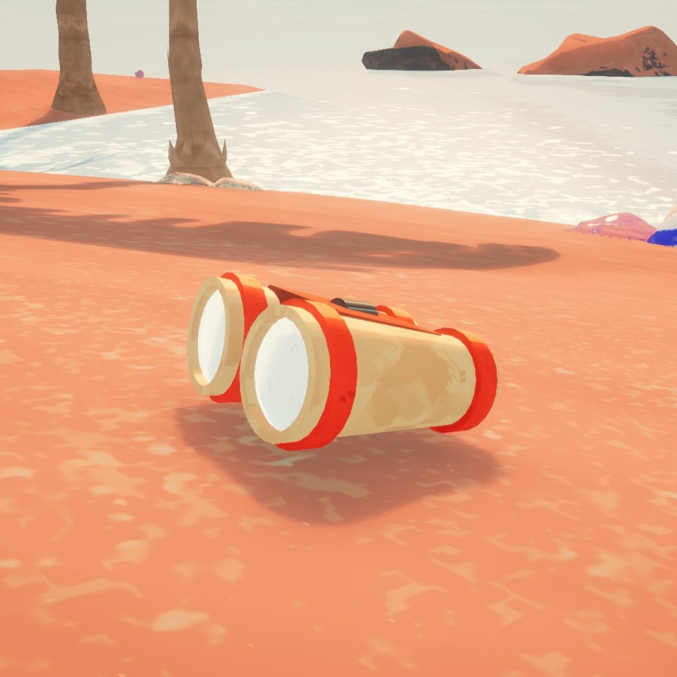](https://peak.wiki.gg/wiki/File%3ABinoculars_Close-up.jpg)

A close-up of the Binoculars

The **Binoculars** is an [equipment](Equipment.md) item in *[PEAK](Peak%20%28game%29.md)*, found at the [crash site](Shore.md#Crash_Site) in [Shore](Shore.md). Using the Binoculars zooms in your view, making it easier to see long distances. A version without it's zoom-in effect can also be found inside the [Airport](Airport.md)'s [photobooth](Airport.md#Photobooth).

You can receive the [](https://peak.wiki.gg/wiki/Astronomy_Badge) [Astronomy Badge](https://peak.wiki.gg/wiki/Astronomy_Badge) by using Binoculars to look directly at the sun while in the [Mesa](Mesa.md) during the day.

## Trivia

- Zooming in with the Binoculars gives you a little extra reach distance, which can be useful in situations where you just barely miss grabbing an item.- This doesn't work with the prop Binoculars found inside the Airport's photobooth because it doesn't zoom in.

## Gallery

- [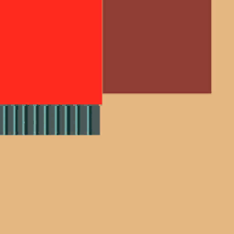](https://peak.wiki.gg/wiki/File%3ABinocs.png)
  Binoculars texture
- [](https://peak.wiki.gg/wiki/File%3AFrog0.jpg)
  Binoculars used to look at a [frog](Frog.md).

## Patch history

 **[1.8](1.8.md) (2025-07-21):** Introduced.

---

# Bishop

Bishop
Black
White
[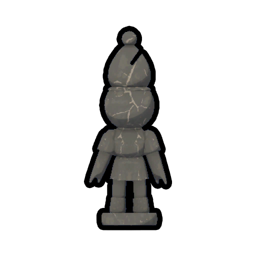](https://peak.wiki.gg/wiki/File%3ABishop_Black.png)
[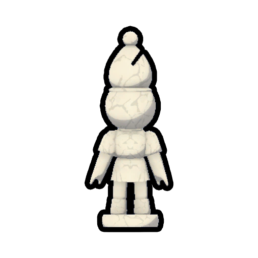](https://peak.wiki.gg/wiki/File%3ABishop_White.png)
[Item type](Items.md)- [Misc](Misc.md)
Biome- [Airport](Airport.md)
Weight
[](Stamina%20bar.md#Weight) **2.5**

The **Bishop** is an [item](https://peak.wiki.gg/wiki/Item) in *[PEAK](Peak%20%28game%29.md)* that can be found in the [Airport](Airport.md). When dropped, chess pieces will automatically lock into place on the floor to avoid being accidentally displaced.

There are four bishop pieces in total to be found in the Airport, with two of each color set up on the the chess board.

## Patch history

 **[1.30.a](1.30.a.md) (2025-09-23):** Introduced.

---

# Black Clusterberry

Black Clusterberry
[](https://peak.wiki.gg/wiki/File%3ABlack_Clusterberry.png)
[Item type](Items.md)- [Food](Food.md)
- [Natural food](https://peak.wiki.gg/wiki/Natural_food)
- [Berry](https://peak.wiki.gg/wiki/Berry)
Biome- [Tropics](Tropics.md)
Weight
[](Stamina%20bar.md#Weight) **2.5**
Base Status Effects
[](Stamina%20bar.md#Hunger)Hunger
-20
Cooked Bonuses
[](Stamina%20bar.md#Hunger)Hunger
-20 (-40 total)
[](Stamina%20bar.md#Bonus_stamina)Bonus Stamina
10 (10 total)

The **Black Clusterberry** is a [natural food](https://peak.wiki.gg/wiki/Natural_food) in *[PEAK](Peak%20%28game%29.md)* found growing on Giant Ivy in the [Tropics](Tropics.md).

## Patch history

 **[1.0](1.0.md) (2025-06-16):** Introduced.

[Food](Food.md)
Natural food
Berries
Berrynanas- [](Yellow%20Berrynana.md) [Yellow Berrynana](Yellow%20Berrynana.md)
- [](Pink%20Berrynana.md) [Pink Berrynana](Pink%20Berrynana.md)
- [](Blue%20Berrynana.md) [Blue Berrynana](Blue%20Berrynana.md)
- [](Brown%20Berrynana.md) [Brown Berrynana](Brown%20Berrynana.md)
Clusterberries- [](Red%20Clusterberry.md) [Red Clusterberry](Red%20Clusterberry.md)
- [](Yellow%20Clusterberry.md) [Yellow Clusterberry](Yellow%20Clusterberry.md)
- [](Black%20Clusterberry.md) Black Clusterberry
Crispberries- [](Green%20Crispberry.md) [Green Crispberry](Green%20Crispberry.md)
- [](Yellow%20Crispberry.md) [Yellow Crispberry](Yellow%20Crispberry.md)
- [](Red%20Crispberry.md) [Red Crispberry](Red%20Crispberry.md)
Kingberries- [](Green%20Kingberry.md) [Green Kingberry](Green%20Kingberry.md)
- [](Yellow%20Kingberry.md) [Yellow Kingberry](Yellow%20Kingberry.md)
- [](Purple%20Kingberry.md) [Purple Kingberry](Purple%20Kingberry.md)
Prickleberries- [](Red%20Prickleberry.md) [Red Prickleberry](Red%20Prickleberry.md)
- [](Gold%20Prickleberry.md) [Gold Prickleberry](Gold%20Prickleberry.md)
Shroomberries- [](Red%20Shroomberry.md) [Red Shroomberry](Red%20Shroomberry.md)
- [](Yellow%20Shroomberry.md) [Yellow Shroomberry](Yellow%20Shroomberry.md)
- [](Green%20Shroomberry.md) [Green Shroomberry](Green%20Shroomberry.md)
- [](Blue%20Shroomberry.md) [Blue Shroomberry](Blue%20Shroomberry.md)
- [](Purple%20Shroomberry.md) [Purple Shroomberry](Purple%20Shroomberry.md)
Winterberries- [](Orange%20Winterberry.md) [Orange Winterberry](Orange%20Winterberry.md)
- [](Yellow%20Winterberry.md) [Yellow Winterberry](Yellow%20Winterberry.md)
Other- [](Napberry.md) [Napberry](Napberry.md)
- [](Scorchberry.md) [Scorchberry](Scorchberry.md)
Campfire food- [](Marshmallow.md) [Marshmallow](Marshmallow.md)
- [](Hot%20Dog.md) [Hot Dog](Hot%20Dog.md)
Mushrooms- [](Bugle%20Shroom.md) [Bugle Shroom](Bugle%20Shroom.md)
- [](Button%20Shroom.md) [Button Shroom](Button%20Shroom.md)
- [](Chubby%20Shroom.md) [Chubby Shroom](Chubby%20Shroom.md)
- [](Cluster%20Shroom.md) [Cluster Shroom](Cluster%20Shroom.md)
Mystical food- [](Cure-All.md) [Cure-All](Cure-All.md)
- [](Pandora%27s%20Lunchbox.md) [Pandora's Lunchbox](Pandora%27s%20Lunchbox.md)
Other- [](Cooked%20Bird.md) [Cooked Bird](Cooked%20Bird.md)
- [](Egg.md) [Egg](Egg.md)
- [](Frog%20Legs.md) [Frog Legs](Frog%20Legs.md)
- [](Honeycomb.md) [Honeycomb](Honeycomb.md)
- [](Half-Coconut.md) [Half-Coconut](Half-Coconut.md)
- [](Medicinal%20Root.md) [Medicinal Root](Medicinal%20Root.md)
- [](Mandrake.md) [Mandrake](Mandrake.md)
- [](Scorpion.md) [Scorpion](Scorpion.md)
- [](Tick.md) [Tick](Tick.md)
- [](The%20Early%20Worm.md) [The Early Worm](The%20Early%20Worm.md)
Packaged food
All packaged foods- [](Airline%20Food.md) [Airline Food](Airline%20Food.md)
- [](Big%20Lollipop.md) [Big Lollipop](Big%20Lollipop.md)
- [](Energy%20Drink.md) [Energy Drink](Energy%20Drink.md)
- [](Fortified%20Milk.md) [Fortified Milk](Fortified%20Milk.md)
- [](Granola%20Bar.md) [Granola Bar](Granola%20Bar.md)
- [](Scout%20Cookies.md) [Scout Cookies](Scout%20Cookies.md)
- [](Sports%20Drink.md) [Sports Drink](Sports%20Drink.md)
- [](Trail%20Mix.md) [Trail Mix](Trail%20Mix.md)

---

# Blizzard

[](https://peak.wiki.gg/wiki/File%3ABlizzard_2.jpg)

A Blizzard

**Blizzards** are environmental hazards exclusive to the [Alpine](Alpine.md). They happen at random times and last several seconds. Any players not properly sheltered will begin receiving significant [](Stamina%20bar.md#Cold) [Cold](Stamina%20bar.md#Cold). Additionally, blizzards severely reduce the visibility and have winds that constantly push you away. They aren't as aggressive as the wind in [Roots](Roots.md), however, they do slightly push you.

The game determines whether the players are sheltered based on the light level, with darker areas providing more protection.[[1]](#cite_note-1) The players also have to be inside an invisible volume to be affected by the blizzard. Being surrounded by objects, cliffs, or other [Scouts](Scout.md) does not affect the intensity of the [](Stamina%20bar.md#Cold) [Cold](Stamina%20bar.md#Cold).

[Huddling](https://peak.wiki.gg/wiki/Huddling) with other players can help mitigate the [Cold](https://peak.wiki.gg/wiki/Cold) gained from being exposed to a blizzard. [Gripping](https://peak.wiki.gg/wiki/Climbing) onto any climbable surface will also anchor you to combat the [Wind](https://peak.wiki.gg/wiki/Wind)[[2]](#cite_note-2) like in [Roots](Roots.md).

## Gallery

- [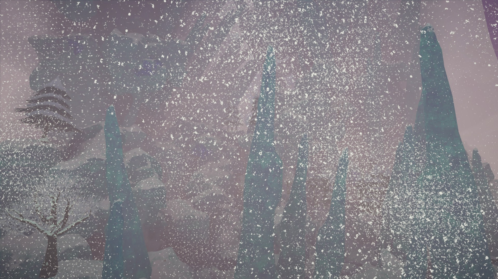](https://peak.wiki.gg/wiki/File%3ABlizzard_1.jpg)
- [](https://peak.wiki.gg/wiki/File%3ABlizzard_3.jpg)

## Notes

- [↑](#cite_ref-1) See `WindChillZone.GetWindIntensityAtPoint()`.
- [↑](#cite_ref-2) See "*Alpine*" under section "*Biomes*" in [Steam guide](https://steamcommunity.com/sharedfiles/filedetails/?id=3514106064)

---

# Blowgun

Blowgun
[](https://peak.wiki.gg/wiki/File%3ABlowgun.png)
[Item type](Items.md)- [Consumable](https://peak.wiki.gg/wiki/Consumable)
Rarity
[Mythic](https://peak.wiki.gg/wiki/Mythic)
Source- [Regular Luggage](https://peak.wiki.gg/wiki/Regular_Luggage)
- [Big Luggage](https://peak.wiki.gg/wiki/Big_Luggage)
Weight
[](Stamina%20bar.md#Weight) **2.5**
Base Status Effects
[](Stamina%20bar.md#Drowsy)Drowsy
120
Removes all status effects except [](Stamina%20bar.md#Curse) [Curse](Stamina%20bar.md#Curse) [Curse](https://peak.wiki.gg/wiki/Curse).
Cooked Bonuses
[](Stamina%20bar.md#Bonus_stamina)Bonus Stamina
10 (10 total)

The **Blowgun** is a [consumable](https://peak.wiki.gg/wiki/Consumable) item in *[PEAK](Peak%20%28game%29.md)* found in regular and big [luggages](Luggage.md) while playing multiplayer. It can be used to shoot a dart at another [Scout](Scout.md) to clear all statuses except [](Stamina%20bar.md#Curse) [Curse](Stamina%20bar.md#Curse) and [](Stamina%20bar.md#Petrify) [Petrify](Stamina%20bar.md#Petrify).

The Blowgun causes the shot Scout to fall asleep due to them receiving [](Stamina%20bar.md#Drowsy) **120** [Drowsy](Stamina%20bar.md#Drowsy). This will prevent earning the [](https://peak.wiki.gg/wiki/Survivalist_Badge) [Survivalist Badge](https://peak.wiki.gg/wiki/Survivalist_Badge), as the Scout will invariably lose consciousness.

([Cooking](Cooking.md) a blowgun causes it to inflict [](Stamina%20bar.md#Heat) **150** [Heat](Stamina%20bar.md#Heat) instead of [](Stamina%20bar.md#Drowsy) **120** [Drowsy](Stamina%20bar.md#Drowsy). Additionally, the user gains [](Stamina%20bar.md#Bonus_stamina) **10** [Bonus stamina](Stamina%20bar.md#Bonus_stamina).) This is currently bugged and gives [](Stamina%20bar.md#Drowsy) **120** [Drowsy](Stamina%20bar.md#Drowsy) even when cooked, along with [](Stamina%20bar.md#Bonus_stamina) **10** [Bonus stamina](Stamina%20bar.md#Bonus_stamina).

## Gallery

- [](https://peak.wiki.gg/wiki/File%3ABlowgun_aiming.png)
  A Blowgun aimed at another [Scout](Scout.md).
- [](https://peak.wiki.gg/wiki/File%3ABlowgun_particle_effect.png)
  The particle effect and [drowsy](https://peak.wiki.gg/wiki/Drowsy) effect coloration created by the Blowgun when a Scout is shot.

## Patch history

 **[1.0](1.0.md) (2025-06-16):** Introduced.
 **[1.8](1.8.md) (2025-07-21):** Blowgun no longer spawns in Solo Play.

---

# Blue Berrynana Peel

Blue Berrynana Peel
Normal
Colorblind
[](https://peak.wiki.gg/wiki/File%3ABlue_Berrynana_Peel.png)
[](https://peak.wiki.gg/wiki/File%3ABlue_Berrynana_Peel_CB.png)
[Item type](Items.md)- [Misc](Misc.md)
Biome- [Tropics](Tropics.md)
Source- [Blue Berrynana](Blue%20Berrynana.md)
Weight
[](Stamina%20bar.md#Weight) **2.5**

The **Blue Berrynana Peel** is an [item](https://peak.wiki.gg/wiki/Item) in *[PEAK](Peak%20%28game%29.md)* that is acquired after eating [](Blue%20Berrynana.md) [Blue Berrynanas](Blue%20Berrynana.md) from the [Tropics](Tropics.md). Players walking over a peel will [slip](https://peak.wiki.gg/wiki/Slippery_effect) and fall to the ground, losing control for a moment.

## Patch history

 **[1.0](1.0.md) (2025-06-16):** Introduced.

---

# Blue Berrynana

Blue Berrynana
Normal
Colorblind
[](https://peak.wiki.gg/wiki/File%3ABlue_Berrynana.png)
[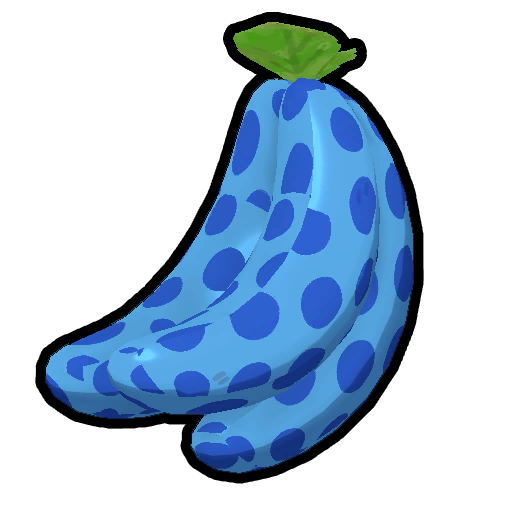](https://peak.wiki.gg/wiki/File%3ABlue_Berrynana_CB.png)
[Item type](Items.md)- [Food](Food.md)
- [Natural food](https://peak.wiki.gg/wiki/Natural_food)
- [Berry](https://peak.wiki.gg/wiki/Berry)
Biome- [Tropics](Tropics.md)
Weight
[](Stamina%20bar.md#Weight) **2.5**
Base Status Effects
[](Stamina%20bar.md#Hunger)Hunger
-30
Cooked Bonuses
[](Stamina%20bar.md#Hunger)Hunger
-30 (-60 total)
[](Stamina%20bar.md#Bonus_stamina)Bonus Stamina
10 (10 total)

The **Blue Berrynana** is a [natural food](https://peak.wiki.gg/wiki/Natural_food) in *[PEAK](Peak%20%28game%29.md)* found growing on [vines](Vines.md) in the [Tropics](Tropics.md). Eating a Blue Berrynana will restore [](Stamina%20bar.md#Hunger) **30** [Hunger](Stamina%20bar.md#Hunger). After eating the Berrynana, the player receives a [](Blue%20Berrynana%20Peel.md) [Blue Berrynana Peel](Blue%20Berrynana%20Peel.md). If the Blue Berrynana is fed to another, the other player will receive the peel. If the other player's inventory and hands are full, the peel will drop at their feet.

## Patch history

 **[1.0](1.0.md) (2025-06-16):** Introduced.

[Food](Food.md)
Natural food
Berries
Berrynanas- [](Yellow%20Berrynana.md) [Yellow Berrynana](Yellow%20Berrynana.md)
- [](Pink%20Berrynana.md) [Pink Berrynana](Pink%20Berrynana.md)
- [](Blue%20Berrynana.md) Blue Berrynana
- [](Brown%20Berrynana.md) [Brown Berrynana](Brown%20Berrynana.md)
Clusterberries- [](Red%20Clusterberry.md) [Red Clusterberry](Red%20Clusterberry.md)
- [](Yellow%20Clusterberry.md) [Yellow Clusterberry](Yellow%20Clusterberry.md)
- [](Black%20Clusterberry.md) [Black Clusterberry](Black%20Clusterberry.md)
Crispberries- [](Green%20Crispberry.md) [Green Crispberry](Green%20Crispberry.md)
- [](Yellow%20Crispberry.md) [Yellow Crispberry](Yellow%20Crispberry.md)
- [](Red%20Crispberry.md) [Red Crispberry](Red%20Crispberry.md)
Kingberries- [](Green%20Kingberry.md) [Green Kingberry](Green%20Kingberry.md)
- [](Yellow%20Kingberry.md) [Yellow Kingberry](Yellow%20Kingberry.md)
- [](Purple%20Kingberry.md) [Purple Kingberry](Purple%20Kingberry.md)
Prickleberries- [](Red%20Prickleberry.md) [Red Prickleberry](Red%20Prickleberry.md)
- [](Gold%20Prickleberry.md) [Gold Prickleberry](Gold%20Prickleberry.md)
Shroomberries- [](Red%20Shroomberry.md) [Red Shroomberry](Red%20Shroomberry.md)
- [](Yellow%20Shroomberry.md) [Yellow Shroomberry](Yellow%20Shroomberry.md)
- [](Green%20Shroomberry.md) [Green Shroomberry](Green%20Shroomberry.md)
- [](Blue%20Shroomberry.md) [Blue Shroomberry](Blue%20Shroomberry.md)
- [](Purple%20Shroomberry.md) [Purple Shroomberry](Purple%20Shroomberry.md)
Winterberries- [](Orange%20Winterberry.md) [Orange Winterberry](Orange%20Winterberry.md)
- [](Yellow%20Winterberry.md) [Yellow Winterberry](Yellow%20Winterberry.md)
Other- [](Napberry.md) [Napberry](Napberry.md)
- [](Scorchberry.md) [Scorchberry](Scorchberry.md)
Campfire food- [](Marshmallow.md) [Marshmallow](Marshmallow.md)
- [](Hot%20Dog.md) [Hot Dog](Hot%20Dog.md)
Mushrooms- [](Bugle%20Shroom.md) [Bugle Shroom](Bugle%20Shroom.md)
- [](Button%20Shroom.md) [Button Shroom](Button%20Shroom.md)
- [](Chubby%20Shroom.md) [Chubby Shroom](Chubby%20Shroom.md)
- [](Cluster%20Shroom.md) [Cluster Shroom](Cluster%20Shroom.md)
Mystical food- [](Cure-All.md) [Cure-All](Cure-All.md)
- [](Pandora%27s%20Lunchbox.md) [Pandora's Lunchbox](Pandora%27s%20Lunchbox.md)
Other- [](Cooked%20Bird.md) [Cooked Bird](Cooked%20Bird.md)
- [](Egg.md) [Egg](Egg.md)
- [](Frog%20Legs.md) [Frog Legs](Frog%20Legs.md)
- [](Honeycomb.md) [Honeycomb](Honeycomb.md)
- [](Half-Coconut.md) [Half-Coconut](Half-Coconut.md)
- [](Medicinal%20Root.md) [Medicinal Root](Medicinal%20Root.md)
- [](Mandrake.md) [Mandrake](Mandrake.md)
- [](Scorpion.md) [Scorpion](Scorpion.md)
- [](Tick.md) [Tick](Tick.md)
- [](The%20Early%20Worm.md) [The Early Worm](The%20Early%20Worm.md)
Packaged food
All packaged foods- [](Airline%20Food.md) [Airline Food](Airline%20Food.md)
- [](Big%20Lollipop.md) [Big Lollipop](Big%20Lollipop.md)
- [](Energy%20Drink.md) [Energy Drink](Energy%20Drink.md)
- [](Fortified%20Milk.md) [Fortified Milk](Fortified%20Milk.md)
- [](Granola%20Bar.md) [Granola Bar](Granola%20Bar.md)
- [](Scout%20Cookies.md) [Scout Cookies](Scout%20Cookies.md)
- [](Sports%20Drink.md) [Sports Drink](Sports%20Drink.md)
- [](Trail%20Mix.md) [Trail Mix](Trail%20Mix.md)

---

# Blue Shroomberry

Blue Shroomberry
[](https://peak.wiki.gg/wiki/File%3ABlue_Shroomberry.png)
[Item type](Items.md)- [Food](Food.md)
- [Natural food](https://peak.wiki.gg/wiki/Natural_food)
- [Berry](https://peak.wiki.gg/wiki/Berry)
Biome- [Roots](Roots.md)
Weight
[](Stamina%20bar.md#Weight) **2.5**
Base Status Effects
[](Stamina%20bar.md#Hunger)Hunger
-10
[](Stamina%20bar.md#Spores)Spores
5
Cooked Bonuses
[](Stamina%20bar.md#Hunger)Hunger
-10 (-20 total)
[](Stamina%20bar.md#Bonus_stamina)Bonus Stamina
10 (10 total)

The **Blue Shroomberry** is a type of [Shroomberry](Shroomberry.md). It produces a random [bad effect](Shroomberry.md#Bad_effects) when eaten.

[Cooking](Cooking.md) a Blue Shroomberry removes the [](Stamina%20bar.md#Spores) [Spores](Stamina%20bar.md#Spores) effect.

## Patch history

 **[1.40.a](1.40.a.md) (2025-11-05):** Introduced.

[Food](Food.md)
Natural food
Berries
Berrynanas- [](Yellow%20Berrynana.md) [Yellow Berrynana](Yellow%20Berrynana.md)
- [](Pink%20Berrynana.md) [Pink Berrynana](Pink%20Berrynana.md)
- [](Blue%20Berrynana.md) [Blue Berrynana](Blue%20Berrynana.md)
- [](Brown%20Berrynana.md) [Brown Berrynana](Brown%20Berrynana.md)
Clusterberries- [](Red%20Clusterberry.md) [Red Clusterberry](Red%20Clusterberry.md)
- [](Yellow%20Clusterberry.md) [Yellow Clusterberry](Yellow%20Clusterberry.md)
- [](Black%20Clusterberry.md) [Black Clusterberry](Black%20Clusterberry.md)
Crispberries- [](Green%20Crispberry.md) [Green Crispberry](Green%20Crispberry.md)
- [](Yellow%20Crispberry.md) [Yellow Crispberry](Yellow%20Crispberry.md)
- [](Red%20Crispberry.md) [Red Crispberry](Red%20Crispberry.md)
Kingberries- [](Green%20Kingberry.md) [Green Kingberry](Green%20Kingberry.md)
- [](Yellow%20Kingberry.md) [Yellow Kingberry](Yellow%20Kingberry.md)
- [](Purple%20Kingberry.md) [Purple Kingberry](Purple%20Kingberry.md)
Prickleberries- [](Red%20Prickleberry.md) [Red Prickleberry](Red%20Prickleberry.md)
- [](Gold%20Prickleberry.md) [Gold Prickleberry](Gold%20Prickleberry.md)
Shroomberries- [](Red%20Shroomberry.md) [Red Shroomberry](Red%20Shroomberry.md)
- [](Yellow%20Shroomberry.md) [Yellow Shroomberry](Yellow%20Shroomberry.md)
- [](Green%20Shroomberry.md) [Green Shroomberry](Green%20Shroomberry.md)
- [](Blue%20Shroomberry.md) Blue Shroomberry
- [](Purple%20Shroomberry.md) [Purple Shroomberry](Purple%20Shroomberry.md)
Winterberries- [](Orange%20Winterberry.md) [Orange Winterberry](Orange%20Winterberry.md)
- [](Yellow%20Winterberry.md) [Yellow Winterberry](Yellow%20Winterberry.md)
Other- [](Napberry.md) [Napberry](Napberry.md)
- [](Scorchberry.md) [Scorchberry](Scorchberry.md)
Campfire food- [](Marshmallow.md) [Marshmallow](Marshmallow.md)
- [](Hot%20Dog.md) [Hot Dog](Hot%20Dog.md)
Mushrooms- [](Bugle%20Shroom.md) [Bugle Shroom](Bugle%20Shroom.md)
- [](Button%20Shroom.md) [Button Shroom](Button%20Shroom.md)
- [](Chubby%20Shroom.md) [Chubby Shroom](Chubby%20Shroom.md)
- [](Cluster%20Shroom.md) [Cluster Shroom](Cluster%20Shroom.md)
Mystical food- [](Cure-All.md) [Cure-All](Cure-All.md)
- [](Pandora%27s%20Lunchbox.md) [Pandora's Lunchbox](Pandora%27s%20Lunchbox.md)
Other- [](Cooked%20Bird.md) [Cooked Bird](Cooked%20Bird.md)
- [](Egg.md) [Egg](Egg.md)
- [](Frog%20Legs.md) [Frog Legs](Frog%20Legs.md)
- [](Honeycomb.md) [Honeycomb](Honeycomb.md)
- [](Half-Coconut.md) [Half-Coconut](Half-Coconut.md)
- [](Medicinal%20Root.md) [Medicinal Root](Medicinal%20Root.md)
- [](Mandrake.md) [Mandrake](Mandrake.md)
- [](Scorpion.md) [Scorpion](Scorpion.md)
- [](Tick.md) [Tick](Tick.md)
- [](The%20Early%20Worm.md) [The Early Worm](The%20Early%20Worm.md)
Packaged food
All packaged foods- [](Airline%20Food.md) [Airline Food](Airline%20Food.md)
- [](Big%20Lollipop.md) [Big Lollipop](Big%20Lollipop.md)
- [](Energy%20Drink.md) [Energy Drink](Energy%20Drink.md)
- [](Fortified%20Milk.md) [Fortified Milk](Fortified%20Milk.md)
- [](Granola%20Bar.md) [Granola Bar](Granola%20Bar.md)
- [](Scout%20Cookies.md) [Scout Cookies](Scout%20Cookies.md)
- [](Sports%20Drink.md) [Sports Drink](Sports%20Drink.md)
- [](Trail%20Mix.md) [Trail Mix](Trail%20Mix.md)

---

# Bounce Fungus

Bounce Fungus
[](https://peak.wiki.gg/wiki/File%3ABounce_Fungus.png)
[Item type](Items.md)- [Deployable](https://peak.wiki.gg/wiki/Deployable)
Biome- [Roots](Roots.md)
Weight
[](Stamina%20bar.md#Weight) **2.5**

The **Bounce Fungus** is an item in *[PEAK](Peak%20%28game%29.md)* and can be found on steep surfaces in the [Roots](Roots.md). It can be thrown or dropped to create a bouncy platform at the point of impact with terrain, an item, player, or other object with valid collision. Thrown items and falling players can also cause a Bounce Fungus to become a platform.

Bouncing on a Bounce Fungus will restore a small portion of [Stamina](Stamina%20bar.md).

Bouncing 40 meters off a Bounce Fungus grants the player the [](https://peak.wiki.gg/wiki/Mycoacrobatics_Badge) [Mycoacrobatics Badge](https://peak.wiki.gg/wiki/Mycoacrobatics_Badge).

## Trivia

- Albeit difficult, the Bounce Fungus can be thrown sideways onto a wall to be used as a ramshackle [](Piton.md) [Piton](Piton.md) due to its stamina-restoring property. Note that climbing over the Bounce Fungus without proper timing between bounces may cause the player to be launched off.
- The bottom side stem of the Bounce Fungus is not bouncy and can be used as a small platform.

---

# Bridge

Bridge
[](https://peak.wiki.gg/wiki/File%3ABridge.png)
General
Type
Traversal utility, Environmental hazard
Biome- [Shore](Shore.md)
- [Roots](Roots.md)

**Bridges** can be found in the [Shore](Shore.md) and [Roots](Roots.md). They can be useful for traversing the terrain, but can also present a danger if too many Scouts try to walk on them at the same time.

The two biomes' bridges are slightly different, with Shore bridges being wider and hanging higher, while Roots bridges are skinnier and hang much lower. Despite their different shapes and appearances, they both function identically.

## Mechanics

At the start of the game, every bridge gets assigned a random number between **1 and 5** as the number of players required to break the bridge. If at any point at least that number of players stands on the bridge, it will start to shake and will break shortly after, dropping all Scouts standing on it in the process.

## Gallery

- [](https://peak.wiki.gg/wiki/File%3ABridge.png)
  A bridge connecting two locations in the [Shore](Shore.md).
- [](https://peak.wiki.gg/wiki/File%3ARoots_Bridge.png)
  A bridge found in the [Roots](Roots.md).

---

# Brown Berrynana Peel

Brown Berrynana Peel
Normal
Colorblind
[](https://peak.wiki.gg/wiki/File%3ABrown_Berrynana_Peel.png)
[](https://peak.wiki.gg/wiki/File%3ABrown_Berrynana_Peel_CB.png)
[Item type](Items.md)- [Misc](Misc.md)
Biome- [Tropics](Tropics.md)
- [Gloom](Gloom.md)
Source- [Brown Berrynana](Brown%20Berrynana.md)
Weight
[](Stamina%20bar.md#Weight) **2.5**

The **Brown Berrynana Peel** is an [item](https://peak.wiki.gg/wiki/Item) in *[PEAK](Peak%20%28game%29.md)* that is acquired after eating [](Brown%20Berrynana.md) [Brown Berrynanas](Brown%20Berrynana.md) from the [Tropics](Tropics.md) or [Gloom](Gloom.md). Players walking over a peel will [slip](https://peak.wiki.gg/wiki/Slippery_effect) and fall to the ground, losing control for a moment.

## Patch history

 **[1.0](1.0.md) (2025-06-16):** Introduced.

---

# Brown Berrynana

Brown Berrynana
Normal
Colorblind
[](https://peak.wiki.gg/wiki/File%3ABrown_Berrynana.png)
[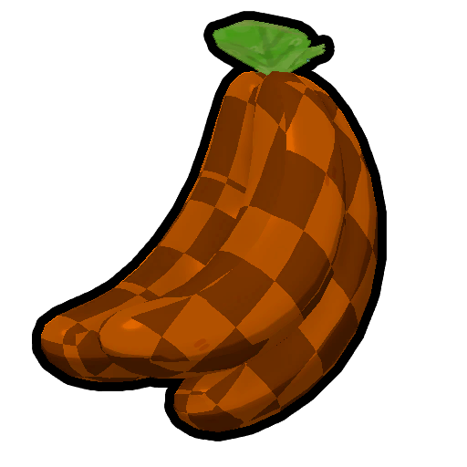](https://peak.wiki.gg/wiki/File%3ABrown_Berrynana_CB.png)
[Item type](Items.md)- [Food](Food.md)
- [Natural food](https://peak.wiki.gg/wiki/Natural_food)
- [Berry](https://peak.wiki.gg/wiki/Berry)
Biome- [Tropics](Tropics.md)
- [Gloom](Gloom.md)
Weight
[](Stamina%20bar.md#Weight) **2.5**
Base Status Effects
[](Stamina%20bar.md#Hunger)Hunger
-15
[](Stamina%20bar.md#Bonus_stamina)Bonus Stamina
10
Cooked Bonuses
[](Stamina%20bar.md#Hunger)Hunger
-15 (-30 total)
[](Stamina%20bar.md#Bonus_stamina)Bonus Stamina
5 (15 total)

The **Brown Berrynana** is a [natural food](https://peak.wiki.gg/wiki/Natural_food) in *[PEAK](Peak%20%28game%29.md)* found growing on [vines](Vines.md) in the [Tropics](Tropics.md) and the [Gloom](Gloom.md). Eating a Brown Berrynana will restore [](Stamina%20bar.md#Hunger) **15** [Hunger](Stamina%20bar.md#Hunger) and give [](Stamina%20bar.md#Bonus_stamina) **10** [Bonus stamina](Stamina%20bar.md#Bonus_stamina). After eating the Berrynana, the player receives a [](Brown%20Berrynana%20Peel.md) [Brown Berrynana Peel](Brown%20Berrynana%20Peel.md). If the Brown Berrynana is fed to another, the other player will receive the peel. If the other player's inventory and hands are full, the peel will drop at their feet.

## Gallery

- [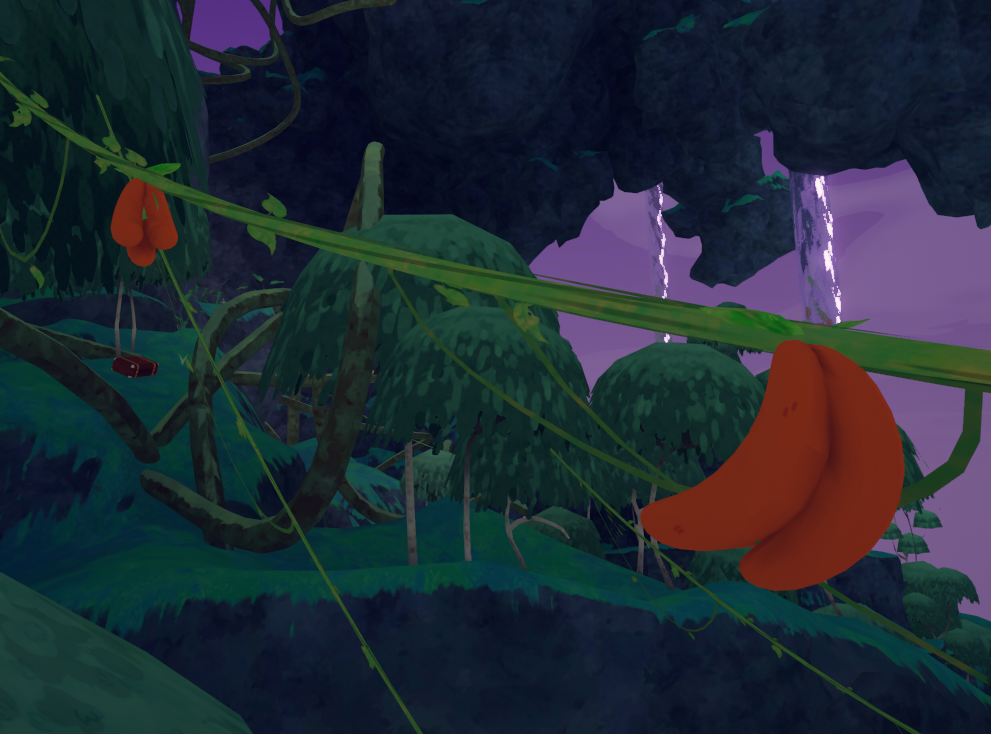](https://peak.wiki.gg/wiki/File%3ABerrynana_brown_closeup.png)
  Brown Berrynanas growing on a [vine](https://peak.wiki.gg/wiki/Vine) in the [Tropics](Tropics.md).

## Patch history

 **[1.0](1.0.md) (2025-06-16):** Introduced.

[Food](Food.md)
Natural food
Berries
Berrynanas- [](Yellow%20Berrynana.md) [Yellow Berrynana](Yellow%20Berrynana.md)
- [](Pink%20Berrynana.md) [Pink Berrynana](Pink%20Berrynana.md)
- [](Blue%20Berrynana.md) [Blue Berrynana](Blue%20Berrynana.md)
- [](Brown%20Berrynana.md) Brown Berrynana
Clusterberries- [](Red%20Clusterberry.md) [Red Clusterberry](Red%20Clusterberry.md)
- [](Yellow%20Clusterberry.md) [Yellow Clusterberry](Yellow%20Clusterberry.md)
- [](Black%20Clusterberry.md) [Black Clusterberry](Black%20Clusterberry.md)
Crispberries- [](Green%20Crispberry.md) [Green Crispberry](Green%20Crispberry.md)
- [](Yellow%20Crispberry.md) [Yellow Crispberry](Yellow%20Crispberry.md)
- [](Red%20Crispberry.md) [Red Crispberry](Red%20Crispberry.md)
Kingberries- [](Green%20Kingberry.md) [Green Kingberry](Green%20Kingberry.md)
- [](Yellow%20Kingberry.md) [Yellow Kingberry](Yellow%20Kingberry.md)
- [](Purple%20Kingberry.md) [Purple Kingberry](Purple%20Kingberry.md)
Prickleberries- [](Red%20Prickleberry.md) [Red Prickleberry](Red%20Prickleberry.md)
- [](Gold%20Prickleberry.md) [Gold Prickleberry](Gold%20Prickleberry.md)
Shroomberries- [](Red%20Shroomberry.md) [Red Shroomberry](Red%20Shroomberry.md)
- [](Yellow%20Shroomberry.md) [Yellow Shroomberry](Yellow%20Shroomberry.md)
- [](Green%20Shroomberry.md) [Green Shroomberry](Green%20Shroomberry.md)
- [](Blue%20Shroomberry.md) [Blue Shroomberry](Blue%20Shroomberry.md)
- [](Purple%20Shroomberry.md) [Purple Shroomberry](Purple%20Shroomberry.md)
Winterberries- [](Orange%20Winterberry.md) [Orange Winterberry](Orange%20Winterberry.md)
- [](Yellow%20Winterberry.md) [Yellow Winterberry](Yellow%20Winterberry.md)
Other- [](Napberry.md) [Napberry](Napberry.md)
- [](Scorchberry.md) [Scorchberry](Scorchberry.md)
Campfire food- [](Marshmallow.md) [Marshmallow](Marshmallow.md)
- [](Hot%20Dog.md) [Hot Dog](Hot%20Dog.md)
Mushrooms- [](Bugle%20Shroom.md) [Bugle Shroom](Bugle%20Shroom.md)
- [](Button%20Shroom.md) [Button Shroom](Button%20Shroom.md)
- [](Chubby%20Shroom.md) [Chubby Shroom](Chubby%20Shroom.md)
- [](Cluster%20Shroom.md) [Cluster Shroom](Cluster%20Shroom.md)
Mystical food- [](Cure-All.md) [Cure-All](Cure-All.md)
- [](Pandora%27s%20Lunchbox.md) [Pandora's Lunchbox](Pandora%27s%20Lunchbox.md)
Other- [](Cooked%20Bird.md) [Cooked Bird](Cooked%20Bird.md)
- [](Egg.md) [Egg](Egg.md)
- [](Frog%20Legs.md) [Frog Legs](Frog%20Legs.md)
- [](Honeycomb.md) [Honeycomb](Honeycomb.md)
- [](Half-Coconut.md) [Half-Coconut](Half-Coconut.md)
- [](Medicinal%20Root.md) [Medicinal Root](Medicinal%20Root.md)
- [](Mandrake.md) [Mandrake](Mandrake.md)
- [](Scorpion.md) [Scorpion](Scorpion.md)
- [](Tick.md) [Tick](Tick.md)
- [](The%20Early%20Worm.md) [The Early Worm](The%20Early%20Worm.md)
Packaged food
All packaged foods- [](Airline%20Food.md) [Airline Food](Airline%20Food.md)
- [](Big%20Lollipop.md) [Big Lollipop](Big%20Lollipop.md)
- [](Energy%20Drink.md) [Energy Drink](Energy%20Drink.md)
- [](Fortified%20Milk.md) [Fortified Milk](Fortified%20Milk.md)
- [](Granola%20Bar.md) [Granola Bar](Granola%20Bar.md)
- [](Scout%20Cookies.md) [Scout Cookies](Scout%20Cookies.md)
- [](Sports%20Drink.md) [Sports Drink](Sports%20Drink.md)
- [](Trail%20Mix.md) [Trail Mix](Trail%20Mix.md)

---

# Bug Phobia Mode

**Bug Phobia Mode** is an option in *[PEAK](Peak%20%28game%29.md)* which allows players to replace various depictions of bugs with [Bing Bong](Bing%20Bong.md) to make the game less scary. It can be toggled in the settings.

Bug Phobia Mode has no effect on the gameplay and only changes the visuals and sounds of certain creatures.

## Gallery

- [](https://peak.wiki.gg/wiki/File%3AAntlion_bugphobia.png)
  An [Antlion](Antlion.md) with Bug Phobia Mode enabled
- [](https://peak.wiki.gg/wiki/File%3ABeehive_bugphobia.png)
  [Bees](https://peak.wiki.gg/wiki/Bees) with Bug Phobia Mode enabled
- [](https://peak.wiki.gg/wiki/File%3ABeeng_Bong.png)
  "**Bee**ng Bong" texture
- [](https://peak.wiki.gg/wiki/File%3ABugfixBingBong.png)
  Bug Phobia Mode [Tick](Tick.md) item icon
- [](https://peak.wiki.gg/wiki/File%3AScorpionBingBong.png)
  Bug Phobia Mode [Scorpion](Scorpion.md) item icon
- [](https://peak.wiki.gg/wiki/File%3ABing_bon_beetle.webp)
  A [Beetle](Beetle.md) with Bug Phobia Mode turned on.

## Patch history

 **[1.20.a](1.20.a.md) (2025-08-11):** Introduced.
 **[1.27.a](1.27.a.md) (2025-08-27):** Replaced [bees](https://peak.wiki.gg/wiki/Bees) sounds in Bug Phobia Mode.

---

# Bugle Shroom

Bugle Shroom
Regular
Poisonous
[](https://peak.wiki.gg/wiki/File%3ABugle_Shroom.png)
[](https://peak.wiki.gg/wiki/File%3ABugle_Shroom_%28Poisonous%29.png)
[Item type](Items.md)- [Food](Food.md)
- [Mushroom](https://peak.wiki.gg/wiki/Mushroom)
Biome- [Shore](Shore.md)
- [Tropics](Tropics.md)
- [Roots](Roots.md)
- [Mesa](Mesa.md)
Weight
[](Stamina%20bar.md#Weight) **2.5**
Base Status Effects
[](Stamina%20bar.md#Hunger)Hunger
-15
[](Stamina%20bar.md#Poison)Poison
20
Cooked Bonuses
[](Stamina%20bar.md#Hunger)Hunger
-15 (-30 total)
[](Stamina%20bar.md#Bonus_stamina)Bonus Stamina
10 (10 total)

The **Bugle Shroom** is a [mushroom](https://peak.wiki.gg/wiki/Mushroom) in *[PEAK](Peak%20%28game%29.md)* that can be found growing in the [Shore](Shore.md), [Tropics](Tropics.md), [Roots](Roots.md), and [Mesa](Mesa.md). It can be eaten as [food](Food.md).

The poisonous variety has a rougher ridged stalk and will slowly inflict [](Stamina%20bar.md#Poison) **20** [Poison](Stamina%20bar.md#Poison) over 8 seconds beginning 10 seconds after eating.

## Patch history

 **[1.0](1.0.md) (2025-06-16):** Introduced.

[Food](Food.md)
Natural food
Berries
Berrynanas- [](Yellow%20Berrynana.md) [Yellow Berrynana](Yellow%20Berrynana.md)
- [](Pink%20Berrynana.md) [Pink Berrynana](Pink%20Berrynana.md)
- [](Blue%20Berrynana.md) [Blue Berrynana](Blue%20Berrynana.md)
- [](Brown%20Berrynana.md) [Brown Berrynana](Brown%20Berrynana.md)
Clusterberries- [](Red%20Clusterberry.md) [Red Clusterberry](Red%20Clusterberry.md)
- [](Yellow%20Clusterberry.md) [Yellow Clusterberry](Yellow%20Clusterberry.md)
- [](Black%20Clusterberry.md) [Black Clusterberry](Black%20Clusterberry.md)
Crispberries- [](Green%20Crispberry.md) [Green Crispberry](Green%20Crispberry.md)
- [](Yellow%20Crispberry.md) [Yellow Crispberry](Yellow%20Crispberry.md)
- [](Red%20Crispberry.md) [Red Crispberry](Red%20Crispberry.md)
Kingberries- [](Green%20Kingberry.md) [Green Kingberry](Green%20Kingberry.md)
- [](Yellow%20Kingberry.md) [Yellow Kingberry](Yellow%20Kingberry.md)
- [](Purple%20Kingberry.md) [Purple Kingberry](Purple%20Kingberry.md)
Prickleberries- [](Red%20Prickleberry.md) [Red Prickleberry](Red%20Prickleberry.md)
- [](Gold%20Prickleberry.md) [Gold Prickleberry](Gold%20Prickleberry.md)
Shroomberries- [](Red%20Shroomberry.md) [Red Shroomberry](Red%20Shroomberry.md)
- [](Yellow%20Shroomberry.md) [Yellow Shroomberry](Yellow%20Shroomberry.md)
- [](Green%20Shroomberry.md) [Green Shroomberry](Green%20Shroomberry.md)
- [](Blue%20Shroomberry.md) [Blue Shroomberry](Blue%20Shroomberry.md)
- [](Purple%20Shroomberry.md) [Purple Shroomberry](Purple%20Shroomberry.md)
Winterberries- [](Orange%20Winterberry.md) [Orange Winterberry](Orange%20Winterberry.md)
- [](Yellow%20Winterberry.md) [Yellow Winterberry](Yellow%20Winterberry.md)
Other- [](Napberry.md) [Napberry](Napberry.md)
- [](Scorchberry.md) [Scorchberry](Scorchberry.md)
Campfire food- [](Marshmallow.md) [Marshmallow](Marshmallow.md)
- [](Hot%20Dog.md) [Hot Dog](Hot%20Dog.md)
Mushrooms- [](Bugle%20Shroom.md) Bugle Shroom
- [](Button%20Shroom.md) [Button Shroom](Button%20Shroom.md)
- [](Chubby%20Shroom.md) [Chubby Shroom](Chubby%20Shroom.md)
- [](Cluster%20Shroom.md) [Cluster Shroom](Cluster%20Shroom.md)
Mystical food- [](Cure-All.md) [Cure-All](Cure-All.md)
- [](Pandora%27s%20Lunchbox.md) [Pandora's Lunchbox](Pandora%27s%20Lunchbox.md)
Other- [](Cooked%20Bird.md) [Cooked Bird](Cooked%20Bird.md)
- [](Egg.md) [Egg](Egg.md)
- [](Frog%20Legs.md) [Frog Legs](Frog%20Legs.md)
- [](Honeycomb.md) [Honeycomb](Honeycomb.md)
- [](Half-Coconut.md) [Half-Coconut](Half-Coconut.md)
- [](Medicinal%20Root.md) [Medicinal Root](Medicinal%20Root.md)
- [](Mandrake.md) [Mandrake](Mandrake.md)
- [](Scorpion.md) [Scorpion](Scorpion.md)
- [](Tick.md) [Tick](Tick.md)
- [](The%20Early%20Worm.md) [The Early Worm](The%20Early%20Worm.md)
Packaged food
All packaged foods- [](Airline%20Food.md) [Airline Food](Airline%20Food.md)
- [](Big%20Lollipop.md) [Big Lollipop](Big%20Lollipop.md)
- [](Energy%20Drink.md) [Energy Drink](Energy%20Drink.md)
- [](Fortified%20Milk.md) [Fortified Milk](Fortified%20Milk.md)
- [](Granola%20Bar.md) [Granola Bar](Granola%20Bar.md)
- [](Scout%20Cookies.md) [Scout Cookies](Scout%20Cookies.md)
- [](Sports%20Drink.md) [Sports Drink](Sports%20Drink.md)
- [](Trail%20Mix.md) [Trail Mix](Trail%20Mix.md)

---

# Bugle of Friendship

Bugle of Friendship
[](https://peak.wiki.gg/wiki/File%3ABugle_of_Friendship.png)
[Item type](Items.md)- [Equipment](Equipment.md)
Rarity
[Legendary](https://peak.wiki.gg/wiki/Legendary)
Source- [Ancient Luggage](https://peak.wiki.gg/wiki/Ancient_Luggage)
- [Ancient Statue](Ancient%20Statue.md)
Weight
[](Stamina%20bar.md#Weight) **2.5**
Base Status Effects
[](Stamina%20bar.md#Infinite_Stamina)Infinite Stamina
Up to 7.5 seconds

The **Bugle of Friendship** is a mystical [equipment](Equipment.md) item in *[PEAK](Peak%20%28game%29.md)* that can be found while playing in multiplayer. While a Scout plays the bugle, all other players within a **56 meter** radius will gain **0.5 seconds** of [](Stamina%20bar.md#Infinite_Stamina) [Infinite Stamina](Stamina%20bar.md#Infinite_Stamina). The bugle has a total use time of **7.5 seconds**. This makes it an amazing item for helping teammates cross large vertical distances.

You can receive the [](https://peak.wiki.gg/wiki/Animal_Serenading_Badge) [Animal Serenading Badge](https://peak.wiki.gg/wiki/Animal_Serenading_Badge) by using the Bugle of Friendship while standing next to a [capybara](Capybara.md), although using the regular [](Bugle.md) [Bugle](Bugle.md) for this is less wasteful. The badge will still be unlocked if the Bugle of Friendship is used without any use time left.

## See also

- [](Bugle.md) [Bugle](Bugle.md)
- [](Scoutmaster%27s%20Bugle.md) [Scoutmaster's Bugle](Scoutmaster%27s%20Bugle.md)

## Patch history

 **[1.0](1.0.md) (2025-06-16):** Introduced.
 **[1.7](1.7.md) (2025-07-10):** Bugle of Friendship will no longer show up in Solo Play.
 **[1.20.a](1.20.a.md) (2025-08-11):** Fixed an issue where the Bugle of Friendship would still play its audio and visual effects when out of juice.

---

# Bugle

Bugle
[](https://peak.wiki.gg/wiki/File%3ABugle.png)
[Item type](Items.md)- [Equipment](Equipment.md)
Biome- [Airport](Airport.md)
- [Shore](Shore.md)
Source- [Airport](Airport.md)
- [Crash Site](https://peak.wiki.gg/wiki/Crash_Site)
- [Clown Luggage](https://peak.wiki.gg/wiki/Clown_Luggage)
Weight
[](Stamina%20bar.md#Weight) **0**

The **Bugle** is an [equipment](Equipment.md) item in *[PEAK](Peak%20%28game%29.md)*, found at the [crash site](https://peak.wiki.gg/wiki/Crash_site) in [Shore](Shore.md). Using the Bugle plays a loud sound that can be heard at a great distance. The farthest distance the bugle can be heard from is between 150 and 175 meters. The pitch of the sound depends on the looking direction, with the lowest pitch corresponding to looking straight down, and the highest pitch corresponding to looking straight up. An unusable version can also be found inside the [Airport](Airport.md)'s [photobooth](https://peak.wiki.gg/wiki/Photobooth).

[Cooking](Cooking.md) a bugle causes its pitch to wobble up and down over the course of about 3 seconds. Subsequent cooking causes the pitch to wobble farther.

Using a bugle while standing next to a [capybara](Capybara.md) grants the user the [](https://peak.wiki.gg/wiki/Animal_Serenading_Badge) [Animal Serenading Badge](https://peak.wiki.gg/wiki/Animal_Serenading_Badge).

## Gallery

- [](https://peak.wiki.gg/wiki/File%3AScout_bugle.png)
  A [Scout](Scout.md) playing a Bugle.

## See also

- [](Bugle%20of%20Friendship.md) [Bugle of Friendship](Bugle%20of%20Friendship.md)
- [](Scoutmaster%27s%20Bugle.md) [Scoutmaster's Bugle](Scoutmaster%27s%20Bugle.md)

## Trivia

- The Bugle is not disabled during the [end game countdown](https://peak.wiki.gg/wiki/End_game_countdown) sequence and can be used during the entrance animation and the title card/credits sequence.

## Patch history

 **[1.0](1.0.md) (2025-06-16):** Introduced.
 **[2.0.a](2.0.a.md) (2026-08-11):** [Clown Luggage](https://peak.wiki.gg/wiki/Clown_Luggage) is introduced and may contain bugles.

---

# Bugle?


Disabled item

This item was part of a time-limited event and is no longer available for use.

Bugle?
[](https://peak.wiki.gg/wiki/File%3ABugle%3F.png)
[Item type](Items.md)- [Equipment](Equipment.md)
Biome- [Shore](Shore.md)
Weight
[](Stamina%20bar.md#Weight) **0**

The **Bugle?** is an time-limited item in *[PEAK](Peak%20%28game%29.md)* that was available during the [PEAK x bbno$ concert](PEAK%20x%20bbno%24%20concert.md) event. It could be found on a statue on the [Shore](Shore.md). Using the bugle for roughly 1 second provided a full [morale boost](https://peak.wiki.gg/wiki/Morale_boost) and initiates the Bbno$ concert. After being used once, it cannot be used again. Probably for the best.

The Bugle? shares its model with, and makes a similar distorted noise to the [](Scoutmaster%27s%20Bugle.md) [Scoutmaster's Bugle](Scoutmaster%27s%20Bugle.md).

## Patch history

 **[1.48.a](1.48.a.md) (2025-12-10):** Introduced.
 **[1.50.a](1.50.a.md) (2025-12-16):** Disabled.

---

# Button Shroom

Button Shroom
Regular
Poisonous
[](https://peak.wiki.gg/wiki/File%3AButton_Shroom.png)
[](https://peak.wiki.gg/wiki/File%3AButton_Shroom_%28Poisonous%29.png)
[Item type](Items.md)- [Food](Food.md)
- [Mushroom](https://peak.wiki.gg/wiki/Mushroom)
Biome- [Shore](Shore.md)
- [Tropics](Tropics.md)
- [Roots](Roots.md)
- [Mesa](Mesa.md)
Weight
[](Stamina%20bar.md#Weight) **2.5**
Base Status Effects
[](Stamina%20bar.md#Hunger)Hunger
-10
[](Stamina%20bar.md#Poison)Poison
30
Cooked Bonuses
[](Stamina%20bar.md#Hunger)Hunger
-10 (-20 total)
[](Stamina%20bar.md#Bonus_stamina)Bonus Stamina
10 (10 total)

The **Button Shroom** is a [mushroom](https://peak.wiki.gg/wiki/Mushroom) in *[PEAK](Peak%20%28game%29.md)* that can be found growing in the [Shore](Shore.md), [Tropics](Tropics.md), [Roots](Roots.md), and [Mesa](Mesa.md). It can be eaten as [food](Food.md).

A poisonous variety has spots on its cap in place of the split "X" shape, and will slowly inflict [](Stamina%20bar.md#Poison) **30** [Poison](Stamina%20bar.md#Poison) over 12 seconds beginning 10 seconds after eating.

## Patch history

 **[1.0](1.0.md) (2025-06-16):** Introduced.

[Food](Food.md)
Natural food
Berries
Berrynanas- [](Yellow%20Berrynana.md) [Yellow Berrynana](Yellow%20Berrynana.md)
- [](Pink%20Berrynana.md) [Pink Berrynana](Pink%20Berrynana.md)
- [](Blue%20Berrynana.md) [Blue Berrynana](Blue%20Berrynana.md)
- [](Brown%20Berrynana.md) [Brown Berrynana](Brown%20Berrynana.md)
Clusterberries- [](Red%20Clusterberry.md) [Red Clusterberry](Red%20Clusterberry.md)
- [](Yellow%20Clusterberry.md) [Yellow Clusterberry](Yellow%20Clusterberry.md)
- [](Black%20Clusterberry.md) [Black Clusterberry](Black%20Clusterberry.md)
Crispberries- [](Green%20Crispberry.md) [Green Crispberry](Green%20Crispberry.md)
- [](Yellow%20Crispberry.md) [Yellow Crispberry](Yellow%20Crispberry.md)
- [](Red%20Crispberry.md) [Red Crispberry](Red%20Crispberry.md)
Kingberries- [](Green%20Kingberry.md) [Green Kingberry](Green%20Kingberry.md)
- [](Yellow%20Kingberry.md) [Yellow Kingberry](Yellow%20Kingberry.md)
- [](Purple%20Kingberry.md) [Purple Kingberry](Purple%20Kingberry.md)
Prickleberries- [](Red%20Prickleberry.md) [Red Prickleberry](Red%20Prickleberry.md)
- [](Gold%20Prickleberry.md) [Gold Prickleberry](Gold%20Prickleberry.md)
Shroomberries- [](Red%20Shroomberry.md) [Red Shroomberry](Red%20Shroomberry.md)
- [](Yellow%20Shroomberry.md) [Yellow Shroomberry](Yellow%20Shroomberry.md)
- [](Green%20Shroomberry.md) [Green Shroomberry](Green%20Shroomberry.md)
- [](Blue%20Shroomberry.md) [Blue Shroomberry](Blue%20Shroomberry.md)
- [](Purple%20Shroomberry.md) [Purple Shroomberry](Purple%20Shroomberry.md)
Winterberries- [](Orange%20Winterberry.md) [Orange Winterberry](Orange%20Winterberry.md)
- [](Yellow%20Winterberry.md) [Yellow Winterberry](Yellow%20Winterberry.md)
Other- [](Napberry.md) [Napberry](Napberry.md)
- [](Scorchberry.md) [Scorchberry](Scorchberry.md)
Campfire food- [](Marshmallow.md) [Marshmallow](Marshmallow.md)
- [](Hot%20Dog.md) [Hot Dog](Hot%20Dog.md)
Mushrooms- [](Bugle%20Shroom.md) [Bugle Shroom](Bugle%20Shroom.md)
- [](Button%20Shroom.md) Button Shroom
- [](Chubby%20Shroom.md) [Chubby Shroom](Chubby%20Shroom.md)
- [](Cluster%20Shroom.md) [Cluster Shroom](Cluster%20Shroom.md)
Mystical food- [](Cure-All.md) [Cure-All](Cure-All.md)
- [](Pandora%27s%20Lunchbox.md) [Pandora's Lunchbox](Pandora%27s%20Lunchbox.md)
Other- [](Cooked%20Bird.md) [Cooked Bird](Cooked%20Bird.md)
- [](Egg.md) [Egg](Egg.md)
- [](Frog%20Legs.md) [Frog Legs](Frog%20Legs.md)
- [](Honeycomb.md) [Honeycomb](Honeycomb.md)
- [](Half-Coconut.md) [Half-Coconut](Half-Coconut.md)
- [](Medicinal%20Root.md) [Medicinal Root](Medicinal%20Root.md)
- [](Mandrake.md) [Mandrake](Mandrake.md)
- [](Scorpion.md) [Scorpion](Scorpion.md)
- [](Tick.md) [Tick](Tick.md)
- [](The%20Early%20Worm.md) [The Early Worm](The%20Early%20Worm.md)
Packaged food
All packaged foods- [](Airline%20Food.md) [Airline Food](Airline%20Food.md)
- [](Big%20Lollipop.md) [Big Lollipop](Big%20Lollipop.md)
- [](Energy%20Drink.md) [Energy Drink](Energy%20Drink.md)
- [](Fortified%20Milk.md) [Fortified Milk](Fortified%20Milk.md)
- [](Granola%20Bar.md) [Granola Bar](Granola%20Bar.md)
- [](Scout%20Cookies.md) [Scout Cookies](Scout%20Cookies.md)
- [](Sports%20Drink.md) [Sports Drink](Sports%20Drink.md)
- [](Trail%20Mix.md) [Trail Mix](Trail%20Mix.md)

---

# Cactus (disambiguation)


This is a disambiguation page for "Cactus (disambiguation)".

The following is a list of links related to Cactus (disambiguation).

**Cactus** may refer to:

- [Big Cacti](Big%20Cacti.md) found in the [Mesa](Mesa.md).
- Smaller [](Cactus.md) [Cactus](Cactus.md) balls also found in the Mesa.

---

# Cactus

Not to be confused with [Big Cacti](Big%20Cacti.md), a much bigger variant of cacti also found in the [Mesa](Mesa.md).
Cactus
[](https://peak.wiki.gg/wiki/File%3ACactus.png)
[Item type](Items.md)- [Misc](Misc.md)
Biome- [Mesa](Mesa.md)
Weight
[](Stamina%20bar.md#Weight) **0**
Base Status Effects
[](Stamina%20bar.md#Thorns)Thorns
20

The **Cactus** is an [item](https://peak.wiki.gg/wiki/Item) in *[PEAK](Peak%20%28game%29.md)* found in the [Mesa](Mesa.md). A Cactus will stick to the player and will apply [](Stamina%20bar.md#Thorns) **20** [Thorns](Stamina%20bar.md#Thorns) until thrown or picked off the player's body. It must be thrown (40% or higher throw power) and cannot be dropped due to its sticky attribute.

Having 5 or more Cacti stuck to the player grants the [](https://peak.wiki.gg/wiki/Needlepoint_Badge) [Needlepoint Badge](https://peak.wiki.gg/wiki/Needlepoint_Badge). Held Cacti do not count towards this total.

[Prickleberries](Prickleberry.md) do not grow on small Cacti.

## Gallery

- [](https://peak.wiki.gg/wiki/File%3ASmall_cactus.png)
  A close-up of a Cactus
- [](https://peak.wiki.gg/wiki/File%3ASmall_cacti.png)
  Two Cacti close together
- [](https://peak.wiki.gg/wiki/File%3ALots_of_cacti.jpg)
  A lot of Cacti in the [Mesa's caves](Mesa.md#Caves)

## Patch history

 **[1.20.a](1.20.a.md) (2025-08-11):** Introduced.

---

# Caldera

Caldera
[](https://peak.wiki.gg/wiki/File%3ACaldera_Location.png)
Details
Type
[Biome](https://peak.wiki.gg/wiki/Biome)
Region
**4**/6

The **Caldera** is one of two possible fourth [biomes](https://peak.wiki.gg/wiki/Biomes) (along with [Gloom](Gloom.md)) in *[PEAK](Peak%20%28game%29.md)*, following the [Alpine](Alpine.md) or [Mesa](Mesa.md) and preceding [The Kiln](The%20Kiln.md). It is a large lake of [lava](Lava.md) with various tall rock formations.

The main hazard of the Caldera is its [lava](#Lava), which rises and falls periodically. Condors also dwell within the Caldera, which scouts must be vigilant of.

At the end of the Caldera is a [temple](#Temple) with an [Ancient Statue](Ancient%20Statue.md). The temple leads into a tunnel in the side of a volcano. Lighting the [campfire](Campfire.md) inside the tunnel dispels the [fog](Fog.md) wall blocking access to [The Kiln](The%20Kiln.md) and grants all living [Scouts](https://peak.wiki.gg/wiki/Scouts) the [](https://peak.wiki.gg/wiki/Volcanology_Badge) [Volcanology Badge](https://peak.wiki.gg/wiki/Volcanology_Badge).

The Caldera does not have any additional time pressure mechanics, such as the [fog](Fog.md) or [The Kiln](The%20Kiln.md)'s rising lava. Cold nights from [Ascent 5](https://peak.wiki.gg/wiki/Ascent_5) and later have no effect in the Caldera.

## Areas

### Rock Towers

---

[](https://peak.wiki.gg/wiki/File%3ACaldera_Location.png)

The Caldera primarily consists of big tall **rock towers**. [Luggage](Luggage.md) and [bird nests](Big%20Egg.md) can sometimes be found on these rocks. Even though the rocks are tall, they usually feature many horizontal surfaces where [Scouts](https://peak.wiki.gg/wiki/Scouts) can rest. Some of these towers may be **hot rock towers**.

Chains connecting two neighboring rock towers can often be found. They function identically to the [vines](Vines.md) in the [Tropics](Tropics.md).

Occasionally, the rocks will [start to glow and burn](#Flare-ups), inflicting [](Stamina%20bar.md#Heat) [Heat](Stamina%20bar.md#Heat) on all [Scouts](https://peak.wiki.gg/wiki/Scouts) standing too close or caught directly in the fire.

### Temple

---

[](https://peak.wiki.gg/wiki/File%3ACaldera_temple.png)

On the opposite end of the Caldera is a large **temple**. [Scouts](https://peak.wiki.gg/wiki/Scouts) will need to climb up multiple vertical walls to reach the top of the temple. The top of the temple houses an [Ancient Statue](Ancient%20Statue.md) and multiple [luggage](Luggage.md) boxes.

Behind the statue is a large bridge that leads into a tunnel within the side of the volcano, leading to the [campfire](Campfire.md) before [The Kiln](The%20Kiln.md).

## Hazards

| Hazard | Image | Description |
| --- | --- | --- |
| **Lava** | [Caldera lava closeup.png](https://peak.wiki.gg/wiki/File%3ACaldera_lava_closeup.png) | The **lava** in the Caldera will rise and fall periodically, occasionally uncovering the burning hot ground. The lava is able to heat up the rocks, which will then inflict [Heat](Stamina%20bar.md#Heat) [Heat](Stamina%20bar.md#Heat) on the [Scouts](https://peak.wiki.gg/wiki/Scouts) standing on them. Rocks closer to the lava deal more [Heat](https://peak.wiki.gg/wiki/Heat) damage. The lava also inflicts [Injury](Stamina%20bar.md#Injury) [Injury](Stamina%20bar.md#Injury) upon direct contact. Lava can also [cook](Cooking.md) dropped and held items if they are sufficiently close. |
| **Eruptions** | [Caldera burning rocks.png](https://peak.wiki.gg/wiki/File%3ACaldera_burning_rocks.png) | **Eruptions** may occur in all parts of the Caldera. Occasionally, rocks will begin to glow with heat before bursting into a vertical inferno of flames shorty after. The inferno inflicts a significant amount of [Heat](Stamina%20bar.md#Heat) [Heat](Stamina%20bar.md#Heat) on [Scouts](https://peak.wiki.gg/wiki/Scouts) caught in it. Eruptions subside after a short amount of time. Standing on the heating-up rocks can also deal a moderate amount of [Heat](Stamina%20bar.md#Heat) [Heat](Stamina%20bar.md#Heat) damage.  Despite their appearance, they do not cook food. |
| **Hot Rock Towers** | [Caldera Hot Rock.png](https://peak.wiki.gg/wiki/File%3ACaldera_Hot_Rock.png) | **Hot Rock Towers** can be found generating alongside normal Rock Towers in The Caldera, dealing [Heat](Stamina%20bar.md#Heat) [Heat](Stamina%20bar.md#Heat) damage on contact or when staying nearby. Condor nests will always generate atop these towers, and a Condor will always be circling around them. A total of three of these towers will spawn in the Caldera in random locations (each with an accompanying Condor). |
| **[Condors](Condor.md)** | [Condor Flying.png](https://peak.wiki.gg/wiki/File%3ACondor_Flying.png) | **[Condors](Condor.md)** will fly around, circling the hot rock towers their nests are built upon. If players get too close to the towers, the Condor may dive down and kidnap them, flying them up to its nest and dropping them inside. Condor nests are always atop hot rock towers; nests generating on normal rock towers or elsewhere are unguarded. |

## Food

There are only two natural [food](Food.md) items that can appear in the Caldera:

- [](Egg.md) [Egg](Egg.md)
- [](Cooked%20Bird.md) [Cooked Bird](Cooked%20Bird.md)

## Tips & Tricks

- The Caldera is often very tricky (or outright impossible) to pass without walking on the burning hot ground uncovered whenever the lava level falls. Plan your route when the lava is high, and begin moving as soon as it falls again. You will take some [](Stamina%20bar.md#Heat) [Heat](Stamina%20bar.md#Heat) damage, but you should be fine as long as you have enough [stamina](https://peak.wiki.gg/wiki/Stamina) to climb back up again, away from the rising lava. [](Energy%20Drink.md) [Energy Drinks](Energy%20Drink.md) and [](Sports%20Drink.md) [Sports Drinks](Sports%20Drink.md) can also help mitigate the heat.
- Be careful with dropped [equipment](Equipment.md) near the lava, as it may [cook](Cooking.md) it, destroying it in the process.
- Whilst [Condors](Condor.md) don't directly harm players, the drop into the nest may cause [](Stamina%20bar.md#Injury) [Injury](Stamina%20bar.md#Injury), and the dangerous locations of the nests atop hot rock towers could provide a challenge if players are kidnapped, so it is best to try to avoid them. However, the nests will usually contain [](Egg.md) [Eggs](Egg.md) so if players are desperately hungry and can't locate any nearby nests or [luggage](Luggage.md), having a Condor kidnap a player may prove tactical.
- A [](https://peak.wiki.gg/wiki/Book_of_Bones) [Book of Bones](https://peak.wiki.gg/wiki/Book_of_Bones) will make most of the hazards in this area trivial, as you can walk through hot areas with no consequence as long as you avoid contact with the lava itself. A [](Glider.md) [Glider](Glider.md) will allow players to glide above much of the lava floor between rocks.

## Gallery

- [](https://peak.wiki.gg/wiki/File%3ACaldera_nest.png)
  A nest with [](Big%20Egg.md) [Big Eggs](Big%20Egg.md) inside.
- [](https://peak.wiki.gg/wiki/File%3APeak_egg_nest.png)
  Ditto.
- [](https://peak.wiki.gg/wiki/File%3ACondor_Strike.png)
  A [Condor](Condor.md) about to strike a player.
- [](https://peak.wiki.gg/wiki/File%3ACaldera_rock_towers.png)
  Rock towers.
- [](https://peak.wiki.gg/wiki/File%3ACaldera_temple_front.png)
  A front view of temple.
- [](https://peak.wiki.gg/wiki/File%3ACaldera_temple_top.png)
  The top of the temple.
- [](https://peak.wiki.gg/wiki/File%3ACaldera_burning_rocks_2.png)
  A flare-up shortly before it bursts into flames.
- [](https://peak.wiki.gg/wiki/File%3ACaldera_chain.png)
  The burning ground revealed when the lava lowers, visible behind the chain.
- [](https://peak.wiki.gg/wiki/File%3AVolcano.png)
  The volcano, the exterior of [The Kiln](The%20Kiln.md).
- [](https://peak.wiki.gg/wiki/File%3ACaldera_Overlook.png)
  An overlook of the Caldera from the [Alpine](Alpine.md) campfire.

## Trivia

- In geology, a [caldera](https://en.wikipedia.org/wiki/Caldera) is "a large, cauldron-like hollow that forms shortly after the emptying of a magma chamber in a volcanic eruption."
- When you are in this biome, your Steam Now Playing will say "Crossing the Caldera".

## Patch history

 **[1.0](1.0.md) (2025-06-16):** Introduced.
 **[1.2.a](1.2.a.md) (2025-06-18):** Lowered the Scout Statue in the Caldera temple.
 **[1.8](1.8.md) (2025-07-21):** We've improved performance in the Caldera and Kiln. To folks noting the abnormally low framerate in these areas, please let us know if it's still happening. (We don't have access to a big variety of computer specs!)
 **[1.20.a](1.20.a.md) (2025-08-11):** The Heat status will now decay faster, but it will take a bit longer to start decaying, and the hot rocks in the Caldera will inflict more Heat on you.
 **[1.44.a](1.44.a.md) (2025-11-13):** You will now be able to walk in the Caldera lava if you are invincible.
 **[2.4.a](2.4.a.md) (2026-09-02):**

- Condors now fly around the CALDERA. Ever wonder why those big nests were around? Don’t get kidnapped!
- Added 2 more luggages in the spawner for THE KILN and removed 1 luggage from the statue area at the end of the CALDERA, but made it guaranteed to spawn better luggage.
- Added Hot Rock Towers. **(Undocumented)**

---

# Campfire

Campfire
Lit
Unlit
[](https://peak.wiki.gg/wiki/File%3ACampfire_lit.png)
[](https://peak.wiki.gg/wiki/File%3ACampfire_unlit.png)
General
Type
Landmark

**Campfires** are landmarks in *[PEAK](Peak%20%28game%29.md)* found at the top of every [biome](https://peak.wiki.gg/wiki/Biome). They mark the players' progression through the [map](https://peak.wiki.gg/wiki/Map) and allow access to the next biome. Campfires also autosave the game and allow you to continue that game later.

Once every player is within **19.2 meters** of the campfire, it can be lit by one of them. Once lit, it can be used to [cook](https://peak.wiki.gg/wiki/Cook) any items the players may want to. Lighting a campfire also grants the following effects to each nearby player:

- A [Morale Boost](Morale%20Boost.md) granting [](Stamina%20bar.md#Bonus_stamina) **25** [Bonus stamina](Stamina%20bar.md#Bonus_stamina).
- Heal [](Stamina%20bar.md#Injury) **20** [Injury](Stamina%20bar.md#Injury).
- Clear [](Stamina%20bar.md#Petrify) **20** [Petrification](Stamina%20bar.md#Petrify).
- Prevents any hunger or the fog from rising until a Scout leaves the Campfire area.

Shortly after a Campfire is lit, the fog wall that blocks access to the next biome will dissipate, allowing further progression.

While at least one player is outside the **19.2 meter** protection radius of the campfire, it advances its internal timer. Once the timer reaches **60 seconds**, the campfire will burn out, providing no further benefits.

Campfires are surrounded by the current biome's flora and are guaranteed to have an empty [](Backpack.md) [Backpack](Backpack.md) nearby, with the exception of those at the end of the [Caldera](Caldera.md) and [Gloom](Gloom.md).

[](Marshmallow.md) [Marshmallows](Marshmallow.md) *(62.5% chance)* and [](Hot%20Dog.md) [Hot Dogs](Hot%20Dog.md) *(37.5% chance)* also spawn nearby, one for each player. Next to campfires at the end of the first three biomes, a [](Scroll.md) [Scroll](Scroll.md) can be found.

## Trivia

- The [Kiln](https://peak.wiki.gg/wiki/Kiln) and [Citadel](https://peak.wiki.gg/wiki/Citadel) do not feature a Campfire.
- There was a map generation bug that allowed the Campfire at the end of [Tropics](Tropics.md) to spawn on top of a nearby tree, which soft-locked players who did not have adequate [Equipment](Equipment.md)[[1]](#cite_note-1). A map [update](1.28.a.md) was pushed soon after with the [developers](https://peak.wiki.gg/wiki/Developers) promising the bug "won't happen again".
- [Luggage](Luggage.md) also occasionally spawns on top of trees.[[2]](#cite_note-2)
- [Gloom](Gloom.md) is the only biome to have a different Campfire appearance.

## Gallery

- [](https://peak.wiki.gg/wiki/File%3ACampfire_shore.png)
  [Shore](Shore.md)
- [](https://peak.wiki.gg/wiki/File%3ACampfire_tropics.png)
  [Tropics](Tropics.md)
- [](https://peak.wiki.gg/wiki/File%3ARoots_campfire.jpg)
  [Roots](Roots.md)
- [](https://peak.wiki.gg/wiki/File%3ACampfire_alpine.png)
  [Alpine](Alpine.md)
- [](https://peak.wiki.gg/wiki/File%3ACampfire_caldera.png)
  [Caldera](Caldera.md)

## Patch history

 **[1.0](1.0.md) (2025-06-16):** Introduced.
 **[1.1.a](1.1.a.md) (2025-06-17):** [Morale Boosts](Morale%20Boost.md) no longer scale with number of nearby [scouts](https://peak.wiki.gg/wiki/Scouts)
 **[1.2.a](1.2.a.md) (2025-06-18):** Fixed issue where [backpacks](Backpack.md) near the campfire could despawn when lighting the campfire.
 **[1.6.a](1.6.a.md) (2025-07-04):** Fixed an issue where [scrolls](Scroll.md) wouldn't spawn properly at campsites, preventing players from more easily getting the [](https://peak.wiki.gg/wiki/Bookworm_Badge) [Bookworm Badge](https://peak.wiki.gg/wiki/Bookworm_Badge).
 **[1.7](1.7.md) (2025-07-10):** Fixed an issue where the campfire would not be lightable if a friend reconnected to the game.
 **[1.8](1.8.md) (2025-07-21):** Yet another potential fix for rare cases where the campfire was unable to be lit. Hopefully it really works this time.
 **[1.20.a](1.20.a.md) (2025-08-11):** **(Undocumented)** Moved the [Caldera](Caldera.md) campfire to inside of the volcano just before the Kiln.
 **[1.44.a](1.44.a.md) (2025-11-13):** Fixed an issue where the campfires would no longer burn players.
 **[1.60.a](1.60.a.md) (2026-03-30):** Added the Chill campfire buff, and added campfire autosaves
 **[2.0.a](2.0.a.md) (2026-08-11):** Campfires now give Morale Boosts to solo players.

## References

- [↑](#cite_ref-1) [A Reddit post featuring the bug](https://www.reddit.com/r/PeakGame/comments/1nb65ck/campfire_in_jungle_september_7/)
- [↑](#cite_ref-2) [Reddit post featuring Luggage on top of a tree](https://www.reddit.com/r/PeakGame/comments/1m2qb62/its_mocking_me/)

---

# Campfire/ru

Костер

---

# Candlestick

Candlestick
[](https://peak.wiki.gg/wiki/File%3ACandlestick.png)
[Item type](Items.md)- [Equipment](Equipment.md)
Biome- [Gloom](Gloom.md)
- [The Citadel](The%20Citadel.md)
Source- [Luggage](Luggage.md)
- [Big Luggage](https://peak.wiki.gg/wiki/Big_Luggage)
Weight
[](Stamina%20bar.md#Weight) **2.5**

The **Candlestick** is an [item](Items.md) in *[PEAK](Peak%20%28game%29.md)*. It can only be found in luggage in the [Gloom](Gloom.md) or [The Citadel](The%20Citadel.md).

While lit, all players within **7 meters** of the candle are immune to the [](Stamina%20bar.md#Drowsy) [Drowsy](Stamina%20bar.md#Drowsy) inflicted by the [Sleepy Gloom](https://peak.wiki.gg/wiki/Sleepy_Gloom), and the visuals of the Gloom are dispelled within **4 meters**. The Candlestick can be lit for **30 seconds** before running out of usage.

A Candlestick can be used to burn [The Ghost](https://peak.wiki.gg/wiki/The_Ghost), granting the player the [](https://peak.wiki.gg/wiki/Exorcist_Badge) [Exorcist Badge](https://peak.wiki.gg/wiki/Exorcist_Badge).

[Cooking](Cooking.md) a Candlestick has no effect.

## Patch history

 **[2.0.a](2.0.a.md) (2026-08-11):** Introduced. **(Undocumented)**

---

# Cannibalism

[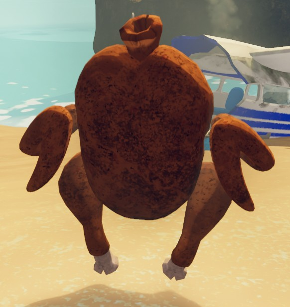](https://peak.wiki.gg/wiki/File%3ACannibalism_chicken.jpg)

Other [Scouts](Scout.md) appear as walking roast chickens when the player is sufficiently hungry.

**Cannibalism** is a game [mechanic](https://peak.wiki.gg/wiki/Mechanic) in *[PEAK](Peak%20%28game%29.md)* that allows players to eat other players when their [](Stamina%20bar.md#Hunger) [Hunger](Stamina%20bar.md#Hunger) is above a certain threshold.

When Cannibalism is enabled, players whose [](Stamina%20bar.md#Hunger) [Hunger](Stamina%20bar.md#Hunger) is 70% or higher will start seeing other players as walking chickens and will be able to eat them, removing all current [](Stamina%20bar.md#Hunger) [Hunger](Stamina%20bar.md#Hunger), adding [](Stamina%20bar.md#Curse) **10** [Curse](Stamina%20bar.md#Curse), and immediately killing the [Scout](Scout.md) that has been eaten.

By default, Cannibalism is enabled for all players. However, players that do not want to engage with this mechanic can toggle it off in the [settings](Settings.md). When a player turns it off, they will no longer see their teammates as chickens nor be able to eat them. Their teammates will also be unable to see them as a chicken or eat them as well.

Eating another Scout will reward the player with the [](https://peak.wiki.gg/wiki/Resourcefulness_Badge) [Resourcefulness Badge](https://peak.wiki.gg/wiki/Resourcefulness_Badge).

## Patch notes

 **[1.10.a](1.10.a.md) (2025-07-30):** Introduced.
 **[1.11.a](1.11.a.md) (2025-08-01):**

- Added an option called “ENABLE CANNIBALISM” which is on by default. For folks who don’t want to engage with this mechanic, simply turn it off at the Main Menu. By turning it off, you will no longer see other players become chickens or be able to eat them, and other players will not be allowed to see you as a chicken or eat you.
- Players will now become cannibals at 70% Hunger instead of 60%.
- Players will now take 10% Curse status upon cannibalizing, up from 5%.

---

# Capybara

Capybara
[](https://peak.wiki.gg/wiki/File%3ACapybara_closeup.png)
General
Type
[NPC](https://peak.wiki.gg/wiki/NPC)
Biome- [Alpine](Alpine.md)
- [Mesa](Mesa.md)

**Capybaras** are animals in *[PEAK](Peak%20%28game%29.md)* that spawn exclusively in either the [Alpine](Alpine.md)'s [Hot Spring](Alpine.md#Hot_Spring) or the [Mesa](Mesa.md)'s [Oasis](Mesa.md#Oasis).

## Uses

Capybaras are utilized in the completion of multiple [Badges](Badges.md).

For the [](https://peak.wiki.gg/wiki/Animal_Serenading_Badge) [Animal Serenading Badge](https://peak.wiki.gg/wiki/Animal_Serenading_Badge), the player must use a [Bugle](Bugle.md), [Bugle of Friendship](Bugle%20of%20Friendship.md), or [Scoutmaster's Bugle](Scoutmaster%27s%20Bugle.md) to play music near the Capybaras.

For the [](https://peak.wiki.gg/wiki/Gourmand_Badge) [Gourmand Badge](https://peak.wiki.gg/wiki/Gourmand_Badge), the player must acquire a [Yellow Winterberry](Yellow%20Winterberry.md) which can always be found on the head of at least one of the Capybaras in a group.

## Trivia

- The location of the [Hot Spring](Alpine.md#Hot_Spring) or [Oasis](Mesa.md#Oasis) (and thus the location of Capybaras) is randomized with every map seed.
- One way to locate the Hot Springs before beginning your climb is to look closely at the cliffs to see rising smoke. Besides the campfire at the top, the hot springs are the only source of smoke in the Alpine. The [Binoculars](Binoculars.md) can assist with this task.
- In the [Mesa](Mesa.md), they can be seen as a mirage which will disappear once the player is close enough.

## Gallery

- [](https://peak.wiki.gg/wiki/File%3ACapybaras_alpine.jpg)
  Capybaras in Alpine
- [](https://peak.wiki.gg/wiki/File%3ACapybara.png)
  Capybara texture

## Patch history

 **[1.0](1.0.md) (2025-06-16):** Introduced.

---

# Chain Launcher

Chain Launcher
[](https://peak.wiki.gg/wiki/File%3AChain_Launcher.png)
[Item type](Items.md)- [Deployable](https://peak.wiki.gg/wiki/Deployable)
Rarity
[Legendary](https://peak.wiki.gg/wiki/Legendary)
Source- [Regular Luggage](https://peak.wiki.gg/wiki/Regular_Luggage)
- [Big Luggage](https://peak.wiki.gg/wiki/Big_Luggage)
- [Explorer's Luggage](https://peak.wiki.gg/wiki/Explorer%27s_Luggage)
Weight
[](Stamina%20bar.md#Weight) **2.5**

The **Chain Launcher** is a [deployable](https://peak.wiki.gg/wiki/Deployable) item in *[PEAK](Peak%20%28game%29.md)* found in Regular and Big [Luggages](Luggage.md) past the [Shore](Shore.md) and [Explorer's Luggages](https://peak.wiki.gg/wiki/Explorer%27s_Luggage) anywhere. Using the chain launcher while grounded allows the player to deploy a chain connecting their current location with a wall up to **80 meters** away, consuming the chain launcher. You cannot use a chain launcher if you are looking too far up or down.

[Cooking](Cooking.md) a Chain Launcher immediately incinerates it, making it unusable.

## Physics

Unlike the [](Rope%20Cannon.md) [Rope Cannon](Rope%20Cannon.md), the Chain Launcher deploys its chain instantaneously, fixed on both ends by hooks embedded into the surface at the firing [Scout](Scout.md)'s position and the target surface. However, the slack of the chain is indeterminate. There is the possibility that the chain will spawn sagging too low to the ground, which can pose a problem on certain biomes such as [Tropics](Tropics.md) and [Caldera](Caldera.md), where the way across may potentially be obstructed by hazards.

## Patch history

 **[1.0](1.0.md) (2025-06-16):** Introduced.
 **[1.7](1.7.md) (2025-07-10):**

- Potentially fixed an issue where Chain Shooters would spawn with nothing in the chamber.
- Chain Launchers now cannot be shot above or below a certain angle past the horizon line. This is to remove unintended use cases where a chain launcher shot directly upwards would get you much further than other items – it’s intended to be used for lateral traversal!

 **[1.8](1.8.md) (2025-07-21):** Fixed an issue where the chain launcher would sometimes spawn as a broken version that didn't launch a chain when used.
 **[1.50.a](1.50.a.md) (2025-12-16):** Fixed bug where players were going 1/2 speed on Chain Launcher chains.

---

# Chain


This is a disambiguation page for "Chain".

The following is a list of links related to Chain.

**Chain** may refer to:

- [](Chain%20Launcher.md) [Chain Launcher](Chain%20Launcher.md) - Creates a chain between you and a targeted surface when fired.
- Pre-existing chains can be found in the [Shore](Shore.md) (Black Sand variant), [Alpine](Alpine.md), and [Caldera](Caldera.md).

---

# Checkpoint Flag

Checkpoint Flag
[](https://peak.wiki.gg/wiki/File%3ACheckpoint_Flag.png)
[Item type](Items.md)- [Deployable](https://peak.wiki.gg/wiki/Deployable)
Source- [Regular Luggage](https://peak.wiki.gg/wiki/Regular_Luggage)
- [Big Luggage](https://peak.wiki.gg/wiki/Big_Luggage)
- [Explorer's Luggage](https://peak.wiki.gg/wiki/Explorer%27s_Luggage)
Weight
[](Stamina%20bar.md#Weight) **2.5**
Cooked Bonuses
[](Stamina%20bar.md#Bonus_stamina)Bonus Stamina
10 (10 total)

The **Checkpoint Flag** is a [deployable](https://peak.wiki.gg/wiki/Deployable) item in *[PEAK](Peak%20%28game%29.md)* found in [Luggages](Luggage.md). It is a placeable flag that provides a single respawn checkpoint for the player who places it. When placed, it is tinted to match the color of the scout who placed it.

Checkpoint Flags can only be [cooked](Cooking.md) using explosives, such as the ones created by [](Dynamite.md) [Dynamite](Dynamite.md). Explosives advance the Checkpoint Flag's cooking stage by two (from uncooked to Well-Done to Incinerated).

## Mechanics

- When a Checkpoint Flag is placed, it saves the player's current [status effects](https://peak.wiki.gg/wiki/Status_effects), excluding [](Stamina%20bar.md#Weight) [Weight](Stamina%20bar.md#Weight).
- When the player dies, they immediately respawn at their most recently placed Checkpoint Flag and revert to the saved status effects. [Bonus stamina](Stamina%20bar.md#Bonus_stamina) is preserved after dying. This does not prevent status over time effects from continuing to apply status effects to the player.- The Checkpoint Flag will not revive [cannibalised](Cannibalism.md) Scouts and will not be destroyed in this scenario.
- Any items that the player dropped when they fell unconscious are returned to their inventory, so long as those items are still on the ground. Items will preserve their [cooking stage](Cooking.md#Cooking_stages) at the time of the player's death.
- An equipped backpack stays equipped after revival. A held backpack is not retained.
- A player's [skeleton](The%20Book%20of%20Bones.md) status is not changed during revival, including if the player became a skeleton after placing the flag.
- All placed Checkpoint Flags are destroyed when a campfire is lit.

## Gallery

- [](https://peak.wiki.gg/wiki/File%3ACheckpoint_flag_placed.jpg)
  A placed Checkpoint Flag.

## Patch history

 **[1.40.a](1.40.a.md) (2025-11-05):** Introduced.
 **[1.44.a](1.44.a.md) (2025-11-13):** The Checkpoint Flag now respawns [Scouts](https://peak.wiki.gg/wiki/Scouts) slightly above the ground to reduce clipping/physics issues upon respawning.

---

# Chubby Shroom

Chubby Shroom
[](https://peak.wiki.gg/wiki/File%3AChubby_Shroom.png)
[Item type](Items.md)- [Food](Food.md)
- [Mushroom](https://peak.wiki.gg/wiki/Mushroom)
Biome- [Shore](Shore.md)
- [Tropics](Tropics.md)
- [Roots](Roots.md)
- [Mesa](Mesa.md)
Weight
[](Stamina%20bar.md#Weight) **2.5**
Base Status Effects
[](Stamina%20bar.md#Hunger)Hunger
-10
Cooked Bonuses
[](Stamina%20bar.md#Hunger)Hunger
-10 (-20 total)
[](Stamina%20bar.md#Bonus_stamina)Bonus Stamina
10 (10 total)

The **Chubby Shroom** is a [mushroom](https://peak.wiki.gg/wiki/Mushroom) in *[PEAK](Peak%20%28game%29.md)* that can be found growing in the [Shore](Shore.md), [Tropics](Tropics.md), [Roots](Roots.md), and [Mesa](Mesa.md). It can be eaten as [food](Food.md).

There is no poisonous variety of the Chubby Shroom.

## Patch history

 **[1.0](1.0.md) (2025-06-16):** Introduced.

[Food](Food.md)
Natural food
Berries
Berrynanas- [](Yellow%20Berrynana.md) [Yellow Berrynana](Yellow%20Berrynana.md)
- [](Pink%20Berrynana.md) [Pink Berrynana](Pink%20Berrynana.md)
- [](Blue%20Berrynana.md) [Blue Berrynana](Blue%20Berrynana.md)
- [](Brown%20Berrynana.md) [Brown Berrynana](Brown%20Berrynana.md)
Clusterberries- [](Red%20Clusterberry.md) [Red Clusterberry](Red%20Clusterberry.md)
- [](Yellow%20Clusterberry.md) [Yellow Clusterberry](Yellow%20Clusterberry.md)
- [](Black%20Clusterberry.md) [Black Clusterberry](Black%20Clusterberry.md)
Crispberries- [](Green%20Crispberry.md) [Green Crispberry](Green%20Crispberry.md)
- [](Yellow%20Crispberry.md) [Yellow Crispberry](Yellow%20Crispberry.md)
- [](Red%20Crispberry.md) [Red Crispberry](Red%20Crispberry.md)
Kingberries- [](Green%20Kingberry.md) [Green Kingberry](Green%20Kingberry.md)
- [](Yellow%20Kingberry.md) [Yellow Kingberry](Yellow%20Kingberry.md)
- [](Purple%20Kingberry.md) [Purple Kingberry](Purple%20Kingberry.md)
Prickleberries- [](Red%20Prickleberry.md) [Red Prickleberry](Red%20Prickleberry.md)
- [](Gold%20Prickleberry.md) [Gold Prickleberry](Gold%20Prickleberry.md)
Shroomberries- [](Red%20Shroomberry.md) [Red Shroomberry](Red%20Shroomberry.md)
- [](Yellow%20Shroomberry.md) [Yellow Shroomberry](Yellow%20Shroomberry.md)
- [](Green%20Shroomberry.md) [Green Shroomberry](Green%20Shroomberry.md)
- [](Blue%20Shroomberry.md) [Blue Shroomberry](Blue%20Shroomberry.md)
- [](Purple%20Shroomberry.md) [Purple Shroomberry](Purple%20Shroomberry.md)
Winterberries- [](Orange%20Winterberry.md) [Orange Winterberry](Orange%20Winterberry.md)
- [](Yellow%20Winterberry.md) [Yellow Winterberry](Yellow%20Winterberry.md)
Other- [](Napberry.md) [Napberry](Napberry.md)
- [](Scorchberry.md) [Scorchberry](Scorchberry.md)
Campfire food- [](Marshmallow.md) [Marshmallow](Marshmallow.md)
- [](Hot%20Dog.md) [Hot Dog](Hot%20Dog.md)
Mushrooms- [](Bugle%20Shroom.md) [Bugle Shroom](Bugle%20Shroom.md)
- [](Button%20Shroom.md) [Button Shroom](Button%20Shroom.md)
- [](Chubby%20Shroom.md) Chubby Shroom
- [](Cluster%20Shroom.md) [Cluster Shroom](Cluster%20Shroom.md)
Mystical food- [](Cure-All.md) [Cure-All](Cure-All.md)
- [](Pandora%27s%20Lunchbox.md) [Pandora's Lunchbox](Pandora%27s%20Lunchbox.md)
Other- [](Cooked%20Bird.md) [Cooked Bird](Cooked%20Bird.md)
- [](Egg.md) [Egg](Egg.md)
- [](Frog%20Legs.md) [Frog Legs](Frog%20Legs.md)
- [](Honeycomb.md) [Honeycomb](Honeycomb.md)
- [](Half-Coconut.md) [Half-Coconut](Half-Coconut.md)
- [](Medicinal%20Root.md) [Medicinal Root](Medicinal%20Root.md)
- [](Mandrake.md) [Mandrake](Mandrake.md)
- [](Scorpion.md) [Scorpion](Scorpion.md)
- [](Tick.md) [Tick](Tick.md)
- [](The%20Early%20Worm.md) [The Early Worm](The%20Early%20Worm.md)
Packaged food
All packaged foods- [](Airline%20Food.md) [Airline Food](Airline%20Food.md)
- [](Big%20Lollipop.md) [Big Lollipop](Big%20Lollipop.md)
- [](Energy%20Drink.md) [Energy Drink](Energy%20Drink.md)
- [](Fortified%20Milk.md) [Fortified Milk](Fortified%20Milk.md)
- [](Granola%20Bar.md) [Granola Bar](Granola%20Bar.md)
- [](Scout%20Cookies.md) [Scout Cookies](Scout%20Cookies.md)
- [](Sports%20Drink.md) [Sports Drink](Sports%20Drink.md)
- [](Trail%20Mix.md) [Trail Mix](Trail%20Mix.md)

---

# Cloud Fungus

Cloud Fungus
[](https://peak.wiki.gg/wiki/File%3ACloud_Fungus.png)
[Item type](Items.md)- [Deployable](https://peak.wiki.gg/wiki/Deployable)
Biome- [Roots](Roots.md)
Weight
[](Stamina%20bar.md#Weight) **2.5**

The **Cloud Fungus** is an [deployable](https://peak.wiki.gg/wiki/Deployable) item in *[PEAK](Peak%20%28game%29.md)* that can be found on the sides of redwoods in the [Roots](Roots.md). It can be used to create a walkable platform similar to the [](Shelf%20Fungus.md) [Shelf Fungus](Shelf%20Fungus.md) in midair.

## Mechanics

When thrown, the Cloud Fungus will create a platform if the following conditions are met:

- At least half a second has passed since the Cloud Fungus was thrown.
- The Cloud Fungus has a downwards velocity.

Once placed, the Cloud Fungus becomes a floating platform approximately 3 meters across. Despite its appearance, the platform does not prevent [fall damage](https://peak.wiki.gg/wiki/Fall_damage).

## Tips

- It is very difficult to avoid activating the Cloud Fungus when dropping it or setting it on the ground, so players are advised to exercise caution when picking one up with a full inventory or low health.

## Gallery

- [](https://peak.wiki.gg/wiki/File%3ACloud_fungus_placed.jpg)
  A Cloud Fungus after being placed.

## Patch history

 **[1.40.a](1.40.a.md) (2025-11-05):** Introduced.

---

# Cluster Shroom

Cluster Shroom
Regular
Poisonous
[](https://peak.wiki.gg/wiki/File%3ACluster_Shroom.png)
[](https://peak.wiki.gg/wiki/File%3ACluster_Shroom_%28Poisonous%29.png)
[Item type](Items.md)- [Food](Food.md)
- [Mushroom](https://peak.wiki.gg/wiki/Mushroom)
Biome- [Shore](Shore.md)
- [Tropics](Tropics.md)
- [Roots](Roots.md)
- [Mesa](Mesa.md)
Weight
[](Stamina%20bar.md#Weight) **2.5**
Base Status Effects
[](Stamina%20bar.md#Hunger)Hunger
-5
[](Stamina%20bar.md#Poison)Poison
40
Cooked Bonuses
[](Stamina%20bar.md#Hunger)Hunger
-5 (-10 total)
[](Stamina%20bar.md#Bonus_stamina)Bonus Stamina
10 (10 total)

The **Cluster Shroom** a [mushroom](https://peak.wiki.gg/wiki/Mushroom) in *[PEAK](Peak%20%28game%29.md)* that can be found growing in the [Shore](Shore.md), [Tropics](Tropics.md), [Roots](Roots.md), and [Mesa](Mesa.md). It can be eaten as [food](Food.md).

A poisonous variety has skirted stalks and will slowly inflict [](Stamina%20bar.md#Poison) **40** [Poison](Stamina%20bar.md#Poison) over 16 seconds beginning 10 seconds after eating.

## Patch history

 **[1.0](1.0.md) (2025-06-16):** Introduced.

[Food](Food.md)
Natural food
Berries
Berrynanas- [](Yellow%20Berrynana.md) [Yellow Berrynana](Yellow%20Berrynana.md)
- [](Pink%20Berrynana.md) [Pink Berrynana](Pink%20Berrynana.md)
- [](Blue%20Berrynana.md) [Blue Berrynana](Blue%20Berrynana.md)
- [](Brown%20Berrynana.md) [Brown Berrynana](Brown%20Berrynana.md)
Clusterberries- [](Red%20Clusterberry.md) [Red Clusterberry](Red%20Clusterberry.md)
- [](Yellow%20Clusterberry.md) [Yellow Clusterberry](Yellow%20Clusterberry.md)
- [](Black%20Clusterberry.md) [Black Clusterberry](Black%20Clusterberry.md)
Crispberries- [](Green%20Crispberry.md) [Green Crispberry](Green%20Crispberry.md)
- [](Yellow%20Crispberry.md) [Yellow Crispberry](Yellow%20Crispberry.md)
- [](Red%20Crispberry.md) [Red Crispberry](Red%20Crispberry.md)
Kingberries- [](Green%20Kingberry.md) [Green Kingberry](Green%20Kingberry.md)
- [](Yellow%20Kingberry.md) [Yellow Kingberry](Yellow%20Kingberry.md)
- [](Purple%20Kingberry.md) [Purple Kingberry](Purple%20Kingberry.md)
Prickleberries- [](Red%20Prickleberry.md) [Red Prickleberry](Red%20Prickleberry.md)
- [](Gold%20Prickleberry.md) [Gold Prickleberry](Gold%20Prickleberry.md)
Shroomberries- [](Red%20Shroomberry.md) [Red Shroomberry](Red%20Shroomberry.md)
- [](Yellow%20Shroomberry.md) [Yellow Shroomberry](Yellow%20Shroomberry.md)
- [](Green%20Shroomberry.md) [Green Shroomberry](Green%20Shroomberry.md)
- [](Blue%20Shroomberry.md) [Blue Shroomberry](Blue%20Shroomberry.md)
- [](Purple%20Shroomberry.md) [Purple Shroomberry](Purple%20Shroomberry.md)
Winterberries- [](Orange%20Winterberry.md) [Orange Winterberry](Orange%20Winterberry.md)
- [](Yellow%20Winterberry.md) [Yellow Winterberry](Yellow%20Winterberry.md)
Other- [](Napberry.md) [Napberry](Napberry.md)
- [](Scorchberry.md) [Scorchberry](Scorchberry.md)
Campfire food- [](Marshmallow.md) [Marshmallow](Marshmallow.md)
- [](Hot%20Dog.md) [Hot Dog](Hot%20Dog.md)
Mushrooms- [](Bugle%20Shroom.md) [Bugle Shroom](Bugle%20Shroom.md)
- [](Button%20Shroom.md) [Button Shroom](Button%20Shroom.md)
- [](Chubby%20Shroom.md) [Chubby Shroom](Chubby%20Shroom.md)
- [](Cluster%20Shroom.md) Cluster Shroom
Mystical food- [](Cure-All.md) [Cure-All](Cure-All.md)
- [](Pandora%27s%20Lunchbox.md) [Pandora's Lunchbox](Pandora%27s%20Lunchbox.md)
Other- [](Cooked%20Bird.md) [Cooked Bird](Cooked%20Bird.md)
- [](Egg.md) [Egg](Egg.md)
- [](Frog%20Legs.md) [Frog Legs](Frog%20Legs.md)
- [](Honeycomb.md) [Honeycomb](Honeycomb.md)
- [](Half-Coconut.md) [Half-Coconut](Half-Coconut.md)
- [](Medicinal%20Root.md) [Medicinal Root](Medicinal%20Root.md)
- [](Mandrake.md) [Mandrake](Mandrake.md)
- [](Scorpion.md) [Scorpion](Scorpion.md)
- [](Tick.md) [Tick](Tick.md)
- [](The%20Early%20Worm.md) [The Early Worm](The%20Early%20Worm.md)
Packaged food
All packaged foods- [](Airline%20Food.md) [Airline Food](Airline%20Food.md)
- [](Big%20Lollipop.md) [Big Lollipop](Big%20Lollipop.md)
- [](Energy%20Drink.md) [Energy Drink](Energy%20Drink.md)
- [](Fortified%20Milk.md) [Fortified Milk](Fortified%20Milk.md)
- [](Granola%20Bar.md) [Granola Bar](Granola%20Bar.md)
- [](Scout%20Cookies.md) [Scout Cookies](Scout%20Cookies.md)
- [](Sports%20Drink.md) [Sports Drink](Sports%20Drink.md)
- [](Trail%20Mix.md) [Trail Mix](Trail%20Mix.md)

---

# Clusterberry (disambiguation)


This is a disambiguation page for "Clusterberry (disambiguation)".

The following is a list of links related to Clusterberry (disambiguation).

**Clusterberry** may refer to:

## Foods

- [](Red%20Clusterberry.md) [Red Clusterberry](Red%20Clusterberry.md)
- [](Yellow%20Clusterberry.md) [Yellow Clusterberry](Yellow%20Clusterberry.md)
- [](Black%20Clusterberry.md) [Black Clusterberry](Black%20Clusterberry.md)

---

# Coconut

Coconut
[](https://peak.wiki.gg/wiki/File%3ACoconut.png)
[Item type](Items.md)- [Misc](Misc.md)
Biome- [Shore](Shore.md)
- [Tropics](Tropics.md)
- [Mesa](Mesa.md)
Weight
[](Stamina%20bar.md#Weight) **12.5**

The **Coconut** is an [item](https://peak.wiki.gg/wiki/Item) in *[PEAK](Peak%20%28game%29.md)* found growing on trees in the [Shore](Shore.md), [Tropics](Tropics.md), and in the [Mesa](Mesa.md) (on the [oasis](https://peak.wiki.gg/wiki/Oasis) trees). You can retrieve them by climbing the palm tree or by throwing another item at the coconut.

A coconut can be broken to make two [](Half-Coconut.md) [Half-Coconuts](Half-Coconut.md). When thrown at a player, a Coconut is able to bonk them, causing them to enter a [ragdoll](https://peak.wiki.gg/wiki/Ragdoll) state.

A [cooked](Cooking.md) Coconut produces cooked Half-Coconuts.

## Trivia

- The Coconut once was the heaviest item in the game before the [Mesa update](1.20.a.md).

## Patch history

 **[1.0](1.0.md) (2025-06-16):** Introduced.
 **[1.7](1.7.md) (2025-07-10):** Whole coconuts will now bonk scouts when thrown at them. We were considering making every item bonk but then none of you would ever reach the PEAK again.

---

# Color Blindness Mode

**Color Blindness Mode** is a [setting](https://peak.wiki.gg/wiki/Setting) in *[PEAK](Peak%20%28game%29.md)* that changes certain textures to better accommodate players with various types of [color blindness](https://en.wikipedia.org/wiki/Color_blindness). It was first introduced in Beta patch 0.28.d and finally released in Patch [1.28.a](1.28.a.md).

Texture Changes

| Item | Normal | Color Blindness Mode |
| --- | --- | --- |
| [Pink Berrynana](Pink%20Berrynana.md) | [Pink Berrynana](Pink%20Berrynana.md) | [Pink Berrynana CB](Pink%20Berrynana.md) |
| [Pink Berrynana Peel](Pink%20Berrynana%20Peel.md) | [Pink Berrynana Peel](Pink%20Berrynana%20Peel.md) | [Pink Berrynana Peel CB](Pink%20Berrynana%20Peel.md) |
| [Brown Berrynana](Brown%20Berrynana.md) | [Brown Berrynana](Brown%20Berrynana.md) | [Brown Berrynana CB](Brown%20Berrynana.md) |
| [Brown Berrynana Peel](Brown%20Berrynana%20Peel.md) | [Brown Berrynana Peel](Brown%20Berrynana%20Peel.md) | [Brown Berrynana Peel CB](Brown%20Berrynana%20Peel.md) |
| [Blue Berrynana](Blue%20Berrynana.md) | [Blue Berrynana](Blue%20Berrynana.md) | [Blue Berrynana CB](Blue%20Berrynana.md) |
| [Blue Berrynana Peel](Blue%20Berrynana%20Peel.md) | [Blue Berrynana Peel](Blue%20Berrynana%20Peel.md) | [Blue Berrynana Peel CB](Blue%20Berrynana%20Peel.md) |
| [Purple Kingberry](Purple%20Kingberry.md) | [Purple Kingberry](Purple%20Kingberry.md) | [Purple Kingberry CB](Purple%20Kingberry.md) |
| [Yellow Kingberry](Yellow%20Kingberry.md) | [Yellow Kingberry](Yellow%20Kingberry.md) | [Yellow Kingberry CB](Yellow%20Kingberry.md) |
| [Red Clusterberry](Red%20Clusterberry.md) | [Red Clusterberry](Red%20Clusterberry.md) | [Red Clusterberry CB](Red%20Clusterberry.md) |
| [Yellow Clusterberry](Yellow%20Clusterberry.md) | [Yellow Clusterberry](Yellow%20Clusterberry.md) | [Yellow Clusterberry CB](Yellow%20Clusterberry.md) |
| [Green Crispberry](Green%20Crispberry.md) | [Green Crispberry](Green%20Crispberry.md) | [Green Crispberry CB](Green%20Crispberry.md) |
| [Yellow Crispberry](Yellow%20Crispberry.md) | [Yellow Crispberry](Yellow%20Crispberry.md) | [Yellow Crispberry CB](Yellow%20Crispberry.md) |
| [Gold Prickleberry](Gold%20Prickleberry.md) | [Gold Prickleberry](Gold%20Prickleberry.md) | [Gold Prickleberry CB](Gold%20Prickleberry.md) |
| [Yellow Winterberry](Yellow%20Winterberry.md) | [Yellow Winterberry](Yellow%20Winterberry.md) | [Yellow Winterberry CB](Yellow%20Winterberry.md) |

---

# Compass

Compass
[](https://peak.wiki.gg/wiki/File%3ACompass.png)
[Item type](Items.md)- [Equipment](Equipment.md)
Biome- [Shore](Shore.md)
Location- [Crash Site](https://peak.wiki.gg/wiki/Crash_Site)
Weight
[](Stamina%20bar.md#Weight) **0**

The **Compass** is an [equipment](Equipment.md) item in *[PEAK](Peak%20%28game%29.md)*. The compass will point towards the [Peak (biome)](Peak%20%28biome%29.md).

## See also

- [](Pirate%27s%20Compass.md) [Pirate's Compass](Pirate%27s%20Compass.md)

## Patch history

 **[1.0](1.0.md) (2025-06-16):** Introduced.

---

# Conch

Conch
[](https://peak.wiki.gg/wiki/File%3AConch.png)
[Item type](Items.md)- [Misc](Misc.md)
Biome- [Shore](Shore.md)
Weight
[](Stamina%20bar.md#Weight) **5**
[](https://peak.wiki.gg/wiki/File%3AConch_closeup.png)

A close-up of a Conch

The **Conch** is an [item](https://peak.wiki.gg/wiki/Item) in *[PEAK](Peak%20%28game%29.md)*. Several conch shells can be found scattered across the beach of the [Shore](Shore.md). Conches can be cooked for no effect aside from visual. Conches have no practical uses.

## Trivia

- The conch is reminiscent of the shell worn by Krill, the protagonist in AggroCrab's 2024 soulslike game, *[Another Crab's Treasure](https://en.wikipedia.org/wiki/Another_Crab%27s_Treasure)*.

## Patch history

 **[1.0](1.0.md) (2025-06-16):** Introduced.

---

# Condor

Condor
[](https://peak.wiki.gg/wiki/File%3ACondor_Flying.png)
General
Type
[Enemy](https://peak.wiki.gg/wiki/Enemy)
Biome- [Caldera](Caldera.md)

The **Condor** is a hostile [NPC](https://peak.wiki.gg/wiki/NPC) that spawn in the [Caldera](Caldera.md), that cruise through the air circling around their nests built upon hot rock towers. If players get too close, they will swoop down and start flapping furiously before grabbing a [Scout](Scout.md), flying them up to its nest and dropping them inside. Condor nests are always atop hot rock towers; nests generating on normal rock towers or elsewhere are unguarded.

Players cannot wiggle free from a Condor's grasp; however, the [](Rescue%20Claw.md) [Rescue Claw](Rescue%20Claw.md) can be used to free yourself and other teammates.

Whilst Condors don't directly harm players, the drop into the nest may cause [](Stamina%20bar.md#Injury) [Injury](Stamina%20bar.md#Injury), and the dangerous locations of the nests atop hot rock towers could provide a challenge if players are kidnapped, so it is best to try to avoid them. However, the nests will usually contain [](Big%20Egg.md) [Big Eggs](Big%20Egg.md) so if players are desperately hungry and can't locate any nearby nests or [luggage](Luggage.md), having a Condor kidnap a player may prove tactical.

A total of three Condors and hot rock towers will spawn in the Caldera in random locations, and they will always fly anti-clockwise around their towers at the same speed.

## Gallery

- [](https://peak.wiki.gg/wiki/File%3ACondor.jpg)
  A Condor in the Caldera's Temple
- [](https://peak.wiki.gg/wiki/File%3ACondor_Strike.png)
  A Condor about to strike a player.

## Patch history

 **[2.4.a](2.4.a.md) (2026-09-02):** Introduced.

---

# Cooked Bird

Cooked Bird
[](https://peak.wiki.gg/wiki/File%3ACooked_Bird.png)
[Item type](Items.md)- [Food](Food.md)
Biome- [Caldera](Caldera.md)
- [Gloom](Gloom.md)
Weight
[](Stamina%20bar.md#Weight) **10**
Cooked Bonuses
[](Stamina%20bar.md#Hunger)Hunger
-80 (-80 total)
[](Stamina%20bar.md#Bonus_stamina)Bonus Stamina
10 (10 total)

The **Cooked Bird** is a natural [food](Food.md) in *[PEAK](Peak%20%28game%29.md)* that has a 10% chance to be found by cracking a [](Big%20Egg.md) [Big Egg](Big%20Egg.md) from nests in the [Caldera](Caldera.md) and a 1% chance to be found by cracking a [](Small%20Egg.md) [Small Egg](Small%20Egg.md) from nests in the [Gloom](Gloom.md). It spawns pre-[cooked](Cooking.md) and cooking it again will make it Well-Done.

Consuming a Cooked Bird while [Cannibalism](Cannibalism.md) is disabled will grant the [](https://peak.wiki.gg/wiki/Resourcefulness_Badge) [Resourcefulness Badge](https://peak.wiki.gg/wiki/Resourcefulness_Badge).

## Patch history

 **[1.20.a](1.20.a.md) (2025-08-11):** Introduced.
 **[2.0.a](2.0.a.md) (2026-08-11):** Now attainable in Gloom biome. **(Undocumented)**

[Food](Food.md)
Natural food
Berries
Berrynanas- [](Yellow%20Berrynana.md) [Yellow Berrynana](Yellow%20Berrynana.md)
- [](Pink%20Berrynana.md) [Pink Berrynana](Pink%20Berrynana.md)
- [](Blue%20Berrynana.md) [Blue Berrynana](Blue%20Berrynana.md)
- [](Brown%20Berrynana.md) [Brown Berrynana](Brown%20Berrynana.md)
Clusterberries- [](Red%20Clusterberry.md) [Red Clusterberry](Red%20Clusterberry.md)
- [](Yellow%20Clusterberry.md) [Yellow Clusterberry](Yellow%20Clusterberry.md)
- [](Black%20Clusterberry.md) [Black Clusterberry](Black%20Clusterberry.md)
Crispberries- [](Green%20Crispberry.md) [Green Crispberry](Green%20Crispberry.md)
- [](Yellow%20Crispberry.md) [Yellow Crispberry](Yellow%20Crispberry.md)
- [](Red%20Crispberry.md) [Red Crispberry](Red%20Crispberry.md)
Kingberries- [](Green%20Kingberry.md) [Green Kingberry](Green%20Kingberry.md)
- [](Yellow%20Kingberry.md) [Yellow Kingberry](Yellow%20Kingberry.md)
- [](Purple%20Kingberry.md) [Purple Kingberry](Purple%20Kingberry.md)
Prickleberries- [](Red%20Prickleberry.md) [Red Prickleberry](Red%20Prickleberry.md)
- [](Gold%20Prickleberry.md) [Gold Prickleberry](Gold%20Prickleberry.md)
Shroomberries- [](Red%20Shroomberry.md) [Red Shroomberry](Red%20Shroomberry.md)
- [](Yellow%20Shroomberry.md) [Yellow Shroomberry](Yellow%20Shroomberry.md)
- [](Green%20Shroomberry.md) [Green Shroomberry](Green%20Shroomberry.md)
- [](Blue%20Shroomberry.md) [Blue Shroomberry](Blue%20Shroomberry.md)
- [](Purple%20Shroomberry.md) [Purple Shroomberry](Purple%20Shroomberry.md)
Winterberries- [](Orange%20Winterberry.md) [Orange Winterberry](Orange%20Winterberry.md)
- [](Yellow%20Winterberry.md) [Yellow Winterberry](Yellow%20Winterberry.md)
Other- [](Napberry.md) [Napberry](Napberry.md)
- [](Scorchberry.md) [Scorchberry](Scorchberry.md)
Campfire food- [](Marshmallow.md) [Marshmallow](Marshmallow.md)
- [](Hot%20Dog.md) [Hot Dog](Hot%20Dog.md)
Mushrooms- [](Bugle%20Shroom.md) [Bugle Shroom](Bugle%20Shroom.md)
- [](Button%20Shroom.md) [Button Shroom](Button%20Shroom.md)
- [](Chubby%20Shroom.md) [Chubby Shroom](Chubby%20Shroom.md)
- [](Cluster%20Shroom.md) [Cluster Shroom](Cluster%20Shroom.md)
Mystical food- [](Cure-All.md) [Cure-All](Cure-All.md)
- [](Pandora%27s%20Lunchbox.md) [Pandora's Lunchbox](Pandora%27s%20Lunchbox.md)
Other- [](Cooked%20Bird.md) Cooked Bird
- [](Egg.md) [Egg](Egg.md)
- [](Frog%20Legs.md) [Frog Legs](Frog%20Legs.md)
- [](Honeycomb.md) [Honeycomb](Honeycomb.md)
- [](Half-Coconut.md) [Half-Coconut](Half-Coconut.md)
- [](Medicinal%20Root.md) [Medicinal Root](Medicinal%20Root.md)
- [](Mandrake.md) [Mandrake](Mandrake.md)
- [](Scorpion.md) [Scorpion](Scorpion.md)
- [](Tick.md) [Tick](Tick.md)
- [](The%20Early%20Worm.md) [The Early Worm](The%20Early%20Worm.md)
Packaged food
All packaged foods- [](Airline%20Food.md) [Airline Food](Airline%20Food.md)
- [](Big%20Lollipop.md) [Big Lollipop](Big%20Lollipop.md)
- [](Energy%20Drink.md) [Energy Drink](Energy%20Drink.md)
- [](Fortified%20Milk.md) [Fortified Milk](Fortified%20Milk.md)
- [](Granola%20Bar.md) [Granola Bar](Granola%20Bar.md)
- [](Scout%20Cookies.md) [Scout Cookies](Scout%20Cookies.md)
- [](Sports%20Drink.md) [Sports Drink](Sports%20Drink.md)
- [](Trail%20Mix.md) [Trail Mix](Trail%20Mix.md)

---

# Cooking

**Cooking** is a game [mechanic](https://peak.wiki.gg/wiki/Mechanic) in *[PEAK](Peak%20%28game%29.md)* that allows the players to cook various [items](Items.md) and [food](Food.md). It requires a fire (or the hot rocks in the [Caldera](Caldera.md) or [The Kiln](The%20Kiln.md)) and produces different effects depending on the item.

Most food items benefit from cooking, while cooking non-food items produces various effects and can be both advantageous and detrimental.

## Sources of heat

Cooking an item is usually accomplished by interacting with a fire while holding the item. Sources of fire in the game include the [campfires](Campfire.md), the fire at the [crash site](https://peak.wiki.gg/wiki/Crash_site), and the [](Portable%20Stove.md) [Portable Stove](Portable%20Stove.md).

Additionally, many explosions, such as those from the [](Dynamite.md) [Dynamite](Dynamite.md), will cook items in a set range by one stage.

In the [Caldera](Caldera.md) and [The Kiln](The%20Kiln.md), dropped items or items in an unequipped [](Backpack.md) [Backpack](Backpack.md) or in a Backpack held in the player's hands can also be cooked by standing on or leaving items on heated ground. Items dropped directly in [lava](Lava.md) will cook at a rapid pace.

## Cooking stages

For most [foods](Food.md), cooking progresses in stages, with each stage being darker than the last. There are 4 cooking stages in the game:

| Stage | Name | Behavior |
| --- | --- | --- |
| 1 | **Cooked** | - Restored [Hunger](Stamina%20bar.md#Hunger) [Hunger](Stamina%20bar.md#Hunger) is doubled. - [Bonus stamina](Stamina%20bar.md#Bonus_stamina) [Bonus stamina](Stamina%20bar.md#Bonus_stamina) is multiplied by **x1.5**- Gives [Bonus stamina](Stamina%20bar.md#Bonus_stamina) **10** [Bonus stamina](Stamina%20bar.md#Bonus_stamina) if it didn't give any before. - For [berries](https://peak.wiki.gg/wiki/Berries) (including [Shroomberries](https://peak.wiki.gg/wiki/Shroomberries)):- Removes any [Thorns](Stamina%20bar.md#Thorns) [Thorns](Stamina%20bar.md#Thorns) and [Poison](Stamina%20bar.md#Poison) [Poison](Stamina%20bar.md#Poison)   - Reduces [Spores](Stamina%20bar.md#Spores) [Spores](Stamina%20bar.md#Spores) by **5**.  (Both stages are identical and do not stack their effects) |
| 2 | **Well-Done** |
| 3 | **Burnt** | - **5** less [Hunger](Stamina%20bar.md#Hunger) [Hunger](Stamina%20bar.md#Hunger) restored compared to the previous stage. |
| 4 | **Incinerated** | - Adds [Poison](Stamina%20bar.md#Poison) **10** [Poison](Stamina%20bar.md#Poison) for each time the food is incinerated (up to a maximum of **90**). - [Equipment](Equipment.md) items break and stop working. |

Some food items, like the [](Cooked%20Bird.md) [Cooked Bird](Cooked%20Bird.md), are precooked and do not occur uncooked.

## Special cooking effects

Almost any item can be cooked. Many items have alternate or additional effects when cooked. Items that explode are destroyed. Unless otherwise specified, the default effects of cooking still apply. See the corresponding item pages for more details.

| Item | Effect |
| --- | --- |
| [Anti-Rope Cannon](Anti-Rope%20Cannon.md) | Incinerated and unusable |
| [Anti-Rope Spool](Anti-Rope%20Spool.md) | Incinerated and unusable |
| [Anti-Zooka](Anti-Zooka.md) | Explodes, creating a larger Anti-Sphere at its location. |
| [Antidote](Antidote.md) | Explodes into a small cloud of [Poison](Stamina%20bar.md#Poison) [Poison](Stamina%20bar.md#Poison) healing without inflicting knockback |
| [Backpack](Backpack.md) | Visual-only. Can still hold items even when repeatedly incinerated |
| [Balloon](Balloon.md) | Pops |
| [Balloon Bunch](Balloon%20Bunch.md) | Pops |
| [Bandages](Bandages.md) | Visual-only |
| [Basketball](Basketball.md) | Pops |
| [Big Lollipop](Big%20Lollipop.md) | Removes [Drowsy](Stamina%20bar.md#Drowsy) [Drowsy](Stamina%20bar.md#Drowsy) penalty after use |
| [Bing Bong](Bing%20Bong.md) | - Lowers pitch and volume of voice lines - Stops playing voice lines when Incinerated |
| [Blowgun](Blowgun.md) | Inflicts [Heat](Stamina%20bar.md#Heat) **150** [Heat](Stamina%20bar.md#Heat) instead of [Drowsy](Stamina%20bar.md#Drowsy) **120** [Drowsy](Stamina%20bar.md#Drowsy) |
| [Bugle](Bugle.md) | Makes the pitch wobble more each time it is cooked |
| [Chain Launcher](Chain%20Launcher.md) | Incinerated and unusable |
| [Cure-All](Cure-All.md) | Explodes into a small cloud of healing without inflicting knockback |
| [Cursed Skull](Cursed%20Skull.md) | Activates immediately, then explodes with a [dynamite](Dynamite.md) explosion |
| [Dynamite](Dynamite.md) | Immediately explodes |
| [Energy Drink](Energy%20Drink.md) | - When consumed, explodes and knocks back players within a large radius - Effect duration is increased by 4 seconds - No additional [Drowsy](Stamina%20bar.md#Drowsy) [Drowsy](Stamina%20bar.md#Drowsy) (previous Drowsy still restored) |
| [Faerie Lantern](Faerie%20Lantern.md) | Explodes into a small cloud of healing |
| [First Aid Kit](First%20Aid%20Kit.md) | Visual-only |
| [Flare](Flare.md) | Explodes, dealing [Injury](Stamina%20bar.md#Injury) [Injury](Stamina%20bar.md#Injury) in a small radius |
| [Fortified Milk](Fortified%20Milk.md) | Increases the effect duration by 10 seconds if at all cooked. Receives no other cooking effects |
| [Guidebook](Guidebook.md) | Incinerated and unusable |
| [Heat Pack](Heat%20Pack.md) | Explodes, dealing [Injury](Stamina%20bar.md#Injury) [Injury](Stamina%20bar.md#Injury) in a small radius |
| [Lantern](Lantern.md) | Explodes, dealing [Injury](Stamina%20bar.md#Injury) [Injury](Stamina%20bar.md#Injury) in a small radius |
| [Mandrake](Mandrake.md) | - Permanently disables its screaming - Removes [Curse](Stamina%20bar.md#Curse) **25** [Curse](Stamina%20bar.md#Curse) upon consumption |
| [Medicinal Root](Medicinal%20Root.md) | Removes an extra [Poison](Stamina%20bar.md#Poison) **20** [Poison](Stamina%20bar.md#Poison) and [Spores](Stamina%20bar.md#Spores) **20** [Spores](Stamina%20bar.md#Spores) |
| [Pandora's Lunchbox](Pandora%27s%20Lunchbox.md) | Explodes, applying its effects in a small radius without inflicting knockback |
| [Piton](Piton.md) | Incinerated and unusable |
| [Portable Stove](Portable%20Stove.md) | Explodes, dealing [Injury](Stamina%20bar.md#Injury) [Injury](Stamina%20bar.md#Injury) in a small radius |
| [Rescue Claw](Rescue%20Claw.md) | Incinerated and unusable |
| [Rope Cannon](Rope%20Cannon.md) | Incinerated and unusable |
| [Rope Spool](Rope%20Spool.md) | Incinerated and unusable |
| [Scout Cannon](Scout%20Cannon.md) | Explodes similarly to  [Dynamite](Dynamite.md) |
| [Sports Drink](Sports%20Drink.md) | No penalty from being Burnt or Incinerated. |
| [Sunscreen](Sunscreen.md) | Explodes into a large cloud of sunscreen without inflicting knockback |
| [The Book of Bones](The%20Book%20of%20Bones.md) | Visual-only |

## Patch history

 **[1.2.a](1.2.a.md) (2025-06-18):** Cooked items will now show up as cooked in the backpack UI.
 **[1.10.a](1.10.a.md) (2025-07-30):**

- Fixed an issue where cooking something Well-Done and then stashing it would remove the buffs. For reference, the intended behavior is that Well-Done items give the same bonus as Cooked items. It's your warning before it burns :)
- Fixed an issue where an item in the temporary slot would display the wrong amount of Cooked.

 **[1.40.a](1.40.a.md) (2025-11-05):**

- A lot more non-food items will now Actually Do Something when cooked. If it seems like a good idea to set something on fire, give it a try!
- Cooked usable but non-food items such as [bandages](Bandages.md) will no longer grant [Extra Stamina](https://peak.wiki.gg/wiki/Extra_Stamina).
- Cooked [poisonous](https://peak.wiki.gg/wiki/Poisonous) berries will now be safe to eat. You still cannot cook the poison out of [mushrooms](https://peak.wiki.gg/wiki/Mushrooms).

 **[1.44.a](1.44.a.md) (2025-11-13):** [Lava](Lava.md) will no longer cook items that are being held in your hands.

---

# Cosmetics


Spoilers ahead!

This page contains **spoilers** for *[PEAK](Peak%20%28game%29.md)*. View at your own discretion.

**Cosmetics** serve to customize the appearance of Scouts and allow individual personalization. Different cosmetics can be equipped using the [](Passport.md) [Passport](Passport.md), at the [Airport](Airport.md). Cosmetics in PEAK include: skin color, accessory, eyes, mouth, fit, hat, and sash.

Most cosmetics are unlocked by earning [Badges](Badges.md) or completing [Ascents](Ascents.md). Each completed Ascent unlocks a sash[[1]](#cite_note-1), while each badge unlocks one or more of the other cosmetic types. A medal is unlocked when all 64 badges are collected.

## Passport Color.png Colors

- [](https://peak.wiki.gg/wiki/File%3AHand_Red.png)
  **Red**
- [](https://peak.wiki.gg/wiki/File%3AHand_Orange.png)
  **Orange**
- [](https://peak.wiki.gg/wiki/File%3AHand_Yellow.png)
  **Yellow**
- [](https://peak.wiki.gg/wiki/File%3AHand_Lime.png)
  **Lime**
- [](https://peak.wiki.gg/wiki/File%3AHand_Green.png)
  **Green**
- [](https://peak.wiki.gg/wiki/File%3AHand_Turquoise.png)
  **Turquoise**
- [](https://peak.wiki.gg/wiki/File%3AHand_Blue.png)
  **Blue**
- [](https://peak.wiki.gg/wiki/File%3AHand_Purple.png)
  **Purple**
- [](https://peak.wiki.gg/wiki/File%3AHand_Pink.png)
  **Pink**

## Passport Accessories.png Accessories

- [](https://peak.wiki.gg/wiki/File%3AAccessory_None.png)
  **None**
- [](https://peak.wiki.gg/wiki/File%3AAccessory_Charlie.png)
  **Charlie**
- [](https://peak.wiki.gg/wiki/File%3AAccessory_Hair.png)
  **Hair**
- [](https://peak.wiki.gg/wiki/File%3AAccessory_Parted_Hair.png)
  **Parted Hair**
- [](https://peak.wiki.gg/wiki/File%3AAccessory_Microbangs.png)
  **Microbangs**
- [](https://peak.wiki.gg/wiki/File%3AAccessory_Raised_Brow.png)
  **Raised Brow**
- [](https://peak.wiki.gg/wiki/File%3AAccessory_Dot_Brow.png)
  **Dot Brow**
- [](https://peak.wiki.gg/wiki/File%3AAccessory_Brows.png)
  **Brows**
- [](https://peak.wiki.gg/wiki/File%3AAccessory_Angry_Brows.png)
  **Angry Brows**
- [](https://peak.wiki.gg/wiki/File%3AAccessory_Round_Glasses.png)
  **Round Glasses**
- [](https://peak.wiki.gg/wiki/File%3AAccessory_Aviators.png)
  **Aviators**
- [](https://peak.wiki.gg/wiki/File%3AAccessory_Cheekbones.png)
  **Cheekbones**
- [](https://peak.wiki.gg/wiki/File%3AAccessory_Face_Paint.png)
  **Face Paint**
- [](https://peak.wiki.gg/wiki/File%3AAccessory_Scar.png)
  **Scar**
- [](https://peak.wiki.gg/wiki/File%3AAccessory_Bow.png)
  **Bow**
   [](https://peak.wiki.gg/wiki/Knot_Tying_Badge) [Knot Tying Badge](https://peak.wiki.gg/wiki/Knot_Tying_Badge)
- [](https://peak.wiki.gg/wiki/File%3AAccessory_Eyepatch.png)
  **Eyepatch**
   [](https://peak.wiki.gg/wiki/Plunderer_Badge) [Plunderer Badge](https://peak.wiki.gg/wiki/Plunderer_Badge)
- [](https://peak.wiki.gg/wiki/File%3AAccessory_Broken_Glasses.png)
  **Broken Glasses**
   [](https://peak.wiki.gg/wiki/Bookworm_Badge) [Bookworm Badge](https://peak.wiki.gg/wiki/Bookworm_Badge)
- [](https://peak.wiki.gg/wiki/File%3AAccessory_Groucho.png)
  **Groucho**
   [](https://peak.wiki.gg/wiki/Leave_No_Trace_Badge) [Leave No Trace Badge](https://peak.wiki.gg/wiki/Leave_No_Trace_Badge)
- [](https://peak.wiki.gg/wiki/File%3AAccessory_Matrix_Glasses.png)
  **Matrix Glasses**
   [](https://peak.wiki.gg/wiki/Astronomy_Badge) [Astronomy Badge](https://peak.wiki.gg/wiki/Astronomy_Badge)
- [](https://peak.wiki.gg/wiki/File%3AAccessory_Scar_2.png)
  **Scar 2**
   [](https://peak.wiki.gg/wiki/Megaentomology_Badge) [Megaentomology Badge](https://peak.wiki.gg/wiki/Megaentomology_Badge)
- [](https://peak.wiki.gg/wiki/File%3AAccessory_ThirdEye.png)
  **Third Eye**
   [](https://peak.wiki.gg/wiki/Calcium_Intake_Badge) [Calcium Intake Badge](https://peak.wiki.gg/wiki/Calcium_Intake_Badge)

## Passport Eyes.png Eyes

- [](https://peak.wiki.gg/wiki/File%3AEyes_Basic.png)
  **Basic Eyes**
- [](https://peak.wiki.gg/wiki/File%3AEyes_Lashes.png)
  **Lashes**
- [](https://peak.wiki.gg/wiki/File%3AEyes_Half.png)
  **Half Eyes**
- [](https://peak.wiki.gg/wiki/File%3AEyes_Shine.png)
  **Shine**
- [](https://peak.wiki.gg/wiki/File%3AEyes_Squint.png)
  **Squint**
- [](https://peak.wiki.gg/wiki/File%3AEyes_Angry.png)
  **Angry Eyes**
- [](https://peak.wiki.gg/wiki/File%3AEyes_Eyeliner.png)
  **Eyeliner**
- [](https://peak.wiki.gg/wiki/File%3AEyes_Sad.png)
  **Sad Eyes**
- [](https://peak.wiki.gg/wiki/File%3AEyes_Cry.png)
  **Cry Eyes**
- [](https://peak.wiki.gg/wiki/File%3AEyes_Tired.png)
  **Tired Eyes**
- [](https://peak.wiki.gg/wiki/File%3AEyes_Almond.png)
  **Almond Eyes**
- [](https://peak.wiki.gg/wiki/File%3AEyes_2.png)
  **Eyes 2**
- [](https://peak.wiki.gg/wiki/File%3AEyes_Small.png)
  **Small Eyes**
- [](https://peak.wiki.gg/wiki/File%3AEyes_Concern.png)
  **Concern Eyes**
- [](https://peak.wiki.gg/wiki/File%3AEyes_Anime.png)
  **Anime Eyes**
   [](https://peak.wiki.gg/wiki/Bouldering_Badge) [Bouldering Badge](https://peak.wiki.gg/wiki/Bouldering_Badge)
- [](https://peak.wiki.gg/wiki/File%3AEyes_Real.png)
  **Real Eyes**
   [](https://peak.wiki.gg/wiki/Arborist_Badge) [Arborist Badge](https://peak.wiki.gg/wiki/Arborist_Badge)
- [](https://peak.wiki.gg/wiki/File%3AEyes_Aggro.png)
  **Aggro Eyes**
   [](https://peak.wiki.gg/wiki/Gourmand_Badge) [Gourmand Badge](https://peak.wiki.gg/wiki/Gourmand_Badge)
- [](https://peak.wiki.gg/wiki/File%3AEyes_Inverted.png)
  **Inverted Eyes**
   [](https://peak.wiki.gg/wiki/Mentorship_Badge) [Mentorship Badge](https://peak.wiki.gg/wiki/Mentorship_Badge)

## Passport Mouth.png Mouths

- [](https://peak.wiki.gg/wiki/File%3AMouth_Smiley.png)
  **Smiley**
- [](https://peak.wiki.gg/wiki/File%3AMouth_CalArts.png)
  **CalArts**
- [](https://peak.wiki.gg/wiki/File%3AMouth_Cat.png)
  **Cat**
- [](https://peak.wiki.gg/wiki/File%3AMouth_Cheek.png)
  **Cheek**
- [](https://peak.wiki.gg/wiki/File%3AMouth_Drool.png)
  **Drool**
- [](https://peak.wiki.gg/wiki/File%3AMouth_Lips.png)
  **Lips**
- [](https://peak.wiki.gg/wiki/File%3AMouth_Frown.png)
  **Frown**
- [](https://peak.wiki.gg/wiki/File%3AMouth_Kissy.png)
  **Kissy**
- [](https://peak.wiki.gg/wiki/File%3AMouth_NonPlussed.png)
  **Non-Plussed**
- [](https://peak.wiki.gg/wiki/File%3AMouth_O.png)
  **O**
- [](https://peak.wiki.gg/wiki/File%3AMouth_Squiggle.png)
  **Squiggle**
- [](https://peak.wiki.gg/wiki/File%3AMouth_Triangle.png)
  **Triangle**
- [](https://peak.wiki.gg/wiki/File%3AMouth_Smirk.png)
  **Smirk**
- [](https://peak.wiki.gg/wiki/File%3AMouth_Cringe.png)
  **Cringe**
- [](https://peak.wiki.gg/wiki/File%3AMouth_Teeth.png)
  **Teeth**
- [](https://peak.wiki.gg/wiki/File%3AMouth_Vamp.png)
  **Vamp**
   [](https://peak.wiki.gg/wiki/Toxicology_Badge) [Toxicology Badge](https://peak.wiki.gg/wiki/Toxicology_Badge)
- [](https://peak.wiki.gg/wiki/File%3AMouth_Aggro.png)
  **Aggro**
   [](https://peak.wiki.gg/wiki/Gourmand_Badge) [Gourmand Badge](https://peak.wiki.gg/wiki/Gourmand_Badge)
- [](https://peak.wiki.gg/wiki/File%3AMouth_Wacky.png)
  **Wacky**
   [](https://peak.wiki.gg/wiki/Foraging_Badge) [Foraging Badge](https://peak.wiki.gg/wiki/Foraging_Badge)
- [](https://peak.wiki.gg/wiki/File%3AMouth_Labu.png)
  **Labu**
   [](https://peak.wiki.gg/wiki/Resourcefulness_Badge) [Resourcefulness Badge](https://peak.wiki.gg/wiki/Resourcefulness_Badge)

## Passport Fit.png Fits

- [](https://peak.wiki.gg/wiki/File%3AFit_Shorts.png)
  **Shorts**
- [](https://peak.wiki.gg/wiki/File%3AFit_Skirt.png)
  **Skirt**
- [](https://peak.wiki.gg/wiki/File%3AFit_Turtle_Shorts.png)
  **Turtle Shorts**
- [](https://peak.wiki.gg/wiki/File%3AFit_Turtle_Skirt.png)
  **Turtle Skirt**
- [](https://peak.wiki.gg/wiki/File%3AFit_Sailor_Shorts.png)
  **Sailor Shorts**
   [](https://peak.wiki.gg/wiki/Emergency_Preparedness_Badge) [Emergency Preparedness Badge](https://peak.wiki.gg/wiki/Emergency_Preparedness_Badge)
- [](https://peak.wiki.gg/wiki/File%3AFit_Sailor_Skirt.png)
  **Sailor Skirt**
   [](https://peak.wiki.gg/wiki/Emergency_Preparedness_Badge) [Emergency Preparedness Badge](https://peak.wiki.gg/wiki/Emergency_Preparedness_Badge)
- [](https://peak.wiki.gg/wiki/File%3AFit_Castaway_Shorts.png)
  **Castaway Shorts**
   [](https://peak.wiki.gg/wiki/Participation_Badge) [Participation Badge](https://peak.wiki.gg/wiki/Participation_Badge)
- [](https://peak.wiki.gg/wiki/File%3AFit_Castaway_Skirt.png)
  **Castaway Skirt**
   [](https://peak.wiki.gg/wiki/Participation_Badge) [Participation Badge](https://peak.wiki.gg/wiki/Participation_Badge)
- [](https://peak.wiki.gg/wiki/File%3AFit_Tropical_Shorts.png)
  **Tropical Shorts**
   [](https://peak.wiki.gg/wiki/Volcanology_Badge) [Volcanology Badge](https://peak.wiki.gg/wiki/Volcanology_Badge)
- [](https://peak.wiki.gg/wiki/File%3AFit_Tropical_Skirt.png)
  **Tropical Skirt**
   [](https://peak.wiki.gg/wiki/Volcanology_Badge) [Volcanology Badge](https://peak.wiki.gg/wiki/Volcanology_Badge)
- [](https://peak.wiki.gg/wiki/File%3AFit_Cookie_Shorts.png)
  **Cookie Shorts**
   [](https://peak.wiki.gg/wiki/Happy_Camper_Badge) [Happy Camper Badge](https://peak.wiki.gg/wiki/Happy_Camper_Badge)
- [](https://peak.wiki.gg/wiki/File%3AFit_Cookie_Skirt.png)
  **Cookie Skirt**
   [](https://peak.wiki.gg/wiki/Happy_Camper_Badge) [Happy Camper Badge](https://peak.wiki.gg/wiki/Happy_Camper_Badge)
- [](https://peak.wiki.gg/wiki/File%3AFit_Balloon_Shorts.png)
  **Balloon Shorts**
   [](https://peak.wiki.gg/wiki/Balloon_Badge) [Balloon Badge](https://peak.wiki.gg/wiki/Balloon_Badge)
- [](https://peak.wiki.gg/wiki/File%3AFit_Balloon_Skirt.png)
  **Balloon Skirt**
   [](https://peak.wiki.gg/wiki/Balloon_Badge) [Balloon Badge](https://peak.wiki.gg/wiki/Balloon_Badge)
- [](https://peak.wiki.gg/wiki/File%3AFit_Scoutmaster_Shorts.png)
  **Scoutmaster Shorts**
   [](https://peak.wiki.gg/wiki/Survivalist_Badge) [Survivalist Badge](https://peak.wiki.gg/wiki/Survivalist_Badge)
- [](https://peak.wiki.gg/wiki/File%3AFit_Scoutmaster_Skirt.png)
  **Scoutmaster Skirt**
   [](https://peak.wiki.gg/wiki/Survivalist_Badge) [Survivalist Badge](https://peak.wiki.gg/wiki/Survivalist_Badge)
- [](https://peak.wiki.gg/wiki/File%3AFit_Cowboy.png)
  **Cowboy**
   [](https://peak.wiki.gg/wiki/Cool_Cucumber_Badge) [Cool Cucumber Badge](https://peak.wiki.gg/wiki/Cool_Cucumber_Badge)
- [](https://peak.wiki.gg/wiki/File%3AFit_Aviator.png)
  **Aviator Fit**
   [](https://peak.wiki.gg/wiki/Alpinist_Badge) [Alpinist Badge](https://peak.wiki.gg/wiki/Alpinist_Badge)
- [](https://peak.wiki.gg/wiki/File%3AFit_Astronaut.png)
  **Astronaut**
   [](https://peak.wiki.gg/wiki/Aeronautics_Badge) [Aeronautics Badge](https://peak.wiki.gg/wiki/Aeronautics_Badge)
- [](https://peak.wiki.gg/wiki/File%3AFit_Ice_Blue.png)
  **Ice Blue**
   [](https://peak.wiki.gg/wiki/Bundled_Up_Badge) [Bundled Up Badge](https://peak.wiki.gg/wiki/Bundled_Up_Badge)
- [](https://peak.wiki.gg/wiki/File%3AFit_Ice_Pink.png)
  **Ice Pink**
   [](https://peak.wiki.gg/wiki/Bundled_Up_Badge) [Bundled Up Badge](https://peak.wiki.gg/wiki/Bundled_Up_Badge)
- [](https://peak.wiki.gg/wiki/File%3AFit_Gnome.png)
  **Gnome**
   [](https://peak.wiki.gg/wiki/Forestry_Badge) [Forestry Badge](https://peak.wiki.gg/wiki/Forestry_Badge)
- [](https://peak.wiki.gg/wiki/File%3AFit_PlagueDoctor.png)
  **Plague Doctor**
   [](https://peak.wiki.gg/wiki/Tread_Lightly_Badge) [Tread Lightly Badge](https://peak.wiki.gg/wiki/Tread_Lightly_Badge)
- [](https://peak.wiki.gg/wiki/File%3AFit_Mummy.png)
  **Mummy Fit**
   [](https://peak.wiki.gg/wiki/Web_Security_Badge) [Web Security Badge](https://peak.wiki.gg/wiki/Web_Security_Badge)
- [](https://peak.wiki.gg/wiki/File%3AFit_Climber.png)
  **Climber**
   [](https://peak.wiki.gg/wiki/Disaster_Response_Badge) [Disaster Response Badge](https://peak.wiki.gg/wiki/Disaster_Response_Badge)
- [](https://peak.wiki.gg/wiki/File%3AFit_SkeleOnesie.png)
  **Skele Onesie**
   [](https://peak.wiki.gg/wiki/Applied_Esoterica_Badge) [Applied Esoterica Badge](https://peak.wiki.gg/wiki/Applied_Esoterica_Badge)
- [](https://peak.wiki.gg/wiki/File%3AFit_Fairy.png)
  **Fairy Fit**
   [](https://peak.wiki.gg/wiki/Mycoacrobatics_Badge) [Mycoacrobatics Badge](https://peak.wiki.gg/wiki/Mycoacrobatics_Badge)
- [](https://peak.wiki.gg/wiki/File%3ASleepy_Guy_Outfit.png)
  **Sleepy Guy Fit**
   [](https://peak.wiki.gg/wiki/Well_Rested_Badge) [Well Rested Badge](https://peak.wiki.gg/wiki/Well_Rested_Badge)
- [](https://peak.wiki.gg/wiki/File%3AKnight_Outfit.png)
  **Knight Fit**
   [](https://peak.wiki.gg/wiki/Medieval_History_Badge) [Medieval History Badge](https://peak.wiki.gg/wiki/Medieval_History_Badge)
- [](https://peak.wiki.gg/wiki/File%3AJester_Outfit.png)
  **Jester Fit**
   [](https://peak.wiki.gg/wiki/Jester_Badge) [Jester Badge](https://peak.wiki.gg/wiki/Jester_Badge)
- [](https://peak.wiki.gg/wiki/File%3AToga_Outfit.png)
  **Toga**
   [](https://peak.wiki.gg/wiki/Last_Resort_Badge) [Last Resort Badge](https://peak.wiki.gg/wiki/Last_Resort_Badge)
- [](https://peak.wiki.gg/wiki/File%3AGothic_Outfit.png)
  **Gothic Fit**
   [](https://peak.wiki.gg/wiki/Exorcist_Badge) [Exorcist Badge](https://peak.wiki.gg/wiki/Exorcist_Badge)
- [](https://peak.wiki.gg/wiki/File%3ACargo_Outfit.png)
  **Cargo Fit**
   [](https://peak.wiki.gg/wiki/Hang_Gliding_Badge) [Hang Gliding Badge](https://peak.wiki.gg/wiki/Hang_Gliding_Badge)
- [](https://peak.wiki.gg/wiki/File%3AStarboy_Outfit.png)
  **Starboy Fit**
   [](https://peak.wiki.gg/wiki/Rule_Zero_Badge) [Rule Zero Badge](https://peak.wiki.gg/wiki/Rule_Zero_Badge)

## Passport Hats.png Hats

- [](https://peak.wiki.gg/wiki/File%3AHat_Cap.png)
  **Cap**
- [](https://peak.wiki.gg/wiki/File%3AHat_Beret.png)
  **Beret**
- [](https://peak.wiki.gg/wiki/File%3AHat_Pith_Helmet.png)
  **Fedora (Pith Helmet)**
   [](https://peak.wiki.gg/wiki/Trailblazer_Badge) [Trailblazer Badge](https://peak.wiki.gg/wiki/Trailblazer_Badge)
- [](https://peak.wiki.gg/wiki/File%3AHat_Propeller_Hat.png)
  **Propeller Hat**
   [](https://peak.wiki.gg/wiki/Bing_Bong_Badge) [Bing Bong Badge](https://peak.wiki.gg/wiki/Bing_Bong_Badge)
- [](https://peak.wiki.gg/wiki/File%3AHat_Straw_Hat.png)
  **Straw Hat**
   [](https://peak.wiki.gg/wiki/Beachcomber_Badge) [Beachcomber Badge](https://peak.wiki.gg/wiki/Beachcomber_Badge)
- [](https://peak.wiki.gg/wiki/File%3AHat_Aviator.png)
  **Aviator Hat**
   [](https://peak.wiki.gg/wiki/Alpinist_Badge) [Alpinist Badge](https://peak.wiki.gg/wiki/Alpinist_Badge)
- [](https://peak.wiki.gg/wiki/File%3AHat_Sailor.png)
  **Sailor Hat**
   [](https://peak.wiki.gg/wiki/Clutch_Badge) [Clutch Badge](https://peak.wiki.gg/wiki/Clutch_Badge)
- [](https://peak.wiki.gg/wiki/File%3AHat_Medic.png)
  **Medic Hat**
   [](https://peak.wiki.gg/wiki/First_Aid_Badge) [First Aid Badge](https://peak.wiki.gg/wiki/First_Aid_Badge)
- [](https://peak.wiki.gg/wiki/File%3AHat_Midsummer.png)
  **Midsummer Hat**
   [](https://peak.wiki.gg/wiki/Naturalist_Badge) [Naturalist Badge](https://peak.wiki.gg/wiki/Naturalist_Badge)
- [](https://peak.wiki.gg/wiki/File%3AHat_Mushroom.png)
  **Mushroom Hat**
   [](https://peak.wiki.gg/wiki/Mycology_Badge) [Mycology Badge](https://peak.wiki.gg/wiki/Mycology_Badge)
- [](https://peak.wiki.gg/wiki/File%3AHat_Crab.png)
  **Crab Hat**
   [](https://peak.wiki.gg/wiki/Animal_Serenading_Badge) [Animal Serenading Badge](https://peak.wiki.gg/wiki/Animal_Serenading_Badge)
- [](https://peak.wiki.gg/wiki/File%3AHat_Courier.png)
  **Courier Hat**
   [](https://peak.wiki.gg/wiki/Hasty_Badge) [Hasty Badge](https://peak.wiki.gg/wiki/Hasty_Badge)
- [](https://peak.wiki.gg/wiki/File%3AHat_Scoutmaster.png)
  **Scoutmaster Hat**
   [](https://peak.wiki.gg/wiki/Peak_Badge) [Peak Badge](https://peak.wiki.gg/wiki/Peak_Badge)
- [](https://peak.wiki.gg/wiki/File%3AHat_Bandana.png)
  **Bandana**
   [](https://peak.wiki.gg/wiki/High_Altitude_Badge) [High Altitude Badge](https://peak.wiki.gg/wiki/High_Altitude_Badge)
- [](https://peak.wiki.gg/wiki/File%3AHat_Ninja_Headband.png)
  **Ninja Headband**
   [](https://peak.wiki.gg/wiki/Endurance_Badge) [Endurance Badge](https://peak.wiki.gg/wiki/Endurance_Badge)
- [](https://peak.wiki.gg/wiki/File%3AHat_Chef.png)
  **Chef Hat**
   [](https://peak.wiki.gg/wiki/Cooking_Badge) [Cooking Badge](https://peak.wiki.gg/wiki/Cooking_Badge)
- [](https://peak.wiki.gg/wiki/File%3AHat_Wizard.png)
  **Wizard Hat**
   [](https://peak.wiki.gg/wiki/Esoterica_Badge) [Esoterica Badge](https://peak.wiki.gg/wiki/Esoterica_Badge)
- [](https://peak.wiki.gg/wiki/File%3AHat_Wolf_Ears.png)
  **Wolf Ears**
   [](https://peak.wiki.gg/wiki/Lone_Wolf_Badge) [Lone Wolf Badge](https://peak.wiki.gg/wiki/Lone_Wolf_Badge)
- [](https://peak.wiki.gg/wiki/File%3AHat_Crown.png)
  **Crown**
   Collect all the [original badges](Badges.md#Original_badges).
- [](https://peak.wiki.gg/wiki/File%3AHat_Goat.png)
  **Goat**
   Complete [Ascent 7](https://peak.wiki.gg/wiki/Ascent_7)
- [](https://peak.wiki.gg/wiki/File%3AHat_Desert_Hat.png)
  **Desert Hat**
   [](https://peak.wiki.gg/wiki/Nomad_Badge) [Nomad Badge](https://peak.wiki.gg/wiki/Nomad_Badge)
- [](https://peak.wiki.gg/wiki/File%3AHat_Visor.png)
  **Visor**
   [](https://peak.wiki.gg/wiki/Ultimate_Badge) [Ultimate Badge](https://peak.wiki.gg/wiki/Ultimate_Badge)
- [](https://peak.wiki.gg/wiki/File%3AHat_Sun_Hat.png)
  **Sun Hat**
   [](https://peak.wiki.gg/wiki/Needlepoint_Badge) [Needlepoint Badge](https://peak.wiki.gg/wiki/Needlepoint_Badge)
- [](https://peak.wiki.gg/wiki/File%3AHat_Gallon.png)
  **Gallon Hat**
   [](https://peak.wiki.gg/wiki/Cool_Cucumber_Badge) [Cool Cucumber Badge](https://peak.wiki.gg/wiki/Cool_Cucumber_Badge)
- [](https://peak.wiki.gg/wiki/File%3AHat_Bing_Bong_Beanie.png)
  **Bing Bong Beanie**
   [](https://peak.wiki.gg/wiki/24_Karat_Badge) [24 Karat Badge](https://peak.wiki.gg/wiki/24_Karat_Badge)
- [](https://peak.wiki.gg/wiki/File%3AHat_Racing_Helmet.png)
  **Racing Helmet**
   [](https://peak.wiki.gg/wiki/Daredevil_Badge) [Daredevil Badge](https://peak.wiki.gg/wiki/Daredevil_Badge)
- [](https://peak.wiki.gg/wiki/File%3AHat_Astronaut.png)
  **Astronaut**
   [](https://peak.wiki.gg/wiki/Aeronautics_Badge) [Aeronautics Badge](https://peak.wiki.gg/wiki/Aeronautics_Badge)
- [](https://peak.wiki.gg/wiki/File%3AHat_Pumpkin.png)
  **Pumpkin**
   [](https://peak.wiki.gg/wiki/Undead_Encounter_Badge) [Undead Encounter Badge](https://peak.wiki.gg/wiki/Undead_Encounter_Badge)
- [](https://peak.wiki.gg/wiki/File%3AHat_Mummy.png)
  **Mummy Hat**
   [](https://peak.wiki.gg/wiki/Web_Security_Badge) [Web Security Badge](https://peak.wiki.gg/wiki/Web_Security_Badge)
- [](https://peak.wiki.gg/wiki/File%3AHat_Antlers.png)
  **Antlers**
   [](https://peak.wiki.gg/wiki/Advanced_Mycology_Badge) [Advanced Mycology Badge](https://peak.wiki.gg/wiki/Advanced_Mycology_Badge)
- [](https://peak.wiki.gg/wiki/File%3AHat_Gnome.png)
  **Gnome Hat**
   [](https://peak.wiki.gg/wiki/Forestry_Badge) [Forestry Badge](https://peak.wiki.gg/wiki/Forestry_Badge)
- [](https://peak.wiki.gg/wiki/File%3AHat_PlagueDoctor.png)
  **Plague Doctor Hat**
   [](https://peak.wiki.gg/wiki/Tread_Lightly_Badge) [Tread Lightly Badge](https://peak.wiki.gg/wiki/Tread_Lightly_Badge)
- [](https://peak.wiki.gg/wiki/File%3AHat_ClimbingHelmet.png)
  **Climbing Helmet**
   [](https://peak.wiki.gg/wiki/Disaster_Response_Badge) [Disaster Response Badge](https://peak.wiki.gg/wiki/Disaster_Response_Badge)
- [](https://peak.wiki.gg/wiki/File%3AHat_DrinkHat.png)
  **Drink Hat**
   [](https://peak.wiki.gg/wiki/Competitive_Eating_Badge) [Competitive Eating Badge](https://peak.wiki.gg/wiki/Competitive_Eating_Badge)
- [](https://peak.wiki.gg/wiki/File%3AHat_Fairy.png)
  **Fairy Hat**
   [](https://peak.wiki.gg/wiki/Mycoacrobatics_Badge) [Mycoacrobatics Badge](https://peak.wiki.gg/wiki/Mycoacrobatics_Badge)
- [](https://peak.wiki.gg/wiki/File%3AHat_Sprout.png)
  **Sprout**
   [](https://peak.wiki.gg/wiki/Cryptogastronomy_Badge) [Cryptogastronomy Badge](https://peak.wiki.gg/wiki/Cryptogastronomy_Badge)
- [](https://peak.wiki.gg/wiki/File%3AFlapper_Hat.png)
  **Flapper Hat**
   [](https://peak.wiki.gg/wiki/Wanderer_Badge) [Wanderer Badge](https://peak.wiki.gg/wiki/Wanderer_Badge)
- [](https://peak.wiki.gg/wiki/File%3AJester_Hat.png)
  **Jester Hat**
   [](https://peak.wiki.gg/wiki/Jester_Badge) [Jester Badge](https://peak.wiki.gg/wiki/Jester_Badge)
- [](https://peak.wiki.gg/wiki/File%3ASleepy_Guy_Hat.png)
  **Sleepy Guy Hat**
   [](https://peak.wiki.gg/wiki/Well_Rested_Badge) [Well Rested Badge](https://peak.wiki.gg/wiki/Well_Rested_Badge)
- [](https://peak.wiki.gg/wiki/File%3AArrow_Hat.png)
  **Arrow Hat**
   [](https://peak.wiki.gg/wiki/Archery_Badge) [Archery Badge](https://peak.wiki.gg/wiki/Archery_Badge)
- [](https://peak.wiki.gg/wiki/File%3ALaurel_Hat.png)
  **Laurel**
   [](https://peak.wiki.gg/wiki/Last_Resort_Badge) [Last Resort Badge](https://peak.wiki.gg/wiki/Last_Resort_Badge)
- [](https://peak.wiki.gg/wiki/File%3AKnight_Hat.png)
  **Knight Hat**
   [](https://peak.wiki.gg/wiki/Medieval_History_Badge) [Medieval History Badge](https://peak.wiki.gg/wiki/Medieval_History_Badge)
- [](https://peak.wiki.gg/wiki/File%3AFrog_Hat.png)
  **Frog Hat**
   [](https://peak.wiki.gg/wiki/Bellringer_Badge) [Bellringer Badge](https://peak.wiki.gg/wiki/Bellringer_Badge)
- [](https://peak.wiki.gg/wiki/File%3AGothic_Hat.png)
  **Gothic Hat**
   [](https://peak.wiki.gg/wiki/Exorcist_Badge) [Exorcist Badge](https://peak.wiki.gg/wiki/Exorcist_Badge)
- [](https://peak.wiki.gg/wiki/File%3AStarboy_Hat.png)
  **Starboy Hat**
   [](https://peak.wiki.gg/wiki/Rule_Zero_Badge) [Rule Zero Badge](https://peak.wiki.gg/wiki/Rule_Zero_Badge)

## Passport Sash Tab.png Sashes

- [](https://peak.wiki.gg/wiki/File%3ASash_0.png)
  **Default Sash**
- [](https://peak.wiki.gg/wiki/File%3ASash_1.png)
  **Tadpole Scout Sash**
   Complete the [Peak Ascent](Ascents.md#Peak)
- [](https://peak.wiki.gg/wiki/File%3ASash_2.png)
  **Rabbit Scout Sash**
   Complete [Ascent 1](Ascents.md#Ascent_1)
- [](https://peak.wiki.gg/wiki/File%3ASash_3.png)
  **Raccoon Scout Sash**
   Complete [Ascent 2](Ascents.md#Ascent_2)
- [](https://peak.wiki.gg/wiki/File%3ASash_4.png)
  **Mule Scout Sash**
   Complete [Ascent 3](Ascents.md#Ascent_3)
- [](https://peak.wiki.gg/wiki/File%3ASash_5.png)
  **Kangaroo Scout Sash**
   Complete [Ascent 4](Ascents.md#Ascent_4)
- [](https://peak.wiki.gg/wiki/File%3ASash_6.png)
  **Owl Scout Sash**
   Complete [Ascent 5](Ascents.md#Ascent_5)
- [](https://peak.wiki.gg/wiki/File%3ASash_7.png)
  **Wolf Scout Sash**
   Complete [Ascent 6](Ascents.md#Ascent_6)
- [](https://peak.wiki.gg/wiki/File%3ASash_8.png)
  **Goat Scout Sash**
   Complete [Ascent 7](https://peak.wiki.gg/wiki/Ascent#Ascent_7)
- [](https://peak.wiki.gg/wiki/File%3ASash_9.png)
  **Scoutmaster Sash**
   Complete [Ascent 8](Ascents.md#Ascent_8)

## Medal

- [](https://peak.wiki.gg/wiki/File%3AAscendant_Medal.png)
  **Ascendant Medal**
   Unlock all 64 [Badges](Badges.md)

## Trivia

- The Charlie hair accessory is a reference to [Charlie Brown](https://en.wikipedia.org/wiki/Charlie_Brown) from [Charles M. Schulz's](https://en.wikipedia.org/wiki/Charles_M._Schulz) comic strip *[Peanuts](https://en.wikipedia.org/wiki/Peanuts)*.
- The Groucho accessory is a reference to the [Groucho glasses](https://en.wikipedia.org/wiki/Groucho_glasses), a novelty disguise which imitates the appearance of comedian [Groucho Marx](https://en.wikipedia.org/wiki/Groucho_Marx), who was well known for his trademark eyebrows, glasses, nose and mustache.
- The Matrix Glasses is a reference to the 1999 action movie *[The Matrix](https://en.wikipedia.org/wiki/The_Matrix)*.
- The Aggro Eyes & Mouth is a reference to *AggroCrab'*s mascot.
- The CalArts mouth is a reference to the bean shaped mouth commonly found in Pixar & Disney TV shows and film. The CalArts name is a reference to the animation school [California Institute of the Arts](https://en.wikipedia.org/wiki/California_Institute_of_the_Arts), however the school and its students are not necessarily responsible for its wide-spread use.
- The Labu mouth is a reference to [Labubu](https://en.wikipedia.org/wiki/Labubu) toys.
- The Balloon Shorts & Skirt is a reference to Russell, a character from the 2009 Pixar movie *[Up](https://en.wikipedia.org/wiki/Up_(2009_film))*.
- The Ice Blue & Ice Pink clothing is a reference to Popo & Nana, characters from the 1985 video game *[Ice Climber](https://en.wikipedia.org/wiki/Ice_Climber)* developed and published by [Nintendo](https://en.wikipedia.org/wiki/Nintendo).
- The Cargo clothing is a reference to the [Nintendo](https://en.wikipedia.org/wiki/Nintendo) franchise *[The Legend of Zelda](https://en.wikipedia.org/wiki/The_Legend_of_Zelda)*, depicting the Triforce on the shirt. The outfit itself is also a reference to a stereotypical "Gamer" outfit.
- The Cap & Beret are the only cosmetics that change depending on which Fit you wear.
- The Courier Hat is a reference to *Landfall'*s game *[HASTE](https://landfall.se/hastebrokenworlds)*.- The main character of *HASTE*, Zoe, and her hat may be a reference to [Arale](https://en.wikipedia.org/wiki/Arale_Norimaki), a character from the manga *[Dr. Slump](https://en.wikipedia.org/wiki/Dr._Slump)* written by [Akira Toriyama](https://en.wikipedia.org/wiki/Akira_Toriyama).
- The Ninja Headband is a reference to the Forehead Protector worn by shinobi (ninja) in the Japanese manga series *[Naruto](https://en.wikipedia.org/wiki/Naruto)* written and illustrated by [Masashi Kishimoto](https://en.wikipedia.org/wiki/Masashi_Kishimoto).
- The cosmetics awarded by the [](https://peak.wiki.gg/wiki/Last_Resort_Badge) [Last Resort Badge](https://peak.wiki.gg/wiki/Last_Resort_Badge) are a reference to Julius Caesar, who was famously killed by being stabbed in the back.
- There are two cosmetics in the game that are unobtainable through normal play, those being the eyes and mushroom cosmetics seen on [Zombies](Zombie.md).

## Gallery

- [](https://peak.wiki.gg/wiki/File%3APassport_HUD.png)
  The customization menu that appears when using the [](Passport.md) [Passport](Passport.md).
- [](https://peak.wiki.gg/wiki/File%3ACosmetics.png)
  A full [Scout](Scout.md) troop with a variety of cosmetics, observed through the [Airport](Airport.md) mirror.

## Notes

- [↑](#cite_ref-1) There's only one exception to this rule, and that is [Ascent 7](https://peak.wiki.gg/wiki/Ascent_7), which unlocks the Goat hat along with the Goat sash

## Patch history

 **[1.0](1.0.md) (2025-06-16):** Introduced.
 **[1.4.a](1.4.a.md) (2025-06-22):** Fixed an issue where new Eye cosmetics unlocked at the end screen would say "New Hat" and feature the wrong shader
 **[1.20.a](1.20.a.md) (2025-08-11):** Changed the Pith Helmet into a Fedora. **(Undocumented Change)**
 **[1.27.a](1.27.a.md) (2025-08-27):** You can now change your [sash](https://peak.wiki.gg/wiki/Sash) in the Passport to any you've unlocked via [ascents](Ascents.md)!
 **[2.0.a](2.0.a.md) (2026-08-11):** Fixed an issue where some badges would clip into the sash and not be visible.

---

# Cosmetics/es-419


Spoilers ahead!

This page contains **spoilers** for *[PEAK](Peak%20%28game%29.md)*. View at your own discretion.

Los **Cosméticos** sirven para personalizar la apariencia de los [Exploradores](Scout_es-419.md) y diferenciarse entre sí. Un Explorador solo puede personalizarse usando un [](Passport.md) [Pasaporte](Passport.md), y en el [Aeropuerto](Airport_es-419.md) siempre se le brindará uno. Los cosméticos incluyen: [colores](#Colores), [accesorios](#Accesorios), [ojos](#Ojos), [bocas](#Bocas), [vestimentas](#Vestimentas), [sombreros](#Sombreros), [bandas](#Bandas) y la [Medalla Ascendente](#Medalla_Ascendente).

Al comenzar, la mayoría de cosméticos deberán desbloquearse consiguiendo [Insignias](Badges_es-419.md) o escapando de la [Isla](Island_es-419.md) en diferentes [Ascensos](Ascents_es-419.md). Cada Insignia desbloquea uno o más cosméticos, mientras que cada Ascenso desbloquea una [banda](#Bandas)[[1]](#cite_note-1). Una medalla se desbloquea al conseguir las 64 Insignias de *[PEAK](Peak%20%28game%29_es-419.md)*.

## Passport Color.png Colores

- [](https://peak.wiki.gg/wiki/File%3AHand_Red.png)
  **Rojo**
- [](https://peak.wiki.gg/wiki/File%3AHand_Orange.png)
  **Naranja**
- [](https://peak.wiki.gg/wiki/File%3AHand_Yellow.png)
  **Amarillo**
- [](https://peak.wiki.gg/wiki/File%3AHand_Lime.png)
  **Lima**
- [](https://peak.wiki.gg/wiki/File%3AHand_Green.png)
  **Verde**
- [](https://peak.wiki.gg/wiki/File%3AHand_Turquoise.png)
  **Turquesa**
- [](https://peak.wiki.gg/wiki/File%3AHand_Blue.png)
  **Azul**
- [](https://peak.wiki.gg/wiki/File%3AHand_Purple.png)
  **Violeta**
- [](https://peak.wiki.gg/wiki/File%3AHand_Pink.png)
  **Rosa**

## Passport Accessories.png Accesorios

- [](https://peak.wiki.gg/wiki/File%3AAccessory_None.png)
  **Ninguno**
- [](https://peak.wiki.gg/wiki/File%3AAccessory_Charlie.png)
  **Charlie**
- [](https://peak.wiki.gg/wiki/File%3AAccessory_Hair.png)
  **Cabello**
- [](https://peak.wiki.gg/wiki/File%3AAccessory_Parted_Hair.png)
  **Cabello con Raya**
- [](https://peak.wiki.gg/wiki/File%3AAccessory_Microbangs.png)
  **Flequillo Corto**
- [](https://peak.wiki.gg/wiki/File%3AAccessory_Raised_Brow.png)
  **Ceja Levantada**
- [](https://peak.wiki.gg/wiki/File%3AAccessory_Dot_Brow.png)
  **Cejas de Punto**
- [](https://peak.wiki.gg/wiki/File%3AAccessory_Brows.png)
  **Cejas**
- [](https://peak.wiki.gg/wiki/File%3AAccessory_Angry_Brows.png)
  **Cejas Enojadas**
- [](https://peak.wiki.gg/wiki/File%3AAccessory_Round_Glasses.png)
  **Anteojos Redondos**
- [](https://peak.wiki.gg/wiki/File%3AAccessory_Aviators.png)
  **Anteojos de Aviador**
- [](https://peak.wiki.gg/wiki/File%3AAccessory_Cheekbones.png)
  **Pómulos**
- [](https://peak.wiki.gg/wiki/File%3AAccessory_Face_Paint.png)
  **Pecas**
- [](https://peak.wiki.gg/wiki/File%3AAccessory_Scar.png)
  **Cicatriz**
- [](https://peak.wiki.gg/wiki/File%3AAccessory_Bow.png)
  **Moño**
   [](https://peak.wiki.gg/wiki/Knot_Tying_Badge) [Knot Tying Badge](https://peak.wiki.gg/wiki/Knot_Tying_Badge)
- [](https://peak.wiki.gg/wiki/File%3AAccessory_Eyepatch.png)
  **Parche**
   [](https://peak.wiki.gg/wiki/Plunderer_Badge) [Plunderer Badge](https://peak.wiki.gg/wiki/Plunderer_Badge)
- [](https://peak.wiki.gg/wiki/File%3AAccessory_Broken_Glasses.png)
  **Anteojos Rotos**
   [](https://peak.wiki.gg/wiki/Bookworm_Badge) [Bookworm Badge](https://peak.wiki.gg/wiki/Bookworm_Badge)
- [](https://peak.wiki.gg/wiki/File%3AAccessory_Groucho.png)
  **Groucho**
   [](https://peak.wiki.gg/wiki/Leave_No_Trace_Badge) [Leave No Trace Badge](https://peak.wiki.gg/wiki/Leave_No_Trace_Badge)
- [](https://peak.wiki.gg/wiki/File%3AAccessory_Matrix_Glasses.png)
  **Anteojos de Matrix**
   [](https://peak.wiki.gg/wiki/Astronomy_Badge) [Astronomy Badge](https://peak.wiki.gg/wiki/Astronomy_Badge)
- [](https://peak.wiki.gg/wiki/File%3AAccessory_Scar_2.png)
  **Cicatriz 2**
   [](https://peak.wiki.gg/wiki/Megaentomology_Badge) [Megaentomology Badge](https://peak.wiki.gg/wiki/Megaentomology_Badge)
- [](https://peak.wiki.gg/wiki/File%3AAccessory_ThirdEye.png)
  **Tercer Ojo**
   [](https://peak.wiki.gg/wiki/Calcium_Intake_Badge) [Calcium Intake Badge](https://peak.wiki.gg/wiki/Calcium_Intake_Badge)

## Passport Eyes.png Ojos

- [](https://peak.wiki.gg/wiki/File%3AEyes_Basic.png)
  **Ojos Básicos**
- [](https://peak.wiki.gg/wiki/File%3AEyes_Lashes.png)
  **Pestañas**
- [](https://peak.wiki.gg/wiki/File%3AEyes_Half.png)
  **Ojos Semiabiertos**
- [](https://peak.wiki.gg/wiki/File%3AEyes_Shine.png)
  **Brillo**
- [](https://peak.wiki.gg/wiki/File%3AEyes_Squint.png)
  **Ojos Entrecerrados**
- [](https://peak.wiki.gg/wiki/File%3AEyes_Angry.png)
  **Ojos Enojados**
- [](https://peak.wiki.gg/wiki/File%3AEyes_Eyeliner.png)
  **Delineado**
- [](https://peak.wiki.gg/wiki/File%3AEyes_Sad.png)
  **Ojos Tristes**
- [](https://peak.wiki.gg/wiki/File%3AEyes_Cry.png)
  **Ojos Llorosos**
- [](https://peak.wiki.gg/wiki/File%3AEyes_Tired.png)
  **Ojos Cansados**
- [](https://peak.wiki.gg/wiki/File%3AEyes_Almond.png)
  **Ojos Almendrados**
- [](https://peak.wiki.gg/wiki/File%3AEyes_2.png)
  **Ojos 2**
- [](https://peak.wiki.gg/wiki/File%3AEyes_Small.png)
  **Ojos Pequeños**
- [](https://peak.wiki.gg/wiki/File%3AEyes_Concern.png)
  **Ojos Preocupados**
- [](https://peak.wiki.gg/wiki/File%3AEyes_Anime.png)
  **Ojos de Anime**
   [](https://peak.wiki.gg/wiki/Bouldering_Badge) [Bouldering Badge](https://peak.wiki.gg/wiki/Bouldering_Badge)
- [](https://peak.wiki.gg/wiki/File%3AEyes_Real.png)
  **Ojos Realistas**
   [](https://peak.wiki.gg/wiki/Arborist_Badge) [Arborist Badge](https://peak.wiki.gg/wiki/Arborist_Badge)
- [](https://peak.wiki.gg/wiki/File%3AEyes_Aggro.png)
  **Ojos Aggro**
   [](https://peak.wiki.gg/wiki/Gourmand_Badge) [Gourmand Badge](https://peak.wiki.gg/wiki/Gourmand_Badge)
- [](https://peak.wiki.gg/wiki/File%3AEyes_Inverted.png)
  **Ojos Invertidos**
   [](https://peak.wiki.gg/wiki/Mentorship_Badge) [Mentorship Badge](https://peak.wiki.gg/wiki/Mentorship_Badge)

## Passport Mouth.png Bocas

- [](https://peak.wiki.gg/wiki/File%3AMouth_Smiley.png)
  **Boca Sonriente**
- [](https://peak.wiki.gg/wiki/File%3AMouth_CalArts.png)
  **Boca CalArts**
- [](https://peak.wiki.gg/wiki/File%3AMouth_Cat.png)
  **Boca de Gato**
- [](https://peak.wiki.gg/wiki/File%3AMouth_Cheek.png)
  **Mejilla**
- [](https://peak.wiki.gg/wiki/File%3AMouth_Drool.png)
  **Boca con Baba**
- [](https://peak.wiki.gg/wiki/File%3AMouth_Lips.png)
  **Labios**
- [](https://peak.wiki.gg/wiki/File%3AMouth_Frown.png)
  **Boca Triste**
- [](https://peak.wiki.gg/wiki/File%3AMouth_Kissy.png)
  **Besito**
- [](https://peak.wiki.gg/wiki/File%3AMouth_NonPlussed.png)
  **Boca Indiferente**
- [](https://peak.wiki.gg/wiki/File%3AMouth_O.png)
  **Boca O**
- [](https://peak.wiki.gg/wiki/File%3AMouth_Squiggle.png)
  **Boca Ondulada**
- [](https://peak.wiki.gg/wiki/File%3AMouth_Triangle.png)
  **Boca Triángulo**
- [](https://peak.wiki.gg/wiki/File%3AMouth_Smirk.png)
  **Sonrisita**
- [](https://peak.wiki.gg/wiki/File%3AMouth_Cringe.png)
  **Boca Avergonzada**
- [](https://peak.wiki.gg/wiki/File%3AMouth_Teeth.png)
  **Boca con Dientes**
- [](https://peak.wiki.gg/wiki/File%3AMouth_Vamp.png)
  **Boca de Vampiro**
   [](https://peak.wiki.gg/wiki/Toxicology_Badge) [Toxicology Badge](https://peak.wiki.gg/wiki/Toxicology_Badge)
- [](https://peak.wiki.gg/wiki/File%3AMouth_Aggro.png)
  **Boca Aggro**
   [](https://peak.wiki.gg/wiki/Gourmand_Badge) [Gourmand Badge](https://peak.wiki.gg/wiki/Gourmand_Badge)
- [](https://peak.wiki.gg/wiki/File%3AMouth_Wacky.png)
  **Boca Loca**
   [](https://peak.wiki.gg/wiki/Foraging_Badge) [Foraging Badge](https://peak.wiki.gg/wiki/Foraging_Badge)
- [](https://peak.wiki.gg/wiki/File%3AMouth_Labu.png)
  **Boca Labu**
   [](https://peak.wiki.gg/wiki/Resourcefulness_Badge) [Resourcefulness Badge](https://peak.wiki.gg/wiki/Resourcefulness_Badge)

## Passport Fit.png Vestimentas

- [](https://peak.wiki.gg/wiki/File%3AFit_Shorts.png)
  **Short de Gaviota**
- [](https://peak.wiki.gg/wiki/File%3AFit_Skirt.png)
  **Falda de Gaviota**
- [](https://peak.wiki.gg/wiki/File%3AFit_Turtle_Shorts.png)
  **Short de Tortuga**
- [](https://peak.wiki.gg/wiki/File%3AFit_Turtle_Skirt.png)
  **Falda de Tortuga**
- [](https://peak.wiki.gg/wiki/File%3AFit_Sailor_Shorts.png)
  **Short de Marinero**
   [](https://peak.wiki.gg/wiki/Emergency_Preparedness_Badge) [Emergency Preparedness Badge](https://peak.wiki.gg/wiki/Emergency_Preparedness_Badge)
- [](https://peak.wiki.gg/wiki/File%3AFit_Sailor_Skirt.png)
  **Falda de Marinero**
   [](https://peak.wiki.gg/wiki/Emergency_Preparedness_Badge) [Emergency Preparedness Badge](https://peak.wiki.gg/wiki/Emergency_Preparedness_Badge)
- [](https://peak.wiki.gg/wiki/File%3AFit_Castaway_Shorts.png)
  **Short de Náufrago**
   [](https://peak.wiki.gg/wiki/Participation_Badge) [Participation Badge](https://peak.wiki.gg/wiki/Participation_Badge)
- [](https://peak.wiki.gg/wiki/File%3AFit_Castaway_Skirt.png)
  **Falda de Náufrago**
   [](https://peak.wiki.gg/wiki/Participation_Badge) [Participation Badge](https://peak.wiki.gg/wiki/Participation_Badge)
- [](https://peak.wiki.gg/wiki/File%3AFit_Tropical_Shorts.png)
  **Short Tropical**
   [](https://peak.wiki.gg/wiki/Volcanology_Badge) [Volcanology Badge](https://peak.wiki.gg/wiki/Volcanology_Badge)
- [](https://peak.wiki.gg/wiki/File%3AFit_Tropical_Skirt.png)
  **Falda Tropical**
   [](https://peak.wiki.gg/wiki/Volcanology_Badge) [Volcanology Badge](https://peak.wiki.gg/wiki/Volcanology_Badge)
- [](https://peak.wiki.gg/wiki/File%3AFit_Cookie_Shorts.png)
  **Short de Galletas**
   [](https://peak.wiki.gg/wiki/Happy_Camper_Badge) [Happy Camper Badge](https://peak.wiki.gg/wiki/Happy_Camper_Badge)
- [](https://peak.wiki.gg/wiki/File%3AFit_Cookie_Skirt.png)
  **Falda de Galletas**
   [](https://peak.wiki.gg/wiki/Happy_Camper_Badge) [Happy Camper Badge](https://peak.wiki.gg/wiki/Happy_Camper_Badge)
- [](https://peak.wiki.gg/wiki/File%3AFit_Balloon_Shorts.png)
  **Short de Globo**
   [](https://peak.wiki.gg/wiki/Balloon_Badge) [Balloon Badge](https://peak.wiki.gg/wiki/Balloon_Badge)
- [](https://peak.wiki.gg/wiki/File%3AFit_Balloon_Skirt.png)
  **Falda de Globo**
   [](https://peak.wiki.gg/wiki/Balloon_Badge) [Balloon Badge](https://peak.wiki.gg/wiki/Balloon_Badge)
- [](https://peak.wiki.gg/wiki/File%3AFit_Scoutmaster_Shorts.png)
  **Short de Jefe de Tropa**
   [](https://peak.wiki.gg/wiki/Survivalist_Badge) [Survivalist Badge](https://peak.wiki.gg/wiki/Survivalist_Badge)
- [](https://peak.wiki.gg/wiki/File%3AFit_Scoutmaster_Skirt.png)
  **Falda de Jefe de Tropa**
   [](https://peak.wiki.gg/wiki/Survivalist_Badge) [Survivalist Badge](https://peak.wiki.gg/wiki/Survivalist_Badge)
- [](https://peak.wiki.gg/wiki/File%3AFit_Cowboy.png)
  **Traje de Vaquero**
   [](https://peak.wiki.gg/wiki/Cool_Cucumber_Badge) [Cool Cucumber Badge](https://peak.wiki.gg/wiki/Cool_Cucumber_Badge)
- [](https://peak.wiki.gg/wiki/File%3AFit_Aviator.png)
  **Traje de Aviador**
   [](https://peak.wiki.gg/wiki/Alpinist_Badge) [Alpinist Badge](https://peak.wiki.gg/wiki/Alpinist_Badge)
- [](https://peak.wiki.gg/wiki/File%3AFit_Astronaut.png)
  **Traje de Astronauta**
   [](https://peak.wiki.gg/wiki/Aeronautics_Badge) [Aeronautics Badge](https://peak.wiki.gg/wiki/Aeronautics_Badge)
- [](https://peak.wiki.gg/wiki/File%3AFit_Ice_Blue.png)
  **Chaqueta de Invierno Azul**
   [](https://peak.wiki.gg/wiki/Bundled_Up_Badge) [Bundled Up Badge](https://peak.wiki.gg/wiki/Bundled_Up_Badge)
- [](https://peak.wiki.gg/wiki/File%3AFit_Ice_Pink.png)
  **Chaqueta de Invierno Rosa**
   [](https://peak.wiki.gg/wiki/Bundled_Up_Badge) [Bundled Up Badge](https://peak.wiki.gg/wiki/Bundled_Up_Badge)
- [](https://peak.wiki.gg/wiki/File%3AFit_Gnome.png)
  **Traje de Gnomo**
   [](https://peak.wiki.gg/wiki/Forestry_Badge) [Forestry Badge](https://peak.wiki.gg/wiki/Forestry_Badge)
- [](https://peak.wiki.gg/wiki/File%3AFit_PlagueDoctor.png)
  **Traje de Doctor de la Peste**
   [](https://peak.wiki.gg/wiki/Tread_Lightly_Badge) [Tread Lightly Badge](https://peak.wiki.gg/wiki/Tread_Lightly_Badge)
- [](https://peak.wiki.gg/wiki/File%3AFit_Mummy.png)
  **Traje de Momia**
   [](https://peak.wiki.gg/wiki/Web_Security_Badge) [Web Security Badge](https://peak.wiki.gg/wiki/Web_Security_Badge)
- [](https://peak.wiki.gg/wiki/File%3AFit_Climber.png)
  **Traje de Alpinismo**
   [](https://peak.wiki.gg/wiki/Disaster_Response_Badge) [Disaster Response Badge](https://peak.wiki.gg/wiki/Disaster_Response_Badge)
- [](https://peak.wiki.gg/wiki/File%3AFit_SkeleOnesie.png)
  **Mono de Esqueleto**
   [](https://peak.wiki.gg/wiki/Applied_Esoterica_Badge) [Applied Esoterica Badge](https://peak.wiki.gg/wiki/Applied_Esoterica_Badge)
- [](https://peak.wiki.gg/wiki/File%3AFit_Fairy.png)
  **Vestido de Hada**
   [](https://peak.wiki.gg/wiki/Mycoacrobatics_Badge) [Mycoacrobatics Badge](https://peak.wiki.gg/wiki/Mycoacrobatics_Badge)
- [](https://peak.wiki.gg/wiki/File%3ASleepy_Guy_Outfit.png)
  **Pijama**
   [](https://peak.wiki.gg/wiki/Well_Rested_Badge) [Well Rested Badge](https://peak.wiki.gg/wiki/Well_Rested_Badge)
- [](https://peak.wiki.gg/wiki/File%3AKnight_Outfit.png)
  **Armadura de Caballero**
   [](https://peak.wiki.gg/wiki/Medieval_History_Badge) [Medieval History Badge](https://peak.wiki.gg/wiki/Medieval_History_Badge)
- [](https://peak.wiki.gg/wiki/File%3AJester_Outfit.png)
  **Traje de Bufón**
   [](https://peak.wiki.gg/wiki/Jester_Badge) [Jester Badge](https://peak.wiki.gg/wiki/Jester_Badge)
- [](https://peak.wiki.gg/wiki/File%3AToga_Outfit.png)
  **Toga**
   [](https://peak.wiki.gg/wiki/Last_Resort_Badge) [Last Resort Badge](https://peak.wiki.gg/wiki/Last_Resort_Badge)
- [](https://peak.wiki.gg/wiki/File%3AGothic_Outfit.png)
  **Vestido Gótico**
   [](https://peak.wiki.gg/wiki/Exorcist_Badge) [Exorcist Badge](https://peak.wiki.gg/wiki/Exorcist_Badge)
- [](https://peak.wiki.gg/wiki/File%3ACargo_Outfit.png)
  **Traje Cargo**
   [](https://peak.wiki.gg/wiki/Hang_Gliding_Badge) [Hang Gliding Badge](https://peak.wiki.gg/wiki/Hang_Gliding_Badge)
- [](https://peak.wiki.gg/wiki/File%3AStarboy_Outfit.png)
  **Traje Estrella**
   [](https://peak.wiki.gg/wiki/Rule_Zero_Badge) [Rule Zero Badge](https://peak.wiki.gg/wiki/Rule_Zero_Badge)

## Passport Hats.png Sombreros

- [](https://peak.wiki.gg/wiki/File%3AHat_Cap.png)
  **Gorra**
- [](https://peak.wiki.gg/wiki/File%3AHat_Beret.png)
  **Boina**
- [](https://peak.wiki.gg/wiki/File%3AHat_Pith_Helmet.png)
  **Sombrero Fedora (antes Casco Colonial)**
   [](https://peak.wiki.gg/wiki/Trailblazer_Badge) [Trailblazer Badge](https://peak.wiki.gg/wiki/Trailblazer_Badge)
- [](https://peak.wiki.gg/wiki/File%3AHat_Propeller_Hat.png)
  **Gorra con Hélice**
   [](https://peak.wiki.gg/wiki/Bing_Bong_Badge) [Bing Bong Badge](https://peak.wiki.gg/wiki/Bing_Bong_Badge)
- [](https://peak.wiki.gg/wiki/File%3AHat_Straw_Hat.png)
  **Sombrero de Paja**
   [](https://peak.wiki.gg/wiki/Beachcomber_Badge) [Beachcomber Badge](https://peak.wiki.gg/wiki/Beachcomber_Badge)
- [](https://peak.wiki.gg/wiki/File%3AHat_Aviator.png)
  **Gorro de Aviador**
   [](https://peak.wiki.gg/wiki/Alpinist_Badge) [Alpinist Badge](https://peak.wiki.gg/wiki/Alpinist_Badge)
- [](https://peak.wiki.gg/wiki/File%3AHat_Sailor.png)
  **Gorro de Marinero**
   [](https://peak.wiki.gg/wiki/Clutch_Badge) [Clutch Badge](https://peak.wiki.gg/wiki/Clutch_Badge)
- [](https://peak.wiki.gg/wiki/File%3AHat_Medic.png)
  **Casco de Médico**
   [](https://peak.wiki.gg/wiki/First_Aid_Badge) [First Aid Badge](https://peak.wiki.gg/wiki/First_Aid_Badge)
- [](https://peak.wiki.gg/wiki/File%3AHat_Midsummer.png)
  **Corona Floral**
   [](https://peak.wiki.gg/wiki/Naturalist_Badge) [Naturalist Badge](https://peak.wiki.gg/wiki/Naturalist_Badge)
- [](https://peak.wiki.gg/wiki/File%3AHat_Mushroom.png)
  **Sombrero de Hongo**
   [](https://peak.wiki.gg/wiki/Mycology_Badge) [Mycology Badge](https://peak.wiki.gg/wiki/Mycology_Badge)
- [](https://peak.wiki.gg/wiki/File%3AHat_Crab.png)
  **Cangrejo**
   [](https://peak.wiki.gg/wiki/Animal_Serenading_Badge) [Animal Serenading Badge](https://peak.wiki.gg/wiki/Animal_Serenading_Badge)
- [](https://peak.wiki.gg/wiki/File%3AHat_Courier.png)
  **Gorra de Mensajero**
   [](https://peak.wiki.gg/wiki/Hasty_Badge) [Hasty Badge](https://peak.wiki.gg/wiki/Hasty_Badge)
- [](https://peak.wiki.gg/wiki/File%3AHat_Scoutmaster.png)
  **Sombrero de Jefe de Tropa**
   [](https://peak.wiki.gg/wiki/Peak_Badge) [Peak Badge](https://peak.wiki.gg/wiki/Peak_Badge)
- [](https://peak.wiki.gg/wiki/File%3AHat_Bandana.png)
  **Bandana**
   [](https://peak.wiki.gg/wiki/High_Altitude_Badge) [High Altitude Badge](https://peak.wiki.gg/wiki/High_Altitude_Badge)
- [](https://peak.wiki.gg/wiki/File%3AHat_Ninja_Headband.png)
  **Diadema Ninja**
   [](https://peak.wiki.gg/wiki/Endurance_Badge) [Endurance Badge](https://peak.wiki.gg/wiki/Endurance_Badge)
- [](https://peak.wiki.gg/wiki/File%3AHat_Chef.png)
  **Gorro de Chef**
   [](https://peak.wiki.gg/wiki/Cooking_Badge) [Cooking Badge](https://peak.wiki.gg/wiki/Cooking_Badge)
- [](https://peak.wiki.gg/wiki/File%3AHat_Wizard.png)
  **Sombrero de Mago**
   [](https://peak.wiki.gg/wiki/Esoterica_Badge) [Esoterica Badge](https://peak.wiki.gg/wiki/Esoterica_Badge)
- [](https://peak.wiki.gg/wiki/File%3AHat_Wolf_Ears.png)
  **Orejas de Lobo**
   [](https://peak.wiki.gg/wiki/Lone_Wolf_Badge) [Lone Wolf Badge](https://peak.wiki.gg/wiki/Lone_Wolf_Badge)
- [](https://peak.wiki.gg/wiki/File%3AHat_Crown.png)
  **Corona**
   Consigue todas las [Insignias Originales](Badges_es-419.md#Insignias_Originales).
- [](https://peak.wiki.gg/wiki/File%3AHat_Goat.png)
  **Cuernos de Cabra**
   Escapa de la [Isla](Island_es-419.md) en *[Ascenso 7](Ascents_es-419.md#Ascenso_7)*.
- [](https://peak.wiki.gg/wiki/File%3AHat_Desert_Hat.png)
  **Sombrero del Desierto**
   [](https://peak.wiki.gg/wiki/Nomad_Badge) [Nomad Badge](https://peak.wiki.gg/wiki/Nomad_Badge)
- [](https://peak.wiki.gg/wiki/File%3AHat_Visor.png)
  **Visera**
   [](https://peak.wiki.gg/wiki/Ultimate_Badge) [Ultimate Badge](https://peak.wiki.gg/wiki/Ultimate_Badge)
- [](https://peak.wiki.gg/wiki/File%3AHat_Sun_Hat.png)
  **Sombrero para el Sol**
   [](https://peak.wiki.gg/wiki/Needlepoint_Badge) [Needlepoint Badge](https://peak.wiki.gg/wiki/Needlepoint_Badge)
- [](https://peak.wiki.gg/wiki/File%3AHat_Gallon.png)
  **Sombrero de Vaquero**
   [](https://peak.wiki.gg/wiki/Cool_Cucumber_Badge) [Cool Cucumber Badge](https://peak.wiki.gg/wiki/Cool_Cucumber_Badge)
- [](https://peak.wiki.gg/wiki/File%3AHat_Bing_Bong_Beanie.png)
  **Gorro de Bing Bong**
   [](https://peak.wiki.gg/wiki/24_Karat_Badge) [24 Karat Badge](https://peak.wiki.gg/wiki/24_Karat_Badge)
- [](https://peak.wiki.gg/wiki/File%3AHat_Racing_Helmet.png)
  **Casco de Carreras**
   [](https://peak.wiki.gg/wiki/Daredevil_Badge) [Daredevil Badge](https://peak.wiki.gg/wiki/Daredevil_Badge)
- [](https://peak.wiki.gg/wiki/File%3AHat_Astronaut.png)
  **Casco de Astronauta**
   [](https://peak.wiki.gg/wiki/Aeronautics_Badge) [Aeronautics Badge](https://peak.wiki.gg/wiki/Aeronautics_Badge)
- [](https://peak.wiki.gg/wiki/File%3AHat_Pumpkin.png)
  **Calabaza**
   [](https://peak.wiki.gg/wiki/Undead_Encounter_Badge) [Undead Encounter Badge](https://peak.wiki.gg/wiki/Undead_Encounter_Badge)
- [](https://peak.wiki.gg/wiki/File%3AHat_Mummy.png)
  **Máscara de Momia**
   [](https://peak.wiki.gg/wiki/Web_Security_Badge) [Web Security Badge](https://peak.wiki.gg/wiki/Web_Security_Badge)
- [](https://peak.wiki.gg/wiki/File%3AHat_Antlers.png)
  **Cuernos de Ciervo**
   [](https://peak.wiki.gg/wiki/Advanced_Mycology_Badge) [Advanced Mycology Badge](https://peak.wiki.gg/wiki/Advanced_Mycology_Badge)
- [](https://peak.wiki.gg/wiki/File%3AHat_Gnome.png)
  **Máscara de Gnomo**
   [](https://peak.wiki.gg/wiki/Forestry_Badge) [Forestry Badge](https://peak.wiki.gg/wiki/Forestry_Badge)
- [](https://peak.wiki.gg/wiki/File%3AHat_PlagueDoctor.png)
  **Máscara de Doctor de la Peste**
   [](https://peak.wiki.gg/wiki/Tread_Lightly_Badge) [Tread Lightly Badge](https://peak.wiki.gg/wiki/Tread_Lightly_Badge)
- [](https://peak.wiki.gg/wiki/File%3AHat_ClimbingHelmet.png)
  **Casco de Alpinismo**
   [](https://peak.wiki.gg/wiki/Disaster_Response_Badge) [Disaster Response Badge](https://peak.wiki.gg/wiki/Disaster_Response_Badge)
- [](https://peak.wiki.gg/wiki/File%3AHat_DrinkHat.png)
  **Gorra con Bebidas**
   [](https://peak.wiki.gg/wiki/Competitive_Eating_Badge) [Competitive Eating Badge](https://peak.wiki.gg/wiki/Competitive_Eating_Badge)
- [](https://peak.wiki.gg/wiki/File%3AHat_Fairy.png)
  **Sombrero de Hada**
   [](https://peak.wiki.gg/wiki/Mycoacrobatics_Badge) [Mycoacrobatics Badge](https://peak.wiki.gg/wiki/Mycoacrobatics_Badge)
- [](https://peak.wiki.gg/wiki/File%3AHat_Sprout.png)
  **Brote**
   [](https://peak.wiki.gg/wiki/Cryptogastronomy_Badge) [Cryptogastronomy Badge](https://peak.wiki.gg/wiki/Cryptogastronomy_Badge)
- [](https://peak.wiki.gg/wiki/File%3AFlapper_Hat.png)
  **Sombrero Flapper**
   [](https://peak.wiki.gg/wiki/Wanderer_Badge) [Wanderer Badge](https://peak.wiki.gg/wiki/Wanderer_Badge)
- [](https://peak.wiki.gg/wiki/File%3AJester_Hat.png)
  **Gorro de Bufón**
   [](https://peak.wiki.gg/wiki/Jester_Badge) [Jester Badge](https://peak.wiki.gg/wiki/Jester_Badge)
- [](https://peak.wiki.gg/wiki/File%3ASleepy_Guy_Hat.png)
  **Gorro de Dormir**
   [](https://peak.wiki.gg/wiki/Well_Rested_Badge) [Well Rested Badge](https://peak.wiki.gg/wiki/Well_Rested_Badge)
- [](https://peak.wiki.gg/wiki/File%3AArrow_Hat.png)
  **Flecha**
   [](https://peak.wiki.gg/wiki/Archery_Badge) [Archery Badge](https://peak.wiki.gg/wiki/Archery_Badge)
- [](https://peak.wiki.gg/wiki/File%3ALaurel_Hat.png)
  **Laureles**
   [](https://peak.wiki.gg/wiki/Last_Resort_Badge) [Last Resort Badge](https://peak.wiki.gg/wiki/Last_Resort_Badge)
- [](https://peak.wiki.gg/wiki/File%3AKnight_Hat.png)
  **Casco de Caballero**
   [](https://peak.wiki.gg/wiki/Medieval_History_Badge) [Medieval History Badge](https://peak.wiki.gg/wiki/Medieval_History_Badge)
- [](https://peak.wiki.gg/wiki/File%3AFrog_Hat.png)
  **Sombrero de Rana**
   [](https://peak.wiki.gg/wiki/Bellringer_Badge) [Bellringer Badge](https://peak.wiki.gg/wiki/Bellringer_Badge)
- [](https://peak.wiki.gg/wiki/File%3AGothic_Hat.png)
  **Vincha Gótica**
   [](https://peak.wiki.gg/wiki/Exorcist_Badge) [Exorcist Badge](https://peak.wiki.gg/wiki/Exorcist_Badge)
- [](https://peak.wiki.gg/wiki/File%3AStarboy_Hat.png)
  **Corona Estrella**
   [](https://peak.wiki.gg/wiki/Rule_Zero_Badge) [Rule Zero Badge](https://peak.wiki.gg/wiki/Rule_Zero_Badge)

## Passport Sash Tab.png Bandas

- [](https://peak.wiki.gg/wiki/File%3ASash_0.png)
  **Banda Predeterminada**
- [](https://peak.wiki.gg/wiki/File%3ASash_1.png)
  **Banda Renacuajo**
   Escapa de la [Isla](Island_es-419.md) en *[Ascenso Cima](Ascents_es-419.md#Cima)*.
- [](https://peak.wiki.gg/wiki/File%3ASash_2.png)
  **Banda Conejo**
   Escapa de la [Isla](Island_es-419.md) en *[Ascenso 1](Ascents_es-419.md#Ascenso_1)*.
- [](https://peak.wiki.gg/wiki/File%3ASash_3.png)
  **Banda Mapache**
   Escapa de la [Isla](Island_es-419.md) en *[Ascenso 2](Ascents_es-419.md#Ascenso_2)*.
- [](https://peak.wiki.gg/wiki/File%3ASash_4.png)
  **Banda Mula**
   Escapa de la [Isla](Island_es-419.md) en *[Ascenso 3](Ascents_es-419.md#Ascenso_3)*.
- [](https://peak.wiki.gg/wiki/File%3ASash_5.png)
  **Banda Canguro**
   Escapa de la [Isla](Island_es-419.md) en *[Ascenso 4](Ascents_es-419.md#Ascenso_4)*.
- [](https://peak.wiki.gg/wiki/File%3ASash_6.png)
  **Banda Búho**
   Escapa de la [Isla](Island_es-419.md) en *[Ascenso 5](Ascents_es-419.md#Ascenso_5)*.
- [](https://peak.wiki.gg/wiki/File%3ASash_7.png)
  **Banda Lobo**
   Escapa de la [Isla](Island_es-419.md) en *[Ascenso 6](Ascents_es-419.md#Ascenso_6)*.
- [](https://peak.wiki.gg/wiki/File%3ASash_8.png)
  **Banda Cabra**
   Escapa de la [Isla](Island_es-419.md) en *[Ascenso 7](Ascents_es-419.md#Ascenso_7)*.
- [](https://peak.wiki.gg/wiki/File%3ASash_9.png)
  **Banda Jefe de Tropa**
   Escapa de la [Isla](Island_es-419.md) en *[Ascenso 8](Ascents_es-419.md#Ascenso_8)*.

## Medalla Ascendente

Los [Exploradores](Scout_es-419.md) que consiguen las **64** insignias obtienen una medalla dorada en la parte superior de su [banda](#Bandas). La medalla puede equiparse o desequiparse usando el [](Passport.md) [Pasaporte](Passport.md).

- [](https://peak.wiki.gg/wiki/File%3AAscendant_Medal.png)
  Medalla Ascendente
- [](https://peak.wiki.gg/wiki/File%3AAscendant_Medal_Scout.png)
  Un Explorador con todas las insignias y la medalla equipada

## Curiosidades

- El accesorio Charlie es una referencia a [Charlie Brown](https://es.wikipedia.org/wiki/Charlie_Brown) de la tira de prensa *[Peanuts](https://es.wikipedia.org/wiki/Peanuts)*, creada por [Charles M. Schulz](https://es.wikipedia.org/wiki/Charles_M._Schulz).
- El accesorio Groucho es una referencia a los [anteojos de Groucho](https://es.wikipedia.org/wiki/Gafas_de_Groucho). Es una máscara popular que imita la apariencia del comediante [Groucho Marx](https://es.wikipedia.org/wiki/Groucho_Marx), conocido por sus características cejas, anteojos, nariz y bigote.
- El accesorio Anteojos de Matrix es una referencia a la película de acción *[Matrix (1999)](https://es.wikipedia.org/wiki/Matrix)*.
- Los Ojos y Boca Aggro son una referencia a la mascota cangrejo de *Aggrocrab*.
- La Boca CalArts es una referencia a la boca en forma de frijol comúnmente encontrada en películas y series de TV de [Pixar](https://es.wikipedia.org/wiki/Pixar) y [Disney](https://es.wikipedia.org/wiki/The_Walt_Disney_Company). Su nombre es una referencia al [Instituto de las Artes de California](https://es.wikipedia.org/wiki/Instituto_de_las_Artes_de_California), una universidad de artes visuales y escénicas. Sin embargo, la universidad y sus estudiantes no son necesariamente responsables de su uso generalizado.
- La Boca Labu es una referencia a los juguetes [Labubu](https://es.wikipedia.org/wiki/Labubu).
- El Short y Falda de Globo son una referencia a Russell, un personaje de la película de [Pixar](https://es.wikipedia.org/wiki/Pixar) [Up (2009)](https://es.wikipedia.org/wiki/Up).
- La Chaqueta de Invierno Azul y Rosa son una referencia a Popo y Nana, personajes del videojuego de [Nintendo](https://es.wikipedia.org/wiki/Nintendo) *[Ice Climber (1985)](https://es.wikipedia.org/wiki/Ice_Climber)*.
- La Toga, los Laureles y la [](https://peak.wiki.gg/wiki/Last_Resort_Badge) [Last Resort Badge](https://peak.wiki.gg/wiki/Last_Resort_Badge) son una referencia a [Julio César](https://es.wikipedia.org/wiki/Julio_César), que murió siendo apuñalado por la espalda.
- El Traje Cargo es una referencia a la franquicia de [Nintendo](https://es.wikipedia.org/wiki/Nintendo) [The Legend of Zelda](https://es.wikipedia.org/wiki/The_Legend_of_Zelda), y muestra la Trifuerza. También es una referencia a un estereotípico outfit de "Gamer".
- La Gorra y la Boina son los únicos cosméticos que cambian de textura dependiendo de qué traje uses.
- La Gorra de Mensajero es una referencia al juego de *Landfall [HASTE](https://landfall.se/hastebrokenworlds)*.- El personaje principal de *HASTE*, Zoe, y su gorra pueden ser una referencia a Arale, un personaje del manga *[Dr. Slump](https://es.wikipedia.org/wiki/Dr._Slump)* escrito por [Akira Toriyama](https://es.wikipedia.org/wiki/Akira_Toriyama).
- La Diadema Ninja es una referencia al Protector de Frente usado por Shinobi (ninja) en la serie de manga japonesa [Naruto](https://es.wikipedia.org/wiki/Naruto) escrito e ilustrado por [Masashi Kishimoto](https://es.wikipedia.org/wiki/Masashi_Kishimoto).
- Hay dos cosméticos en el juego que no se pueden obtener de forma normal: los ojos y hongos que usan los [Zombis](Zombie.md).

## Galería

- [](https://peak.wiki.gg/wiki/File%3APassport_HUD.png)
  El menú de personalización de Explorador al usar el [](Passport.md) [Pasaporte](Passport.md).
- [](https://peak.wiki.gg/wiki/File%3ACosmetics.png)
  Una tropa de [Exploradores](Scout_es-419.md) con varios cosméticos, vistos desde el [espejo del Aeropuerto](Airport_es-419.md#Espejo).

## Notas

- [↑](#cite_ref-1) Hay una excepción a esta regla, y esa es *[Ascenso 7](Ascents_es-419.md#Ascenso_7)*, que desbloquea los [](#Sombreros) [Cuernos de Cabra](#Sombreros) además de la [](Cosmetics.md#Sashes) [Banda de Cabra](Cosmetics.md#Sashes).

## Historial de versiones

 **[1.0](1.0.md) (2025-06-16):** Se introdujeron los [colores](#Colores), [accesorios](#Accesorios), [ojos](#Ojos), [bocas](#Bocas), [vestimentas](#Vestimentas), [sombreros](#Sombreros) y [bandas](#Bandas) iniciales.

 **[1.4.a](1.4.a.md) (2025-06-22):** Se arregló un error en el que al desbloquear ojos nuevos diría “Nuevo Sombrero" en la pantalla final y tendría el shader incorrecto.

 **[1.20.a](1.20.a.md) (2025-08-11):**

- Se cambió el Casco Colonial por el [](https://peak.wiki.gg/wiki/Pith_Helmet) [Fedora](https://peak.wiki.gg/wiki/Pith_Helmet). **(Cambio no documentado)**
- Se añadió la [](#Sombreros) [Corona](#Sombreros) como recompensa por conseguir todas las [Insignias Originales](Badges_es-419.md#Insignias_Originales). **(Cambio no documentado)**
- Se añadieron los [](#Sombreros) [Cuernos de Cabra](#Sombreros) por completar el *[Ascenso 7](Ascents_es-419.md#Ascenso_7)*. **(Cambio no documentado)**
- ¡Nuevos cosméticos como recompensas de las [insignias](Badges_es-419.md)!- [](#Accesorios) [Anteojos de Matrix](#Accesorios), [](#Accesorios) [Cicatriz 2](#Accesorios), [](#Bocas) [Boca Labu](#Bocas), [](#Vestimentas) [Traje de Vaquero](#Vestimentas), [](#Vestimentas) [Traje de Astronauta](#Vestimentas), [](#Sombreros) [Sombrero del Desierto](#Sombreros), [](#Sombreros) [Visera](#Sombreros), [](#Sombreros) [Sombrero para el Sol](#Sombreros), [](#Sombreros) [Sombrero de Vaquero](#Sombreros), [](#Sombreros) [Gorro de Bing Bong](#Sombreros), [](#Sombreros) [Casco de Carreras](#Sombreros) y [](#Sombreros) [Casco de Astronauta](#Sombreros).

 **[1.27.a](1.27.a.md) (2025-08-27):** ¡Ahora puedes cambiar tu [banda](#Bandas) en el [](Passport.md) [Pasaporte](Passport.md) por cualquiera que hayas desbloqueado mediante [ascensos](Ascents_es-419.md)!

 **[1.30.a](1.30.a.md) (2025-09-23):**

- Se añadieron dos nuevas vestimentas por conseguir la [nueva insignia](Badges_es-419.md#Insignia_de_Resguardo).- [](#Vestimentas) [Chaqueta de Invierno Azul](#Vestimentas) y [](#Vestimentas) [Chaqueta de Invierno Rosa](#Vestimentas).

 **[1.40.a](1.40.a.md) (2025-11-05):**

- ¡Se añadieron 11 [insignias](Badges_es-419.md) nuevas para conseguir, cada una con cosméticos asignados para desbloquear como recompensas!- [](#Accesorios) [Tercer Ojo](#Accesorios), [](#Vestimentas) [Traje de Gnomo](#Vestimentas), [](#Vestimentas) [Traje de Doctor de la Peste](#Vestimentas), [](#Vestimentas) [Traje de Momia](#Vestimentas), [](#Vestimentas) [Traje de Alpinismo](#Vestimentas), [](#Vestimentas) [Mono de Esqueleto](#Vestimentas), [](#Vestimentas) [Vestido de Hada](#Vestimentas), [](#Sombreros) [Calabaza](#Sombreros), [](#Sombreros) [Máscara de Momia](#Sombreros), [](#Sombreros) [Cuernos de Ciervo](#Sombreros), [](#Sombreros) [Máscara de Gnomo](#Sombreros), [](#Sombreros) [Máscara de Doctor de la Peste](#Sombreros), [](#Sombreros) [Casco de Alpinismo](#Sombreros), [](#Sombreros) [Gorra con Bebidas](#Sombreros), [](#Sombreros) [Sombrero de Hada](#Sombreros) y [](#Sombreros) [Brote](#Sombreros).

 **[2.0.a](2.0.a.md) (2026-08-11):**

- Se arregló un problema por el cual algunas insignias se superponían con la banda y no eran visibles.
- Se añadió el [](#Vestimentas) [Traje de Aviador](#Vestimentas) como recompensa por conseguir la [](https://peak.wiki.gg/wiki/Alpinist_Badge) [Alpinist Badge](https://peak.wiki.gg/wiki/Alpinist_Badge). **(Cambio no documentado)**
- Se añadió la [](Cosmetics.md#Sashes) [Banda Jefe de Tropa](Cosmetics.md#Sashes) como recompensa por completar el *[Ascenso 8](Ascents_es-419.md#Ascenso_8)*. **(Cambio no documentado)**
- Se añadió la [Medalla Ascendente](#Medalla_Ascendente). **(Cambio no documentado)**
- ¡Hay 10 [insignias](Badges_es-419.md) nuevas para conseguir y nuevos cosméticos para desbloquear con cada una! Para los completistas: no se preocupen, esta es la última vez que arruinamos su 100%.- [](#Vestimentas) [Pijama](#Vestimentas), [](#Vestimentas) [Armadura de Caballero](#Vestimentas), [](#Vestimentas) [Traje de Bufón](#Vestimentas), [](#Vestimentas) [Toga](#Vestimentas), [](#Vestimentas) [Vestido Gótico](#Vestimentas), [](#Vestimentas) [Traje Cargo](#Vestimentas), [](#Vestimentas) [Traje Estrella](#Vestimentas), [](#Sombreros) [Sombrero Flapper](#Sombreros), [](#Sombreros) [Gorro de Bufón](#Sombreros), [](#Sombreros) [Gorro de Dormir](#Sombreros), [](#Sombreros) [Flecha](#Sombreros), [](#Sombreros) [Laureles](#Sombreros), [](#Sombreros) [Casco de Caballero](#Sombreros), [](#Sombreros) [Sombrero de Rana](#Sombreros), [](#Sombreros) [Vincha Gótica](#Sombreros) y [](#Sombreros) [Corona Estrella](#Sombreros).

---

# Credits

## Credits

In order of appearance during the in-game credits sequence:

### A game made by

- Galen Drew
- Caelan Rashby-Pollock
- Erik Skog
- Nick Kaman
- Zorro Svärdendahl
- Petter Henriksson

### Aggro Crab Publishing

- Corey Warning
- Paige Wilson

### Landfall Publishing

- Hanna Fogelberg
- Tim Käll
- Rebecca Lautner
- Alivia Mantel
- Kirsten-Lee Naidoo
- Lisabeth Raisanen

### Landfall House

- Madelene Holmen
- Jonatan Skoogh

### Key Art

- Arthur Bates

### Lockit QA

- Michaël Lelièvre
- Florian Lelièvre
- Gabriel Tissot-Ritchot
- Pawel Zielinski

### Indium Play

- Anastasija Krstevska
- Andrej Arsov
- Filip Georgijev

### Popagenda

- Geneviève St-Onge
- Marie-Christine Bourdua
- Nicolas Bertrand-Verge
- Jurge Cruz-Alvarez
- Audrey-Anne Boucher
- Jules Engel
- Megan Hilario
- Cody Gravelle
- Jennifer Locke
- Stephanie Herdman

### Playtesters

- Captainbear
- Sneznypernik
- Tymofii Pieshkov-Stafieiev (O_Pivko)
- Zvyezdana Plečko (Zedorfska)
- Zoo Marcy
- Rio Bacha (Diamondragon4)
- Phaytox
- Carter R. J. Matos
- Ronokopl
- Luis Rosario (Skg)
- legitnub
- Harren Tonderen
- Googly Eyes

### Special Thanks

- Benjamin Myres
- CJ Kimberlin
- Joanna Lin
- Kevin Sorensen
- Akiko Mueller
- Winter MacFarland
- Phillip Corrado
- Felix Peaslee
- Kyle Chin
- Lilian Mak
- Maximilian Runelind
- Ashley Hauck
- Petter Vilberg
- Freya Holmér (credited as Freya Holmer)
- Kela van der Deijl
- Sarah Burk
- Marcus Bromander
- Walter Tischkewitz
- Emma Thiry
- Lilliana
- Sabrina Tobe
- Amanda Wiking
- Grace Bruxner

### Made with

- [Unity](https://en.wikipedia.org/wiki/Unity_(game_engine))

### A collab between

- [Landfall](https://landfall.se)
- [Aggro Crab](https://aggrocrab.com)

## Other credits

### Music

- Erik Skog

---

# Crispberry (disambiguation)


This is a disambiguation page for "Crispberry".

The following is a list of links related to Crispberry.

**Crispberry** may refer to:

- [](Green%20Crispberry.md) [Green Crispberry](Green%20Crispberry.md)
- [](Yellow%20Crispberry.md) [Yellow Crispberry](Yellow%20Crispberry.md)
- [](Red%20Crispberry.md) [Red Crispberry](Red%20Crispberry.md)

---

# Cure-All

Cure-All
[](https://peak.wiki.gg/wiki/File%3ACure-All.png)
[Item type](Items.md)- [Consumable](https://peak.wiki.gg/wiki/Consumable)
- [Mystical item](https://peak.wiki.gg/wiki/Mystical_item)
Rarity
[Legendary](https://peak.wiki.gg/wiki/Legendary)
Source- [Ancient Luggage](https://peak.wiki.gg/wiki/Ancient_Luggage)
- [Ancient Statue](Ancient%20Statue.md)
Uses
3
Weight
[](Stamina%20bar.md#Weight) **5**
Base Status Effects
[](Stamina%20bar.md#Hunger)Hunger
-20
[](Stamina%20bar.md#Heat)Heat
-35
[](Stamina%20bar.md#Cold)Cold
-35
[](Stamina%20bar.md#Poison)Poison
-35
[](Stamina%20bar.md#Drowsy)Drowsy
-35
[](Stamina%20bar.md#Injury)Injury
-35
[](Stamina%20bar.md#Spores)Spores
-35
[](Stamina%20bar.md#Thorns)Thorns
-25
[](Stamina%20bar.md#Curse)Curse
-5

The **Cure-All** is a [consumable](https://peak.wiki.gg/wiki/Consumable) [mystical item](https://peak.wiki.gg/wiki/Mystical_item) in *[PEAK](Peak%20%28game%29.md)*. It can be found in [Ancient Luggage](https://peak.wiki.gg/wiki/Ancient_Luggage) or obtained from an [Ancient Statue](Ancient%20Statue.md). It has **3 uses**, and when drunk, it removes a wide array of status effects from the [Stamina bar](Stamina%20bar.md). Drinking the Cure-All also removes poison over time effects from the player but it does not remove drowsy over time effects from the player.

Dropping or [cooking](Cooking.md) the Cure-All causes it to shatter, removing up to [](Stamina%20bar.md#Hunger) **10** [Hunger](Stamina%20bar.md#Hunger), [](Stamina%20bar.md#Heat) **20** [Heat](Stamina%20bar.md#Heat), [](Stamina%20bar.md#Cold) **20** [Cold](Stamina%20bar.md#Cold), [](Stamina%20bar.md#Poison) **20** [Poison](Stamina%20bar.md#Poison), [](Stamina%20bar.md#Drowsy) **20** [Drowsy](Stamina%20bar.md#Drowsy), [](Stamina%20bar.md#Spores) **20** [Spores](Stamina%20bar.md#Spores), [](Stamina%20bar.md#Thorns) **20** [Thorns](Stamina%20bar.md#Thorns), and [](Stamina%20bar.md#Curse) **5** [Curse](Stamina%20bar.md#Curse) from players up to **4.8 meters** away, depending on their distance. Dropped or cooked Cure-All does not prevent poison over time effects that have not elapsed from applying additional poison to the player. Throwing a Cure-All directly at a player however will bonk them, causing them to enter a [ragdoll](https://peak.wiki.gg/wiki/Ragdoll) state.

## Tips

- Because the shatter effect is always the same, it's often most efficient to throw and shatter the cure-all after using it twice, allowing multiple scouts to be healed with the final use. This does not apply in a solo run, as the shatter heals less than simply drinking it.

## Patch history

 **[1.0](1.0.md) (2025-06-16):** Introduced.
 **[1.2.a](1.2.a.md) (2025-06-18):** Fixed an issue where Cure-All only worked on the third use.
 **[1.25.a](1.25.a.md) (2025-08-21):** The Cure-All now cures some [](Stamina%20bar.md#Thorns) [Thorns](Stamina%20bar.md#Thorns).
 **[1.40.a](1.40.a.md) (2025-11-05):**

- Cooking or throwing the Cure-All now causes it to shatter.
- Cure-All now cures some [](Stamina%20bar.md#Spores) [Spores](Stamina%20bar.md#Spores).

 **[1.50.a](1.50.a.md) (2025-12-16):** Fixed a bug where only the host would see the healing cloud from items that can break on impact such as Cure-All and Antidote.

[Food](Food.md)
Natural food
Berries
Berrynanas- [](Yellow%20Berrynana.md) [Yellow Berrynana](Yellow%20Berrynana.md)
- [](Pink%20Berrynana.md) [Pink Berrynana](Pink%20Berrynana.md)
- [](Blue%20Berrynana.md) [Blue Berrynana](Blue%20Berrynana.md)
- [](Brown%20Berrynana.md) [Brown Berrynana](Brown%20Berrynana.md)
Clusterberries- [](Red%20Clusterberry.md) [Red Clusterberry](Red%20Clusterberry.md)
- [](Yellow%20Clusterberry.md) [Yellow Clusterberry](Yellow%20Clusterberry.md)
- [](Black%20Clusterberry.md) [Black Clusterberry](Black%20Clusterberry.md)
Crispberries- [](Green%20Crispberry.md) [Green Crispberry](Green%20Crispberry.md)
- [](Yellow%20Crispberry.md) [Yellow Crispberry](Yellow%20Crispberry.md)
- [](Red%20Crispberry.md) [Red Crispberry](Red%20Crispberry.md)
Kingberries- [](Green%20Kingberry.md) [Green Kingberry](Green%20Kingberry.md)
- [](Yellow%20Kingberry.md) [Yellow Kingberry](Yellow%20Kingberry.md)
- [](Purple%20Kingberry.md) [Purple Kingberry](Purple%20Kingberry.md)
Prickleberries- [](Red%20Prickleberry.md) [Red Prickleberry](Red%20Prickleberry.md)
- [](Gold%20Prickleberry.md) [Gold Prickleberry](Gold%20Prickleberry.md)
Shroomberries- [](Red%20Shroomberry.md) [Red Shroomberry](Red%20Shroomberry.md)
- [](Yellow%20Shroomberry.md) [Yellow Shroomberry](Yellow%20Shroomberry.md)
- [](Green%20Shroomberry.md) [Green Shroomberry](Green%20Shroomberry.md)
- [](Blue%20Shroomberry.md) [Blue Shroomberry](Blue%20Shroomberry.md)
- [](Purple%20Shroomberry.md) [Purple Shroomberry](Purple%20Shroomberry.md)
Winterberries- [](Orange%20Winterberry.md) [Orange Winterberry](Orange%20Winterberry.md)
- [](Yellow%20Winterberry.md) [Yellow Winterberry](Yellow%20Winterberry.md)
Other- [](Napberry.md) [Napberry](Napberry.md)
- [](Scorchberry.md) [Scorchberry](Scorchberry.md)
Campfire food- [](Marshmallow.md) [Marshmallow](Marshmallow.md)
- [](Hot%20Dog.md) [Hot Dog](Hot%20Dog.md)
Mushrooms- [](Bugle%20Shroom.md) [Bugle Shroom](Bugle%20Shroom.md)
- [](Button%20Shroom.md) [Button Shroom](Button%20Shroom.md)
- [](Chubby%20Shroom.md) [Chubby Shroom](Chubby%20Shroom.md)
- [](Cluster%20Shroom.md) [Cluster Shroom](Cluster%20Shroom.md)
Mystical food- [](Cure-All.md) Cure-All
- [](Pandora%27s%20Lunchbox.md) [Pandora's Lunchbox](Pandora%27s%20Lunchbox.md)
Other- [](Cooked%20Bird.md) [Cooked Bird](Cooked%20Bird.md)
- [](Egg.md) [Egg](Egg.md)
- [](Frog%20Legs.md) [Frog Legs](Frog%20Legs.md)
- [](Honeycomb.md) [Honeycomb](Honeycomb.md)
- [](Half-Coconut.md) [Half-Coconut](Half-Coconut.md)
- [](Medicinal%20Root.md) [Medicinal Root](Medicinal%20Root.md)
- [](Mandrake.md) [Mandrake](Mandrake.md)
- [](Scorpion.md) [Scorpion](Scorpion.md)
- [](Tick.md) [Tick](Tick.md)
- [](The%20Early%20Worm.md) [The Early Worm](The%20Early%20Worm.md)
Packaged food
All packaged foods- [](Airline%20Food.md) [Airline Food](Airline%20Food.md)
- [](Big%20Lollipop.md) [Big Lollipop](Big%20Lollipop.md)
- [](Energy%20Drink.md) [Energy Drink](Energy%20Drink.md)
- [](Fortified%20Milk.md) [Fortified Milk](Fortified%20Milk.md)
- [](Granola%20Bar.md) [Granola Bar](Granola%20Bar.md)
- [](Scout%20Cookies.md) [Scout Cookies](Scout%20Cookies.md)
- [](Sports%20Drink.md) [Sports Drink](Sports%20Drink.md)
- [](Trail%20Mix.md) [Trail Mix](Trail%20Mix.md)

---

# Cursed Skull

Cursed Skull
[](https://peak.wiki.gg/wiki/File%3ACursed_Skull.png)
[Item type](Items.md)- [Consumable](https://peak.wiki.gg/wiki/Consumable)
- [Mystical item](https://peak.wiki.gg/wiki/Mystical_item)
Rarity
[Legendary](https://peak.wiki.gg/wiki/Legendary)
Source- [Ancient Luggage](https://peak.wiki.gg/wiki/Ancient_Luggage)
Weight
[](Stamina%20bar.md#Weight) **5**

The **Cursed Skull** is a [consumable](https://peak.wiki.gg/wiki/Consumable) [mystical item](https://peak.wiki.gg/wiki/Mystical_item) in *[PEAK](Peak%20%28game%29.md)*. Unlike other mystical items, it can only spawn in [Ancient Luggage](https://peak.wiki.gg/wiki/Ancient_Luggage) and is not obtainable through [Ancient Statues](Ancient%20Statue.md). When used, the player who activates the Cursed Skull will die immediately, and all other players within **1440 meters** will gain [](Stamina%20bar.md#Bonus_stamina) **100** [Bonus stamina](Stamina%20bar.md#Bonus_stamina) and be cleared of all [afflictions](Stamina%20bar.md) except [](Stamina%20bar.md#Curse) [Curse](Stamina%20bar.md#Curse) (and potentially [Petrify](https://peak.wiki.gg/wiki/Petrify)).

Attempting to [cook](Cooking.md) a Cursed Skull immediately activates it and creates a [dynamite](Dynamite.md) explosion, destroying the item.

- If the Cursed Skull is cooked by throwing it into Lava, leaving it on heated ground or by using explosives, the Cursed Skull will activate without killing any scouts.
- If lava or heated ground causes the Cursed Skull in a held [](Backpack.md) [Backpack](Backpack.md) to be cooked, the player will not die but will take [](Stamina%20bar.md#Injury) [Injury](Stamina%20bar.md#Injury) damage and knockback from the explosion.

If a player has placed a [Checkpoint Flag](Checkpoint%20Flag.md) and uses the Cursed Skull, they will gain [](Stamina%20bar.md#Bonus_stamina) **50** [Bonus stamina](Stamina%20bar.md#Bonus_stamina) but will otherwise follow normal Checkpoint Flag respawning rules.

The Cursed Skull cannot spawn when playing solo.

## Patch history

 **[1.0](1.0.md) (2025-06-16):** Introduced.
 **[1.1.a](1.1.a.md) (2025-06-17):**

- Cursed Skull and [Scout Effigy](Scout%20Effigy.md) will no longer spawn when playing solo
- Cursed Skull will no longer spawn from [Scout Statues](https://peak.wiki.gg/wiki/Scout_Statues) (but can still spawn from [Ancient Luggage](https://peak.wiki.gg/wiki/Ancient_Luggage))

 **[1.5.a](1.5.a.md) (2025-06-24):** Cursed Skull now gives all your friends some bonus stamina, alongside its... other effects
 **[1.43.a](1.43.a.md) (2025-11-07):** The Cursed Skull and Book of Bones ambient sfx are now muted when in the backpack.
 **[2.0.a](2.0.a.md) (2026-08-11):** Cursed Skull bonus stamina gain increased to 100%.

---

# Custom Expedition

[](https://peak.wiki.gg/wiki/File%3ACustom_expedition_ui.png)

Custom Expedition settings.

**Custom Expeditions** were added in version [1.60.a](1.60.a.md) ("The Play It Your Way Update"). They provide numerous options to adjust [item](https://peak.wiki.gg/wiki/Item) spawns, enabled [hazards](Hazards.md), and other gameplay elements.

Earning [Badges](Badges.md) and [Sashes](Ascents.md) is disabled in Custom Expeditions.

## Details

In a Custom Expedition, most [items](Items.md) can be removed from the spawn pool. Since items spawn is based on [weights](Rarity.md), other items become more common, with the [](Dynamite.md) [Dynamite](Dynamite.md) being especially notable. If a [Luggage](Luggage.md) or [Ancient Statue](Ancient%20Statue.md) is opened with no available items, [](Bing%20Bong.md) [Bing Bong](Bing%20Bong.md) will be spawned as a fallback.

| Setting | Options | Details |
| --- | --- | --- |
| **Expedition Type** | - Classic - Mini Run | - Climb all the way to the [PEAK](Peak%20%28biome%29.md). - Climb a single [biome](https://peak.wiki.gg/wiki/Biome) to win. |
| **Mini Run Biome** | - Biome 1 - Biome 2 - Biome 3 - Biome 4 - Biome 5 | Which one of today's [map](https://peak.wiki.gg/wiki/Map) [biomes](https://peak.wiki.gg/wiki/Biome) will be used for the mini run. |
| **Grapple Mode** | On / Off | *"Start with an infinite-use Rescue Claw...but you suck at climbing."* All players spawn with a golden variant of the  [Rescue Claw](Rescue%20Claw.md), which has infinite durability. If not disabled, [stamina](https://peak.wiki.gg/wiki/Stamina) usage is set to 4x the usual. |
| **Kick Mode** | On / Off | Players lose access to Helping Hand, with the control instead triggering a kick, knocking away hit [Scouts](Scout.md). |
| **The Fog Rises** | On / Off | Enable or disable the [Fog](Fog.md). Does not affect the [Kiln](https://peak.wiki.gg/wiki/Kiln)'s [rising lava](Lava.md). |
| **Hunger Rate** | - Off - Low - Normal - High | Depending on the chosen setting, multiplies gained [Hunger](Stamina%20bar.md#Hunger) [Hunger](Stamina%20bar.md#Hunger) by **0**, **0.7**, **1** (unchanged), or **1.6**. "Low" and "High" are identical to the changes in [Tenderfoot](Ascents.md) and [Ascent 2](Ascents.md), respectively. |
| **Fall Damage** | - Off - Low - Normal - High | Depending on the chosen setting, can halve, double, or disable [fall damage](https://peak.wiki.gg/wiki/Fall_damage). High is identical to the change in [Ascent 1](Ascents.md). |
| **Other Damage** | - Off - Low - Normal - High | Includes [Injury](Stamina%20bar.md#Injury) [Injury](Stamina%20bar.md#Injury), [Curse](Stamina%20bar.md#Curse) [Curse](Stamina%20bar.md#Curse), [Poison](Stamina%20bar.md#Poison) [Poison](Stamina%20bar.md#Poison), [Spores](Stamina%20bar.md#Spores) [Spores](Stamina%20bar.md#Spores), [Cold](Stamina%20bar.md#Cold) [Cold](Stamina%20bar.md#Cold), [Heat](Stamina%20bar.md#Heat) [Heat](Stamina%20bar.md#Heat), [Drowsy](Stamina%20bar.md#Drowsy) [Drowsy](Stamina%20bar.md#Drowsy). Can disable, halve, or double the received amount of all of these [effects](https://peak.wiki.gg/wiki/Effects). |
| **Cold At Night** | On / Off | Identical to the effect of [Ascent 5](Ascents.md). |
| **Item Weight** | - Off - Normal - High | If set to high, all items gain a flat [Weight](Stamina%20bar.md#Weight) **2.5** [Weight](Stamina%20bar.md#Weight), identical to [Ascent 3](Ascents.md). |
| **Flares at Peak** | On / Off | Identical to the effect of [Ascent 4](Ascents.md) when set to "Off". |
| **Climbing Stamina Usage** | - Off - Low - Normal - High | Depending on the chosen setting, multiplies [stamina](https://peak.wiki.gg/wiki/Stamina) usage while climbing by **0**, **0.7**, **1** (unchanged), or **1.4**. "Low" and "High" are identical to the changes in [Tenderfoot](Ascents.md) and [Ascent 6](Ascents.md), respectively. |

## Hazards

The following hazards can be toggled off:

- [Jellyfish](https://peak.wiki.gg/wiki/Jellyfish)
- [Urchins](https://peak.wiki.gg/wiki/Urchin)

---

- Spore Bombs (Includes all three variants found in the [Tropics](Tropics.md) and [Roots](Roots.md))
- [Bees](https://peak.wiki.gg/wiki/Bees)
- [Rain](https://peak.wiki.gg/wiki/Rain)

---

- [Zombies](Zombie.md)
- [Beetles](Beetle.md)
- [Spiders](Spider.md)
- [Mandrake](Mandrake.md)
- [Spore Clouds](Spore%20emitter.md)
- [Wind](Roots.md#Wind)

---

- [Geysers](Geyser.md)
- [Flash Bulbs](Flash%20Bulbs.md)
- [Blizzards](Blizzard.md)

---

- [Tornadoes](Tornado.md)
- [Cactus Thorns](https://peak.wiki.gg/wiki/Thorns) ([Cacti](https://peak.wiki.gg/wiki/Cacti) still generate, but do not inflict any status]
- [Dynamite](Dynamite.md)
- [Tumbleweeds](Tumbleweed.md)
- [Antlions](Antlion.md)
- [Blazing Sun](Mesa.md#Blazing_Sun)
- [Scorpions](Scorpion.md)

---

- [The Lava Rises](Lava.md)

---

- [Sleepy Gloom](https://peak.wiki.gg/wiki/Sleepy_Gloom)
- [Frog Tongues](Frog.md)
- [Tricky Ravens](Tricky%20Ravens.md)
- [Big Ghost](Big%20Ghost.md)
- [Flytraps](Flytrap.md)

---

- [Arrow Traps](https://peak.wiki.gg/wiki/Arrow_Trap)
- [Luggage Traps](Luggage.md#Luggage_Trap)
- [Etc Traps](The%20Citadel.md#Hazards)
- [Petrifying Stones](https://peak.wiki.gg/wiki/Petrifying_Stones)
- [The Gloom Rises](Fog.md#Gloom)

---

- [The Scoutmaster](Scoutmaster%20Myres.md)

---

# Daily

[](https://peak.wiki.gg/)

*Hold up, Scout! Please read this:*

If you're looking for daily locations, you'd probably be better off looking [here](https://qwojtpl.github.io/PeakMap/WebApp/) or in the game's official [Discord](https://discord.gg/peakgame) or [subreddit](https://www.reddit.com/r/PeakGame/).

We do not provide daily [Capybara](Capybara.md) locations, [Beehive](Beehive.md) locations, [Mushroom](https://peak.wiki.gg/wiki/Mushroom) locations, or any other daily locations. We also do not know if the [Tomb](Tomb.md) is open today or not or if it's accessible.

Why? Because we have no way to query this information automatically (if we *did*, you would not be reading this text). Moreover, we can't even datamine it effectively, so the only way is for someone to go through all 14 (or sometimes 15...) maps in the [rotation](Island.md) and find and document these locations *manually*. I hope you can imagine how much time that would take. Keep in mind that because of the way map generation works currently, these locations would have to be updated *every time the devs release a patch/update*. Yep.

So unless we somehow gain a literal army of selfless contributors willing to find all of these locations and document them for the good of the community, we have to rely on an automatic JS script that queries your system time and displays today's [biomes](https://peak.wiki.gg/wiki/Biome) based on [Alpine](Alpine.md)/[Mesa](Mesa.md) alternation introduced in Patch [1.27.a](1.27.a.md). (even that has a bit of a problem, apparently) Should this behavior be changed in any way, the script will have to be updated ASAP.

Unfortunately, that means that if you really want the daily locations, then we can only redirect you over to the mentioned resources, where (hopefully) someone will have already found the info you're looking for.

P.S.: If you think you have an army of contributors or some other clever way to solve this issue, please let us know either on the [talk page](https://peak.wiki.gg/wiki/Talk%3ADaily) or on the wiki Discord (see sidebar).

Notes:

- Old daily map locations link: <https://steamcommunity.com/sharedfiles/filedetails/?id=3553972295>

---

# Day-Night Cycle

The **Day-Night Cycle** in *[PEAK](Peak%20%28game%29.md)* lasts **10 minutes** of real time. The day begins at 05:00 (5 AM, game time) and ends at 21:00 (9 PM). One hour in-game is equivalent to **25 seconds** of real time, which gives the duration of a day of 400 seconds or ~6.67 minutes. The expedition starts at 09:00 (9 AM).

The Day-Night Cycle controls the direction and intensity of the sun. It also controls whether the [Mesa](Mesa.md)'s hot [sun](https://peak.wiki.gg/wiki/Sun) affects the players and whether the night on [Ascent 5](https://peak.wiki.gg/wiki/Ascent_5) and higher will inflict [](Stamina%20bar.md#Cold) [Cold](Stamina%20bar.md#Cold) (~100 total).

---

# Dynamite

Dynamite
[](https://peak.wiki.gg/wiki/File%3ADynamite.png)
[Item type](Items.md)- [Consumable](https://peak.wiki.gg/wiki/Consumable)
Rarity
[Legendary](https://peak.wiki.gg/wiki/Legendary)
Biome- [Mesa](Mesa.md)
Location- On ground
- In [Luggage](Luggage.md)
Source- [Regular Luggage](https://peak.wiki.gg/wiki/Regular_Luggage)
- [Big Luggage](https://peak.wiki.gg/wiki/Big_Luggage)
- [Clown Luggage](https://peak.wiki.gg/wiki/Clown_Luggage)
Weight
[](Stamina%20bar.md#Weight) **0**
Base Status Effects
[](Stamina%20bar.md#Injury)Injury
52.5

The **Dynamite** is a [consumable](https://peak.wiki.gg/wiki/Consumable) item in *[PEAK](Peak%20%28game%29.md)* found in [luggage](Luggage.md) or on the ground of the [Mesa](Mesa.md), or rarely in other biomes inside [Clown Luggages](https://peak.wiki.gg/wiki/Clown_Luggage). If a scout is within **8 meters** of the dynamite (or it is found inside a luggage) the fuse will be automatically lit, exploding after 5 seconds. The explosion can cause up to [](Stamina%20bar.md#Injury) **27.5** [Injury](Stamina%20bar.md#Injury) to players within **9.6 meters**, and an additional [](Stamina%20bar.md#Injury) **25** [Injury](Stamina%20bar.md#Injury) if held.

It is possible to pick up and throw Dynamite, should there be no safe place to retreat from it or too many clueless [Scouts](https://peak.wiki.gg/wiki/Scouts) nearby.

Attempting to [cook](Cooking.md) Dynamite will cause it to immediately detonate. Dynamite explosions cook other items in close proximity, which can cause chain reactions if those items happen to be more Dynamite.

The Dynamite can also be used as a fuel for [Jetpacks](Jetpack.md) making it useful and non-dangerous if timed right

The label text "FIVE BIG BOOMS" may be a reference to [this meme.](https://youtu.be/wHryuEcgSXY)

[](https://peak.wiki.gg/wiki/File%3ADynamite_closeup.png)

Dynamite can be found on the ground in [Mesa](Mesa.md).

## Label text

**FIVE BIG BOOMS**

DANGER: WILL EXPLODE FOR REAL

THIS STUFF IS SERIOUSLY DANGEROUS

IT'S NOT A JOKE KIDS

SAVE YOUR FINGERS

## Gallery

- [](https://peak.wiki.gg/wiki/File%3ADynamite_lit.png)
  Lit Dynamite
- [](https://peak.wiki.gg/wiki/File%3AMining_Equipment.png)
  Dynamite texture

## Patch history

 **[1.20.a](1.20.a.md) (2025-08-11):** Introduced.
 **[1.22.a](1.22.a.md) (2025-08-11):**

- Fixed issue where dynamite would not explode if placed in a backpack.
- Fixed issue where dynamite explosion caused performance issues.

 **[1.22.a](1.22.a.md) (2025-08-11):**

- Dynamite now spawns in luggage slightly less often.
- Dynamite will no longer damage you through walls.

 **[1.25.a](1.25.a.md) (2025-08-21):** Fixed the issue where biome-specific items such as the Dynamite and [Heat Pack](Heat%20Pack.md) could show up in the [Caldera](Caldera.md) onwards.
 **[1.44.a](1.44.a.md) (2025-11-13):**

- Fixed an issue caused by the cooking update where dynamite would create two explosions.
- Dynamite explosions slightly more optimized.

 **[1.50.a](1.50.a.md) (2025-12-16):** Dynamite should be less likely to blow up a player's entire computer when it goes off.

---

# Egg

Egg
[](https://peak.wiki.gg/wiki/File%3AEgg.png)
[Item type](Items.md)- [Food](Food.md)
- [Natural food](https://peak.wiki.gg/wiki/Natural_food)
Biome- [Caldera](Caldera.md)
- [Gloom](Gloom.md)
Source- [Big Egg](Big%20Egg.md)
- [Small Egg](Small%20Egg.md)
Weight
[](Stamina%20bar.md#Weight) **5**
Base Status Effects
[](Stamina%20bar.md#Hunger)Hunger
-15
Cooked Bonuses
[](Stamina%20bar.md#Hunger)Hunger
-15 (-30 total)
[](Stamina%20bar.md#Bonus_stamina)Bonus Stamina
10 (10 total)

The **Egg** is a natural [food](Food.md) in *[PEAK](Peak%20%28game%29.md)* found by cracking a [](Big%20Egg.md) [Big Egg](Big%20Egg.md) from the [Condor](Condor.md) nests in the [Caldera](Caldera.md), or [](Small%20Egg.md) [Small Eggs](Small%20Egg.md) from [Raven](Tricky%20Ravens.md) nests in the [Gloom](Gloom.md). It is one of the [food](Food.md) items required for the [](https://peak.wiki.gg/wiki/Gourmand_Badge) [Gourmand Badge](https://peak.wiki.gg/wiki/Gourmand_Badge).

## Patch history

 **[1.0](1.0.md) (2025-06-16):** Introduced.
 **[1.2.a](1.2.a.md) (2025-06-18):** Fixed issue where a cooked Egg wouldn't properly count towards the [Gourmand badge](https://peak.wiki.gg/wiki/Gourmand_Badge), making that badge impossible (my apologies to those who found this out!!)
 **[2.0.a](2.0.a.md) (2026-08-11):**

- Added Small Eggs
- Fixed an issue where throwing an egg at a surface would only stick it to that surface for the host.
[Food](Food.md)
Natural food
Berries
Berrynanas- [](Yellow%20Berrynana.md) [Yellow Berrynana](Yellow%20Berrynana.md)
- [](Pink%20Berrynana.md) [Pink Berrynana](Pink%20Berrynana.md)
- [](Blue%20Berrynana.md) [Blue Berrynana](Blue%20Berrynana.md)
- [](Brown%20Berrynana.md) [Brown Berrynana](Brown%20Berrynana.md)
Clusterberries- [](Red%20Clusterberry.md) [Red Clusterberry](Red%20Clusterberry.md)
- [](Yellow%20Clusterberry.md) [Yellow Clusterberry](Yellow%20Clusterberry.md)
- [](Black%20Clusterberry.md) [Black Clusterberry](Black%20Clusterberry.md)
Crispberries- [](Green%20Crispberry.md) [Green Crispberry](Green%20Crispberry.md)
- [](Yellow%20Crispberry.md) [Yellow Crispberry](Yellow%20Crispberry.md)
- [](Red%20Crispberry.md) [Red Crispberry](Red%20Crispberry.md)
Kingberries- [](Green%20Kingberry.md) [Green Kingberry](Green%20Kingberry.md)
- [](Yellow%20Kingberry.md) [Yellow Kingberry](Yellow%20Kingberry.md)
- [](Purple%20Kingberry.md) [Purple Kingberry](Purple%20Kingberry.md)
Prickleberries- [](Red%20Prickleberry.md) [Red Prickleberry](Red%20Prickleberry.md)
- [](Gold%20Prickleberry.md) [Gold Prickleberry](Gold%20Prickleberry.md)
Shroomberries- [](Red%20Shroomberry.md) [Red Shroomberry](Red%20Shroomberry.md)
- [](Yellow%20Shroomberry.md) [Yellow Shroomberry](Yellow%20Shroomberry.md)
- [](Green%20Shroomberry.md) [Green Shroomberry](Green%20Shroomberry.md)
- [](Blue%20Shroomberry.md) [Blue Shroomberry](Blue%20Shroomberry.md)
- [](Purple%20Shroomberry.md) [Purple Shroomberry](Purple%20Shroomberry.md)
Winterberries- [](Orange%20Winterberry.md) [Orange Winterberry](Orange%20Winterberry.md)
- [](Yellow%20Winterberry.md) [Yellow Winterberry](Yellow%20Winterberry.md)
Other- [](Napberry.md) [Napberry](Napberry.md)
- [](Scorchberry.md) [Scorchberry](Scorchberry.md)
Campfire food- [](Marshmallow.md) [Marshmallow](Marshmallow.md)
- [](Hot%20Dog.md) [Hot Dog](Hot%20Dog.md)
Mushrooms- [](Bugle%20Shroom.md) [Bugle Shroom](Bugle%20Shroom.md)
- [](Button%20Shroom.md) [Button Shroom](Button%20Shroom.md)
- [](Chubby%20Shroom.md) [Chubby Shroom](Chubby%20Shroom.md)
- [](Cluster%20Shroom.md) [Cluster Shroom](Cluster%20Shroom.md)
Mystical food- [](Cure-All.md) [Cure-All](Cure-All.md)
- [](Pandora%27s%20Lunchbox.md) [Pandora's Lunchbox](Pandora%27s%20Lunchbox.md)
Other- [](Cooked%20Bird.md) [Cooked Bird](Cooked%20Bird.md)
- [](Egg.md) Egg
- [](Frog%20Legs.md) [Frog Legs](Frog%20Legs.md)
- [](Honeycomb.md) [Honeycomb](Honeycomb.md)
- [](Half-Coconut.md) [Half-Coconut](Half-Coconut.md)
- [](Medicinal%20Root.md) [Medicinal Root](Medicinal%20Root.md)
- [](Mandrake.md) [Mandrake](Mandrake.md)
- [](Scorpion.md) [Scorpion](Scorpion.md)
- [](Tick.md) [Tick](Tick.md)
- [](The%20Early%20Worm.md) [The Early Worm](The%20Early%20Worm.md)
Packaged food
All packaged foods- [](Airline%20Food.md) [Airline Food](Airline%20Food.md)
- [](Big%20Lollipop.md) [Big Lollipop](Big%20Lollipop.md)
- [](Energy%20Drink.md) [Energy Drink](Energy%20Drink.md)
- [](Fortified%20Milk.md) [Fortified Milk](Fortified%20Milk.md)
- [](Granola%20Bar.md) [Granola Bar](Granola%20Bar.md)
- [](Scout%20Cookies.md) [Scout Cookies](Scout%20Cookies.md)
- [](Sports%20Drink.md) [Sports Drink](Sports%20Drink.md)
- [](Trail%20Mix.md) [Trail Mix](Trail%20Mix.md)

---

# Emotes

Emotes
[](https://peak.wiki.gg/wiki/File%3AEmote_wheel.png)

**Emotes** are expressive actions that the player can have their [Scout](Scout.md) perform. These can be performed by opening the emote wheel by holding  then moving the mouse to the chosen emote. Most emotes last around **2.5 seconds** before returning to the Scout's default stance. The play dead emote lasts longer at roughly **4 seconds** long.

## List of Emotes

In order of appearance in the emote wheel, clockwise starting from the top center.

### Page 1

- [](https://peak.wiki.gg/wiki/File%3AEmote_Salute.png)
  Salute
- [](https://peak.wiki.gg/wiki/File%3AEmote_ThumbsUp.png)
  Thumbs up
- [](https://peak.wiki.gg/wiki/File%3AEmote_Think.png)
  Think
- [](https://peak.wiki.gg/wiki/File%3AEmote_Nono.png)
  No-no
- [](https://peak.wiki.gg/wiki/File%3AEmote_PlayDead.png)
  Play dead
- [](https://peak.wiki.gg/wiki/File%3AEmote_Shrug.png)
  Shrug
- [](https://peak.wiki.gg/wiki/File%3AEmote_CrossedArms.png)
  Crossed arms
- [](https://peak.wiki.gg/wiki/File%3AEmote_Dance.png)
  Dance

### Page 2

- [](https://peak.wiki.gg/wiki/File%3AEmote_Wave.png)
  Wave
- [](https://peak.wiki.gg/wiki/File%3AEmote_Cinema.png)
  Cinema
- [](https://peak.wiki.gg/wiki/File%3AEmote_Shimmy.png)
  Shimmy
- [](https://peak.wiki.gg/wiki/File%3AEmote_Flex.png)
  Flex
- [](https://peak.wiki.gg/wiki/File%3AEmote_Backflip.png)
  Backflip
- [](https://peak.wiki.gg/wiki/File%3AEmote_Crashout.png)
  Crashout
- [](https://peak.wiki.gg/wiki/File%3AEmote_Despair.png)
  It's so over
- [](https://peak.wiki.gg/wiki/File%3AEmote_Bully.png)
  Bully

## Trivia

- Using an emote does not restrict a Scout's ability to [point or extend a helping hand](How%20to%20play.md). These actions can thus be combined to create more unique poses.- The only exception to this is the *Play dead* emote, during which any motion of the hands is not displayed to other Scouts.
- While unconscious (also while being carried), all emotes play for a very short period of time before the Scout transitions to the expected pose.
- The Backflip emote has a 50% chance to [ragdoll](Scout.md#Ragdoll_State) the Scout instead of landing the flip.
- The Backflip emote is disabled if the Scout opens the emote wheel while they are not grounded. If the Scout opened the emote wheel while they grounded, they can perform a backflip midair if something, such as the [wind in the Roots](Roots.md#Wind), causes them to fall while the emote wheel remains open.

## Patch history

 **[1.0](1.0.md) (2025-06-16):** Introduced.
 **[1.40.a](1.40.a.md) (2025-11-05):** Added 8 new Emotes.
 **[1.44.a](1.44.a.md) (2025-11-13):** The Emote wheel can no longer be accessed as a [Ghost](https://peak.wiki.gg/wiki/Ghost).

---

# Energy Drink

Energy Drink
[](https://peak.wiki.gg/wiki/File%3AEnergy_Drink.png)
[Item type](Items.md)- [Food](Food.md)
- [Packaged food](https://peak.wiki.gg/wiki/Packaged_food)
Rarity
[Rare](https://peak.wiki.gg/wiki/Rare)
Source- [Regular Luggage](https://peak.wiki.gg/wiki/Regular_Luggage)
- [Big Luggage](https://peak.wiki.gg/wiki/Big_Luggage)
- [Explorer's Luggage](https://peak.wiki.gg/wiki/Explorer%27s_Luggage)
Weight
[](Stamina%20bar.md#Weight) **2.5**
Base Status Effects
[](Stamina%20bar.md#Heat)Heat
-30
[](Stamina%20bar.md#Drowsy)Drowsy
25
Cooked Bonuses
[](Stamina%20bar.md#Bonus_stamina)Bonus Stamina
10 (10 total)

The **Energy Drink** is a packaged [food](Food.md) in *[PEAK](Peak%20%28game%29.md)* found in regular or large [luggage](Luggage.md).

Drinking an Energy Drink will immediately remove [](Stamina%20bar.md#Heat) **30** [Heat](Stamina%20bar.md#Heat) and [](Stamina%20bar.md#Drowsy) **50** [Drowsy](Stamina%20bar.md#Drowsy), and the player will gain 11 seconds of both 50% bonus run speed and 150% bonus climb speed, with the maximum duration being shortened to 8 seconds after you begin climbing. While these effects are active, you cannot gain any [](Stamina%20bar.md#Drowsy) [Drowsy](Stamina%20bar.md#Drowsy). After the effect ends, the player immediately receives [](Stamina%20bar.md#Drowsy) **25** [Drowsy](Stamina%20bar.md#Drowsy).

[Cooking](Cooking.md) an Energy Drink will cause it to explode upon consumption, causing no [](Stamina%20bar.md#Injury) [Injury](Stamina%20bar.md#Injury) but will knock-back players within **9.6 meters** of the explosion, including the user. Additionally, the duration of the effect is increased to 15 seconds, shortening to 12 seconds after you begin climbing, and no additional [](Stamina%20bar.md#Drowsy) [Drowsy](Stamina%20bar.md#Drowsy) is gained afterwards, although previously removed [](Stamina%20bar.md#Drowsy) [Drowsy](Stamina%20bar.md#Drowsy) is still returned.

## Gallery

- [](https://peak.wiki.gg/wiki/File%3AEnergydrink.png)
  Energy Drink texture

## Patch history

 **[1.0](1.0.md) (2025-06-16):** Introduced.
 **[1.1.a](1.1.a.md) (2025-06-17):**

- Increased the length of Energy Drink's buff, but reduced the amount it increases your speed. ALSO REDUCED THE DROWSY IT INFLICTS BY A LOT, SORRY TO ALL THE SCOUTS WHO LOST THEIR LIVES TO THIS ITEM
- Both [Lollipop](Big%20Lollipop.md) and Energy Drink now have a "grace period" where they won't start their effect cooldown for a few seconds unless you begin climbing a wall

 **[1.40.a](1.40.a.md) (2025-11-05):** Energy Drink now has additional effects when cooked.
 **[2.0.a](2.0.a.md) (2026-08-11):** Now removes a flat 50% Drowsy and gives a flat 25% Drowsy when it wears off. You cannot gain Drowsy when the effect is active.

[Food](Food.md)
Natural food
Berries
Berrynanas- [](Yellow%20Berrynana.md) [Yellow Berrynana](Yellow%20Berrynana.md)
- [](Pink%20Berrynana.md) [Pink Berrynana](Pink%20Berrynana.md)
- [](Blue%20Berrynana.md) [Blue Berrynana](Blue%20Berrynana.md)
- [](Brown%20Berrynana.md) [Brown Berrynana](Brown%20Berrynana.md)
Clusterberries- [](Red%20Clusterberry.md) [Red Clusterberry](Red%20Clusterberry.md)
- [](Yellow%20Clusterberry.md) [Yellow Clusterberry](Yellow%20Clusterberry.md)
- [](Black%20Clusterberry.md) [Black Clusterberry](Black%20Clusterberry.md)
Crispberries- [](Green%20Crispberry.md) [Green Crispberry](Green%20Crispberry.md)
- [](Yellow%20Crispberry.md) [Yellow Crispberry](Yellow%20Crispberry.md)
- [](Red%20Crispberry.md) [Red Crispberry](Red%20Crispberry.md)
Kingberries- [](Green%20Kingberry.md) [Green Kingberry](Green%20Kingberry.md)
- [](Yellow%20Kingberry.md) [Yellow Kingberry](Yellow%20Kingberry.md)
- [](Purple%20Kingberry.md) [Purple Kingberry](Purple%20Kingberry.md)
Prickleberries- [](Red%20Prickleberry.md) [Red Prickleberry](Red%20Prickleberry.md)
- [](Gold%20Prickleberry.md) [Gold Prickleberry](Gold%20Prickleberry.md)
Shroomberries- [](Red%20Shroomberry.md) [Red Shroomberry](Red%20Shroomberry.md)
- [](Yellow%20Shroomberry.md) [Yellow Shroomberry](Yellow%20Shroomberry.md)
- [](Green%20Shroomberry.md) [Green Shroomberry](Green%20Shroomberry.md)
- [](Blue%20Shroomberry.md) [Blue Shroomberry](Blue%20Shroomberry.md)
- [](Purple%20Shroomberry.md) [Purple Shroomberry](Purple%20Shroomberry.md)
Winterberries- [](Orange%20Winterberry.md) [Orange Winterberry](Orange%20Winterberry.md)
- [](Yellow%20Winterberry.md) [Yellow Winterberry](Yellow%20Winterberry.md)
Other- [](Napberry.md) [Napberry](Napberry.md)
- [](Scorchberry.md) [Scorchberry](Scorchberry.md)
Campfire food- [](Marshmallow.md) [Marshmallow](Marshmallow.md)
- [](Hot%20Dog.md) [Hot Dog](Hot%20Dog.md)
Mushrooms- [](Bugle%20Shroom.md) [Bugle Shroom](Bugle%20Shroom.md)
- [](Button%20Shroom.md) [Button Shroom](Button%20Shroom.md)
- [](Chubby%20Shroom.md) [Chubby Shroom](Chubby%20Shroom.md)
- [](Cluster%20Shroom.md) [Cluster Shroom](Cluster%20Shroom.md)
Mystical food- [](Cure-All.md) [Cure-All](Cure-All.md)
- [](Pandora%27s%20Lunchbox.md) [Pandora's Lunchbox](Pandora%27s%20Lunchbox.md)
Other- [](Cooked%20Bird.md) [Cooked Bird](Cooked%20Bird.md)
- [](Egg.md) [Egg](Egg.md)
- [](Frog%20Legs.md) [Frog Legs](Frog%20Legs.md)
- [](Honeycomb.md) [Honeycomb](Honeycomb.md)
- [](Half-Coconut.md) [Half-Coconut](Half-Coconut.md)
- [](Medicinal%20Root.md) [Medicinal Root](Medicinal%20Root.md)
- [](Mandrake.md) [Mandrake](Mandrake.md)
- [](Scorpion.md) [Scorpion](Scorpion.md)
- [](Tick.md) [Tick](Tick.md)
- [](The%20Early%20Worm.md) [The Early Worm](The%20Early%20Worm.md)
Packaged food
All packaged foods- [](Airline%20Food.md) [Airline Food](Airline%20Food.md)
- [](Big%20Lollipop.md) [Big Lollipop](Big%20Lollipop.md)
- [](Energy%20Drink.md) Energy Drink
- [](Fortified%20Milk.md) [Fortified Milk](Fortified%20Milk.md)
- [](Granola%20Bar.md) [Granola Bar](Granola%20Bar.md)
- [](Scout%20Cookies.md) [Scout Cookies](Scout%20Cookies.md)
- [](Sports%20Drink.md) [Sports Drink](Sports%20Drink.md)
- [](Trail%20Mix.md) [Trail Mix](Trail%20Mix.md)

---

# Equipment


It has been proposed that this page be merged with [Items](Items.md).

**Equipment** are [items](Items.md) in *[PEAK](Peak%20%28game%29.md)* that the player can (in most cases) use to their advantage along their climb. Players will find most equipment in [luggage](Luggage.md), and some at the starting [crash site](https://peak.wiki.gg/wiki/Crash_site) or the top of a [biome](https://peak.wiki.gg/wiki/Biome). Their purpose and usefulness vary greatly; some can help reduce ill-effects on the [stamina bar](Stamina%20bar.md), some can be used to make travel easier while others may be most suited for completing [badges](Badges.md).

## List of Equipment

### Consumable

| Icon | Item | Weight | Notes |
| --- | --- | --- | --- |
| [Antidote](Antidote.md) | [Antidote](Antidote.md) | [Weight](Stamina%20bar.md#Weight) **2.5** | - Removes [Heat](Stamina%20bar.md#Heat) **10** [Heat](Stamina%20bar.md#Heat). - Removes [Poison](Stamina%20bar.md#Poison) **35** [Poison](Stamina%20bar.md#Poison). - Removes [Spores](Stamina%20bar.md#Spores) **35** [Spores](Stamina%20bar.md#Spores). |
| [Balloon](Balloon.md) | [Balloon](Balloon.md) | [Weight](Stamina%20bar.md#Weight) **−5** | - Lowers gravity by **18%** per Balloon, ending after **2 minutes** or upon ascending **160m.** - Using 6 Balloons at the same time allows for limited flight. - Can be stacked with itself and Balloon Bunches. - Passively removes [Weight](Stamina%20bar.md#Weight) **5** [Weight](Stamina%20bar.md#Weight) when held, in inventory, or in a  [Backpack](Backpack.md). - **Dropped balloons float away!** |
| [Balloon Bunch](Balloon%20Bunch.md) | [Balloon Bunch](Balloon%20Bunch.md) | [Weight](Stamina%20bar.md#Weight) **−15** | - Lowers gravity by **54%** per Balloon Bunch, ending after **2 minutes** or upon ascending **160m.** - Using 2 Balloon Bunches at the same time allows for limited flight. - Can be stacked with itself and Balloons. - Passively removes [Weight](Stamina%20bar.md#Weight) **15** [Weight](Stamina%20bar.md#Weight) when held, in inventory, or in a  [Backpack](Backpack.md). - **Dropped balloons float away!** |
| [Bandages](Bandages.md) | [Bandages](Bandages.md) | [Weight](Stamina%20bar.md#Weight) **2.5** | - Removes [Injury](Stamina%20bar.md#Injury) **30** [Injury](Stamina%20bar.md#Injury). - Takes 4 seconds to use. |
| [Blowgun](Blowgun.md) | [Blowgun](Blowgun.md) | [Weight](Stamina%20bar.md#Weight) **2.5** | - Shoots a single dart with these effects on target scout:- Clears all status effects except [Curse](Stamina%20bar.md#Curse) [Curse](Stamina%20bar.md#Curse).   - Inflicts [Drowsy](Stamina%20bar.md#Drowsy) **120** [Drowsy](Stamina%20bar.md#Drowsy) if uncooked.   - Inflicts [Heat](Stamina%20bar.md#Heat) **150** [Heat](Stamina%20bar.md#Heat) if [Cooked](Cooking.md). - Cannot spawn in solo play. |
| [First Aid Kit](First%20Aid%20Kit.md) | [First Aid Kit](First%20Aid%20Kit.md) | [Weight](Stamina%20bar.md#Weight) **5** | - Removes [Poison](Stamina%20bar.md#Poison) **100** [Poison](Stamina%20bar.md#Poison). - Removes [Spores](Stamina%20bar.md#Spores) **100** [Spores](Stamina%20bar.md#Spores) - Removes [Injury](Stamina%20bar.md#Injury) **100** [Injury](Stamina%20bar.md#Injury). - Takes 5 seconds to use. |
| [Flare](Flare.md) | [Flare](Flare.md) | [Weight](Stamina%20bar.md#Weight) **0** | - Can be lit to display a tall column of colourful smoke matching the colour of the player's scout. - Summons the rescue helicopter if used at the [Peak (biome)](Peak%20%28biome%29.md). |
| [Heat Pack](Heat%20Pack.md) | [Heat Pack](Heat%20Pack.md) | [Weight](Stamina%20bar.md#Weight) **0** | - Removes [Cold](Stamina%20bar.md#Cold) **360** [Cold](Stamina%20bar.md#Cold) over **60** seconds. |
| [Remedy Fungus](Remedy%20Fungus.md) | [Remedy Fungus](Remedy%20Fungus.md) | [Weight](Stamina%20bar.md#Weight) **2.5** | - Creates a cloud of healing smoke when dropped. - Removes [Injury](Stamina%20bar.md#Injury) **45** [Injury](Stamina%20bar.md#Injury), [Poison](Stamina%20bar.md#Poison) **27.5** [Poison](Stamina%20bar.md#Poison) and [Spores](Stamina%20bar.md#Spores) **27.5** [Spores](Stamina%20bar.md#Spores) in total to [Scouts](https://peak.wiki.gg/wiki/Scouts) in the cloud's range.- [Injury](Stamina%20bar.md#Injury) **17.5** [Injury](Stamina%20bar.md#Injury) removed immediately after explosion.   - [Injury](Stamina%20bar.md#Injury) **27.5** [Injury](Stamina%20bar.md#Injury), [Poison](Stamina%20bar.md#Poison) **27.5** [Poison](Stamina%20bar.md#Poison) and [Spores](Stamina%20bar.md#Spores) **27.5** [Spores](Stamina%20bar.md#Spores) removed within **11 seconds** **(-2.5/s)**. |
| [Rescue Claw](Rescue%20Claw.md) | [Rescue Claw](Rescue%20Claw.md) | [Weight](Stamina%20bar.md#Weight) **2.5** | - Pulls the player's scout towards terrain, or other scouts towards the player's scout, with a range of **30m** when aiming above the horizon, and **40m** when aiming below. - Part of the [Disaster Response Badge](https://peak.wiki.gg/wiki/Disaster_Response_Badge) [Disaster Response Badge](https://peak.wiki.gg/wiki/Disaster_Response_Badge) |
| [Scroll](Scroll.md) | [Scroll](Scroll.md) | [Weight](Stamina%20bar.md#Weight) **0** | - Can be opened to reveal a [torn page](https://peak.wiki.gg/wiki/Torn_page). |
| [Sunscreen](Sunscreen.md) | [Sunscreen](Sunscreen.md) | [Weight](Stamina%20bar.md#Weight) **2.5** | - Has 3 uses. - Sprays a cloud of sunscreen that gives temporary sun protection for **90** seconds.- Protection is given to any player that enters the cloud. |
| [Warp Fungus](Warp%20Fungus.md) | [Warp Fungus](Warp%20Fungus.md) | [Weight](Stamina%20bar.md#Weight) **2.5** | - Teleports a [Scout](Scout.md) to wherever it lands after being thrown. |

### Deployable

| Icon | Item | Weight | Notes |
| --- | --- | --- | --- |
| [Bounce Fungus](Bounce%20Fungus.md) | [Bounce Fungus](Bounce%20Fungus.md) | [Weight](Stamina%20bar.md#Weight) **2.5** | - Creates a bouncy platform aligned with the terrain it was thrown at. - Bouncing on it regens a portion of stamina each bounce. - Can be used for the [Mycoacrobatics Badge](https://peak.wiki.gg/wiki/Mycoacrobatics_Badge) [Mycoacrobatics Badge](https://peak.wiki.gg/wiki/Mycoacrobatics_Badge) |
| [Chain Launcher](Chain%20Launcher.md) | [Chain Launcher](Chain%20Launcher.md) | [Weight](Stamina%20bar.md#Weight) **2.5** | - Creates a length of chain between two points that can be climbed on like a vine. - The chain originates from the point where the user fired the launcher. - The chain launcher cannot fire a chain upwards. |
| [Checkpoint Flag](Checkpoint%20Flag.md) | [Checkpoint Flag](Checkpoint%20Flag.md) | [Weight](Stamina%20bar.md#Weight) **2.5** | - Creates a single-use respawn checkpoint for the Scout who placed it, saving & restoring all statuses when it was placed. |
| [Cloud Fungus](Cloud%20Fungus.md) | [Cloud Fungus](Cloud%20Fungus.md) | [Weight](Stamina%20bar.md#Weight) **2.5** | - Creates a platform when it is thrown at a wall. - Creates a platform at the apex of a throw mid-air. |
| [Magic Bean](Magic%20Bean.md) | [Magic Bean](Magic%20Bean.md) | [Weight](Stamina%20bar.md#Weight) **2.5** | - After **3** seconds from being dropped or thrown it will begin to grow a vine up to **10** metres tall if unobstructed. |
| [Piton](Piton.md) | [Piton](Piton.md) | [Weight](Stamina%20bar.md#Weight) **2.5** | - Attaches to a climbable surface to provide a point for scouts to grab and rest to regenerate stamina.- Limited to 1 scout at a time. - Items from the main inventory can be used while hanging on a placed piton. |
| [Portable Stove](Portable%20Stove.md) | [Portable Stove](Portable%20Stove.md) | [Weight](Stamina%20bar.md#Weight) **5** | - Used to cook items. - Removes [Cold](Stamina%20bar.md#Cold) **5** [Cold](Stamina%20bar.md#Cold) per second from Scouts within 2 metres. - Lasts for **60** seconds after being placed. |
| [Rope Cannon](Rope%20Cannon.md) | [Rope Cannon](Rope%20Cannon.md) | [Weight](Stamina%20bar.md#Weight) **2.5** | - Shoots a harpoon that will drop **7.5** metres of rope on contact with a compatible surface. |
| [Rope Spool](Rope%20Spool.md) | [Rope Spool](Rope%20Spool.md) | [Weight](Stamina%20bar.md#Weight) **2.5** | - Creates lengths of climbable rope (up to **10** metres) that can be attached to any climbable surface. - Rope is affected by gravity. - Each spool contains **12.5** metres of rope. |
| [Scout Cannon](Scout%20Cannon.md) | [Scout Cannon](Scout%20Cannon.md) | [Weight](Stamina%20bar.md#Weight) **10** | - Can be aimed vertically. - When used, places down an infinite-use cannon locked into its adjusted angle and position. - After a short delay after the fuse has been lit, the object or Scout inside the cannon is launched out. - Required for the [Daredevil Badge](https://peak.wiki.gg/wiki/Daredevil_Badge) [Daredevil Badge](https://peak.wiki.gg/wiki/Daredevil_Badge). |
| [Shelf Fungus](Shelf%20Fungus.md) | [Shelf Fungus](Shelf%20Fungus.md) | [Weight](Stamina%20bar.md#Weight) **2.5** | - Creates a platform when it is thrown at a wall. |

### Misc Equipment

| Icon | Item | Weight | Notes |
| --- | --- | --- | --- |
| [Backpack](Backpack.md) | [Backpack](Backpack.md) | [Weight](Stamina%20bar.md#Weight) **0** | - Found at the crash site and campfires. - Equipped in the fourth slot. - Can be used to carry 4 additional items. |
| [Bing Bong](Bing%20Bong.md) | [Bing Bong](Bing%20Bong.md) | [Weight](Stamina%20bar.md#Weight) **5** | - Can be used for the [Bing Bong Badge](https://peak.wiki.gg/wiki/Bing_Bong_Badge) [Bing Bong Badge](https://peak.wiki.gg/wiki/Bing_Bong_Badge). - Used to talk to streamers on occasion, feature deleted from the game in June. - Player can "ask" Bing Bong "yes or no" questions |
| [Binoculars](Binoculars.md) | [Binoculars](Binoculars.md) | [Weight](Stamina%20bar.md#Weight) **0** | - Can be used for the [Astronomy Badge](https://peak.wiki.gg/wiki/Astronomy_Badge) [Astronomy Badge](https://peak.wiki.gg/wiki/Astronomy_Badge). - Used to see farther. |
| [Bugle](Bugle.md) | [Bugle](Bugle.md) | [Weight](Stamina%20bar.md#Weight) **0** | - Plays a musical note when used. - Can be used for the [Animal Serenading Badge](https://peak.wiki.gg/wiki/Animal_Serenading_Badge) [Animal Serenading Badge](https://peak.wiki.gg/wiki/Animal_Serenading_Badge). |
| [Candlestick](Candlestick.md) | [Candlestick](Candlestick.md) | [Weight](Stamina%20bar.md#Weight) **2.5** | - Prevents [Drowsy](Stamina%20bar.md#Drowsy) [Drowsy](Stamina%20bar.md#Drowsy) from the [Gloom](Gloom.md) over **30 seconds** for nearby players. - Can be extinguished to preserve the remaining fuel. - Can be used for the [Exorcist Badge](https://peak.wiki.gg/wiki/Exorcist_Badge) [Exorcist Badge](https://peak.wiki.gg/wiki/Exorcist_Badge). |
| [Compass](Compass.md) | [Compass](Compass.md) | [Weight](Stamina%20bar.md#Weight) **0** | - Points towards the [Peak (biome)](Peak%20%28biome%29.md). |
| [Fanny Pack](Fanny%20Pack.md) | [Fanny Pack](Fanny%20Pack.md) | [Weight](Stamina%20bar.md#Weight) **0** | - Equipped in the fourth slot. - Can be used to carry 2 additional items. |
| [Flying Disc](Flying%20Disc.md) | [Flying Disc](Flying%20Disc.md) | [Weight](Stamina%20bar.md#Weight) **0** | - Can be used for the [Ultimate Badge](https://peak.wiki.gg/wiki/Ultimate_Badge) [Ultimate Badge](https://peak.wiki.gg/wiki/Ultimate_Badge). - Can be thrown at other scouts to bonk them. |
| [Glider](Glider.md) | [Glider](Glider.md) | [Weight](Stamina%20bar.md#Weight) **5** | - Can be used to glide while airborne. - Consumes stamina while gliding. - Can be used for the [Hang Gliding Badge](https://peak.wiki.gg/wiki/Hang_Gliding_Badge) [Hang Gliding Badge](https://peak.wiki.gg/wiki/Hang_Gliding_Badge). |
| [Guidebook](Guidebook.md) | [Guidebook](Guidebook.md) | [Weight](Stamina%20bar.md#Weight) **0** | - Teaches player how to play the game. |
| [Jetpack](Jetpack.md) | [Jetpack](Jetpack.md) | [Weight](Stamina%20bar.md#Weight) **0** | - Equipped in the fourth slot. - Can be used to fly upwards as long as it has fuel. - Items put in it are destroyed and converted into fuel. |
| [Lantern](Lantern.md) | [Lantern](Lantern.md) | [Weight](Stamina%20bar.md#Weight) **5** | - Removes [Cold](Stamina%20bar.md#Cold) **150** [Cold](Stamina%20bar.md#Cold) over **60** seconds from nearby players. - Can be extinguished to preserve the remaining fuel. - Will stay lit while stowed in a dropped [Backpack](Backpack.md). |
| [Parasol](Parasol.md) | [Parasol](Parasol.md) | [Weight](Stamina%20bar.md#Weight) **2.5** | - Protects the player from the harsh sunlight in the [Mesa](Mesa.md). - Slows the player's falling speed while in the air. |
| [Pirate's Compass](Pirate%27s%20Compass.md) | [Pirate's Compass](Pirate%27s%20Compass.md) | [Weight](Stamina%20bar.md#Weight) **0** | - Points to the nearest unopened [luggage](Luggage.md) or unused [Ancient Statue](Ancient%20Statue.md). |
| [Rocketpack](Rocketpack.md) | [Rocketpack](Rocketpack.md) | [Weight](Stamina%20bar.md#Weight) **2.5** | - Equipped in the fourth slot. - Fuse can be lit by wearer or another Scout to ignite the rocket, propelling the wearer into the air with very little control. - The rocket explodes after a short time flying, potentially causing [Injury](Stamina%20bar.md#Injury) [Injury](Stamina%20bar.md#Injury) to nearby Scouts. |
| [Torch](Torch.md) | [Torch](Torch.md) | [Weight](Stamina%20bar.md#Weight) **0** | - Found only inside the [Tomb](Tomb.md). - Provides temporary light source. |

## Mystical Items

**[Mystical Items](https://peak.wiki.gg/wiki/Category%3AMystical_Items)** are [items](Items.md) that can only be obtained through the [Ancient Luggage](https://peak.wiki.gg/wiki/Ancient_Luggage), [Ancient Statue](Ancient%20Statue.md) or in secret locations. Obtaining a mystical item grants the player the [](https://peak.wiki.gg/wiki/Esoterica_Badge) [Esoterica Badge](https://peak.wiki.gg/wiki/Esoterica_Badge).

| Icon | Item | Weight | Notes |
| --- | --- | --- | --- |
| [Ancient Idol](Ancient%20Idol.md) | [Ancient Idol](Ancient%20Idol.md) | [Weight](Stamina%20bar.md#Weight) **40** | - Found exclusively inside the [Tomb](Tomb.md). - Grants complete [invincibility](Stamina%20bar.md#Invincibility) from any damage or negative status effects while actively held.- The scout can still receive knockback from damaging sources like  [Dynamite](Dynamite.md), which can cause falling down the mountain and losing progress. - Can be thrown into the lava of [The Kiln](The%20Kiln.md) or the cauldron in [The Citadel](The%20Citadel.md) to receive the [24 Karat Badge](https://peak.wiki.gg/wiki/24_Karat_Badge) [24 Karat Badge](https://peak.wiki.gg/wiki/24_Karat_Badge). |
| [Anti-Rope Cannon](Anti-Rope%20Cannon.md) | [Anti-Rope Cannon](Anti-Rope%20Cannon.md) | [Weight](Stamina%20bar.md#Weight) **0** | - Shoots a harpoon that will deploy a length of gravity defying anti-rope on contact with a compatible surface. - **A dropped anti-rope Cannon can float away!** |
| [Anti-Rope Spool](Anti-Rope%20Spool.md) | [Anti-Rope Spool](Anti-Rope%20Spool.md) | [Weight](Stamina%20bar.md#Weight) **−2.5** | - Creates lengths of climbable anti-rope (up to **10** metres) that can be attached to any climbable surface. - Anti-rope will defy gravity and float upwards. - Each spool contains **12.5** metres of anti-rope. - **A dropped spool of anti-rope will float upwards!** |
| [Anti-Zooka](Anti-Zooka.md) | [Anti-Zooka](Anti-Zooka.md) | [Weight](Stamina%20bar.md#Weight) **0** | - Has 3 uses. - Shoots a projectile that creates a large sphere that reverses gravity for anything inside of it upon contact with a surface or mid-air if travel time is long enough. - **A dropped Anti-Zooka can float away!** |
| [Bugle of Friendship](Bugle%20of%20Friendship.md) | [Bugle of Friendship](Bugle%20of%20Friendship.md) | [Weight](Stamina%20bar.md#Weight) **2.5** | - Plays a musical note when used. - Gives scouts in a large radius infinite [Stamina](https://peak.wiki.gg/wiki/Stamina) while being played, up to a total of **7.5** seconds. - Can be used for the [Animal Serenading Badge](https://peak.wiki.gg/wiki/Animal_Serenading_Badge) [Animal Serenading Badge](https://peak.wiki.gg/wiki/Animal_Serenading_Badge). - Cannot spawn in solo play. |
| [Cure-All](Cure-All.md) | [Cure-All](Cure-All.md) | [Weight](Stamina%20bar.md#Weight) **5** | - Has 3 uses. - Removes [Hunger](Stamina%20bar.md#Hunger) **20** [Hunger](Stamina%20bar.md#Hunger), [Poison](Stamina%20bar.md#Poison) **35** [Poison](Stamina%20bar.md#Poison), [Spores](Stamina%20bar.md#Spores) **35** [Spores](Stamina%20bar.md#Spores), [Injury](Stamina%20bar.md#Injury) **35** [Injury](Stamina%20bar.md#Injury), [Drowsy](Stamina%20bar.md#Drowsy) **35** [Drowsy](Stamina%20bar.md#Drowsy), [Cold](Stamina%20bar.md#Cold) **35** [Cold](Stamina%20bar.md#Cold), [Heat](Stamina%20bar.md#Heat) **35** [Heat](Stamina%20bar.md#Heat), [Thorns](Stamina%20bar.md#Thorns) **25** [Thorns](Stamina%20bar.md#Thorns), and [Curse](Stamina%20bar.md#Curse) **5** [Curse](Stamina%20bar.md#Curse). - Cooking will cause the item to explode but will instantly give the player one use. - Dropping the Cure-All causes it to shatter. |
| [Cursed Skull](Cursed%20Skull.md) | [Cursed Skull](Cursed%20Skull.md) | [Weight](Stamina%20bar.md#Weight) **5** | - Instantly kills the Scout holding it when used. - Grants other Scouts [Bonus stamina](Stamina%20bar.md#Bonus_stamina) **100** [Bonus stamina](Stamina%20bar.md#Bonus_stamina) and cleanses all negative status effects aside from [Curse](Stamina%20bar.md#Curse) [Curse](Stamina%20bar.md#Curse). - Can only be found in [Ancient Luggage](https://peak.wiki.gg/wiki/Ancient_Luggage). - Cannot spawn in solo play. |
| [Faerie Lantern](Faerie%20Lantern.md) | [Faerie Lantern](Faerie%20Lantern.md) | [Weight](Stamina%20bar.md#Weight) **5** | - Removes [Heat](Stamina%20bar.md#Heat) **75** [Heat](Stamina%20bar.md#Heat), [Cold](Stamina%20bar.md#Cold) **150** [Cold](Stamina%20bar.md#Cold), [Poison](Stamina%20bar.md#Poison) **75** [Poison](Stamina%20bar.md#Poison), [Spores](Stamina%20bar.md#Spores) **75** [Spores](Stamina%20bar.md#Spores), [Drowsy](Stamina%20bar.md#Drowsy) **150** [Drowsy](Stamina%20bar.md#Drowsy) and [Injury](Stamina%20bar.md#Injury) **75** [Injury](Stamina%20bar.md#Injury) over **30** seconds from nearby players. - Can be extinguished to preserve the remaining fuel. - Will stay lit while stowed in a dropped [Backpack](Backpack.md). - Can be used for the [Exorcist Badge](https://peak.wiki.gg/wiki/Exorcist_Badge) [Exorcist Badge](https://peak.wiki.gg/wiki/Exorcist_Badge). |
| [Pandora's Lunchbox](Pandora%27s%20Lunchbox.md) | [Pandora's Lunchbox](Pandora%27s%20Lunchbox.md) | [Weight](Stamina%20bar.md#Weight) **2.5** | - Has 3 uses. - Clears all status then randomizes [Hunger](Stamina%20bar.md#Hunger) [Hunger](Stamina%20bar.md#Hunger), [Bonus stamina](Stamina%20bar.md#Bonus_stamina) [Bonus stamina](Stamina%20bar.md#Bonus_stamina), [Injury](Stamina%20bar.md#Injury) [Injury](Stamina%20bar.md#Injury), [Poison](Stamina%20bar.md#Poison) [Poison](Stamina%20bar.md#Poison), [Spores](Stamina%20bar.md#Spores) [Spores](Stamina%20bar.md#Spores), [Cold](Stamina%20bar.md#Cold) [Cold](Stamina%20bar.md#Cold), [Heat](Stamina%20bar.md#Heat) [Heat](Stamina%20bar.md#Heat), [Drowsy](Stamina%20bar.md#Drowsy) [Drowsy](Stamina%20bar.md#Drowsy) and [Curse](Stamina%20bar.md#Curse) [Curse](Stamina%20bar.md#Curse). - Cooking will cause the box to explode but will instantly inflict one use on the player. |
| [Ritual Dagger](Ritual%20Dagger.md) | [Ritual Dagger](Ritual%20Dagger.md) | [Weight](Stamina%20bar.md#Weight) **2.5** | - Use while aiming at a Scout's back to sacrifice them, killing them instantly by filling their stamina bar with [Petrify](Stamina%20bar.md#Petrify) [Petrify](Stamina%20bar.md#Petrify). - Heal all negative status effects with the exception of [Curse](Stamina%20bar.md#Curse) [Curse](Stamina%20bar.md#Curse) and gain [Bonus stamina](Stamina%20bar.md#Bonus_stamina) **100** [Bonus stamina](Stamina%20bar.md#Bonus_stamina) after sacrificing another Scout.- Healing over **75** of any combination of status effects in one use unlocks the [Last Resort Badge](https://peak.wiki.gg/wiki/Last_Resort_Badge) [Last Resort Badge](https://peak.wiki.gg/wiki/Last_Resort_Badge). - Cannot spawn in solo play. |
| [Scout Effigy](Scout%20Effigy.md) | [Scout Effigy](Scout%20Effigy.md) | [Weight](Stamina%20bar.md#Weight) **5** | - Can be used to revive a random dead [scout](Scout.md) at the target location. - Cannot spawn in solo play. |
| [Scout's Ambition](Scout%27s%20Ambition.md) | [Scout's Ambition](Scout%27s%20Ambition.md) | [Weight](Stamina%20bar.md#Weight) **2.5** | - Generates an aura around the user that gives Scouts within its radius [Infinite Stamina](Stamina%20bar.md#Infinite_Stamina) [Infinite Stamina](Stamina%20bar.md#Infinite_Stamina). - Inflicts [Petrify](Stamina%20bar.md#Petrify) **30** [Petrify](Stamina%20bar.md#Petrify) on the user upon activation. - Required for earning the [Rule Zero Badge](https://peak.wiki.gg/wiki/Rule_Zero_Badge) [Rule Zero Badge](https://peak.wiki.gg/wiki/Rule_Zero_Badge) and winning a run on [Ascent 8](Ascents.md). |
| [Scout's Generosity](Scout%27s%20Generosity.md) | [Scout's Generosity](Scout%27s%20Generosity.md) | [Weight](Stamina%20bar.md#Weight) **2.5** | - Duplicates a targeted item.- Inflicts [Petrify](Stamina%20bar.md#Petrify) **25** [Petrify](Stamina%20bar.md#Petrify) when duplicating a normal item.   - Inflicts [Petrify](Stamina%20bar.md#Petrify) **45** [Petrify](Stamina%20bar.md#Petrify) when duplicating a [Mystical item](https://peak.wiki.gg/wiki/Mystical_Items). - Required for earning the [Rule Zero Badge](https://peak.wiki.gg/wiki/Rule_Zero_Badge) [Rule Zero Badge](https://peak.wiki.gg/wiki/Rule_Zero_Badge) and winning a run on [Ascent 8](Ascents.md). |
| [Scout's Initiative](Scout%27s%20Initiative.md) | [Scout's Initiative](Scout%27s%20Initiative.md) | [Weight](Stamina%20bar.md#Weight) **2.5** | - Lifts the user and nearby Scouts into the air and grants them [wind walking](Wind%20walking.md). - Inflicts [Petrify](Stamina%20bar.md#Petrify) **7.5** [Petrify](Stamina%20bar.md#Petrify) on the user upon activation. - Required for earning the [Rule Zero Badge](https://peak.wiki.gg/wiki/Rule_Zero_Badge) [Rule Zero Badge](https://peak.wiki.gg/wiki/Rule_Zero_Badge) and winning a run on [Ascent 8](Ascents.md). |
| [Scout's Tenacity](Scout%27s%20Tenacity.md) | [Scout's Tenacity](Scout%27s%20Tenacity.md) | [Weight](Stamina%20bar.md#Weight) **2.5** | - Can be used on the user or another Scout. - Grants the targeted Scout [Invincibility](Stamina%20bar.md#Invincibility) [Invincibility](Stamina%20bar.md#Invincibility) for **10 seconds**. - Heals the targeted Scout up to **60** [Injury](Stamina%20bar.md#Injury) [Injury](Stamina%20bar.md#Injury), [Spores](Stamina%20bar.md#Spores) [Spores](Stamina%20bar.md#Spores), [Poison](Stamina%20bar.md#Poison) [Poison](Stamina%20bar.md#Poison), [Cold](Stamina%20bar.md#Cold) [Cold](Stamina%20bar.md#Cold), [Heat](Stamina%20bar.md#Heat) [Heat](Stamina%20bar.md#Heat), and [Drowsy](Stamina%20bar.md#Drowsy) [Drowsy](Stamina%20bar.md#Drowsy).- Inflicts [Petrify](Stamina%20bar.md#Petrify) **10**-**30** [Petrify](Stamina%20bar.md#Petrify) depending on the amount healed. - Required for earning the [Rule Zero Badge](https://peak.wiki.gg/wiki/Rule_Zero_Badge) [Rule Zero Badge](https://peak.wiki.gg/wiki/Rule_Zero_Badge) and winning a run on [Ascent 8](Ascents.md). |
| [Scoutmaster's Bugle](Scoutmaster%27s%20Bugle.md) | [Scoutmaster's Bugle](Scoutmaster%27s%20Bugle.md) | [Weight](Stamina%20bar.md#Weight) **2.5** | - User and nearby scouts gain [Bonus stamina](Stamina%20bar.md#Bonus_stamina) **100** [Bonus stamina](Stamina%20bar.md#Bonus_stamina). - Summons the [Scoutmaster](https://peak.wiki.gg/wiki/Scoutmaster) for two minutes and marks the user as his target. - [Ridiculously Rare](https://peak.wiki.gg/wiki/Ridiculously_Rare). |
| [The Book of Bones](The%20Book%20of%20Bones.md) | [The Book of Bones](The%20Book%20of%20Bones.md) | [Weight](Stamina%20bar.md#Weight) **2.5** | - User will become a living skeleton on self use. - Using on another Scout will cause them to become a living skeleton. - Using on a dead Scout's skeleton resurrects them and grants the [Applied Esoterica Badge](https://peak.wiki.gg/wiki/Applied_Esoterica_Badge) [Applied Esoterica Badge](https://peak.wiki.gg/wiki/Applied_Esoterica_Badge). - Becoming a living skeleton will deal [Curse](Stamina%20bar.md#Curse) **25** [Curse](Stamina%20bar.md#Curse), unless that scout was resurrected which only deal [Curse](Stamina%20bar.md#Curse) **5** [Curse](Stamina%20bar.md#Curse). - Living skeleton are impervious to all afflictions other than [Injury](Stamina%20bar.md#Injury) [Injury](Stamina%20bar.md#Injury), [Weight](Stamina%20bar.md#Weight) [Weight](Stamina%20bar.md#Weight), [Arrow](Stamina%20bar.md#Arrow) [Arrow](Stamina%20bar.md#Arrow), [Flytrap](Stamina%20bar.md#Flytrap) [Flytrap](Stamina%20bar.md#Flytrap), [Web](Stamina%20bar.md#Web) [Web](Stamina%20bar.md#Web), [Petrify](Stamina%20bar.md#Petrify) [Petrify](Stamina%20bar.md#Petrify) and [Curse](Stamina%20bar.md#Curse) [Curse](Stamina%20bar.md#Curse). - Any [Injury](Stamina%20bar.md#Injury) [Injury](Stamina%20bar.md#Injury) taken while in skeleton form is multiplied by 8, instantly killing the player if max stamina is overtaken. - Using while already a living skeleton will turn you back into a normal scout, removing [Curse](Stamina%20bar.md#Curse) **25** [Curse](Stamina%20bar.md#Curse). |
| [Scout's Honor](Scout%27s%20Honor.md) | [Scout's Honor](Scout%27s%20Honor.md) | [Weight](Stamina%20bar.md#Weight) **2.5** | - Created by transforming the  [Strange Gem](Strange%20Gem.md) using the four [Amulets](Amulets.md) with the Stone Scout behind the [PEAK](Peak%20%28biome%29.md). - Teleports all players to [Nadir](Nadir.md) on activation. - Required for earning the [Rule Zero Badge](https://peak.wiki.gg/wiki/Rule_Zero_Badge) [Rule Zero Badge](https://peak.wiki.gg/wiki/Rule_Zero_Badge) and winning a run on [Ascent 8](Ascents.md). |

## See Also

- [Unused content](Unused%20content.md)

---

# Exploits


Attention, Scout!

This page describes [mechanics](https://peak.wiki.gg/wiki/Mechanics) in *[PEAK](Peak%20%28game%29.md)* that are considered **exploits** by some players. These mechanics can hurt your enjoyment of the game or get patched out in a later update by the developers. Continue at your own risk.

**Exploits** are the unintentional results of different [mechanics](https://peak.wiki.gg/wiki/Mechanics) in *[PEAK](Peak%20%28game%29.md)* that are usually advantageous to the player.

## List of known exploits

- The fastest way to move around in the game (even faster than sprinting) is to perform sprint jumps. Mid-air sprinting is possible even with no stamina, so the player can spam  **Space** while holding  **Left Shift** to move around faster.
- Another jumping trick is a technique known as the *"neutral jump"*. It is performed by first jumping and only *then* pressing  **Left Shift**, which results in a sprint jump but consumes less stamina.
- [Lunges](Movement.md#Lunging) can be made more effective by waiting until the [stamina](https://peak.wiki.gg/wiki/Stamina) is almost depleted while [climbing](https://peak.wiki.gg/wiki/Climbing), then letting go, immediately starting climbing again and quickly pressing  **Left Shift** to perform a lunge. This gives a much bigger boost than simply lunging without letting go of the climb button.
- [](Rope%20Spool.md) [Rope Spool](Rope%20Spool.md):- Spamming  and  **Space** allows ascending ropes much faster.
  - A little bit of rope can be used to give yourself a small vertical boost to save a bit of stamina. This can be very useful on higher [Ascents](Ascents.md) even in solo play. To perform this trick, start climbing for a bit, then let go and quickly switch to the Rope Spool and begin placing rope immediately on the wall. You may fall down in the process but the placement progress should still continue. This can be a little tricky to perform so give it a few tries. Once you've successfully placed a tiny bit of rope down, you can use it to give yourself a small but often much needed vertical boost to make an otherwise impossible climb possible. This trick exploits the ability of the rope to teleport players to itself, much like [](Piton.md) [Pitons](Piton.md).
- [Scouts](https://peak.wiki.gg/wiki/Scouts) can pass through very narrow openings by standing close to the opening and repeatedly taking an item out and putting it away. This usually moves the player through to the other side.
- Putting a back slot item such as a [backpack](Backpack.md), [fanny pack](Fanny%20Pack.md), or [jetpack](Jetpack.md) into a [](Scout%20Cannon.md) [Scout Cannon](Scout%20Cannon.md) will drastically increase your launch velocity, allowing you to clear entire regions with one cannon if angled properly.
- After reaching the tropics, you can exit the expedition immediately before you die (the death timer running out), and try that biome again, this does not work in the shore because autosaves only happen at campfires.

---

# Exploits/sandbox


This page is a [stub](https://support.wiki.gg/wiki/Stub). You can help **PEAK Wiki** by expanding it.


Attention, Scout!

This page describes [mechanics](https://peak.wiki.gg/wiki/Mechanics) in *[PEAK](Peak%20%28game%29.md)* that are considered **exploits** by some players. These mechanics can hurt your enjoyment of the game or get patched out in a later update by the developers. Continue at your own risk.

Exploits ahead.
Scroll down or collapse this warning to continue.

**Exploits** are the unintentional results of different [mechanics](https://peak.wiki.gg/wiki/Mechanics) in *[PEAK](Peak%20%28game%29.md)* that are usually advantageous to the player.

## Exploits

### Minor glitches

Minor glitches do not radically affect the game experience but still provide a meaningful advantage.

### Movement tech

**Jump sprinting**: This allows the player to maintain a sprinting pace without having to wait for stamina to regenerate. This can be achieved by holding  **Left Shift** and spamming  **Space** to perform consecutive sprinting jumps. If the player has more than [](Stamina%20bar.md#Bonus_stamina) **15** [Bonus stamina](Stamina%20bar.md#Bonus_stamina), each sprinting jump will consume [](Stamina%20bar.md#Bonus_stamina) **15** [Bonus stamina](Stamina%20bar.md#Bonus_stamina).

**Neutral jump**: Lunging () after the player () has already jumped forwards grants a small horizontal boost at no additional cost. A sprinting jump allows the player to traverse a greater horizontal distance at increased cost: [](Stamina%20bar.md#Bonus_stamina) **15** [Bonus stamina](Stamina%20bar.md#Bonus_stamina) for a sprinting jump versus [](Stamina%20bar.md#Bonus_stamina) **5** [Bonus stamina](Stamina%20bar.md#Bonus_stamina) for a neutral jump.

**Double grab lunge**: Lunges can be made more effective by waiting until the player's primary stamina or bonus stamina is almost depleted while [climbing](https://peak.wiki.gg/wiki/Climbing), then letting go, immediately starting climbing again and quickly pressing  **Left Shift** to perform a lunge. This gives a much bigger boost than simply lunging without letting go of the climb button. If the player has bonus stamina, attempting to perform this technique when the primary stamina bar is nearly empty may consume a large amount of bonus stamina.

**Rope fast climbing**: Spamming  and  **Space** allows ascending ropes much faster.

**Rope boost**: A little bit of rope can be used to give yourself a small vertical boost to save a bit of stamina. To perform this trick, start climbing for a bit, then let go and quickly switch to the [](Rope%20Spool.md) [Rope Spool](Rope%20Spool.md) and begin placing rope immediately on the wall. You may fall down in the process but the placement progress should still continue. This may require a few attempts. Once you've successfully placed a tiny bit of rope down, you can use it to give yourself a small but often much needed vertical boost to make an otherwise impossible climb possible. This trick exploits the ability of the rope to teleport players to itself, much like [](Piton.md) [Pitons](Piton.md).

**Cactus throw/grapple**: Allows a player to gain momentum by climbing a thrown [Cactus](Cactus.md). The player charges a throw (), holds down the climb button ( **Left Click**), releases the throw button and tracks the thrown cactus with their cursor.

**Shroomalloon combo - normal flight**:

**Squeezing through openings using held items**: [Scouts](https://peak.wiki.gg/wiki/Scouts) can pass through very narrow openings by standing close to the opening and taking an item out from the inventory. This usually moves the player through to the other side.

### Damage negation

**Fall damage negation**: By performing an exploit involving [ragdolling](Scout.md#Ragdoll_State) by using the "Play dead" emote and repeatedly selecting and deselecting an inventory slot with an item. Taking out an item temporarily resets the vertical velocity which, when combined with the way the game calculates fall damage, can reduce otherwise fatal fall damage to manageable levels or negate it completely.

### Other

**Rope storage**: By climbing a rope, vine or chain, the player can grab and store items in their inventory that are normally not storable, such as [Scorpions](Scorpion.md) and [Mandrakes](Mandrake.md). If the player later holds one of the items in their hands, they will not be able to store the item in their inventory without repeating this exploit.

**Lit lantern in equipped backpack**: Lit lanterns can be put in a [](Backpack.md) [Backpack](Backpack.md) but the lantern will be turned off when the Backpack is equipped. If the player inventory slots are already full when they pick up a lantern, they may light a lantern, place it in a backpack and equip the backpack without the lantern extingushing itself.

### Major glitches

Major glitches are considered game-breaking and exploiting these significantly affect the game experience.

**Cannon glitch**:

**Clipping into out of bounds areas**:

**Cactus yeet**:

**Shroomalloon combo - fast flight**:

## Other glitches and bugs

These bugs and glitches do not provide any meaningful gameplay advantages.

**Airport clipping**:

**Spinning piton**:

**Hugging**:

## See also

- [Peak Glitches and Techs Guide on speedrun.com](https://www.speedrun.com/PEAK/guides/3d449)

---

# Faerie Lantern

Faerie Lantern
[](https://peak.wiki.gg/wiki/File%3AFaerie_Lantern.png)
[Item type](Items.md)- [Equipment](Equipment.md)
- [Mystical item](https://peak.wiki.gg/wiki/Mystical_item)
Rarity
[Legendary](https://peak.wiki.gg/wiki/Legendary)
Source- [Ancient Luggage](https://peak.wiki.gg/wiki/Ancient_Luggage)
- [Ancient Statue](Ancient%20Statue.md)
Weight
[](Stamina%20bar.md#Weight) **5**
Base Status Effects
[](Stamina%20bar.md#Heat)Heat
-75
[](Stamina%20bar.md#Cold)Cold
-150
[](Stamina%20bar.md#Poison)Poison
-75
[](Stamina%20bar.md#Drowsy)Drowsy
-150
[](Stamina%20bar.md#Injury)Injury
-75
[](Stamina%20bar.md#Spores)Spores
-75

The **Faerie Lantern** is a [mystical](https://peak.wiki.gg/wiki/Mystical) [equipment](Equipment.md) item in *[PEAK](Peak%20%28game%29.md)*. While lit, all players within **7.2 meters** of the lantern recover [](Stamina%20bar.md#Heat) **2.5** [Heat](Stamina%20bar.md#Heat), [](Stamina%20bar.md#Cold) **5** [Cold](Stamina%20bar.md#Cold), [](Stamina%20bar.md#Poison) **2.5** [Poison](Stamina%20bar.md#Poison), [](Stamina%20bar.md#Drowsy) **5** [Drowsy](Stamina%20bar.md#Drowsy), and [](Stamina%20bar.md#Injury) **2.5** [Injury](Stamina%20bar.md#Injury) each second, and are immune to the Fog. The Faerie Lantern can be lit for up to **30 seconds** before running out of fuel.

The Lantern will stay lit when dropped or when placed into a dropped backpack. It is automatically extinguished if it is put away, if the containing backpack is picked up, or if it is taken out of a containing backpack.

The Faerie Lantern can be used to burn [The Ghost](https://peak.wiki.gg/wiki/The_Ghost) in the [Gloom](Gloom.md), granting the player the [](https://peak.wiki.gg/wiki/Exorcist_Badge) [Exorcist Badge](https://peak.wiki.gg/wiki/Exorcist_Badge).

[Cooking](Cooking.md) a Faerie Lantern while it has remaining fuel causes it to explode, restoring up to [](Stamina%20bar.md#Poison) **25** [Poison](Stamina%20bar.md#Poison), [](Stamina%20bar.md#Spores) **25** [Spores](Stamina%20bar.md#Spores), [](Stamina%20bar.md#Cold) **25** [Cold](Stamina%20bar.md#Cold), [](Stamina%20bar.md#Heat) **25** [Heat](Stamina%20bar.md#Heat), [](Stamina%20bar.md#Drowsy) **25** [Drowsy](Stamina%20bar.md#Drowsy), [](Stamina%20bar.md#Thorns) **25** [Thorns](Stamina%20bar.md#Thorns) to scouts within **4.8 meters**, depending on their distance.

## See also

- [](Lantern.md) [Lantern](Lantern.md)

## Gallery

- [](https://peak.wiki.gg/wiki/File%3AFaerieLanternLit.png)
  A lit Faerie Lantern in a scout's hands.

## Patch history

 **[1.0](1.0.md) (2025-06-16):** Introduced.
 **[1.40.a](1.40.a.md) (2025-11-05):** Faerie Lantern now explodes when cooked.
 **[2.0.a](2.0.a.md) (2026-08-11):** Changed the grip of Faerie Lantern

---

# Fanny Pack


This page is a [stub](https://support.wiki.gg/wiki/Stub). You can help **PEAK Wiki** by expanding it.

Fanny Pack
[](https://peak.wiki.gg/wiki/File%3AFanny_Pack.png)
[Item type](Items.md)- [Equipment](Equipment.md)
Rarity
[Legendary](https://peak.wiki.gg/wiki/Legendary)
Source- [Regular Luggage](https://peak.wiki.gg/wiki/Regular_Luggage)
- [Explorer's Luggage](https://peak.wiki.gg/wiki/Explorer%27s_Luggage)
Weight
[](Stamina%20bar.md#Weight) **0**

The **Fanny Pack** is an [equipment](Equipment.md) item in *[PEAK](Peak%20%28game%29.md)*. It is equipped in the fourth equipment slot, similar to the [](Backpack.md) [Backpack](Backpack.md). It allows [scouts](Scout.md) to carry two more items during their climb.

The Fanny Pack cannot spawn in a solo expedition. The **Fanny Pack** is quite rare and can be found in all luggages except the [Clown Luggage](https://peak.wiki.gg/wiki/Clown_Luggage).

## Gallery

- [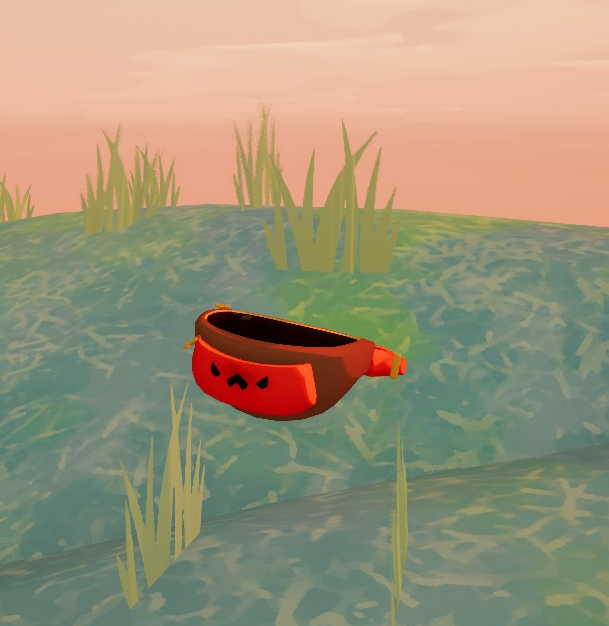](https://peak.wiki.gg/wiki/File%3AFanny_Pack_on_Ground.png)
  Fanny Pack in game.
- [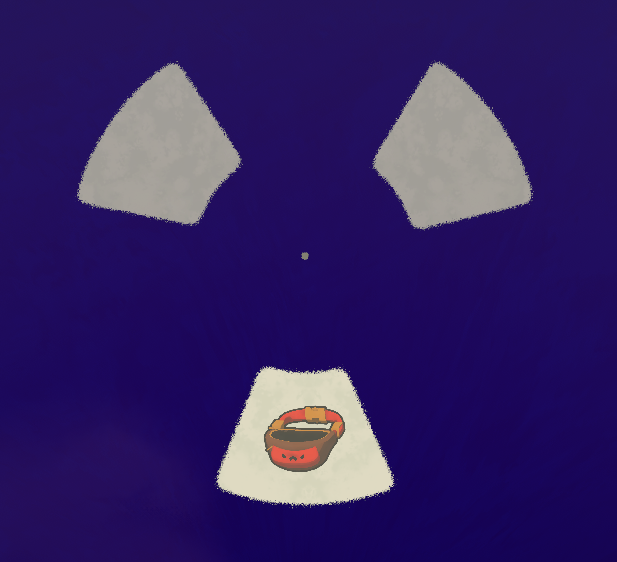](https://peak.wiki.gg/wiki/File%3AFanny_Pack_UI.png)
  The Fanny Pack's inventory UI.
- [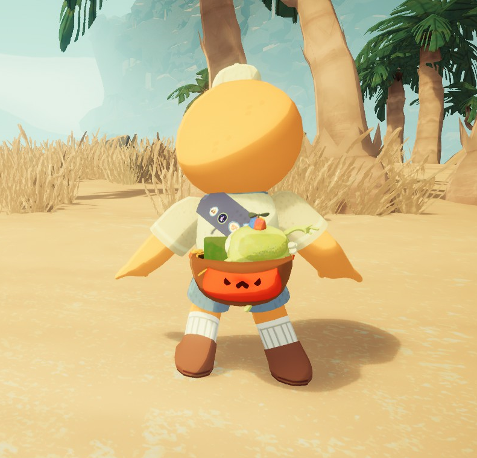](https://peak.wiki.gg/wiki/File%3AFanny_Pack_on_Scout.png)
  Scout wearing a Fanny Pack with two items inside.

## Patch history

 **[2.0.a](2.0.a.md) (2026-08-11):** Introduced. **(Undocumented)**
 **[2.4.a](2.4.a.md) (2026-09-02):** Fanny Pack is now disabled in solo play.

---

# Fire


This is a disambiguation page for "Fire".

The following is a list of links related to Fire.

**Fire** may refer to:

- [Campfire](Campfire.md)
- A small fire found at the [Crash Site](Shore.md#Crash_Site)
- The [](Stamina%20bar.md#Heat) [Heat](Stamina%20bar.md#Heat) affliction
- Fiery [Eruptions](Caldera.md#Eruptions) in the [Caldera](Caldera.md)

---

# First Aid Kit

First Aid Kit
[](https://peak.wiki.gg/wiki/File%3AFirst_Aid_Kit.png)
[Item type](Items.md)- [Consumable](https://peak.wiki.gg/wiki/Consumable)
Rarity
[Epic](https://peak.wiki.gg/wiki/Epic)
Source- [Regular Luggage](https://peak.wiki.gg/wiki/Regular_Luggage)
- [Big Luggage](https://peak.wiki.gg/wiki/Big_Luggage)
- [Explorer's Luggage](https://peak.wiki.gg/wiki/Explorer%27s_Luggage)
Weight
[](Stamina%20bar.md#Weight) **5**
Base Status Effects
[](Stamina%20bar.md#Poison)Poison
-100
[](Stamina%20bar.md#Injury)Injury
-100
[](Stamina%20bar.md#Spores)Spores
-100

The **First Aid Kit** is a [consumable](https://peak.wiki.gg/wiki/Consumable) item in *[PEAK](Peak%20%28game%29.md)*. It is found in [luggage](Luggage.md).

Using the First Aid Kit removes any [](Stamina%20bar.md#Injury) [Injury](Stamina%20bar.md#Injury), [](Stamina%20bar.md#Poison) [Poison](Stamina%20bar.md#Poison) (including any remaining poison over time effects), or [](Stamina%20bar.md#Spores) [Spores](Stamina%20bar.md#Spores) a [Scout](Scout.md) may have.

[Cooking](Cooking.md) a First Aid Kit has no effect, even when incinerated.

## Gallery

- [](https://peak.wiki.gg/wiki/File%3AFirstaidkit_0.png)
  First Aid Kit texture

## Patch history

 **[1.0](1.0.md) (2025-06-16):** Introduced.
 **[1.40.a](1.40.a.md) (2025-11-05):** Cooking a First Aid Kit no longer has an effect.

---

# Flare

Flare
[](https://peak.wiki.gg/wiki/File%3AFlare.png)
[Item type](Items.md)- [Consumable](https://peak.wiki.gg/wiki/Consumable)
Rarity
[Legendary](https://peak.wiki.gg/wiki/Legendary)
Location- [Crash Site](https://peak.wiki.gg/wiki/Crash_Site)
- [Peak](Peak%20%28biome%29.md)
Source- [Regular Luggage](https://peak.wiki.gg/wiki/Regular_Luggage)
- [Big Luggage](https://peak.wiki.gg/wiki/Big_Luggage)
Weight
[](Stamina%20bar.md#Weight) **0**

The **Flare** is a [consumable](https://peak.wiki.gg/wiki/Consumable) item in *[PEAK](Peak%20%28game%29.md)*. It can be found at the [crash site](Shore.md#Crash_Site), in [Luggage](Luggage.md), and in a small crate full of them at the [PEAK](Peak%20%28biome%29.md) while not doing [Ascent 4+](Ascents.md).

A flare can be lit to display a tall column of colourful smoke matching the colour of the scout who uses it. Lighting a flare at the [PEAK](Peak%20%28biome%29.md) signals the rescue helicopter, completing the expedition. Once a flare is lit, it can no longer be stored in the player's inventory or in a [](Backpack.md) [Backpack](Backpack.md).

[Cooking](Cooking.md) a flare causes it to explode, dealing up to [](Stamina%20bar.md#Injury) **20** [Injury](Stamina%20bar.md#Injury) to scouts within **4.8 meters**, depending on distance.

## Label text

**NOTICE ME!!!**

EMERGENCY FLARE

---

**DANGER:**

*EXTREMELY FLAMMABLE*

*Keep Out Of Reach Of Children*

---

MFG DATE

DEC 20XX

## Gallery

- [](https://peak.wiki.gg/wiki/File%3AFlare_texture.png)
  Flare texture

## Patch history

 **[1.0](1.0.md) (2025-06-16):** Introduced.
 **[1.25.a](1.25.a.md) (2025-08-21):** You can no longer put the [](Beehive.md) [Beehive](Beehive.md) or a lit [](Flare.md) Flare in the [](Backpack.md) [Backpack](Backpack.md).
 **[1.40.a](1.40.a.md) (2025-11-05):** Cooking a flare now causes it to explode.

---

# Flash Bulbs

Flash Bulb
[](https://peak.wiki.gg/wiki/File%3AFlashpod.png)
General
Type
Environmental hazard
Biome- [Alpine](Alpine.md)

Flash Bulbs are an environmental hazard found in the [Alpine](Alpine.md). When any player touches a Flash Bulb, it explodes. When this happens, all players within **6.4 meters** of the Flash Bulb are blinded for up to **45 seconds**, depending on their distance.

## Gallery

- [](https://peak.wiki.gg/wiki/File%3ABlindness.png)
  A player's vision while blinded by a Flash Bulb.
- [](https://peak.wiki.gg/wiki/File%3ABlinded_Scout.png)
  A [Scout](Scout.md) after being blinded by a Flash Bulb.
- [](https://peak.wiki.gg/wiki/File%3AFlashpod_detonated.png)
  A Flash Bulb after exploding.

---

# Flying Disc

Flying Disc
[](https://peak.wiki.gg/wiki/File%3AFlying_Disc.png)
[Item type](Items.md)- [Misc](Misc.md)
Source- [Crash Site](https://peak.wiki.gg/wiki/Crash_Site)
Weight
[](Stamina%20bar.md#Weight) **0**

The **Flying Disc** is an [item](https://peak.wiki.gg/wiki/Item) in *[PEAK](Peak%20%28game%29.md)*, found exclusively at the [crash site](Shore.md#Crash_Site) in [Shore](Shore.md). When thrown at a player, the flying disc is able to bonk them, causing them to enter a [ragdoll](https://peak.wiki.gg/wiki/Ragdoll) state.

Catching the Flying Disc when it has been thrown from over 100 meters away unlocks the [](https://peak.wiki.gg/wiki/Ultimate_Badge) [Ultimate Badge](https://peak.wiki.gg/wiki/Ultimate_Badge).

## Trivia

- The Flying Disc was added as a tribute to "[Jonathan Frisbee](https://www.youtube.com/watch?v=IWMHUEc8_dM)", a character played by Flowerland in videos posted by Nucknom. Clips of the character went viral on TikTok and have been featured in numerous *[PEAK](Peak%20%28game%29.md)* clips.- "JONATHAN" can be seen written in black marker on the underside of the Flying Disc.

## Gallery

- [](https://peak.wiki.gg/wiki/File%3AFrisbee_texture.png)
  The texture for the Flying Disc.

## Patch history

 **[1.8](1.8.md) (2025-07-21):** Introduced.
 **[1.20.a](1.20.a.md) (2025-08-11):** Added the Ultimate Badge for catching the Flying Disc from 100 meters away. **(Undocumented change)**
 **[1.44.a](1.44.a.md) (2025-11-13):** Fixed an issue where a frisbee that landed in the water would still be considered "in flight" for purposes of the Ultimate Badge.

---

# Flytrap

Flytrap
[](https://peak.wiki.gg/wiki/File%3AFlytrap.png)
General
Type
[Enemy](https://peak.wiki.gg/wiki/Enemy)
Biome- [Gloom](Gloom.md)

**Flytraps** are hostile [NPCs](https://peak.wiki.gg/wiki/NPC) found in the [Gloom](Gloom.md). They can trap unaware [Scouts](https://peak.wiki.gg/wiki/Scouts) in their jaws, inflicting [](Stamina%20bar.md#Poison) [Poison](Stamina%20bar.md#Poison) until the Scout escapes.

## Mechanics

When a [Scout](Scout.md) walks on top of a Flytrap, it will close its jaws and trap the Scout who touched it. The trapped Scout is immediately inflicted with [](Stamina%20bar.md#Flytrap) **30** [Flytrap](Stamina%20bar.md#Flytrap). The trapped Scout can struggle out of the jaws by pressing jump (), removing [](Stamina%20bar.md#Flytrap) **2.5** [Flytrap](Stamina%20bar.md#Flytrap) per press of the key. Note that struggling requires [stamina](https://peak.wiki.gg/wiki/Stamina) and stamina is still regained while trapped. A trapped Scout cannot use any items or access their [backpack](Backpack.md).

Once the Flytrap has trapped its victim, it will begin dealing [](Stamina%20bar.md#Poison) **5** [Poison](Stamina%20bar.md#Poison) to them every second.

Other [Scouts](https://peak.wiki.gg/wiki/Scouts) can also free a trapped Scout by grabbing them with **Helping Hand**.

## Interactions

- A player with [invincibility](Stamina%20bar.md#Invincibility) will be immediately released after being trapped by a flytrap. This will still briefly knock the player down.
- A player that is trapped can be freed from afar by shooting them with a [](Blowgun.md) [Blowgun](Blowgun.md).
- A player can also be freed by being fed a [](Napberry.md) [Napberry](Napberry.md). If the trapped player is close enough to be fed, it is probably best to instead use **Helping Hand**.

## Gallery

- [](https://peak.wiki.gg/wiki/File%3AFlytrapNoScout.png)
  A Flytrap sitting on the rocks of the Gloom

## Patch History

 **[2.0.a](2.0.a.md) (2026-08-11):** Introduced.
 **[2.1.a](2.1.a.md) (2026-08-13):**

- Fixed issue where players would stay muffled after dying to a Flytrap.
- [Skeleton Scouts](https://peak.wiki.gg/wiki/Skeleton_Scouts) are now affected by [spiders](Spider.md), flytraps, and arrow traps. (Be especially careful around the arrow traps…)

---

# Fog

Fog
[](https://peak.wiki.gg/wiki/File%3AThe_Fog.png)
General
Biome- [Shore](Shore.md)
- [Tropics](Tropics.md)
- [Roots](Roots.md)
- [Alpine](Alpine.md)
- [Mesa](Mesa.md)
- [The Kiln](The%20Kiln.md)
- [The Citadel](The%20Citadel.md)

The **Fog** is a [](Stamina%20bar.md#Cold) [freezing](Stamina%20bar.md#Cold) hazard present on all [Ascents](Ascents.md) above [Tenderfoot](https://peak.wiki.gg/wiki/Tenderfoot) in all [biomes](https://peak.wiki.gg/wiki/Biomes) except [Caldera](Caldera.md) and [Gloom](Gloom.md). It acts as a time limit and barrier.

## Behavior

### Rising

---

The Fog will begin rising after all [Scouts](Scout.md) have passed a certain height/distance in the biome, or after 16 minutes and 40 seconds (1000 seconds) have passed. It will close in as a shrinking sphere at a linear rate until a certain radius around the [campfire](Campfire.md).

Being in the Fog will inflict **[](Stamina%20bar.md#Cold)**2.5**[Cold](Stamina%20bar.md#Cold)** every ~2.4 seconds[[1]](#cite_note-1). On living [skeletons](The%20Book%20of%20Bones.md#Skeleton_behavior), it will deal [](Stamina%20bar.md#Injury) [Injury](Stamina%20bar.md#Injury) instead at the same rate. It will also obscure the screen and make it extremely difficult to see.

### Barrier

---

A barrier of Fog will block the next biome until the [campfire](Campfire.md) is lit, in which case it will instead block the previous. The former can be overcome via the [Cannon exploit](Exploits.md#List_of_known_exploits), and the latter by simply walking along it. However, getting past the barrier blocking the next biome will make the game register the player as being in the next biome without loading it. Additionally, walking off the edge of the barrier blocking the previous biome will cause the player to fall into the void, where the bottom of the [Island](Island.md) can be seen.

Contact with this form of Fog will not inflict [](Stamina%20bar.md#Cold) [Cold](Stamina%20bar.md#Cold).

### Lava

---

In [The Kiln](The%20Kiln.md), the Fog will be replaced by rising [Lava](Lava.md). It will start rising 3 minutes after lighting the [campfire](Campfire.md), and stop rising once it reaches the top after 20 minutes. Being in the lava will deal **[](Stamina%20bar.md#Injury)**25**[Injury](Stamina%20bar.md#Injury)** and about **[](Stamina%20bar.md#Heat)**30**[Heat](Stamina%20bar.md#Heat)** per second.

### Gloom

---

In [The Citadel](The%20Citadel.md), the Fog will be replaced by rising [Gloom](Gloom.md#Hazards). Being in the Gloom will inflict [](Stamina%20bar.md#Drowsy) **2.5** [Drowsy](Stamina%20bar.md#Drowsy) every ~2.75 seconds. Holding a burning [Candlestick](Candlestick.md) will alleviate the [](Stamina%20bar.md#Drowsy) [Drowsy](Stamina%20bar.md#Drowsy), but will not increase visibility like in the [Sleepy Gloom](Gloom.md#Hazards).

## Gallery

- [](https://peak.wiki.gg/wiki/File%3AFogStoppedCampfire.png)
  The Fog stopped around a [Campfire](Campfire.md).
- [](https://peak.wiki.gg/wiki/File%3AShore_fog.png)
  The Fog slowly approaching, on the [Shore](Shore.md).
- [](https://peak.wiki.gg/wiki/File%3AFog_visual_effect.png)
  The visual effect of the Fog, making it harder to see.
- [](https://peak.wiki.gg/wiki/File%3AMesa_Fog.jpg)
  The yellow Fog of the [Mesa](Mesa.md).

## Notes

- [↑](#cite_ref-1) The actual rate is 1.05 per second, which comes out to 2.5 every 2.380952381 seconds.

---

# Fog/ru

Туман

---

# Food


This page does not meet **PEAK Wiki**'s page quality standards. You can edit it to help fix grammar, formatting, or code issues.


This page is a [stub](https://support.wiki.gg/wiki/Stub). You can help **PEAK Wiki** by expanding it.

**Food** in *[PEAK](Peak%20%28game%29.md)* can be consumed to reduce [](Stamina%20bar.md#Hunger) [Hunger](Stamina%20bar.md#Hunger) or gain [](Stamina%20bar.md#Bonus_stamina) [Bonus stamina](Stamina%20bar.md#Bonus_stamina). Some foods are [](Stamina%20bar.md#Poison) [poisonous](Stamina%20bar.md#Poison), while others have additional effects, such as healing [](Stamina%20bar.md#Injury) [Injury](Stamina%20bar.md#Injury) or removing [](Stamina%20bar.md#Heat) [Heat](Stamina%20bar.md#Heat).

Players can forage for various [natural foods](#Natural_food), such as fruits and [mushrooms](#Mushrooms), or find [packaged food](#Packaged_food) in [Luggage](Luggage.md).

Food can be [cooked](Cooking.md) to double the amount of [hunger](https://peak.wiki.gg/wiki/Hunger) restored and increase its [bonus stamina](https://peak.wiki.gg/wiki/Bonus_stamina).

The tables below list every food item obtainable in the game, including their nutritional properties, weight, additional effects, and other notes.

## Natural food

Natural food can be found in almost every [biome](https://peak.wiki.gg/wiki/Biome). It can be used to earn the [](https://peak.wiki.gg/wiki/Naturalist_Badge) [Naturalist Badge](https://peak.wiki.gg/wiki/Naturalist_Badge). [Mystical](https://peak.wiki.gg/wiki/Mystical) items, such as the [](Cure-All.md) [Cure-All](Cure-All.md) and [](Pandora%27s%20Lunchbox.md) [Pandora's Lunchbox](Pandora%27s%20Lunchbox.md), are also safe for the badge.

| Icon | Name | Hunger reduction | Hunger reduction (cooked) | Bonus Stamina | Bonus Stamina (cooked) | Weight | Poison | Hunger-to-Weight ratio (cooked) | | Location | Notes |
| --- | --- | --- | --- | --- | --- | --- | --- | --- | --- | --- | --- |
| Base | [Ascent 3+](Ascents.md#Ascent_3) |
| [Half-Coconut](Half-Coconut.md) | [Half-Coconut](Half-Coconut.md) | [Hunger](Stamina%20bar.md#Hunger) **−10** | [Hunger](Stamina%20bar.md#Hunger) **−20** | — | [Bonus stamina](Stamina%20bar.md#Bonus_stamina) **10** | [Weight](Stamina%20bar.md#Weight) **5** | — | 4 | 2.7 | - [Shore](Shore.md) - [Tropics](Tropics.md) - [Mesa](Mesa.md) | - **Source:** Breaking a large  [Coconut](Coconut.md) gives 2x [Half-Coconuts](Half-Coconut.md). - Removes [Heat](Stamina%20bar.md#Heat) **30** [Heat](Stamina%20bar.md#Heat). |
| [Red Crispberry](Red%20Crispberry.md) | [Red Crispberry](Red%20Crispberry.md) | [Hunger](Stamina%20bar.md#Hunger) **−5** | [Hunger](Stamina%20bar.md#Hunger) **−10** | — | [Bonus stamina](Stamina%20bar.md#Bonus_stamina) **10** | [Weight](Stamina%20bar.md#Weight) **2.5** | — | 4 | 2 | - [Shore](Shore.md) - [Tropics](Tropics.md) | - **Source**: Bushes in the [Shore](Shore.md) and [Tropics](Tropics.md) |
| [Yellow Crispberry](Yellow%20Crispberry.md) | [Yellow Crispberry](Yellow%20Crispberry.md) | [Hunger](Stamina%20bar.md#Hunger) **−5** | [Hunger](Stamina%20bar.md#Hunger) **−10** | [Bonus stamina](Stamina%20bar.md#Bonus_stamina) **10** | [Bonus stamina](Stamina%20bar.md#Bonus_stamina) **15** | [Weight](Stamina%20bar.md#Weight) **2.5** | — | 4 | 2 | - [Shore](Shore.md) - [Tropics](Tropics.md) | - **Source**: Bushes in the [Shore](Shore.md) and [Tropics](Tropics.md) |
| [Green Crispberry](Green%20Crispberry.md) | [Green Crispberry](Green%20Crispberry.md) | [Hunger](Stamina%20bar.md#Hunger) **−5** | [Hunger](Stamina%20bar.md#Hunger) **−10** | — | [Bonus stamina](Stamina%20bar.md#Bonus_stamina) **10** | [Weight](Stamina%20bar.md#Weight) **2.5** | [Poison](Stamina%20bar.md#Poison) **10** | 4 | 2 | - [Shore](Shore.md) - [Tropics](Tropics.md) | - **Source**: Bushes in the [Shore](Shore.md) and [Tropics](Tropics.md) - After 2 seconds, inflicts [Poison](Stamina%20bar.md#Poison) **10** [Poison](Stamina%20bar.md#Poison) over 4 seconds. - Cooking it before consumption removes the poison effect. |
| [Honeycomb](Honeycomb.md) | [Honeycomb](Honeycomb.md) | [Hunger](Stamina%20bar.md#Hunger) **−10** | [Hunger](Stamina%20bar.md#Hunger) **−20** | [Bonus stamina](Stamina%20bar.md#Bonus_stamina) **50** | [Bonus stamina](Stamina%20bar.md#Bonus_stamina) **75** | [Weight](Stamina%20bar.md#Weight) **2.5** | — | 8 | 4 | - [Tropics](Tropics.md) - [Roots](Roots.md) | - **Source:** Breaking a  [Beehive](Beehive.md) gives 4x [Honeycombs](Honeycomb.md). Can also be found in tree trunks in the [Roots](Roots.md) |
| [Scorchberry](Scorchberry.md) | [Scorchberry](Scorchberry.md) | [Hunger](Stamina%20bar.md#Hunger) **−10** | [Hunger](Stamina%20bar.md#Hunger) **−20** | — | [Bonus stamina](Stamina%20bar.md#Bonus_stamina) **10** | [Weight](Stamina%20bar.md#Weight) **2.5** | — | 8 | 4 | - [Tropics](Tropics.md) | - **Source**: Bushes in the [Tropics](Tropics.md) - Inflicts [Heat](Stamina%20bar.md#Heat) **25** [Heat](Stamina%20bar.md#Heat). |
| [Purple Kingberry](Purple%20Kingberry.md) | [Purple Kingberry](Purple%20Kingberry.md) | [Hunger](Stamina%20bar.md#Hunger) **−30** | [Hunger](Stamina%20bar.md#Hunger) **−60** | [Bonus stamina](Stamina%20bar.md#Bonus_stamina) **35** | [Bonus stamina](Stamina%20bar.md#Bonus_stamina) **52.5** | [Weight](Stamina%20bar.md#Weight) **5** | — | 12 | 8 | - [Tropics](Tropics.md) | - **Source:** Willow trees in the [Tropics](Tropics.md). |
| [Yellow Kingberry](Yellow%20Kingberry.md) | [Yellow Kingberry](Yellow%20Kingberry.md) | [Hunger](Stamina%20bar.md#Hunger) **−30** | [Hunger](Stamina%20bar.md#Hunger) **−60** | — | [Bonus stamina](Stamina%20bar.md#Bonus_stamina) **10** | [Weight](Stamina%20bar.md#Weight) **5** | [Poison](Stamina%20bar.md#Poison) **25** | 12 | 8 | - [Tropics](Tropics.md) | - **Source** Willow trees in the [Tropics](Tropics.md). - After 3 seconds, inflicts [Poison](Stamina%20bar.md#Poison) **25** [Poison](Stamina%20bar.md#Poison) over 10 seconds. - Cooking it before consumption removes the poison effect. |
| [Green Kingberry](Green%20Kingberry.md) | [Green Kingberry](Green%20Kingberry.md) | [Hunger](Stamina%20bar.md#Hunger) **−30** | [Hunger](Stamina%20bar.md#Hunger) **−60** | — | [Bonus stamina](Stamina%20bar.md#Bonus_stamina) **10** | [Weight](Stamina%20bar.md#Weight) **5** | [Poison](Stamina%20bar.md#Poison) **5** | 12 | 8 | - [Tropics](Tropics.md) | - **Source** Willow trees in the [Tropics](Tropics.md). - Inflicts [Poison](Stamina%20bar.md#Poison) **5** [Poison](Stamina%20bar.md#Poison) immediately. - Cooking it before consumption removes the poison effect. |
| [Yellow Berrynana](Yellow%20Berrynana.md) | [Yellow Berrynana](Yellow%20Berrynana.md) | [Hunger](Stamina%20bar.md#Hunger) **−15** | [Hunger](Stamina%20bar.md#Hunger) **−30** | — | [Bonus stamina](Stamina%20bar.md#Bonus_stamina) **10** | [Weight](Stamina%20bar.md#Weight) **2.5** | — | 12 | 6 | - [Tropics](Tropics.md) - [Gloom](Gloom.md) | - **Source**: [Vines](Vines.md) in the [tropics](Tropics.md) and [gloom](Gloom.md) - Produces a  [Yellow Berrynana Peel](Yellow%20Berrynana%20Peel.md) after eating. |
| [Pink Berrynana](Pink%20Berrynana.md) | [Pink Berrynana](Pink%20Berrynana.md) | [Hunger](Stamina%20bar.md#Hunger) **−15** | [Hunger](Stamina%20bar.md#Hunger) **−30** | — | [Bonus stamina](Stamina%20bar.md#Bonus_stamina) **10** | [Weight](Stamina%20bar.md#Weight) **2.5** | [Poison](Stamina%20bar.md#Poison) **15** | 12 | 6 | - [Tropics](Tropics.md) - [Gloom](Gloom.md) | - **Source**: [Vines](Vines.md) in the [Tropics](Tropics.md) and * [Gloom](Gloom.md) - Produces a  [Pink Berrynana Peel](Pink%20Berrynana%20Peel.md) after eating. - After 2 seconds, inflicts [Poison](Stamina%20bar.md#Poison) **15** [Poison](Stamina%20bar.md#Poison) over 6 seconds. - Cooking it before consumption removes the poison effect. |
| [Blue Berrynana](Blue%20Berrynana.md) | [Blue Berrynana](Blue%20Berrynana.md) | [Hunger](Stamina%20bar.md#Hunger) **−30** | [Hunger](Stamina%20bar.md#Hunger) **−60** | — | [Bonus stamina](Stamina%20bar.md#Bonus_stamina) **10** | [Weight](Stamina%20bar.md#Weight) **2.5** | — | 24 | 12 | - [Tropics](Tropics.md) - [Gloom](Gloom.md) | - **Source**: [Vines](Vines.md) in the [tropics](Tropics.md) and [Gloom](Gloom.md) - Produces a  [Blue Berrynana Peel](Blue%20Berrynana%20Peel.md) after eating. |
| [Brown Berrynana](Brown%20Berrynana.md) | [Brown Berrynana](Brown%20Berrynana.md) | [Hunger](Stamina%20bar.md#Hunger) **−15** | [Hunger](Stamina%20bar.md#Hunger) **−30** | [Bonus stamina](Stamina%20bar.md#Bonus_stamina) **10** | [Bonus stamina](Stamina%20bar.md#Bonus_stamina) **15** | [Weight](Stamina%20bar.md#Weight) **2.5** | — | 12 | 6 | - [Tropics](Tropics.md) - [Gloom](Gloom.md) | - **Source**: [Vines](Vines.md) in the [tropics](Tropics.md) and [Gloom](Gloom.md) - Produces a  [Brown Berrynana Peel](Brown%20Berrynana%20Peel.md) after eating. |
| [Yellow Clusterberry](Yellow%20Clusterberry.md) | [Yellow Clusterberry](Yellow%20Clusterberry.md) | [Hunger](Stamina%20bar.md#Hunger) **−10** | [Hunger](Stamina%20bar.md#Hunger) **−20** | [Bonus stamina](Stamina%20bar.md#Bonus_stamina) **10** | [Bonus stamina](Stamina%20bar.md#Bonus_stamina) **15** | [Weight](Stamina%20bar.md#Weight) **2.5** | — | 8 | 4 | - [Tropics](Tropics.md) | - **Source**: Willows in the [Tropics](Tropics.md) |
| [Red Clusterberry](Red%20Clusterberry.md) | [Red Clusterberry](Red%20Clusterberry.md) | [Hunger](Stamina%20bar.md#Hunger) **−10** | [Hunger](Stamina%20bar.md#Hunger) **−20** | — | [Bonus stamina](Stamina%20bar.md#Bonus_stamina) **10** | [Weight](Stamina%20bar.md#Weight) **2.5** | — | 8 | 4 | - [Tropics](Tropics.md) | - **Source**: Willows in the [Tropics](Tropics.md) - Heals [Injury](Stamina%20bar.md#Injury) **20** [Injury](Stamina%20bar.md#Injury). |
| [Black Clusterberry](Black%20Clusterberry.md) | [Black Clusterberry](Black%20Clusterberry.md) | [Hunger](Stamina%20bar.md#Hunger) **−20** | [Hunger](Stamina%20bar.md#Hunger) **−40** | — | [Bonus stamina](Stamina%20bar.md#Bonus_stamina) **10** | [Weight](Stamina%20bar.md#Weight) **2.5** | — | 16 | 8 | - [Tropics](Tropics.md) | - **Source**: Willows in the [Tropics](Tropics.md) |
| [Orange Winterberry](Orange%20Winterberry.md) | [Orange Winterberry](Orange%20Winterberry.md) | [Hunger](Stamina%20bar.md#Hunger) **−15** | [Hunger](Stamina%20bar.md#Hunger) **−30** | — | [Bonus stamina](Stamina%20bar.md#Bonus_stamina) **10** | [Weight](Stamina%20bar.md#Weight) **2.5** | — | 12 | 6 | - [Alpine](Alpine.md) | - **Source**: Winterberry trees in the [Alpines](https://peak.wiki.gg/wiki/Alpines) - Removes [Heat](Stamina%20bar.md#Heat) **30** [Heat](Stamina%20bar.md#Heat). |
| [Yellow Winterberry](Yellow%20Winterberry.md) | [Yellow Winterberry](Yellow%20Winterberry.md) | [Hunger](Stamina%20bar.md#Hunger) **−30** | [Hunger](Stamina%20bar.md#Hunger) **−60** | [Bonus stamina](Stamina%20bar.md#Bonus_stamina) **35** | [Bonus stamina](Stamina%20bar.md#Bonus_stamina) **52.5** | [Weight](Stamina%20bar.md#Weight) **2.5** | — | 24 | 12 | - [Alpine](Alpine.md) - [Mesa](Mesa.md) | **Source**: Winterberry trees in the [Alpines](https://peak.wiki.gg/wiki/Alpines), also found at the [Oasis](https://peak.wiki.gg/wiki/Oasis) or [Hot spring](https://peak.wiki.gg/wiki/Hot_spring). - Removes [Heat](Stamina%20bar.md#Heat) **50** [Heat](Stamina%20bar.md#Heat). - Heals [Injury](Stamina%20bar.md#Injury) **20** [Injury](Stamina%20bar.md#Injury). |
| [Red Prickleberry](Red%20Prickleberry.md) | [Red Prickleberry](Red%20Prickleberry.md) | [Hunger](Stamina%20bar.md#Hunger) **−15** | [Hunger](Stamina%20bar.md#Hunger) **−30** | — | [Bonus stamina](Stamina%20bar.md#Bonus_stamina) **10** | [Weight](Stamina%20bar.md#Weight) **2.5** | — | 12 | 6 | - [Mesa](Mesa.md) | - **Source**: Cacti in the [Mesa](Mesa.md) - Inflicts [Thorns](Stamina%20bar.md#Thorns) **10** [Thorns](Stamina%20bar.md#Thorns). - Removes [Heat](Stamina%20bar.md#Heat) **10** [Heat](Stamina%20bar.md#Heat). |
| [Gold Prickleberry](Gold%20Prickleberry.md) | [Gold Prickleberry](Gold%20Prickleberry.md) | [Hunger](Stamina%20bar.md#Hunger) **−15** | [Hunger](Stamina%20bar.md#Hunger) **−30** | — | [Bonus stamina](Stamina%20bar.md#Bonus_stamina) **10** | [Weight](Stamina%20bar.md#Weight) **2.5** | — | 12 | 6 | - [Mesa](Mesa.md) | - **Source**: Cacti in the [Mesa](Mesa.md) - Inflicts [Thorns](Stamina%20bar.md#Thorns) **10** [Thorns](Stamina%20bar.md#Thorns). - Removes [Heat](Stamina%20bar.md#Heat) **10** [Heat](Stamina%20bar.md#Heat). - Heals [Injury](Stamina%20bar.md#Injury) **10** [Injury](Stamina%20bar.md#Injury). |
| [Medicinal Root](Medicinal%20Root.md) | [Medicinal Root](Medicinal%20Root.md) | [Hunger](Stamina%20bar.md#Hunger) **−5** | [Hunger](Stamina%20bar.md#Hunger) **−10** | — | [Bonus stamina](Stamina%20bar.md#Bonus_stamina) **10** | [Weight](Stamina%20bar.md#Weight) **2.5** | [Poison](Stamina%20bar.md#Poison) **−25** | 4 | 2 | - [Shore](Shore.md) - [Tropics](Tropics.md) - [Mesa](Mesa.md) - [Roots](Roots.md) | - **Source**: Any valid surface. - Removes [Poison](Stamina%20bar.md#Poison) **25** [Poison](Stamina%20bar.md#Poison). - Heals [Injury](Stamina%20bar.md#Injury) **10** [Injury](Stamina%20bar.md#Injury). - Removes [Spores](Stamina%20bar.md#Spores) **25** [Spores](Stamina%20bar.md#Spores). |
| [Mandrake](Mandrake.md) | [Mandrake](Mandrake.md) | [Hunger](Stamina%20bar.md#Hunger) **−10** | [Hunger](Stamina%20bar.md#Hunger) **−20** | — | [Bonus stamina](Stamina%20bar.md#Bonus_stamina) **10** | [Weight](Stamina%20bar.md#Weight) **2.5** | — | 8 | 4 | - [Roots](Roots.md) | - **Source:** When uprooting a  [Medicinal Root](Medicinal%20Root.md) in the [Roots](Roots.md) Biome, there is a 28.57% chance it will instead be a  [Mandrake](Mandrake.md). - Hides [Stamina bar](Stamina%20bar.md) for 60s when eaten uncooked. - When cooked, removes [Curse](Stamina%20bar.md#Curse) **25** [Curse](Stamina%20bar.md#Curse). |
| [Marshmallow](Marshmallow.md) | [Marshmallow](Marshmallow.md) | [Hunger](Stamina%20bar.md#Hunger) **−15** | [Hunger](Stamina%20bar.md#Hunger) **−30** | — | [Bonus stamina](Stamina%20bar.md#Bonus_stamina) **10** | [Weight](Stamina%20bar.md#Weight) **2.5** | — | 12 | 6 | - [Campfires](Campfire.md) | - **Source**: Campfires - 62.5% chance to appear instead of a  [Hot Dog](Hot%20Dog.md) |
| [Hot Dog](Hot%20Dog.md) | [Hot Dog](Hot%20Dog.md) | [Hunger](Stamina%20bar.md#Hunger) **−30** | [Hunger](Stamina%20bar.md#Hunger) **−60** | [Bonus stamina](Stamina%20bar.md#Bonus_stamina) **20** | [Bonus stamina](Stamina%20bar.md#Bonus_stamina) **30** | [Weight](Stamina%20bar.md#Weight) **2.5** | — | 24 | 12 | - [Campfires](Campfire.md) - [Gloom](Gloom.md) | - **Source**: Campfires, Amongst cattails in the [Gloom](Gloom.md) - 37.5% chance to appear instead of a  [Marshmallow](Marshmallow.md) |
| [Egg](Egg.md) | [Egg](Egg.md) | [Hunger](Stamina%20bar.md#Hunger) **−15** | [Hunger](Stamina%20bar.md#Hunger) **−30** | — | [Bonus stamina](Stamina%20bar.md#Bonus_stamina) **10** | [Weight](Stamina%20bar.md#Weight) **5** | — | 6 | 4 | - [Gloom](Gloom.md) - [Caldera](Caldera.md) | - **Source:** Made upon breaking a  [Big Egg](Big%20Egg.md) or  [Small Egg](Small%20Egg.md) |
| [Cooked Bird](Cooked%20Bird.md) | [Cooked Bird](Cooked%20Bird.md) | — | [Hunger](Stamina%20bar.md#Hunger) **−40** | — | [Bonus stamina](Stamina%20bar.md#Bonus_stamina) **10** | [Weight](Stamina%20bar.md#Weight) **10** | — | 4 | 3.2 | - [Gloom](Gloom.md) - [Caldera](Caldera.md) | - **Source:** Has a 10% chance to spawn from a  [Big Egg](Big%20Egg.md) instead of an  [Egg](Egg.md). Has a 1% chance to spawn from a  [Small Egg](Small%20Egg.md) instead of an  [Egg](Egg.md) |
| [Tick](Tick.md) | [Tick](Tick.md) | [Hunger](Stamina%20bar.md#Hunger) **−20** | [Hunger](Stamina%20bar.md#Hunger) **−40** | — | [Bonus stamina](Stamina%20bar.md#Bonus_stamina) **10** | [Weight](Stamina%20bar.md#Weight) **2.5** | — | 16 | 8 | - [Tropics](Tropics.md) | - **Source**: Monstera Bushes - Inflicts [Poison](Stamina%20bar.md#Poison) [Poison](Stamina%20bar.md#Poison) over time until removed. - Consuming does not inflict poison. |
| [Scorpion](Scorpion.md) | Cooked [Scorpion](Scorpion.md) | — | [Hunger](Stamina%20bar.md#Hunger) **−20** | — | [Bonus stamina](Stamina%20bar.md#Bonus_stamina) **10** | [Weight](Stamina%20bar.md#Weight) **2.5** | — | 8 | 4 | - [Mesa](Mesa.md) | - **Source**: [cooking](Cooking.md) a [scorpion](Scorpion.md) manually or with a  [Dynamite](Dynamite.md) explosion. - Cannot be eaten raw. - Can be held, but not placed into any inventory slot. |
| [Napberry](Napberry.md) | [Napberry](Napberry.md) | [Hunger](Stamina%20bar.md#Hunger) **−100** | [Hunger](Stamina%20bar.md#Hunger) **−200** | — | [Bonus stamina](Stamina%20bar.md#Bonus_stamina) **10** | [Weight](Stamina%20bar.md#Weight) **2.5** | — | 80 | 40 | - [Alpine](Alpine.md) | - **Source**: Napberry Stems in the [Alpine](Alpine.md) Caves - Eating it will remove all status effects except [Curse](Stamina%20bar.md#Curse) [Curse](Stamina%20bar.md#Curse) and [Petrify](Stamina%20bar.md#Petrify) [Petrify](Stamina%20bar.md#Petrify), but replaces the entire stamina bar with [Drowsy](Stamina%20bar.md#Drowsy) [Drowsy](Stamina%20bar.md#Drowsy) in the process, knocking the player out for a time until gradually fading away. |
| [Red Shroomberry](Red%20Shroomberry.md) | [Red Shroomberry](Red%20Shroomberry.md) | [Hunger](Stamina%20bar.md#Hunger) **−10** | [Hunger](Stamina%20bar.md#Hunger) **−20** | [Bonus stamina](Stamina%20bar.md#Bonus_stamina) **5** | [Bonus stamina](Stamina%20bar.md#Bonus_stamina) **10** | [Weight](Stamina%20bar.md#Weight) **2.5** | — | 8 | 4 | - [Roots](Roots.md) | - **Source**: Any valid surface - Inflicts [Spores](Stamina%20bar.md#Spores) **5** [Spores](Stamina%20bar.md#Spores). - Produces a random [*good* effect](Shroomberry.md#Good_effects) after eating. |
| [Yellow Shroomberry](Yellow%20Shroomberry.md) | [Yellow Shroomberry](Yellow%20Shroomberry.md) | [Hunger](Stamina%20bar.md#Hunger) **−10** | [Hunger](Stamina%20bar.md#Hunger) **−20** | [Bonus stamina](Stamina%20bar.md#Bonus_stamina) **5** | [Bonus stamina](Stamina%20bar.md#Bonus_stamina) **10** | [Weight](Stamina%20bar.md#Weight) **2.5** | — | 8 | 4 | - [Roots](Roots.md) | - **Source**: Any valid surface - Inflicts [Spores](Stamina%20bar.md#Spores) **5** [Spores](Stamina%20bar.md#Spores). - Produces a random [*good* effect](Shroomberry.md#Good_effects) after eating. |
| [Green Shroomberry](Green%20Shroomberry.md) | [Green Shroomberry](Green%20Shroomberry.md) | [Hunger](Stamina%20bar.md#Hunger) **−10** | [Hunger](Stamina%20bar.md#Hunger) **−20** | [Bonus stamina](Stamina%20bar.md#Bonus_stamina) **5** | [Bonus stamina](Stamina%20bar.md#Bonus_stamina) **10** | [Weight](Stamina%20bar.md#Weight) **2.5** | — | 8 | 4 | - [Roots](Roots.md) | - **Source**: Any valid surface - Inflicts [Spores](Stamina%20bar.md#Spores) **5** [Spores](Stamina%20bar.md#Spores). - Produces a random [*bad* effect](Shroomberry.md#Bad_effects) after eating. |
| [Blue Shroomberry](Blue%20Shroomberry.md) | [Blue Shroomberry](Blue%20Shroomberry.md) | [Hunger](Stamina%20bar.md#Hunger) **−10** | [Hunger](Stamina%20bar.md#Hunger) **−20** | [Bonus stamina](Stamina%20bar.md#Bonus_stamina) **5** | [Bonus stamina](Stamina%20bar.md#Bonus_stamina) **10** | [Weight](Stamina%20bar.md#Weight) **2.5** | — | 8 | 4 | - [Roots](Roots.md) | - **Source**: Any valid surface - Inflicts [Spores](Stamina%20bar.md#Spores) **5** [Spores](Stamina%20bar.md#Spores). - Produces a random [*bad* effect](Shroomberry.md#Bad_effects) after eating. |
| [Purple Shroomberry](Purple%20Shroomberry.md) | [Purple Shroomberry](Purple%20Shroomberry.md) | [Hunger](Stamina%20bar.md#Hunger) **−10** | [Hunger](Stamina%20bar.md#Hunger) **−20** | [Bonus stamina](Stamina%20bar.md#Bonus_stamina) **5** | [Bonus stamina](Stamina%20bar.md#Bonus_stamina) **10** | [Weight](Stamina%20bar.md#Weight) **2.5** | — | 8 | 4 | - [Roots](Roots.md) | - **Source**: Any valid surface - Inflicts [Spores](Stamina%20bar.md#Spores) **5** [Spores](Stamina%20bar.md#Spores). - Produces a [*random* effect](Shroomberry.md#Effects) after eating. |
| [The Early Worm](The%20Early%20Worm.md) | [The Early Worm](The%20Early%20Worm.md) | [Hunger](Stamina%20bar.md#Hunger) **−5** | [Hunger](Stamina%20bar.md#Hunger) **−5** | — | — | [Weight](Stamina%20bar.md#Weight) **0** | — |  |  | - [Gloom](Gloom.md) | - **Source**: Can be found on the surface of the [Gloom](Gloom.md). - Removes [Drowsy](Stamina%20bar.md#Drowsy) **100** [Drowsy](Stamina%20bar.md#Drowsy). |
| [Frog Legs](Frog%20Legs.md) | [Frog Legs](Frog%20Legs.md) | [Hunger](Stamina%20bar.md#Hunger) **−50** | [Hunger](Stamina%20bar.md#Hunger) **−100** | — | [Bonus stamina](Stamina%20bar.md#Bonus_stamina) **10** | [Weight](Stamina%20bar.md#Weight) **2.5** | — | 40 | 20 | - [Gloom](Gloom.md) | - **Source**: Can be found by cooking a frog found in the [Gloom](Gloom.md) |

## Mystical food

Mystical food is only found from [Ancient Statues](Ancient%20Statue.md) when there are no ghost scouts in need of revival and from [Ancient Luggage](https://peak.wiki.gg/wiki/Ancient_Luggage). It is not considered packaged and therefore will not stop players from earning the [](https://peak.wiki.gg/wiki/Naturalist_Badge) [Naturalist Badge](https://peak.wiki.gg/wiki/Naturalist_Badge).

| Icon | Name | Hunger reduction | Hunger reduction (cooked) | Bonus Stamina | Bonus Stamina (cooked) | Weight | Poison | Hunger-to-Weight ratio (cooked) | | Location | Notes |
| --- | --- | --- | --- | --- | --- | --- | --- | --- | --- | --- | --- |
| Base | [Ascent 3+](Ascents.md#Ascent_3) |
| [Cure-All](Cure-All.md) | [Cure-All](Cure-All.md) | [Hunger](Stamina%20bar.md#Hunger) **−20** | [Hunger](Stamina%20bar.md#Hunger) **−10**, but [Shatters.](Cure-All.md#Cooked) | — | — | [Weight](Stamina%20bar.md#Weight) **5** | — | 12 | 8 | - [Ancient Statue](Ancient%20Statue.md) - [Ancient Luggage](https://peak.wiki.gg/wiki/Ancient_Luggage) | - Has 3 uses ([Hunger](Stamina%20bar.md#Hunger) **−60** [Hunger](Stamina%20bar.md#Hunger) in total). - Removes a certain amount of negative [effects](Stamina%20bar.md), including [Curse](Stamina%20bar.md#Curse) [Curse](Stamina%20bar.md#Curse) (see the full page for details). - Explodes when dropped or cooked, removing a certain amount of negative effects in an area of effect. |
| [Pandora's Lunchbox](Pandora%27s%20Lunchbox.md) | [Pandora's Lunchbox](Pandora%27s%20Lunchbox.md) | Random | [Random*](Pandora%27s%20Lunchbox.md#Cooked) | Random | [Random*](Pandora%27s%20Lunchbox.md#Cooked) | [Weight](Stamina%20bar.md#Weight) **2.5** | Random | ? | ? | - [Ancient Statue](Ancient%20Statue.md) - [Ancient Luggage](https://peak.wiki.gg/wiki/Ancient_Luggage) | - Has 3 uses. - Randomizes the user's [status effects](Stamina%20bar.md). - Explodes when cooked, applying its bonus effects within an area of effect. |
| [The Book of Bones](The%20Book%20of%20Bones.md) | [The Book of Bones](The%20Book%20of%20Bones.md) | All | All | — | — | [Weight](Stamina%20bar.md#Weight) **2.5** | — | — | — | - [Ancient Statue](Ancient%20Statue.md) - [Ancient Luggage](https://peak.wiki.gg/wiki/Ancient_Luggage) | - Applies 25 [Curse](Stamina%20bar.md#Curse) [Curse](Stamina%20bar.md#Curse) . - Removes most [status effects](Stamina%20bar.md) and prevents gaining any further (see the full page for details). |

## Packaged food

Packaged food is found inside [Luggage](Luggage.md). Consuming any packaged food prevents the players from earning the [](https://peak.wiki.gg/wiki/Naturalist_Badge) [Naturalist Badge](https://peak.wiki.gg/wiki/Naturalist_Badge) in the same run.

| Icon | Food | Hunger reduction | Hunger reduction (cooked) | Bonus Stamina | Bonus Stamina (cooked) | Weight | Hunger-to-Weight ratio (cooked) | | Notes |
| --- | --- | --- | --- | --- | --- | --- | --- | --- | --- |
| Base | [Ascent 3+](Ascents.md#Ascent_3) |
| [Airline Food](Airline%20Food.md) | [Airline Food](Airline%20Food.md) | [Hunger](Stamina%20bar.md#Hunger) **−40** | [Hunger](Stamina%20bar.md#Hunger) **−80** | [Bonus stamina](Stamina%20bar.md#Bonus_stamina) **40** | [Bonus stamina](Stamina%20bar.md#Bonus_stamina) **60** | [Weight](Stamina%20bar.md#Weight) **5** | 16 | 10.7 |  |
| [Big Lollipop](Big%20Lollipop.md) | [Big Lollipop](Big%20Lollipop.md) | [Hunger](Stamina%20bar.md#Hunger) **−5** | [Hunger](Stamina%20bar.md#Hunger) **−10** | — | [Bonus stamina](Stamina%20bar.md#Bonus_stamina) **10** | [Weight](Stamina%20bar.md#Weight) **2.5** | 4 | 2 | - Grants infinite [stamina](https://peak.wiki.gg/wiki/Stamina) temporarily. - Inflicts [Drowsy](Stamina%20bar.md#Drowsy) **32.5** [Drowsy](Stamina%20bar.md#Drowsy) over 10 seconds afterwards. - When cooked, the base 32.5 [Drowsy](https://peak.wiki.gg/wiki/Drowsy) is not applied. |
| [Energy Drink](Energy%20Drink.md) | [Energy Drink](Energy%20Drink.md) | — | — | — | [Bonus stamina](Stamina%20bar.md#Bonus_stamina) **10** | [Weight](Stamina%20bar.md#Weight) **2.5** | — | — | - Removes [Drowsy](Stamina%20bar.md#Drowsy) **50** [Drowsy](Stamina%20bar.md#Drowsy) - Removes [Heat](Stamina%20bar.md#Heat) **30** [Heat](Stamina%20bar.md#Heat) - Grants a temporary speed boost. - Inflicts [Drowsy](Stamina%20bar.md#Drowsy) **25** [Drowsy](Stamina%20bar.md#Drowsy) afterwards plus previous Drowsy. - When cooked, the base 25 [Drowsy](https://peak.wiki.gg/wiki/Drowsy) is not applied and the duration of the speed boost is increased, but will make the energy drink explode upon usage. |
| [Fortified Milk](Fortified%20Milk.md) | [Fortified Milk](Fortified%20Milk.md) | [Hunger](Stamina%20bar.md#Hunger) **−5** | [Hunger](Stamina%20bar.md#Hunger) **−5** | — | — | [Weight](Stamina%20bar.md#Weight) **2.5** | 4 | 2 | - Removes [Heat](Stamina%20bar.md#Heat) **50** [Heat](Stamina%20bar.md#Heat). - Grants a **15s** shield that stops the accumulation of new status effects, except for weight. - When cooked, add **10s** of shield. - Also heals for [Injury](Stamina%20bar.md#Injury) **100** [Injury](Stamina%20bar.md#Injury) when consumed by a [skeleton](Skeleton.md). |
| [Granola Bar](Granola%20Bar.md) | [Granola Bar](Granola%20Bar.md) | [Hunger](Stamina%20bar.md#Hunger) **−15** | [Hunger](Stamina%20bar.md#Hunger) **−30** | [Bonus stamina](Stamina%20bar.md#Bonus_stamina) **20** | [Bonus stamina](Stamina%20bar.md#Bonus_stamina) **30** | [Weight](Stamina%20bar.md#Weight) **2.5** | 12 | 6 |  |
| [Scout Cookies](Scout%20Cookies.md) | [Scout Cookies](Scout%20Cookies.md) | [Hunger](Stamina%20bar.md#Hunger) **−10** | [Hunger](Stamina%20bar.md#Hunger) **−20** | [Bonus stamina](Stamina%20bar.md#Bonus_stamina) **10** | [Bonus stamina](Stamina%20bar.md#Bonus_stamina) **15** | [Weight](Stamina%20bar.md#Weight) **5** | 16 | 10.7 | - Has 4 uses (total [Hunger](Stamina%20bar.md#Hunger) **−40** [Hunger](Stamina%20bar.md#Hunger) if uncooked, [Hunger](Stamina%20bar.md#Hunger) **−80** [Hunger](Stamina%20bar.md#Hunger) if cooked). |
| [Sports Drink](Sports%20Drink.md) | [Sports Drink](Sports%20Drink.md) | — | — | [Bonus stamina](Stamina%20bar.md#Bonus_stamina) **30** | [Bonus stamina](Stamina%20bar.md#Bonus_stamina) **45** | [Weight](Stamina%20bar.md#Weight) **2.5** | — | — | - Removes [Heat](Stamina%20bar.md#Heat) **200** [Heat](Stamina%20bar.md#Heat) |
| [Trail Mix](Trail%20Mix.md) | [Trail Mix](Trail%20Mix.md) | [Hunger](Stamina%20bar.md#Hunger) **−10** | [Hunger](Stamina%20bar.md#Hunger) **−20** | [Bonus stamina](Stamina%20bar.md#Bonus_stamina) **10** | [Bonus stamina](Stamina%20bar.md#Bonus_stamina) **15** | [Weight](Stamina%20bar.md#Weight) **2.5** | 8 | 4 |  |

## Mushrooms

Mushroom spawn locations are predetermined by the [seed](Island.md), although the same location may spawn a different number of mushrooms (including none) every time a run is started.

Mushrooms are considered natural food and thus are safe for the [](https://peak.wiki.gg/wiki/Naturalist_Badge) [Naturalist Badge](https://peak.wiki.gg/wiki/Naturalist_Badge).

| Icon (normal) | Icon (poisonous) | Mushroom | Hunger reduction | Hunger reduction (cooked) | Bonus Stamina | Bonus Stamina (cooked) | Weight | Hunger-to-Weight ratio (cooked) | | Poison (for poisonous) | Poison delay | Poison time | Location |
| --- | --- | --- | --- | --- | --- | --- | --- | --- | --- | --- | --- | --- | --- |
| Base | [Ascent 3+](Ascents.md#Ascent_3) |
| [Bugle Shroom](Bugle%20Shroom.md) | [Bugle Shroom Poison](Bugle%20Shroom.md) | [Bugle Shroom](Bugle%20Shroom.md) | [Hunger](Stamina%20bar.md#Hunger) **−15** | [Hunger](Stamina%20bar.md#Hunger) **−30** | — | [Bonus stamina](Stamina%20bar.md#Bonus_stamina) **10** | [Weight](Stamina%20bar.md#Weight) **2.5** | 12 | 6 | [Poison](Stamina%20bar.md#Poison) **20** | 10 seconds | 8 seconds | - [Shore](Shore.md) - [Tropics](Tropics.md) - [Mesa](Mesa.md) - [Roots](Roots.md) |
| [Button Shroom](Button%20Shroom.md) | [Button Shroom Poison](Button%20Shroom.md) | [Button Shroom](Button%20Shroom.md) | [Hunger](Stamina%20bar.md#Hunger) **−10** | [Hunger](Stamina%20bar.md#Hunger) **−20** | — | [Bonus stamina](Stamina%20bar.md#Bonus_stamina) **10** | [Weight](Stamina%20bar.md#Weight) **2.5** | 8 | 4 | [Poison](Stamina%20bar.md#Poison) **30** | 10 seconds | 12 seconds | - [Shore](Shore.md) - [Tropics](Tropics.md) - [Mesa](Mesa.md) - [Roots](Roots.md) |
| [Chubby Shroom](Chubby%20Shroom.md) | n/a | [Chubby Shroom](Chubby%20Shroom.md) | [Hunger](Stamina%20bar.md#Hunger) **−10** | [Hunger](Stamina%20bar.md#Hunger) **−20** | — | [Bonus stamina](Stamina%20bar.md#Bonus_stamina) **10** | [Weight](Stamina%20bar.md#Weight) **2.5** | 8 | 4 | No poisonous variant. | | | - [Shore](Shore.md) - [Tropics](Tropics.md) - [Mesa](Mesa.md) - [Roots](Roots.md) |
| [Cluster Shroom](Cluster%20Shroom.md) | [Cluster Shroom Poison](Cluster%20Shroom.md) | [Cluster Shroom](Cluster%20Shroom.md) | [Hunger](Stamina%20bar.md#Hunger) **−5** | [Hunger](Stamina%20bar.md#Hunger) **−10** | — | [Bonus stamina](Stamina%20bar.md#Bonus_stamina) **10** | [Weight](Stamina%20bar.md#Weight) **2.5** | 4 | 2 | [Poison](Stamina%20bar.md#Poison) **40** | 10 seconds | 16 seconds | - [Shore](Shore.md) - [Tropics](Tropics.md) - [Mesa](Mesa.md) - [Roots](Roots.md) |

## Badges

Some badges are related to foods. Some requires eating a certain set of food, and others restrict the type of food the player can eat in the expedition. All food-related badges are listed below.

| Icon | Name | **Description** |
| --- | --- | --- |
| [Advanced Mycology Badge](https://peak.wiki.gg/wiki/Advanced_Mycology_Badge) | Advanced Mycology Badge | Try all 5 types of [Shroomberry](Shroomberry.md) in a single expedition. |
| [Calcium Intake Badge](https://peak.wiki.gg/wiki/Calcium_Intake_Badge) | Calcium Intake Badge | Block 100 total damage with the [Fortified Milk](Fortified%20Milk.md). |
| [Competitive Eating Badge](https://peak.wiki.gg/wiki/Competitive_Eating_Badge) | Competitive Eating Badge | Eat 3 [Hot Dogs](Hot%20Dog.md) in 5 seconds or less. |
| [Cryptogastronomy Badge](https://peak.wiki.gg/wiki/Cryptogastronomy_Badge) | Cryptogastronomy Badge | Cook and eat a [Mandrake](Mandrake.md). |
| [Foraging Badge](https://peak.wiki.gg/wiki/Foraging_Badge) | Foraging Badge | Eat 5 different berries in one expedition. |
| [Gourmand Badge](https://peak.wiki.gg/wiki/Gourmand_Badge) | Gourmand Badge | Escape the [island](Island.md) after cooking and eating a  [Half-Coconut](Half-Coconut.md),  [Honeycomb](Honeycomb.md),  [Yellow Winterberry](Yellow%20Winterberry.md), and an  [Egg](Egg.md). |
| [Mycology Badge](https://peak.wiki.gg/wiki/Mycology_Badge) | Mycology Badge | Eat four different non-toxic [mushrooms](#Mushrooms) in a single expedition.- [Shroomberries](https://peak.wiki.gg/wiki/Shroomberries) do not count towards this badge |
| [Naturalist Badge](https://peak.wiki.gg/wiki/Naturalist_Badge) | Naturalist Badge | Escape the [island](Island.md) without eating any [packaged food](https://peak.wiki.gg/wiki/Packaged_food). |
| [Resourcefulness Badge](https://peak.wiki.gg/wiki/Resourcefulness_Badge) | Resourcefulness Badge | Give in to your hunger.- By default, cannibalism is required to earn this badge. However, with cannibalism disabled in the options menu, this badge can be earned by eating a  [Cooked Bird](Cooked%20Bird.md). |
| [Well Rested Badge](https://peak.wiki.gg/wiki/Well_Rested_Badge) | Well Rested Badge | Consume  [The Early Worm](The%20Early%20Worm.md). |

---

# Food/ru

Еда

---

# Fortified Milk

Fortified Milk
[](https://peak.wiki.gg/wiki/File%3AFortified_Milk.png)
[Item type](Items.md)- [Food](Food.md)
- [Packaged food](https://peak.wiki.gg/wiki/Packaged_food)
Rarity
[Rare](https://peak.wiki.gg/wiki/Rare)
Source- [Regular Luggage](https://peak.wiki.gg/wiki/Regular_Luggage)
- [Big Luggage](https://peak.wiki.gg/wiki/Big_Luggage)
Weight
[](Stamina%20bar.md#Weight) **2.5**
Base Status Effects
[](Stamina%20bar.md#Hunger)Hunger
-10
[](Stamina%20bar.md#Heat)Heat
-50

The **Fortified Milk** is an [item](https://peak.wiki.gg/wiki/Item) in *[PEAK](Peak%20%28game%29.md)*. When consumed, it removes [](Stamina%20bar.md#Heat) **50** [Heat](Stamina%20bar.md#Heat) and [](Stamina%20bar.md#Hunger) **10** [Hunger](Stamina%20bar.md#Hunger), and applies [](Stamina%20bar.md#Invincibility) [Invincibility](Stamina%20bar.md#Invincibility) for 15 seconds. For the duration, a scout cannot gain any additional [status effects](https://peak.wiki.gg/wiki/Stamina_Bar) other than [](Stamina%20bar.md#Weight) [Weight](Stamina%20bar.md#Weight), [](Stamina%20bar.md#Curse) [Curse](Stamina%20bar.md#Curse) and [](Stamina%20bar.md#Petrify) [Petrify](Stamina%20bar.md#Petrify), although existing status effects are not removed. A scout can still die by some methods, like being [consumed by another scout](Cannibalism.md).

[Cooking](Cooking.md) Fortified Milk increases its duration by 10 seconds the first time you cook it. Overcooking has no effect.

If a [skeleton](The%20Book%20of%20Bones.md) consumes Fortified Milk, it additionally heals [](Stamina%20bar.md#Injury) **100** [Injury](Stamina%20bar.md#Injury).

## Gallery

- [](https://peak.wiki.gg/wiki/File%3AMilk.png)
  Fortified Milk texture

## Patch history

 **[1.40.a](1.40.a.md) (2025-11-05):** Introduced.
 **[1.45.a](1.45.a.md) (2025-11-17):** Fortified Milk has gone from an [Uncommon](Rarity.md) to a [Rare](Rarity.md) loot.
 **[1.47.a](1.47.a.md) (2025-12-01):** * Fixed an issue where [cooking](Cooking.md) Fortified Milk multiple times without putting it away would continue to stack the amount of invincibility it gave you.
 **[2.0.a](2.0.a.md) (2026-08-11):** Made Fortified Milk slightly rarer, but increased the amount of hunger it cures to make it more useful as a food item. The invincibility effect remains unchanged.

---

# Frog Legs

Frog Legs
[](https://peak.wiki.gg/wiki/File%3AFrog_Legs.png)
[Item type](Items.md)- [Food](Food.md)
- [Natural food](https://peak.wiki.gg/wiki/Natural_food)
Biome- [Gloom](Gloom.md)
Weight
[](Stamina%20bar.md#Weight) **2.5**
Base Status Effects
[](Stamina%20bar.md#Hunger)Hunger
-50
Cooked Bonuses
[](Stamina%20bar.md#Hunger)Hunger
-50 (-100 total)
[](Stamina%20bar.md#Bonus_stamina)Bonus Stamina
10 (10 total)

**Frog Legs** are a natural [food](Food.md) in *[PEAK](Peak%20%28game%29.md)*. To obtain cooked Frog Legs, the player must pick up a [](Frog.md) [Frog](Frog.md) from the [Gloom](Gloom.md) and cook it. Despite uncooked Frogs Legs appearing in the game files, there is no way to obtain them through normal game means.

[Cooking](Cooking.md) once doubles the removed [](Stamina%20bar.md#Hunger) [Hunger](Stamina%20bar.md#Hunger) and gains [](Stamina%20bar.md#Bonus_stamina) **10** [Bonus stamina](Stamina%20bar.md#Bonus_stamina).

## Patch history

 **[2.0.a](2.0.a.md) (2026-08-11):** Introduced.

[Food](Food.md)
Natural food
Berries
Berrynanas- [](Yellow%20Berrynana.md) [Yellow Berrynana](Yellow%20Berrynana.md)
- [](Pink%20Berrynana.md) [Pink Berrynana](Pink%20Berrynana.md)
- [](Blue%20Berrynana.md) [Blue Berrynana](Blue%20Berrynana.md)
- [](Brown%20Berrynana.md) [Brown Berrynana](Brown%20Berrynana.md)
Clusterberries- [](Red%20Clusterberry.md) [Red Clusterberry](Red%20Clusterberry.md)
- [](Yellow%20Clusterberry.md) [Yellow Clusterberry](Yellow%20Clusterberry.md)
- [](Black%20Clusterberry.md) [Black Clusterberry](Black%20Clusterberry.md)
Crispberries- [](Green%20Crispberry.md) [Green Crispberry](Green%20Crispberry.md)
- [](Yellow%20Crispberry.md) [Yellow Crispberry](Yellow%20Crispberry.md)
- [](Red%20Crispberry.md) [Red Crispberry](Red%20Crispberry.md)
Kingberries- [](Green%20Kingberry.md) [Green Kingberry](Green%20Kingberry.md)
- [](Yellow%20Kingberry.md) [Yellow Kingberry](Yellow%20Kingberry.md)
- [](Purple%20Kingberry.md) [Purple Kingberry](Purple%20Kingberry.md)
Prickleberries- [](Red%20Prickleberry.md) [Red Prickleberry](Red%20Prickleberry.md)
- [](Gold%20Prickleberry.md) [Gold Prickleberry](Gold%20Prickleberry.md)
Shroomberries- [](Red%20Shroomberry.md) [Red Shroomberry](Red%20Shroomberry.md)
- [](Yellow%20Shroomberry.md) [Yellow Shroomberry](Yellow%20Shroomberry.md)
- [](Green%20Shroomberry.md) [Green Shroomberry](Green%20Shroomberry.md)
- [](Blue%20Shroomberry.md) [Blue Shroomberry](Blue%20Shroomberry.md)
- [](Purple%20Shroomberry.md) [Purple Shroomberry](Purple%20Shroomberry.md)
Winterberries- [](Orange%20Winterberry.md) [Orange Winterberry](Orange%20Winterberry.md)
- [](Yellow%20Winterberry.md) [Yellow Winterberry](Yellow%20Winterberry.md)
Other- [](Napberry.md) [Napberry](Napberry.md)
- [](Scorchberry.md) [Scorchberry](Scorchberry.md)
Campfire food- [](Marshmallow.md) [Marshmallow](Marshmallow.md)
- [](Hot%20Dog.md) [Hot Dog](Hot%20Dog.md)
Mushrooms- [](Bugle%20Shroom.md) [Bugle Shroom](Bugle%20Shroom.md)
- [](Button%20Shroom.md) [Button Shroom](Button%20Shroom.md)
- [](Chubby%20Shroom.md) [Chubby Shroom](Chubby%20Shroom.md)
- [](Cluster%20Shroom.md) [Cluster Shroom](Cluster%20Shroom.md)
Mystical food- [](Cure-All.md) [Cure-All](Cure-All.md)
- [](Pandora%27s%20Lunchbox.md) [Pandora's Lunchbox](Pandora%27s%20Lunchbox.md)
Other- [](Cooked%20Bird.md) [Cooked Bird](Cooked%20Bird.md)
- [](Egg.md) [Egg](Egg.md)
- [](Frog%20Legs.md) Frog Legs
- [](Honeycomb.md) [Honeycomb](Honeycomb.md)
- [](Half-Coconut.md) [Half-Coconut](Half-Coconut.md)
- [](Medicinal%20Root.md) [Medicinal Root](Medicinal%20Root.md)
- [](Mandrake.md) [Mandrake](Mandrake.md)
- [](Scorpion.md) [Scorpion](Scorpion.md)
- [](Tick.md) [Tick](Tick.md)
- [](The%20Early%20Worm.md) [The Early Worm](The%20Early%20Worm.md)
Packaged food
All packaged foods- [](Airline%20Food.md) [Airline Food](Airline%20Food.md)
- [](Big%20Lollipop.md) [Big Lollipop](Big%20Lollipop.md)
- [](Energy%20Drink.md) [Energy Drink](Energy%20Drink.md)
- [](Fortified%20Milk.md) [Fortified Milk](Fortified%20Milk.md)
- [](Granola%20Bar.md) [Granola Bar](Granola%20Bar.md)
- [](Scout%20Cookies.md) [Scout Cookies](Scout%20Cookies.md)
- [](Sports%20Drink.md) [Sports Drink](Sports%20Drink.md)
- [](Trail%20Mix.md) [Trail Mix](Trail%20Mix.md)

---

# Frog


This page is a [stub](https://support.wiki.gg/wiki/Stub). You can help **PEAK Wiki** by expanding it.

Frog
[](https://peak.wiki.gg/wiki/File%3AFrog.png)
[Item type](Items.md)- [Enemy](https://peak.wiki.gg/wiki/Enemy)
Biome- [Gloom](Gloom.md)
Weight
[](Stamina%20bar.md#Weight) **5**

The **Frog** is a creature found in [Gloom](Gloom.md). It occasionally hops around aimlessly until a [Scout](Scout.md) gets too close to it, at which point it will grab the scout with its long tongue to pull them closer to it. Frogs are usually unseen in unlit gloom until a player well within their grab range, though are easily spotted in dispelled gloom. Their frequent ribbit sound gives away their positions more reliably.

## Mechanics

When a Frog spots a Scout within **28.8 meters** of it, it will attempt to shoot its tongue at the Scout, making the Scout lose control as it drags the Scout towards it for 2 seconds. It will then proceed to hop away, and apply a **12 second** cooldown to any tongue shooting to all Frogs in the Gloom.

A scout can pick up the frog. Once thrown, the frog will use its tongue to grab the Scout shortly after, pulling the Scout in the direction it was thrown. This can be used intentionally to traverse the Gloom.

Frogs can be [cooked](https://peak.wiki.gg/wiki/Cooked) into [](Frog%20Legs.md) [Frog Legs](Frog%20Legs.md).

## Gallery

- [](https://peak.wiki.gg/wiki/File%3AAggroFrog.png)
  A Scout holding a frog while standing in the Gloom.
- [](https://peak.wiki.gg/wiki/File%3AFrog0.jpg)
  A frog barely visible in the gloom via binoculars.
- [](https://peak.wiki.gg/wiki/File%3AFrog1.jpg)
  A frog sitting on a lily pad just about in range to grab a player. More visible with a lit candle.
- [](https://peak.wiki.gg/wiki/File%3AFrog2.jpg)
  A frog lurking on a lily pad behind reeds just after grabbing a player. More visible with a lit candle.

## Patch history

 **[2.0.a](2.0.a.md) (2026-08-11):** Added.
 **[2.01.a](https://peak.wiki.gg/wiki/2.01.a) :** Frogs now have a global cooldown where no other frog can grab you if you’ve recently been grabbed.
 **[2.02.a](https://peak.wiki.gg/wiki/2.02.a) :**

- MORE FROG NERFS (fine you guys win)- Max Tongue Distance 22m->18m
  - Max Tongue Angle 16°->14°
  - Cooldown 10s->12s

---

# Fungus (disambiguation)


This is a disambiguation page for "Fungus".

The following is a list of links related to Fungus.

**Fungus** may refer to:

- [](Bounce%20Fungus.md) [Bounce Fungus](Bounce%20Fungus.md) - creates a bouncy platform when contacting a surface.
- [](Cloud%20Fungus.md) [Cloud Fungus](Cloud%20Fungus.md) - creates a usable platform in the air or when contacting a surface.
- [](Remedy%20Fungus.md) [Remedy Fungus](Remedy%20Fungus.md) - can heal various [status effects](https://peak.wiki.gg/wiki/Status_effects).
- [](Shelf%20Fungus.md) [Shelf Fungus](Shelf%20Fungus.md) - creates a usable platform when contacting a surface.
- [](Warp%20Fungus.md) [Warp Fungus](Warp%20Fungus.md) - teleports the player to the spot it lands on.

---

# Game modding


Candidate for Deletion

This page is a candidate for **deletion**. Reason: Moved to [Modifications](Modifications.md).

Game Modding in PEAK For better information there is a peak modding wikipedia.

PEAK is a singleplayer game that does not officially support mods. However, the game’s community has developed mods that can enhance or change gameplay. These mods are unsupported by the developers, so use them at your own risk. To enable mods, players typically use a third-party framework called BepInEx. BepInEx is a popular modding framework for Unity-based games, which PEAK uses. It allows players to easily install and manage mods, but since the game is singleplayer, mods only affect your local game experience. ———————————————————————————————————————————————————————————————————————————————————————————————————————— How to Install Mods

1. Download BepInEx Visit the official BepInEx website or the modding community page to download the latest version compatible with PEAK.

2. Install Extract the contents of the BepInEx zip file into your PEAK game directory (where the game executable is located).

3. Add Mods Download mods from trusted sources like nexusmods.com or thunderstore.io. When you have your mods there will be a .dll file that you will drop into the BepInEx/plugins folder, in the games files.

4. Launch the Game Start PEAK normally. BepInEx will load automatically, and any installed mods will be applied. Important notice! If your game keeps crashing open the bepinex config folder, and enable the console log to see what mod is not working.

---

# Geyser

Geyser
[](https://peak.wiki.gg/wiki/File%3AGeyser.png)
General
Type
Environmental hazard
Biome- [Alpine](Alpine.md)

**Geysers** are an environmental hazard found in the [Alpine](Alpine.md). They both provide [](Stamina%20bar.md#Heat) [Heat](Stamina%20bar.md#Heat) and can erupt, sending nearby players flying.

When a player comes within **9.6 meters** of a Geyser, it has a **33.3%** chance to trigger. When this happens, nearby players' screens will start shaking, and a sound effect will play before the Geyser erupts **2 seconds** later. Upon eruption, all players within **6.4 meters** of the Geyser will be launched, entering a [ragdoll](https://peak.wiki.gg/wiki/Ragdoll) state and receiving up to [](Stamina%20bar.md#Heat) **30** [Heat](Stamina%20bar.md#Heat), depending on their distance.

Geysers will passively warm any players within **3.2 meters** of them, removing up to [](Stamina%20bar.md#Cold) **5** [Cold](Stamina%20bar.md#Cold) every **0.5 seconds** (10 Cold every second) depending on their distance from the Geyser.

## Gallery

- [](https://peak.wiki.gg/wiki/File%3AGeyser_eruption.png)
  An erupting Geyser

## Patch History

 **[1.0](1.0.md) (2025-06-16):** Introduced.

---

# Ghost (disambiguation)


This is a disambiguation page for "Ghost".

The following is a list of links related to Ghost.

**Ghost** may refer to:

- [Scout Ghosts](Scout.md#Ghosts) - The ghosts of deceased [Scouts](https://peak.wiki.gg/wiki/Scouts) controlled by players after death.
- [Big Ghost](Big%20Ghost.md) - An enemy that can appear in the [Gloom](Gloom.md)

---

# Glider


This page is a [stub](https://support.wiki.gg/wiki/Stub). You can help **PEAK Wiki** by expanding it.

Glider
[](https://peak.wiki.gg/wiki/File%3AGlider.png)
[Item type](Items.md)- [Misc](Misc.md)
Weight
[](Stamina%20bar.md#Weight) **5**

The **Glider** is an [item](https://peak.wiki.gg/wiki/Item) in *[PEAK](Peak%20%28game%29.md)*. While held in hand, the user can glide while airborne. Gliding consumes **20** stamina per second, and when no stamina is available, the glider cannot be used.

Gliding **100 meters** without touching the ground grants the [](https://peak.wiki.gg/wiki/Hang_Gliding_Badge) [Hang Gliding Badge](https://peak.wiki.gg/wiki/Hang_Gliding_Badge).

[Cooking](Cooking.md) the Glider has no effect beyond its appearance, even when Burnt or Incinerated.

## Tips & Tricks

- You can pull a glider out at the last second of a fall to avoid taking fall damage.
- A glider can easily get you past the Mesa canyon.
- Eating a [Big Lollipop](Big%20Lollipop.md) and using the Glider significantly increases the horizontal distance you can cover

## Patch history

 **[2.0.a](2.0.a.md) (2026-08-11):** Introduced.
 **[2.01.a](https://peak.wiki.gg/wiki/2.01.a) :** Glider no longer ignores custom run and ascent level’s stamina usage modification.
 **[2.02.a](https://peak.wiki.gg/wiki/2.02.a) :**

- Glider fixes:- The Glider no longer gives forward momentum when [ragdolled](Scout.md#Ragdoll_State), such as when using the [Play Dead emote](Emotes.md#Page_1).
  - Fixed the Glider's networking so the positions of players using it are synced properly.
  - The glider now rotates forward in your hands when out of stamina as a visual indicator of its power being disabled.
  - The Glider now protects you from the sun's heat in [MESA](Mesa.md).

---

# Gloom

This article is about the biome. For the rising hazard, see [The Citadel](The%20Citadel.md#Hazards).
Gloom
[](https://peak.wiki.gg/wiki/File%3AGloom.png)
Details
Type
[Biome](https://peak.wiki.gg/wiki/Biome)
Region
**4**/6

The **Gloom** is one of the two possible fourth biomes (the other being the [Caldera](Caldera.md)) in *[PEAK](Peak%20%28game%29.md)*, following the [Alpine](Alpine.md) or [Mesa](Mesa.md) and preceding [The Citadel](The%20Citadel.md). It is a haunted swampland covered with a purple fog, and filled with Ghosts that can be seen rising out of the mist. Across the gloom is a massive tower, [The Citadel](The%20Citadel.md) itself.

Reaching the tower and lighting the [campfire](Campfire.md) within the entrance hall dispels the [fog](Fog.md) wall blocking access to [The Citadel](The%20Citadel.md) and grants all living [Scouts](Scout.md) the [](https://peak.wiki.gg/wiki/Wanderer_Badge) [Wanderer Badge](https://peak.wiki.gg/wiki/Wanderer_Badge).

The Gloom does not have additional time pressure mechanics, such as the [fog](Fog.md) or [The Citadel](The%20Citadel.md)'s rising gloom. Cold nights from [Ascent 5](https://peak.wiki.gg/wiki/Ascent_5) and later have no effect in the Gloom.

## Areas

### Citadel Entrance

---

On the other side of the Gloom is the entrance to **The Citadel**, with a ruined staircase leading to a long entrance hallway. In the middle of the hallway is a small bowl of sticks that serve as the Gloom's [campfire](Campfire.md). To the left of the fire is a room containing an [Ancient Statue](Ancient%20Statue.md) for reviving or a [mystical item](https://peak.wiki.gg/wiki/Mystical_item), while to the right is a room with three [luggage](Luggage.md) protected by an arrow trap, requiring Scouts to crouch under it to avoid being shot.

## Features

### Belltowers

---

- [](https://peak.wiki.gg/wiki/File%3ABelltower_Unlit.png)
- [](https://peak.wiki.gg/wiki/File%3ABelltower_Lit.png)

**Belltowers** can be found while inside the sleepy gloom. Interacting with them will light them, permanently dispelling the hazard within a short radius. A sound cue plays whenever they are lit.

Lighting five of them in a single expedition will grant all scouts the [](https://peak.wiki.gg/wiki/Bellringer_Badge) [Bellringer Badge](https://peak.wiki.gg/wiki/Bellringer_Badge).

### Early Worm

---

[](https://peak.wiki.gg/wiki/File%3AGloom_Early_Worm.png)

The **Early Worm** can be found in various locations across the Gloom. They move in a small circle until picked up by a player.
Consuming an Early Worm grants the player who ate it the [](https://peak.wiki.gg/wiki/Well_Rested_Badge) [Well Rested Badge](https://peak.wiki.gg/wiki/Well_Rested_Badge).

### Lilypads

---

[](https://peak.wiki.gg/wiki/File%3AGloom_lilypad.png)

**Lilypads** can be found in the Gloom's water. Standing on them removes the water's debuff.

### Petrified Scouts

---

[](https://peak.wiki.gg/wiki/File%3AGloom_Statue.jpg)

**Petrified Scouts** can be found all across the Gloom, bearing a striking appearance to the player Scouts. Each one points towards a piece of [luggage](Luggage.md), though a scout above the Gloom might point towards luggage inside the Gloom, and the opposite can also occur.

### Raven Nests

---

[](https://peak.wiki.gg/wiki/File%3AGloom_Nest.png)

**Raven Nests** can be found across the Gloom, typically in trees or on pillars. Ravens can be found perched on the nests, but will not attack the player.
A raven's nest can contain up to five [](Small%20Egg.md) [Small Eggs](Small%20Egg.md).

### Vines

---

[](https://peak.wiki.gg/wiki/File%3AGloomBananaVines.png)

**Vines** can be found throughout the gloom, connecting various parts of the terrain. They can be grappled onto similar to [chains](Chain.md), taking very little [stamina](https://peak.wiki.gg/wiki/Stamina) while doing so. Moving along or resting on the vines consumes some stamina, but not as much as climbing.

Various [Berrynanas](Berrynana%20%28disambiguation%29.md) can occasionally be found hanging on them, like the vines in the [Tropics](Tropics.md).

## Hazards

| Hazard | Image | Description |
| --- | --- | --- |
| **Sleepy Gloom** | [Sleepy gloom.png](https://peak.wiki.gg/wiki/File%3ASleepy_gloom.png) | **Sleepy Gloom** is the main hazard of the Gloom, being a purple fog that covers the majority of the biome aside from the small islands and giant trees that pierce through its top. While inside the Sleepy Gloom, Scouts gain [Drowsy](Stamina%20bar.md#Drowsy) **2.5** [Drowsy](Stamina%20bar.md#Drowsy) every **~2.75 seconds**. Available stamina points will roughly correlate to how many seconds you can spend in the Sleepy Gloom before falling asleep. |
| **Gloom Water** | [Gloom water.png](https://peak.wiki.gg/wiki/File%3AGloom_water.png) | **Gloom Water** slows down [Scouts](Scout.md)' movement speed by **50%** while walking in it, making it harder to traverse the Gloom. Movement speed is instead reduced by **70%** while jumping, and jump height is reduced by **50%**. |
| **[Flytraps](https://peak.wiki.gg/wiki/Flytraps)** | [Flytrap.png](https://peak.wiki.gg/wiki/File%3AFlytrap.png) | **Flytraps** are stationary enemy plants that rest on the ground of the Gloom. If a Scout walks on top of an open Flytrap, it will catch and ensnare them, filling their stamina bar with a moderate amount of [Flytrap](Stamina%20bar.md#Flytrap) [Flytrap](Stamina%20bar.md#Flytrap) and inflicting [Poison](Stamina%20bar.md#Poison) [Poison](Stamina%20bar.md#Poison) over time while they are trapped. The Scout's voice will be muffled while they are within the Flytrap. The trapped Scout can struggle out on their own with enough available stamina, or be rescued them by another scout using Helping Hand to pull them out. |
| **[Big Ghost](Big%20Ghost.md)** | [Big ghost (hiquality).png](https://peak.wiki.gg/wiki/File%3ABig_ghost_%28hiquality%29.png) | **The Big Ghost** is a hostile enemy that spawns when Scouts spend too long inside of the Sleepy Gloom. It will begin to manifest with a unique sound cue, before chasing the nearest Scout, pathing through terrain if necessary to get to them. Once caught up, the Ghost will explode, inflicting [Cold](Stamina%20bar.md#Cold) [Cold](Stamina%20bar.md#Cold) and Blindness. The explosion launches affected targets, potentially leading to additional [Injury](Stamina%20bar.md#Injury) [Injury](Stamina%20bar.md#Injury). Light sources such as the  [Candlestick](Candlestick.md),  [Faerie Lantern](Faerie%20Lantern.md), and the Belltowers can be used to burn the Ghost, despawning it and rewarding the responsible Scouts the [Exorcist Badge](https://peak.wiki.gg/wiki/Exorcist_Badge) [Exorcist Badge](https://peak.wiki.gg/wiki/Exorcist_Badge). |
| **[Frogs](https://peak.wiki.gg/wiki/Frogs)** | [Frog.png](https://peak.wiki.gg/wiki/File%3AFrog.png) | **[Frogs](Frog.md)** are creatures that are scattered around the Gloom. If a Scout enters a Frog's line of sight, it will shoot its tongue out from a great distance. If it hits a Scout with its tongue, it will turn the Scout to its direction then fling them towards itself, while also [ragdolling](Scout.md#Ragdoll_State) them. Frogs can be picked up by Scouts and tossed, but cannot be stored, similarly to the  [Scorpion](Scorpion.md). Frogs can be [cooked](https://peak.wiki.gg/wiki/Cooked) into  [Frog Legs](Frog%20Legs.md). A thrown Frog will often pull the thrower immediately, allowing them to be used as an unorthodox traversal tool. |
| **[Tricky Ravens](Tricky%20Ravens.md)** | [Tricky raven.png](https://peak.wiki.gg/wiki/File%3ATricky_raven.png) | **Tricky Ravens** are creatures that are scattered around the Gloom, perched on sign posts and their nests. After spending enough time in the fog of the Gloom, a perched Raven currently unseen by all players will steal their voice. While this effect is active, any time that Scout talks, the voice will instead originate from the Raven, with it visibly speaking. The effect will end if the Scout leaves the gloom or the Raven leaves its perch. Ravens will be spooked and fly off if a Scout gets close. |
| **Wrought-Iron Fences** | [Fencing.png](https://peak.wiki.gg/wiki/File%3AFencing.png) | **Wrought-Iron Fences** appear as railings scattered across the Gloom that serve as obstacles that may block direct paths to the next island. They cannot be climbed on. Touching the top of the Fencing will deal [Injury](Stamina%20bar.md#Injury) **2.5** [Injury](Stamina%20bar.md#Injury) per second. |

## Food

There are five natural food items that can appear in the Gloom:

- [](Egg.md) [Egg](Egg.md)
- [](Cooked%20Bird.md) [Cooked Bird](Cooked%20Bird.md)
- [](The%20Early%20Worm.md) [The Early Worm](The%20Early%20Worm.md)
- [](Hot%20Dog.md) [Hot Dog](Hot%20Dog.md)
- [](Yellow%20Berrynana.md) [Yellow Berrynana](Yellow%20Berrynana.md)

## Tips and Tricks

- Planning your route each time you ascend from the sleepy gloom is advised to minimize the amount of [](Stamina%20bar.md#Drowsy) [Drowsy](Stamina%20bar.md#Drowsy) you could accumulate.
- As any active light source can dispel the Sleepy Gloom, items such as [](Candlestick.md) [candlesticks](Candlestick.md) or [](Faerie%20Lantern.md) [Faerie Lanterns](Faerie%20Lantern.md) are recommended for extended travel.- Although the [](Lantern.md) [Lantern](Lantern.md) won't stop you from growing [](Stamina%20bar.md#Drowsy) [Drowsy](Stamina%20bar.md#Drowsy), it will still dispel the fog, helping visibility.
- If you manage to grab a frog, it is possible to throw it and have it pull you in a certain direction[[1]](#cite_note-1). This is not always reliable, as the frog often runs away after tonguing a scout, and if thrown too far up can lead to big enough falls that can cause [](Stamina%20bar.md#Injury) [Injury](Stamina%20bar.md#Injury).
- Similar to the Caldera, the Gloom can easily be cheesed with the [](https://peak.wiki.gg/wiki/Book_of_Bones) [Book of Bones](https://peak.wiki.gg/wiki/Book_of_Bones) or the [](Ancient%20Idol.md) [Ancient Idol](Ancient%20Idol.md), preventing the [](Stamina%20bar.md#Drowsy) [Drowsy](Stamina%20bar.md#Drowsy) earned inside the Sleepy Gloom.
- There is a hole directly above both the ancient statue and the chest room at the [The Citadel](The%20Citadel.md)'s entrance. Dropping or throwing any anti-gravity items in those areas could cause them to float away.

## Gallery

- [](https://peak.wiki.gg/wiki/File%3AGloom_Ghost_Explosion.png)
  The big ghost's explosion.
- [](https://peak.wiki.gg/wiki/File%3AGloom_WallTexture.jpg)
  An unweathered version of the wall textures found across bricks in both the Gloom and The Citadel.
- [](https://peak.wiki.gg/wiki/File%3AGloom_Berynanas.jpg)
  Two Yellow Berrynanas growing on a vine in the Gloom.

## Trivia

- The Gloom, alongside The Citadel, were the final two biomes added to *Peak* post-launch.
- When Gloom was first released alongside The Citadel, it was locked into rotation for three weeks, preventing them from cycling with the Caldera and The Kiln.
- [](Hot%20Dog.md) [Hot Dogs](Hot%20Dog.md) can rarely be found among the ornamental cattails, which is a pun on an alternative name for cattails, "water sausages." Unlike ordinary [](Hot%20Dog.md) [Hot Dogs](Hot%20Dog.md), these are skewered axially and straight, which can make them easier to overlook. Their inventory sprite, however, remains curved.
- When you are in this biome, your Steam Now Playing will say "Wandering the Gloom".

## Patch history

 **[2.0.a](2.0.a.md) (2026-08-11):** Introduced.
 **[2.02.a](https://peak.wiki.gg/wiki/2.02.a) :** Thickened the colliders on wrought-iron fences to reduce the likelihood of the player [ragdoll](Scout.md#Ragdoll_State) getting stuck in them.

## Notes

- [↑](#cite_ref-1) [[1]](https://www.youtube.com/shorts/QcmFc3PYYuY) "HOW TO HANDLE THE FROGS"

---

# Gold Prickleberry

Gold Prickleberry
Normal
Colorblind
[](https://peak.wiki.gg/wiki/File%3AGold_Prickleberry.png)
[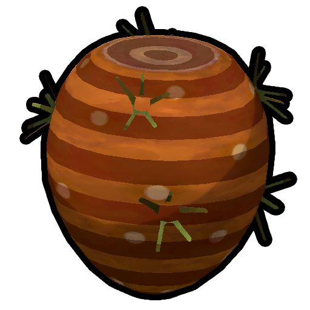](https://peak.wiki.gg/wiki/File%3AGold_Prickleberry_CB.png)
[Item type](Items.md)- [Food](Food.md)
- [Natural food](https://peak.wiki.gg/wiki/Natural_food)
- [Berry](https://peak.wiki.gg/wiki/Berry)
Biome- [Mesa](Mesa.md)
Weight
[](Stamina%20bar.md#Weight) **2.5**
Base Status Effects
[](Stamina%20bar.md#Hunger)Hunger
-15
[](Stamina%20bar.md#Heat)Heat
-10
[](Stamina%20bar.md#Injury)Injury
-10
[](Stamina%20bar.md#Thorns)Thorns
10
Cooked Bonuses
[](Stamina%20bar.md#Hunger)Hunger
-15 (-30 total)
[](Stamina%20bar.md#Bonus_stamina)Bonus Stamina
10 (10 total)

The **Gold Prickleberry** is a [natural food](https://peak.wiki.gg/wiki/Natural_food) in *[PEAK](Peak%20%28game%29.md)* found growing on [Cacti](https://peak.wiki.gg/wiki/Cacti) in the [Mesa](Mesa.md). Eating it restores [](Stamina%20bar.md#Hunger) **15** [Hunger](Stamina%20bar.md#Hunger), [](Stamina%20bar.md#Heat) **10** [Heat](Stamina%20bar.md#Heat), heals [](Stamina%20bar.md#Injury) **10** [Injury](Stamina%20bar.md#Injury) and attaches 2 thorns to the Scout's head, inflicting [](Stamina%20bar.md#Thorns) **10** [Thorns](Stamina%20bar.md#Thorns). Because the thorns are attached to the head, you cannot remove them from yourself.

[Cooking](Cooking.md) a Gold Prickleberry removes the [](Stamina%20bar.md#Thorns) [Thorns](Stamina%20bar.md#Thorns) effect, in addition to the normal effects of cooking.

## Gallery

- [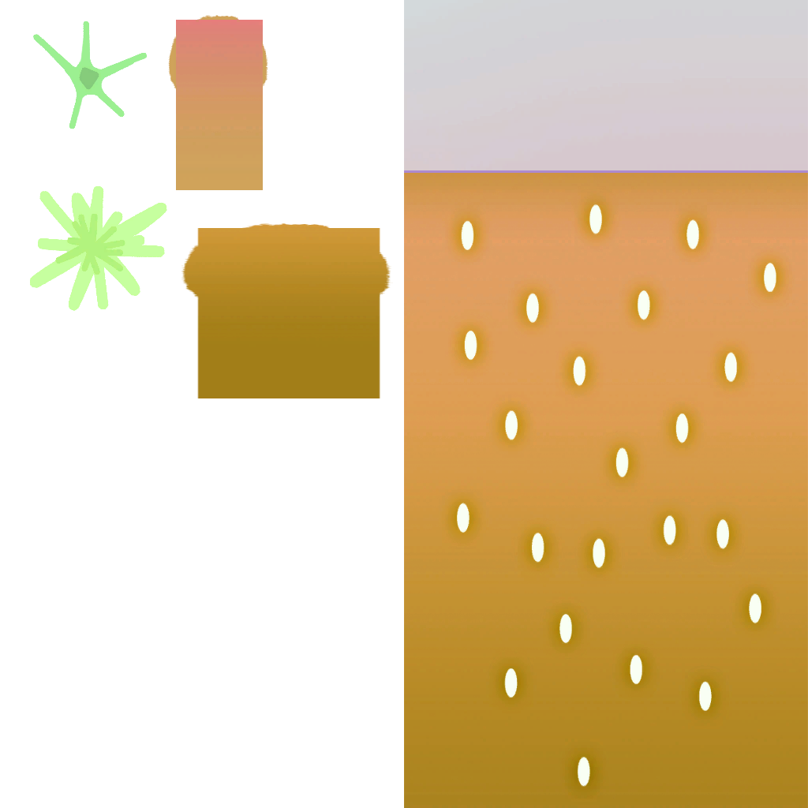](https://peak.wiki.gg/wiki/File%3APrickleberryGold.png)
  Gold Prickleberry texture

## Patch history

 **[1.20.a](1.20.a.md) (2025-08-11):** Introduced.
 **[1.40.a](1.40.a.md) (2025-11-05):** Cooking prickleberries now removes the thorns.

[Food](Food.md)
Natural food
Berries
Berrynanas- [](Yellow%20Berrynana.md) [Yellow Berrynana](Yellow%20Berrynana.md)
- [](Pink%20Berrynana.md) [Pink Berrynana](Pink%20Berrynana.md)
- [](Blue%20Berrynana.md) [Blue Berrynana](Blue%20Berrynana.md)
- [](Brown%20Berrynana.md) [Brown Berrynana](Brown%20Berrynana.md)
Clusterberries- [](Red%20Clusterberry.md) [Red Clusterberry](Red%20Clusterberry.md)
- [](Yellow%20Clusterberry.md) [Yellow Clusterberry](Yellow%20Clusterberry.md)
- [](Black%20Clusterberry.md) [Black Clusterberry](Black%20Clusterberry.md)
Crispberries- [](Green%20Crispberry.md) [Green Crispberry](Green%20Crispberry.md)
- [](Yellow%20Crispberry.md) [Yellow Crispberry](Yellow%20Crispberry.md)
- [](Red%20Crispberry.md) [Red Crispberry](Red%20Crispberry.md)
Kingberries- [](Green%20Kingberry.md) [Green Kingberry](Green%20Kingberry.md)
- [](Yellow%20Kingberry.md) [Yellow Kingberry](Yellow%20Kingberry.md)
- [](Purple%20Kingberry.md) [Purple Kingberry](Purple%20Kingberry.md)
Prickleberries- [](Red%20Prickleberry.md) [Red Prickleberry](Red%20Prickleberry.md)
- [](Gold%20Prickleberry.md) Gold Prickleberry
Shroomberries- [](Red%20Shroomberry.md) [Red Shroomberry](Red%20Shroomberry.md)
- [](Yellow%20Shroomberry.md) [Yellow Shroomberry](Yellow%20Shroomberry.md)
- [](Green%20Shroomberry.md) [Green Shroomberry](Green%20Shroomberry.md)
- [](Blue%20Shroomberry.md) [Blue Shroomberry](Blue%20Shroomberry.md)
- [](Purple%20Shroomberry.md) [Purple Shroomberry](Purple%20Shroomberry.md)
Winterberries- [](Orange%20Winterberry.md) [Orange Winterberry](Orange%20Winterberry.md)
- [](Yellow%20Winterberry.md) [Yellow Winterberry](Yellow%20Winterberry.md)
Other- [](Napberry.md) [Napberry](Napberry.md)
- [](Scorchberry.md) [Scorchberry](Scorchberry.md)
Campfire food- [](Marshmallow.md) [Marshmallow](Marshmallow.md)
- [](Hot%20Dog.md) [Hot Dog](Hot%20Dog.md)
Mushrooms- [](Bugle%20Shroom.md) [Bugle Shroom](Bugle%20Shroom.md)
- [](Button%20Shroom.md) [Button Shroom](Button%20Shroom.md)
- [](Chubby%20Shroom.md) [Chubby Shroom](Chubby%20Shroom.md)
- [](Cluster%20Shroom.md) [Cluster Shroom](Cluster%20Shroom.md)
Mystical food- [](Cure-All.md) [Cure-All](Cure-All.md)
- [](Pandora%27s%20Lunchbox.md) [Pandora's Lunchbox](Pandora%27s%20Lunchbox.md)
Other- [](Cooked%20Bird.md) [Cooked Bird](Cooked%20Bird.md)
- [](Egg.md) [Egg](Egg.md)
- [](Frog%20Legs.md) [Frog Legs](Frog%20Legs.md)
- [](Honeycomb.md) [Honeycomb](Honeycomb.md)
- [](Half-Coconut.md) [Half-Coconut](Half-Coconut.md)
- [](Medicinal%20Root.md) [Medicinal Root](Medicinal%20Root.md)
- [](Mandrake.md) [Mandrake](Mandrake.md)
- [](Scorpion.md) [Scorpion](Scorpion.md)
- [](Tick.md) [Tick](Tick.md)
- [](The%20Early%20Worm.md) [The Early Worm](The%20Early%20Worm.md)
Packaged food
All packaged foods- [](Airline%20Food.md) [Airline Food](Airline%20Food.md)
- [](Big%20Lollipop.md) [Big Lollipop](Big%20Lollipop.md)
- [](Energy%20Drink.md) [Energy Drink](Energy%20Drink.md)
- [](Fortified%20Milk.md) [Fortified Milk](Fortified%20Milk.md)
- [](Granola%20Bar.md) [Granola Bar](Granola%20Bar.md)
- [](Scout%20Cookies.md) [Scout Cookies](Scout%20Cookies.md)
- [](Sports%20Drink.md) [Sports Drink](Sports%20Drink.md)
- [](Trail%20Mix.md) [Trail Mix](Trail%20Mix.md)

---

# Gold


This is a disambiguation page for "Gold".

The following is a list of links related to Gold.

**Gold** may refer to:

- [](Gold%20Prickleberry.md) [Gold Prickleberry](Gold%20Prickleberry.md)
- Golden [](Ancient%20Idol.md) [Ancient Idol](Ancient%20Idol.md)

---

# Granola Bar

Granola Bar
[](https://peak.wiki.gg/wiki/File%3AGranola_Bar.png)
[Item type](Items.md)- [Food](Food.md)
- [Packaged food](https://peak.wiki.gg/wiki/Packaged_food)
Rarity
[Rare](https://peak.wiki.gg/wiki/Rare)
Source- [Regular Luggage](https://peak.wiki.gg/wiki/Regular_Luggage)
- [Big Luggage](https://peak.wiki.gg/wiki/Big_Luggage)
Weight
[](Stamina%20bar.md#Weight) **2.5**
Base Status Effects
[](Stamina%20bar.md#Hunger)Hunger
-15
[](Stamina%20bar.md#Bonus_stamina)Bonus Stamina
20
Cooked Bonuses
[](Stamina%20bar.md#Hunger)Hunger
-15 (-30 total)
[](Stamina%20bar.md#Bonus_stamina)Bonus Stamina
10 (30 total)

The **Granola Bar** is a packaged [food](Food.md) in *[PEAK](Peak%20%28game%29.md)* found in regular or large [luggage](Luggage.md).

## Gallery

- [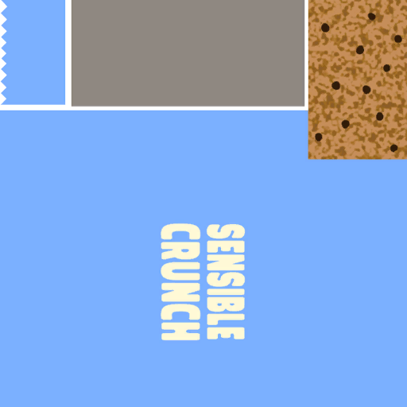](https://peak.wiki.gg/wiki/File%3AGranola.png)
  Granola Bar texture

## Patch history

 **[1.0](1.0.md) (2025-06-16):** Introduced.
 **[1.10.a](1.10.a.md) (2025-07-30):** Fixed an issue where [Trail Mix](Trail%20Mix.md), Granola Bar, [Medicinal Root](Medicinal%20Root.md), and [Airline Food](Airline%20Food.md) would not give extra hunger reduction after cooked.

[Food](Food.md)
Natural food
Berries
Berrynanas- [](Yellow%20Berrynana.md) [Yellow Berrynana](Yellow%20Berrynana.md)
- [](Pink%20Berrynana.md) [Pink Berrynana](Pink%20Berrynana.md)
- [](Blue%20Berrynana.md) [Blue Berrynana](Blue%20Berrynana.md)
- [](Brown%20Berrynana.md) [Brown Berrynana](Brown%20Berrynana.md)
Clusterberries- [](Red%20Clusterberry.md) [Red Clusterberry](Red%20Clusterberry.md)
- [](Yellow%20Clusterberry.md) [Yellow Clusterberry](Yellow%20Clusterberry.md)
- [](Black%20Clusterberry.md) [Black Clusterberry](Black%20Clusterberry.md)
Crispberries- [](Green%20Crispberry.md) [Green Crispberry](Green%20Crispberry.md)
- [](Yellow%20Crispberry.md) [Yellow Crispberry](Yellow%20Crispberry.md)
- [](Red%20Crispberry.md) [Red Crispberry](Red%20Crispberry.md)
Kingberries- [](Green%20Kingberry.md) [Green Kingberry](Green%20Kingberry.md)
- [](Yellow%20Kingberry.md) [Yellow Kingberry](Yellow%20Kingberry.md)
- [](Purple%20Kingberry.md) [Purple Kingberry](Purple%20Kingberry.md)
Prickleberries- [](Red%20Prickleberry.md) [Red Prickleberry](Red%20Prickleberry.md)
- [](Gold%20Prickleberry.md) [Gold Prickleberry](Gold%20Prickleberry.md)
Shroomberries- [](Red%20Shroomberry.md) [Red Shroomberry](Red%20Shroomberry.md)
- [](Yellow%20Shroomberry.md) [Yellow Shroomberry](Yellow%20Shroomberry.md)
- [](Green%20Shroomberry.md) [Green Shroomberry](Green%20Shroomberry.md)
- [](Blue%20Shroomberry.md) [Blue Shroomberry](Blue%20Shroomberry.md)
- [](Purple%20Shroomberry.md) [Purple Shroomberry](Purple%20Shroomberry.md)
Winterberries- [](Orange%20Winterberry.md) [Orange Winterberry](Orange%20Winterberry.md)
- [](Yellow%20Winterberry.md) [Yellow Winterberry](Yellow%20Winterberry.md)
Other- [](Napberry.md) [Napberry](Napberry.md)
- [](Scorchberry.md) [Scorchberry](Scorchberry.md)
Campfire food- [](Marshmallow.md) [Marshmallow](Marshmallow.md)
- [](Hot%20Dog.md) [Hot Dog](Hot%20Dog.md)
Mushrooms- [](Bugle%20Shroom.md) [Bugle Shroom](Bugle%20Shroom.md)
- [](Button%20Shroom.md) [Button Shroom](Button%20Shroom.md)
- [](Chubby%20Shroom.md) [Chubby Shroom](Chubby%20Shroom.md)
- [](Cluster%20Shroom.md) [Cluster Shroom](Cluster%20Shroom.md)
Mystical food- [](Cure-All.md) [Cure-All](Cure-All.md)
- [](Pandora%27s%20Lunchbox.md) [Pandora's Lunchbox](Pandora%27s%20Lunchbox.md)
Other- [](Cooked%20Bird.md) [Cooked Bird](Cooked%20Bird.md)
- [](Egg.md) [Egg](Egg.md)
- [](Frog%20Legs.md) [Frog Legs](Frog%20Legs.md)
- [](Honeycomb.md) [Honeycomb](Honeycomb.md)
- [](Half-Coconut.md) [Half-Coconut](Half-Coconut.md)
- [](Medicinal%20Root.md) [Medicinal Root](Medicinal%20Root.md)
- [](Mandrake.md) [Mandrake](Mandrake.md)
- [](Scorpion.md) [Scorpion](Scorpion.md)
- [](Tick.md) [Tick](Tick.md)
- [](The%20Early%20Worm.md) [The Early Worm](The%20Early%20Worm.md)
Packaged food
All packaged foods- [](Airline%20Food.md) [Airline Food](Airline%20Food.md)
- [](Big%20Lollipop.md) [Big Lollipop](Big%20Lollipop.md)
- [](Energy%20Drink.md) [Energy Drink](Energy%20Drink.md)
- [](Fortified%20Milk.md) [Fortified Milk](Fortified%20Milk.md)
- [](Granola%20Bar.md) Granola Bar
- [](Scout%20Cookies.md) [Scout Cookies](Scout%20Cookies.md)
- [](Sports%20Drink.md) [Sports Drink](Sports%20Drink.md)
- [](Trail%20Mix.md) [Trail Mix](Trail%20Mix.md)

---

# Green Crispberry

Green Crispberry
Normal
Colorblind
[](https://peak.wiki.gg/wiki/File%3AGreen_Crispberry.png)
[](https://peak.wiki.gg/wiki/File%3AGreen_Crispberry_CB.png)
[Item type](Items.md)- [Food](Food.md)
- [Natural food](https://peak.wiki.gg/wiki/Natural_food)
- [Berry](https://peak.wiki.gg/wiki/Berry)
Biome- [Shore](Shore.md)
- [Tropics](Tropics.md)
- [Roots](Roots.md)
- [Mesa](Mesa.md)
- [Alpine](Alpine.md)
- [Peak](Peak%20%28biome%29.md)
Weight
[](Stamina%20bar.md#Weight) **2.5**
Base Status Effects
[](Stamina%20bar.md#Hunger)Hunger
-5
[](Stamina%20bar.md#Poison)Poison
10
Cooked Bonuses
[](Stamina%20bar.md#Hunger)Hunger
-5 (-10 total)
[](Stamina%20bar.md#Bonus_stamina)Bonus Stamina
10 (10 total)

The **Green Crispberry** is a [natural food](https://peak.wiki.gg/wiki/Natural_food) in *[PEAK](Peak%20%28game%29.md)* found growing on bushes in the [Shore](Shore.md) and [Tropics](Tropics.md). It sometimes also appears on the bushes around the [Campfire](Campfire.md) at the top of the [Roots](Roots.md) and [Alpine](Alpine.md), around the [Hot Spring](Alpine.md#Hot_Spring) in the Alpine and [Oasis](Mesa.md#Oasis) in the [Mesa](Mesa.md), and at the foot of the [Peak](Peak%20%28biome%29.md). Eating it restores [](Stamina%20bar.md#Hunger) **5** [Hunger](Stamina%20bar.md#Hunger) and inflicts [](Stamina%20bar.md#Poison) **10** [Poison](Stamina%20bar.md#Poison) over the course of 4 seconds, beginning 2 seconds after eating it.

[Cooking](Cooking.md) a Green Crispberry removes the [](Stamina%20bar.md#Poison) [Poison](Stamina%20bar.md#Poison) effect.

## Patch history

 **[1.0](1.0.md) (2025-06-16):** Introduced.
 **[1.40.a](1.40.a.md) (2025-11-05):** Cooked poisonous berries will now be safe to eat.

[Food](Food.md)
Natural food
Berries
Berrynanas- [](Yellow%20Berrynana.md) [Yellow Berrynana](Yellow%20Berrynana.md)
- [](Pink%20Berrynana.md) [Pink Berrynana](Pink%20Berrynana.md)
- [](Blue%20Berrynana.md) [Blue Berrynana](Blue%20Berrynana.md)
- [](Brown%20Berrynana.md) [Brown Berrynana](Brown%20Berrynana.md)
Clusterberries- [](Red%20Clusterberry.md) [Red Clusterberry](Red%20Clusterberry.md)
- [](Yellow%20Clusterberry.md) [Yellow Clusterberry](Yellow%20Clusterberry.md)
- [](Black%20Clusterberry.md) [Black Clusterberry](Black%20Clusterberry.md)
Crispberries- [](Green%20Crispberry.md) Green Crispberry
- [](Yellow%20Crispberry.md) [Yellow Crispberry](Yellow%20Crispberry.md)
- [](Red%20Crispberry.md) [Red Crispberry](Red%20Crispberry.md)
Kingberries- [](Green%20Kingberry.md) [Green Kingberry](Green%20Kingberry.md)
- [](Yellow%20Kingberry.md) [Yellow Kingberry](Yellow%20Kingberry.md)
- [](Purple%20Kingberry.md) [Purple Kingberry](Purple%20Kingberry.md)
Prickleberries- [](Red%20Prickleberry.md) [Red Prickleberry](Red%20Prickleberry.md)
- [](Gold%20Prickleberry.md) [Gold Prickleberry](Gold%20Prickleberry.md)
Shroomberries- [](Red%20Shroomberry.md) [Red Shroomberry](Red%20Shroomberry.md)
- [](Yellow%20Shroomberry.md) [Yellow Shroomberry](Yellow%20Shroomberry.md)
- [](Green%20Shroomberry.md) [Green Shroomberry](Green%20Shroomberry.md)
- [](Blue%20Shroomberry.md) [Blue Shroomberry](Blue%20Shroomberry.md)
- [](Purple%20Shroomberry.md) [Purple Shroomberry](Purple%20Shroomberry.md)
Winterberries- [](Orange%20Winterberry.md) [Orange Winterberry](Orange%20Winterberry.md)
- [](Yellow%20Winterberry.md) [Yellow Winterberry](Yellow%20Winterberry.md)
Other- [](Napberry.md) [Napberry](Napberry.md)
- [](Scorchberry.md) [Scorchberry](Scorchberry.md)
Campfire food- [](Marshmallow.md) [Marshmallow](Marshmallow.md)
- [](Hot%20Dog.md) [Hot Dog](Hot%20Dog.md)
Mushrooms- [](Bugle%20Shroom.md) [Bugle Shroom](Bugle%20Shroom.md)
- [](Button%20Shroom.md) [Button Shroom](Button%20Shroom.md)
- [](Chubby%20Shroom.md) [Chubby Shroom](Chubby%20Shroom.md)
- [](Cluster%20Shroom.md) [Cluster Shroom](Cluster%20Shroom.md)
Mystical food- [](Cure-All.md) [Cure-All](Cure-All.md)
- [](Pandora%27s%20Lunchbox.md) [Pandora's Lunchbox](Pandora%27s%20Lunchbox.md)
Other- [](Cooked%20Bird.md) [Cooked Bird](Cooked%20Bird.md)
- [](Egg.md) [Egg](Egg.md)
- [](Frog%20Legs.md) [Frog Legs](Frog%20Legs.md)
- [](Honeycomb.md) [Honeycomb](Honeycomb.md)
- [](Half-Coconut.md) [Half-Coconut](Half-Coconut.md)
- [](Medicinal%20Root.md) [Medicinal Root](Medicinal%20Root.md)
- [](Mandrake.md) [Mandrake](Mandrake.md)
- [](Scorpion.md) [Scorpion](Scorpion.md)
- [](Tick.md) [Tick](Tick.md)
- [](The%20Early%20Worm.md) [The Early Worm](The%20Early%20Worm.md)
Packaged food
All packaged foods- [](Airline%20Food.md) [Airline Food](Airline%20Food.md)
- [](Big%20Lollipop.md) [Big Lollipop](Big%20Lollipop.md)
- [](Energy%20Drink.md) [Energy Drink](Energy%20Drink.md)
- [](Fortified%20Milk.md) [Fortified Milk](Fortified%20Milk.md)
- [](Granola%20Bar.md) [Granola Bar](Granola%20Bar.md)
- [](Scout%20Cookies.md) [Scout Cookies](Scout%20Cookies.md)
- [](Sports%20Drink.md) [Sports Drink](Sports%20Drink.md)
- [](Trail%20Mix.md) [Trail Mix](Trail%20Mix.md)

---

# Green Kingberry

Green Kingberry
[](https://peak.wiki.gg/wiki/File%3AGreen_Kingberry.png)
[Item type](Items.md)- [Food](Food.md)
- [Natural food](https://peak.wiki.gg/wiki/Natural_food)
- [Berry](https://peak.wiki.gg/wiki/Berry)
Biome- [Tropics](Tropics.md)
Weight
[](Stamina%20bar.md#Weight) **5**
Base Status Effects
[](Stamina%20bar.md#Hunger)Hunger
-30
[](Stamina%20bar.md#Poison)Poison
5
Cooked Bonuses
[](Stamina%20bar.md#Hunger)Hunger
-30 (-60 total)
[](Stamina%20bar.md#Bonus_stamina)Bonus Stamina
10 (10 total)

The **Green [Kingberry](https://peak.wiki.gg/wiki/Kingberry)** is a [natural food](https://peak.wiki.gg/wiki/Natural_food) in *[PEAK](Peak%20%28game%29.md)* found growing on trees in the [Tropics](Tropics.md). Eating it restores [](Stamina%20bar.md#Hunger) **30** [Hunger](Stamina%20bar.md#Hunger) and inflicts [](Stamina%20bar.md#Poison) **5** [Poison](Stamina%20bar.md#Poison) immediately.

Eating a raw Green Kingberry is almost always worth it despite the [](Stamina%20bar.md#Poison) [Poison](Stamina%20bar.md#Poison), since the [](Stamina%20bar.md#Hunger) [Hunger](Stamina%20bar.md#Hunger) it restores is far greater than the [](Stamina%20bar.md#Poison) [Poison](Stamina%20bar.md#Poison) it inflicts.

[Cooking](Cooking.md) a Green Kingberry removes the [](Stamina%20bar.md#Poison) [Poison](Stamina%20bar.md#Poison) effect.

## Gallery

- [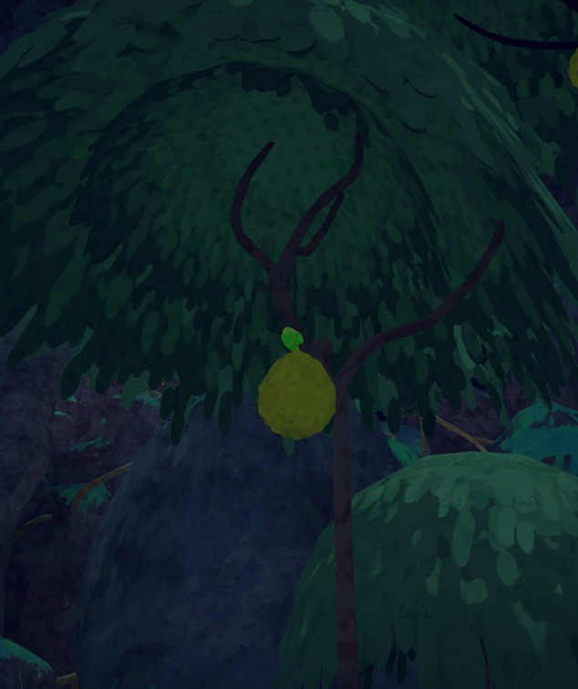](https://peak.wiki.gg/wiki/File%3AKingberry_green.png)
  A Green Kingberry growing on a tree in the [Tropics](Tropics.md).

## Patch history

 **[1.0](1.0.md) (2025-06-16):** Introduced.
 **[1.40.a](1.40.a.md) (2025-11-05):** Cooked poisonous berries will now be safe to eat.

[Food](Food.md)
Natural food
Berries
Berrynanas- [](Yellow%20Berrynana.md) [Yellow Berrynana](Yellow%20Berrynana.md)
- [](Pink%20Berrynana.md) [Pink Berrynana](Pink%20Berrynana.md)
- [](Blue%20Berrynana.md) [Blue Berrynana](Blue%20Berrynana.md)
- [](Brown%20Berrynana.md) [Brown Berrynana](Brown%20Berrynana.md)
Clusterberries- [](Red%20Clusterberry.md) [Red Clusterberry](Red%20Clusterberry.md)
- [](Yellow%20Clusterberry.md) [Yellow Clusterberry](Yellow%20Clusterberry.md)
- [](Black%20Clusterberry.md) [Black Clusterberry](Black%20Clusterberry.md)
Crispberries- [](Green%20Crispberry.md) [Green Crispberry](Green%20Crispberry.md)
- [](Yellow%20Crispberry.md) [Yellow Crispberry](Yellow%20Crispberry.md)
- [](Red%20Crispberry.md) [Red Crispberry](Red%20Crispberry.md)
Kingberries- [](Green%20Kingberry.md) Green Kingberry
- [](Yellow%20Kingberry.md) [Yellow Kingberry](Yellow%20Kingberry.md)
- [](Purple%20Kingberry.md) [Purple Kingberry](Purple%20Kingberry.md)
Prickleberries- [](Red%20Prickleberry.md) [Red Prickleberry](Red%20Prickleberry.md)
- [](Gold%20Prickleberry.md) [Gold Prickleberry](Gold%20Prickleberry.md)
Shroomberries- [](Red%20Shroomberry.md) [Red Shroomberry](Red%20Shroomberry.md)
- [](Yellow%20Shroomberry.md) [Yellow Shroomberry](Yellow%20Shroomberry.md)
- [](Green%20Shroomberry.md) [Green Shroomberry](Green%20Shroomberry.md)
- [](Blue%20Shroomberry.md) [Blue Shroomberry](Blue%20Shroomberry.md)
- [](Purple%20Shroomberry.md) [Purple Shroomberry](Purple%20Shroomberry.md)
Winterberries- [](Orange%20Winterberry.md) [Orange Winterberry](Orange%20Winterberry.md)
- [](Yellow%20Winterberry.md) [Yellow Winterberry](Yellow%20Winterberry.md)
Other- [](Napberry.md) [Napberry](Napberry.md)
- [](Scorchberry.md) [Scorchberry](Scorchberry.md)
Campfire food- [](Marshmallow.md) [Marshmallow](Marshmallow.md)
- [](Hot%20Dog.md) [Hot Dog](Hot%20Dog.md)
Mushrooms- [](Bugle%20Shroom.md) [Bugle Shroom](Bugle%20Shroom.md)
- [](Button%20Shroom.md) [Button Shroom](Button%20Shroom.md)
- [](Chubby%20Shroom.md) [Chubby Shroom](Chubby%20Shroom.md)
- [](Cluster%20Shroom.md) [Cluster Shroom](Cluster%20Shroom.md)
Mystical food- [](Cure-All.md) [Cure-All](Cure-All.md)
- [](Pandora%27s%20Lunchbox.md) [Pandora's Lunchbox](Pandora%27s%20Lunchbox.md)
Other- [](Cooked%20Bird.md) [Cooked Bird](Cooked%20Bird.md)
- [](Egg.md) [Egg](Egg.md)
- [](Frog%20Legs.md) [Frog Legs](Frog%20Legs.md)
- [](Honeycomb.md) [Honeycomb](Honeycomb.md)
- [](Half-Coconut.md) [Half-Coconut](Half-Coconut.md)
- [](Medicinal%20Root.md) [Medicinal Root](Medicinal%20Root.md)
- [](Mandrake.md) [Mandrake](Mandrake.md)
- [](Scorpion.md) [Scorpion](Scorpion.md)
- [](Tick.md) [Tick](Tick.md)
- [](The%20Early%20Worm.md) [The Early Worm](The%20Early%20Worm.md)
Packaged food
All packaged foods- [](Airline%20Food.md) [Airline Food](Airline%20Food.md)
- [](Big%20Lollipop.md) [Big Lollipop](Big%20Lollipop.md)
- [](Energy%20Drink.md) [Energy Drink](Energy%20Drink.md)
- [](Fortified%20Milk.md) [Fortified Milk](Fortified%20Milk.md)
- [](Granola%20Bar.md) [Granola Bar](Granola%20Bar.md)
- [](Scout%20Cookies.md) [Scout Cookies](Scout%20Cookies.md)
- [](Sports%20Drink.md) [Sports Drink](Sports%20Drink.md)
- [](Trail%20Mix.md) [Trail Mix](Trail%20Mix.md)

---

# Green Shroomberry

Green Shroomberry
[](https://peak.wiki.gg/wiki/File%3AGreen_Shroomberry.png)
[Item type](Items.md)- [Food](Food.md)
- [Natural food](https://peak.wiki.gg/wiki/Natural_food)
- [Berry](https://peak.wiki.gg/wiki/Berry)
Biome- [Roots](Roots.md)
Weight
[](Stamina%20bar.md#Weight) **2.5**
Base Status Effects
[](Stamina%20bar.md#Hunger)Hunger
-10
[](Stamina%20bar.md#Spores)Spores
5
Cooked Bonuses
[](Stamina%20bar.md#Hunger)Hunger
-10 (-20 total)
[](Stamina%20bar.md#Bonus_stamina)Bonus Stamina
10 (10 total)

The **Green Shroomberry** is a type of [Shroomberry](Shroomberry.md). It produces a random [bad effect](Shroomberry.md#Bad_effects) when eaten.

[Cooking](Cooking.md) a Green Shroomberry removes the [](Stamina%20bar.md#Spores) [Spores](Stamina%20bar.md#Spores) effect.

## Patch history

 **[1.40.a](1.40.a.md) (2025-11-05):** Introduced.

[Food](Food.md)
Natural food
Berries
Berrynanas- [](Yellow%20Berrynana.md) [Yellow Berrynana](Yellow%20Berrynana.md)
- [](Pink%20Berrynana.md) [Pink Berrynana](Pink%20Berrynana.md)
- [](Blue%20Berrynana.md) [Blue Berrynana](Blue%20Berrynana.md)
- [](Brown%20Berrynana.md) [Brown Berrynana](Brown%20Berrynana.md)
Clusterberries- [](Red%20Clusterberry.md) [Red Clusterberry](Red%20Clusterberry.md)
- [](Yellow%20Clusterberry.md) [Yellow Clusterberry](Yellow%20Clusterberry.md)
- [](Black%20Clusterberry.md) [Black Clusterberry](Black%20Clusterberry.md)
Crispberries- [](Green%20Crispberry.md) [Green Crispberry](Green%20Crispberry.md)
- [](Yellow%20Crispberry.md) [Yellow Crispberry](Yellow%20Crispberry.md)
- [](Red%20Crispberry.md) [Red Crispberry](Red%20Crispberry.md)
Kingberries- [](Green%20Kingberry.md) [Green Kingberry](Green%20Kingberry.md)
- [](Yellow%20Kingberry.md) [Yellow Kingberry](Yellow%20Kingberry.md)
- [](Purple%20Kingberry.md) [Purple Kingberry](Purple%20Kingberry.md)
Prickleberries- [](Red%20Prickleberry.md) [Red Prickleberry](Red%20Prickleberry.md)
- [](Gold%20Prickleberry.md) [Gold Prickleberry](Gold%20Prickleberry.md)
Shroomberries- [](Red%20Shroomberry.md) [Red Shroomberry](Red%20Shroomberry.md)
- [](Yellow%20Shroomberry.md) [Yellow Shroomberry](Yellow%20Shroomberry.md)
- [](Green%20Shroomberry.md) Green Shroomberry
- [](Blue%20Shroomberry.md) [Blue Shroomberry](Blue%20Shroomberry.md)
- [](Purple%20Shroomberry.md) [Purple Shroomberry](Purple%20Shroomberry.md)
Winterberries- [](Orange%20Winterberry.md) [Orange Winterberry](Orange%20Winterberry.md)
- [](Yellow%20Winterberry.md) [Yellow Winterberry](Yellow%20Winterberry.md)
Other- [](Napberry.md) [Napberry](Napberry.md)
- [](Scorchberry.md) [Scorchberry](Scorchberry.md)
Campfire food- [](Marshmallow.md) [Marshmallow](Marshmallow.md)
- [](Hot%20Dog.md) [Hot Dog](Hot%20Dog.md)
Mushrooms- [](Bugle%20Shroom.md) [Bugle Shroom](Bugle%20Shroom.md)
- [](Button%20Shroom.md) [Button Shroom](Button%20Shroom.md)
- [](Chubby%20Shroom.md) [Chubby Shroom](Chubby%20Shroom.md)
- [](Cluster%20Shroom.md) [Cluster Shroom](Cluster%20Shroom.md)
Mystical food- [](Cure-All.md) [Cure-All](Cure-All.md)
- [](Pandora%27s%20Lunchbox.md) [Pandora's Lunchbox](Pandora%27s%20Lunchbox.md)
Other- [](Cooked%20Bird.md) [Cooked Bird](Cooked%20Bird.md)
- [](Egg.md) [Egg](Egg.md)
- [](Frog%20Legs.md) [Frog Legs](Frog%20Legs.md)
- [](Honeycomb.md) [Honeycomb](Honeycomb.md)
- [](Half-Coconut.md) [Half-Coconut](Half-Coconut.md)
- [](Medicinal%20Root.md) [Medicinal Root](Medicinal%20Root.md)
- [](Mandrake.md) [Mandrake](Mandrake.md)
- [](Scorpion.md) [Scorpion](Scorpion.md)
- [](Tick.md) [Tick](Tick.md)
- [](The%20Early%20Worm.md) [The Early Worm](The%20Early%20Worm.md)
Packaged food
All packaged foods- [](Airline%20Food.md) [Airline Food](Airline%20Food.md)
- [](Big%20Lollipop.md) [Big Lollipop](Big%20Lollipop.md)
- [](Energy%20Drink.md) [Energy Drink](Energy%20Drink.md)
- [](Fortified%20Milk.md) [Fortified Milk](Fortified%20Milk.md)
- [](Granola%20Bar.md) [Granola Bar](Granola%20Bar.md)
- [](Scout%20Cookies.md) [Scout Cookies](Scout%20Cookies.md)
- [](Sports%20Drink.md) [Sports Drink](Sports%20Drink.md)
- [](Trail%20Mix.md) [Trail Mix](Trail%20Mix.md)

---

# Guidebook

Guidebook
[](https://peak.wiki.gg/wiki/File%3AGuidebook.png)
[Item type](Items.md)- [Equipment](Equipment.md)
Biome- [Shore](Shore.md)
Location- [Crash Site](https://peak.wiki.gg/wiki/Crash_Site)
Weight
[](Stamina%20bar.md#Weight) **0**

The **Guidebook** is an [equipment](Equipment.md) item in *[PEAK](Peak%20%28game%29.md)*. It is found exclusively at the crash site in [Shore](Shore.md).

It serves as a readable tutorial for the game, explaining various gameplay mechanics such as the [Stamina bar](Stamina%20bar.md) and cooking food. It was written by [Scoutmaster Myres](Scoutmaster%20Myres.md).

When [cooked](Cooking.md), the Guidebook is incinerated and can no longer be opened or closed. If the Guidebook was already open prior to cooking, the player can continue to flip through its pages. Dropping or stashing the Guidebook away will close it and prevent it from being reopened.

## Gallery

- [](https://peak.wiki.gg/wiki/File%3AGuidebook_page_1.jpg)
  Page 1
- [](https://peak.wiki.gg/wiki/File%3AGuidebook_page_2.jpg)
  Page 2
- [](https://peak.wiki.gg/wiki/File%3AGuidebook_page_3.jpg)
  Page 3
- [](https://peak.wiki.gg/wiki/File%3AGuidebook_page_4.jpg)
  Page 4
- [](https://peak.wiki.gg/wiki/File%3AGuidebook_page_5.jpg)
  Page 5
- [](https://peak.wiki.gg/wiki/File%3AGuidebook_page_6.jpg)
  Page 6
- [](https://peak.wiki.gg/wiki/File%3AGuidebook_page_7.jpg)
  Page 7
- [](https://peak.wiki.gg/wiki/File%3AGuidebook_page_8.jpg)
  Page 8

## See Also

- [Scroll](Scroll.md)

## Patch history

 **[1.0](1.0.md) (2025-06-16):** Introduced.
 **[1.1.a](1.1.a.md) (2025-06-17):** Guidebooks are now synced across clients, allowing your friends to read over your shoulder.
 **[1.7](1.7.md) (2025-07-10):** Fixed an issue where guidebook SFX was not spatialized.
 **[1.8](1.8.md) (2025-07-21):** Fixed an issue where the guidebook wouldn't disappear on your back in first-person if you put it in a backpack.

---

# Half-Coconut

Half-Coconut
[](https://peak.wiki.gg/wiki/File%3AHalf-Coconut.png)
[Item type](Items.md)- [Food](Food.md)
- [Natural food](https://peak.wiki.gg/wiki/Natural_food)
Biome- [Shore](Shore.md)
- [Tropics](Tropics.md)
Weight
[](Stamina%20bar.md#Weight) **5**
Base Status Effects
[](Stamina%20bar.md#Hunger)Hunger
-10
[](Stamina%20bar.md#Heat)Heat
-30
Cooked Bonuses
[](Stamina%20bar.md#Hunger)Hunger
-10 (-20 total)
[](Stamina%20bar.md#Bonus_stamina)Bonus Stamina
10 (10 total)

The **Half-Coconut** is a [natural food](https://peak.wiki.gg/wiki/Natural_food) in *[PEAK](Peak%20%28game%29.md)* found by a breaking whole [](Coconut.md) [Coconuts](Coconut.md) that grow on trees in the [Shore](Shore.md), [Tropics](Tropics.md) or on [Oasis](https://peak.wiki.gg/wiki/Oasis) trees. Consuming it removes [](Stamina%20bar.md#Hunger) **10** [Hunger](Stamina%20bar.md#Hunger) and [](Stamina%20bar.md#Heat) **30** [Heat](Stamina%20bar.md#Heat).

[Cooking](Cooking.md) it once doubles the removed [](Stamina%20bar.md#Hunger) [Hunger](Stamina%20bar.md#Hunger) and adds [](Stamina%20bar.md#Bonus_stamina) **10** [Bonus stamina](Stamina%20bar.md#Bonus_stamina).

It is one of the [food](Food.md) items required for the [](https://peak.wiki.gg/wiki/Gourmand_Badge) [Gourmand Badge](https://peak.wiki.gg/wiki/Gourmand_Badge).

## Patch history

 **[1.0](1.0.md) (2025-06-16):** Introduced.

[Food](Food.md)
Natural food
Berries
Berrynanas- [](Yellow%20Berrynana.md) [Yellow Berrynana](Yellow%20Berrynana.md)
- [](Pink%20Berrynana.md) [Pink Berrynana](Pink%20Berrynana.md)
- [](Blue%20Berrynana.md) [Blue Berrynana](Blue%20Berrynana.md)
- [](Brown%20Berrynana.md) [Brown Berrynana](Brown%20Berrynana.md)
Clusterberries- [](Red%20Clusterberry.md) [Red Clusterberry](Red%20Clusterberry.md)
- [](Yellow%20Clusterberry.md) [Yellow Clusterberry](Yellow%20Clusterberry.md)
- [](Black%20Clusterberry.md) [Black Clusterberry](Black%20Clusterberry.md)
Crispberries- [](Green%20Crispberry.md) [Green Crispberry](Green%20Crispberry.md)
- [](Yellow%20Crispberry.md) [Yellow Crispberry](Yellow%20Crispberry.md)
- [](Red%20Crispberry.md) [Red Crispberry](Red%20Crispberry.md)
Kingberries- [](Green%20Kingberry.md) [Green Kingberry](Green%20Kingberry.md)
- [](Yellow%20Kingberry.md) [Yellow Kingberry](Yellow%20Kingberry.md)
- [](Purple%20Kingberry.md) [Purple Kingberry](Purple%20Kingberry.md)
Prickleberries- [](Red%20Prickleberry.md) [Red Prickleberry](Red%20Prickleberry.md)
- [](Gold%20Prickleberry.md) [Gold Prickleberry](Gold%20Prickleberry.md)
Shroomberries- [](Red%20Shroomberry.md) [Red Shroomberry](Red%20Shroomberry.md)
- [](Yellow%20Shroomberry.md) [Yellow Shroomberry](Yellow%20Shroomberry.md)
- [](Green%20Shroomberry.md) [Green Shroomberry](Green%20Shroomberry.md)
- [](Blue%20Shroomberry.md) [Blue Shroomberry](Blue%20Shroomberry.md)
- [](Purple%20Shroomberry.md) [Purple Shroomberry](Purple%20Shroomberry.md)
Winterberries- [](Orange%20Winterberry.md) [Orange Winterberry](Orange%20Winterberry.md)
- [](Yellow%20Winterberry.md) [Yellow Winterberry](Yellow%20Winterberry.md)
Other- [](Napberry.md) [Napberry](Napberry.md)
- [](Scorchberry.md) [Scorchberry](Scorchberry.md)
Campfire food- [](Marshmallow.md) [Marshmallow](Marshmallow.md)
- [](Hot%20Dog.md) [Hot Dog](Hot%20Dog.md)
Mushrooms- [](Bugle%20Shroom.md) [Bugle Shroom](Bugle%20Shroom.md)
- [](Button%20Shroom.md) [Button Shroom](Button%20Shroom.md)
- [](Chubby%20Shroom.md) [Chubby Shroom](Chubby%20Shroom.md)
- [](Cluster%20Shroom.md) [Cluster Shroom](Cluster%20Shroom.md)
Mystical food- [](Cure-All.md) [Cure-All](Cure-All.md)
- [](Pandora%27s%20Lunchbox.md) [Pandora's Lunchbox](Pandora%27s%20Lunchbox.md)
Other- [](Cooked%20Bird.md) [Cooked Bird](Cooked%20Bird.md)
- [](Egg.md) [Egg](Egg.md)
- [](Frog%20Legs.md) [Frog Legs](Frog%20Legs.md)
- [](Honeycomb.md) [Honeycomb](Honeycomb.md)
- [](Half-Coconut.md) Half-Coconut
- [](Medicinal%20Root.md) [Medicinal Root](Medicinal%20Root.md)
- [](Mandrake.md) [Mandrake](Mandrake.md)
- [](Scorpion.md) [Scorpion](Scorpion.md)
- [](Tick.md) [Tick](Tick.md)
- [](The%20Early%20Worm.md) [The Early Worm](The%20Early%20Worm.md)
Packaged food
All packaged foods- [](Airline%20Food.md) [Airline Food](Airline%20Food.md)
- [](Big%20Lollipop.md) [Big Lollipop](Big%20Lollipop.md)
- [](Energy%20Drink.md) [Energy Drink](Energy%20Drink.md)
- [](Fortified%20Milk.md) [Fortified Milk](Fortified%20Milk.md)
- [](Granola%20Bar.md) [Granola Bar](Granola%20Bar.md)
- [](Scout%20Cookies.md) [Scout Cookies](Scout%20Cookies.md)
- [](Sports%20Drink.md) [Sports Drink](Sports%20Drink.md)
- [](Trail%20Mix.md) [Trail Mix](Trail%20Mix.md)

---

# Hazards


This page is a [stub](https://support.wiki.gg/wiki/Stub). You can help **PEAK Wiki** by expanding it.

Hazards are various environmental dangers that can add unwanted status effects to a player's [stamina bar](Stamina%20bar.md). The majority of unique hazards in *[PEAK](Peak%20%28game%29.md)* are contained within a single [biome](https://peak.wiki.gg/wiki/Biome), with many exceptions.

| Hazards | Image | Biome | Effect | Notes |
| --- | --- | --- | --- | --- |
| **[Fog](Fog.md)** | [The Fog.png](https://peak.wiki.gg/wiki/File%3AThe_Fog.png) | - [Shore](Shore.md) - [Tropics](Tropics.md) - [Roots](Roots.md) - [Alpine](Alpine.md) - [Mesa](Mesa.md) | [Cold](Stamina%20bar.md#Cold) **2.5** [Cold](Stamina%20bar.md#Cold) every ~2.4 seconds | The [Fog](Fog.md) will begin to rise after all [Scouts](https://peak.wiki.gg/wiki/Scouts) have passed a certain height in the biome or after 16 minutes and 40 seconds have passed. It will start closing in as a shrinking sphere at a linear rate until a certain radius around the campfire. The [Fog](Fog.md) is replaced by rising [Lava](Lava.md) in [The Kiln](The%20Kiln.md) and rising Gloom in [The Citadel](The%20Citadel.md). If the [Scout](Scout.md) is a [Skeleton](Skeleton.md) the [Fog](Fog.md) will instead deal [Injury](Stamina%20bar.md#Injury) [Injury](Stamina%20bar.md#Injury) at the same rate. |
| **[Jellyfish](https://peak.wiki.gg/wiki/Jellyfish)** | [Jellyfish.png](https://peak.wiki.gg/wiki/File%3AJellyfish.png) | - [Shore](Shore.md) | [Poison](Stamina%20bar.md#Poison) **5** [Poison](Stamina%20bar.md#Poison) | Causes the [Scout](Scout.md) to enter a [ragdoll](https://peak.wiki.gg/wiki/Ragdoll) state and plays a slipping noise upon contact. This may cause the player to fall a significant distance. Inflicts [Poison](Stamina%20bar.md#Poison) [Poison](Stamina%20bar.md#Poison) onto the [Scout](Scout.md) when touched. |
| **[Urchin](https://peak.wiki.gg/wiki/Urchin)** | [Urchin.png](https://peak.wiki.gg/wiki/File%3AUrchin.png) | - [Shore](Shore.md) | [Poison](Stamina%20bar.md#Poison) **10** [Poison](Stamina%20bar.md#Poison) per second. | Direct contact with the giant urchin or any of its spines inflicts [Poison](Stamina%20bar.md#Poison) [Poison](Stamina%20bar.md#Poison) onto the [Scout](Scout.md). |
| **[Bridge](Bridge.md)** | [Bridge.png](https://peak.wiki.gg/wiki/File%3ABridge.png) | - [Shore](Shore.md) - [Roots](Roots.md) | - | Having too many [Scouts](Scout.md) on the bridge at once may cause it to collapse, leading to falls that can inflict serious amounts of [Injury](Stamina%20bar.md#Injury) [Injury](Stamina%20bar.md#Injury). |
| Fire Hazards | [Fire Hazards.png](https://peak.wiki.gg/wiki/File%3AFire_Hazards.png) | - [Shore](Shore.md) - [Tropics](Tropics.md) - [Roots](Roots.md) - [Alpine](Alpine.md) - [Mesa](Mesa.md) - [Gloom](Gloom.md) - [Caldera](Caldera.md) | [Heat](Stamina%20bar.md#Heat) [Heat](Stamina%20bar.md#Heat) | Fire Hazards are objects that inflicts [Heat](Stamina%20bar.md#Heat) [Heat](Stamina%20bar.md#Heat), the most notable one being the [Campfires](Campfire.md) that spawn at the end of nearly every biome. The [airplane Crash Site](https://peak.wiki.gg/wiki/Crash_site) also has a fire, which exhibits similar behavior. |
| **[Rain](https://peak.wiki.gg/wiki/Rain)** | [Tropics rain trees.png](https://peak.wiki.gg/wiki/File%3ATropics_rain_trees.png) | - [Tropics](Tropics.md) | - | Will make [Climbing](https://peak.wiki.gg/wiki/Climbing) cost extra [Stamina](Stamina%20bar.md), and make surfaces more slippery and harder to stand on for its duration, potentially causing falls and inflicting [Injury](Stamina%20bar.md#Injury) [Injury](Stamina%20bar.md#Injury). |
| **Spore Bomb (explosive)** | [Spore Bomb - explosive - closeup.png](https://peak.wiki.gg/wiki/File%3ASpore_Bomb_-_explosive_-_closeup.png) | - [Tropics](Tropics.md) - [Roots](Roots.md) | - | Explodes and launches the [Scout](Scout.md) away from itself. It does not directly cause damage, but may cause the player to fall a long distance and inflict [Injury](Stamina%20bar.md#Injury) [Injury](Stamina%20bar.md#Injury) |
| **Spore Bomb (poisonous)** | [Spore Bomb - poisonous - closeup.png](https://peak.wiki.gg/wiki/File%3ASpore_Bomb_-_poisonous_-_closeup.png) | - [Tropics](Tropics.md) | [Poison](Stamina%20bar.md#Poison) [Poison](Stamina%20bar.md#Poison) | Creates a poison cloud that inflicts [Poison](Stamina%20bar.md#Poison) [Poison](Stamina%20bar.md#Poison) over time onto the [Scout](Scout.md) when touched. The initial explosion will deal more [Poison](Stamina%20bar.md#Poison) [Poison](Stamina%20bar.md#Poison) than the subsequent cloud that forms. |
| **Poison Ivy** | [Tropics poison bush.png](https://peak.wiki.gg/wiki/File%3ATropics_poison_bush.png) | - [Tropics](Tropics.md) | [Poison](Stamina%20bar.md#Poison) **2.5** [Poison](Stamina%20bar.md#Poison) | Direct contact with the plant inflicts [Poison](Stamina%20bar.md#Poison) [Poison](Stamina%20bar.md#Poison) on the [Scout](Scout.md). |
| **Monstera plant** | [Tropics monstera.jpg](https://peak.wiki.gg/wiki/File%3ATropics_monstera.jpg) | - [Tropics](Tropics.md) | - | Small chance for a [Tick](Tick.md) to attach to the [Scout](Scout.md) when walking through these plants, which can inflict up to [Poison](Stamina%20bar.md#Poison) **50** [Poison](Stamina%20bar.md#Poison) over time. |
| **Thorny Giant Ivy** | [Tropics 1.png](https://peak.wiki.gg/wiki/File%3ATropics_1.png) | - [Tropics](Tropics.md) | [Poison](Stamina%20bar.md#Poison) [Poison](Stamina%20bar.md#Poison) | Inflicts [Poison](Stamina%20bar.md#Poison) [Poison](Stamina%20bar.md#Poison) and slightly knocks back the [Scout](Scout.md) if touched. They look similar to the Giant Ivy, but have large spikes. |
| **[Beehive](Beehive.md)** | [Beehive closeup.png](https://peak.wiki.gg/wiki/File%3ABeehive_closeup.png) | - [Tropics](Tropics.md) | [Poison](Stamina%20bar.md#Poison) **2.5** [Poison](Stamina%20bar.md#Poison) per second. | When approached, the bees will attack the [Scout](Scout.md), inflicting [Poison](Stamina%20bar.md#Poison) [Poison](Stamina%20bar.md#Poison). The bees will chase the player a short distance until the player is far enough away. If the beehive is smashed open, the bees will stay around where the hive was destroyed for a short time. |
| **[Lava Tube](https://peak.wiki.gg/wiki/Lava_Tube)** | [Lava tube1.jpg](https://peak.wiki.gg/wiki/File%3ALava_tube1.jpg) | - [Tropics](Tropics.md) - [Alpine](Alpine.md) - [The Kiln](The%20Kiln.md) | [Heat](Stamina%20bar.md#Heat) **50** [Heat](Stamina%20bar.md#Heat) per second. [Injury](Stamina%20bar.md#Injury) **20** [Injury](Stamina%20bar.md#Injury) per second. | Contact with the lava tube inflicts the [Scout](Scout.md) with [Heat](Stamina%20bar.md#Heat) [Heat](Stamina%20bar.md#Heat) and [Injury](Stamina%20bar.md#Injury) [Injury](Stamina%20bar.md#Injury) every second and applies a small amount of knockback. |
| **Wind** | [Roots wind.jpg](https://peak.wiki.gg/wiki/File%3ARoots_wind.jpg) | - [Roots](Roots.md) | - | Periodically, it will begin to gust, pushing all physics objects and [Scouts](https://peak.wiki.gg/wiki/Scouts) to either the left or right side of the biome. Additionally, while a player is affected by wind, their [Stamina](https://peak.wiki.gg/wiki/Stamina) consumption when gripping onto a wall without moving becomes similar to regular climbing. Stamina consumption while climbing is also increased. Increased stamina consumption does not apply while using [Vines](Vines.md), [Ropes](Rope.md) or [Chains](Chain.md). [[confirmation needed](https://peak.wiki.gg/wiki/Category%3APages_needing_confirmation)] The wind also dissipates **Mushroom Spore Clouds** and spore clouds from **spore bombs** for its duration and a short while after. |
| Deep Water | [Roots Deep Water.jpg](https://peak.wiki.gg/wiki/File%3ARoots_Deep_Water.jpg) | - [Roots](Roots.md) | [Spores](Stamina%20bar.md#Spores) [Spores](Stamina%20bar.md#Spores) | Sometimes the water at the bottom of the biome is deeper and has a red hue . This water will constantly inflict [Spores](Stamina%20bar.md#Spores) [Spores](Stamina%20bar.md#Spores) to any [Scouts](https://peak.wiki.gg/wiki/Scouts) in contact with it. |
| **Mushroom Spore Clouds** | [Roots spores outside.jpg](https://peak.wiki.gg/wiki/File%3ARoots_spores_outside.jpg)[Roots spore emitter.jpg](https://peak.wiki.gg/wiki/File%3ARoots_spore_emitter.jpg) | - [Roots](Roots.md) | [Spores](Stamina%20bar.md#Spores) [Spores](Stamina%20bar.md#Spores) | **Mushroom Spore Clouds** are areas of glowing pink fog that inflict [Spores](Stamina%20bar.md#Spores) [Spores](Stamina%20bar.md#Spores) as players remain within them. When the **Wind** is blowing, the clouds will temporarily dissipate. The cloud is produced by a **Spore Emitter**, which can be found at its center. Getting closer to the center of the cloud will increase the rate of [Spores](Stamina%20bar.md#Spores) [Spores](Stamina%20bar.md#Spores) inflicted on the [Scout](Scout.md). |
| **Evil Bounce Fungi** | [Evil Bounce Fungus.png](https://peak.wiki.gg/wiki/File%3AEvil_Bounce_Fungus.png) | - [Roots](Roots.md) | [Spores](Stamina%20bar.md#Spores) **5** [Spores](Stamina%20bar.md#Spores) | **Evil Bounce Fungi** are similar to **Giant Bounce Fungi**, with a more purple, cracked appearance. Landing on one will bounce you and will additionally apply [Spores](Stamina%20bar.md#Spores) **5** [Spores](Stamina%20bar.md#Spores) each bounce. They will only generate in the **Clearcut** variant of the **Roots**. |
| **Spore Bomb (spores)** | [Roots bombshroom.jpg](https://peak.wiki.gg/wiki/File%3ARoots_bombshroom.jpg) | - [Roots](Roots.md) | [Spores](Stamina%20bar.md#Spores) [Spores](Stamina%20bar.md#Spores) | They will explode upon contact, inflicting a higher initial amount of [Spores](Stamina%20bar.md#Spores) [Spores](Stamina%20bar.md#Spores) and releasing a purple gas cloud that inflicts [Spores](Stamina%20bar.md#Spores) [Spores](Stamina%20bar.md#Spores) over time on any [Scout](Scout.md) caught in it. The cloud dissipates after a certain amount of time or when the **Wind** blows. |
| [Mandrake](Mandrake.md) | [Mandrake Hazard.png](https://peak.wiki.gg/wiki/File%3AMandrake_Hazard.png) | - [Roots](Roots.md) | [Drowsy](Stamina%20bar.md#Drowsy) [Drowsy](Stamina%20bar.md#Drowsy) 60 seconds [Numb](https://peak.wiki.gg/wiki/Numb) (If eaten when not cooked) | Look like Medicinal Root until picked up. Once uprooted, they will periodically scream will, rapidly applying the [Drowsy](https://peak.wiki.gg/wiki/Drowsy) effect to any players in range. Eating them gives 60 seconds of [Numbness](https://peak.wiki.gg/wiki/Numb)- If the player's sound effects volume is set to 0, they won't be affected by the Mandrake's scream. |
| **[Beetles](Beetle.md)** | [Beetle.jpg](https://peak.wiki.gg/wiki/File%3ABeetle.jpg) | - [Roots](Roots.md) | - | They will chase [Scouts](https://peak.wiki.gg/wiki/Scouts) and attempt to hit them. If the **Beetle** lands a hit the Scout will knocked away from the **Beetle** in a [ragdoll](Scout.md#Ragdoll_State), which may cause **Scouts** to fall off a cliff and sustain [Injury](Stamina%20bar.md#Injury) [Injury](Stamina%20bar.md#Injury), but the hit itself does not deal damage. |
| **[Spiders](Spider.md)** | [Spider closeup.jpg](https://peak.wiki.gg/wiki/File%3ASpider_closeup.jpg) | - [Roots](Roots.md) | [Web](Stamina%20bar.md#Web) **25** [Web](Stamina%20bar.md#Web) [Poison](Stamina%20bar.md#Poison) **5** [Poison](Stamina%20bar.md#Poison) every 0.8 seconds. | **Spiders** are an enemy found hanging from the trees and cliffs of the Roots. They will grab careless [Scouts](Scout.md), inflicting [Web](Stamina%20bar.md#Web) [Web](Stamina%20bar.md#Web) and a significant amount of [Poison](Stamina%20bar.md#Poison) [Poison](Stamina%20bar.md#Poison). Throwing objects at the **Spider**, on hit, will stun them for a period of time, allowing **Scouts** to pass by beneath without being grabbed. |
| **[Zombies](Zombie.md)** | [Zombie run.jpg](https://peak.wiki.gg/wiki/File%3AZombie_run.jpg) | - [Roots](Roots.md) | [Spores](Stamina%20bar.md#Spores) **10** [Spores](Stamina%20bar.md#Spores) on bite. [Spores](Stamina%20bar.md#Spores) **30** [Spores](Stamina%20bar.md#Spores) over 60 seconds.  [Injury](Stamina%20bar.md#Injury) **10** [Injury](Stamina%20bar.md#Injury) on bite. | **Zombies** are enemies found throughout the Roots on [Peak ascent](Ascents.md#Peak) or higher. They chase and climb after [Scouts](Scout.md), biting them and inflicting [Spores](Stamina%20bar.md#Spores) [Spores](Stamina%20bar.md#Spores) and [Injury](Stamina%20bar.md#Injury) [Injury](Stamina%20bar.md#Injury) until they die. After a bite the player will be infected and take an additional [Spores](Stamina%20bar.md#Spores) **2.5** [Spores](Stamina%20bar.md#Spores) every 5 seconds over the course of 60 seconds, unless the infection is cured early. |
| **[Blizzards](Blizzard.md)** | [Blizzard 1.jpg](https://peak.wiki.gg/wiki/File%3ABlizzard_1.jpg) | - [Alpine](Alpine.md) | [Cold](Stamina%20bar.md#Cold) [Cold](Stamina%20bar.md#Cold) | **[Blizzards](Blizzard.md)** are the main hazard of the Alpine. Periodically, a **blizzard** will move through the entire biome (excluding deep caves), inflicting [Cold](Stamina%20bar.md#Cold) [Cold](Stamina%20bar.md#Cold) rapidly on any [Scout](Scout.md) caught in it. **Scouts** can hide from the **blizzard** by hiding below the **Alpine's** surface or inside the caves. **Blizzards** also severely reduce visibility and have winds that slightly push you. |
| **Icicles** | [Alpine Icicle.png](https://peak.wiki.gg/wiki/File%3AAlpine_Icicle.png) | - [Alpine](Alpine.md) | - | **Icicles** can be found hanging within the Alpine's caves. Climbing on one may cause it to shake before falling a short time later, potentially causing [Injury](Stamina%20bar.md#Injury) [Injury](Stamina%20bar.md#Injury) from the fall. |
| **[Ice Rocks](Ice%20Rocks.md)** | [Ice rock with piton.png](https://peak.wiki.gg/wiki/File%3AIce_rock_with_piton.png) | - [Alpine](Alpine.md) | [Cold](Stamina%20bar.md#Cold) **2.5** [Cold](Stamina%20bar.md#Cold) per 1.75 seconds (while standing). [Cold](Stamina%20bar.md#Cold) **2.5** [Cold](Stamina%20bar.md#Cold) per 0.525 seconds (while [Climbing](https://peak.wiki.gg/wiki/Climbing)) | **[Ice Rocks](Ice%20Rocks.md)** are giant rocks in the walls of the **Alpine's** cliffside and caves that inflict [Cold](Stamina%20bar.md#Cold) [Cold](Stamina%20bar.md#Cold) on [Scouts](https://peak.wiki.gg/wiki/Scouts) standing on them or **Climbing** them. **Climbing** inflicts much more [Cold](Stamina%20bar.md#Cold) [Cold](Stamina%20bar.md#Cold) than simply standing on [Ice Rocks](Ice%20Rocks.md). |
| **[Flash Bulbs](Flash%20Bulbs.md)** | [Flashpod.png](https://peak.wiki.gg/wiki/File%3AFlashpod.png) | - [Alpine](Alpine.md) | - | **[Flash Bulbs](Flash%20Bulbs.md)** are flowers found in the Alpine's caves. Upon making contact with a [Scout](Scout.md), the Flash Bulb will open up and Blind all nearby [Scouts](Scout.md). |
| **[Geysers](https://peak.wiki.gg/wiki/Geysers)** | [Geyser.png](https://peak.wiki.gg/wiki/File%3AGeyser.png) | - [Alpine](Alpine.md) | Up to [Heat](Stamina%20bar.md#Heat) **30** [Heat](Stamina%20bar.md#Heat). | **[Geysers](https://peak.wiki.gg/wiki/Geysers)** can be found on the floor or cliffside, more often within the caves. They can spontaneously erupt when there are [Scouts](https://peak.wiki.gg/wiki/Scouts) nearby, inflicting [Heat](Stamina%20bar.md#Heat) [Heat](Stamina%20bar.md#Heat) on them and sending them flying if they are too close. |
| Rusty [Piton](Piton.md) | [Rusty Piton Hazard.png](https://peak.wiki.gg/wiki/File%3ARusty_Piton_Hazard.png) | - [Alpine](Alpine.md) | - | **[Rusty Pitons](Piton.md#Rusty_Pitons)** can be found embedded in the walls of the Alpine's caves. [Scouts](https://peak.wiki.gg/wiki/Scouts) can grab onto the handle of a Rusty Piton to recover stamina identical to a normal  [Piton](Piton.md), but will break after being held onto for **6 seconds and will potentially cause[Injury](Stamina%20bar.md#Injury) [Injury](Stamina%20bar.md#Injury)** |
| **Blazing Sun** | [Mesa sun.jpg](https://peak.wiki.gg/wiki/File%3AMesa_sun.jpg) | - [Mesa](Mesa.md) | [Heat](Stamina%20bar.md#Heat) **5** [Heat](Stamina%20bar.md#Heat) per second. | The **Sun** in the Mesa will inflict [Heat](Stamina%20bar.md#Heat) **5** [Heat](Stamina%20bar.md#Heat) per second on all players in its direct visibility. Players staying in the shade, using the  [Parasol](Parasol.md), using the  [Glider](Glider.md), or wearing  [Sunscreen](Sunscreen.md) are not affected by the sun. |
| **Cacti** | [Big cacti.png](https://peak.wiki.gg/wiki/File%3ABig_cacti.png) | - [Mesa](Mesa.md) | [Thorns](Stamina%20bar.md#Thorns) [Thorns](Stamina%20bar.md#Thorns) | Various **[Big Cacti](Big%20Cacti.md)** and small **[Cactus](Cactus.md)** balls can both be found in the **Mesa**. Coming into contact with a cactus inflicts [Thorns](Stamina%20bar.md#Thorns) [Thorns](Stamina%20bar.md#Thorns) and makes the player temporarily stick to the cactus. **Scouts** can use **Helping Hand** to free another **scout** from the cactus. |
| **[Tumbleweeds](Tumbleweed.md)** | [Tumbleweed.png](https://peak.wiki.gg/wiki/File%3ATumbleweed.png) | - [Mesa](Mesa.md) | [Thorns](Stamina%20bar.md#Thorns) [Thorns](Stamina%20bar.md#Thorns) | **[Tumbleweeds](Tumbleweed.md)** are ball-like dry plants rolling around the **Mesa**. They seek out unaware players and knock them over, inflicting [Thorns](Stamina%20bar.md#Thorns) [Thorns](Stamina%20bar.md#Thorns) in the process and occasionally even sending them flying. |
| **[Tornadoes](Tornado.md)** | [Mesa tornado.png](https://peak.wiki.gg/wiki/File%3AMesa_tornado.png) | - [Mesa](Mesa.md) | - | **[Tornadoes](Tornado.md)** can spawn on the **Mesa's** Plateau. They will move unpredictably around the Plateau, picking up caught players and sending them flying, potentially causing [Injury](Stamina%20bar.md#Injury) [Injury](Stamina%20bar.md#Injury) when they land or send them flying into a [Cactus](https://peak.wiki.gg/wiki/Cacti),making them get [Thorns](Stamina%20bar.md#Thorns) [Thorns](Stamina%20bar.md#Thorns) while they are still laying down |
| **[Antlion](Antlion.md)** | [Antlion trap.png](https://peak.wiki.gg/wiki/File%3AAntlion_trap.png) | - [Mesa](Mesa.md) | [Injury](Stamina%20bar.md#Injury) **20** [Injury](Stamina%20bar.md#Injury) | **[Antlions](Antlion.md)** lure the players in with fake [Explorer's Luggage](https://peak.wiki.gg/wiki/Explorer%27s_Luggage) in their traps and inflict serious amounts of [Injury](Stamina%20bar.md#Injury) [Injury](Stamina%20bar.md#Injury) on caught players. |
| **[Scorpions](Scorpion.md)** | [Scorpion closeup.png](https://peak.wiki.gg/wiki/File%3AScorpion_closeup.png) | - [Mesa](Mesa.md) | [Poison](Stamina%20bar.md#Poison) **52.5−102.5** [Poison](Stamina%20bar.md#Poison) | **[Scorpions](Scorpion.md)** are a natural enemy found in the Caves of the **Mesa**. They sting careless players, dealing a significant amount of [Poison](Stamina%20bar.md#Poison) [Poison](Stamina%20bar.md#Poison). |
| **[Dynamite](Dynamite.md)** | [Dynamite closeup.png](https://peak.wiki.gg/wiki/File%3ADynamite_closeup.png) | - [Mesa](Mesa.md) | Up to [Injury](Stamina%20bar.md#Injury) **22.5** [Injury](Stamina%20bar.md#Injury). [Injury](Stamina%20bar.md#Injury) **30** [Injury](Stamina%20bar.md#Injury) if held. | **[Dynamite](Dynamite.md)** is scattered all throughout the Caves of the [Mesa](Mesa.md), embedded into the ground and walls. It lights up when a player is nearby and explodes shortly after, [Injury](Stamina%20bar.md#Injury) [injuring](Stamina%20bar.md#Injury) close players and knocking them back. |
| Pickaxe | [Pickaxe Hazard.png](https://peak.wiki.gg/wiki/File%3APickaxe_Hazard.png) | - [Mesa](Mesa.md) | - | Old **[Pickaxes](Piton.md#Pickaxes)** can spawn naturally in the cliffs of the Caves. They perform identically to [Rusty Pitons](Piton.md), breaking after **6 seconds** of being held on to **and will potentially cause[Injury](Stamina%20bar.md#Injury) [Injury](Stamina%20bar.md#Injury)** |
| Exploding [Luggages](Luggage.md) | [Risky Luggages.png](https://peak.wiki.gg/wiki/File%3ARisky_Luggages.png) | - [Mesa](Mesa.md) and [Clown Lugagges](https://peak.wiki.gg/wiki/Clown_Luggage) | Up to [Injury](Stamina%20bar.md#Injury) **22.5** [Injury](Stamina%20bar.md#Injury). [Injury](Stamina%20bar.md#Injury) **30** [Injury](Stamina%20bar.md#Injury) if held. | Some [luggages](Luggage.md) found in [Mesa](Mesa.md) have a chance to have **[Dynamite](Dynamite.md) in them and makes them Dangerous,** [Clown Luggages](https://peak.wiki.gg/wiki/Clown_Luggage) can spawn with **[Dynamite](Dynamite.md) as a loot in them aswell with a high chance.** |
| **[Lava](Lava.md)** | [Caldera lava closeup.png](https://peak.wiki.gg/wiki/File%3ACaldera_lava_closeup.png) | - [Caldera](Caldera.md) - [The Kiln](The%20Kiln.md) | [Heat](Stamina%20bar.md#Heat) [Heat](Stamina%20bar.md#Heat) (25 per second when directly touched). [Injury](Stamina%20bar.md#Injury) **25** [Injury](Stamina%20bar.md#Injury) per second when directly touched. | The **lava** in the Caldera will rise and fall periodically, occasionally uncovering the burning hot ground. The lava is able to heat up the rocks, which will then inflict [Heat](Stamina%20bar.md#Heat) [Heat](Stamina%20bar.md#Heat) on the [Scouts](https://peak.wiki.gg/wiki/Scouts) standing on them. Rocks closer to the lava deal more heat damage. The **Lava** replaces the [Fog](Fog.md) in [The Kiln](The%20Kiln.md), rising from the bottom until it reaches the top.  Lava can also [cook](Cooking.md) dropped and held items if they are sufficiently close. |
| **Eruptions** | [Caldera burning rocks.png](https://peak.wiki.gg/wiki/File%3ACaldera_burning_rocks.png) | - [Caldera](Caldera.md) | [Heat](Stamina%20bar.md#Heat) [Heat](Stamina%20bar.md#Heat) | **Eruptions** may occur in all parts of the Caldera. Occasionally, rocks will begin to glow with heat before bursting into a vertical inferno of flames shorty after. The inferno inflicts a significant amount of [Heat](Stamina%20bar.md#Heat) [Heat](Stamina%20bar.md#Heat) on [Scouts](https://peak.wiki.gg/wiki/Scouts) caught in it. Eruptions subside after a short amount of time. Standing on the heating-up rocks can also deal a moderate amount of [Heat](Stamina%20bar.md#Heat) [Heat](Stamina%20bar.md#Heat) damage.  Despite their appearance, they do not cook food. |
| **Hot Rocks** | [Hot rock.png](https://peak.wiki.gg/wiki/File%3AHot_rock.png) | - [The Kiln](The%20Kiln.md) | [Heat](Stamina%20bar.md#Heat) [Heat](Stamina%20bar.md#Heat) | **Hot Rocks** can be found embedded in the walls throughout The Kiln, dealing [Heat](Stamina%20bar.md#Heat) [Heat](Stamina%20bar.md#Heat) damage on contact or when staying nearby. |
| **Sleepy Gloom** | [Sleepy gloom.png](https://peak.wiki.gg/wiki/File%3ASleepy_gloom.png) | - [Gloom](Gloom.md) - [The Citadel](The%20Citadel.md) | [Drowsy](Stamina%20bar.md#Drowsy) **2.5** [Drowsy](Stamina%20bar.md#Drowsy) every ~2.75 seconds | Covers the majority of the [Gloom](Gloom.md) Replaces the [Fog](Fog.md) in [The Citadel](The%20Citadel.md) and will rise until it reaches the top. If the [Scout](Scout.md) is a [Skeleton](Skeleton.md) the rising gloom will not have any effect. |
| **Gloom Water** | [Gloom water.png](https://peak.wiki.gg/wiki/File%3AGloom_water.png) | - [Gloom](Gloom.md) | Slowness | **Gloom Water** significantly slows down [Scouts](Scout.md)' movement speed while walking in it, making it harder to traverse the Gloom. |
| **Wrought-Iron Fences** | [Fencing.png](https://peak.wiki.gg/wiki/File%3AFencing.png) | - [Gloom](Gloom.md) | [Injury](Stamina%20bar.md#Injury) **2.5** [Injury](Stamina%20bar.md#Injury) per second | **Wrought-Iron Fences** appear as railings scattered across the Gloom that serve as obstacles that may block direct paths to the next island. They cannot be climbed on. Standing on top of the Fencing will deal [Injury](Stamina%20bar.md#Injury) **2.5** [Injury](Stamina%20bar.md#Injury) per second. |
| **[Flytraps](https://peak.wiki.gg/wiki/Flytraps)** | [Flytrap.png](https://peak.wiki.gg/wiki/File%3AFlytrap.png) | - [Gloom](Gloom.md) | [Flytrap](Stamina%20bar.md#Flytrap) **30** [Flytrap](Stamina%20bar.md#Flytrap) [Poison](Stamina%20bar.md#Poison) **5** [Poison](Stamina%20bar.md#Poison) per second | **Flytraps** are stationary enemy plants that rest on the ground of the Gloom. If a Scout walks on top of an open Flytrap, it will catch and ensnare them, filling their stamina bar with [Flytrap](Stamina%20bar.md#Flytrap) **30** [Flytrap](Stamina%20bar.md#Flytrap) and then inflicting [Poison](Stamina%20bar.md#Poison) **5** [Poison](Stamina%20bar.md#Poison) every second. The trapped Scout can struggle by pressing the jump button to remove [Flytrap](Stamina%20bar.md#Flytrap) **2.5** [Flytrap](Stamina%20bar.md#Flytrap) per struggle, escaping after the [Flytrap](Stamina%20bar.md#Flytrap) [Flytrap](Stamina%20bar.md#Flytrap) is fully removed. Alternatively, another Scout can rescue them by reaching out with a helping hand to pull them out. |
| **[Frogs](https://peak.wiki.gg/wiki/Frogs)** | [Frog Hazard.png](https://peak.wiki.gg/wiki/File%3AFrog_Hazard.png) | - [Gloom](Gloom.md) | - | **[Frogs](Frog.md)** are creatures that are scattered around the Gloom. If a [Scout](Scout.md) enters a Frog's line of sight, it will shoot its tongue out from a great distance. If it hits a Scout with its tongue, it will turn the Scout to its direction then fling them towards itself, while also [ragdolling](Scout.md#Ragdoll_State) them. Frogs can be picked up by Scouts and tossed, but cannot be stored, similarly to the  [Scorpion](Scorpion.md). Frogs can be [cooked](https://peak.wiki.gg/wiki/Cooked) into  [Frog Legs](Frog%20Legs.md). Throwing a Frog high into the air may result in it flinging you upwards, inflicting high amounts of [Injury](Stamina%20bar.md#Injury) [Injury](Stamina%20bar.md#Injury). |
| **[Big Ghost](Big%20Ghost.md)** | [Big ghost (hiquality).png](https://peak.wiki.gg/wiki/File%3ABig_ghost_%28hiquality%29.png) | - [Gloom](Gloom.md) | [Cold](Stamina%20bar.md#Cold) **35** [Cold](Stamina%20bar.md#Cold) Blindness for 20 seconds | **[The Big Ghost](Big%20Ghost.md)** is a hostile enemy that spawns when Scouts spend too long inside of the Sleepy Gloom. It will begin to manifest with a unique sound cue, before chasing the nearest Scout, pathing through terrain if necessary to get to them. Once caught up, the Ghost will explode, inflicting [Cold](Stamina%20bar.md#Cold) **35** [Cold](Stamina%20bar.md#Cold), 20 seconds of Blindness and [ragdolling](Scout.md#Ragdoll_State) them with a great force, potentially leading to additional [Injury](Stamina%20bar.md#Injury) [Injury](Stamina%20bar.md#Injury). Light sources such as the  [Candlestick](Candlestick.md),  [Faerie Lantern](Faerie%20Lantern.md), and the Belltowers can be used to burn the Ghost, despawning it and rewarding the responsible Scouts the [Exorcist Badge](https://peak.wiki.gg/wiki/Exorcist_Badge) [Exorcist Badge](https://peak.wiki.gg/wiki/Exorcist_Badge). |
| Arrow Traps | [Arrow Trap.png](https://peak.wiki.gg/wiki/File%3AArrow_Trap.png) | - [The Citadel](The%20Citadel.md) | [Arrow](Stamina%20bar.md#Arrow) **7.5** [Arrow](Stamina%20bar.md#Arrow) | **Arrow Traps** are scattered across the walls,ceilings and the enterance room of [The Citadel](The%20Citadel.md). If a [Scout](Scout.md) makes contact with the thin blue line, an arrow will shoot out. If the arrow hits the Scout, they are afflicted with [Arrow](Stamina%20bar.md#Arrow) **7.5** [Arrow](Stamina%20bar.md#Arrow). Similar to [Thorns](Stamina%20bar.md#Thorns) [Thorns](Stamina%20bar.md#Thorns), the arrows can be removed, but doing so will inflict [Injury](Stamina%20bar.md#Injury) **12.5** [Injury](Stamina%20bar.md#Injury). An arrow trap deactivates after firing 3 arrows, at which point its blue line will disappear. |
| [Crucible of Lava](https://peak.wiki.gg/wiki/24_karat) | [Crucible of lava.png](https://peak.wiki.gg/wiki/File%3ACrucible_of_lava.png) | - [The Citadel](The%20Citadel.md) | [Heat](Stamina%20bar.md#Heat) [Heat](Stamina%20bar.md#Heat) | The Crucible of Lava spawns as a substitute for the lava of [The Kiln](The%20Kiln.md),Contacting with it gives you [Heat](Stamina%20bar.md#Heat) [Heat](Stamina%20bar.md#Heat) |
| **Petrifying Stones** | [PetrifyingRocks.png](https://peak.wiki.gg/wiki/File%3APetrifyingRocks.png) | - [The Citadel](The%20Citadel.md) | [Petrify](Stamina%20bar.md#Petrify) **2** [Petrify](Stamina%20bar.md#Petrify) per second | **Petrifying Stones** are rocks that form on the walls of The Citadel similar to the [Ice Rocks](Ice%20Rocks.md) of the [Alpine](Alpine.md). While any part of a Scout is touching a Petrifying Stone, they are inflicted with [Petrify](Stamina%20bar.md#Petrify) **2** [Petrify](Stamina%20bar.md#Petrify) every second. |
| Giant Saw | [Giant saw.png](https://peak.wiki.gg/wiki/File%3AGiant_saw.png) | - [The Citadel](The%20Citadel.md) | [Injury](Stamina%20bar.md#Injury) [Injury](Stamina%20bar.md#Injury) | Giant saw spawns in the walls of [The Citadel](The%20Citadel.md),it moves up and down perpetually which if [Scouts](Scout.md) touch it they get [Injury](Stamina%20bar.md#Injury) [Injury](Stamina%20bar.md#Injury) |
| **Spike Traps** | [SpikeTrap.png](https://peak.wiki.gg/wiki/File%3ASpikeTrap.png) | - [The Citadel](The%20Citadel.md) | [Injury](Stamina%20bar.md#Injury) **15** [Injury](Stamina%20bar.md#Injury) | **Spike Traps** are pressure plates that can be found on the ground. When a Scout stands on a pressure plate, the spikes will arm themselves for **0.8 seconds** before shooting up, then receding back into the plate after a second. If a Scout is hit by the spikes, they take [Injury](Stamina%20bar.md#Injury) **15** [Injury](Stamina%20bar.md#Injury). Spike Traps can sometimes hit through floors when a platform generates close enough. |
| **Swinging Maces** | [SwingingMace.png](https://peak.wiki.gg/wiki/File%3ASwingingMace.png) | - [The Citadel](The%20Citadel.md) | [Injury](Stamina%20bar.md#Injury) **25** [Injury](Stamina%20bar.md#Injury) | **Swinging Maces** are large, spiked balls hung from platforms inside The Citadel. They swing back and forth perpetually, granting small openings for Scouts to run through. Obstacles may sometimes impede the full swing of the mace, causing it to bounce off whatever it hit, shortening the swing. If a Swinging Mace hits a Scout, they take up to [Injury](Stamina%20bar.md#Injury) **25** [Injury](Stamina%20bar.md#Injury) and enter a [ragdoll](https://peak.wiki.gg/wiki/Ragdoll) state. |
| **Horizontal Spike Rollers** | [RotatingHorizontalCrushers.png](https://peak.wiki.gg/wiki/File%3ARotatingHorizontalCrushers.png) | - [The Citadel](The%20Citadel.md) | [Injury](Stamina%20bar.md#Injury) **5** [Injury](Stamina%20bar.md#Injury) every **0.25 seconds** | **Horizontal Spike Rollers** are round metal beams dotted with spikes that appear in the center of The Citadel. Two or four crushers spin clockwise in a circle around an elevated center, inflicting [Injury](Stamina%20bar.md#Injury) **5** [Injury](Stamina%20bar.md#Injury) every **0.25 seconds** while in contact. A luggage or a luggage trap can occasionally spawn on the center platform. |
| **Vertical Spike Rollers** | [RotatingVerticalCrusher.png](https://peak.wiki.gg/wiki/File%3ARotatingVerticalCrusher.png) | - [The Citadel](The%20Citadel.md) | [Injury](Stamina%20bar.md#Injury) **5** [Injury](Stamina%20bar.md#Injury) every **0.25 seconds** | **Vertical Spike Rollers** are large round metal beams dotted with spikes that appear in the center of The Citadel. They spin in place on the vertical axis, inflicting [Injury](Stamina%20bar.md#Injury) **5** [Injury](Stamina%20bar.md#Injury) every **0.25 seconds** while in contact. |
| **[Luggage Trap](Luggage.md#Luggage_Trap)** | [MimicLuggage.png](https://peak.wiki.gg/wiki/File%3AMimicLuggage.png) | - [The Citadel](The%20Citadel.md) | [Drowsy](Stamina%20bar.md#Drowsy) [Drowsy](Stamina%20bar.md#Drowsy) | **[Luggage Traps](Luggage.md#Luggage_Trap)** are mimics made to look like [Regular Luggage](https://peak.wiki.gg/wiki/Regular_Luggage) but with the handle up and appearing slightly opened. When opened, a cloud of gas explodes out from the Luggage Trap, which inflicts [Drowsy](Stamina%20bar.md#Drowsy) [Drowsy](Stamina%20bar.md#Drowsy). |
| [The Lost Souls](https://peak.wiki.gg/wiki/The_Lost_Souls) | [Nadir Lost Souls.png](https://peak.wiki.gg/wiki/File%3ANadir_Lost_Souls.png) | - [Nadir](Nadir.md) | [Petrify](Stamina%20bar.md#Petrify) [Petrify](Stamina%20bar.md#Petrify) per second | The **Lost Souls** are an environmental hazard and time limit similar to the [Fog](Fog.md), the rising lava of [The Kiln](The%20Kiln.md) or the rising Gloom of [The Citadel](The%20Citadel.md). The Lost Souls appear as a inky black liquid with Scout ghosts that occasionally fly up from the liquid. It slowly ascends from the False Shore up the climb, moving faster than the other time limit hazards. Scouts submerged in the Lost Souls are gradually inflicted with  [[Stamina bar#Petrify|[Petrify](Stamina%20bar.md#Petrify) [Petrify](Stamina%20bar.md#Petrify)]], and if they are submerged too deep, they take a large amount of  [Injury](Stamina%20bar.md#Injury) at once and are instantly killed. Unlike other time limit hazards, "The lost souls are rising" notification is not disabled on [Tenderfoot](https://peak.wiki.gg/wiki/Tenderfoot). However, the actual effect is disabled and the lost souls will never actually inflict  [[Stamina bar#Petrify|[Petrify](Stamina%20bar.md#Petrify) [Petrify](Stamina%20bar.md#Petrify)]] or  [[Stamina bar#Injury|[Injury](Stamina%20bar.md#Injury) [Injury](Stamina%20bar.md#Injury)]]. |
| [Scoutmaster Myres](Scoutmaster%20Myres.md) | [Scoutmaster face.png](https://peak.wiki.gg/wiki/File%3AScoutmaster_face.png) | - | [Injury](Stamina%20bar.md#Injury) [Injury](Stamina%20bar.md#Injury) | **The Scoutmaster** is a hostile [NPC](https://peak.wiki.gg/wiki/NPC) in *[PEAK](Peak%20%28game%29.md)*. He can be encountered in any [biome](https://peak.wiki.gg/wiki/Biome) under the right conditions, with the exception of the [PEAK](Peak%20%28biome%29.md) and [Nadir](Nadir.md).He spawns when scouts are far away from each other.If he catches any scout,he will toss them around and deal large amounts of [Injury](Stamina%20bar.md#Injury) [Injury](Stamina%20bar.md#Injury). |

---

# Heat Pack

Heat Pack
[](https://peak.wiki.gg/wiki/File%3AHeat_Pack.png)
[Item type](Items.md)- [Consumable](https://peak.wiki.gg/wiki/Consumable)
Rarity
[Common](https://peak.wiki.gg/wiki/Common)
Biome- [Alpine](Alpine.md)
Source- [Regular Luggage](https://peak.wiki.gg/wiki/Regular_Luggage)
- [Big Luggage](https://peak.wiki.gg/wiki/Big_Luggage)
Weight
[](Stamina%20bar.md#Weight) **0**
Base Status Effects
[](Stamina%20bar.md#Cold)Cold
-360
**WARNING:** might melt hand meat

The **Heat Pack** is a [consumable](https://peak.wiki.gg/wiki/Consumable) item in *[PEAK](Peak%20%28game%29.md)*. Using a Heat Pack removes [](Stamina%20bar.md#Cold) **6** [Cold](Stamina%20bar.md#Cold) per second for the next 60 seconds. Heat packs only spawn in [luggages](Luggage.md) in the [Alpine](Alpine.md).

[Cooking](Cooking.md) a Heat Pack causes it to explode, dealing up to [](Stamina%20bar.md#Injury) **20** [Injury](Stamina%20bar.md#Injury) to players within **4.8 meters**, depending on their distance.

## Gallery

- [](https://peak.wiki.gg/wiki/File%3AHot_hands.png)
  Heat Pack texture.

## Patch history

 **[1.0](1.0.md) (2025-06-16):** Introduced.
 **[1.6.a](1.6.a.md) (2025-07-04):** Fixed an issue where eating a [lollipop](Big%20Lollipop.md) after using a heat pack would cause a ton of cold damage over time.
 **[1.25.a](1.25.a.md) (2025-08-21):** Fixed the issue where biome-specific items such as the [Dynamite](Dynamite.md) and Heat Pack could show up in the [Caldera](Caldera.md) onwards.
 **[1.40.a](1.40.a.md) (2025-11-05):** Cooking a heat pack now causes it to explode.

---

# Honeycomb

Honeycomb
[](https://peak.wiki.gg/wiki/File%3AHoneycomb.png)
[Item type](Items.md)- [Food](Food.md)
- [Natural food](https://peak.wiki.gg/wiki/Natural_food)
Biome- [Tropics](Tropics.md)
- [Roots](Roots.md)
Weight
[](Stamina%20bar.md#Weight) **2.5**
Base Status Effects
[](Stamina%20bar.md#Hunger)Hunger
-10
[](Stamina%20bar.md#Bonus_stamina)Bonus Stamina
50
Cooked Bonuses
[](Stamina%20bar.md#Hunger)Hunger
-10 (-20 total)
[](Stamina%20bar.md#Bonus_stamina)Bonus Stamina
25 (75 total)

The **Honeycomb** is a natural [food](Food.md) in *[PEAK](Peak%20%28game%29.md)*, it has a chance to be found in [Roots](Roots.md) inside [Redwood Stumps](Roots.md#Redwood_Stumps) or in [Tropics](Tropics.md) by breaking a [](Beehive.md) [Beehive](Beehive.md) (yields four honeycombs). Eating it restores [](Stamina%20bar.md#Hunger) **10** [Hunger](Stamina%20bar.md#Hunger) and grants [](Stamina%20bar.md#Bonus_stamina) **50** [Bonus stamina](Stamina%20bar.md#Bonus_stamina).

Honeycomb is one of the [food](Food.md) items required for the [](https://peak.wiki.gg/wiki/Gourmand_Badge) [Gourmand Badge](https://peak.wiki.gg/wiki/Gourmand_Badge).

## Patch history

 **[1.0](1.0.md) (2025-06-16):** Introduced.

[Food](Food.md)
Natural food
Berries
Berrynanas- [](Yellow%20Berrynana.md) [Yellow Berrynana](Yellow%20Berrynana.md)
- [](Pink%20Berrynana.md) [Pink Berrynana](Pink%20Berrynana.md)
- [](Blue%20Berrynana.md) [Blue Berrynana](Blue%20Berrynana.md)
- [](Brown%20Berrynana.md) [Brown Berrynana](Brown%20Berrynana.md)
Clusterberries- [](Red%20Clusterberry.md) [Red Clusterberry](Red%20Clusterberry.md)
- [](Yellow%20Clusterberry.md) [Yellow Clusterberry](Yellow%20Clusterberry.md)
- [](Black%20Clusterberry.md) [Black Clusterberry](Black%20Clusterberry.md)
Crispberries- [](Green%20Crispberry.md) [Green Crispberry](Green%20Crispberry.md)
- [](Yellow%20Crispberry.md) [Yellow Crispberry](Yellow%20Crispberry.md)
- [](Red%20Crispberry.md) [Red Crispberry](Red%20Crispberry.md)
Kingberries- [](Green%20Kingberry.md) [Green Kingberry](Green%20Kingberry.md)
- [](Yellow%20Kingberry.md) [Yellow Kingberry](Yellow%20Kingberry.md)
- [](Purple%20Kingberry.md) [Purple Kingberry](Purple%20Kingberry.md)
Prickleberries- [](Red%20Prickleberry.md) [Red Prickleberry](Red%20Prickleberry.md)
- [](Gold%20Prickleberry.md) [Gold Prickleberry](Gold%20Prickleberry.md)
Shroomberries- [](Red%20Shroomberry.md) [Red Shroomberry](Red%20Shroomberry.md)
- [](Yellow%20Shroomberry.md) [Yellow Shroomberry](Yellow%20Shroomberry.md)
- [](Green%20Shroomberry.md) [Green Shroomberry](Green%20Shroomberry.md)
- [](Blue%20Shroomberry.md) [Blue Shroomberry](Blue%20Shroomberry.md)
- [](Purple%20Shroomberry.md) [Purple Shroomberry](Purple%20Shroomberry.md)
Winterberries- [](Orange%20Winterberry.md) [Orange Winterberry](Orange%20Winterberry.md)
- [](Yellow%20Winterberry.md) [Yellow Winterberry](Yellow%20Winterberry.md)
Other- [](Napberry.md) [Napberry](Napberry.md)
- [](Scorchberry.md) [Scorchberry](Scorchberry.md)
Campfire food- [](Marshmallow.md) [Marshmallow](Marshmallow.md)
- [](Hot%20Dog.md) [Hot Dog](Hot%20Dog.md)
Mushrooms- [](Bugle%20Shroom.md) [Bugle Shroom](Bugle%20Shroom.md)
- [](Button%20Shroom.md) [Button Shroom](Button%20Shroom.md)
- [](Chubby%20Shroom.md) [Chubby Shroom](Chubby%20Shroom.md)
- [](Cluster%20Shroom.md) [Cluster Shroom](Cluster%20Shroom.md)
Mystical food- [](Cure-All.md) [Cure-All](Cure-All.md)
- [](Pandora%27s%20Lunchbox.md) [Pandora's Lunchbox](Pandora%27s%20Lunchbox.md)
Other- [](Cooked%20Bird.md) [Cooked Bird](Cooked%20Bird.md)
- [](Egg.md) [Egg](Egg.md)
- [](Frog%20Legs.md) [Frog Legs](Frog%20Legs.md)
- [](Honeycomb.md) Honeycomb
- [](Half-Coconut.md) [Half-Coconut](Half-Coconut.md)
- [](Medicinal%20Root.md) [Medicinal Root](Medicinal%20Root.md)
- [](Mandrake.md) [Mandrake](Mandrake.md)
- [](Scorpion.md) [Scorpion](Scorpion.md)
- [](Tick.md) [Tick](Tick.md)
- [](The%20Early%20Worm.md) [The Early Worm](The%20Early%20Worm.md)
Packaged food
All packaged foods- [](Airline%20Food.md) [Airline Food](Airline%20Food.md)
- [](Big%20Lollipop.md) [Big Lollipop](Big%20Lollipop.md)
- [](Energy%20Drink.md) [Energy Drink](Energy%20Drink.md)
- [](Fortified%20Milk.md) [Fortified Milk](Fortified%20Milk.md)
- [](Granola%20Bar.md) [Granola Bar](Granola%20Bar.md)
- [](Scout%20Cookies.md) [Scout Cookies](Scout%20Cookies.md)
- [](Sports%20Drink.md) [Sports Drink](Sports%20Drink.md)
- [](Trail%20Mix.md) [Trail Mix](Trail%20Mix.md)

---

# Hot Dog

Hot Dog
[](https://peak.wiki.gg/wiki/File%3AHot_Dog.png)
[Item type](Items.md)- [Food](Food.md)
- [Natural food](https://peak.wiki.gg/wiki/Natural_food)
Rarity
[Rare](https://peak.wiki.gg/wiki/Rare)
Biome- [Gloom](Gloom.md)
Source- [Campfires](https://peak.wiki.gg/wiki/Campfires)
Weight
[](Stamina%20bar.md#Weight) **2.5**
Base Status Effects
[](Stamina%20bar.md#Hunger)Hunger
-30
[](Stamina%20bar.md#Bonus_stamina)Bonus Stamina
20
Cooked Bonuses
[](Stamina%20bar.md#Hunger)Hunger
-30 (-60 total)
[](Stamina%20bar.md#Bonus_stamina)Bonus Stamina
10 (30 total)

The **Hot Dog** is a [natural food](https://peak.wiki.gg/wiki/Natural_food) in *[PEAK](Peak%20%28game%29.md)* found near the [campfires](Campfire.md).

At each campfire, either a [](Marshmallow.md) [Marshmallow](Marshmallow.md) (62.5% chance) or a Hot Dog (37.5% chance) spawns for each player in the expedition.

The Hot Dog can also be found in the [Gloom](Gloom.md) hiding as a cattail.

Eating (or being fed) 3 Hot Dogs within 5 seconds grants the player the [](https://peak.wiki.gg/wiki/Competitive_Eating_Badge) [Competitive Eating Badge](https://peak.wiki.gg/wiki/Competitive_Eating_Badge).

## Trivia

- The Hot Dog is called "Glizzy" in the *PEAK* game files. The term is slang for a hot dog.

## Gallery

- [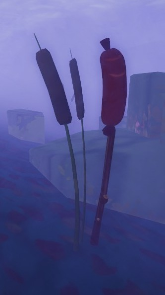](https://peak.wiki.gg/wiki/File%3AHot_Dog_cattail.jpg)
  A Hot Dog in the Gloom hiding near cattails.
- [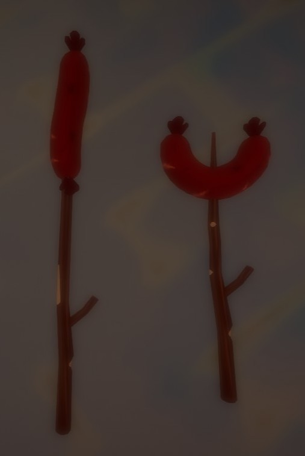](https://peak.wiki.gg/wiki/File%3AHot_Dogs_campfire-Gloom.jpg)
  A Hot Dog found in the Gloom next to one found near a campfire.
[Food](Food.md)
Natural food
Berries
Berrynanas- [](Yellow%20Berrynana.md) [Yellow Berrynana](Yellow%20Berrynana.md)
- [](Pink%20Berrynana.md) [Pink Berrynana](Pink%20Berrynana.md)
- [](Blue%20Berrynana.md) [Blue Berrynana](Blue%20Berrynana.md)
- [](Brown%20Berrynana.md) [Brown Berrynana](Brown%20Berrynana.md)
Clusterberries- [](Red%20Clusterberry.md) [Red Clusterberry](Red%20Clusterberry.md)
- [](Yellow%20Clusterberry.md) [Yellow Clusterberry](Yellow%20Clusterberry.md)
- [](Black%20Clusterberry.md) [Black Clusterberry](Black%20Clusterberry.md)
Crispberries- [](Green%20Crispberry.md) [Green Crispberry](Green%20Crispberry.md)
- [](Yellow%20Crispberry.md) [Yellow Crispberry](Yellow%20Crispberry.md)
- [](Red%20Crispberry.md) [Red Crispberry](Red%20Crispberry.md)
Kingberries- [](Green%20Kingberry.md) [Green Kingberry](Green%20Kingberry.md)
- [](Yellow%20Kingberry.md) [Yellow Kingberry](Yellow%20Kingberry.md)
- [](Purple%20Kingberry.md) [Purple Kingberry](Purple%20Kingberry.md)
Prickleberries- [](Red%20Prickleberry.md) [Red Prickleberry](Red%20Prickleberry.md)
- [](Gold%20Prickleberry.md) [Gold Prickleberry](Gold%20Prickleberry.md)
Shroomberries- [](Red%20Shroomberry.md) [Red Shroomberry](Red%20Shroomberry.md)
- [](Yellow%20Shroomberry.md) [Yellow Shroomberry](Yellow%20Shroomberry.md)
- [](Green%20Shroomberry.md) [Green Shroomberry](Green%20Shroomberry.md)
- [](Blue%20Shroomberry.md) [Blue Shroomberry](Blue%20Shroomberry.md)
- [](Purple%20Shroomberry.md) [Purple Shroomberry](Purple%20Shroomberry.md)
Winterberries- [](Orange%20Winterberry.md) [Orange Winterberry](Orange%20Winterberry.md)
- [](Yellow%20Winterberry.md) [Yellow Winterberry](Yellow%20Winterberry.md)
Other- [](Napberry.md) [Napberry](Napberry.md)
- [](Scorchberry.md) [Scorchberry](Scorchberry.md)
Campfire food- [](Marshmallow.md) [Marshmallow](Marshmallow.md)
- [](Hot%20Dog.md) Hot Dog
Mushrooms- [](Bugle%20Shroom.md) [Bugle Shroom](Bugle%20Shroom.md)
- [](Button%20Shroom.md) [Button Shroom](Button%20Shroom.md)
- [](Chubby%20Shroom.md) [Chubby Shroom](Chubby%20Shroom.md)
- [](Cluster%20Shroom.md) [Cluster Shroom](Cluster%20Shroom.md)
Mystical food- [](Cure-All.md) [Cure-All](Cure-All.md)
- [](Pandora%27s%20Lunchbox.md) [Pandora's Lunchbox](Pandora%27s%20Lunchbox.md)
Other- [](Cooked%20Bird.md) [Cooked Bird](Cooked%20Bird.md)
- [](Egg.md) [Egg](Egg.md)
- [](Frog%20Legs.md) [Frog Legs](Frog%20Legs.md)
- [](Honeycomb.md) [Honeycomb](Honeycomb.md)
- [](Half-Coconut.md) [Half-Coconut](Half-Coconut.md)
- [](Medicinal%20Root.md) [Medicinal Root](Medicinal%20Root.md)
- [](Mandrake.md) [Mandrake](Mandrake.md)
- [](Scorpion.md) [Scorpion](Scorpion.md)
- [](Tick.md) [Tick](Tick.md)
- [](The%20Early%20Worm.md) [The Early Worm](The%20Early%20Worm.md)
Packaged food
All packaged foods- [](Airline%20Food.md) [Airline Food](Airline%20Food.md)
- [](Big%20Lollipop.md) [Big Lollipop](Big%20Lollipop.md)
- [](Energy%20Drink.md) [Energy Drink](Energy%20Drink.md)
- [](Fortified%20Milk.md) [Fortified Milk](Fortified%20Milk.md)
- [](Granola%20Bar.md) [Granola Bar](Granola%20Bar.md)
- [](Scout%20Cookies.md) [Scout Cookies](Scout%20Cookies.md)
- [](Sports%20Drink.md) [Sports Drink](Sports%20Drink.md)
- [](Trail%20Mix.md) [Trail Mix](Trail%20Mix.md)

---

# How to play

*[PEAK](Peak%20%28game%29.md)* is a game that is mostly learned through experimentation and trial and error. The players are nudged in certain directions by the [](Guidebook.md) [Guidebook](Guidebook.md) found at the start of any run at the [Crash Site](https://peak.wiki.gg/wiki/Crash_Site), and in bits and pieces by collecting [Scoutmaster Myres](Scoutmaster%20Myres.md)' diary [pages](Scroll.md#Torn_pages).

When starting a new game lobby from the main menu, players are dropped into the [Airport](Airport.md) where they can [customize](https://peak.wiki.gg/wiki/Customization) their individual [Scout](Scout.md) appearances, test out the game [mechanics](https://peak.wiki.gg/wiki/Category%3AMechanics) and physics by climbing a [rock wall](Airport.md#Climbing_Wall), and then start their adventure by [boarding](Airport.md#Kiosks) the plane. Starting a new run allows the player to select the [difficulty level](Ascents.md) by pressing the "up" and "down" buttons in the boarding pass UI.

The game can be played solo or with friends. By default, *[PEAK](Peak%20%28game%29.md)* supports up to 4 people in a given lobby, but this limit can be extended with the help of [modifications](Modifications.md) such as [PEAK Unlimited](https://thunderstore.io/c/peak/p/glarmer/PEAK_Unlimited/).

The run begins when the plane you've just boarded [crashes](https://peak.wiki.gg/wiki/Crash_Site) into the [Shore](Shore.md). Your objective is to climb the [mountain](Island.md) by moving through several [biomes](https://peak.wiki.gg/wiki/Biomes) and finally reaching the [Peak](Peak%20%28biome%29.md) of the mountain. You'll encounter many [hazards](Hazards.md) on your way up, but you will also find useful [equipment](Equipment.md) that will help you on your journey. Keep in mind that the island [changes every 24 hours](Island.md) for all players.

## Controls

The controls can also be viewed in-game on the pause screen (). As of [1.30.a](1.30.a.md), you can change control bindings.

| Mouse and Keyboard | Action |
| --- | --- |
| Keyboard w.pngKeyboard a.pngKeyboard s.pngKeyboard d.png | Move |
| Mouse move.png | Aim |
| Mouse left.png | Climb / Use Item |
| Mouse right.png | Helping Hand / Alt Use Item |
| Keyboard e.png | Interact |
| Keyboard q.png | Drop / Throw (Hold) |
| Keyboard space.png | Jump |
| Keyboard ctrl.png | Crouch |
| Keyboard shift.png | Sprint / Lunge (While Climbing) |
| Mouse scroll.png | Ping Location |
| Keyboard r.png | Emote |
| Keyboard v.png | Push to talk / Push to mute (depending on the settings) |
| Keyboard 1.pngKeyboard 2.pngKeyboard 3.png | Item Slot |
| Keyboard 4.png | Backpack Slot |
| Key tab.png | Stash Item |
| Mouse scroll.png | Scroll |
| Keyboard t.png | Scroll Forward |
| Keyboard g.png | Scroll Backward |

## Basic gameplay!

### Climbing & Stamina

---

For more info about stamina, see [Stamina](https://peak.wiki.gg/wiki/Stamina).
[](https://peak.wiki.gg/wiki/File%3AScouts_helping_hand.png)

Extend a helping hand to your friends by pressing .

In order to reach the [Peak](Peak%20%28biome%29.md) and beat the game, you will need to climb the mountain ahead of you. Climbing is accomplished by standing close to a cliff, holding down  **Left Click**, and moving with the movement keys. Pretty much any surface in *[PEAK](Peak%20%28game%29.md)* is climbable with rare exceptions.

Climbing consumes your *[stamina](https://peak.wiki.gg/wiki/Stamina)*. When you run out of stamina, you can no longer climb until it regenerates back. If you run out of stamina mid-climb, you will begin to rapidly slide down and fall, which can be fatal. Performing certain actions, like eating specific foods, rewards you with [](Stamina%20bar.md#Bonus_stamina) [Bonus stamina](Stamina%20bar.md#Bonus_stamina), which is only consumed when you run out of your main stamina.

You can press  **Left Shift** to perform a lunge and give yourself a small vertical boost at the cost of some stamina. If your hands are empty, you can also press  **Right Click** to extend a helping hand to your friends, which will pull them to you once they're close enough (note that this only works if they're climbing and you're above them). Be careful, however, as this will also pull you slightly towards them!

Another thing you can do with your friends to help each other climb is to crouch, let a friend stand on top of you, and then jump. This will give them a vertical boost without consuming their stamina. Your friend can then extend their hand and help you climb up too.

You can also hold  **Left Shift** to sprint while not climbing, but keep in mind that this consumes your stamina.

### Status effects

---

Main article: [Stamina bar](Stamina%20bar.md)

Over the course of your climb you will have many [status effects](Stamina%20bar.md) accumulated in your stamina bar, the majority of which decay over time:

- [](Stamina%20bar.md#Weight) [Weight](Stamina%20bar.md#Weight) is gained when carrying [items](Items.md) or other [Scouts](https://peak.wiki.gg/wiki/Scouts) and **does not decay over time**. It can be removed by throwing out (or consuming) carried stuff or mitigated by carrying items with negative weight, such as [](Anti-Rope.md) [Anti-Rope](Anti-Rope.md), [](Anti-Rope%20Cannon.md) [Anti-Rope Cannon](Anti-Rope%20Cannon.md), [](Balloon.md) [Balloon](Balloon.md), and [](Balloon%20Bunch.md) [Balloon Bunch](Balloon%20Bunch.md).
- [](Stamina%20bar.md#Hunger) [Hunger](Stamina%20bar.md#Hunger) is **gained naturally over time**. It can be removed by eating [food](Food.md).
- [](Stamina%20bar.md#Injury) [Injury](Stamina%20bar.md#Injury) is gained when your [Scout](Scout.md) takes damage from falls or other sources and **does not decay over time**. It must be removed with a healing item, such as [](Bandages.md) [Bandages](Bandages.md), [](First%20Aid%20Kit.md) [First Aid Kit](First%20Aid%20Kit.md), [](Medicinal%20Root.md) [Medicinal Root](Medicinal%20Root.md) and [](Cure-All.md) [Cure-All](Cure-All.md).
[](https://peak.wiki.gg/wiki/File%3AScouts_revive.png)

Revive unconscious friends with [](First%20Aid%20Kit.md) [First Aid Kits](First%20Aid%20Kit.md) and other healing items.- [](Stamina%20bar.md#Poison) [Poison](Stamina%20bar.md#Poison) is gained by touching poisonous objects or eating poisonous [food](Food.md). **It does decay after some time**, but it's better to be removed with some healing items, such as [](Antidote.md) [Antidote](Antidote.md), [](First%20Aid%20Kit.md) [First Aid Kit](First%20Aid%20Kit.md), [](Medicinal%20Root.md) [Medicinal Root](Medicinal%20Root.md) and [](Cure-All.md) [Cure-All](Cure-All.md). Do not underestimate its effects, as there are situations in which you can get a great deal of poison inflicted on you if you're not careful.
- [](Stamina%20bar.md#Spores) [Spores](Stamina%20bar.md#Spores) are gained by consuming [Shroomberries](Shroomberry.md), standing inside a [spore cloud](Roots.md#Mushroom_Spore_Clouds) in the [Roots](Roots.md), or by being bitten by a [zombie](Zombie.md). **It does decay after some time, UNLESS you have been bitten by a zombie, in which case it will continue to increase until cured.** It takes the longest to go away on its own out of any status effect (unless playing in multiplayer, where[](Stamina%20bar.md#Thorns) [Thorns](Stamina%20bar.md#Thorns) takes the longest), so avoiding it should be of high priority.
- [](Stamina%20bar.md#Cold) [Cold](Stamina%20bar.md#Cold) is gained during [blizzards](Blizzard.md) in the [Alpine](Alpine.md), during nights on [Ascent 5](https://peak.wiki.gg/wiki/Ascent_5) or higher, or when the [Fog](Fog.md) finally reaches you.
- [](Stamina%20bar.md#Heat) [Heat](Stamina%20bar.md#Heat) is gained by being burned (e.g. on a [campfire](Campfire.md) or by a [](Scorchberry.md) [Scorchberry](Scorchberry.md)) or by being in direct sunlight in the [Mesa](Mesa.md).
- [](Stamina%20bar.md#Drowsy) [Drowsy](Stamina%20bar.md#Drowsy) is gained after consuming certain items ([](Big%20Lollipop.md) [Big Lollipop](Big%20Lollipop.md), [](Energy%20Drink.md) [Energy Drink](Energy%20Drink.md), [](Napberry.md) [Napberry](Napberry.md)) or being hit with a [](Blowgun.md) [Blowgun](Blowgun.md).
- [](Stamina%20bar.md#Thorns) [Thorns](Stamina%20bar.md#Thorns) are gained by getting hit by a [tumbleweed](Tumbleweed.md) or touching various [cacti](https://peak.wiki.gg/wiki/Cacti) in the [Mesa](Mesa.md), or by consuming a [prickleberry](Prickleberry.md).
- [](Stamina%20bar.md#Arrow) [Arrow](Stamina%20bar.md#Arrow) is gained by getting shot by an [Arrow Trap](https://peak.wiki.gg/wiki/Arrow_Trap) in [The Citadel](The%20Citadel.md) and **does not decay over time**. You can pull them out, inflicting [](Stamina%20bar.md#Injury) [Injury](Stamina%20bar.md#Injury) instead.
- [](Stamina%20bar.md#Web) [Web](Stamina%20bar.md#Web) is gained when a [Spider](Spider.md) touches a [Scout](Scout.md), wrapping them in a web. **It does not decay over time**, as it needs to be manually removed by repeatedly pressing **Jump** .
- [](Stamina%20bar.md#Flytrap) [Flytrap](Stamina%20bar.md#Flytrap) is gained when a [Flytrap](Flytrap.md) grabs a [Scout](Scout.md), trapping and muffling them. **It does not decay over time**, as it needs to be manually removed by repeatedly pressing **Jump** .
- [](Stamina%20bar.md#Curse) [Curse](Stamina%20bar.md#Curse) is commonly gained when being revived at an [Ancient Statue](Ancient%20Statue.md) or being targeted by the [](https://peak.wiki.gg/wiki/Book_of_Bones) [Book of Bones](https://peak.wiki.gg/wiki/Book_of_Bones) and **does not decay over time**. It is usually removed with [](Cure-All.md) [Cure-All](Cure-All.md) or [](Pandora%27s%20Lunchbox.md) [Pandora's Lunchbox](Pandora%27s%20Lunchbox.md) (the latter of which is not recommended unless in a dire situation).
- [](Stamina%20bar.md#Petrify) [Petrify](Stamina%20bar.md#Petrify) is gained after being sacrificed with the [](Ritual%20Dagger.md) [Ritual Dagger](Ritual%20Dagger.md), using any [Amulet](Amulets.md), or touching [Petrifying Stones](https://peak.wiki.gg/wiki/Petrifying_Stones) and **does not decay over time**. The only way of removing it is to light a [Campfire](Campfire.md). This status effect is unique in that it doesn't affect [Stamina](https://peak.wiki.gg/wiki/Stamina), but rather limits [](Stamina%20bar.md#Bonus_stamina) [Bonus stamina](Stamina%20bar.md#Bonus_stamina).

These effects reduce the amount of stamina you have. If you run out of main stamina completely, you will *pass out, unless you were targeted by the [](https://peak.wiki.gg/wiki/Book_of_Bones) [Book of Bones](https://peak.wiki.gg/wiki/Book_of_Bones)*. While you are passed out, you will be unable to move or use items, and your friends will be unable to hear you. There is a certain amount of time during which you are still alive and can be revived (either by waiting for temporary status effects to wear off or by your friends). Once this time is over, you will become a [ghost](https://peak.wiki.gg/wiki/Ghost) until somebody resurrects you at an [Ancient Statue](Ancient%20Statue.md) or by using the [](Scout%20Effigy.md) [Scout Effigy](Scout%20Effigy.md). Unconscious [Scouts](https://peak.wiki.gg/wiki/Scouts) can also be carried around, which temporarily stops the death timer unless you have over 50 [](Stamina%20bar.md#Spores) [Spores](Stamina%20bar.md#Spores). Furthermore, if you run out of [](Stamina%20bar.md#Bonus_stamina) [Bonus stamina](Stamina%20bar.md#Bonus_stamina) due to [](Stamina%20bar.md#Petrify) [Petrify](Stamina%20bar.md#Petrify), you will crystallize shortly after, dying and leaving a statue of your [Scout](Scout.md).

### Inventory & [Backpack](Backpack.md)

---

Items that you pick up by looking at them and pressing the interact key () are stored into your **inventory** slots. You can select any of these three slots by pressing , , and , respectively. Pressing the corresponding key again while the slot is already selected will deselect it and empty your hands. Keep in mind that you cannot climb walls if you're holding anything.

Picking up items with a full inventory is still possible as they will be put into your hands, but you will be unable to store them until you make some room. To drop the current item, simply press . Alternatively, you can hold down  and charge a throw, which you can perform by releasing the key.

Although you cannot change the amount of inventory slots that you have, you can use the [](Backpack.md) [Backpack](Backpack.md) to extend your storage. The backpack is a special item that goes into its own, special fourth slot (selected by pressing ) and allows you to carry up to 4 additional items. One backpack is always available at the [Crash Site](https://peak.wiki.gg/wiki/Crash_Site), while more can always be found at the [campfire](Campfire.md).

To use the backpack yourself, place it on the ground, look at it, and hold the interact key (). A radial menu with four empty slots will appear. When you are holding an item, hovering over an empty slot and releasing the key will store the held item in the selected slot of the backpack. To retrieve a stored item, open the backpack menu again and select the corresponding slot. To equip the backpack, select the bottom slot with an icon of a [](Backpack.md) [Backpack](Backpack.md).

Your friends can also use your backpack while you're wearing it without you first having to take it off.

### Communication

---

For more information about emotes, see [Emotes](Emotes.md).
[](https://peak.wiki.gg/wiki/File%3AEmote_wheel.png)

The Emote Wheel

Communication in *[PEAK](Peak%20%28game%29.md)* is essential if you're playing with a group. The game features a **proximity voice chat** with a simulation of echo and the [Doppler effect](https://en.wikipedia.org/wiki/Doppler_effect). By default, it is activated automatically by your voice, but can also be switched to "Push to Talk" or "Push to Mute" in the settings.

Another useful communication tool in the game is the **Ping** system.  **Middle Click** will show a pointing hand at the point you're currently looking at to all players.

You can also **Emote** by opening the *emote wheel* with  and selecting the desired emote. Be careful with the "Play dead" and the "Backflip" emotes as you may fall from a great height because of them, since they can force you into a [ragdoll](https://peak.wiki.gg/wiki/Ragdoll) state!

### Ascents

---

Main article: [Ascents](Ascents.md)

[Ascents](Ascents.md) are the difficulty system of *[PEAK](Peak%20%28game%29.md)*. Two Ascents are available by default: *[Tenderfoot](https://peak.wiki.gg/wiki/Tenderfoot)* and *[Peak](Ascents.md)*. *Peak* is the standard difficulty with no additional modifier, while *Tenderfoot* is intended to provide an easier experience. After beating the game at least once on a given Ascent, the next Ascent is unlocked (with [Ascent 1](https://peak.wiki.gg/wiki/Ascent_1) being the first one), up until [Ascent 8](Ascents.md#Ascent_8), which is the last ascent as of [Patch 2.0.a](2.0.a.md).

Do not be afraid of trying a lower Ascent if you're having trouble beating the game. Randomly generated maps can also introduce a great deal of additional trouble to your playthrough, so feel free to start on a lower difficulty and eventually make your way to [Ascent 8](Ascents.md#Ascent_8)!

### Badges

---

Main article: [Badges](Badges.md)

You can earn [Badges](Badges.md) for completing certain in-game actions. Badges serve as the game's achievement system and are synchronized with your Steam achievements. Earning them unlocks new [cosmetics](Cosmetics.md) for your [Scout](Scout.md).

Badges can be earned on all Ascents including [Tenderfoot](https://peak.wiki.gg/wiki/Tenderfoot), which can make things a lot easier. Most of the badges are obtainable in solo, although some of them can only be earned with the help of other players.

## Challenges & hazards

The difficulty of the [Island](Island.md) depends on multiple factors:

- Your own skill level
- The skill level of your friends
- The generation of the [map](Island.md)
- Which [Ascent](Ascents.md) you're playing on
- The loot from [luggage](Luggage.md)
- How far away you are from your friends
- How fast you're moving up the mountain
- and many more.

The game provides enough tools to combat all these challenges, so don't feel discouraged to try again if you happen to fail!

## Tips & Tricks

[](https://peak.wiki.gg/wiki/File%3AFoothold_on_steep_slope.png)

A steep foothold in [Alpine](Alpine.md), the depicted player holding the  and  keys.- Always plan your path ahead of time. Finding a good path is a skill that has to be trained. You can usually tell what parts of the terrain can be stood on (the [Shore](Shore.md) will have sand, the [Tropics](Tropics.md) will have grass, etc.), so use that information to your advantage.- Even the smallest and steepest kinds of walkable terrain can be stood on, so long as you continuously hold down the directions opposite where you are bound to slip.
- [Cooking](Cooking.md) your food is really useful, since it doubles the amount of [](Stamina%20bar.md#Hunger) [Hunger](Stamina%20bar.md#Hunger) restored and multiplies the amount of given [](Stamina%20bar.md#Bonus_stamina) [Bonus stamina](Stamina%20bar.md#Bonus_stamina) by 1.5x (gives 10 if it didn't give any before).
- If you're playing in a group, try to stick together, as the game gives a lot of tools for helping each other. However, if the situation is dire, don't try to be a hero and save your fellow [Scouts](Scout.md) if the risk far outweighs the benefit. After all, they can always be resurrected as long as you make it out alive.- It can be useful to send one [Scout](Scout.md) on a route to see if it's possible, and then save them in case something goes wrong (which it often does) and they fall.
- Use the quirks of map generation to your advantage. There are usually many little walkable surfaces that you can stand on and regenerate your stamina in the middle of a route. Some of these stops may require you to walk in place into the wall not to fall down, but stamina regenerates even while walking, so it's not an issue.
- The [](Rope%20Spool.md) [Rope Spool](Rope%20Spool.md) can be very useful for helping your friends reach higher places.
- Sometimes eating [food](Food.md) solely for its [](Stamina%20bar.md#Bonus_stamina) [Bonus stamina](Stamina%20bar.md#Bonus_stamina) can be necessary for finishing an otherwise impossible climb.
- The [Fog](Fog.md) is usually much less scary than the game makes it out to be. As long as you're moving at a somewhat steady pace, you should be okay. It's often possible to avoid seeing it at all during the entire run if your route is particularly good.
- Fatal [](Stamina%20bar.md#Injury) [fall damage](Stamina%20bar.md#Injury) can be clutched by quickly using the [](Pandora%27s%20Lunchbox.md) [Pandora's Lunchbox](Pandora%27s%20Lunchbox.md) before passing out. This will randomize your status effects and have a good chance of restoring your health, or at least trading permanent [Injury](https://peak.wiki.gg/wiki/Injury) for some less permanent [effects](https://peak.wiki.gg/wiki/Effects).

## See also

- [Stamina bar](Stamina%20bar.md)
- [Food](Food.md)
- [Equipment](Equipment.md)
- [Biomes](https://peak.wiki.gg/wiki/Biomes)
- [Island](Island.md)
- [Badges](Badges.md)
- [Ascents](Ascents.md)
- [Category:Mechanics](https://peak.wiki.gg/wiki/Category%3AMechanics)
- [Category:Guides](https://peak.wiki.gg/wiki/Category%3AGuides)

---

# How to play/es-419

*[PEAK](Peak%20%28game%29_es-419.md)* es un juego en el que se aprende principalmente mediante la experimentación y la prueba y error. Sin embargo, los [Exploradores](Scout_es-419.md) son introducidos a mecánicas básicas gracias a la [](Guidebook.md) [Guía](Guidebook.md) del [Jefe de Tropa Myres](Scoutmaster%20Myres.md), que se encuentra en el [lugar del accidente](Shore_es-419.md#Lugar_del_accidente), y a las [Páginas Arrancadas](Scroll.md#Torn_pages) de su diario, que se encuentran aleatoriamente cerca de [fogatas](Campfire.md).

Al crear una nueva partida, los Exploradores aparecen en el [Aeropuerto](Airport_es-419.md), donde pueden [personalizar](Cosmetics_es-419.md) su apariencia con el [](Passport.md) [Pasaporte](Passport.md), probar las [mecánicas](https://peak.wiki.gg/wiki/Mechanics) y físicas de escalado en un [muro de escalada](Airport_es-419.md#Muro_de_escalada), invitar a otros Exploradores interactuando con el [quiosco para invitaciones](Airport_es-419.md#Quioscos), jugar al [básquet](Airport_es-419.md#Cancha_de_básquet) y al [ajedrez](Airport_es-419.md#Tablero_de_ajedrez), tomarse fotos interactuando con la [cabina fotográfica](Airport_es-419.md#Cabina_fotográfica), y empezar la exploración interactuando con el [quiosco de la sala](Airport_es-419.md#Quioscos), donde también pueden seleccionar el [Ascenso (dificultad)](Ascents_es-419.md) de la expedición o el [modo de juego](Custom%20Expedition.md).

*PEAK* puede jugarse en solitario o de a 4 Exploradores como máximo, aunque este límite puede extenderse con el uso de [mods](Modifications.md) como [PEAK Unlimited](https://thunderstore.io/c/peak/p/glarmer/PEAK_Unlimited/).

Una expedición en modo normal empieza cuando el avión en el que ibas a bordo se [estrella](Shore_es-419.md#Lugar_del_accidente) en la [Costa](Shore_es-419.md). Tu objetivo es escalar la [Isla](Island_es-419.md) cruzando diferentes [biomas](Locations_es-419.md#Biomas) y finalmente alcanzar la [Cima](Peak%20%28biome%29.md). Te encontrarás muchos [peligros](Hazards.md) en el camino, así como también [equipamiento](Equipment.md) útil para completar tu objetivo. Ten en cuenta que la Isla [cambia cada 24 horas](Island_es-419.md) de forma global.

## Controles

Los **controles** pueden verse en el menú de pausa del juego (), pulsando el botón "**Reasignar Controles**". A continuación se muestran los controles predeterminados. Estos se usarán como referencia a lo largo de toda la wiki.

| Acción | Controles Predeterminados |
| --- | --- |
| Moverse hacia Adelante | Keyboard w.png |
| Moverse hacia Atrás | Keyboard s.png |
| Moverse hacia la Izquierda | Keyboard a.png |
| Moverse hacia la Derecha | Keyboard d.png |
| Apuntar | Mouse move.png |
| Escalar / Uso Primario de Objeto | Mouse left.png |
| Ayudar / Uso Secundario de Objeto | Mouse right.png |
| Interactuar | Keyboard e.png |
| Soltar / Lanzar (Mantener Pulsado) | Keyboard q.png |
| Saltar | Keyboard space.png |
| Agacharse | Keyboard ctrl.png |
| Correr / Lanzarse (Mientras Escalas) | Keyboard shift.png |
| Marcar Ubicación | Mouse scroll.png |
| Usar Gesto | Keyboard r.png |
| Pulsa para Hablar / Pulsa para Silenciar | Keyboard v.png |
| Espacio de Objeto 1 | Keyboard 1.png |
| Espacio de Objeto 2 | Keyboard 2.png |
| Espacio de Objeto 3 | Keyboard 3.png |
| Espacio de Mochila | Keyboard 4.png |
| Guardar Objeto | Key tab.png |
| Desplazar | Mouse scroll.png |
| Desplazar hacia Adelante | Keyboard t.png |
| Desplazar hacia Atrás | Keyboard g.png |

## Guía básica

### Escalado y Resistencia

---

Para saber más sobre la Resistencia, véase [Resistencia](https://peak.wiki.gg/wiki/Stamina).
[](https://peak.wiki.gg/wiki/File%3AScouts_helping_hand.png)

Extiende una mano a otros Exploradores pulsando Ayudar ().

**Escalar** es una acción fundamental en *[PEAK](Peak%20%28game%29_es-419.md)*, por lo que no sería raro decir que la gran mayoría de superficies son escalables (La lista de superficies no escalables puede verse aquí). Cuando te acerques a una superficie escalable, la retícula cambiará de color a un amarillo anaranjado, indicando que puedes escalarla. Manteniendo **Escalar** () te agarrarás a dicha superficie y podrás **Moverte** () por ella.

Escalar consume **[Resistencia](https://peak.wiki.gg/wiki/Stamina)**. Cuando te quedas sin Resistencia, no puedes escalar, y si te quedas sin Resistencia mientras escalas, empezarás a caer rápidamente, lo que puede ser mortal. Puedes acumular [](Stamina%20bar.md#Bonus_stamina) [Resistencia Adicional](Stamina%20bar.md#Bonus_stamina) usando o consumiendo objetos específicos, y solo se consume si te quedas sin Resistencia.

Puedes **Lanzarte** () mientras escalas para obtener un pequeño impulso hacia dónde te estás moviendo a costa de consumir más Resistencia. También puedes mantener **Correr** () mientras caminas para correr, y esto también consume Resistencia.

Si tus manos están vacías, puedes mantener **Ayudar** () para extender tu mano hacia adelante y ayudar a [Exploradores](Scout_es-419.md) que estén escalando cerca tuyo a llegar a donde estas. Otra cosa que puedes hacer con otros Exploradores para llegar a lugares altos es agacharte para que uno se suba encima y luego saltar. Esto elevará levemente al Explorador sin consumir su Resistencia.

### Efectos de Estado

---

Para saber más sobre cada Efecto de Estado, véase [Barra de Resistencia](https://peak.wiki.gg/wiki/Stamina_Bar).

Durante tu expedición tendrás varios **Efectos de Estado** limitando tu Resistencia, y es tu deber gestionarlos. La lista a continuación tiene información general y resumida:

- El [](Stamina%20bar.md#Weight) [Peso](Stamina%20bar.md#Weight) se obtiene al cargar [objetos](Items_es-419.md) o a [Exploradores inconscientes](Scout_es-419.md#Estado_Inconsciente_y_Muerte). Se puede reducir tirando o consumiendo lo que llevas encima o cargando objetos con peso negativo, como el [](Anti-Rope.md) [Carrete de Anticuerda](Anti-Rope.md), el [](Balloon.md) [Globo](Balloon.md) o los [](Balloon%20Bunch.md) [Globos](Balloon%20Bunch.md).
- El [](Stamina%20bar.md#Hunger) [Hambre](Stamina%20bar.md#Hunger) incrementa naturalmente con el tiempo, y puede reducirse consumiendo [comida](Food.md).
- La [](Stamina%20bar.md#Injury) [Lesión](Stamina%20bar.md#Injury) se obtiene principalmente cayendo desde una gran altura, tocando [lava](Lava.md), estando cerca de explosiones o siendo atacado por ciertos [enemigos](https://peak.wiki.gg/wiki/Enemies), y se puede reducir usando [](Bandages.md) [Vendas](Bandages.md), [](First%20Aid%20Kit.md) [Kits de Primeros Auxilios](First%20Aid%20Kit.md), [](Medicinal%20Root.md) [Raíces Medicinales](Medicinal%20Root.md) o [](Cure-All.md) [Curatodo](Cure-All.md).
[](https://peak.wiki.gg/wiki/File%3AScouts_revive.png)

Ayuda a Exploradores inconscientes con objetos curativos como el [](First%20Aid%20Kit.md) [Kit de Primeros Auxilios](First%20Aid%20Kit.md).- El [](Stamina%20bar.md#Poison) [Veneno](Stamina%20bar.md#Poison) se obtiene principalmente tocando objetos venenosos o consumiendo [comidas](Food.md) venenosas, y se reduce con el tiempo. También se puede reducir usando [](Antidote.md) [Antídotos](Antidote.md), [](First%20Aid%20Kit.md) [Kits de Primeros Auxilios](First%20Aid%20Kit.md), [](Medicinal%20Root.md) [Raíces Medicinales](Medicinal%20Root.md) o [](Cure-All.md) [Curatodo](Cure-All.md).
- Las [](Stamina%20bar.md#Spores) [Esporas](Stamina%20bar.md#Spores) se obtienen principalmente consumiendo [](Shroomberry.md) [Champibayas](Shroomberry.md), estando dentro de una [nube de esporas](Roots.md#Mushroom_Spore_Clouds) o siendo mordido por un [Zombi](Zombie.md), y se reduce con el tiempo solo si no fuiste mordido por un Zombi. En caso contrario, incrementará lentamente por 60 segundos o hasta que sea reducido. También se puede reducir usando [](Antidote.md) [Antídotos](Antidote.md), [](First%20Aid%20Kit.md) [Kits de Primeros Auxilios](First%20Aid%20Kit.md), [](Medicinal%20Root.md) [Raíces Medicinales](Medicinal%20Root.md) o [](Cure-All.md) [Curatodo](Cure-All.md).
- El [](Stamina%20bar.md#Cold) [Frío](Stamina%20bar.md#Cold) se obtiene principalmente estando desprotegido durante una [ventisca](Blizzard.md) o siendo alcanzado por la [niebla](Fog.md), y se reduce con el tiempo. También se puede reducir más rápido usando [](Heat%20Pack.md) [Compresas Calientes](Heat%20Pack.md), [](Lantern.md) [Linternas](Lantern.md) o [](Cure-All.md) [Curatodo](Cure-All.md).
- El [](Stamina%20bar.md#Heat) [Calor](Stamina%20bar.md#Heat) se obtiene principalmente consumiendo [](Scorchberry.md) [Bayas Picantes](Scorchberry.md), estando expuesto al [sol abrasador](https://peak.wiki.gg/wiki/Sun) de la [Mesa](Mesa.md) o tocando Fuego o [lava](Lava.md), y se reduce con el tiempo. También se puede reducir más rápido usando [](Sports%20Drink.md) [Bebidas Deportivas](Sports%20Drink.md), [](Energy%20Drink.md) [Bebidas Energéticas](Energy%20Drink.md), [](Fortified%20Milk.md) [Leches Enriquecidas](Fortified%20Milk.md), [](Aloe%20Vera.md) [Aloe Vera](Aloe%20Vera.md) o [](Cure-All.md) [Curatodo](Cure-All.md).
- El [](Stamina%20bar.md#Drowsy) [Sueño](Stamina%20bar.md#Drowsy) se obtiene principalmente estando dentro de la [penumbra soñolienta](https://peak.wiki.gg/wiki/Sleepy_Gloom), siendo alcanzado por el dardo de una [](Blowgun.md) [Cerbatana](Blowgun.md) o consumiendo ciertos objetos, y se reduce con el tiempo. También se puede reducir más rápido usando [](Energy%20Drink.md) [Bebidas Energéticas](Energy%20Drink.md), [](Candlestick.md) [Candelabros](Candlestick.md), [](The%20Early%20Worm.md) [Gusanos Madrugadores](The%20Early%20Worm.md) o [](Cure-All.md) [Curatodo](Cure-All.md).
- Las [](Stamina%20bar.md#Thorns) [Espinas](Stamina%20bar.md#Thorns) se obtienen siendo golpeado por un [estepicursor](Tumbleweed.md), tocando o agarrando [cactus](https://peak.wiki.gg/wiki/Cacti) o consumiendo [Bayas Espinosas](Prickleberry.md), y se reducen con el tiempo. Al ser espinas físicas que se muestran en el cuerpo del [Explorador](Scout_es-419.md), estas se pueden quitar **Interactuando** () con ellas, tanto a uno mismo como a otro Explorador. También se puede reducir usando [](Cure-All.md) [Curatodo](Cure-All.md).
- Las [](Stamina%20bar.md#Arrow) [Flechas](Stamina%20bar.md#Arrow) se obtienen cruzando delante de una [trampa de flechas](https://peak.wiki.gg/wiki/Arrow_Trap), y al ser flechas físicas que se muestran en el cuerpo del [Explorador](Scout_es-419.md), estas se pueden quitar **Interactuando** () con ellas, tanto a uno mismo como a otro Explorador. Al quitarlas, infligirán [](Stamina%20bar.md#Injury) [Lesión](Stamina%20bar.md#Injury).
- La [](Stamina%20bar.md#Web) [Telaraña](Stamina%20bar.md#Web) se obtiene siendo atrapado por una [Araña](Spider.md), y se reduce únicamente **Saltando** () repetidamente.
- La [](Stamina%20bar.md#Flytrap) [Atrapamoscas](Stamina%20bar.md#Flytrap) se obtiene siendo atrapado por una [Atrapamoscas](Flytrap.md), y se reduce únicamente **Saltando** () repetidamente.
- La [](Stamina%20bar.md#Curse) [Maldición](Stamina%20bar.md#Curse) se obtiene principalmente reviviendo por medio de una [Estatua Antigua](Ancient%20Statue.md) o transformándose en un [Esqueleto Viviente](Scout_es-419.md#Esqueleto_Viviente), y se puede reducir usando [](Mandrake.md) [Mandrágoras Cocinadas](Mandrake.md) o [](Cure-All.md) [Curatodo](Cure-All.md).
- La [](Stamina%20bar.md#Petrify) [Petrificación](Stamina%20bar.md#Petrify) se obtiene principalmente siendo sacrificado con una [](Ritual%20Dagger.md) [Daga de Ritual](Ritual%20Dagger.md), usando cualquier [amuleto](Amulets.md) o tocando [rocas petrificantes](https://peak.wiki.gg/wiki/Petrifying_Stones), y se reduce únicamente al encender una [fogata](Campfire.md). Este efecto de estado es el único que no afecta a la [Resistencia](https://peak.wiki.gg/wiki/Stamina), sino que limita la [](Stamina%20bar.md#Bonus_stamina) [Resistencia Adicional](Stamina%20bar.md#Bonus_stamina).

Si la [Barra de Resistencia](https://peak.wiki.gg/wiki/Stamina_Bar) se llena de efectos de estado, quedarás [inconsciente](Scout_es-419.md#Estado_Inconsciente_y_Muerte), a menos que seas un [Esqueleto Viviente](Scout_es-419.md#Esqueleto_Viviente), en cuyo caso morirás instantáneamente. Estando inconsciente, no podrás moverte, usar objetos ni hablar, y habrá un tiempo límite en donde podrás recuperarte, ya sea esperando a que algunos efectos de estado se reduzcan con el tiempo o a que un Explorador te ayude. Si el temporizador de muerte se acaba, morirás y te convertirás en un [Fantasma](Scout_es-419.md#Fantasma) hasta que te revivan por medio de una [Estatua Antigua](Ancient%20Statue.md) o usando una [](Scout%20Effigy.md) [Efigie de Explorador](Scout%20Effigy.md). Los Exploradores inconscientes pueden ser llevados por otros Exploradores en el **Espacio de Mochila** (), lo que pausará su temporizador de muerte siempre y cuando tengas menos de [](Stamina%20bar.md#Spores) **50** [Esporas](Stamina%20bar.md#Spores). Caso contrario, al terminar el temporizador de muerte te convertirás en un [Zombi](Zombie.md). Además, si la Barra de [](Stamina%20bar.md#Bonus_stamina) [Resistencia Adicional](Stamina%20bar.md#Bonus_stamina) se llena de [](Stamina%20bar.md#Petrify) [Petrificación](Stamina%20bar.md#Petrify), te cristalizarás lentamente, muriendo y dejando una estatua.

### Inventario

---

Los [objetos](Items_es-419.md) que recojas **Interactuando** () con ellos se guardan en tu **inventario**. Tu inventario tiene 3 espacios, que puedes seleccionar mediante sus respectivos controles. Seleccionar un espacio que contiene un objeto colocará dicho objeto en tus manos, y volver a seleccionar el mismo espacio lo guardará. Ten en cuenta que no puedes escalar si tienes un objeto en tus manos.

Si recoges un objeto con el inventario lleno, este se colocará en tus manos, pero no podrás guardarlo hasta liberar un espacio. Si seleccionas otro espacio, soltarás automáticamente el objeto que tengas en las manos. Puedes **Soltar** () un objeto en tu mano o mantener **Soltar** () para cargar fuerza y lanzar el objeto al dejar de pulsar.

Puedes ampliar tu inventario llevando una [](Backpack.md) [Mochila](Backpack.md) o [](Fanny%20Pack.md) [Riñonera](Fanny%20Pack.md) en el **Espacio de Mochila** (). La Mochila tiene 4 espacios de inventario, y siempre hay una disponible en el [lugar del accidente](Shore_es-419.md#Lugar_del_accidente) y en cada [fogata](Campfire.md). La Riñonera tiene 2 espacios de inventario, y puede encontrarse en [maletas](Luggage.md).

Para usar una Mochila, **Interactúa** () con ella para abrir un menú radial con 4 espacios de inventario y un espacio con una Mochila. Mientras tengas un objeto en la mano, selecciona un espacio vacío de la Mochila para guardarlo allí. Para sacar un objeto, selecciona el espacio que lo contiene. Para equipar la Mochila, selecciona el espacio con la Mochila. La Riñonera funciona exactamente igual. Ten en cuenta que no puedes acceder a Mochilas o Riñoneras que estén en tus manos, en las manos de otro [Explorador](Scout_es-419.md) o en tu espalda, pero puedes acceder a Mochilas o Riñoneras que estén en la espalda de otro Explorador.

### Comunicación

---

Para saber más sobre los gestos, véase [Gestos](Emotes.md).
[](https://peak.wiki.gg/wiki/File%3AEmote_wheel.png)

Las dos páginas de gestos.

La **comunicación** en *[PEAK](Peak%20%28game%29_es-419.md)* es esencial si estás jugando en tropa. El juego cuenta con un **chat de voz de proximidad** que simula eco y el [efecto Doppler](https://es.wikipedia.org/wiki/Efecto_Doppler). Por defecto, el chat de voz funciona por activación por voz, pero puede cambiarse a "Pulsa para Hablar" o "Pulsa para Silenciar" en el menú de pausa (), pulsando el botón "**Ajustes**" y dirigiéndose a la sección "**Sonido**".

Otra acción útil para comunicarse es **Marcar Ubicaciones** (), lo que mostrará a todos los [Exploradores](Scout_es-419.md) una mano apuntando a la superficie que estabas viendo.

También puedes usar **[Gestos](Emotes.md)** manteniendo **Usar Gestos** (), lo que abrirá un menú radial con 8 gestos y una flecha. Al seleccionar un gesto y dejar de pulsar, el Explorador empezará a realizar el gesto seleccionado. Al hacer clic en la flecha, se mostrarán otros 8 gestos diferentes. Ten cuidado al realizar los gestos "Hacerse el muerto" y "Voltereta hacia atrás", ya que el primer gesto hace que el Explorador entre en [Estado Ragdoll](Scout_es-419.md#Estado_Ragdoll) por 3 segundos y el segundo gesto tiene una probabilidad del 50% de hacer que el Explorador entre en Estado Ragdoll por 1 segundo.

### Ascensos

---

Artículo principal: [Ascensos](Ascents_es-419.md).

Los **[Ascensos](Ascents_es-419.md)** son el sistema de dificultad de *[PEAK](Peak%20%28game%29_es-419.md)*, y por defecto dos Ascensos están desbloqueados: *[Pies Blandos](Ascents_es-419.md#Pies_Blandos)* y *[Cima](Ascents_es-419.md#Cima)*. *Cima* es la dificultad estándar, sin modificadores adicionales, mientras que *Pies Blandos* ofrece una experiencia más sencilla, con más Resistencia al escalar, menos [](Stamina%20bar.md#Hunger) [Hambre](Stamina%20bar.md#Hunger) con el tiempo y sin [límite de tiempo](Fog.md). Al escapar de la [Isla](Island_es-419.md) en un Ascenso, se desbloqueará el siguiente junto con una [banda](Cosmetics_es-419.md#Bandas), hasta alcanzar el *[Ascenso 8](Ascents_es-419.md#Ascenso_8)*, el último Ascenso.

### Insignias

---

Artículo principal: [Insignias](Badges_es-419.md).

Las **[Insignias](Badges_es-419.md)** son el sistema de logros de *[PEAK](Peak%20%28game%29_es-419.md)*, y están sincronizadas con tus logros de [Steam](https://es.wikipedia.org/wiki/Steam). Se consiguen al completar ciertos objetivos o realizar ciertas acciones en una expedición, y desbloquean [cosméticos](Cosmetics_es-419.md) para tu [Explorador](Scout_es-419.md). Las Insignias pueden conseguirse en cualquier [Ascenso](Ascents_es-419.md), incluido *[Pies Blandos](Ascents_es-419.md#Pies_Blandos)*. La mayoría de las Insignias se pueden conseguir expedicionando solo, pero algunas requieren ir de expedición con una tropa.

## Desafíos

La dificultad de una expedición depende de múltiples factores:

- El nivel de habilidad y conocimiento de PEAK de los [Exploradores](Scout_es-419.md).
- Qué tan cooperativos son los Exploradores entre sí.
- La generación de la [Isla](Island_es-419.md).
- El [Ascenso](Ascents_es-419.md) seleccionado.
- Los [objetos](Items_es-419.md) de las [maletas](Luggage.md).
- Los [enemigos](https://peak.wiki.gg/wiki/Enemies) que te encuentres.

El juego brinda las herramientas necesarias para combatir todos estos desafíos, ¡así que no te rindas si fallas! Cada expedición es diferente, incluso en la misma Isla.

## Trucos y consejos

- Planea tu camino antes de escalar. Encontrar buenos caminos es una habilidad que lleva práctica. La mayoría de las veces puedes saber en qué partes del terreno puedes caminar debido a su textura. En la [Costa](Shore_es-419.md), por ejemplo, habrá arena donde puedas caminar, y roca donde tengas que escalar.- Puedes pararte incluso en las superficies caminables más inclinadas si te **Mueves** () en la dirección de dicha superficie.
- [Cocinar](Cooking.md) comida es muy útil, ya que duplica el [](Stamina%20bar.md#Hunger) [Hambre](Stamina%20bar.md#Hunger) que reduce, aumenta en 1.5x la [](Stamina%20bar.md#Bonus_stamina) [Resistencia Adicional](Stamina%20bar.md#Bonus_stamina) que otorga y en algunos casos anula Efectos de Estado.
- Si están jugando en grupo, traten de no separarse, ya que el juego brinda muchas herramientas para ayudarse entre sí. Sin embargo, no intentes ser el héroe y salvar a otros [Exploradores](Scout_es-419.md) si el riesgo es mayor que el beneficio. Recuerda que puedes revivirlos siempre que llegues a una [Estatua Antigua](Ancient%20Statue.md) con vida o encuentres una [](Scout%20Effigy.md) [Efigie de Explorador](Scout%20Effigy.md).- Puede ser útil enviar al Explorador más sano o hábil a probar una ruta para saber si es posible avanzar por ella, ya que luego puede ayudar a los demás a subir.
- Aprovecha las peculiaridades de la generación de la Isla a tu favor. Hay muchas superficies en las que parece imposible pararse, pero caminar contra la superficie puede mantenerte en el lugar, ayudándote a regenerar [Resistencia](https://peak.wiki.gg/wiki/Stamina).
- El [](Rope.md) [Carrete de Cuerda](Rope.md) puede ser muy útil para ayudar a otros Exploradores a llegar a lugares que no podrían normalmente.
- A veces, consumir [comida](Food.md) solo para obtener [](Stamina%20bar.md#Bonus_stamina) [Resistencia Adicional](Stamina%20bar.md#Bonus_stamina) es necesario para poder escalar distancias que serían imposibles sin ella.
- La [niebla](Fog.md) suele ser mucho menos aterradora de lo que el juego la hace parecer. Siempre y cuando te muevas a un ritmo constante, no debes preocuparte por ella. A veces es posible no verla durante toda la expedición si tus caminos y decisiones son excepcionalmente buenas.
- Puedes salvarte de la [](Stamina%20bar.md#Injury) [Lesión](Stamina%20bar.md#Injury) de una caída fatal usando una [](Pandora%27s%20Lunchbox.md) [Lonchera de Pandora](Pandora%27s%20Lunchbox.md) antes de quedar [inconsciente](Scout_es-419.md#Estado_Inconsciente_y_Muerte). Esto cambiará aleatoriamente tus [Efectos de Estado](https://peak.wiki.gg/wiki/Status_effects) y hay una buena probabilidad de que reduzca gran parte de la Lesión o, al menos, lo reemplace con Efectos de Estado que se reduzcan con el tiempo. También puedes usar otros objetos curativos antes de quedar inconsciente para reducir la Lesión, pero la [](Pandora%27s%20Lunchbox.md) [Lonchera de Pandora](Pandora%27s%20Lunchbox.md) es mejor en ciertas situaciones ya que tiene un tiempo de uso muy corto.

## Véase también

- [Barra de Resistencia](Stamina%20bar.md)
- [Objetos](Items_es-419.md)
- [Comida](Food.md)
- [Biomas](Locations_es-419.md#Biomas)
- [Isla](Island_es-419.md)
- [Insignias](Badges_es-419.md)
- [Ascensos](Ascents_es-419.md)
- [Categoría:Mecánicas](https://peak.wiki.gg/wiki/Category%3AMechanics)
- [Categoría:Guías](https://peak.wiki.gg/wiki/Category%3AGuides)

---

# How to play/ru

PEAK — это игра, которую игроки осваивают преимущественно путем экспериментов, метода проб и ошибок. Направление действий подсказывает [Руководство](Guidebook.md), доступное в начале каждой игры на [месте крушения](https://peak.wiki.gg/wiki/Crash_Site), а также разбросанные по карте [страницы из дневника](Scroll.md) [скаутмастера Майерса](Scoutmaster%20Myres.md), которые можно найти по ходу игры.

При создании нового лобби в главном меню игроки попадают в аэропорт. Там можно настроить внешний вид своего скаута, опробовать игровые механики и физику (например, полазив по скалодрому), а затем начать приключение, поднявшись на борт самолета. Перед началом вылазки игрок может выбрать уровень сложности, используя кнопки «вверх» и «вниз» в интерфейсе посадочного талона.

В PEAK можно играть как в одиночку, так и с друзьями. По умолчанию лобби рассчитано максимум на четырёх человек, однако этот лимит можно увеличить с помощью модификаций, таких как [PEAK Unlimited](https://thunderstore.io/c/peak/p/glarmer/PEAK_Unlimited/).

Игра начинается с того, что самолет, на который вы только что сели, терпит крушение у побережья. Ваша цель — подняться на вершину горы, преодолев несколько биомов. На пути вам встретится немало опасностей, но вы также найдете полезное снаряжение, которое поможет в восхождении. Помните, что остров меняется каждые 24 часа для всех игроков.

## Управление

Управление можно посмотреть в игре в меню паузы (). С версии 1.30.a, можно изменять назначение клавиш.

| Мышь и клавиатура | Действие |
| --- | --- |
| Keyboard w.pngKeyboard a.pngKeyboard s.pngKeyboard d.png | Движение персонажа |
| Mouse move.png | Движение камерой |
| Mouse left.png | Подъем по горе/Использовать предмет |
| Mouse right.png | Протянуть руку помощи/Альт. использование предмета |
| Keyboard e.png | Взаимодействовать |
| Keyboard q.png | Выложить/Бросить (Зажать) предмет |
| Keyboard space.png | Прыжок |
| Keyboard ctrl.png | Присесть |
| Keyboard shift.png | Бег/Рывок (во время подъема) |
| Mouse scroll.png | Поставить метку (указать пальцем) |
| Keyboard r.png | Колесо эмоций |
| Keyboard v.png | Нажать для разговора / Нажать для заглушения (в зависимости от настроек) |
| Keyboard 1.pngKeyboard 2.pngKeyboard 3.png | Слот предмета |
| Keyboard 4.png | Слот рюкзака |
| Key tab.png | Убрать предмет |
| Mouse scroll.png | Прокрутка |
| Keyboard t.png | Прокрутить вперёд |
| Keyboard g.png | Прокрутить назад |

## Основной геймплей

### Лазание и выносливость

[](https://peak.wiki.gg/wiki/File%3AScouts_helping_hand.png)

Протяните другу руку помощи, нажав  **ПКМ**.

Чтобы достичь [Пика](Peak%20%28biome%29.md) и пройти игру, вам придётся взобраться на гору, которая перед вами. Чтобы лазать, встаньте рядом со скалой, зажмите  **ЛКМ** и двигайтесь с помощью клавиш передвижения. Практически по любой поверхности в *[PEAK](Peak%20%28game%29.md)* можно лазать, за редкими исключениями.

Лазание тратит вашу *[выносливость](https://peak.wiki.gg/wiki/%D0%92%D1%8B%D0%BD%D0%BE%D1%81%D0%BB%D0%B8%D0%B2%D0%BE%D1%81%D1%82%D1%8C)*. Если она закончится, вы больше не сможете лазать до тех пор, пока она не восстановится обратно. Если же выносливость заканчивается в процессе лазания, вы начнёте быстро скользить вниз и упадёте, что может нанести летальный урон. Некоторые действия, например поедание некоторой еды, дают вам [](Stamina%20bar.md#Bonus_stamina) [Дополнительную выносливость](Stamina%20bar.md#Bonus_stamina), которая начинает тратиться только после того, как закончится основная.

Вы можете нажать  **Левый Shift**, чтобы совершить рывок и получить небольшой толчок вверх ценой небольшого количества выносливости. Если у вас ничего нет в руках, вы можете нажать  **ПКМ** и помочь другу забраться, протянув ему руку. Это притянет его к вам, если он достаточно близко (при этом друг должен лезть, а вы должны быть сверху). Будьте осторожны, ведь вас тоже немного притянет к нему!

Другой способ помочь другу — присесть, дать ему встать на вас, а затем прыгнуть. Это даст другу толчок вверх и при этом не потратит вашу выносливость. Далее, ваш друг может также помочь вам забраться, протянув вам руку помощи.

Вы также можете удерживать  **Левый Shift** чтобы бежать, но имейте в виду, что бег также тратит выносливость.

## Статусы и эффекты

В ходе игры на шкале выносливости накапливается множество статусных эффектов, большинство из которых со временем истощаются:

- [](Stamina%20bar.md#Weight) [Вес](Stamina%20bar.md#Weight) получается когда у вас в инвентаре находятся вещи или вы несете другого игрока без сознания на спине, этот статус **не убывает со временем** и может быть убран только при освобождении инвентаря путем их выброса или использования. Эффект не будет засчитываться у вещей с отрицательным весом, такими как [](Anti-Rope%20Spool.md) [АнтиВеревка](Anti-Rope%20Spool.md),[](Anti-Rope%20Cannon.md) [АнтиВеревочная пушка](Anti-Rope%20Cannon.md), [](Balloon.md) [Шарик](Balloon.md), [](Balloon%20Bunch.md) [Связка Шариков](Balloon%20Bunch.md)
- [](Stamina%20bar.md#Hunger) [Голод](Stamina%20bar.md#Hunger) **получается сам со временем.** Может быть убрано съев [еду](Food.md)
- [](Stamina%20bar.md#Injury) [Повреждения](Stamina%20bar.md#Injury) получаются когда ваш Скаут получает урон от падения и прочих прочих источников, **статус не уходит со временем**. Его можно убрать исцеляющими вещами как [](Bandages.md) [Повязки](Bandages.md), [](First%20Aid%20Kit.md) [Аптечка](First%20Aid%20Kit.md), [](Medicinal%20Root.md) [Лечебный корень](Medicinal%20Root.md) и [](Cure-All.md) [Панацея](Cure-All.md)
[](https://peak.wiki.gg/wiki/File%3AScouts_revive.png)

Оживляйте друзей без сознания с помощью [](First%20Aid%20Kit.md) [Аптечек](First%20Aid%20Kit.md) и остальных исцеляющих вещей- [](Stamina%20bar.md#Poison) [Яд](Stamina%20bar.md#Poison) дается при касании ядовитых объектов или при употреблении отравленной еды. Эффект **уходит со временем,** но лучше всего будет использовать исцеляющие вещи, такие как [](First%20Aid%20Kit.md) [Аптечка](First%20Aid%20Kit.md), [](Antidote.md) [Противоядие](Antidote.md), [](Medicinal%20Root.md) [Лечебный корень](Medicinal%20Root.md) и [](Cure-All.md) [Панацея](Cure-All.md). Не стоит недооценивать его последствия, так как есть ситуации, в которых вы можете получить много яда, нанесенного вам, если вы не будете осторожны.
- [](Stamina%20bar.md#Cold) [Обморожение](Stamina%20bar.md#Cold) дается во время бури в [Высокогорье](Alpine.md), во время ночи в [Восхождении 5](Ascents.md) или выше, или когда Туман настигает вас.
- [](Stamina%20bar.md#Heat) [Жар](Stamina%20bar.md#Heat) получается, будучи сожженным (например стоя на [Костре](Campfire.md) или съев [](Scorchberry.md) [Пламенику](Scorchberry.md)) или стоя на солнце в [Столовой горе](Mesa.md).
- [](Stamina%20bar.md#Thorns) [Колючки](Stamina%20bar.md#Thorns) получается при ударе от [Перекати Поля](Tumbleweed.md) или при касании разных [кактусов](https://peak.wiki.gg/wiki/Cacti) в [Столовой Горе](Mesa.md) или при употреблении [](Prickleberry.md) [Шипники](Prickleberry.md)

---

# Ice Rocks

Ice Rock
[](https://peak.wiki.gg/wiki/File%3AIce_rock_with_piton.png)
General
Type
Environmental hazard
Biome- [Alpine](Alpine.md)

**Ice Rocks** are an environmental hazard in the [Alpine](Alpine.md). They apply [](Stamina%20bar.md#Cold) [Cold](Stamina%20bar.md#Cold) to Scouts standing on them or climbing them.

While *standing* on an Ice Rock, the player will receive [](Stamina%20bar.md#Cold) **2.5** [Cold](Stamina%20bar.md#Cold) every **1.75 seconds** (~1.43 Cold every second). While *climbing* on an Ice Rock, the player will receive [](Stamina%20bar.md#Cold) **2.5** [Cold](Stamina%20bar.md#Cold) every **0.525 seconds** (~4.76 Cold every second).

---

# Island


This page is a [stub](https://support.wiki.gg/wiki/Stub). You can help **PEAK Wiki** by expanding it.

The **Island** is the main world of *[PEAK](Peak%20%28game%29.md)* (not including the [Airport](Airport.md)) in which players must navigate. The island consists of six [biomes](https://peak.wiki.gg/wiki/Biomes) and its map refreshes daily at [17:00 UTC](https://dateful.com/convert/utc?t=17) with a different landscape experience each time. The biome list will also change, with all biomes except the [Shore](Shore.md) and [Peak](Peak%20%28biome%29.md) having two possible options.

The pool of available maps is predetermined and consists of 42 different randomly generated[[1]](#cite_note-1) maps (as of [2.3.a](2.3.a.md)). These random maps are pre-generated by the [developers](https://peak.wiki.gg/wiki/Developers) and released alongside updates and patches. As a result, the usual daily map rotation will typically reset to a new island map and new map pool list when a game update is released. Any active player sessions will not be affected by a change to the island map rotation, and should continue as normal with the map that was started. However, all subsequent sessions after a map reset will instead use the new daily map.

As of [2.0.a](2.0.a.md) there are ten standard [biomes](https://peak.wiki.gg/wiki/Biomes) in the game with only six being used per map:

- [Shore](Shore.md)
- [Tropics](Tropics.md) or [Roots](Roots.md)
- [Alpine](Alpine.md) or [Mesa](Mesa.md)
- [Caldera](Caldera.md) or [Gloom](Gloom.md)
- [The Kiln](The%20Kiln.md) or [The Citadel](The%20Citadel.md)
- [The Peak](Peak%20%28biome%29.md)

Note that, when [Caldera](Caldera.md) is generated on an island, the next biome can only be [The Kiln](The%20Kiln.md), and similarly, when the fourth biome is the [Gloom](Gloom.md), [The Citadel](The%20Citadel.md) is sure to follow.

## Trivia

- The developers have claimed they do not check whether a given mountain is climbable or not.[[2]](#cite_note-2)
- Map generation [requires](https://www.reddit.com/r/PeakGame/comments/1m5s7ei/comment/n4ebwmv/?utm_source=share&utm_medium=web3x&utm_name=web3xcss&utm_term=1&utm_content=share_button) the use of the [RTX technology](https://en.wikipedia.org/wiki/Nvidia_RTX) to bake the lightmaps used by the game for lighting and certain mechanics, such as the [Alpine](Alpine.md)'s [blizzards](Blizzard.md).
- While *[PEAK](Peak%20%28game%29.md)* uses meters for its in-game distance measurement, it should not be confused with meters used in Unity, the game engine in which the game was developed. For reference, a single meter in Unity is equal to 1.6 meters in *PEAK* which would make the [Peak biome](Peak%20%28biome%29.md) height of 1920m equal to 1200 Unity meters.

## References

- [↑](#cite_ref-1) [Reddit comment by one of the developers from Landfall](https://www.reddit.com/r/PeakGame/comments/1m5s7ei/comment/n4e9xib/?utm_source=share&utm_medium=web3x&utm_name=web3xcss&utm_term=1&utm_content=share_button)
- [↑](#cite_ref-2) [Comment by AggroCrab on Reddit](https://www.reddit.com/r/PeakGame/comments/1m5s7ei/comment/n4e9ejy/?utm_source=share&utm_medium=web3x&utm_name=web3xcss&utm_term=1&utm_content=share_button)

---

# Island/es-419


This page is a [stub](https://support.wiki.gg/wiki/Stub). You can help **PEAK Wiki** by expanding it.

La **Isla** es la zona principal de *[PEAK](Peak%20%28game%29_es-419.md)* (sin incluir el [Aeropuerto](Airport_es-419.md)) en la que los Exploradores deben recorrer durante una expedición. La Isla consta de seis secciones y cambia cada día a las [17:00 UTC](https://dateful.com/convert/utc?t=17). Los [biomas](Locations_es-419.md#Biomas) de cada sección también pueden cambiar, ya que todas, exceptuando la primera y la última, pueden contener uno de dos biomas posible.

El conjunto de Islas disponibles está predeterminado y consta de 42 Islas diferentes generadas proceduralmente[[1]](#cite_note-1) (hasta la versión [2.3.a](2.3.a.md)). Estas Islas son pregeneradas por los [desarrolladores](https://peak.wiki.gg/wiki/Developers) y lanzadas junto a actualizaciones y parches.
Como resultado, la rotación diaria puede reiniciarse con una nueva Isla y un nuevo conjunto de Islas disponibles cuando se lanza una actualización. Las expediciones en curso y las guardadas no son afectadas por el cambio de Isla, y usarán la Isla con la que se empezó. Sin embargo, las expediciones iniciadas después del cambio usarán la nueva Isla diaria.

Hasta la [2.3.a](2.3.a.md), hay 10 [biomas](Locations_es-419.md#Biomas) estándar en *PEAK*, y solo 6 de ellos aparecen en una expedición:

- [Costa](Shore_es-419.md)
- [Zona Tropical](Tropics.md) o [Raíces](Roots.md)
- [Zona Alpina](Alpine.md) o [Mesa](Mesa.md)
- [Caldera](Caldera.md) o [Penumbra](Gloom.md)
- [El Horno](The%20Kiln.md) o [La Ciudadela](The%20Citadel.md)
- [La Cima](Peak%20%28biome%29.md)

## Curiosidades

- Los desarrolladores han afirmado que no comprueban si se puede llegar a la [Cima](Peak%20%28biome%29.md) de una Isla o no.[[2]](#cite_note-2)
- La generación de las Islas [requiere](https://www.reddit.com/r/PeakGame/comments/1m5s7ei/comment/n4ebwmv/?utm_source=share&utm_medium=web3x&utm_name=web3xcss&utm_term=1&utm_content=share_button) el uso de [tecnología RTX](https://es.wikipedia.org/wiki/Nvidia_RTX) para calcular los mapas de luz utilizados por el juego, tanto para la iluminación como para las [ventiscas](Blizzard.md) y el [viento](Roots.md#Wind).
- *[PEAK](Peak%20%28game%29_es-419.md)* usa metros para medir distancias dentro del juego, pero no deben confundirse con las unidades utilizadas en [Unity](https://es.wikipedia.org/wiki/Unity%20(motor%20de%20videojuego)), el motor de videojuegos en el que fue desarrollado. Como referencia, una unidad de Unity equivale a 1,6 metros en *PEAK*, por lo que los 1920 metros de altura de la [Cima](Peak%20%28biome%29.md) equivalen a 1200 unidades de Unity.

## Referencias

- [↑](#cite_ref-1) [Comentario de Reddit de un desarrollador de Landfall](https://www.reddit.com/r/PeakGame/comments/1m5s7ei/comment/n4e9xib/?utm_source=share&utm_medium=web3x&utm_name=web3xcss&utm_term=1&utm_content=share_button)
- [↑](#cite_ref-2) [Comentario de AggroCrab en Reddit](https://www.reddit.com/r/PeakGame/comments/1m5s7ei/comment/n4e9ejy/?utm_source=share&utm_medium=web3x&utm_name=web3xcss&utm_term=1&utm_content=share_button)

---

# Items

There are a total of **134 items** in *[PEAK](Peak%20%28game%29.md)*. They can range in purpose such as [food](Food.md) for staving off hunger or tools for climbing or surviving hazards.

## List of items

| Icon | Name | Weight | Hunger | Bonus   Stamina | Poison | Biome | Location | Notes |
| --- | --- | --- | --- | --- | --- | --- | --- | --- |
| [Airline Food](Airline%20Food.md) | [Airline Food](Airline%20Food.md) | [Weight](Stamina%20bar.md#Weight) **5** | [Hunger](Stamina%20bar.md#Hunger) **−40** | [Bonus stamina](Stamina%20bar.md#Bonus_stamina) **40** | n/a | Any |  |  |
| [Aloe Vera](Aloe%20Vera.md) | [Aloe Vera](Aloe%20Vera.md) | [Weight](Stamina%20bar.md#Weight) **2.5** | n/a | n/a | n/a | - [Mesa](Mesa.md) |  | - Removes [Heat](Stamina%20bar.md#Heat) **50** [Heat](Stamina%20bar.md#Heat). |
| [Ancient Idol](Ancient%20Idol.md) | [Ancient Idol](Ancient%20Idol.md) | [Weight](Stamina%20bar.md#Weight) **40** | n/a | n/a | n/a | - [Mesa](Mesa.md) | - [Tomb](Tomb.md) | - Found exclusively inside the [Tomb](Tomb.md). - Grants [Invincibility](Stamina%20bar.md#Invincibility) [Invincibility](Stamina%20bar.md#Invincibility) from any damage or negative status effects (except knockback) while actively held. - Prevents consumption of [Bonus stamina](Stamina%20bar.md#Bonus_stamina) [Bonus stamina](Stamina%20bar.md#Bonus_stamina) while actively held. - Can be thrown into the lava of [The Kiln](The%20Kiln.md) to receive the [24 Karat Badge](https://peak.wiki.gg/wiki/24_Karat_Badge) [24 Karat Badge](https://peak.wiki.gg/wiki/24_Karat_Badge). - **Cooking:** Cannot be cooked. |
| [Anti-Rope Cannon](Anti-Rope%20Cannon.md) | [Anti-Rope Cannon](Anti-Rope%20Cannon.md) | [Weight](Stamina%20bar.md#Weight) **0** | n/a | n/a | n/a | Any |  | - Shoots a harpoon that will deploy a length of gravity defying anti-rope on contact with a compatible surface. - **A dropped anti-rope Cannon can float away!** - **Cooking:** Immediately incinerated. |
| [Anti-Rope Spool](Anti-Rope%20Spool.md) | [Anti-Rope Spool](Anti-Rope%20Spool.md) | [Weight](Stamina%20bar.md#Weight) **−2.5** | n/a | n/a | n/a | Any |  | - Creates lengths of climbable anti-rope (up to **10 meters**) that can be attached to any climbable surface. - Anti-rope will defy gravity and float upwards. - Each spool contains **12.5 meters** of anti-rope. - **A dropped spool of anti-rope will float upwards!** - **Cooking:** Immediately incinerated. |
| [Anti-Zooka](Anti-Zooka.md) | [Anti-Zooka](Anti-Zooka.md) | [Weight](Stamina%20bar.md#Weight) **0** | n/a | n/a | n/a | Any |  | - **Cooking:** Explodes, creating an **Anti-Sphere** with twice the regular diameter. |
| [Antidote](Antidote.md) | [Antidote](Antidote.md) | [Weight](Stamina%20bar.md#Weight) **2.5** | n/a | n/a | [Poison](Stamina%20bar.md#Poison) **−35** | - [Tropics](Tropics.md) - [Roots](Roots.md) |  | - Can be used 3 times. - Removes [Poison](Stamina%20bar.md#Poison) **35** [Poison](Stamina%20bar.md#Poison). - Removes [Heat](Stamina%20bar.md#Heat) **10** [Heat](Stamina%20bar.md#Heat). - Removes [Spores](Stamina%20bar.md#Spores) **35** [Spores](Stamina%20bar.md#Spores). - **Cooking:** Explodes, removing up to [Poison](Stamina%20bar.md#Poison) **20** [Poison](Stamina%20bar.md#Poison) from all players within **4.8m**. |
| [Backpack](Backpack.md) | [Backpack](Backpack.md) | [Weight](Stamina%20bar.md#Weight) **0** | n/a | n/a | n/a | Any | - [Crash Site](https://peak.wiki.gg/wiki/Crash_Site) - [Campfires](https://peak.wiki.gg/wiki/Campfires) | - Found at the crash site and campfires. - Can be used to carry 4 additional items. |
| [Balloon](Balloon.md) | [Balloon](Balloon.md) | [Weight](Stamina%20bar.md#Weight) **−5** | n/a | n/a | n/a | Any |  | - Lowers gravity by **18%** per Balloon for **2 minutes** or when **100m** has passed. - Using 6 Balloons at the same time allows for limited flight. - Can be stacked with itself and Balloon Bunches. - Passively removes [Weight](Stamina%20bar.md#Weight) **5** [Weight](Stamina%20bar.md#Weight) when held, in inventory, or in a  [Backpack](Backpack.md). - **Dropped balloons float away!** - **Cooking:** Pops. |
| [Balloon Bunch](Balloon%20Bunch.md) | [Balloon Bunch](Balloon%20Bunch.md) | [Weight](Stamina%20bar.md#Weight) **−15** | n/a | n/a | n/a | Any |  | - Lowers gravity by **54%** per Balloon Bunch for **2 minutes** or when **100m** has passed. - Using 2 Balloon Bunches at the same time allows for limited flight. - Can be stacked with itself and Balloons. - Passively removes [Weight](Stamina%20bar.md#Weight) **15** [Weight](Stamina%20bar.md#Weight) when held, in inventory, or in a  [Backpack](Backpack.md). - **Dropped balloons float away!** - **Cooking:** Pops. |
| [Bandages](Bandages.md) | [Bandages](Bandages.md) | [Weight](Stamina%20bar.md#Weight) **2.5** | n/a | n/a | n/a | Any |  | - Heals [Injury](Stamina%20bar.md#Injury) **30** [Injury](Stamina%20bar.md#Injury). - **Cooking:** No effect. |
| [Basketball](Basketball.md) | [Basketball](Basketball.md) | [Weight](Stamina%20bar.md#Weight) **2.5** | n/a | n/a | n/a | - [Airport](Airport.md) |  | - **Cooking:** Pops. |
| [Beehive](Beehive.md) | [Beehive](Beehive.md) | [Weight](Stamina%20bar.md#Weight) **10** | n/a | n/a | n/a | - [Tropics](Tropics.md) |  |  |
| [Big Egg](Big%20Egg.md) | [Big Egg](Big%20Egg.md) | [Weight](Stamina%20bar.md#Weight) **5** | n/a | n/a | n/a | - [Caldera](Caldera.md) |  |  |
| [Big Lollipop](Big%20Lollipop.md) | [Big Lollipop](Big%20Lollipop.md) | [Weight](Stamina%20bar.md#Weight) **2.5** | [Hunger](Stamina%20bar.md#Hunger) **−5** | n/a | n/a | Any |  | - Grants infinite [stamina](https://peak.wiki.gg/wiki/Stamina) temporarily. - **Cooking:** Removes [Drowsy](Stamina%20bar.md#Drowsy) [Drowsy](Stamina%20bar.md#Drowsy) effect. |
| [Bing Bong](Bing%20Bong.md) | [Bing Bong](Bing%20Bong.md) | [Weight](Stamina%20bar.md#Weight) **5** | n/a | n/a | n/a | - [Airport](Airport.md) - [Shore](Shore.md) | - [Photobooth](https://peak.wiki.gg/wiki/Photobooth) - [Crash Site](https://peak.wiki.gg/wiki/Crash_Site) | - Can be asked "Yes" or "No" questions. - Can be used for the [Bing Bong Badge](https://peak.wiki.gg/wiki/Bing_Bong_Badge) [Bing Bong Badge](https://peak.wiki.gg/wiki/Bing_Bong_Badge). - **Cooking:** Lowers pitch and volume of voice lines. |
| [Binoculars](Binoculars.md) | [Binoculars](Binoculars.md) | [Weight](Stamina%20bar.md#Weight) **0** | n/a | n/a | n/a | Any | - [Photobooth](https://peak.wiki.gg/wiki/Photobooth) - [Crash Site](https://peak.wiki.gg/wiki/Crash_Site) | - Used to see farther. - Can be used for the [Astronomy Badge](https://peak.wiki.gg/wiki/Astronomy_Badge) [Astronomy Badge](https://peak.wiki.gg/wiki/Astronomy_Badge). |
| [Bishop](Bishop.md) | [Bishop](Bishop.md) | [Weight](Stamina%20bar.md#Weight) **2.5** | n/a | n/a | n/a | - [Airport](Airport.md) |  |  |
| [Black Clusterberry](Black%20Clusterberry.md) | [Black Clusterberry](Black%20Clusterberry.md) | [Weight](Stamina%20bar.md#Weight) **2.5** | [Hunger](Stamina%20bar.md#Hunger) **−20** | n/a | n/a | - [Tropics](Tropics.md) |  |  |
| [Blowgun](Blowgun.md) | [Blowgun](Blowgun.md) | [Weight](Stamina%20bar.md#Weight) **2.5** | n/a | n/a | n/a | Any |  | - Shoots a single dart with these effects on target scout:- Clears all status effects except [Curse](Stamina%20bar.md#Curse) [Curse](Stamina%20bar.md#Curse).   - Inflicts [Drowsy](Stamina%20bar.md#Drowsy) **120** [Drowsy](Stamina%20bar.md#Drowsy). - Does not spawn in solo play. - **Cooking:** Replaces [Drowsy](Stamina%20bar.md#Drowsy) **120** [Drowsy](Stamina%20bar.md#Drowsy) with [Heat](Stamina%20bar.md#Heat) **150** [Heat](Stamina%20bar.md#Heat). |
| [Blue Berrynana](Blue%20Berrynana.md) | [Blue Berrynana](Blue%20Berrynana.md) | [Weight](Stamina%20bar.md#Weight) **2.5** | [Hunger](Stamina%20bar.md#Hunger) **−30** | n/a | n/a | - [Tropics](Tropics.md) |  | - Produces a  [Blue Berrynana Peel](Blue%20Berrynana%20Peel.md) after eating. |
| [Blue Berrynana Peel](Blue%20Berrynana%20Peel.md) | [Blue Berrynana Peel](Blue%20Berrynana%20Peel.md) | [Weight](Stamina%20bar.md#Weight) **2.5** | n/a | n/a | n/a | - [Tropics](Tropics.md) |  | - **Source:** Acquired after eating a  [Blue Berrynana](Blue%20Berrynana.md). |
| [Blue Shroomberry](Blue%20Shroomberry.md) | [Blue Shroomberry](Blue%20Shroomberry.md) | [Weight](Stamina%20bar.md#Weight) **2.5** | [Hunger](Stamina%20bar.md#Hunger) **−10** | n/a | n/a | - [Roots](Roots.md) |  | - Inflicts [Spores](Stamina%20bar.md#Spores) **5** [Spores](Stamina%20bar.md#Spores). - Produces a [*bad* effect](Shroomberry.md#Effects) when eaten. - **Cooking:** Removes [Spores](Stamina%20bar.md#Spores) **5** [Spores](Stamina%20bar.md#Spores) effect. |
| [Bounce Fungus](Bounce%20Fungus.md) | [Bounce Fungus](Bounce%20Fungus.md) | [Weight](Stamina%20bar.md#Weight) **2.5** | n/a | n/a | n/a | - [Roots](Roots.md) |  | - Creates a bouncy platform when thrown. |
| [Brown Berrynana](Brown%20Berrynana.md) | [Brown Berrynana](Brown%20Berrynana.md) | [Weight](Stamina%20bar.md#Weight) **2.5** | [Hunger](Stamina%20bar.md#Hunger) **−15** | [Bonus stamina](Stamina%20bar.md#Bonus_stamina) **10** | n/a | - [Tropics](Tropics.md) - [Gloom](Gloom.md) |  | - Produces a  [Brown Berrynana Peel](Brown%20Berrynana%20Peel.md) after eating. |
| [Brown Berrynana Peel](Brown%20Berrynana%20Peel.md) | [Brown Berrynana Peel](Brown%20Berrynana%20Peel.md) | [Weight](Stamina%20bar.md#Weight) **2.5** | n/a | n/a | n/a | - [Tropics](Tropics.md) - [Gloom](Gloom.md) |  | - **Source:** Acquired after eating a  [Brown Berrynana](Brown%20Berrynana.md). |
| [Bugle](Bugle.md) | [Bugle](Bugle.md) | [Weight](Stamina%20bar.md#Weight) **0** | n/a | n/a | n/a | - [Airport](Airport.md) - [Shore](Shore.md) |  | - Plays a musical note when used. - Can be used for the [Animal Serenading Badge](https://peak.wiki.gg/wiki/Animal_Serenading_Badge) [Animal Serenading Badge](https://peak.wiki.gg/wiki/Animal_Serenading_Badge). - **Cooking:** Adds a pitch modulation varying on times cooked. |
| [Bugle of Friendship](Bugle%20of%20Friendship.md) | [Bugle of Friendship](Bugle%20of%20Friendship.md) | [Weight](Stamina%20bar.md#Weight) **2.5** | n/a | n/a | n/a | Any |  | - Plays a musical note when used. - Gives scouts in a large radius infinite [Stamina](https://peak.wiki.gg/wiki/Stamina) while being played, up to a total of **7.5** seconds. - Can be used for the [Animal Serenading Badge](https://peak.wiki.gg/wiki/Animal_Serenading_Badge) [Animal Serenading Badge](https://peak.wiki.gg/wiki/Animal_Serenading_Badge). - Cannot spawn in solo play. |
| [Bugle Shroom](Bugle%20Shroom.md) | [Bugle Shroom](Bugle%20Shroom.md) | [Weight](Stamina%20bar.md#Weight) **2.5** | [Hunger](Stamina%20bar.md#Hunger) **−15** | n/a | n/a | - [Shore](Shore.md) - [Tropics](Tropics.md) - [Roots](Roots.md) - [Mesa](Mesa.md) |  |  |
| [Bugle Shroom (Poisonous)](https://peak.wiki.gg/wiki/Bugle_Shroom_%28Poisonous%29) | [Bugle Shroom (Poisonous)](https://peak.wiki.gg/wiki/Bugle_Shroom_%28Poisonous%29) | [Weight](Stamina%20bar.md#Weight) **2.5** | [Hunger](Stamina%20bar.md#Hunger) **−15** | n/a | [Poison](Stamina%20bar.md#Poison) **20** | - [Shore](Shore.md) - [Tropics](Tropics.md) - [Roots](Roots.md) - [Mesa](Mesa.md) |  | - After 10 seconds, inflicts [Poison](Stamina%20bar.md#Poison) **20** [Poison](Stamina%20bar.md#Poison) over 8 seconds. |
| [Button Shroom](Button%20Shroom.md) | [Button Shroom](Button%20Shroom.md) | [Weight](Stamina%20bar.md#Weight) **2.5** | [Hunger](Stamina%20bar.md#Hunger) **−10** | n/a | n/a | - [Shore](Shore.md) - [Tropics](Tropics.md) - [Roots](Roots.md) - [Mesa](Mesa.md) |  |  |
| [Button Shroom (Poisonous)](https://peak.wiki.gg/wiki/Button_Shroom_%28Poisonous%29) | [Button Shroom (Poisonous)](https://peak.wiki.gg/wiki/Button_Shroom_%28Poisonous%29) | [Weight](Stamina%20bar.md#Weight) **2.5** | [Hunger](Stamina%20bar.md#Hunger) **−10** | n/a | [Poison](Stamina%20bar.md#Poison) **30** | - [Shore](Shore.md) - [Tropics](Tropics.md) - [Roots](Roots.md) - [Mesa](Mesa.md) |  | - After 10 seconds, inflicts [Poison](Stamina%20bar.md#Poison) **30** [Poison](Stamina%20bar.md#Poison) over 12 seconds. |
| [Cactus](Cactus.md) | [Cactus](Cactus.md) | [Weight](Stamina%20bar.md#Weight) **0** | n/a | n/a | n/a | - [Mesa](Mesa.md) |  | - Inflicts [Thorns](Stamina%20bar.md#Thorns) **20** [Thorns](Stamina%20bar.md#Thorns). |
| [Candlestick](Candlestick.md) | [Candlestick](Candlestick.md) | [Weight](Stamina%20bar.md#Weight) **2.5** | n/a | n/a | n/a | - [Gloom](Gloom.md) - [The Citadel](The%20Citadel.md) |  |  |
| [Chain Launcher](Chain%20Launcher.md) | [Chain Launcher](Chain%20Launcher.md) | [Weight](Stamina%20bar.md#Weight) **2.5** | n/a | n/a | n/a | Any |  | - Creates a length of chain between two points that can be climbed on like a vine. - The chain originates from the point where the user fired the launcher. - The chain launcher cannot fire a chain upwards. - **Cooking:** Immediately incinerated. |
| [Checkpoint Flag](Checkpoint%20Flag.md) | [Checkpoint Flag](Checkpoint%20Flag.md) | [Weight](Stamina%20bar.md#Weight) **2.5** | n/a | n/a | n/a | Any |  | - Creates a single-use respawn checkpoint for the Scout who placed it, saving & restoring all statuses when it was placed. - **Cooking:** Can only be cooked using explosives. Cooking stage increases by two when cooked. |
| [Chubby Shroom](Chubby%20Shroom.md) | [Chubby Shroom](Chubby%20Shroom.md) | [Weight](Stamina%20bar.md#Weight) **2.5** | [Hunger](Stamina%20bar.md#Hunger) **−10** | n/a | n/a | - [Shore](Shore.md) - [Tropics](Tropics.md) - [Roots](Roots.md) - [Mesa](Mesa.md) |  |  |
| [Cloud Fungus](Cloud%20Fungus.md) | [Cloud Fungus](Cloud%20Fungus.md) | [Weight](Stamina%20bar.md#Weight) **2.5** | n/a | n/a | n/a | - [Roots](Roots.md) |  | - Creates a platform when it is thrown at a wall. - Creates a platform at the apex of a throw mid-air. |
| [Cluster Shroom](Cluster%20Shroom.md) | [Cluster Shroom](Cluster%20Shroom.md) | [Weight](Stamina%20bar.md#Weight) **2.5** | [Hunger](Stamina%20bar.md#Hunger) **−5** | n/a | n/a | - [Shore](Shore.md) - [Tropics](Tropics.md) - [Roots](Roots.md) - [Mesa](Mesa.md) |  |  |
| [Cluster Shroom (Poisonous)](https://peak.wiki.gg/wiki/Cluster_Shroom_%28Poisonous%29) | [Cluster Shroom (Poisonous)](https://peak.wiki.gg/wiki/Cluster_Shroom_%28Poisonous%29) | [Weight](Stamina%20bar.md#Weight) **2.5** | [Hunger](Stamina%20bar.md#Hunger) **−5** | n/a | [Poison](Stamina%20bar.md#Poison) **40** | - [Shore](Shore.md) - [Tropics](Tropics.md) - [Roots](Roots.md) - [Mesa](Mesa.md) |  | - After 10 seconds, inflicts [Poison](Stamina%20bar.md#Poison) **40** [Poison](Stamina%20bar.md#Poison) over 16 seconds. |
| [Coconut](Coconut.md) | [Coconut](Coconut.md) | [Weight](Stamina%20bar.md#Weight) **12.5** | n/a | n/a | n/a | - [Shore](Shore.md) - [Tropics](Tropics.md) - [Mesa](Mesa.md) |  |  |
| [Compass](Compass.md) | [Compass](Compass.md) | [Weight](Stamina%20bar.md#Weight) **0** | n/a | n/a | n/a | - [Shore](Shore.md) | - [Crash Site](https://peak.wiki.gg/wiki/Crash_Site) | - Points towards the [PEAK](Peak%20%28biome%29.md). |
| [Conch](Conch.md) | [Conch](Conch.md) | [Weight](Stamina%20bar.md#Weight) **5** | n/a | n/a | n/a | - [Shore](Shore.md) |  |  |
| [Cooked Bird](Cooked%20Bird.md) | [Cooked Bird](Cooked%20Bird.md) | [Weight](Stamina%20bar.md#Weight) **10** | n/a | n/a | n/a | - [Caldera](Caldera.md) - [Gloom](Gloom.md) |  | - **Source:** Has a 10% chance to spawn from a  [Big Egg](Big%20Egg.md) instead of an  [Egg](Egg.md). |
| [Cure-All](Cure-All.md) | [Cure-All](Cure-All.md) | [Weight](Stamina%20bar.md#Weight) **5** | [Hunger](Stamina%20bar.md#Hunger) **−20** | n/a | [Poison](Stamina%20bar.md#Poison) **−35** | Any |  | - Removes [Poison](Stamina%20bar.md#Poison) **35** [Poison](Stamina%20bar.md#Poison), [Heat](Stamina%20bar.md#Heat) **35** [Heat](Stamina%20bar.md#Heat), [Cold](Stamina%20bar.md#Cold) **35** [Cold](Stamina%20bar.md#Cold), [Drowsy](Stamina%20bar.md#Drowsy) **35** [Drowsy](Stamina%20bar.md#Drowsy), [Injury](Stamina%20bar.md#Injury) **35** [Injury](Stamina%20bar.md#Injury), [Spores](Stamina%20bar.md#Spores) **35** [Spores](Stamina%20bar.md#Spores), [Thorns](Stamina%20bar.md#Thorns) **35** [Thorns](Stamina%20bar.md#Thorns), and [Curse](Stamina%20bar.md#Curse) **5** [Curse](Stamina%20bar.md#Curse). - **Cooking:** Explodes, removing up to [Curse](Stamina%20bar.md#Curse) **5** [Curse](Stamina%20bar.md#Curse), [Hunger](Stamina%20bar.md#Hunger) **10** [Hunger](Stamina%20bar.md#Hunger), and **20** each of [Poison](Stamina%20bar.md#Poison) [Poison](Stamina%20bar.md#Poison), [Cold](Stamina%20bar.md#Cold) [Cold](Stamina%20bar.md#Cold), [Heat](Stamina%20bar.md#Heat) [Heat](Stamina%20bar.md#Heat), [Drowsy](Stamina%20bar.md#Drowsy) [Drowsy](Stamina%20bar.md#Drowsy), [Thorns](Stamina%20bar.md#Thorns) [Thorns](Stamina%20bar.md#Thorns) from all players within **4.8m**. |
| [Cursed Skull](Cursed%20Skull.md) | [Cursed Skull](Cursed%20Skull.md) | [Weight](Stamina%20bar.md#Weight) **5** | n/a | n/a | n/a | Any |  | - Use instantly kills the Scout holding it and grants other players [Bonus stamina](Stamina%20bar.md#Bonus_stamina) **50** [Bonus stamina](Stamina%20bar.md#Bonus_stamina) and cleanses all negative status effects aside from [Curse](Stamina%20bar.md#Curse) [Curse](Stamina%20bar.md#Curse). - Can only be found in [Ancient Luggage](https://peak.wiki.gg/wiki/Ancient_Luggage). - Cannot spawn in solo play. - **Cooking:** Activates immediately, then explodes with a dynamite explosion. |
| [Dynamite](Dynamite.md) | [Dynamite](Dynamite.md) | [Weight](Stamina%20bar.md#Weight) **0** | n/a | n/a | n/a | - [Mesa](Mesa.md) | - On ground - In [Luggage](Luggage.md) | - Inflicts [Injury](Stamina%20bar.md#Injury) **52.5** [Injury](Stamina%20bar.md#Injury). - **Cooking:** Immediately explodes. |
| [Egg](Egg.md) | [Egg](Egg.md) | [Weight](Stamina%20bar.md#Weight) **5** | [Hunger](Stamina%20bar.md#Hunger) **−15** | n/a | n/a | - [Caldera](Caldera.md) - [Gloom](Gloom.md) |  | - **Source:** Made upon breaking a  [Big Egg](Big%20Egg.md). - Part of the [Gourmand Badge](https://peak.wiki.gg/wiki/Gourmand_Badge) [Gourmand Badge](https://peak.wiki.gg/wiki/Gourmand_Badge). |
| [Energy Drink](Energy%20Drink.md) | [Energy Drink](Energy%20Drink.md) | [Weight](Stamina%20bar.md#Weight) **2.5** | n/a | n/a | n/a | Any |  | - Removes [Heat](Stamina%20bar.md#Heat) **30** [Heat](Stamina%20bar.md#Heat). - Inflicts [Drowsy](Stamina%20bar.md#Drowsy) **25** [Drowsy](Stamina%20bar.md#Drowsy). - Grants a temporary speed boost. |
| [Faerie Lantern](Faerie%20Lantern.md) | [Faerie Lantern](Faerie%20Lantern.md) | [Weight](Stamina%20bar.md#Weight) **5** | n/a | n/a | [Poison](Stamina%20bar.md#Poison) **−75** | Any |  | - Removes [Heat](Stamina%20bar.md#Heat) **75** [Heat](Stamina%20bar.md#Heat), [Cold](Stamina%20bar.md#Cold) **150** [Cold](Stamina%20bar.md#Cold), [Poison](Stamina%20bar.md#Poison) **75** [Poison](Stamina%20bar.md#Poison), [Spores](Stamina%20bar.md#Spores) **75** [Spores](Stamina%20bar.md#Spores), [Drowsy](Stamina%20bar.md#Drowsy) **150** [Drowsy](Stamina%20bar.md#Drowsy) and [Injury](Stamina%20bar.md#Injury) **75** [Injury](Stamina%20bar.md#Injury) over **30** seconds from nearby players. - Can be extinguished to preserve the remaining fuel. - Will stay lit while stowed in a dropped [Backpack](Backpack.md). - **Cooking:** Explodes, removing up to **25** each of [Poison](Stamina%20bar.md#Poison) [Poison](Stamina%20bar.md#Poison), [Cold](Stamina%20bar.md#Cold) [Cold](Stamina%20bar.md#Cold), [Heat](Stamina%20bar.md#Heat) [Heat](Stamina%20bar.md#Heat), [Drowsy](Stamina%20bar.md#Drowsy) [Drowsy](Stamina%20bar.md#Drowsy), and [Thorns](Stamina%20bar.md#Thorns) [Thorns](Stamina%20bar.md#Thorns) from all players within **4.8m**. |
| [Fanny Pack](Fanny%20Pack.md) | [Fanny Pack](Fanny%20Pack.md) | [Weight](Stamina%20bar.md#Weight) **0** | n/a | n/a | n/a | Any |  |  |
| [First Aid Kit](First%20Aid%20Kit.md) | [First Aid Kit](First%20Aid%20Kit.md) | [Weight](Stamina%20bar.md#Weight) **5** | n/a | n/a | [Poison](Stamina%20bar.md#Poison) **−100** | Any |  | - Removes [Poison](Stamina%20bar.md#Poison) **100** [Poison](Stamina%20bar.md#Poison). - Heals [Injury](Stamina%20bar.md#Injury) **100** [Injury](Stamina%20bar.md#Injury). - Removes [Spores](Stamina%20bar.md#Spores) **100** [Spores](Stamina%20bar.md#Spores). - Takes 5 seconds to use. - **Cooking:** No effect. |
| [Flare](Flare.md) | [Flare](Flare.md) | [Weight](Stamina%20bar.md#Weight) **0** | n/a | n/a | n/a | Any | - [Crash Site](https://peak.wiki.gg/wiki/Crash_Site) - [Peak](Peak%20%28biome%29.md) | - Can be lit to display a tall column of colourful smoke matching the colour of the player's scout. - Summons the rescue helicopter if used at the [PEAK](Peak%20%28biome%29.md). - **Cooking:** Explodes, dealing up to [Injury](Stamina%20bar.md#Injury) **20** [Injury](Stamina%20bar.md#Injury) to all players within **4.8m**. |
| [Flying Disc](Flying%20Disc.md) | [Flying Disc](Flying%20Disc.md) | [Weight](Stamina%20bar.md#Weight) **0** | n/a | n/a | n/a | Any |  | - Can be thrown at other scouts to bonk them. - Can be used for the [Ultimate Badge](https://peak.wiki.gg/wiki/Ultimate_Badge) [Ultimate Badge](https://peak.wiki.gg/wiki/Ultimate_Badge). |
| [Fortified Milk](Fortified%20Milk.md) | [Fortified Milk](Fortified%20Milk.md) | [Weight](Stamina%20bar.md#Weight) **2.5** | [Hunger](Stamina%20bar.md#Hunger) **−10** | n/a | n/a | Any |  | - Removes [Heat](Stamina%20bar.md#Heat) **50** [Heat](Stamina%20bar.md#Heat). - **Cooking:** Adds **10s** to invulnerability. |
| [Frog](Frog.md) | [Frog](Frog.md) | [Weight](Stamina%20bar.md#Weight) **5** | n/a | n/a | n/a | - [Gloom](Gloom.md) |  |  |
| [Frog Legs](Frog%20Legs.md) | [Frog Legs](Frog%20Legs.md) | [Weight](Stamina%20bar.md#Weight) **2.5** | [Hunger](Stamina%20bar.md#Hunger) **−50** | n/a | n/a | - [Gloom](Gloom.md) |  | - Obtained by [cooking](Cooking.md) a [frog](Frog.md). |
| [Glider](Glider.md) | [Glider](Glider.md) | [Weight](Stamina%20bar.md#Weight) **5** | n/a | n/a | n/a | Any |  |  |
| [Gold Prickleberry](Gold%20Prickleberry.md) | [Gold Prickleberry](Gold%20Prickleberry.md) | [Weight](Stamina%20bar.md#Weight) **2.5** | [Hunger](Stamina%20bar.md#Hunger) **−15** | n/a | n/a | - [Mesa](Mesa.md) |  | - Removes [Heat](Stamina%20bar.md#Heat) **10** [Heat](Stamina%20bar.md#Heat). - Heals [Injury](Stamina%20bar.md#Injury) **10** [Injury](Stamina%20bar.md#Injury). - Inflicts [Thorns](Stamina%20bar.md#Thorns) **10** [Thorns](Stamina%20bar.md#Thorns). - **Cooking:** Removes [Poison](Stamina%20bar.md#Poison) [Poison](Stamina%20bar.md#Poison) effect. |
| [Granola Bar](Granola%20Bar.md) | [Granola Bar](Granola%20Bar.md) | [Weight](Stamina%20bar.md#Weight) **2.5** | [Hunger](Stamina%20bar.md#Hunger) **−15** | [Bonus stamina](Stamina%20bar.md#Bonus_stamina) **20** | n/a | Any |  |  |
| [Green Crispberry](Green%20Crispberry.md) | [Green Crispberry](Green%20Crispberry.md) | [Weight](Stamina%20bar.md#Weight) **2.5** | [Hunger](Stamina%20bar.md#Hunger) **−5** | n/a | [Poison](Stamina%20bar.md#Poison) **10** | - [Shore](Shore.md) - [Tropics](Tropics.md) - [Roots](Roots.md) - [Mesa](Mesa.md) - [Alpine](Alpine.md) - [Peak](https://peak.wiki.gg/wiki/Peak) |  | - After 2 seconds, inflicts [Poison](Stamina%20bar.md#Poison) **10** [Poison](Stamina%20bar.md#Poison) over 4 seconds. - **Cooking:** Removes [Poison](Stamina%20bar.md#Poison) [Poison](Stamina%20bar.md#Poison) effect. |
| [Green Kingberry](Green%20Kingberry.md) | [Green Kingberry](Green%20Kingberry.md) | [Weight](Stamina%20bar.md#Weight) **5** | [Hunger](Stamina%20bar.md#Hunger) **−30** | n/a | [Poison](Stamina%20bar.md#Poison) **5** | - [Tropics](Tropics.md) |  | - Inflicts [Poison](Stamina%20bar.md#Poison) **5** [Poison](Stamina%20bar.md#Poison). - **Cooking:** Removes [Poison](Stamina%20bar.md#Poison) [Poison](Stamina%20bar.md#Poison) effect. |
| [Green Shroomberry](Green%20Shroomberry.md) | [Green Shroomberry](Green%20Shroomberry.md) | [Weight](Stamina%20bar.md#Weight) **2.5** | [Hunger](Stamina%20bar.md#Hunger) **−10** | n/a | n/a | - [Roots](Roots.md) |  | - Inflicts [Spores](Stamina%20bar.md#Spores) **5** [Spores](Stamina%20bar.md#Spores). - Produces a [*bad* effect](Shroomberry.md#Effects) when eaten. - **Cooking:** Removes [Spores](Stamina%20bar.md#Spores) **5** [Spores](Stamina%20bar.md#Spores) effect. |
| [Guidebook](Guidebook.md) | [Guidebook](Guidebook.md) | [Weight](Stamina%20bar.md#Weight) **0** | n/a | n/a | n/a | - [Shore](Shore.md) | - [Crash Site](https://peak.wiki.gg/wiki/Crash_Site) | - A survival guide to teach basic gameplay. - **Cooking:** Immediately incinerated. |
| [Half-Coconut](Half-Coconut.md) | [Half-Coconut](Half-Coconut.md) | [Weight](Stamina%20bar.md#Weight) **5** | [Hunger](Stamina%20bar.md#Hunger) **−10** | n/a | n/a | - [Shore](Shore.md) - [Tropics](Tropics.md) |  | - Removes [Heat](Stamina%20bar.md#Heat) **30** [Heat](Stamina%20bar.md#Heat). - **Source:** Breaking a large  [Coconut](Coconut.md) gives 2x [Half-Coconuts](Half-Coconut.md). - Part of the [Gourmand Badge](https://peak.wiki.gg/wiki/Gourmand_Badge) [Gourmand Badge](https://peak.wiki.gg/wiki/Gourmand_Badge). |
| [Heat Pack](Heat%20Pack.md) | [Heat Pack](Heat%20Pack.md) | [Weight](Stamina%20bar.md#Weight) **0** | n/a | n/a | n/a | - [Alpine](Alpine.md) |  | - Removes [Cold](Stamina%20bar.md#Cold) **360** [Cold](Stamina%20bar.md#Cold). - **Cooking:** Explodes, dealing up to [Injury](Stamina%20bar.md#Injury) **20** [Injury](Stamina%20bar.md#Injury) to all players within **4.8m**. |
| [Honeycomb](Honeycomb.md) | [Honeycomb](Honeycomb.md) | [Weight](Stamina%20bar.md#Weight) **2.5** | [Hunger](Stamina%20bar.md#Hunger) **−10** | [Bonus stamina](Stamina%20bar.md#Bonus_stamina) **50** | n/a | - [Tropics](Tropics.md) - [Roots](Roots.md) |  | - **Source:** Breaking a  [Beehive](Beehive.md) gives 4x [Honeycombs](Honeycomb.md). - Part of the [Gourmand Badge](https://peak.wiki.gg/wiki/Gourmand_Badge) [Gourmand Badge](https://peak.wiki.gg/wiki/Gourmand_Badge). |
| [Hot Dog](Hot%20Dog.md) | [Hot Dog](Hot%20Dog.md) | [Weight](Stamina%20bar.md#Weight) **2.5** | [Hunger](Stamina%20bar.md#Hunger) **−30** | [Bonus stamina](Stamina%20bar.md#Bonus_stamina) **20** | n/a | - [Gloom](Gloom.md) |  | - **Source**: Campfires, amongst cattails in the [Gloom](Gloom.md). - 37.5% chance to appear instead of a  [Marshmallow](Marshmallow.md). |
| [Jetpack](Jetpack.md) | [Jetpack](Jetpack.md) | [Weight](Stamina%20bar.md#Weight) **7.5** | n/a | n/a | n/a | Any |  |  |
| [King](King.md) | [King](King.md) | [Weight](Stamina%20bar.md#Weight) **2.5** | n/a | n/a | n/a | - [Airport](Airport.md) |  |  |
| [Knight](Knight.md) | [Knight](Knight.md) | [Weight](Stamina%20bar.md#Weight) **2.5** | n/a | n/a | n/a | - [Airport](Airport.md) |  |  |
| [Lantern](Lantern.md) | [Lantern](Lantern.md) | [Weight](Stamina%20bar.md#Weight) **5** | n/a | n/a | n/a | - [Tropics](Tropics.md) - [Alpine](Alpine.md) |  | - Removes [Cold](Stamina%20bar.md#Cold) **150** [Cold](Stamina%20bar.md#Cold). - Can be extinguished to preserve the remaining fuel. - Will stay lit while stowed in a dropped [Backpack](Backpack.md). - **Cooking:** Explodes, dealing up to [Injury](Stamina%20bar.md#Injury) **20** [Injury](Stamina%20bar.md#Injury) to all players within **4.8m**. |
| [Magic Bean](Magic%20Bean.md) | [Magic Bean](Magic%20Bean.md) | [Weight](Stamina%20bar.md#Weight) **2.5** | n/a | n/a | n/a | - [Shore](Shore.md) - [Tropics](Tropics.md) - [Roots](Roots.md) - [Alpine](Alpine.md) - [Mesa](Mesa.md) |  | - After **3** seconds from being dropped or thrown it will begin to grow a vine up to **10** metres tall if unobstructed. |
| [Mandrake](Mandrake.md) | [Mandrake](Mandrake.md) | [Weight](Stamina%20bar.md#Weight) **2.5** | [Hunger](Stamina%20bar.md#Hunger) **−10** | n/a | n/a | - [Roots](Roots.md) |  | - **Source:** Has a 50% chance to spawn instead of a  [Medicinal Root](Medicinal%20Root.md). - Hides Stamina bar for **60** seconds when eaten uncooked. - Starts screaming when uprooted in 3 second intervals, inflicting [Drowsy](Stamina%20bar.md#Drowsy) [Drowsy](Stamina%20bar.md#Drowsy) on nearby players.- [Cooking](Cooking.md) stops the screaming. - Required for the [Cryptogastronomy Badge](https://peak.wiki.gg/wiki/Cryptogastronomy_Badge) [Cryptogastronomy Badge](https://peak.wiki.gg/wiki/Cryptogastronomy_Badge). - **Cooking:** Disables scream and removes [Curse](Stamina%20bar.md#Curse) **25** [Curse](Stamina%20bar.md#Curse). |
| [Marshmallow](Marshmallow.md) | [Marshmallow](Marshmallow.md) | [Weight](Stamina%20bar.md#Weight) **2.5** | [Hunger](Stamina%20bar.md#Hunger) **−15** | n/a | n/a | Any |  |  |
| [Medicinal Root](Medicinal%20Root.md) | [Medicinal Root](Medicinal%20Root.md) | [Weight](Stamina%20bar.md#Weight) **2.5** | [Hunger](Stamina%20bar.md#Hunger) **−5** | n/a | [Poison](Stamina%20bar.md#Poison) **−25** | - [Shore](Shore.md) - [Tropics](Tropics.md) - [Roots](Roots.md) - [Mesa](Mesa.md) |  | - Removes [Poison](Stamina%20bar.md#Poison) **25** [Poison](Stamina%20bar.md#Poison). - Heals [Injury](Stamina%20bar.md#Injury) **10** [Injury](Stamina%20bar.md#Injury). - Removes [Spores](Stamina%20bar.md#Spores) **25** [Spores](Stamina%20bar.md#Spores). - **Cooking:** Removes an extra [Poison](Stamina%20bar.md#Poison) **20** [Poison](Stamina%20bar.md#Poison) and [Spores](Stamina%20bar.md#Spores) **20** [Spores](Stamina%20bar.md#Spores). |
| [Napberry](Napberry.md) | [Napberry](Napberry.md) | [Weight](Stamina%20bar.md#Weight) **2.5** | [Hunger](Stamina%20bar.md#Hunger) **−100** | n/a | n/a | - [Alpine](Alpine.md) |  | - Inflicts [Drowsy](Stamina%20bar.md#Drowsy) **100** [Drowsy](Stamina%20bar.md#Drowsy). - Eating it will remove all status effects except [Curse](Stamina%20bar.md#Curse) [Curse](Stamina%20bar.md#Curse). |
| [Orange Winterberry](Orange%20Winterberry.md) | [Orange Winterberry](Orange%20Winterberry.md) | [Weight](Stamina%20bar.md#Weight) **2.5** | [Hunger](Stamina%20bar.md#Hunger) **−15** | n/a | n/a | - [Alpine](Alpine.md) |  | - Removes [Heat](Stamina%20bar.md#Heat) **30** [Heat](Stamina%20bar.md#Heat). |
| [Pandora's Lunchbox](Pandora%27s%20Lunchbox.md) | [Pandora's Lunchbox](Pandora%27s%20Lunchbox.md) | [Weight](Stamina%20bar.md#Weight) **2.5** | [Hunger](Stamina%20bar.md#Hunger) **0** | [Bonus stamina](Stamina%20bar.md#Bonus_stamina) **0** | [Poison](Stamina%20bar.md#Poison) **0** | Any |  | - Can be used 3 times. - Removes [Poison](Stamina%20bar.md#Poison) [Poison](Stamina%20bar.md#Poison). - Removes [Heat](Stamina%20bar.md#Heat) [Heat](Stamina%20bar.md#Heat). - Removes [Cold](Stamina%20bar.md#Cold) [Cold](Stamina%20bar.md#Cold). - Removes [Drowsy](Stamina%20bar.md#Drowsy) [Drowsy](Stamina%20bar.md#Drowsy). - Heals [Injury](Stamina%20bar.md#Injury) [Injury](Stamina%20bar.md#Injury). - Removes [Spores](Stamina%20bar.md#Spores) [Spores](Stamina%20bar.md#Spores). - Removes [Curse](Stamina%20bar.md#Curse) [Curse](Stamina%20bar.md#Curse). - Randomizes the user's [status effects](Stamina%20bar.md). - **Cooking:** Explodes, applying its effects to all players within **4.8m**. |
| [Parasol](Parasol.md) | [Parasol](Parasol.md) | [Weight](Stamina%20bar.md#Weight) **2.5** | n/a | n/a | n/a | - [Roots](Roots.md) - [Mesa](Mesa.md) |  | - Protects the player from the harsh sunlight in the [Mesa](Mesa.md). - Slows the player's falling speed while in the air. |
| [Passport](Passport.md) | [Passport](Passport.md) | [Weight](Stamina%20bar.md#Weight) **−2.5** | n/a | n/a | n/a | - [Airport](Airport.md) |  | - Customizes the appearance of the player's scout. |
| [Pawn](Pawn.md) | [Pawn](Pawn.md) | [Weight](Stamina%20bar.md#Weight) **2.5** | n/a | n/a | n/a | - [Airport](Airport.md) |  |  |
| [Pink Berrynana](Pink%20Berrynana.md) | [Pink Berrynana](Pink%20Berrynana.md) | [Weight](Stamina%20bar.md#Weight) **2.5** | [Hunger](Stamina%20bar.md#Hunger) **−15** | n/a | [Poison](Stamina%20bar.md#Poison) **15** | - [Tropics](Tropics.md) |  | - After 2 seconds, inflicts [Poison](Stamina%20bar.md#Poison) **15** [Poison](Stamina%20bar.md#Poison) over 6 seconds. - Produces a  [Pink Berrynana Peel](Pink%20Berrynana%20Peel.md) after eating. - **Cooking:** Removes [Poison](Stamina%20bar.md#Poison) [Poison](Stamina%20bar.md#Poison) effect. |
| [Pink Berrynana Peel](Pink%20Berrynana%20Peel.md) | [Pink Berrynana Peel](Pink%20Berrynana%20Peel.md) | [Weight](Stamina%20bar.md#Weight) **2.5** | n/a | n/a | n/a | - [Tropics](Tropics.md) |  | - **Source:** Acquired after eating a  [Pink Berrynana](Pink%20Berrynana.md). |
| [Pirate's Compass](Pirate%27s%20Compass.md) | [Pirate's Compass](Pirate%27s%20Compass.md) | [Weight](Stamina%20bar.md#Weight) **0** | n/a | n/a | n/a | Any |  | - Points to the nearest unopened [luggage](Luggage.md) or unused [Ancient Statue](Ancient%20Statue.md). |
| [Piton](Piton.md) | [Piton](Piton.md) | [Weight](Stamina%20bar.md#Weight) **2.5** | n/a | n/a | n/a | Any |  | - Attaches to a climbable surface to provide a point for scouts to grab and rest to regenerate stamina.- Limited to 1 scout at a time. - Items from the main inventory can be used while hanging on a placed piton. - **Cooking:** Immediately incinerated. |
| [Portable Stove](Portable%20Stove.md) | [Portable Stove](Portable%20Stove.md) | [Weight](Stamina%20bar.md#Weight) **5** | n/a | n/a | n/a | - [Roots](Roots.md) - [Tropics](Tropics.md) - [Alpine](Alpine.md) - [Mesa](Mesa.md) - [Caldera](Caldera.md) - [The Kiln](The%20Kiln.md) |  | - Used to cook items. - Lasts for **60** seconds after being placed. - **Cooking:** Explodes, dealing up to [Injury](Stamina%20bar.md#Injury) **20** [Injury](Stamina%20bar.md#Injury) to all players within **4.8m**. |
| [Purple Kingberry](Purple%20Kingberry.md) | [Purple Kingberry](Purple%20Kingberry.md) | [Weight](Stamina%20bar.md#Weight) **5** | [Hunger](Stamina%20bar.md#Hunger) **−30** | [Bonus stamina](Stamina%20bar.md#Bonus_stamina) **35** | n/a | - [Tropics](Tropics.md) |  |  |
| [Purple Shroomberry](Purple%20Shroomberry.md) | [Purple Shroomberry](Purple%20Shroomberry.md) | [Weight](Stamina%20bar.md#Weight) **2.5** | [Hunger](Stamina%20bar.md#Hunger) **−10** | n/a | n/a | - [Roots](Roots.md) |  | - Inflicts [Spores](Stamina%20bar.md#Spores) **5** [Spores](Stamina%20bar.md#Spores). - Produces a [random effect](Shroomberry.md#Effects) (good or bad) when eaten. - **Cooking:** Removes [Spores](Stamina%20bar.md#Spores) **5** [Spores](Stamina%20bar.md#Spores) effect. |
| [Queen](Queen.md) | [Queen](Queen.md) | [Weight](Stamina%20bar.md#Weight) **2.5** | n/a | n/a | n/a | - [Airport](Airport.md) |  |  |
| [Red Clusterberry](Red%20Clusterberry.md) | [Red Clusterberry](Red%20Clusterberry.md) | [Weight](Stamina%20bar.md#Weight) **2.5** | [Hunger](Stamina%20bar.md#Hunger) **−10** | n/a | n/a | - [Tropics](Tropics.md) |  | - Heals [Injury](Stamina%20bar.md#Injury) **20** [Injury](Stamina%20bar.md#Injury). |
| [Red Crispberry](Red%20Crispberry.md) | [Red Crispberry](Red%20Crispberry.md) | [Weight](Stamina%20bar.md#Weight) **2.5** | [Hunger](Stamina%20bar.md#Hunger) **−5** | n/a | n/a | - [Shore](Shore.md) - [Tropics](Tropics.md) - [Roots](Roots.md) - [Mesa](Mesa.md) - [Alpine](Alpine.md) - [Peak](https://peak.wiki.gg/wiki/Peak) |  |  |
| [Red Prickleberry](Red%20Prickleberry.md) | [Red Prickleberry](Red%20Prickleberry.md) | [Weight](Stamina%20bar.md#Weight) **2.5** | [Hunger](Stamina%20bar.md#Hunger) **−15** | n/a | n/a | - [Mesa](Mesa.md) |  | - Removes [Heat](Stamina%20bar.md#Heat) **10** [Heat](Stamina%20bar.md#Heat). - Inflicts [Thorns](Stamina%20bar.md#Thorns) **10** [Thorns](Stamina%20bar.md#Thorns). - **Cooking:** Removes [Thorns](Stamina%20bar.md#Thorns) [Thorns](Stamina%20bar.md#Thorns) effect. |
| [Red Shroomberry](Red%20Shroomberry.md) | [Red Shroomberry](Red%20Shroomberry.md) | [Weight](Stamina%20bar.md#Weight) **2.5** | [Hunger](Stamina%20bar.md#Hunger) **−10** | n/a | n/a | - [Roots](Roots.md) |  | - Inflicts [Spores](Stamina%20bar.md#Spores) **5** [Spores](Stamina%20bar.md#Spores). - Produces a [*good* effect](Shroomberry.md#Effects) when eaten. - **Cooking:** Removes [Spores](Stamina%20bar.md#Spores) **5** [Spores](Stamina%20bar.md#Spores) effect. |
| [Remedy Fungus](Remedy%20Fungus.md) | [Remedy Fungus](Remedy%20Fungus.md) | [Weight](Stamina%20bar.md#Weight) **2.5** | n/a | n/a | [Poison](Stamina%20bar.md#Poison) **−35** | Any |  | - Removes [Poison](Stamina%20bar.md#Poison) **35** [Poison](Stamina%20bar.md#Poison). - Heals [Injury](Stamina%20bar.md#Injury) **52.5** [Injury](Stamina%20bar.md#Injury). - Removes [Spores](Stamina%20bar.md#Spores) **35** [Spores](Stamina%20bar.md#Spores). - Creates a cloud of healing smoke when dropped, with a range of **8 meters**.- Immediately removes [Injury](Stamina%20bar.md#Injury) **17.5** [Injury](Stamina%20bar.md#Injury).   - Removes up to [Injury](Stamina%20bar.md#Injury) **35** [Injury](Stamina%20bar.md#Injury), [Poison](Stamina%20bar.md#Poison) **35** [Poison](Stamina%20bar.md#Poison) and [Spores](Stamina%20bar.md#Spores) **35** [Spores](Stamina%20bar.md#Spores) (a rate of 2.5/s) over the course of **14 seconds** while within the area of effect. |
| [Rescue Claw](Rescue%20Claw.md) | [Rescue Claw](Rescue%20Claw.md) | [Weight](Stamina%20bar.md#Weight) **2.5** | n/a | n/a | n/a | Any |  | - Can be used 3 times. - Can be used to pull the wielder towards terrain, or pull others towards them. - Can be used for the [Disaster Response Badge](https://peak.wiki.gg/wiki/Disaster_Response_Badge) [Disaster Response Badge](https://peak.wiki.gg/wiki/Disaster_Response_Badge). - **Cooking:** Immediately incinerated. |
| [Ritual Dagger](Ritual%20Dagger.md) | [Ritual Dagger](Ritual%20Dagger.md) | [Weight](Stamina%20bar.md#Weight) **2.5** | [Hunger](Stamina%20bar.md#Hunger) **−100** | [Bonus stamina](Stamina%20bar.md#Bonus_stamina) **100** | [Poison](Stamina%20bar.md#Poison) **−100** | Any |  | - Removes [Poison](Stamina%20bar.md#Poison) **100** [Poison](Stamina%20bar.md#Poison). - Removes [Heat](Stamina%20bar.md#Heat) **100** [Heat](Stamina%20bar.md#Heat). - Removes [Cold](Stamina%20bar.md#Cold) **100** [Cold](Stamina%20bar.md#Cold). - Removes [Drowsy](Stamina%20bar.md#Drowsy) **100** [Drowsy](Stamina%20bar.md#Drowsy). - Heals [Injury](Stamina%20bar.md#Injury) **100** [Injury](Stamina%20bar.md#Injury). - Removes [Spores](Stamina%20bar.md#Spores) **100** [Spores](Stamina%20bar.md#Spores). |
| [Rocketpack](Rocketpack.md) | [Rocketpack](Rocketpack.md) | [Weight](Stamina%20bar.md#Weight) **2.5** | n/a | n/a | n/a | Any |  |  |
| [Rook](Rook.md) | [Rook](Rook.md) | [Weight](Stamina%20bar.md#Weight) **2.5** | n/a | n/a | n/a | - [Airport](Airport.md) |  |  |
| [Rope Cannon](Rope%20Cannon.md) | [Rope Cannon](Rope%20Cannon.md) | [Weight](Stamina%20bar.md#Weight) **2.5** | n/a | n/a | n/a | Any |  | - Shoots a harpoon that will drop a length of rope on contact with a compatible surface. - **Cooking:** Immediately incinerated. |
| [Rope Spool](Rope%20Spool.md) | [Rope Spool](Rope%20Spool.md) | [Weight](Stamina%20bar.md#Weight) **2.5** | n/a | n/a | n/a | Any |  | - Creates lengths of climbable rope (up to **10 meters**) that can be attached to any climbable surface. - Rope is affected by gravity. - Each spool contains **12.5 meters** of rope. - **Cooking:** Immediately incinerated. |
| [Scorchberry](Scorchberry.md) | [Scorchberry](Scorchberry.md) | [Weight](Stamina%20bar.md#Weight) **2.5** | [Hunger](Stamina%20bar.md#Hunger) **−10** | n/a | n/a | - [Tropics](Tropics.md) - [Roots](Roots.md) - [Alpine](Alpine.md) |  | - Inflicts [Heat](Stamina%20bar.md#Heat) **25** [Heat](Stamina%20bar.md#Heat). |
| [Scorpion](Scorpion.md) | [Scorpion](Scorpion.md) | [Weight](Stamina%20bar.md#Weight) **2.5** | n/a | n/a | n/a | - [Mesa](Mesa.md) |  | - Obtained by [cooking](Cooking.md) a [scorpion](Scorpion.md) manually or with a  [Dynamite](Dynamite.md) explosion. - Cannot be eaten raw. - Can be held, but not placed into any inventory slot. |
| [Scout Cannon](Scout%20Cannon.md) | [Scout Cannon](Scout%20Cannon.md) | [Weight](Stamina%20bar.md#Weight) **10** | n/a | n/a | n/a | Any |  | - Inflicts [Injury](Stamina%20bar.md#Injury) **50** [Injury](Stamina%20bar.md#Injury). - When used, places down a cannon. - Once you are inside the cannon after the fuse has been lit, you will get launched out and get sent flying. - **Cooking:** Explodes identically to  [Dynamite](Dynamite.md) but does not apply the extra damage from being held. |
| [Scout Cookies](Scout%20Cookies.md) | [Scout Cookies](Scout%20Cookies.md) | [Weight](Stamina%20bar.md#Weight) **5** | [Hunger](Stamina%20bar.md#Hunger) **−10** | [Bonus stamina](Stamina%20bar.md#Bonus_stamina) **10** | n/a | Any |  | - Can be used 4 times. |
| [Scout Effigy](Scout%20Effigy.md) | [Scout Effigy](Scout%20Effigy.md) | [Weight](Stamina%20bar.md#Weight) **5** | n/a | n/a | n/a | Any |  | - Used to resurrect a dead scout at the target location. - Cannot spawn in solo play. |
| [Scout's Ambition](Scout%27s%20Ambition.md) | [Scout's Ambition](Scout%27s%20Ambition.md) | [Weight](Stamina%20bar.md#Weight) **2.5** | n/a | n/a | n/a | Any |  |  |
| [Scout's Generosity](Scout%27s%20Generosity.md) | [Scout's Generosity](Scout%27s%20Generosity.md) | [Weight](Stamina%20bar.md#Weight) **2.5** | n/a | n/a | n/a | Any | - [Scout Statue](https://peak.wiki.gg/wiki/Scout_Statue) |  |
| [Scout's Honor](Scout%27s%20Honor.md) | [Scout's Honor](Scout%27s%20Honor.md) | [Weight](Stamina%20bar.md#Weight) **2.5** | n/a | n/a | n/a | - [Peak](https://peak.wiki.gg/wiki/Peak) | - [Stone Scout](Peak%20%28biome%29.md#Stone_Scout) |  |
| [Scout's Initiative](Scout%27s%20Initiative.md) | [Scout's Initiative](Scout%27s%20Initiative.md) | [Weight](Stamina%20bar.md#Weight) **2.5** | n/a | n/a | n/a | Any | - [Scout Statue](https://peak.wiki.gg/wiki/Scout_Statue) |  |
| [Scout's Tenacity](Scout%27s%20Tenacity.md) | [Scout's Tenacity](Scout%27s%20Tenacity.md) | [Weight](Stamina%20bar.md#Weight) **2.5** | n/a | n/a | [Poison](Stamina%20bar.md#Poison) **−60** | Any |  | - Removes [Poison](Stamina%20bar.md#Poison) **60** [Poison](Stamina%20bar.md#Poison). - Removes [Heat](Stamina%20bar.md#Heat) **60** [Heat](Stamina%20bar.md#Heat). - Removes [Cold](Stamina%20bar.md#Cold) **60** [Cold](Stamina%20bar.md#Cold). - Removes [Drowsy](Stamina%20bar.md#Drowsy) **60** [Drowsy](Stamina%20bar.md#Drowsy). - Heals [Injury](Stamina%20bar.md#Injury) **60** [Injury](Stamina%20bar.md#Injury). - Removes [Spores](Stamina%20bar.md#Spores) **60** [Spores](Stamina%20bar.md#Spores). |
| [Scoutmaster's Bugle](Scoutmaster%27s%20Bugle.md) | [Scoutmaster's Bugle](Scoutmaster%27s%20Bugle.md) | [Weight](Stamina%20bar.md#Weight) **2.5** | n/a | [Bonus stamina](Stamina%20bar.md#Bonus_stamina) **100** | n/a | Any |  | - User and nearby scouts gain [Bonus stamina](Stamina%20bar.md#Bonus_stamina) **100** [Bonus stamina](Stamina%20bar.md#Bonus_stamina). - Summons the [Scoutmaster](https://peak.wiki.gg/wiki/Scoutmaster) for two minutes and marks the user as his target. - Much rarer than other mystical items. |
| [Scroll](Scroll.md) | [Scroll](Scroll.md) | [Weight](Stamina%20bar.md#Weight) **0** | n/a | n/a | n/a | Any | - [Campfire](Campfire.md) | - Can be opened to reveal a [torn page](https://peak.wiki.gg/wiki/Torn_page). |
| [Shelf Fungus](Shelf%20Fungus.md) | [Shelf Fungus](Shelf%20Fungus.md) | [Weight](Stamina%20bar.md#Weight) **2.5** | n/a | n/a | n/a | Any |  | - Creates a platform when it is thrown at a wall. |
| [Small Egg](Small%20Egg.md) | [Small Egg](Small%20Egg.md) | [Weight](Stamina%20bar.md#Weight) **2.5** | n/a | n/a | n/a | - [Gloom](Gloom.md) |  |  |
| [Snowball](Snowball.md) | [Snowball](Snowball.md) | [Weight](Stamina%20bar.md#Weight) **2.5** | n/a | n/a | n/a | - [Alpine](Alpine.md) |  |  |
| [Sports Drink](Sports%20Drink.md) | [Sports Drink](Sports%20Drink.md) | [Weight](Stamina%20bar.md#Weight) **2.5** | n/a | [Bonus stamina](Stamina%20bar.md#Bonus_stamina) **30** | n/a | Any |  | - Removes [Heat](Stamina%20bar.md#Heat) **200** [Heat](Stamina%20bar.md#Heat). |
| [Strange Gem](Strange%20Gem.md) | [Strange Gem](Strange%20Gem.md) | [Weight](Stamina%20bar.md#Weight) **2.5** | n/a | n/a | n/a | - [Peak](https://peak.wiki.gg/wiki/Peak) |  |  |
| [Sunscreen](Sunscreen.md) | [Sunscreen](Sunscreen.md) | [Weight](Stamina%20bar.md#Weight) **2.5** | n/a | n/a | n/a | - [Mesa](Mesa.md) |  | - Can be used 3 times. - Sprays a cloud of sunscreen that gives temporary protection from the harsh sunlight in the [Mesa](Mesa.md) for **90** seconds.- Protection is giving to any player that enters the cloud. - **Cooking:** Explodes, applying the sunscreen effect to all players within **4.8m**. |
| [The Book of Bones](The%20Book%20of%20Bones.md) | [The Book of Bones](The%20Book%20of%20Bones.md) | [Weight](Stamina%20bar.md#Weight) **2.5** | n/a | n/a | n/a | Any |  | - Inflicts [Curse](Stamina%20bar.md#Curse) **25** [Curse](Stamina%20bar.md#Curse). Removes all status effects except [Curse](Stamina%20bar.md#Curse) [Curse](Stamina%20bar.md#Curse) and [Petrify](Stamina%20bar.md#Petrify) [Petrify](Stamina%20bar.md#Petrify) and prevents gaining any further (see the full page for details).- **Cooking:** No effect. |
| [The Early Worm](The%20Early%20Worm.md) | [The Early Worm](The%20Early%20Worm.md) | [Weight](Stamina%20bar.md#Weight) **0** | [Hunger](Stamina%20bar.md#Hunger) **−5** | n/a | n/a | - [Gloom](Gloom.md) |  | - Removes [Drowsy](Stamina%20bar.md#Drowsy) **100** [Drowsy](Stamina%20bar.md#Drowsy). - **Source:** Can be found on the surface of the [Gloom](Gloom.md). - **Cooking:** No additional bonuses are gained and the worm stops moving. |
| [Tick](Tick.md) | [Tick](Tick.md) | [Weight](Stamina%20bar.md#Weight) **2.5** | [Hunger](Stamina%20bar.md#Hunger) **−20** | n/a | n/a | - [Tropics](Tropics.md) |  | - Consuming as food does not inflict poison. |
| [Torch](Torch.md) | [Torch](Torch.md) | [Weight](Stamina%20bar.md#Weight) **0** | n/a | n/a | n/a | - [Mesa](Mesa.md) | - [Tomb](Tomb.md) | - Found only inside the [Tomb](Tomb.md). - Provides temporary light source. |
| [Trail Mix](Trail%20Mix.md) | [Trail Mix](Trail%20Mix.md) | [Weight](Stamina%20bar.md#Weight) **2.5** | [Hunger](Stamina%20bar.md#Hunger) **−10** | [Bonus stamina](Stamina%20bar.md#Bonus_stamina) **10** | n/a | Any |  |  |
| [Warp Fungus](Warp%20Fungus.md) | [Warp Fungus](Warp%20Fungus.md) | [Weight](Stamina%20bar.md#Weight) **2.5** | n/a | n/a | n/a | Any |  | - Teleports user to where it lands. |
| [Yellow Berrynana](Yellow%20Berrynana.md) | [Yellow Berrynana](Yellow%20Berrynana.md) | [Weight](Stamina%20bar.md#Weight) **2.5** | [Hunger](Stamina%20bar.md#Hunger) **−15** | n/a | n/a | - [Tropics](Tropics.md) - [Gloom](Gloom.md) |  | - Produces a  [Yellow Berrynana Peel](Yellow%20Berrynana%20Peel.md) after eating. |
| [Yellow Berrynana Peel](Yellow%20Berrynana%20Peel.md) | [Yellow Berrynana Peel](Yellow%20Berrynana%20Peel.md) | [Weight](Stamina%20bar.md#Weight) **2.5** | n/a | n/a | n/a | - [Tropics](Tropics.md) - [Gloom](Gloom.md) |  | - **Source:** Acquired after eating a  [Yellow Berrynana](Yellow%20Berrynana.md). |
| [Yellow Clusterberry](Yellow%20Clusterberry.md) | [Yellow Clusterberry](Yellow%20Clusterberry.md) | [Weight](Stamina%20bar.md#Weight) **2.5** | [Hunger](Stamina%20bar.md#Hunger) **−10** | [Bonus stamina](Stamina%20bar.md#Bonus_stamina) **10** | n/a | - [Tropics](Tropics.md) |  |  |
| [Yellow Crispberry](Yellow%20Crispberry.md) | [Yellow Crispberry](Yellow%20Crispberry.md) | [Weight](Stamina%20bar.md#Weight) **2.5** | [Hunger](Stamina%20bar.md#Hunger) **−5** | [Bonus stamina](Stamina%20bar.md#Bonus_stamina) **10** | n/a | - [Shore](Shore.md) - [Tropics](Tropics.md) - [Roots](Roots.md) - [Alpine](Alpine.md) - [Mesa](Mesa.md) - [Peak](https://peak.wiki.gg/wiki/Peak) |  |  |
| [Yellow Kingberry](Yellow%20Kingberry.md) | [Yellow Kingberry](Yellow%20Kingberry.md) | [Weight](Stamina%20bar.md#Weight) **5** | [Hunger](Stamina%20bar.md#Hunger) **−30** | n/a | [Poison](Stamina%20bar.md#Poison) **25** | - [Tropics](Tropics.md) |  | - After 3 seconds, inflicts [Poison](Stamina%20bar.md#Poison) **25** [Poison](Stamina%20bar.md#Poison) over 10 seconds. - **Cooking:** Removes [Poison](Stamina%20bar.md#Poison) [Poison](Stamina%20bar.md#Poison) effect. |
| [Yellow Shroomberry](Yellow%20Shroomberry.md) | [Yellow Shroomberry](Yellow%20Shroomberry.md) | [Weight](Stamina%20bar.md#Weight) **2.5** | [Hunger](Stamina%20bar.md#Hunger) **−10** | n/a | n/a | - [Roots](Roots.md) |  | - Inflicts [Spores](Stamina%20bar.md#Spores) **5** [Spores](Stamina%20bar.md#Spores). - Produces a [*good* effect](Shroomberry.md#Effects) when eaten. - **Cooking:** Removes [Spores](Stamina%20bar.md#Spores) **5** [Spores](Stamina%20bar.md#Spores) effect. |
| [Yellow Winterberry](Yellow%20Winterberry.md) | [Yellow Winterberry](Yellow%20Winterberry.md) | [Weight](Stamina%20bar.md#Weight) **2.5** | [Hunger](Stamina%20bar.md#Hunger) **−30** | [Bonus stamina](Stamina%20bar.md#Bonus_stamina) **35** | n/a | - [Alpine](Alpine.md) |  | - Removes [Heat](Stamina%20bar.md#Heat) **50** [Heat](Stamina%20bar.md#Heat). - Heals [Injury](Stamina%20bar.md#Injury) **20** [Injury](Stamina%20bar.md#Injury). - Part of the [Gourmand Badge](https://peak.wiki.gg/wiki/Gourmand_Badge) [Gourmand Badge](https://peak.wiki.gg/wiki/Gourmand_Badge). |

---

# Items/es-419

Hay un total de **134 objetos** en *[PEAK](Peak%20%28game%29_es-419.md)*. Pueden variar en utilidad, desde [comidas](Food.md) hasta herramientas para escalar o sobrevivir a [peligros](Hazards.md).

## Lista de objetos

| Ícono | Nombre | Peso | Hambre | Resistencia   Adicional | Veneno | Bioma | Ubicación | Notas |
| --- | --- | --- | --- | --- | --- | --- | --- | --- |
| [Airline Food](Airline%20Food.md) | [Airline Food](Airline%20Food.md) | [Weight](Stamina%20bar.md#Weight) **5** | [Hunger](Stamina%20bar.md#Hunger) **−40** | [Bonus stamina](Stamina%20bar.md#Bonus_stamina) **40** | n/a | Any |  |  |
| [Aloe Vera](Aloe%20Vera.md) | [Aloe Vera](Aloe%20Vera.md) | [Weight](Stamina%20bar.md#Weight) **2.5** | n/a | n/a | n/a | - [Mesa](Mesa.md) |  | - Removes [Heat](Stamina%20bar.md#Heat) **50** [Heat](Stamina%20bar.md#Heat). |
| [Ancient Idol](Ancient%20Idol.md) | [Ancient Idol](Ancient%20Idol.md) | [Weight](Stamina%20bar.md#Weight) **40** | n/a | n/a | n/a | - [Mesa](Mesa.md) | - [Tomb](Tomb.md) | - Found exclusively inside the [Tomb](Tomb.md). - Grants [Invincibility](Stamina%20bar.md#Invincibility) [Invincibility](Stamina%20bar.md#Invincibility) from any damage or negative status effects (except knockback) while actively held. - Prevents consumption of [Bonus stamina](Stamina%20bar.md#Bonus_stamina) [Bonus stamina](Stamina%20bar.md#Bonus_stamina) while actively held. - Can be thrown into the lava of [The Kiln](The%20Kiln.md) to receive the [24 Karat Badge](https://peak.wiki.gg/wiki/24_Karat_Badge) [24 Karat Badge](https://peak.wiki.gg/wiki/24_Karat_Badge). - **Cooking:** Cannot be cooked. |
| [Anti-Rope Cannon](Anti-Rope%20Cannon.md) | [Anti-Rope Cannon](Anti-Rope%20Cannon.md) | [Weight](Stamina%20bar.md#Weight) **0** | n/a | n/a | n/a | Any |  | - Shoots a harpoon that will deploy a length of gravity defying anti-rope on contact with a compatible surface. - **A dropped anti-rope Cannon can float away!** - **Cooking:** Immediately incinerated. |
| [Anti-Rope Spool](Anti-Rope%20Spool.md) | [Anti-Rope Spool](Anti-Rope%20Spool.md) | [Weight](Stamina%20bar.md#Weight) **−2.5** | n/a | n/a | n/a | Any |  | - Creates lengths of climbable anti-rope (up to **10 meters**) that can be attached to any climbable surface. - Anti-rope will defy gravity and float upwards. - Each spool contains **12.5 meters** of anti-rope. - **A dropped spool of anti-rope will float upwards!** - **Cooking:** Immediately incinerated. |
| [Anti-Zooka](Anti-Zooka.md) | [Anti-Zooka](Anti-Zooka.md) | [Weight](Stamina%20bar.md#Weight) **0** | n/a | n/a | n/a | Any |  | - **Cooking:** Explodes, creating an **Anti-Sphere** with twice the regular diameter. |
| [Antidote](Antidote.md) | [Antidote](Antidote.md) | [Weight](Stamina%20bar.md#Weight) **2.5** | n/a | n/a | [Poison](Stamina%20bar.md#Poison) **−35** | - [Tropics](Tropics.md) - [Roots](Roots.md) |  | - Can be used 3 times. - Removes [Poison](Stamina%20bar.md#Poison) **35** [Poison](Stamina%20bar.md#Poison). - Removes [Heat](Stamina%20bar.md#Heat) **10** [Heat](Stamina%20bar.md#Heat). - Removes [Spores](Stamina%20bar.md#Spores) **35** [Spores](Stamina%20bar.md#Spores). - **Cooking:** Explodes, removing up to [Poison](Stamina%20bar.md#Poison) **20** [Poison](Stamina%20bar.md#Poison) from all players within **4.8m**. |
| [Backpack](Backpack.md) | [Backpack](Backpack.md) | [Weight](Stamina%20bar.md#Weight) **0** | n/a | n/a | n/a | Any | - [Crash Site](https://peak.wiki.gg/wiki/Crash_Site) - [Campfires](https://peak.wiki.gg/wiki/Campfires) | - Found at the crash site and campfires. - Can be used to carry 4 additional items. |
| [Balloon](Balloon.md) | [Balloon](Balloon.md) | [Weight](Stamina%20bar.md#Weight) **−5** | n/a | n/a | n/a | Any |  | - Lowers gravity by **18%** per Balloon for **2 minutes** or when **100m** has passed. - Using 6 Balloons at the same time allows for limited flight. - Can be stacked with itself and Balloon Bunches. - Passively removes [Weight](Stamina%20bar.md#Weight) **5** [Weight](Stamina%20bar.md#Weight) when held, in inventory, or in a  [Backpack](Backpack.md). - **Dropped balloons float away!** - **Cooking:** Pops. |
| [Balloon Bunch](Balloon%20Bunch.md) | [Balloon Bunch](Balloon%20Bunch.md) | [Weight](Stamina%20bar.md#Weight) **−15** | n/a | n/a | n/a | Any |  | - Lowers gravity by **54%** per Balloon Bunch for **2 minutes** or when **100m** has passed. - Using 2 Balloon Bunches at the same time allows for limited flight. - Can be stacked with itself and Balloons. - Passively removes [Weight](Stamina%20bar.md#Weight) **15** [Weight](Stamina%20bar.md#Weight) when held, in inventory, or in a  [Backpack](Backpack.md). - **Dropped balloons float away!** - **Cooking:** Pops. |
| [Bandages](Bandages.md) | [Bandages](Bandages.md) | [Weight](Stamina%20bar.md#Weight) **2.5** | n/a | n/a | n/a | Any |  | - Heals [Injury](Stamina%20bar.md#Injury) **30** [Injury](Stamina%20bar.md#Injury). - **Cooking:** No effect. |
| [Basketball](Basketball.md) | [Basketball](Basketball.md) | [Weight](Stamina%20bar.md#Weight) **2.5** | n/a | n/a | n/a | - [Airport](Airport.md) |  | - **Cooking:** Pops. |
| [Beehive](Beehive.md) | [Beehive](Beehive.md) | [Weight](Stamina%20bar.md#Weight) **10** | n/a | n/a | n/a | - [Tropics](Tropics.md) |  |  |
| [Big Egg](Big%20Egg.md) | [Big Egg](Big%20Egg.md) | [Weight](Stamina%20bar.md#Weight) **5** | n/a | n/a | n/a | - [Caldera](Caldera.md) |  |  |
| [Big Lollipop](Big%20Lollipop.md) | [Big Lollipop](Big%20Lollipop.md) | [Weight](Stamina%20bar.md#Weight) **2.5** | [Hunger](Stamina%20bar.md#Hunger) **−5** | n/a | n/a | Any |  | - Grants infinite [stamina](https://peak.wiki.gg/wiki/Stamina) temporarily. - **Cooking:** Removes [Drowsy](Stamina%20bar.md#Drowsy) [Drowsy](Stamina%20bar.md#Drowsy) effect. |
| [Bing Bong](Bing%20Bong.md) | [Bing Bong](Bing%20Bong.md) | [Weight](Stamina%20bar.md#Weight) **5** | n/a | n/a | n/a | - [Airport](Airport.md) - [Shore](Shore.md) | - [Photobooth](https://peak.wiki.gg/wiki/Photobooth) - [Crash Site](https://peak.wiki.gg/wiki/Crash_Site) | - Can be asked "Yes" or "No" questions. - Can be used for the [Bing Bong Badge](https://peak.wiki.gg/wiki/Bing_Bong_Badge) [Bing Bong Badge](https://peak.wiki.gg/wiki/Bing_Bong_Badge). - **Cooking:** Lowers pitch and volume of voice lines. |
| [Binoculars](Binoculars.md) | [Binoculars](Binoculars.md) | [Weight](Stamina%20bar.md#Weight) **0** | n/a | n/a | n/a | Any | - [Photobooth](https://peak.wiki.gg/wiki/Photobooth) - [Crash Site](https://peak.wiki.gg/wiki/Crash_Site) | - Used to see farther. - Can be used for the [Astronomy Badge](https://peak.wiki.gg/wiki/Astronomy_Badge) [Astronomy Badge](https://peak.wiki.gg/wiki/Astronomy_Badge). |
| [Bishop](Bishop.md) | [Bishop](Bishop.md) | [Weight](Stamina%20bar.md#Weight) **2.5** | n/a | n/a | n/a | - [Airport](Airport.md) |  |  |
| [Black Clusterberry](Black%20Clusterberry.md) | [Black Clusterberry](Black%20Clusterberry.md) | [Weight](Stamina%20bar.md#Weight) **2.5** | [Hunger](Stamina%20bar.md#Hunger) **−20** | n/a | n/a | - [Tropics](Tropics.md) |  |  |
| [Blowgun](Blowgun.md) | [Blowgun](Blowgun.md) | [Weight](Stamina%20bar.md#Weight) **2.5** | n/a | n/a | n/a | Any |  | - Shoots a single dart with these effects on target scout:- Clears all status effects except [Curse](Stamina%20bar.md#Curse) [Curse](Stamina%20bar.md#Curse).   - Inflicts [Drowsy](Stamina%20bar.md#Drowsy) **120** [Drowsy](Stamina%20bar.md#Drowsy). - Does not spawn in solo play. - **Cooking:** Replaces [Drowsy](Stamina%20bar.md#Drowsy) **120** [Drowsy](Stamina%20bar.md#Drowsy) with [Heat](Stamina%20bar.md#Heat) **150** [Heat](Stamina%20bar.md#Heat). |
| [Blue Berrynana](Blue%20Berrynana.md) | [Blue Berrynana](Blue%20Berrynana.md) | [Weight](Stamina%20bar.md#Weight) **2.5** | [Hunger](Stamina%20bar.md#Hunger) **−30** | n/a | n/a | - [Tropics](Tropics.md) |  | - Produces a  [Blue Berrynana Peel](Blue%20Berrynana%20Peel.md) after eating. |
| [Blue Berrynana Peel](Blue%20Berrynana%20Peel.md) | [Blue Berrynana Peel](Blue%20Berrynana%20Peel.md) | [Weight](Stamina%20bar.md#Weight) **2.5** | n/a | n/a | n/a | - [Tropics](Tropics.md) |  | - **Source:** Acquired after eating a  [Blue Berrynana](Blue%20Berrynana.md). |
| [Blue Shroomberry](Blue%20Shroomberry.md) | [Blue Shroomberry](Blue%20Shroomberry.md) | [Weight](Stamina%20bar.md#Weight) **2.5** | [Hunger](Stamina%20bar.md#Hunger) **−10** | n/a | n/a | - [Roots](Roots.md) |  | - Inflicts [Spores](Stamina%20bar.md#Spores) **5** [Spores](Stamina%20bar.md#Spores). - Produces a [*bad* effect](Shroomberry.md#Effects) when eaten. - **Cooking:** Removes [Spores](Stamina%20bar.md#Spores) **5** [Spores](Stamina%20bar.md#Spores) effect. |
| [Bounce Fungus](Bounce%20Fungus.md) | [Bounce Fungus](Bounce%20Fungus.md) | [Weight](Stamina%20bar.md#Weight) **2.5** | n/a | n/a | n/a | - [Roots](Roots.md) |  | - Creates a bouncy platform when thrown. |
| [Brown Berrynana](Brown%20Berrynana.md) | [Brown Berrynana](Brown%20Berrynana.md) | [Weight](Stamina%20bar.md#Weight) **2.5** | [Hunger](Stamina%20bar.md#Hunger) **−15** | [Bonus stamina](Stamina%20bar.md#Bonus_stamina) **10** | n/a | - [Tropics](Tropics.md) - [Gloom](Gloom.md) |  | - Produces a  [Brown Berrynana Peel](Brown%20Berrynana%20Peel.md) after eating. |
| [Brown Berrynana Peel](Brown%20Berrynana%20Peel.md) | [Brown Berrynana Peel](Brown%20Berrynana%20Peel.md) | [Weight](Stamina%20bar.md#Weight) **2.5** | n/a | n/a | n/a | - [Tropics](Tropics.md) - [Gloom](Gloom.md) |  | - **Source:** Acquired after eating a  [Brown Berrynana](Brown%20Berrynana.md). |
| [Bugle](Bugle.md) | [Bugle](Bugle.md) | [Weight](Stamina%20bar.md#Weight) **0** | n/a | n/a | n/a | - [Airport](Airport.md) - [Shore](Shore.md) |  | - Plays a musical note when used. - Can be used for the [Animal Serenading Badge](https://peak.wiki.gg/wiki/Animal_Serenading_Badge) [Animal Serenading Badge](https://peak.wiki.gg/wiki/Animal_Serenading_Badge). - **Cooking:** Adds a pitch modulation varying on times cooked. |
| [Bugle of Friendship](Bugle%20of%20Friendship.md) | [Bugle of Friendship](Bugle%20of%20Friendship.md) | [Weight](Stamina%20bar.md#Weight) **2.5** | n/a | n/a | n/a | Any |  | - Plays a musical note when used. - Gives scouts in a large radius infinite [Stamina](https://peak.wiki.gg/wiki/Stamina) while being played, up to a total of **7.5** seconds. - Can be used for the [Animal Serenading Badge](https://peak.wiki.gg/wiki/Animal_Serenading_Badge) [Animal Serenading Badge](https://peak.wiki.gg/wiki/Animal_Serenading_Badge). - Cannot spawn in solo play. |
| [Bugle Shroom](Bugle%20Shroom.md) | [Bugle Shroom](Bugle%20Shroom.md) | [Weight](Stamina%20bar.md#Weight) **2.5** | [Hunger](Stamina%20bar.md#Hunger) **−15** | n/a | n/a | - [Shore](Shore.md) - [Tropics](Tropics.md) - [Roots](Roots.md) - [Mesa](Mesa.md) |  |  |
| [Bugle Shroom (Poisonous)](https://peak.wiki.gg/wiki/Bugle_Shroom_%28Poisonous%29) | [Bugle Shroom (Poisonous)](https://peak.wiki.gg/wiki/Bugle_Shroom_%28Poisonous%29) | [Weight](Stamina%20bar.md#Weight) **2.5** | [Hunger](Stamina%20bar.md#Hunger) **−15** | n/a | [Poison](Stamina%20bar.md#Poison) **20** | - [Shore](Shore.md) - [Tropics](Tropics.md) - [Roots](Roots.md) - [Mesa](Mesa.md) |  | - After 10 seconds, inflicts [Poison](Stamina%20bar.md#Poison) **20** [Poison](Stamina%20bar.md#Poison) over 8 seconds. |
| [Button Shroom](Button%20Shroom.md) | [Button Shroom](Button%20Shroom.md) | [Weight](Stamina%20bar.md#Weight) **2.5** | [Hunger](Stamina%20bar.md#Hunger) **−10** | n/a | n/a | - [Shore](Shore.md) - [Tropics](Tropics.md) - [Roots](Roots.md) - [Mesa](Mesa.md) |  |  |
| [Button Shroom (Poisonous)](https://peak.wiki.gg/wiki/Button_Shroom_%28Poisonous%29) | [Button Shroom (Poisonous)](https://peak.wiki.gg/wiki/Button_Shroom_%28Poisonous%29) | [Weight](Stamina%20bar.md#Weight) **2.5** | [Hunger](Stamina%20bar.md#Hunger) **−10** | n/a | [Poison](Stamina%20bar.md#Poison) **30** | - [Shore](Shore.md) - [Tropics](Tropics.md) - [Roots](Roots.md) - [Mesa](Mesa.md) |  | - After 10 seconds, inflicts [Poison](Stamina%20bar.md#Poison) **30** [Poison](Stamina%20bar.md#Poison) over 12 seconds. |
| [Cactus](Cactus.md) | [Cactus](Cactus.md) | [Weight](Stamina%20bar.md#Weight) **0** | n/a | n/a | n/a | - [Mesa](Mesa.md) |  | - Inflicts [Thorns](Stamina%20bar.md#Thorns) **20** [Thorns](Stamina%20bar.md#Thorns). |
| [Candlestick](Candlestick.md) | [Candlestick](Candlestick.md) | [Weight](Stamina%20bar.md#Weight) **2.5** | n/a | n/a | n/a | - [Gloom](Gloom.md) - [The Citadel](The%20Citadel.md) |  |  |
| [Chain Launcher](Chain%20Launcher.md) | [Chain Launcher](Chain%20Launcher.md) | [Weight](Stamina%20bar.md#Weight) **2.5** | n/a | n/a | n/a | Any |  | - Creates a length of chain between two points that can be climbed on like a vine. - The chain originates from the point where the user fired the launcher. - The chain launcher cannot fire a chain upwards. - **Cooking:** Immediately incinerated. |
| [Checkpoint Flag](Checkpoint%20Flag.md) | [Checkpoint Flag](Checkpoint%20Flag.md) | [Weight](Stamina%20bar.md#Weight) **2.5** | n/a | n/a | n/a | Any |  | - Creates a single-use respawn checkpoint for the Scout who placed it, saving & restoring all statuses when it was placed. - **Cooking:** Can only be cooked using explosives. Cooking stage increases by two when cooked. |
| [Chubby Shroom](Chubby%20Shroom.md) | [Chubby Shroom](Chubby%20Shroom.md) | [Weight](Stamina%20bar.md#Weight) **2.5** | [Hunger](Stamina%20bar.md#Hunger) **−10** | n/a | n/a | - [Shore](Shore.md) - [Tropics](Tropics.md) - [Roots](Roots.md) - [Mesa](Mesa.md) |  |  |
| [Cloud Fungus](Cloud%20Fungus.md) | [Cloud Fungus](Cloud%20Fungus.md) | [Weight](Stamina%20bar.md#Weight) **2.5** | n/a | n/a | n/a | - [Roots](Roots.md) |  | - Creates a platform when it is thrown at a wall. - Creates a platform at the apex of a throw mid-air. |
| [Cluster Shroom](Cluster%20Shroom.md) | [Cluster Shroom](Cluster%20Shroom.md) | [Weight](Stamina%20bar.md#Weight) **2.5** | [Hunger](Stamina%20bar.md#Hunger) **−5** | n/a | n/a | - [Shore](Shore.md) - [Tropics](Tropics.md) - [Roots](Roots.md) - [Mesa](Mesa.md) |  |  |
| [Cluster Shroom (Poisonous)](https://peak.wiki.gg/wiki/Cluster_Shroom_%28Poisonous%29) | [Cluster Shroom (Poisonous)](https://peak.wiki.gg/wiki/Cluster_Shroom_%28Poisonous%29) | [Weight](Stamina%20bar.md#Weight) **2.5** | [Hunger](Stamina%20bar.md#Hunger) **−5** | n/a | [Poison](Stamina%20bar.md#Poison) **40** | - [Shore](Shore.md) - [Tropics](Tropics.md) - [Roots](Roots.md) - [Mesa](Mesa.md) |  | - After 10 seconds, inflicts [Poison](Stamina%20bar.md#Poison) **40** [Poison](Stamina%20bar.md#Poison) over 16 seconds. |
| [Coconut](Coconut.md) | [Coconut](Coconut.md) | [Weight](Stamina%20bar.md#Weight) **12.5** | n/a | n/a | n/a | - [Shore](Shore.md) - [Tropics](Tropics.md) - [Mesa](Mesa.md) |  |  |
| [Compass](Compass.md) | [Compass](Compass.md) | [Weight](Stamina%20bar.md#Weight) **0** | n/a | n/a | n/a | - [Shore](Shore.md) | - [Crash Site](https://peak.wiki.gg/wiki/Crash_Site) | - Points towards the [PEAK](Peak%20%28biome%29.md). |
| [Conch](Conch.md) | [Conch](Conch.md) | [Weight](Stamina%20bar.md#Weight) **5** | n/a | n/a | n/a | - [Shore](Shore.md) |  |  |
| [Cooked Bird](Cooked%20Bird.md) | [Cooked Bird](Cooked%20Bird.md) | [Weight](Stamina%20bar.md#Weight) **10** | n/a | n/a | n/a | - [Caldera](Caldera.md) - [Gloom](Gloom.md) |  | - **Source:** Has a 10% chance to spawn from a  [Big Egg](Big%20Egg.md) instead of an  [Egg](Egg.md). |
| [Cure-All](Cure-All.md) | [Cure-All](Cure-All.md) | [Weight](Stamina%20bar.md#Weight) **5** | [Hunger](Stamina%20bar.md#Hunger) **−20** | n/a | [Poison](Stamina%20bar.md#Poison) **−35** | Any |  | - Removes [Poison](Stamina%20bar.md#Poison) **35** [Poison](Stamina%20bar.md#Poison), [Heat](Stamina%20bar.md#Heat) **35** [Heat](Stamina%20bar.md#Heat), [Cold](Stamina%20bar.md#Cold) **35** [Cold](Stamina%20bar.md#Cold), [Drowsy](Stamina%20bar.md#Drowsy) **35** [Drowsy](Stamina%20bar.md#Drowsy), [Injury](Stamina%20bar.md#Injury) **35** [Injury](Stamina%20bar.md#Injury), [Spores](Stamina%20bar.md#Spores) **35** [Spores](Stamina%20bar.md#Spores), [Thorns](Stamina%20bar.md#Thorns) **35** [Thorns](Stamina%20bar.md#Thorns), and [Curse](Stamina%20bar.md#Curse) **5** [Curse](Stamina%20bar.md#Curse). - **Cooking:** Explodes, removing up to [Curse](Stamina%20bar.md#Curse) **5** [Curse](Stamina%20bar.md#Curse), [Hunger](Stamina%20bar.md#Hunger) **10** [Hunger](Stamina%20bar.md#Hunger), and **20** each of [Poison](Stamina%20bar.md#Poison) [Poison](Stamina%20bar.md#Poison), [Cold](Stamina%20bar.md#Cold) [Cold](Stamina%20bar.md#Cold), [Heat](Stamina%20bar.md#Heat) [Heat](Stamina%20bar.md#Heat), [Drowsy](Stamina%20bar.md#Drowsy) [Drowsy](Stamina%20bar.md#Drowsy), [Thorns](Stamina%20bar.md#Thorns) [Thorns](Stamina%20bar.md#Thorns) from all players within **4.8m**. |
| [Cursed Skull](Cursed%20Skull.md) | [Cursed Skull](Cursed%20Skull.md) | [Weight](Stamina%20bar.md#Weight) **5** | n/a | n/a | n/a | Any |  | - Use instantly kills the Scout holding it and grants other players [Bonus stamina](Stamina%20bar.md#Bonus_stamina) **50** [Bonus stamina](Stamina%20bar.md#Bonus_stamina) and cleanses all negative status effects aside from [Curse](Stamina%20bar.md#Curse) [Curse](Stamina%20bar.md#Curse). - Can only be found in [Ancient Luggage](https://peak.wiki.gg/wiki/Ancient_Luggage). - Cannot spawn in solo play. - **Cooking:** Activates immediately, then explodes with a dynamite explosion. |
| [Dynamite](Dynamite.md) | [Dynamite](Dynamite.md) | [Weight](Stamina%20bar.md#Weight) **0** | n/a | n/a | n/a | - [Mesa](Mesa.md) | - On ground - In [Luggage](Luggage.md) | - Inflicts [Injury](Stamina%20bar.md#Injury) **52.5** [Injury](Stamina%20bar.md#Injury). - **Cooking:** Immediately explodes. |
| [Egg](Egg.md) | [Egg](Egg.md) | [Weight](Stamina%20bar.md#Weight) **5** | [Hunger](Stamina%20bar.md#Hunger) **−15** | n/a | n/a | - [Caldera](Caldera.md) - [Gloom](Gloom.md) |  | - **Source:** Made upon breaking a  [Big Egg](Big%20Egg.md). - Part of the [Gourmand Badge](https://peak.wiki.gg/wiki/Gourmand_Badge) [Gourmand Badge](https://peak.wiki.gg/wiki/Gourmand_Badge). |
| [Energy Drink](Energy%20Drink.md) | [Energy Drink](Energy%20Drink.md) | [Weight](Stamina%20bar.md#Weight) **2.5** | n/a | n/a | n/a | Any |  | - Removes [Heat](Stamina%20bar.md#Heat) **30** [Heat](Stamina%20bar.md#Heat). - Inflicts [Drowsy](Stamina%20bar.md#Drowsy) **25** [Drowsy](Stamina%20bar.md#Drowsy). - Grants a temporary speed boost. |
| [Faerie Lantern](Faerie%20Lantern.md) | [Faerie Lantern](Faerie%20Lantern.md) | [Weight](Stamina%20bar.md#Weight) **5** | n/a | n/a | [Poison](Stamina%20bar.md#Poison) **−75** | Any |  | - Removes [Heat](Stamina%20bar.md#Heat) **75** [Heat](Stamina%20bar.md#Heat), [Cold](Stamina%20bar.md#Cold) **150** [Cold](Stamina%20bar.md#Cold), [Poison](Stamina%20bar.md#Poison) **75** [Poison](Stamina%20bar.md#Poison), [Spores](Stamina%20bar.md#Spores) **75** [Spores](Stamina%20bar.md#Spores), [Drowsy](Stamina%20bar.md#Drowsy) **150** [Drowsy](Stamina%20bar.md#Drowsy) and [Injury](Stamina%20bar.md#Injury) **75** [Injury](Stamina%20bar.md#Injury) over **30** seconds from nearby players. - Can be extinguished to preserve the remaining fuel. - Will stay lit while stowed in a dropped [Backpack](Backpack.md). - **Cooking:** Explodes, removing up to **25** each of [Poison](Stamina%20bar.md#Poison) [Poison](Stamina%20bar.md#Poison), [Cold](Stamina%20bar.md#Cold) [Cold](Stamina%20bar.md#Cold), [Heat](Stamina%20bar.md#Heat) [Heat](Stamina%20bar.md#Heat), [Drowsy](Stamina%20bar.md#Drowsy) [Drowsy](Stamina%20bar.md#Drowsy), and [Thorns](Stamina%20bar.md#Thorns) [Thorns](Stamina%20bar.md#Thorns) from all players within **4.8m**. |
| [Fanny Pack](Fanny%20Pack.md) | [Fanny Pack](Fanny%20Pack.md) | [Weight](Stamina%20bar.md#Weight) **0** | n/a | n/a | n/a | Any |  |  |
| [First Aid Kit](First%20Aid%20Kit.md) | [First Aid Kit](First%20Aid%20Kit.md) | [Weight](Stamina%20bar.md#Weight) **5** | n/a | n/a | [Poison](Stamina%20bar.md#Poison) **−100** | Any |  | - Removes [Poison](Stamina%20bar.md#Poison) **100** [Poison](Stamina%20bar.md#Poison). - Heals [Injury](Stamina%20bar.md#Injury) **100** [Injury](Stamina%20bar.md#Injury). - Removes [Spores](Stamina%20bar.md#Spores) **100** [Spores](Stamina%20bar.md#Spores). - Takes 5 seconds to use. - **Cooking:** No effect. |
| [Flare](Flare.md) | [Flare](Flare.md) | [Weight](Stamina%20bar.md#Weight) **0** | n/a | n/a | n/a | Any | - [Crash Site](https://peak.wiki.gg/wiki/Crash_Site) - [Peak](Peak%20%28biome%29.md) | - Can be lit to display a tall column of colourful smoke matching the colour of the player's scout. - Summons the rescue helicopter if used at the [PEAK](Peak%20%28biome%29.md). - **Cooking:** Explodes, dealing up to [Injury](Stamina%20bar.md#Injury) **20** [Injury](Stamina%20bar.md#Injury) to all players within **4.8m**. |
| [Flying Disc](Flying%20Disc.md) | [Flying Disc](Flying%20Disc.md) | [Weight](Stamina%20bar.md#Weight) **0** | n/a | n/a | n/a | Any |  | - Can be thrown at other scouts to bonk them. - Can be used for the [Ultimate Badge](https://peak.wiki.gg/wiki/Ultimate_Badge) [Ultimate Badge](https://peak.wiki.gg/wiki/Ultimate_Badge). |
| [Fortified Milk](Fortified%20Milk.md) | [Fortified Milk](Fortified%20Milk.md) | [Weight](Stamina%20bar.md#Weight) **2.5** | [Hunger](Stamina%20bar.md#Hunger) **−10** | n/a | n/a | Any |  | - Removes [Heat](Stamina%20bar.md#Heat) **50** [Heat](Stamina%20bar.md#Heat). - **Cooking:** Adds **10s** to invulnerability. |
| [Frog](Frog.md) | [Frog](Frog.md) | [Weight](Stamina%20bar.md#Weight) **5** | n/a | n/a | n/a | - [Gloom](Gloom.md) |  |  |
| [Frog Legs](Frog%20Legs.md) | [Frog Legs](Frog%20Legs.md) | [Weight](Stamina%20bar.md#Weight) **2.5** | [Hunger](Stamina%20bar.md#Hunger) **−50** | n/a | n/a | - [Gloom](Gloom.md) |  | - Obtained by [cooking](Cooking.md) a [frog](Frog.md). |
| [Glider](Glider.md) | [Glider](Glider.md) | [Weight](Stamina%20bar.md#Weight) **5** | n/a | n/a | n/a | Any |  |  |
| [Gold Prickleberry](Gold%20Prickleberry.md) | [Gold Prickleberry](Gold%20Prickleberry.md) | [Weight](Stamina%20bar.md#Weight) **2.5** | [Hunger](Stamina%20bar.md#Hunger) **−15** | n/a | n/a | - [Mesa](Mesa.md) |  | - Removes [Heat](Stamina%20bar.md#Heat) **10** [Heat](Stamina%20bar.md#Heat). - Heals [Injury](Stamina%20bar.md#Injury) **10** [Injury](Stamina%20bar.md#Injury). - Inflicts [Thorns](Stamina%20bar.md#Thorns) **10** [Thorns](Stamina%20bar.md#Thorns). - **Cooking:** Removes [Poison](Stamina%20bar.md#Poison) [Poison](Stamina%20bar.md#Poison) effect. |
| [Granola Bar](Granola%20Bar.md) | [Granola Bar](Granola%20Bar.md) | [Weight](Stamina%20bar.md#Weight) **2.5** | [Hunger](Stamina%20bar.md#Hunger) **−15** | [Bonus stamina](Stamina%20bar.md#Bonus_stamina) **20** | n/a | Any |  |  |
| [Green Crispberry](Green%20Crispberry.md) | [Green Crispberry](Green%20Crispberry.md) | [Weight](Stamina%20bar.md#Weight) **2.5** | [Hunger](Stamina%20bar.md#Hunger) **−5** | n/a | [Poison](Stamina%20bar.md#Poison) **10** | - [Shore](Shore.md) - [Tropics](Tropics.md) - [Roots](Roots.md) - [Mesa](Mesa.md) - [Alpine](Alpine.md) - [Peak](https://peak.wiki.gg/wiki/Peak) |  | - After 2 seconds, inflicts [Poison](Stamina%20bar.md#Poison) **10** [Poison](Stamina%20bar.md#Poison) over 4 seconds. - **Cooking:** Removes [Poison](Stamina%20bar.md#Poison) [Poison](Stamina%20bar.md#Poison) effect. |
| [Green Kingberry](Green%20Kingberry.md) | [Green Kingberry](Green%20Kingberry.md) | [Weight](Stamina%20bar.md#Weight) **5** | [Hunger](Stamina%20bar.md#Hunger) **−30** | n/a | [Poison](Stamina%20bar.md#Poison) **5** | - [Tropics](Tropics.md) |  | - Inflicts [Poison](Stamina%20bar.md#Poison) **5** [Poison](Stamina%20bar.md#Poison). - **Cooking:** Removes [Poison](Stamina%20bar.md#Poison) [Poison](Stamina%20bar.md#Poison) effect. |
| [Green Shroomberry](Green%20Shroomberry.md) | [Green Shroomberry](Green%20Shroomberry.md) | [Weight](Stamina%20bar.md#Weight) **2.5** | [Hunger](Stamina%20bar.md#Hunger) **−10** | n/a | n/a | - [Roots](Roots.md) |  | - Inflicts [Spores](Stamina%20bar.md#Spores) **5** [Spores](Stamina%20bar.md#Spores). - Produces a [*bad* effect](Shroomberry.md#Effects) when eaten. - **Cooking:** Removes [Spores](Stamina%20bar.md#Spores) **5** [Spores](Stamina%20bar.md#Spores) effect. |
| [Guidebook](Guidebook.md) | [Guidebook](Guidebook.md) | [Weight](Stamina%20bar.md#Weight) **0** | n/a | n/a | n/a | - [Shore](Shore.md) | - [Crash Site](https://peak.wiki.gg/wiki/Crash_Site) | - A survival guide to teach basic gameplay. - **Cooking:** Immediately incinerated. |
| [Half-Coconut](Half-Coconut.md) | [Half-Coconut](Half-Coconut.md) | [Weight](Stamina%20bar.md#Weight) **5** | [Hunger](Stamina%20bar.md#Hunger) **−10** | n/a | n/a | - [Shore](Shore.md) - [Tropics](Tropics.md) |  | - Removes [Heat](Stamina%20bar.md#Heat) **30** [Heat](Stamina%20bar.md#Heat). - **Source:** Breaking a large  [Coconut](Coconut.md) gives 2x [Half-Coconuts](Half-Coconut.md). - Part of the [Gourmand Badge](https://peak.wiki.gg/wiki/Gourmand_Badge) [Gourmand Badge](https://peak.wiki.gg/wiki/Gourmand_Badge). |
| [Heat Pack](Heat%20Pack.md) | [Heat Pack](Heat%20Pack.md) | [Weight](Stamina%20bar.md#Weight) **0** | n/a | n/a | n/a | - [Alpine](Alpine.md) |  | - Removes [Cold](Stamina%20bar.md#Cold) **360** [Cold](Stamina%20bar.md#Cold). - **Cooking:** Explodes, dealing up to [Injury](Stamina%20bar.md#Injury) **20** [Injury](Stamina%20bar.md#Injury) to all players within **4.8m**. |
| [Honeycomb](Honeycomb.md) | [Honeycomb](Honeycomb.md) | [Weight](Stamina%20bar.md#Weight) **2.5** | [Hunger](Stamina%20bar.md#Hunger) **−10** | [Bonus stamina](Stamina%20bar.md#Bonus_stamina) **50** | n/a | - [Tropics](Tropics.md) - [Roots](Roots.md) |  | - **Source:** Breaking a  [Beehive](Beehive.md) gives 4x [Honeycombs](Honeycomb.md). - Part of the [Gourmand Badge](https://peak.wiki.gg/wiki/Gourmand_Badge) [Gourmand Badge](https://peak.wiki.gg/wiki/Gourmand_Badge). |
| [Hot Dog](Hot%20Dog.md) | [Hot Dog](Hot%20Dog.md) | [Weight](Stamina%20bar.md#Weight) **2.5** | [Hunger](Stamina%20bar.md#Hunger) **−30** | [Bonus stamina](Stamina%20bar.md#Bonus_stamina) **20** | n/a | - [Gloom](Gloom.md) |  | - **Source**: Campfires, amongst cattails in the [Gloom](Gloom.md). - 37.5% chance to appear instead of a  [Marshmallow](Marshmallow.md). |
| [Jetpack](Jetpack.md) | [Jetpack](Jetpack.md) | [Weight](Stamina%20bar.md#Weight) **7.5** | n/a | n/a | n/a | Any |  |  |
| [King](King.md) | [King](King.md) | [Weight](Stamina%20bar.md#Weight) **2.5** | n/a | n/a | n/a | - [Airport](Airport.md) |  |  |
| [Knight](Knight.md) | [Knight](Knight.md) | [Weight](Stamina%20bar.md#Weight) **2.5** | n/a | n/a | n/a | - [Airport](Airport.md) |  |  |
| [Lantern](Lantern.md) | [Lantern](Lantern.md) | [Weight](Stamina%20bar.md#Weight) **5** | n/a | n/a | n/a | - [Tropics](Tropics.md) - [Alpine](Alpine.md) |  | - Removes [Cold](Stamina%20bar.md#Cold) **150** [Cold](Stamina%20bar.md#Cold). - Can be extinguished to preserve the remaining fuel. - Will stay lit while stowed in a dropped [Backpack](Backpack.md). - **Cooking:** Explodes, dealing up to [Injury](Stamina%20bar.md#Injury) **20** [Injury](Stamina%20bar.md#Injury) to all players within **4.8m**. |
| [Magic Bean](Magic%20Bean.md) | [Magic Bean](Magic%20Bean.md) | [Weight](Stamina%20bar.md#Weight) **2.5** | n/a | n/a | n/a | - [Shore](Shore.md) - [Tropics](Tropics.md) - [Roots](Roots.md) - [Alpine](Alpine.md) - [Mesa](Mesa.md) |  | - After **3** seconds from being dropped or thrown it will begin to grow a vine up to **10** metres tall if unobstructed. |
| [Mandrake](Mandrake.md) | [Mandrake](Mandrake.md) | [Weight](Stamina%20bar.md#Weight) **2.5** | [Hunger](Stamina%20bar.md#Hunger) **−10** | n/a | n/a | - [Roots](Roots.md) |  | - **Source:** Has a 50% chance to spawn instead of a  [Medicinal Root](Medicinal%20Root.md). - Hides Stamina bar for **60** seconds when eaten uncooked. - Starts screaming when uprooted in 3 second intervals, inflicting [Drowsy](Stamina%20bar.md#Drowsy) [Drowsy](Stamina%20bar.md#Drowsy) on nearby players.- [Cooking](Cooking.md) stops the screaming. - Required for the [Cryptogastronomy Badge](https://peak.wiki.gg/wiki/Cryptogastronomy_Badge) [Cryptogastronomy Badge](https://peak.wiki.gg/wiki/Cryptogastronomy_Badge). - **Cooking:** Disables scream and removes [Curse](Stamina%20bar.md#Curse) **25** [Curse](Stamina%20bar.md#Curse). |
| [Marshmallow](Marshmallow.md) | [Marshmallow](Marshmallow.md) | [Weight](Stamina%20bar.md#Weight) **2.5** | [Hunger](Stamina%20bar.md#Hunger) **−15** | n/a | n/a | Any |  |  |
| [Medicinal Root](Medicinal%20Root.md) | [Medicinal Root](Medicinal%20Root.md) | [Weight](Stamina%20bar.md#Weight) **2.5** | [Hunger](Stamina%20bar.md#Hunger) **−5** | n/a | [Poison](Stamina%20bar.md#Poison) **−25** | - [Shore](Shore.md) - [Tropics](Tropics.md) - [Roots](Roots.md) - [Mesa](Mesa.md) |  | - Removes [Poison](Stamina%20bar.md#Poison) **25** [Poison](Stamina%20bar.md#Poison). - Heals [Injury](Stamina%20bar.md#Injury) **10** [Injury](Stamina%20bar.md#Injury). - Removes [Spores](Stamina%20bar.md#Spores) **25** [Spores](Stamina%20bar.md#Spores). - **Cooking:** Removes an extra [Poison](Stamina%20bar.md#Poison) **20** [Poison](Stamina%20bar.md#Poison) and [Spores](Stamina%20bar.md#Spores) **20** [Spores](Stamina%20bar.md#Spores). |
| [Napberry](Napberry.md) | [Napberry](Napberry.md) | [Weight](Stamina%20bar.md#Weight) **2.5** | [Hunger](Stamina%20bar.md#Hunger) **−100** | n/a | n/a | - [Alpine](Alpine.md) |  | - Inflicts [Drowsy](Stamina%20bar.md#Drowsy) **100** [Drowsy](Stamina%20bar.md#Drowsy). - Eating it will remove all status effects except [Curse](Stamina%20bar.md#Curse) [Curse](Stamina%20bar.md#Curse). |
| [Orange Winterberry](Orange%20Winterberry.md) | [Orange Winterberry](Orange%20Winterberry.md) | [Weight](Stamina%20bar.md#Weight) **2.5** | [Hunger](Stamina%20bar.md#Hunger) **−15** | n/a | n/a | - [Alpine](Alpine.md) |  | - Removes [Heat](Stamina%20bar.md#Heat) **30** [Heat](Stamina%20bar.md#Heat). |
| [Pandora's Lunchbox](Pandora%27s%20Lunchbox.md) | [Pandora's Lunchbox](Pandora%27s%20Lunchbox.md) | [Weight](Stamina%20bar.md#Weight) **2.5** | [Hunger](Stamina%20bar.md#Hunger) **0** | [Bonus stamina](Stamina%20bar.md#Bonus_stamina) **0** | [Poison](Stamina%20bar.md#Poison) **0** | Any |  | - Can be used 3 times. - Removes [Poison](Stamina%20bar.md#Poison) [Poison](Stamina%20bar.md#Poison). - Removes [Heat](Stamina%20bar.md#Heat) [Heat](Stamina%20bar.md#Heat). - Removes [Cold](Stamina%20bar.md#Cold) [Cold](Stamina%20bar.md#Cold). - Removes [Drowsy](Stamina%20bar.md#Drowsy) [Drowsy](Stamina%20bar.md#Drowsy). - Heals [Injury](Stamina%20bar.md#Injury) [Injury](Stamina%20bar.md#Injury). - Removes [Spores](Stamina%20bar.md#Spores) [Spores](Stamina%20bar.md#Spores). - Removes [Curse](Stamina%20bar.md#Curse) [Curse](Stamina%20bar.md#Curse). - Randomizes the user's [status effects](Stamina%20bar.md). - **Cooking:** Explodes, applying its effects to all players within **4.8m**. |
| [Parasol](Parasol.md) | [Parasol](Parasol.md) | [Weight](Stamina%20bar.md#Weight) **2.5** | n/a | n/a | n/a | - [Roots](Roots.md) - [Mesa](Mesa.md) |  | - Protects the player from the harsh sunlight in the [Mesa](Mesa.md). - Slows the player's falling speed while in the air. |
| [Passport](Passport.md) | [Passport](Passport.md) | [Weight](Stamina%20bar.md#Weight) **−2.5** | n/a | n/a | n/a | - [Airport](Airport.md) |  | - Customizes the appearance of the player's scout. |
| [Pawn](Pawn.md) | [Pawn](Pawn.md) | [Weight](Stamina%20bar.md#Weight) **2.5** | n/a | n/a | n/a | - [Airport](Airport.md) |  |  |
| [Pink Berrynana](Pink%20Berrynana.md) | [Pink Berrynana](Pink%20Berrynana.md) | [Weight](Stamina%20bar.md#Weight) **2.5** | [Hunger](Stamina%20bar.md#Hunger) **−15** | n/a | [Poison](Stamina%20bar.md#Poison) **15** | - [Tropics](Tropics.md) |  | - After 2 seconds, inflicts [Poison](Stamina%20bar.md#Poison) **15** [Poison](Stamina%20bar.md#Poison) over 6 seconds. - Produces a  [Pink Berrynana Peel](Pink%20Berrynana%20Peel.md) after eating. - **Cooking:** Removes [Poison](Stamina%20bar.md#Poison) [Poison](Stamina%20bar.md#Poison) effect. |
| [Pink Berrynana Peel](Pink%20Berrynana%20Peel.md) | [Pink Berrynana Peel](Pink%20Berrynana%20Peel.md) | [Weight](Stamina%20bar.md#Weight) **2.5** | n/a | n/a | n/a | - [Tropics](Tropics.md) |  | - **Source:** Acquired after eating a  [Pink Berrynana](Pink%20Berrynana.md). |
| [Pirate's Compass](Pirate%27s%20Compass.md) | [Pirate's Compass](Pirate%27s%20Compass.md) | [Weight](Stamina%20bar.md#Weight) **0** | n/a | n/a | n/a | Any |  | - Points to the nearest unopened [luggage](Luggage.md) or unused [Ancient Statue](Ancient%20Statue.md). |
| [Piton](Piton.md) | [Piton](Piton.md) | [Weight](Stamina%20bar.md#Weight) **2.5** | n/a | n/a | n/a | Any |  | - Attaches to a climbable surface to provide a point for scouts to grab and rest to regenerate stamina.- Limited to 1 scout at a time. - Items from the main inventory can be used while hanging on a placed piton. - **Cooking:** Immediately incinerated. |
| [Portable Stove](Portable%20Stove.md) | [Portable Stove](Portable%20Stove.md) | [Weight](Stamina%20bar.md#Weight) **5** | n/a | n/a | n/a | - [Roots](Roots.md) - [Tropics](Tropics.md) - [Alpine](Alpine.md) - [Mesa](Mesa.md) - [Caldera](Caldera.md) - [The Kiln](The%20Kiln.md) |  | - Used to cook items. - Lasts for **60** seconds after being placed. - **Cooking:** Explodes, dealing up to [Injury](Stamina%20bar.md#Injury) **20** [Injury](Stamina%20bar.md#Injury) to all players within **4.8m**. |
| [Purple Kingberry](Purple%20Kingberry.md) | [Purple Kingberry](Purple%20Kingberry.md) | [Weight](Stamina%20bar.md#Weight) **5** | [Hunger](Stamina%20bar.md#Hunger) **−30** | [Bonus stamina](Stamina%20bar.md#Bonus_stamina) **35** | n/a | - [Tropics](Tropics.md) |  |  |
| [Purple Shroomberry](Purple%20Shroomberry.md) | [Purple Shroomberry](Purple%20Shroomberry.md) | [Weight](Stamina%20bar.md#Weight) **2.5** | [Hunger](Stamina%20bar.md#Hunger) **−10** | n/a | n/a | - [Roots](Roots.md) |  | - Inflicts [Spores](Stamina%20bar.md#Spores) **5** [Spores](Stamina%20bar.md#Spores). - Produces a [random effect](Shroomberry.md#Effects) (good or bad) when eaten. - **Cooking:** Removes [Spores](Stamina%20bar.md#Spores) **5** [Spores](Stamina%20bar.md#Spores) effect. |
| [Queen](Queen.md) | [Queen](Queen.md) | [Weight](Stamina%20bar.md#Weight) **2.5** | n/a | n/a | n/a | - [Airport](Airport.md) |  |  |
| [Red Clusterberry](Red%20Clusterberry.md) | [Red Clusterberry](Red%20Clusterberry.md) | [Weight](Stamina%20bar.md#Weight) **2.5** | [Hunger](Stamina%20bar.md#Hunger) **−10** | n/a | n/a | - [Tropics](Tropics.md) |  | - Heals [Injury](Stamina%20bar.md#Injury) **20** [Injury](Stamina%20bar.md#Injury). |
| [Red Crispberry](Red%20Crispberry.md) | [Red Crispberry](Red%20Crispberry.md) | [Weight](Stamina%20bar.md#Weight) **2.5** | [Hunger](Stamina%20bar.md#Hunger) **−5** | n/a | n/a | - [Shore](Shore.md) - [Tropics](Tropics.md) - [Roots](Roots.md) - [Mesa](Mesa.md) - [Alpine](Alpine.md) - [Peak](https://peak.wiki.gg/wiki/Peak) |  |  |
| [Red Prickleberry](Red%20Prickleberry.md) | [Red Prickleberry](Red%20Prickleberry.md) | [Weight](Stamina%20bar.md#Weight) **2.5** | [Hunger](Stamina%20bar.md#Hunger) **−15** | n/a | n/a | - [Mesa](Mesa.md) |  | - Removes [Heat](Stamina%20bar.md#Heat) **10** [Heat](Stamina%20bar.md#Heat). - Inflicts [Thorns](Stamina%20bar.md#Thorns) **10** [Thorns](Stamina%20bar.md#Thorns). - **Cooking:** Removes [Thorns](Stamina%20bar.md#Thorns) [Thorns](Stamina%20bar.md#Thorns) effect. |
| [Red Shroomberry](Red%20Shroomberry.md) | [Red Shroomberry](Red%20Shroomberry.md) | [Weight](Stamina%20bar.md#Weight) **2.5** | [Hunger](Stamina%20bar.md#Hunger) **−10** | n/a | n/a | - [Roots](Roots.md) |  | - Inflicts [Spores](Stamina%20bar.md#Spores) **5** [Spores](Stamina%20bar.md#Spores). - Produces a [*good* effect](Shroomberry.md#Effects) when eaten. - **Cooking:** Removes [Spores](Stamina%20bar.md#Spores) **5** [Spores](Stamina%20bar.md#Spores) effect. |
| [Remedy Fungus](Remedy%20Fungus.md) | [Remedy Fungus](Remedy%20Fungus.md) | [Weight](Stamina%20bar.md#Weight) **2.5** | n/a | n/a | [Poison](Stamina%20bar.md#Poison) **−35** | Any |  | - Removes [Poison](Stamina%20bar.md#Poison) **35** [Poison](Stamina%20bar.md#Poison). - Heals [Injury](Stamina%20bar.md#Injury) **52.5** [Injury](Stamina%20bar.md#Injury). - Removes [Spores](Stamina%20bar.md#Spores) **35** [Spores](Stamina%20bar.md#Spores). - Creates a cloud of healing smoke when dropped, with a range of **8 meters**.- Immediately removes [Injury](Stamina%20bar.md#Injury) **17.5** [Injury](Stamina%20bar.md#Injury).   - Removes up to [Injury](Stamina%20bar.md#Injury) **35** [Injury](Stamina%20bar.md#Injury), [Poison](Stamina%20bar.md#Poison) **35** [Poison](Stamina%20bar.md#Poison) and [Spores](Stamina%20bar.md#Spores) **35** [Spores](Stamina%20bar.md#Spores) (a rate of 2.5/s) over the course of **14 seconds** while within the area of effect. |
| [Rescue Claw](Rescue%20Claw.md) | [Rescue Claw](Rescue%20Claw.md) | [Weight](Stamina%20bar.md#Weight) **2.5** | n/a | n/a | n/a | Any |  | - Can be used 3 times. - Can be used to pull the wielder towards terrain, or pull others towards them. - Can be used for the [Disaster Response Badge](https://peak.wiki.gg/wiki/Disaster_Response_Badge) [Disaster Response Badge](https://peak.wiki.gg/wiki/Disaster_Response_Badge). - **Cooking:** Immediately incinerated. |
| [Ritual Dagger](Ritual%20Dagger.md) | [Ritual Dagger](Ritual%20Dagger.md) | [Weight](Stamina%20bar.md#Weight) **2.5** | [Hunger](Stamina%20bar.md#Hunger) **−100** | [Bonus stamina](Stamina%20bar.md#Bonus_stamina) **100** | [Poison](Stamina%20bar.md#Poison) **−100** | Any |  | - Removes [Poison](Stamina%20bar.md#Poison) **100** [Poison](Stamina%20bar.md#Poison). - Removes [Heat](Stamina%20bar.md#Heat) **100** [Heat](Stamina%20bar.md#Heat). - Removes [Cold](Stamina%20bar.md#Cold) **100** [Cold](Stamina%20bar.md#Cold). - Removes [Drowsy](Stamina%20bar.md#Drowsy) **100** [Drowsy](Stamina%20bar.md#Drowsy). - Heals [Injury](Stamina%20bar.md#Injury) **100** [Injury](Stamina%20bar.md#Injury). - Removes [Spores](Stamina%20bar.md#Spores) **100** [Spores](Stamina%20bar.md#Spores). |
| [Rocketpack](Rocketpack.md) | [Rocketpack](Rocketpack.md) | [Weight](Stamina%20bar.md#Weight) **2.5** | n/a | n/a | n/a | Any |  |  |
| [Rook](Rook.md) | [Rook](Rook.md) | [Weight](Stamina%20bar.md#Weight) **2.5** | n/a | n/a | n/a | - [Airport](Airport.md) |  |  |
| [Rope Cannon](Rope%20Cannon.md) | [Rope Cannon](Rope%20Cannon.md) | [Weight](Stamina%20bar.md#Weight) **2.5** | n/a | n/a | n/a | Any |  | - Shoots a harpoon that will drop a length of rope on contact with a compatible surface. - **Cooking:** Immediately incinerated. |
| [Rope Spool](Rope%20Spool.md) | [Rope Spool](Rope%20Spool.md) | [Weight](Stamina%20bar.md#Weight) **2.5** | n/a | n/a | n/a | Any |  | - Creates lengths of climbable rope (up to **10 meters**) that can be attached to any climbable surface. - Rope is affected by gravity. - Each spool contains **12.5 meters** of rope. - **Cooking:** Immediately incinerated. |
| [Scorchberry](Scorchberry.md) | [Scorchberry](Scorchberry.md) | [Weight](Stamina%20bar.md#Weight) **2.5** | [Hunger](Stamina%20bar.md#Hunger) **−10** | n/a | n/a | - [Tropics](Tropics.md) - [Roots](Roots.md) - [Alpine](Alpine.md) |  | - Inflicts [Heat](Stamina%20bar.md#Heat) **25** [Heat](Stamina%20bar.md#Heat). |
| [Scorpion](Scorpion.md) | [Scorpion](Scorpion.md) | [Weight](Stamina%20bar.md#Weight) **2.5** | n/a | n/a | n/a | - [Mesa](Mesa.md) |  | - Obtained by [cooking](Cooking.md) a [scorpion](Scorpion.md) manually or with a  [Dynamite](Dynamite.md) explosion. - Cannot be eaten raw. - Can be held, but not placed into any inventory slot. |
| [Scout Cannon](Scout%20Cannon.md) | [Scout Cannon](Scout%20Cannon.md) | [Weight](Stamina%20bar.md#Weight) **10** | n/a | n/a | n/a | Any |  | - Inflicts [Injury](Stamina%20bar.md#Injury) **50** [Injury](Stamina%20bar.md#Injury). - When used, places down a cannon. - Once you are inside the cannon after the fuse has been lit, you will get launched out and get sent flying. - **Cooking:** Explodes identically to  [Dynamite](Dynamite.md) but does not apply the extra damage from being held. |
| [Scout Cookies](Scout%20Cookies.md) | [Scout Cookies](Scout%20Cookies.md) | [Weight](Stamina%20bar.md#Weight) **5** | [Hunger](Stamina%20bar.md#Hunger) **−10** | [Bonus stamina](Stamina%20bar.md#Bonus_stamina) **10** | n/a | Any |  | - Can be used 4 times. |
| [Scout Effigy](Scout%20Effigy.md) | [Scout Effigy](Scout%20Effigy.md) | [Weight](Stamina%20bar.md#Weight) **5** | n/a | n/a | n/a | Any |  | - Used to resurrect a dead scout at the target location. - Cannot spawn in solo play. |
| [Scout's Ambition](Scout%27s%20Ambition.md) | [Scout's Ambition](Scout%27s%20Ambition.md) | [Weight](Stamina%20bar.md#Weight) **2.5** | n/a | n/a | n/a | Any |  |  |
| [Scout's Generosity](Scout%27s%20Generosity.md) | [Scout's Generosity](Scout%27s%20Generosity.md) | [Weight](Stamina%20bar.md#Weight) **2.5** | n/a | n/a | n/a | Any | - [Scout Statue](https://peak.wiki.gg/wiki/Scout_Statue) |  |
| [Scout's Honor](Scout%27s%20Honor.md) | [Scout's Honor](Scout%27s%20Honor.md) | [Weight](Stamina%20bar.md#Weight) **2.5** | n/a | n/a | n/a | - [Peak](https://peak.wiki.gg/wiki/Peak) | - [Stone Scout](Peak%20%28biome%29.md#Stone_Scout) |  |
| [Scout's Initiative](Scout%27s%20Initiative.md) | [Scout's Initiative](Scout%27s%20Initiative.md) | [Weight](Stamina%20bar.md#Weight) **2.5** | n/a | n/a | n/a | Any | - [Scout Statue](https://peak.wiki.gg/wiki/Scout_Statue) |  |
| [Scout's Tenacity](Scout%27s%20Tenacity.md) | [Scout's Tenacity](Scout%27s%20Tenacity.md) | [Weight](Stamina%20bar.md#Weight) **2.5** | n/a | n/a | [Poison](Stamina%20bar.md#Poison) **−60** | Any |  | - Removes [Poison](Stamina%20bar.md#Poison) **60** [Poison](Stamina%20bar.md#Poison). - Removes [Heat](Stamina%20bar.md#Heat) **60** [Heat](Stamina%20bar.md#Heat). - Removes [Cold](Stamina%20bar.md#Cold) **60** [Cold](Stamina%20bar.md#Cold). - Removes [Drowsy](Stamina%20bar.md#Drowsy) **60** [Drowsy](Stamina%20bar.md#Drowsy). - Heals [Injury](Stamina%20bar.md#Injury) **60** [Injury](Stamina%20bar.md#Injury). - Removes [Spores](Stamina%20bar.md#Spores) **60** [Spores](Stamina%20bar.md#Spores). |
| [Scoutmaster's Bugle](Scoutmaster%27s%20Bugle.md) | [Scoutmaster's Bugle](Scoutmaster%27s%20Bugle.md) | [Weight](Stamina%20bar.md#Weight) **2.5** | n/a | [Bonus stamina](Stamina%20bar.md#Bonus_stamina) **100** | n/a | Any |  | - User and nearby scouts gain [Bonus stamina](Stamina%20bar.md#Bonus_stamina) **100** [Bonus stamina](Stamina%20bar.md#Bonus_stamina). - Summons the [Scoutmaster](https://peak.wiki.gg/wiki/Scoutmaster) for two minutes and marks the user as his target. - Much rarer than other mystical items. |
| [Scroll](Scroll.md) | [Scroll](Scroll.md) | [Weight](Stamina%20bar.md#Weight) **0** | n/a | n/a | n/a | Any | - [Campfire](Campfire.md) | - Can be opened to reveal a [torn page](https://peak.wiki.gg/wiki/Torn_page). |
| [Shelf Fungus](Shelf%20Fungus.md) | [Shelf Fungus](Shelf%20Fungus.md) | [Weight](Stamina%20bar.md#Weight) **2.5** | n/a | n/a | n/a | Any |  | - Creates a platform when it is thrown at a wall. |
| [Small Egg](Small%20Egg.md) | [Small Egg](Small%20Egg.md) | [Weight](Stamina%20bar.md#Weight) **2.5** | n/a | n/a | n/a | - [Gloom](Gloom.md) |  |  |
| [Snowball](Snowball.md) | [Snowball](Snowball.md) | [Weight](Stamina%20bar.md#Weight) **2.5** | n/a | n/a | n/a | - [Alpine](Alpine.md) |  |  |
| [Sports Drink](Sports%20Drink.md) | [Sports Drink](Sports%20Drink.md) | [Weight](Stamina%20bar.md#Weight) **2.5** | n/a | [Bonus stamina](Stamina%20bar.md#Bonus_stamina) **30** | n/a | Any |  | - Removes [Heat](Stamina%20bar.md#Heat) **200** [Heat](Stamina%20bar.md#Heat). |
| [Strange Gem](Strange%20Gem.md) | [Strange Gem](Strange%20Gem.md) | [Weight](Stamina%20bar.md#Weight) **2.5** | n/a | n/a | n/a | - [Peak](https://peak.wiki.gg/wiki/Peak) |  |  |
| [Sunscreen](Sunscreen.md) | [Sunscreen](Sunscreen.md) | [Weight](Stamina%20bar.md#Weight) **2.5** | n/a | n/a | n/a | - [Mesa](Mesa.md) |  | - Can be used 3 times. - Sprays a cloud of sunscreen that gives temporary protection from the harsh sunlight in the [Mesa](Mesa.md) for **90** seconds.- Protection is giving to any player that enters the cloud. - **Cooking:** Explodes, applying the sunscreen effect to all players within **4.8m**. |
| [The Book of Bones](The%20Book%20of%20Bones.md) | [The Book of Bones](The%20Book%20of%20Bones.md) | [Weight](Stamina%20bar.md#Weight) **2.5** | n/a | n/a | n/a | Any |  | - Inflicts [Curse](Stamina%20bar.md#Curse) **25** [Curse](Stamina%20bar.md#Curse). Removes all status effects except [Curse](Stamina%20bar.md#Curse) [Curse](Stamina%20bar.md#Curse) and [Petrify](Stamina%20bar.md#Petrify) [Petrify](Stamina%20bar.md#Petrify) and prevents gaining any further (see the full page for details).- **Cooking:** No effect. |
| [The Early Worm](The%20Early%20Worm.md) | [The Early Worm](The%20Early%20Worm.md) | [Weight](Stamina%20bar.md#Weight) **0** | [Hunger](Stamina%20bar.md#Hunger) **−5** | n/a | n/a | - [Gloom](Gloom.md) |  | - Removes [Drowsy](Stamina%20bar.md#Drowsy) **100** [Drowsy](Stamina%20bar.md#Drowsy). - **Source:** Can be found on the surface of the [Gloom](Gloom.md). - **Cooking:** No additional bonuses are gained and the worm stops moving. |
| [Tick](Tick.md) | [Tick](Tick.md) | [Weight](Stamina%20bar.md#Weight) **2.5** | [Hunger](Stamina%20bar.md#Hunger) **−20** | n/a | n/a | - [Tropics](Tropics.md) |  | - Consuming as food does not inflict poison. |
| [Torch](Torch.md) | [Torch](Torch.md) | [Weight](Stamina%20bar.md#Weight) **0** | n/a | n/a | n/a | - [Mesa](Mesa.md) | - [Tomb](Tomb.md) | - Found only inside the [Tomb](Tomb.md). - Provides temporary light source. |
| [Trail Mix](Trail%20Mix.md) | [Trail Mix](Trail%20Mix.md) | [Weight](Stamina%20bar.md#Weight) **2.5** | [Hunger](Stamina%20bar.md#Hunger) **−10** | [Bonus stamina](Stamina%20bar.md#Bonus_stamina) **10** | n/a | Any |  |  |
| [Warp Fungus](Warp%20Fungus.md) | [Warp Fungus](Warp%20Fungus.md) | [Weight](Stamina%20bar.md#Weight) **2.5** | n/a | n/a | n/a | Any |  | - Teleports user to where it lands. |
| [Yellow Berrynana](Yellow%20Berrynana.md) | [Yellow Berrynana](Yellow%20Berrynana.md) | [Weight](Stamina%20bar.md#Weight) **2.5** | [Hunger](Stamina%20bar.md#Hunger) **−15** | n/a | n/a | - [Tropics](Tropics.md) - [Gloom](Gloom.md) |  | - Produces a  [Yellow Berrynana Peel](Yellow%20Berrynana%20Peel.md) after eating. |
| [Yellow Berrynana Peel](Yellow%20Berrynana%20Peel.md) | [Yellow Berrynana Peel](Yellow%20Berrynana%20Peel.md) | [Weight](Stamina%20bar.md#Weight) **2.5** | n/a | n/a | n/a | - [Tropics](Tropics.md) - [Gloom](Gloom.md) |  | - **Source:** Acquired after eating a  [Yellow Berrynana](Yellow%20Berrynana.md). |
| [Yellow Clusterberry](Yellow%20Clusterberry.md) | [Yellow Clusterberry](Yellow%20Clusterberry.md) | [Weight](Stamina%20bar.md#Weight) **2.5** | [Hunger](Stamina%20bar.md#Hunger) **−10** | [Bonus stamina](Stamina%20bar.md#Bonus_stamina) **10** | n/a | - [Tropics](Tropics.md) |  |  |
| [Yellow Crispberry](Yellow%20Crispberry.md) | [Yellow Crispberry](Yellow%20Crispberry.md) | [Weight](Stamina%20bar.md#Weight) **2.5** | [Hunger](Stamina%20bar.md#Hunger) **−5** | [Bonus stamina](Stamina%20bar.md#Bonus_stamina) **10** | n/a | - [Shore](Shore.md) - [Tropics](Tropics.md) - [Roots](Roots.md) - [Alpine](Alpine.md) - [Mesa](Mesa.md) - [Peak](https://peak.wiki.gg/wiki/Peak) |  |  |
| [Yellow Kingberry](Yellow%20Kingberry.md) | [Yellow Kingberry](Yellow%20Kingberry.md) | [Weight](Stamina%20bar.md#Weight) **5** | [Hunger](Stamina%20bar.md#Hunger) **−30** | n/a | [Poison](Stamina%20bar.md#Poison) **25** | - [Tropics](Tropics.md) |  | - After 3 seconds, inflicts [Poison](Stamina%20bar.md#Poison) **25** [Poison](Stamina%20bar.md#Poison) over 10 seconds. - **Cooking:** Removes [Poison](Stamina%20bar.md#Poison) [Poison](Stamina%20bar.md#Poison) effect. |
| [Yellow Shroomberry](Yellow%20Shroomberry.md) | [Yellow Shroomberry](Yellow%20Shroomberry.md) | [Weight](Stamina%20bar.md#Weight) **2.5** | [Hunger](Stamina%20bar.md#Hunger) **−10** | n/a | n/a | - [Roots](Roots.md) |  | - Inflicts [Spores](Stamina%20bar.md#Spores) **5** [Spores](Stamina%20bar.md#Spores). - Produces a [*good* effect](Shroomberry.md#Effects) when eaten. - **Cooking:** Removes [Spores](Stamina%20bar.md#Spores) **5** [Spores](Stamina%20bar.md#Spores) effect. |
| [Yellow Winterberry](Yellow%20Winterberry.md) | [Yellow Winterberry](Yellow%20Winterberry.md) | [Weight](Stamina%20bar.md#Weight) **2.5** | [Hunger](Stamina%20bar.md#Hunger) **−30** | [Bonus stamina](Stamina%20bar.md#Bonus_stamina) **35** | n/a | - [Alpine](Alpine.md) |  | - Removes [Heat](Stamina%20bar.md#Heat) **50** [Heat](Stamina%20bar.md#Heat). - Heals [Injury](Stamina%20bar.md#Injury) **20** [Injury](Stamina%20bar.md#Injury). - Part of the [Gourmand Badge](https://peak.wiki.gg/wiki/Gourmand_Badge) [Gourmand Badge](https://peak.wiki.gg/wiki/Gourmand_Badge). |

---

# Jetpack

Jetpack
[](https://peak.wiki.gg/wiki/File%3AJetpack.png)
[Item type](Items.md)- [Equipment](Equipment.md)
Rarity
[Mythic](https://peak.wiki.gg/wiki/Mythic)
Source- [Regular Luggage](https://peak.wiki.gg/wiki/Regular_Luggage)
- [Big Luggage](https://peak.wiki.gg/wiki/Big_Luggage)
- [Explorer's Luggage](https://peak.wiki.gg/wiki/Explorer%27s_Luggage)
Weight
[](Stamina%20bar.md#Weight) **7.5**

The **Jetpack** is an wearable [Equipment](Equipment.md) [item](https://peak.wiki.gg/wiki/Item) in *[PEAK](Peak%20%28game%29.md)*. It takes the fourth equipment slot similar to the [](Backpack.md) [Backpack](Backpack.md), and you cannot wear both at the same time. Each Jetpack starts fully fueled. While in mid-air, pressing or holding  **Space** will activate the Jetpack and slowly ascend the Scout into the air, consuming **20%** of the fuel every second.

[Cooking](Cooking.md) the Jetpack has no effect.

## Refueling

The Jetpack be refueled by putting an item inside of it, which consumes the item and increases Jetpack's fuel by a certain amount, most items provide **25%** fuel with some exceptions.

| Item | Fuel Value | Max Fuel Value |
| --- | --- | --- |
| Jetpack | 25%  + remaining fuel | 125%[[1]](#cite_note-notes-1) |
| [Cure-All](Cure-All.md) | 34% per uses left | 102%[[1]](#cite_note-notes-1) |
| [Backpack](Backpack.md) •  [Bing Bong](Bing%20Bong.md) •  [Dynamite](Dynamite.md) •  [Heat Pack](Heat%20Pack.md)  [Portable Stove](Portable%20Stove.md) •  [Rocketpack](Rocketpack.md) •  [Scout Cannon](Scout%20Cannon.md) | 100% | |
| [Pandora's Lunchbox](Pandora%27s%20Lunchbox.md) | 10%  + 30% per uses left | 100% |
| [Scout Cookies](Scout%20Cookies.md) | 10%  + 20% per uses left | 90% |
| [Anti-Zooka](Anti-Zooka.md) | 25% per uses left | 75% |
| [Sunscreen](Sunscreen.md) | 10%  + 20% per uses left | 70% |
| [Lantern](Lantern.md) | 10%  + remaining fuel | 70% |
| [Anti-Rope Cannon](Anti-Rope%20Cannon.md) •  [Cooked Bird](Cooked%20Bird.md)  [Fanny Pack](Fanny%20Pack.md) •  [Rescue Claw](Rescue%20Claw.md) | 50% | |
| [Anti-Rope Spool](Anti-Rope%20Spool.md) •  [Rope Spool](Rope%20Spool.md) | 4% per meter | 50% |
| [Flare](Flare.md) | 10% + 40% if unlit | 50% |
| [Torch](Torch.md) | 25%  + remaining fuel | 40% |
| [Candlestick](Candlestick.md) | 10%  + half of remaining fuel | 40% |
| [Faerie Lantern](Faerie%20Lantern.md) | 10%  + remaining fuel | 40% |
| [Antidote](Antidote.md) | 10% per uses left | 30% |
| [Balloon Bunch](Balloon%20Bunch.md) | 15% | |
| [Balloon](Balloon.md) | 5% | |
| **All other [Items](Items.md)** | **25%** | |

## Notes

- ↑ [1.0](#cite_ref-notes_1-0) [1.1](#cite_ref-notes_1-1) The Jetpack cannot be fueled past 100%.

## Patch history

 **[2.0.a](2.0.a.md) (2026-08-11):** Introduced.
 **[2.02.a](https://peak.wiki.gg/wiki/2.02.a) :** Fixed an issue when cloning jetpack with Scout's Generosity created a jetpack with maximum fuel.

---

# King

King
Black
White
[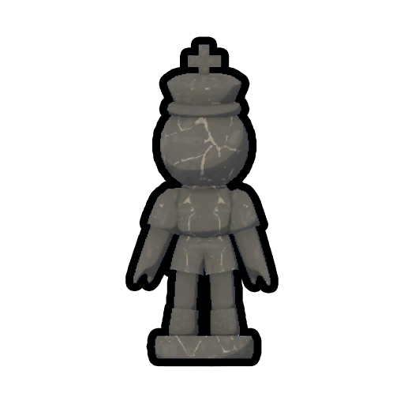](https://peak.wiki.gg/wiki/File%3AKing_Black.png)
[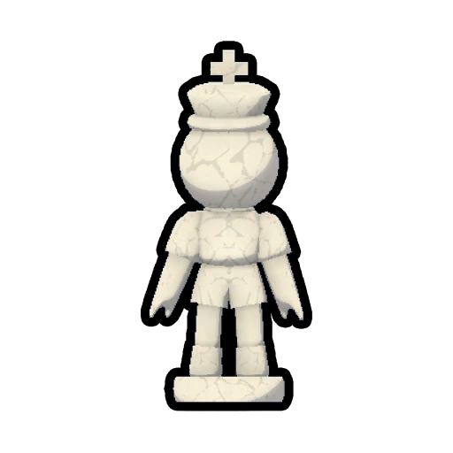](https://peak.wiki.gg/wiki/File%3AKing_White.png)
[Item type](Items.md)- [Misc](Misc.md)
Biome- [Airport](Airport.md)
Weight
[](Stamina%20bar.md#Weight) **2.5**

The **King** is an [item](https://peak.wiki.gg/wiki/Item) in *[PEAK](Peak%20%28game%29.md)* that can be found in the [Airport](Airport.md). When dropped, chess pieces will automatically lock into place on the floor to avoid being accidentally displaced.

There are two king pieces in total to be found in the Airport, with one of each color set up on the the chess board.

## Patch history

 **[1.30.a](1.30.a.md) (2025-09-23):** Introduced.

---

# Kingberry (disambiguation)


This is a disambiguation page for "Kingberry (disambiguation)".

The following is a list of links related to Kingberry (disambiguation).

**Kingberry** may refer to:

## Foods

- [](Green%20Kingberry.md) [Green Kingberry](Green%20Kingberry.md)
- [](Yellow%20Kingberry.md) [Yellow Kingberry](Yellow%20Kingberry.md)
- [](Purple%20Kingberry.md) [Purple Kingberry](Purple%20Kingberry.md)

---

# Knight

Knight
Black
White
[](https://peak.wiki.gg/wiki/File%3AKnight_Black.png)
[](https://peak.wiki.gg/wiki/File%3AKnight_White.png)
[Item type](Items.md)- [Misc](Misc.md)
Biome- [Airport](Airport.md)
Weight
[](Stamina%20bar.md#Weight) **2.5**

The **Knight** is an [item](https://peak.wiki.gg/wiki/Item) in *[PEAK](Peak%20%28game%29.md)* that can be found in the [Airport](Airport.md). When dropped, chess pieces will automatically lock into place on the floor to avoid being accidentally displaced.

There are four knight pieces in total to be found in the Airport, with two of each color set up on the the chess board.

## Patch history

 **[1.30.a](1.30.a.md) (2025-09-23):** Introduced.

---

# Lantern

Lantern
[](https://peak.wiki.gg/wiki/File%3ALantern.png)
[Item type](Items.md)- [Equipment](Equipment.md)
Rarity
[Epic](https://peak.wiki.gg/wiki/Epic)
Biome- [Tropics](Tropics.md)
- [Alpine](Alpine.md)
Source- [Crash Site](https://peak.wiki.gg/wiki/Crash_Site)
- [Regular Luggage](https://peak.wiki.gg/wiki/Regular_Luggage)
- [Big Luggage](https://peak.wiki.gg/wiki/Big_Luggage)
Weight
[](Stamina%20bar.md#Weight) **5**
Base Status Effects
[](Stamina%20bar.md#Cold)Cold
-150
[](https://peak.wiki.gg/wiki/File%3ALantern_Closeup.jpg)

Close-up of the Lantern

The **Lantern** is an [equipment](Equipment.md) item in *[PEAK](Peak%20%28game%29.md)*. One lantern can be found in the [Crash Site](https://peak.wiki.gg/wiki/Crash_site), with more lanterns potentially being found in [luggages](Luggage.md) in the [Tropics](Tropics.md) and [Alpine](Alpine.md). While lit, all scouts within **7.2 meters** of the lantern recover [](Stamina%20bar.md#Cold) **2.5** [Cold](Stamina%20bar.md#Cold) each second. The Lantern can be lit for up to **60 seconds** before running out of fuel.

A Lantern will stay lit when dropped or when placed into a dropped backpack. It is automatically extinguished if it is put away, if the containing backpack is picked up, or if it is taken out of a containing backpack.

[Cooking](Cooking.md) a lantern while it has remaining fuel will cause it to explode, dealing up to [](Stamina%20bar.md#Injury) **20** [Injury](Stamina%20bar.md#Injury) to scouts within **4.8 meters**, depending on their distance.

## See also

- [](Faerie%20Lantern.md) [Faerie Lantern](Faerie%20Lantern.md)

## Patch history

 **[1.0](1.0.md) (2025-06-16):** Introduced.
 **[1.40.a](1.40.a.md) (2025-11-05):** Cooking a lantern will cause it to explode.
 **[2.0.a](2.0.a.md) (2026-08-11):** Changed the grip of lantern

---

# Lava

Lava
[](https://peak.wiki.gg/wiki/File%3ACaldera_lava_closeup.png)
General
Type
Environmental hazard
Biome- [Tropics](Tropics.md)
- [Alpine](Alpine.md)
- [Caldera](Caldera.md)
- [The Kiln](The%20Kiln.md)

**Lava** in *[PEAK](Peak%20%28game%29.md)* is an environmental hazard which deals [](Stamina%20bar.md#Heat) [Heat](Stamina%20bar.md#Heat) damage and [](Stamina%20bar.md#Injury) [Injury](Stamina%20bar.md#Injury). It appears in large pools in the [Caldera](Caldera.md) and [The Kiln](The%20Kiln.md), and in the form of [Lava Tubes](https://peak.wiki.gg/wiki/Lava_Tube) in the [Tropics](Tropics.md) and [Alpine](Alpine.md).

Pools of lava can [cook](#Cooking) items that are sufficiently close.

## Variations

### Caldera

The lava in the [Caldera](Caldera.md) follows a **71.75-second** tidal cycle. The rocks visually change their appearance as the lava gets closer, though this is a purely cosmetic effect since the damage is defined by the player's distance to the lava's surface.

### The Kiln

[The Kiln](The%20Kiln.md)'s lava will start to rise **3 minutes** after lighting the [campfire](Campfire.md), and will take **20 minutes** to rise to the top of the volcano.

### Lava rivers

**Lava rivers** (also known as *lava tubes*) may occasionally spawn in the [Tropics](Tropics.md), [Alpine](Alpine.md), and [The Kiln](The%20Kiln.md).

Despite their appearance, lava rivers do not share physical properties with lava found in pools. They can also be climbed, and [items](Items.md) do not sink in them.

## Damage mechanics

Players in direct contact with the [Caldera](Caldera.md)'s or [Kiln](https://peak.wiki.gg/wiki/Kiln)'s lava receive [](Stamina%20bar.md#Injury) **25** [Injury](Stamina%20bar.md#Injury) and [](Stamina%20bar.md#Heat) **25** [Heat](Stamina%20bar.md#Heat) every second. Depending on the distance to the lava's surface, players may take up to [](Stamina%20bar.md#Heat) **2.5** [Heat](Stamina%20bar.md#Heat) every ~0.208 seconds[[1]](#cite_note-1).

Lava rivers deal [](Stamina%20bar.md#Injury) **20** [Injury](Stamina%20bar.md#Injury) and [](Stamina%20bar.md#Heat) **50** [Heat](Stamina%20bar.md#Heat) and apply a small amount of knockback to all players directly touching them.

## Cooking

Pools of lava can [cook](https://peak.wiki.gg/wiki/Cook) nearby items at a rate depending on their distance to the lava, with the minimum time of ~1.43 seconds. Items in equipped [](Backpack.md) [Backpacks](Backpack.md) are not cooked by lava.

## Gallery

- [](https://peak.wiki.gg/wiki/File%3ACaldera_lava_closeup.png)
  A close-up on the lava in the [Caldera](Caldera.md).
- [](https://peak.wiki.gg/wiki/File%3AKiln_Lava_Max.png)
  The top of [The Kiln](The%20Kiln.md) after the lava has fully risen.
- [](https://peak.wiki.gg/wiki/File%3ALava_tube1.jpg)
  A lava tube in the [Tropics](Tropics.md).
- [](https://peak.wiki.gg/wiki/File%3ALava_tube2.jpg)
  Another lava river in the [Tropics](Tropics.md).
- [](https://peak.wiki.gg/wiki/File%3ALava_tube_alpine.jpg)
  A lava river in the [Alpine](Alpine.md).

## Notes

- [↑](#cite_ref-1) The exact formula is `heat * (1 / heatRate) * 1.5 = 0.8 * (1 / 0.1) * 1.5 = 12` Heat per second, or equivalently, `2.5 / 12 = 0.2083333` seconds per tick of Heat.

## Patch history

 **[1.0](1.0.md) (2025-06-16):** Introduced.
 **[1.44.a](1.44.a.md) (2025-11-13):** Lava will no longer [cook](https://peak.wiki.gg/wiki/Cook) items that are being held in your hands.
 **[1.47.a](1.47.a.md) (2025-12-01):** Fixed an issue where lava pools would not damage you unless you were over halfway submerged in them (careful!).

---

# List of Landcrab Comments

Here is the list of comments by LandCrab, the current comment is always shown on the title screen.

LANDCRAB COMMENTS (Incomplete and not in order)

- We did not win a bafta
- The patch is live with some new fixes! We hope you enjoy PEAK for the next two weeks until you all move on to silksong.
- yes we are working on the new biome! no you can't know when it's done
- Thank you for choosing us for BETTER WITH FRIENDS!!! and if you see a scorpion in the mesa. run. (we're fixing it sorry sorry)
- Tropics crash has been resolved! More fixes coming soon. Thank you for your patience <3
- thank you for a PEAK year and enjoy the snow!! (if you're in the southern hemisphere i dont wanna hear it)
- stay tuned on Discord for updates coming to the beta branch SOON(ish)
- fixed the backpack! try losing it now i dare you
- Ok apparently its been Alpine like 6 days in a row. SORRY!! Worst RNG of all time. We'll fix it early this week.
- ITS MESA NOW I SWEAR
- vote for us in the GOLDEN JOYSTICK AWARDS it would mean a lot <3
- no new update today we're playing big walk
- The Final Ascent is Finally OUT!! Check patch notes! OUR SERVERS ARE EXPLODING! They should scale up shortly, sorry if your game fails to load in the meantime! And remember to disable your mods, this update will probably break them!!
- we nerfed the frogs again
- We're gonna wait one more week before CALDERA and THE KILN re-enter the map rotation. We got a little swamped (ha) with bugs and need more time to refine the biomes. Sorry!
- if you had your bookworm badge deleted last week, SORRY ABOUT THAT!!! check the patch notes for instructions on getting it back
- bing bong is a father of two
- (unfinished please help)

---

# Locations

**Locations** in *[PEAK](Peak%20%28game%29.md)* are the areas players will find themselves in either before or during their climbing sessions. The most common locations are the **biomes** that dictate the conditions of each climb, the hazards the players encounter, and the types of items they can find. Aside from the [Shore](Shore.md) and the [PEAK](Peak%20%28biome%29.md), each biome has an alternative that it can swap with when the map changes.

The current map [changes](Daily.md) every 24 hours at [17:00 UTC](https://dateful.com/convert/utc?t=17).

## Lobby

| Region | Preview | Name | Description |
| --- | --- | --- | --- |
| — | [Airport](Airport.md) | **[Airport](Airport.md)** | - The lobby area from which you invite your friends before beginning your climbing session. - Use your [Passport](Passport.md) here to [customize](Cosmetics.md) the look of your [Scout](Scout.md). - Partake in fun activities while you wait to start the game, such as using the photobooth or playing chess. - Behind the gated wall just around the corner in an "out of bounds" room you are able to see [Scoutmaster Myres](Scoutmaster%20Myres.md). |

## Biomes

| Region | Preview | Name | Description |
| --- | --- | --- | --- |
| **1** | [Shore](Shore.md) | **[Shore](Shore.md)** | - Loot your crashed flight for supplies. - Climb rocky cliffs. - Find [Coconuts](Coconut.md) on palm trees and [Crispberries](https://peak.wiki.gg/wiki/Crispberries) on bushes. - Avoid [Poison](Stamina%20bar.md#Poison) [poisonous](Stamina%20bar.md#Poison) hazards, such as the [jellyfish](Shore.md#Hazards) and [giant sea urchins](Shore.md#Hazards). - Traverse wooden [bridges](Bridge.md) that can break under the pressure of too many scouts. |
| **2** | [Tropics](Tropics.md) | **[Tropics](Tropics.md)** | - Climb trees, roots and vines. - Find various natural food, including [Kingberries](https://peak.wiki.gg/wiki/Kingberries), [Scorchberries](https://peak.wiki.gg/wiki/Scorchberries), and [Berrynanas](Berrynana%20%28disambiguation%29.md). - Steal [Honeycombs](Honeycomb.md) from bees in [Beehives](Beehive.md) (but avoid getting stung by them!). - Avoid [Poison](Stamina%20bar.md#Poison) [poisonous](Stamina%20bar.md#Poison) spikes on large roots, bombshrooms, and  [ticks](Tick.md). |
| [Roots](Roots.md) | **[Roots](Roots.md)** | - Scale tall trees and giant mushrooms in a swamp. - Forage all kinds of fungi, whether edible or usable as tools in the climb. - Avoid [Spores](Stamina%20bar.md#Spores) [spores](Stamina%20bar.md#Spores), various hostile bugs and fungal [zombies](https://peak.wiki.gg/wiki/Zombies). |
| **3** | [Alpine](Alpine.md) | **[Alpine](Alpine.md)** | - Navigate freezing winds and icy caves. - Find different [Winterberries](https://peak.wiki.gg/wiki/Winterberries). - Take cover from [Cold](Stamina%20bar.md#Cold) [freezing](Stamina%20bar.md#Cold) blizzards and [Ice Rocks](Ice%20Rocks.md). - Avoid erupting [geysers](Geyser.md) that can [Heat](Stamina%20bar.md#Heat) [burn](Stamina%20bar.md#Heat) you and send you flying. |
| [Mesa](Mesa.md) | **[Mesa](Mesa.md)** | - Traverse sandy terrain under a blistering sun. - Take cover from the [Heat](Stamina%20bar.md#Heat) [blistering](Stamina%20bar.md#Heat) sun. - Stay away from [Thorns](Stamina%20bar.md#Thorns) [thorny](Stamina%20bar.md#Thorns) [Cacti](https://peak.wiki.gg/wiki/Cacti) and rolling [Tumbleweeds](Tumbleweed.md). - Avoid other hazards, such as [Poison](Stamina%20bar.md#Poison) [venomous](Stamina%20bar.md#Poison) [Scorpions](Scorpion.md), [Injury](Stamina%20bar.md#Injury) [explosive](Stamina%20bar.md#Injury) [Dynamite](Dynamite.md), and [others](Mesa.md#Hazards). - Don't get fooled by mirages or [antlions](Antlion.md). - Rumors say that on some days, a [secret entrance](Tomb.md) might be open in the sand... |
| **4** | [Caldera](Caldera.md) | **[Caldera](Caldera.md)** | - Jump across [Heat](Stamina%20bar.md#Heat) [burning](Stamina%20bar.md#Heat) [rocks](Caldera.md#Hazards), being careful of the growing flames. - Wait for the lava to rise and fall before making your jump. - Find [Big Eggs](Big%20Egg.md) in nests. - Take cover from the [Condors](Condor.md) that fly near their nests. - Will always be paired with The Kiln if in rotation. |
| [Image Of The Gloom Biome](Gloom.md) | **[Gloom](Gloom.md)** | - Traverse the misty terrain and avoid getting too [Drowsy](Stamina%20bar.md#Drowsy) [sleepy](Stamina%20bar.md#Drowsy). - Avoid [Cold](Stamina%20bar.md#Cold) [freezing](Stamina%20bar.md#Cold) [ghosts](Big%20Ghost.md) and hungry [frogs](Frog.md). - Find [Small Eggs](Small%20Egg.md) in nests atop pillars. - Use the Belltowers to dispel the mist and kill any ghosts. - Will always be paired with The Citadel if in rotation. |
| **5** | [The Kiln](The%20Kiln.md) | **[The Kiln](The%20Kiln.md)** | - Navigate carefully up a narrow vertical climb. - Use your equipment to make climbing to the [Peak](Peak%20%28biome%29.md) easier. - Avoid [Heat](Stamina%20bar.md#Heat) [burning](Stamina%20bar.md#Heat) [Hot Rocks](https://peak.wiki.gg/wiki/Kiln#Hot_Rocks) and rising lava. - Use [Petrify](Stamina%20bar.md#Petrify) [petrifying](Stamina%20bar.md#Petrify) blue rocks as platforms only when needed, as they limit your maximum [Bonus stamina](Stamina%20bar.md#Bonus_stamina) [Bonus stamina](Stamina%20bar.md#Bonus_stamina). - Will always be paired with Caldera if in rotation. |
| [A Image of the inside of the citadel](The%20Citadel.md) | **[The Citadel](The%20Citadel.md)** | - Avoid traps such as [Arrow](Stamina%20bar.md#Arrow) [arrows](Stamina%20bar.md#Arrow), swinging maces, and spike rollers. - Generally, equipment is not needed if stamina is high. - Use [Petrify](Stamina%20bar.md#Petrify) [petrifying](Stamina%20bar.md#Petrify) grey rocks as platforms only when needed, as they limit your maximum [Bonus stamina](Stamina%20bar.md#Bonus_stamina) [Bonus stamina](Stamina%20bar.md#Bonus_stamina). - Move quickly to avoid the rising gloom. - Will always be paired with Gloom if in rotation. |
| **6** | [Peak](Peak%20%28biome%29.md) | **[Peak](Peak%20%28biome%29.md)** | - You have successfully reached the [Peak](Peak%20%28biome%29.md)! Congrats! - A box of  [flares](Flare.md) can be found here to call for help, as long as you are not playing on [Ascent 4](Ascents.md) or higher. - Nothing else to worry about from here on out! ...Although, some say you can find something else beyond the Peak... |

## Secret Locations

[](https://peak.wiki.gg/wiki/File%3AWarning_Icon.png) **Spoilers!** - The following section contains spoilers for *[PEAK](Peak%20%28game%29.md)*.
List of secret locations

| Preview | Name | Description |
| --- | --- | --- |
| [Tomb hallway.jpg](https://peak.wiki.gg/wiki/File%3ATomb_hallway.jpg) | **[Tomb](Tomb.md)** | - Entrance occasionally opened up in the [Mesa](Mesa.md)'s plateau. - Navigate a maze and a parkour challenge deep underground. - A [reward](Ancient%20Idol.md) awaits those brave enough to reach the end. |
| [Nadir.jpg](https://peak.wiki.gg/wiki/File%3ANadir.jpg) | **[Nadir](Nadir.md)** | - Entered by using a [magical item](Scout%27s%20Honor.md) empowered by four [amulets](Amulets.md) bestowed to a [stone Scout](Peak%20%28biome%29.md#Stone_Statue). - Climb for your life against a rising sea of the dead. - Escape to free the soul of an [abandoned leader](Scoutmaster%20Myres.md). - Going through this realm is required to win on [Ascent 8](https://peak.wiki.gg/wiki/Ascent_8). |

## Patch history

 **[1.0](1.0.md) (2025-06-16):** Introduced.
 **[1.6.a](1.6.a.md) (2025-07-04):** Removed a weird thin green line in the airport
 **[1.8](1.8.md) (2025-07-21):**

- We've improved performance in the Caldera and Kiln. To folks noting the abnormally low framerate in these areas, please let us know if it's still happening. (We don't have access to a big variety of computer specs!)
- Fixed an issue where you could not reconnect properly from the top of the Alpine/Mesa onwards.

 **[1.20.a](1.20.a.md) (2025-08-11):**

- Added a new biome that replaces the Alpine: the MESA. The MESA will be present in every run for the next week - after which future maps will rotate randomly between the Mesa and Alpine.
- There may be a surprise waiting for you in The Kiln…
- The fog rises slightly slower in the Tropics.
- Improved performance across the board on the mountain.
- Added the TOMB. **(Undocumented)**

 **[1.40.a](1.40.a.md) (2025-11-05):**

- Added a new biome: the ROOTS.- Delve into the ROOTS: a shrouded redwood forest infested by mushrooms and creepy-crawlies alike. This Biome replaces the TROPICS, and will be present in every run until November 17 - after which, future maps will rotate randomly between TROPICS and ROOTS.

 **[2.0.a](2.0.a.md) (2026-08-11):**

- Added two new biomes: the GLOOM and THE CITADEL.
- Added NADIR. **(Undocumented)**

---

# Locations/es-419

Las **ubicaciones** son las zonas en las que los [Exploradores](Scout_es-419.md) estarán a lo largo de todo PEAK. Las ubicaciones más importantes son los **biomas**, ya que establecen las condiciones de cada escalada, los [peligros](Hazards.md) a los que se enfrentan los Exploradores y los [objetos](Items_es-419.md) que se encuentran. Exceptuando a la [Costa](Shore_es-419.md) y a la [Cima](Peak%20%28biome%29.md), cada bioma tiene uno alternativo con el que puede cambiar junto a la [Isla](Island_es-419.md). Recuerda que la isla [cambia cada 24 horas](Island_es-419.md) a las [17:00 UTC](https://dateful.com/convert/utc?t=17).

## Sala de Espera

| Nombre | Sección | Imagen | Descripción |
| --- | --- | --- | --- |
| **[Aeropuerto](Airport_es-419.md)** | n/a | [Airport](Airport_es-419.md) | - El **[Aeropuerto](Airport_es-419.md)** es la sala de espera desde la que invitas a otros [Exploradores](Scout_es-419.md) antes de abordar el avión y comenzar tu expedición. - Usa tu  [Pasaporte](Passport.md) aquí para [personalizar](Cosmetics_es-419.md) tu apariencia. - Puedes participar de actividades divertidas mientras esperas, como jugar al ajedrez o al básquet y sacarte fotos en la cabina fotográfica. |

## Biomas

| Nombre | Sección | Imagen | Descripción |
| --- | --- | --- | --- |
| **[Costa](Shore_es-419.md)** | **1** | [Costa](Shore_es-419.md) | - Escala el acantilado rocoso de una playa. - Encuentra  [Cocos](Coconut.md) en las palmeras y  [Crujibayas](https://peak.wiki.gg/wiki/Crispberry) en los arbustos. - Evita peligros [Poison](Stamina%20bar.md#Poison) [venenosos](Stamina%20bar.md#Poison) como las [medusas](Shore_es-419.md#Medusa) y los [erizos de mar gigantes](Shore_es-419.md#Erizo_de_Mar_Gigante). - Atraviesa [puentes de madera](Bridge.md) que puede romperse bajo la presión de muchos [Exploradores](Scout_es-419.md) encima. |
| **[Zona Tropical](Tropics.md)** | **2** | [Zona Tropical](Tropics.md) | - Escala [árboles](Tropics.md#Trees), [raíces](Tropics.md#Giant_Ivy) y [enredaderas](Vines.md) en una jungla. - Encuentra una gran variedad de bayas únicas de la Zona Tropical: las  [Bayarreyes](https://peak.wiki.gg/wiki/Kingberry), las  [Bayas Picantes](Scorchberry.md) y las  [Clusterbayas](https://peak.wiki.gg/wiki/Clusterberry). - Tómate un descanso cuando empiece a [llover](https://peak.wiki.gg/wiki/Rain), las superficies estarán resbalosas. - Evita la flora y la fauna [Poison](Stamina%20bar.md#Poison) [venenosa](Stamina%20bar.md#Poison) y las fuertes [corrientes de agua](Tropics.md#Waterfalls). |
| **[Raíces](Roots.md)** | [Raíces](Roots.md) | - Escala un bosque lleno de [árboles de secuoya](Roots.md#Redwood_Trees), [enredaderas](Vines.md) y muchos, pero muchos hongos de todo tipo. - Encuentra todo tipo de hongos, tanto comestibles como utilizables para ayudarte a escalar. - Evita las [Spores](Stamina%20bar.md#Spores) [Esporas](Stamina%20bar.md#Spores), los [bichos hostiles](https://peak.wiki.gg/wiki/Enemies) y los [Zombis fúngicos](Zombie.md). |
| **[Zona Alpina](Alpine.md)** | **3** | [Zona Alpina](Alpine.md) | - Escala una montaña congelada con cuevas, [clavijas oxidadas](Alpine.md#Rusty_Pitons) y flora muerta. - Encuentra bayas únicas de la Zona Alpina: las  [Bayas de Invierno](https://peak.wiki.gg/wiki/Winterberry) y las  [Siestibayas](Napberry.md). - Busca cobertura cuando comience la [ventisca](Blizzard.md) para no recibir [Cold](Stamina%20bar.md#Cold) [Frío](Stamina%20bar.md#Cold). - Evita tocar las [rocas de hielo](Ice%20Rocks.md) o acercarte mucho a los [géiseres](Geyser.md), ya que estos últimos podrían hacerte volar. |
| **[Mesa](Mesa.md)** | [Mesa](Mesa.md) | - Atraviesa un desierto y escala su acantilado con muchas [cuevas](Mesa.md#Caves),  [dinamitas](Dynamite.md) y [cactus](https://peak.wiki.gg/wiki/Cacti), un [cañón](Mesa.md#Canyon) y una… ¿¿¿[entrada subterránea](Mesa.md#Tomb_entrance)??? - Quédate en la sombra cuando salga el [sol abrasador](https://peak.wiki.gg/wiki/Sun) o recibirás [Heat](Stamina%20bar.md#Heat) [Calor](Stamina%20bar.md#Heat). - Ten cuidado con los [estepicursores](Tumbleweed.md) y los [tornados](Tornado.md) que rondan por la meseta. - Evita la [fauna hostil](https://peak.wiki.gg/wiki/Enemies) y no te dejes engañar por los [espejismos](https://peak.wiki.gg/wiki/Mirage). |
| **[Caldera](Caldera.md)** | **4** | [Caldera](Caldera.md) | - Atraviesa un [lago de lava](Caldera.md#Lava) con grandes [pilares de roca volcánica](Caldera.md#Rock_Towers). - Espera a que la lava baje para cruzar entre los pilares. - Algunos pilares todavía están [calientes](Caldera.md#Hot_Rock_Towers) y recibirás [Heat](Stamina%20bar.md#Heat) [Calor](Stamina%20bar.md#Heat) si los tocas. Sin embargo, en la cima de ellos se encuentran nidos con  [Huevos Grandes](Big%20Egg.md). - Evita las [erupciones](Caldera.md#Eruptions) y los [Cóndores](Condor.md), ya que estos últimos te agarrarán y te llevarán volando a su nido. |
| **[Penumbra](Gloom.md)** | [Penumbra](Gloom.md) | - Atraviesa un pantano con una [penumbra soñolienta](https://peak.wiki.gg/wiki/Sleepy_Gloom) y varios [exploradores petrificados](Gloom.md#Petrified_Scouts). - Busca terreno elevado para salir de la penumbra soñolienta o [campanarios](https://peak.wiki.gg/wiki/Belltower) para crear zonas seguras dentro de ella y así reducir el [Drowsy](Stamina%20bar.md#Drowsy) [Sueño](Stamina%20bar.md#Drowsy). - Encuentra  [Huevos Pequeños](Small%20Egg.md) encima de pilares y árboles. - Evita la flora y la fauna peligrosa y no te dejes confundir por los [Cuervos Astutos](Tricky%20Ravens.md). |
| **[El Horno](The%20Kiln.md)** | **5** | [El Horno](The%20Kiln.md) | - Escala el interior de un volcán con puentes de roca volcánica. - Algunos puentes todavía están [calientes](https://peak.wiki.gg/wiki/Hot_rock_bridges) y recibirás [Heat](Stamina%20bar.md#Heat) [Calor](Stamina%20bar.md#Heat) si los tocas. - Evita tocar las [rocas calientes](The%20Kiln.md#Hot_Rocks), las [rocas petrificantes](The%20Kiln.md#Petrifying_Stones) o los [ríos de lava](The%20Kiln.md#Lava_Rivers). |
| **[La Ciudadela](The%20Citadel.md)** | [La Ciudadela](The%20Citadel.md) | - Escala el interior de un castillo medieval con salas centrales y estructuras rotas por fuera. - Usa las [escaleras de mano](The%20Citadel.md#Ladders) en las paredes para escalar más rápido consumiendo menos [Resistencia](https://peak.wiki.gg/wiki/Stamina). - Encuentra [maletas](Luggage.md) en el centro del castillo. - Evita caer en la enorme cantidad de [trampas](The%20Citadel.md#Hazards) o tocar las [rocas petrificantes](https://peak.wiki.gg/wiki/Petrifying_rocks). |
| **[Cima](Peak%20%28biome%29.md)** | **6** | [Cima](Peak%20%28biome%29.md) | - ¡Felicidades, has llegado a la [Cima](Peak%20%28biome%29.md)! - Escala la pequeña montaña hasta la bandera. Si la expedición es *[Ascenso 3](Ascents_es-419.md#Ascenso_3)* o inferior, allí habrá una caja con  [Bengalas](Flare.md) para llamar al [helicóptero de rescate](https://peak.wiki.gg/wiki/Helicopter). - Detrás de la montaña se encuentra un [explorador de piedra](https://peak.wiki.gg/wiki/Stone_Scout) sosteniendo una  [Gema Extraña](Strange%20Gem.md)… ¿Cuál será su uso? |

## Ubicaciones Secretas

[](https://peak.wiki.gg/wiki/File%3AWarning_Icon.png) **Spoilers!** - The following section contains spoilers for *[PEAK](Peak%20%28game%29.md)*.
Lista de ubicaciones secretas

| Nombre | Sección | Imagen | Descripción |
| --- | --- | --- | --- |
| **[Tumba](Tomb.md)** | n/a | [Tumba](Tomb.md) | - La entrada se encuentra en la meseta de la [Mesa](Mesa.md) y está ocasionalmente abierta. - Recorre el laberinto y sobrevive al abismo haciendo parkour bajo tierra. - Una [recompensa](Ancient%20Idol.md) espera a los valientes y habilidosos [Exploradores](Scout_es-419.md) que logren llegar hasta el final. |
| **[Nadir](Nadir.md)** | **7** | [Nadir](Nadir.md) | - Puedes llegar a este lugar por medio de un [objeto extraño](Scout%27s%20Honor.md) creado a partir del poder de 4 [amuletos](Amulets.md) y una  [Gema Extraña](Strange%20Gem.md) sostenida por un [explorador de piedra](https://peak.wiki.gg/wiki/Stone_Scout). - Escala por una [Costa](Shore_es-419.md) distorsionada en el tiempo y el espacio antes de que las [almas perdidas](https://peak.wiki.gg/wiki/The_Lost_Souls) te alcancen. - Libera el alma del [Jefe de Tropa](https://peak.wiki.gg/wiki/Scoutmaster) y ayúdalo a volver a la [Isla](Island_es-419.md). - En *[Ascenso 8](Ascents_es-419.md#Ascenso_8)*, es obligatorio llegar a Nadir para escapar de la Isla. |

## Historial de Versiones

 **[1.0](1.0.md) (2025-06-16):** Se introdujeron el [Aeropuerto](Airport_es-419.md), [Costa](Shore_es-419.md), [Zona Tropical](Tropics.md), [Zona Alpina](Alpine.md), [Caldera](Caldera.md), [El Horno](The%20Kiln.md) y la [Cima](Peak%20%28biome%29.md).

 **[1.8](1.8.md) (2025-07-21):**

- ¡Nueva música de amanecer/atardecer específica de cada [bioma](#Biomas)!
- Se mejoró el rendimiento en la [Caldera](Caldera.md) y [El Horno](The%20Kiln.md). Para los que notaron la cantidad de fotogramas anormalmente baja en estas zonas, por favor avísanos si sigue ocurriendo. (¡No tenemos acceso a una gran variedad de características de computadora!)
- Se arregló un error que impedía reconectarse correctamente desde la cima de la [Zona Alpina](Alpine.md) en adelante.

 **[1.20.a](1.20.a.md) (2025-08-11):**

- Se añadió un nuevo [bioma](#Biomas) que reemplaza a la [ZONA ALPINA](Alpine.md): la [MESA](Mesa.md). La MESA estará presente en todas las expediciones hasta la semana que viene; después de esa fecha, la [Isla](Island_es-419.md) rotará aleatoriamente entre la ZONA ALPINA y la MESA.
- Se añadió la [TUMBA](Tomb.md). **(Cambio no documentado)**
- Puede que haya una sorpresa esperándote en [El Horno](The%20Kiln.md)...
- La [niebla](Fog.md) se levanta un poco más lento en la [Zona Tropical](Tropics.md).
- Se mejoró el rendimiento en la [montaña](Island_es-419.md).

 **[1.40.a](1.40.a.md) (2025-11-05):**

- Se añadió un nuevo [bioma](#Biomas): las [RAÍCES](Roots.md).- Adéntrate en las RAÍCES: un bosque de secuoyas infestado de hongos y bichos espeluznantes. Este bioma reemplaza a la [ZONA TROPICAL](Tropics.md), y estará presente en todas las expediciones hasta el 17 de noviembre; después de esa fecha, la [Isla](Island_es-419.md) rotará aleatoriamente entre la ZONA TROPICAL y las RAÍCES.

 **[2.0.a](2.0.a.md) (2026-08-11):**

- Se añadieron la [PENUMBRA](Gloom.md) y [LA CIUDADELA](The%20Citadel.md), reemplazando aleatoriamente a [CALDERA](https://peak.wiki.gg/wiki/CALDERA) y [EL HORNO](The%20Kiln.md).
- Se añadió [NADIR](Nadir.md). **(Cambio no documentado)**

---

# Looker

Looker
[](https://peak.wiki.gg/wiki/File%3AOrange_scout_peeking.png)
General
Type
[NPC](https://peak.wiki.gg/wiki/NPC)
Biome- [Shore](Shore.md)
- [Tropics](Tropics.md)
- [Roots](Roots.md)
- [Alpine](Alpine.md)
- [Mesa](Mesa.md)

The **Looker** is an [NPC](https://peak.wiki.gg/wiki/NPC) who has a chance of spawning during a game session. They will appear to pop up from behind a smooth round rock, staring at the player for a moment before quickly hiding behind the rock again if a player looks at them. If a player has looked at them for too long (roughly **3 seconds**) or approaches the rock, they will vanish and cannot reappear for the remainder of the run.

It can be disabled in the game's accessibility options.

## Notes

- The Looker cannot spawn in the [Caldera](Caldera.md), [Gloom](Gloom.md), [The Kiln](The%20Kiln.md), [The Citadel](The%20Citadel.md), or the [PEAK](Peak%20%28biome%29.md).
- The chance of the Looker spawning is 5%, at one of 20 random locations on the map.
- The scout and the rock are linked via code, therefore the rock will not appear in sessions where the scout did not spawn.
- It is possible for multiple rocks to spawn nearby, allowing multiple Lookers to be visible at the same time.
- When approached before it can hide, it turns around and even tilt into the rock to ensure always appearing behind it for each player's viewpoint.

## Patch history

 **[1.20.a](1.20.a.md) (2025-08-11):** Introduced.
 **[1.25.a](1.25.a.md) (2025-08-21):**

- There is now a setting to disable "The Looker."
- Fixed an issue where "The Looker" would not work properly sometimes, and made it a much more rare occurrence.

 **[2.2.a](2.2.a.md) (2026-08-18):** Looker rocks should once again match the biome they're in

---

# Luggage

**Luggage boxes** are item containers scattered across the island. Their locations are determined by the map seed and remain fixed for the duration of the current map. The contents of each box are randomly generated upon opening.

The amount and type of items inside a luggage depends on its type, and for [Regular](#Regular_Luggage) and [Big Luggage](#Big_Luggage), the biome they're found in. Items inside the boxes are unmovable until picked up.

Opening 15 luggage boxes in a single run unlocks the [](https://peak.wiki.gg/wiki/Plunderer_Badge) [Plunderer Badge](https://peak.wiki.gg/wiki/Plunderer_Badge).

## Types

There are six types of luggage boxes, out of which five contain items.

All item spawn chances are rounded to one decimal.

### Regular Luggage

---

[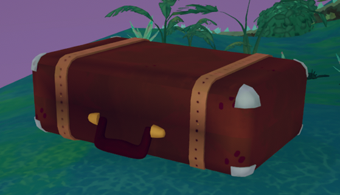](https://peak.wiki.gg/wiki/File%3ARegular_Luggage.png)

**Regular Luggage** is the most common luggage box, it's brown and moderately sized. Regular Luggage always contains one item, and has a 1 in 3 chance to contain another. The item spawn pool differs slightly based on the biome the it's found in. One Regular Luggage is guaranteed to spawn at the [Crash Site](Shore.md#Crash_Site).

[Co-op](#Co-op-0)[Solo](#Solo-0)

[Shore](#Shore-0)[Tropics](#Tropics-0)[Roots](#Roots-0)[Alpine](#Alpine-0)[Mesa](#Mesa-0)[Caldera/Kiln](#Caldera/Kiln-0)[Gloom/Citadel](#Gloom/Citadel-0)

Regular Luggage Items - Shore

| Item | Chance per slot[[n 1]](#cite_note-cps-1) | Total chance[[n 2]](#cite_note-tot-nodupe-2) |
| --- | --- | --- |
| [Bandages](Bandages.md) | 10% | 13.2% |
| [Sports Drink](Sports%20Drink.md) | 10% | 13.2% |
| [Trail Mix](Trail%20Mix.md) | 10% | 13.2% |
| [Energy Drink](Energy%20Drink.md) | 7% | 9.3% |
| [Granola Bar](Granola%20Bar.md) | 7% | 9.3% |
| [Rope Spool](Rope%20Spool.md) | 7% | 9.3% |
| [Balloon](Balloon.md) | 4% | 5.4% |
| [First Aid Kit](First%20Aid%20Kit.md) | 4% | 5.4% |
| [Fortified Milk](Fortified%20Milk.md) | 4% | 5.4% |
| [Piton](Piton.md) | 4% | 5.4% |
| [Airline Food](Airline%20Food.md) | 3% | 4% |
| [Big Lollipop](Big%20Lollipop.md) | 3% | 4% |
| [Chain Launcher](Chain%20Launcher.md) | 3% | 4% |
| [Fanny Pack](Fanny%20Pack.md) | 3% | 4% |
| [Flare](Flare.md) | 3% | 4% |
| [Rescue Claw](Rescue%20Claw.md) | 3% | 4% |
| [Rope Cannon](Rope%20Cannon.md) | 3% | 4% |
| [Scout Cookies](Scout%20Cookies.md) | 3% | 4% |
| [Balloon Bunch](Balloon%20Bunch.md) | 1.2% | 1.6% |
| [Blowgun](Blowgun.md) | 1.2% | 1.6% |
| [Checkpoint Flag](Checkpoint%20Flag.md) | 1.2% | 1.6% |
| [Glider](Glider.md) | 1.2% | 1.6% |
| [Jetpack](Jetpack.md) | 1.2% | 1.6% |
| [Rocketpack](Rocketpack.md) | 1.2% | 1.6% |
| [Scout Cannon](Scout%20Cannon.md) | 1.2% | 1.6% |
| [Pirate's Compass](Pirate%27s%20Compass.md) | 0.6% | 0.8% |

Regular Luggage Items - Tropics

| Item | Chance per slot[[n 1]](#cite_note-cps-1) | Total chance[[n 2]](#cite_note-tot-nodupe-2) |
| --- | --- | --- |
| [Bandages](Bandages.md) | 8.8% | 11.6% |
| [Sports Drink](Sports%20Drink.md) | 8.8% | 11.6% |
| [Trail Mix](Trail%20Mix.md) | 8.8% | 11.6% |
| [Antidote](Antidote.md) | 6.1% | 8.2% |
| [Energy Drink](Energy%20Drink.md) | 6.1% | 8.2% |
| [Granola Bar](Granola%20Bar.md) | 6.1% | 8.2% |
| [Rope Spool](Rope%20Spool.md) | 6.1% | 8.2% |
| [Balloon](Balloon.md) | 3.5% | 4.7% |
| [First Aid Kit](First%20Aid%20Kit.md) | 3.5% | 4.7% |
| [Fortified Milk](Fortified%20Milk.md) | 3.5% | 4.7% |
| [Lantern](Lantern.md) | 3.5% | 4.7% |
| [Piton](Piton.md) | 3.5% | 4.7% |
| [Airline Food](Airline%20Food.md) | 2.6% | 3.5% |
| [Big Lollipop](Big%20Lollipop.md) | 2.6% | 3.5% |
| [Chain Launcher](Chain%20Launcher.md) | 2.6% | 3.5% |
| [Fanny Pack](Fanny%20Pack.md) | 2.6% | 3.5% |
| [Flare](Flare.md) | 2.6% | 3.5% |
| [Portable Stove](Portable%20Stove.md) | 2.6% | 3.5% |
| [Rescue Claw](Rescue%20Claw.md) | 2.6% | 3.5% |
| [Rope Cannon](Rope%20Cannon.md) | 2.6% | 3.5% |
| [Scout Cookies](Scout%20Cookies.md) | 2.6% | 3.5% |
| [Balloon Bunch](Balloon%20Bunch.md) | 1.1% | 1.4% |
| [Blowgun](Blowgun.md) | 1.1% | 1.4% |
| [Checkpoint Flag](Checkpoint%20Flag.md) | 1.1% | 1.4% |
| [Glider](Glider.md) | 1.1% | 1.4% |
| [Jetpack](Jetpack.md) | 1.1% | 1.4% |
| [Rocketpack](Rocketpack.md) | 1.1% | 1.4% |
| [Scout Cannon](Scout%20Cannon.md) | 1.1% | 1.4% |
| [Pirate's Compass](Pirate%27s%20Compass.md) | 0.5% | 0.7% |

Regular Luggage Items - Roots

| Item | Chance per slot[[n 1]](#cite_note-cps-1) | Total chance[[n 2]](#cite_note-tot-nodupe-2) |
| --- | --- | --- |
| [Bandages](Bandages.md) | 8.8% | 11.7% |
| [Sports Drink](Sports%20Drink.md) | 8.8% | 11.7% |
| [Trail Mix](Trail%20Mix.md) | 8.8% | 11.7% |
| [Antidote](Antidote.md) | 6.2% | 8.2% |
| [Energy Drink](Energy%20Drink.md) | 6.2% | 8.2% |
| [Granola Bar](Granola%20Bar.md) | 6.2% | 8.2% |
| [Rope Spool](Rope%20Spool.md) | 6.2% | 8.2% |
| [Balloon](Balloon.md) | 3.5% | 4.7% |
| [First Aid Kit](First%20Aid%20Kit.md) | 3.5% | 4.7% |
| [Fortified Milk](Fortified%20Milk.md) | 3.5% | 4.7% |
| [Piton](Piton.md) | 3.5% | 4.7% |
| [Airline Food](Airline%20Food.md) | 2.7% | 3.6% |
| [Big Lollipop](Big%20Lollipop.md) | 2.7% | 3.6% |
| [Chain Launcher](Chain%20Launcher.md) | 2.7% | 3.6% |
| [Fanny Pack](Fanny%20Pack.md) | 2.7% | 3.6% |
| [Flare](Flare.md) | 2.7% | 3.6% |
| [Parasol](Parasol.md) | 2.7% | 3.6% |
| [Portable Stove](Portable%20Stove.md) | 2.7% | 3.6% |
| [Rescue Claw](Rescue%20Claw.md) | 2.7% | 3.6% |
| [Rope Cannon](Rope%20Cannon.md) | 2.7% | 3.6% |
| [Scout Cookies](Scout%20Cookies.md) | 2.7% | 3.6% |
| [Balloon Bunch](Balloon%20Bunch.md) | 1.1% | 1.4% |
| [Blowgun](Blowgun.md) | 1.1% | 1.4% |
| [Checkpoint Flag](Checkpoint%20Flag.md) | 1.1% | 1.4% |
| [Glider](Glider.md) | 1.1% | 1.4% |
| [Jetpack](Jetpack.md) | 1.1% | 1.4% |
| [Rocketpack](Rocketpack.md) | 1.1% | 1.4% |
| [Scout Cannon](Scout%20Cannon.md) | 1.1% | 1.4% |
| [Pirate's Compass](Pirate%27s%20Compass.md) | 0.5% | 0.7% |

Regular Luggage Items - Alpine

| Item | Chance per slot[[n 1]](#cite_note-cps-1) | Total chance[[n 2]](#cite_note-tot-nodupe-2) |
| --- | --- | --- |
| [Heat Pack](Heat%20Pack.md) | 15.7% | 20.4% |
| [Bandages](Bandages.md) | 7.9% | 10.5% |
| [Sports Drink](Sports%20Drink.md) | 7.9% | 10.5% |
| [Trail Mix](Trail%20Mix.md) | 7.9% | 10.5% |
| [Energy Drink](Energy%20Drink.md) | 5.5% | 7.4% |
| [Granola Bar](Granola%20Bar.md) | 5.5% | 7.4% |
| [Rope Spool](Rope%20Spool.md) | 5.5% | 7.4% |
| [Balloon](Balloon.md) | 3.1% | 4.2% |
| [First Aid Kit](First%20Aid%20Kit.md) | 3.1% | 4.2% |
| [Fortified Milk](Fortified%20Milk.md) | 3.1% | 4.2% |
| [Lantern](Lantern.md) | 3.1% | 4.2% |
| [Piton](Piton.md) | 3.1% | 4.2% |
| [Airline Food](Airline%20Food.md) | 2.4% | 3.2% |
| [Big Lollipop](Big%20Lollipop.md) | 2.4% | 3.2% |
| [Chain Launcher](Chain%20Launcher.md) | 2.4% | 3.2% |
| [Fanny Pack](Fanny%20Pack.md) | 2.4% | 3.2% |
| [Flare](Flare.md) | 2.4% | 3.2% |
| [Portable Stove](Portable%20Stove.md) | 2.4% | 3.2% |
| [Rescue Claw](Rescue%20Claw.md) | 2.4% | 3.2% |
| [Rope Cannon](Rope%20Cannon.md) | 2.4% | 3.2% |
| [Scout Cookies](Scout%20Cookies.md) | 2.4% | 3.2% |
| [Balloon Bunch](Balloon%20Bunch.md) | 0.9% | 1.3% |
| [Blowgun](Blowgun.md) | 0.9% | 1.3% |
| [Checkpoint Flag](Checkpoint%20Flag.md) | 0.9% | 1.3% |
| [Glider](Glider.md) | 0.9% | 1.3% |
| [Jetpack](Jetpack.md) | 0.9% | 1.3% |
| [Rocketpack](Rocketpack.md) | 0.9% | 1.3% |
| [Scout Cannon](Scout%20Cannon.md) | 0.9% | 1.3% |
| [Pirate's Compass](Pirate%27s%20Compass.md) | 0.5% | 0.6% |

Regular Luggage Items - Mesa

| Item | Chance per slot[[n 1]](#cite_note-cps-1) | Total chance[[n 2]](#cite_note-tot-nodupe-2) |
| --- | --- | --- |
| [Bandages](Bandages.md) | 8.9% | 11.8% |
| [Sports Drink](Sports%20Drink.md) | 8.9% | 11.8% |
| [Trail Mix](Trail%20Mix.md) | 8.9% | 11.8% |
| [Energy Drink](Energy%20Drink.md) | 6.2% | 8.3% |
| [Granola Bar](Granola%20Bar.md) | 6.2% | 8.3% |
| [Rope Spool](Rope%20Spool.md) | 6.2% | 8.3% |
| [Balloon](Balloon.md) | 3.6% | 4.8% |
| [First Aid Kit](First%20Aid%20Kit.md) | 3.6% | 4.8% |
| [Fortified Milk](Fortified%20Milk.md) | 3.6% | 4.8% |
| [Parasol](Parasol.md) | 3.6% | 4.8% |
| [Piton](Piton.md) | 3.6% | 4.8% |
| [Sunscreen](Sunscreen.md) | 3.6% | 4.8% |
| [Airline Food](Airline%20Food.md) | 2.7% | 3.6% |
| [Chain Launcher](Chain%20Launcher.md) | 2.7% | 3.6% |
| [Dynamite](Dynamite.md) | 2.7% | 3.6% |
| [Fanny Pack](Fanny%20Pack.md) | 2.7% | 3.6% |
| [Flare](Flare.md) | 2.7% | 3.6% |
| [Portable Stove](Portable%20Stove.md) | 2.7% | 3.6% |
| [Rescue Claw](Rescue%20Claw.md) | 2.7% | 3.6% |
| [Rope Cannon](Rope%20Cannon.md) | 2.7% | 3.6% |
| [Scout Cookies](Scout%20Cookies.md) | 2.7% | 3.6% |
| [Balloon Bunch](Balloon%20Bunch.md) | 1.1% | 1.4% |
| [Big Lollipop](Big%20Lollipop.md) | 1.1% | 1.4% |
| [Blowgun](Blowgun.md) | 1.1% | 1.4% |
| [Checkpoint Flag](Checkpoint%20Flag.md) | 1.1% | 1.4% |
| [Glider](Glider.md) | 1.1% | 1.4% |
| [Jetpack](Jetpack.md) | 1.1% | 1.4% |
| [Rocketpack](Rocketpack.md) | 1.1% | 1.4% |
| [Scout Cannon](Scout%20Cannon.md) | 1.1% | 1.4% |
| [Pirate's Compass](Pirate%27s%20Compass.md) | 0.5% | 0.7% |

Regular Luggage Items - Caldera/Kiln

| Item | Chance per slot[[n 1]](#cite_note-cps-1) | Total chance[[n 2]](#cite_note-tot-nodupe-2) |
| --- | --- | --- |
| [Bandages](Bandages.md) | 10% | 13.2% |
| [Sports Drink](Sports%20Drink.md) | 10% | 13.2% |
| [Trail Mix](Trail%20Mix.md) | 10% | 13.2% |
| [Energy Drink](Energy%20Drink.md) | 7% | 9.3% |
| [Granola Bar](Granola%20Bar.md) | 7% | 9.3% |
| [Rope Spool](Rope%20Spool.md) | 7% | 9.3% |
| [Balloon](Balloon.md) | 4% | 5.4% |
| [First Aid Kit](First%20Aid%20Kit.md) | 4% | 5.4% |
| [Fortified Milk](Fortified%20Milk.md) | 4% | 5.4% |
| [Piton](Piton.md) | 4% | 5.4% |
| [Airline Food](Airline%20Food.md) | 3% | 4% |
| [Big Lollipop](Big%20Lollipop.md) | 3% | 4% |
| [Chain Launcher](Chain%20Launcher.md) | 3% | 4% |
| [Fanny Pack](Fanny%20Pack.md) | 3% | 4% |
| [Flare](Flare.md) | 3% | 4% |
| [Rescue Claw](Rescue%20Claw.md) | 3% | 4% |
| [Rope Cannon](Rope%20Cannon.md) | 3% | 4% |
| [Scout Cookies](Scout%20Cookies.md) | 3% | 4% |
| [Balloon Bunch](Balloon%20Bunch.md) | 1.2% | 1.6% |
| [Blowgun](Blowgun.md) | 1.2% | 1.6% |
| [Checkpoint Flag](Checkpoint%20Flag.md) | 1.2% | 1.6% |
| [Glider](Glider.md) | 1.2% | 1.6% |
| [Jetpack](Jetpack.md) | 1.2% | 1.6% |
| [Rocketpack](Rocketpack.md) | 1.2% | 1.6% |
| [Scout Cannon](Scout%20Cannon.md) | 1.2% | 1.6% |
| [Pirate's Compass](Pirate%27s%20Compass.md) | 0.6% | 0.8% |

Regular Luggage Items - Gloom/Citadel

| Item | Chance per slot[[n 1]](#cite_note-cps-1) | Total chance[[n 2]](#cite_note-tot-nodupe-2) |
| --- | --- | --- |
| [Bandages](Bandages.md) | 9.1% | 12.1% |
| [Candlestick](Candlestick.md) | 9.1% | 12.1% |
| [Sports Drink](Sports%20Drink.md) | 9.1% | 12.1% |
| [Trail Mix](Trail%20Mix.md) | 9.1% | 12.1% |
| [Energy Drink](Energy%20Drink.md) | 6.4% | 8.5% |
| [Granola Bar](Granola%20Bar.md) | 6.4% | 8.5% |
| [Rope Spool](Rope%20Spool.md) | 6.4% | 8.5% |
| [Balloon](Balloon.md) | 3.7% | 4.9% |
| [First Aid Kit](First%20Aid%20Kit.md) | 3.7% | 4.9% |
| [Fortified Milk](Fortified%20Milk.md) | 3.7% | 4.9% |
| [Piton](Piton.md) | 3.7% | 4.9% |
| [Airline Food](Airline%20Food.md) | 2.7% | 3.7% |
| [Big Lollipop](Big%20Lollipop.md) | 2.7% | 3.7% |
| [Chain Launcher](Chain%20Launcher.md) | 2.7% | 3.7% |
| [Fanny Pack](Fanny%20Pack.md) | 2.7% | 3.7% |
| [Flare](Flare.md) | 2.7% | 3.7% |
| [Rescue Claw](Rescue%20Claw.md) | 2.7% | 3.7% |
| [Rope Cannon](Rope%20Cannon.md) | 2.7% | 3.7% |
| [Scout Cookies](Scout%20Cookies.md) | 2.7% | 3.7% |
| [Balloon Bunch](Balloon%20Bunch.md) | 1.1% | 1.5% |
| [Blowgun](Blowgun.md) | 1.1% | 1.5% |
| [Checkpoint Flag](Checkpoint%20Flag.md) | 1.1% | 1.5% |
| [Glider](Glider.md) | 1.1% | 1.5% |
| [Jetpack](Jetpack.md) | 1.1% | 1.5% |
| [Rocketpack](Rocketpack.md) | 1.1% | 1.5% |
| [Scout Cannon](Scout%20Cannon.md) | 1.1% | 1.5% |

[Shore](#Shore-1)[Tropics](#Tropics-1)[Roots](#Roots-1)[Alpine](#Alpine-1)[Mesa](#Mesa-1)[Caldera/Kiln](#Caldera/Kiln-1)[Gloom/Citadel](#Gloom/Citadel-1)

Regular Luggage Items - Shore

| Item | Chance per slot[[n 1]](#cite_note-cps-1) | Total chance[[n 2]](#cite_note-tot-nodupe-2) |
| --- | --- | --- |
| [Bandages](Bandages.md) | 10.4% | 13.8% |
| [Sports Drink](Sports%20Drink.md) | 10.4% | 13.8% |
| [Trail Mix](Trail%20Mix.md) | 10.4% | 13.8% |
| [Energy Drink](Energy%20Drink.md) | 7.3% | 9.7% |
| [Granola Bar](Granola%20Bar.md) | 7.3% | 9.7% |
| [Rope Spool](Rope%20Spool.md) | 7.3% | 9.7% |
| [Balloon](Balloon.md) | 4.2% | 5.6% |
| [First Aid Kit](First%20Aid%20Kit.md) | 4.2% | 5.6% |
| [Fortified Milk](Fortified%20Milk.md) | 4.2% | 5.6% |
| [Piton](Piton.md) | 4.2% | 5.6% |
| [Airline Food](Airline%20Food.md) | 3.1% | 4.2% |
| [Big Lollipop](Big%20Lollipop.md) | 3.1% | 4.2% |
| [Chain Launcher](Chain%20Launcher.md) | 3.1% | 4.2% |
| [Flare](Flare.md) | 3.1% | 4.2% |
| [Rescue Claw](Rescue%20Claw.md) | 3.1% | 4.2% |
| [Rope Cannon](Rope%20Cannon.md) | 3.1% | 4.2% |
| [Scout Cookies](Scout%20Cookies.md) | 3.1% | 4.2% |
| [Balloon Bunch](Balloon%20Bunch.md) | 1.3% | 1.7% |
| [Checkpoint Flag](Checkpoint%20Flag.md) | 1.3% | 1.7% |
| [Glider](Glider.md) | 1.3% | 1.7% |
| [Jetpack](Jetpack.md) | 1.3% | 1.7% |
| [Rocketpack](Rocketpack.md) | 1.3% | 1.7% |
| [Scout Cannon](Scout%20Cannon.md) | 1.3% | 1.7% |
| [Pirate's Compass](Pirate%27s%20Compass.md) | 0.6% | 0.8% |

Regular Luggage Items - Tropics

| Item | Chance per slot[[n 1]](#cite_note-cps-1) | Total chance[[n 2]](#cite_note-tot-nodupe-2) |
| --- | --- | --- |
| [Bandages](Bandages.md) | 9.1% | 12% |
| [Sports Drink](Sports%20Drink.md) | 9.1% | 12% |
| [Trail Mix](Trail%20Mix.md) | 9.1% | 12% |
| [Antidote](Antidote.md) | 6.4% | 8.5% |
| [Energy Drink](Energy%20Drink.md) | 6.4% | 8.5% |
| [Granola Bar](Granola%20Bar.md) | 6.4% | 8.5% |
| [Rope Spool](Rope%20Spool.md) | 6.4% | 8.5% |
| [Balloon](Balloon.md) | 3.6% | 4.9% |
| [First Aid Kit](First%20Aid%20Kit.md) | 3.6% | 4.9% |
| [Fortified Milk](Fortified%20Milk.md) | 3.6% | 4.9% |
| [Lantern](Lantern.md) | 3.6% | 4.9% |
| [Piton](Piton.md) | 3.6% | 4.9% |
| [Airline Food](Airline%20Food.md) | 2.7% | 3.7% |
| [Big Lollipop](Big%20Lollipop.md) | 2.7% | 3.7% |
| [Chain Launcher](Chain%20Launcher.md) | 2.7% | 3.7% |
| [Flare](Flare.md) | 2.7% | 3.7% |
| [Portable Stove](Portable%20Stove.md) | 2.7% | 3.7% |
| [Rescue Claw](Rescue%20Claw.md) | 2.7% | 3.7% |
| [Rope Cannon](Rope%20Cannon.md) | 2.7% | 3.7% |
| [Scout Cookies](Scout%20Cookies.md) | 2.7% | 3.7% |
| [Balloon Bunch](Balloon%20Bunch.md) | 1.1% | 1.5% |
| [Checkpoint Flag](Checkpoint%20Flag.md) | 1.1% | 1.5% |
| [Glider](Glider.md) | 1.1% | 1.5% |
| [Jetpack](Jetpack.md) | 1.1% | 1.5% |
| [Rocketpack](Rocketpack.md) | 1.1% | 1.5% |
| [Scout Cannon](Scout%20Cannon.md) | 1.1% | 1.5% |
| [Pirate's Compass](Pirate%27s%20Compass.md) | 0.5% | 0.7% |

Regular Luggage Items - Roots

| Item | Chance per slot[[n 1]](#cite_note-cps-1) | Total chance[[n 2]](#cite_note-tot-nodupe-2) |
| --- | --- | --- |
| [Bandages](Bandages.md) | 9.2% | 12.1% |
| [Sports Drink](Sports%20Drink.md) | 9.2% | 12.1% |
| [Trail Mix](Trail%20Mix.md) | 9.2% | 12.1% |
| [Antidote](Antidote.md) | 6.4% | 8.6% |
| [Energy Drink](Energy%20Drink.md) | 6.4% | 8.6% |
| [Granola Bar](Granola%20Bar.md) | 6.4% | 8.6% |
| [Rope Spool](Rope%20Spool.md) | 6.4% | 8.6% |
| [Balloon](Balloon.md) | 3.7% | 4.9% |
| [First Aid Kit](First%20Aid%20Kit.md) | 3.7% | 4.9% |
| [Fortified Milk](Fortified%20Milk.md) | 3.7% | 4.9% |
| [Piton](Piton.md) | 3.7% | 4.9% |
| [Airline Food](Airline%20Food.md) | 2.8% | 3.7% |
| [Big Lollipop](Big%20Lollipop.md) | 2.8% | 3.7% |
| [Chain Launcher](Chain%20Launcher.md) | 2.8% | 3.7% |
| [Flare](Flare.md) | 2.8% | 3.7% |
| [Parasol](Parasol.md) | 2.8% | 3.7% |
| [Portable Stove](Portable%20Stove.md) | 2.8% | 3.7% |
| [Rescue Claw](Rescue%20Claw.md) | 2.8% | 3.7% |
| [Rope Cannon](Rope%20Cannon.md) | 2.8% | 3.7% |
| [Scout Cookies](Scout%20Cookies.md) | 2.8% | 3.7% |
| [Balloon Bunch](Balloon%20Bunch.md) | 1.1% | 1.5% |
| [Checkpoint Flag](Checkpoint%20Flag.md) | 1.1% | 1.5% |
| [Glider](Glider.md) | 1.1% | 1.5% |
| [Jetpack](Jetpack.md) | 1.1% | 1.5% |
| [Rocketpack](Rocketpack.md) | 1.1% | 1.5% |
| [Scout Cannon](Scout%20Cannon.md) | 1.1% | 1.5% |
| [Pirate's Compass](Pirate%27s%20Compass.md) | 0.6% | 0.7% |

Regular Luggage Items - Alpine

| Item | Chance per slot[[n 1]](#cite_note-cps-1) | Total chance[[n 2]](#cite_note-tot-nodupe-2) |
| --- | --- | --- |
| [Heat Pack](Heat%20Pack.md) | 16.3% | 21.1% |
| [Bandages](Bandages.md) | 8.1% | 10.8% |
| [Sports Drink](Sports%20Drink.md) | 8.1% | 10.8% |
| [Trail Mix](Trail%20Mix.md) | 8.1% | 10.8% |
| [Energy Drink](Energy%20Drink.md) | 5.7% | 7.6% |
| [Granola Bar](Granola%20Bar.md) | 5.7% | 7.6% |
| [Rope Spool](Rope%20Spool.md) | 5.7% | 7.6% |
| [Balloon](Balloon.md) | 3.3% | 4.4% |
| [First Aid Kit](First%20Aid%20Kit.md) | 3.3% | 4.4% |
| [Fortified Milk](Fortified%20Milk.md) | 3.3% | 4.4% |
| [Lantern](Lantern.md) | 3.3% | 4.4% |
| [Piton](Piton.md) | 3.3% | 4.4% |
| [Airline Food](Airline%20Food.md) | 2.4% | 3.3% |
| [Big Lollipop](Big%20Lollipop.md) | 2.4% | 3.3% |
| [Chain Launcher](Chain%20Launcher.md) | 2.4% | 3.3% |
| [Flare](Flare.md) | 2.4% | 3.3% |
| [Portable Stove](Portable%20Stove.md) | 2.4% | 3.3% |
| [Rescue Claw](Rescue%20Claw.md) | 2.4% | 3.3% |
| [Rope Cannon](Rope%20Cannon.md) | 2.4% | 3.3% |
| [Scout Cookies](Scout%20Cookies.md) | 2.4% | 3.3% |
| [Balloon Bunch](Balloon%20Bunch.md) | 1% | 1.3% |
| [Checkpoint Flag](Checkpoint%20Flag.md) | 1% | 1.3% |
| [Glider](Glider.md) | 1% | 1.3% |
| [Jetpack](Jetpack.md) | 1% | 1.3% |
| [Rocketpack](Rocketpack.md) | 1% | 1.3% |
| [Scout Cannon](Scout%20Cannon.md) | 1% | 1.3% |
| [Pirate's Compass](Pirate%27s%20Compass.md) | 0.5% | 0.7% |

Regular Luggage Items - Mesa

| Item | Chance per slot[[n 1]](#cite_note-cps-1) | Total chance[[n 2]](#cite_note-tot-nodupe-2) |
| --- | --- | --- |
| [Bandages](Bandages.md) | 9.3% | 12.2% |
| [Sports Drink](Sports%20Drink.md) | 9.3% | 12.2% |
| [Trail Mix](Trail%20Mix.md) | 9.3% | 12.2% |
| [Energy Drink](Energy%20Drink.md) | 6.5% | 8.6% |
| [Granola Bar](Granola%20Bar.md) | 6.5% | 8.6% |
| [Rope Spool](Rope%20Spool.md) | 6.5% | 8.6% |
| [Balloon](Balloon.md) | 3.7% | 5% |
| [First Aid Kit](First%20Aid%20Kit.md) | 3.7% | 5% |
| [Fortified Milk](Fortified%20Milk.md) | 3.7% | 5% |
| [Parasol](Parasol.md) | 3.7% | 5% |
| [Piton](Piton.md) | 3.7% | 5% |
| [Sunscreen](Sunscreen.md) | 3.7% | 5% |
| [Airline Food](Airline%20Food.md) | 2.8% | 3.7% |
| [Chain Launcher](Chain%20Launcher.md) | 2.8% | 3.7% |
| [Dynamite](Dynamite.md) | 2.8% | 3.7% |
| [Flare](Flare.md) | 2.8% | 3.7% |
| [Portable Stove](Portable%20Stove.md) | 2.8% | 3.7% |
| [Rescue Claw](Rescue%20Claw.md) | 2.8% | 3.7% |
| [Rope Cannon](Rope%20Cannon.md) | 2.8% | 3.7% |
| [Scout Cookies](Scout%20Cookies.md) | 2.8% | 3.7% |
| [Balloon Bunch](Balloon%20Bunch.md) | 1.1% | 1.5% |
| [Big Lollipop](Big%20Lollipop.md) | 1.1% | 1.5% |
| [Checkpoint Flag](Checkpoint%20Flag.md) | 1.1% | 1.5% |
| [Glider](Glider.md) | 1.1% | 1.5% |
| [Jetpack](Jetpack.md) | 1.1% | 1.5% |
| [Rocketpack](Rocketpack.md) | 1.1% | 1.5% |
| [Scout Cannon](Scout%20Cannon.md) | 1.1% | 1.5% |
| [Pirate's Compass](Pirate%27s%20Compass.md) | 0.6% | 0.8% |

Regular Luggage Items - Caldera/Kiln

| Item | Chance per slot[[n 1]](#cite_note-cps-1) | Total chance[[n 2]](#cite_note-tot-nodupe-2) |
| --- | --- | --- |
| [Bandages](Bandages.md) | 10.4% | 13.8% |
| [Sports Drink](Sports%20Drink.md) | 10.4% | 13.8% |
| [Trail Mix](Trail%20Mix.md) | 10.4% | 13.8% |
| [Energy Drink](Energy%20Drink.md) | 7.3% | 9.7% |
| [Granola Bar](Granola%20Bar.md) | 7.3% | 9.7% |
| [Rope Spool](Rope%20Spool.md) | 7.3% | 9.7% |
| [Balloon](Balloon.md) | 4.2% | 5.6% |
| [First Aid Kit](First%20Aid%20Kit.md) | 4.2% | 5.6% |
| [Fortified Milk](Fortified%20Milk.md) | 4.2% | 5.6% |
| [Piton](Piton.md) | 4.2% | 5.6% |
| [Airline Food](Airline%20Food.md) | 3.1% | 4.2% |
| [Big Lollipop](Big%20Lollipop.md) | 3.1% | 4.2% |
| [Chain Launcher](Chain%20Launcher.md) | 3.1% | 4.2% |
| [Flare](Flare.md) | 3.1% | 4.2% |
| [Rescue Claw](Rescue%20Claw.md) | 3.1% | 4.2% |
| [Rope Cannon](Rope%20Cannon.md) | 3.1% | 4.2% |
| [Scout Cookies](Scout%20Cookies.md) | 3.1% | 4.2% |
| [Balloon Bunch](Balloon%20Bunch.md) | 1.3% | 1.7% |
| [Checkpoint Flag](Checkpoint%20Flag.md) | 1.3% | 1.7% |
| [Glider](Glider.md) | 1.3% | 1.7% |
| [Jetpack](Jetpack.md) | 1.3% | 1.7% |
| [Rocketpack](Rocketpack.md) | 1.3% | 1.7% |
| [Scout Cannon](Scout%20Cannon.md) | 1.3% | 1.7% |
| [Pirate's Compass](Pirate%27s%20Compass.md) | 0.6% | 0.8% |

Regular Luggage Items - Gloom/Citadel

| Item | Chance per slot[[n 1]](#cite_note-cps-1) | Total chance[[n 2]](#cite_note-tot-nodupe-2) |
| --- | --- | --- |
| [Bandages](Bandages.md) | 9.5% | 12.6% |
| [Candlestick](Candlestick.md) | 9.5% | 12.6% |
| [Sports Drink](Sports%20Drink.md) | 9.5% | 12.6% |
| [Trail Mix](Trail%20Mix.md) | 9.5% | 12.6% |
| [Energy Drink](Energy%20Drink.md) | 6.7% | 8.9% |
| [Granola Bar](Granola%20Bar.md) | 6.7% | 8.9% |
| [Rope Spool](Rope%20Spool.md) | 6.7% | 8.9% |
| [Balloon](Balloon.md) | 3.8% | 5.1% |
| [First Aid Kit](First%20Aid%20Kit.md) | 3.8% | 5.1% |
| [Fortified Milk](Fortified%20Milk.md) | 3.8% | 5.1% |
| [Piton](Piton.md) | 3.8% | 5.1% |
| [Airline Food](Airline%20Food.md) | 2.9% | 3.8% |
| [Big Lollipop](Big%20Lollipop.md) | 2.9% | 3.8% |
| [Chain Launcher](Chain%20Launcher.md) | 2.9% | 3.8% |
| [Flare](Flare.md) | 2.9% | 3.8% |
| [Rescue Claw](Rescue%20Claw.md) | 2.9% | 3.8% |
| [Rope Cannon](Rope%20Cannon.md) | 2.9% | 3.8% |
| [Scout Cookies](Scout%20Cookies.md) | 2.9% | 3.8% |
| [Balloon Bunch](Balloon%20Bunch.md) | 1.1% | 1.5% |
| [Checkpoint Flag](Checkpoint%20Flag.md) | 1.1% | 1.5% |
| [Glider](Glider.md) | 1.1% | 1.5% |
| [Jetpack](Jetpack.md) | 1.1% | 1.5% |
| [Rocketpack](Rocketpack.md) | 1.1% | 1.5% |
| [Scout Cannon](Scout%20Cannon.md) | 1.1% | 1.5% |

### Big Luggage

---

[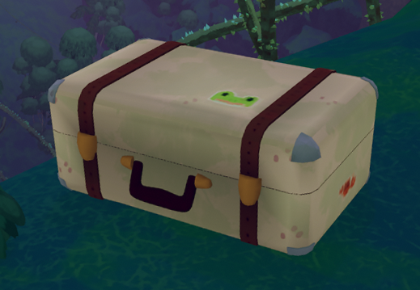](https://peak.wiki.gg/wiki/File%3ABig_Luggage.png)

**Big Luggage** is a less common luggage box, with an appearance similar to the Regular Luggage, but slightly taller and white in color. The Big Luggage contains 2 items and has a 1 in 3 chance to contain another. It has the same spawn pools as the Regular Luggage. One Big Luggage is guaranteed to spawn at the [Crash Site](Shore.md#Crash_Site).

[Co-op](#Co-op-1)[Solo](#Solo-1)

[Shore](#Shore-2)[Tropics](#Tropics-2)[Roots](#Roots-2)[Alpine](#Alpine-2)[Mesa](#Mesa-2)[Caldera/Kiln](#Caldera/Kiln-2)[Gloom/Citadel](#Gloom/Citadel-2)

Big Luggage Items - Shore

| Item | Chance per slot[[n 1]](#cite_note-cps-1) | Total chance[[n 2]](#cite_note-tot-nodupe-2) |
| --- | --- | --- |
| [Bandages](Bandages.md) | 10% | 22.5% |
| [Sports Drink](Sports%20Drink.md) | 10% | 22.5% |
| [Trail Mix](Trail%20Mix.md) | 10% | 22.5% |
| [Energy Drink](Energy%20Drink.md) | 7% | 16.2% |
| [Granola Bar](Granola%20Bar.md) | 7% | 16.2% |
| [Rope Spool](Rope%20Spool.md) | 7% | 16.2% |
| [Balloon](Balloon.md) | 4% | 9.5% |
| [First Aid Kit](First%20Aid%20Kit.md) | 4% | 9.5% |
| [Fortified Milk](Fortified%20Milk.md) | 4% | 9.5% |
| [Piton](Piton.md) | 4% | 9.5% |
| [Airline Food](Airline%20Food.md) | 3% | 7.2% |
| [Big Lollipop](Big%20Lollipop.md) | 3% | 7.2% |
| [Chain Launcher](Chain%20Launcher.md) | 3% | 7.2% |
| [Fanny Pack](Fanny%20Pack.md) | 3% | 7.2% |
| [Flare](Flare.md) | 3% | 7.2% |
| [Rescue Claw](Rescue%20Claw.md) | 3% | 7.2% |
| [Rope Cannon](Rope%20Cannon.md) | 3% | 7.2% |
| [Scout Cookies](Scout%20Cookies.md) | 3% | 7.2% |
| [Balloon Bunch](Balloon%20Bunch.md) | 1.2% | 2.9% |
| [Blowgun](Blowgun.md) | 1.2% | 2.9% |
| [Checkpoint Flag](Checkpoint%20Flag.md) | 1.2% | 2.9% |
| [Glider](Glider.md) | 1.2% | 2.9% |
| [Jetpack](Jetpack.md) | 1.2% | 2.9% |
| [Rocketpack](Rocketpack.md) | 1.2% | 2.9% |
| [Scout Cannon](Scout%20Cannon.md) | 1.2% | 2.9% |
| [Pirate's Compass](Pirate%27s%20Compass.md) | 0.6% | 1.5% |

Big Luggage Items - Tropics

| Item | Chance per slot[[n 1]](#cite_note-cps-1) | Total chance[[n 2]](#cite_note-tot-nodupe-2) |
| --- | --- | --- |
| [Bandages](Bandages.md) | 8.8% | 19.9% |
| [Sports Drink](Sports%20Drink.md) | 8.8% | 19.9% |
| [Trail Mix](Trail%20Mix.md) | 8.8% | 19.9% |
| [Antidote](Antidote.md) | 6.1% | 14.2% |
| [Energy Drink](Energy%20Drink.md) | 6.1% | 14.2% |
| [Granola Bar](Granola%20Bar.md) | 6.1% | 14.2% |
| [Rope Spool](Rope%20Spool.md) | 6.1% | 14.2% |
| [Balloon](Balloon.md) | 3.5% | 8.3% |
| [First Aid Kit](First%20Aid%20Kit.md) | 3.5% | 8.3% |
| [Fortified Milk](Fortified%20Milk.md) | 3.5% | 8.3% |
| [Lantern](Lantern.md) | 3.5% | 8.3% |
| [Piton](Piton.md) | 3.5% | 8.3% |
| [Airline Food](Airline%20Food.md) | 2.6% | 6.3% |
| [Big Lollipop](Big%20Lollipop.md) | 2.6% | 6.3% |
| [Chain Launcher](Chain%20Launcher.md) | 2.6% | 6.3% |
| [Fanny Pack](Fanny%20Pack.md) | 2.6% | 6.3% |
| [Flare](Flare.md) | 2.6% | 6.3% |
| [Portable Stove](Portable%20Stove.md) | 2.6% | 6.3% |
| [Rescue Claw](Rescue%20Claw.md) | 2.6% | 6.3% |
| [Rope Cannon](Rope%20Cannon.md) | 2.6% | 6.3% |
| [Scout Cookies](Scout%20Cookies.md) | 2.6% | 6.3% |
| [Balloon Bunch](Balloon%20Bunch.md) | 1.1% | 2.5% |
| [Blowgun](Blowgun.md) | 1.1% | 2.5% |
| [Checkpoint Flag](Checkpoint%20Flag.md) | 1.1% | 2.5% |
| [Glider](Glider.md) | 1.1% | 2.5% |
| [Jetpack](Jetpack.md) | 1.1% | 2.5% |
| [Rocketpack](Rocketpack.md) | 1.1% | 2.5% |
| [Scout Cannon](Scout%20Cannon.md) | 1.1% | 2.5% |
| [Pirate's Compass](Pirate%27s%20Compass.md) | 0.5% | 1.3% |

Big Luggage Items - Roots

| Item | Chance per slot[[n 1]](#cite_note-cps-1) | Total chance[[n 2]](#cite_note-tot-nodupe-2) |
| --- | --- | --- |
| [Bandages](Bandages.md) | 8.8% | 20% |
| [Sports Drink](Sports%20Drink.md) | 8.8% | 20% |
| [Trail Mix](Trail%20Mix.md) | 8.8% | 20% |
| [Antidote](Antidote.md) | 6.2% | 14.3% |
| [Energy Drink](Energy%20Drink.md) | 6.2% | 14.3% |
| [Granola Bar](Granola%20Bar.md) | 6.2% | 14.3% |
| [Rope Spool](Rope%20Spool.md) | 6.2% | 14.3% |
| [Balloon](Balloon.md) | 3.5% | 8.4% |
| [First Aid Kit](First%20Aid%20Kit.md) | 3.5% | 8.4% |
| [Fortified Milk](Fortified%20Milk.md) | 3.5% | 8.4% |
| [Piton](Piton.md) | 3.5% | 8.4% |
| [Airline Food](Airline%20Food.md) | 2.7% | 6.3% |
| [Big Lollipop](Big%20Lollipop.md) | 2.7% | 6.3% |
| [Chain Launcher](Chain%20Launcher.md) | 2.7% | 6.3% |
| [Fanny Pack](Fanny%20Pack.md) | 2.7% | 6.3% |
| [Flare](Flare.md) | 2.7% | 6.3% |
| [Parasol](Parasol.md) | 2.7% | 6.3% |
| [Portable Stove](Portable%20Stove.md) | 2.7% | 6.3% |
| [Rescue Claw](Rescue%20Claw.md) | 2.7% | 6.3% |
| [Rope Cannon](Rope%20Cannon.md) | 2.7% | 6.3% |
| [Scout Cookies](Scout%20Cookies.md) | 2.7% | 6.3% |
| [Balloon Bunch](Balloon%20Bunch.md) | 1.1% | 2.6% |
| [Blowgun](Blowgun.md) | 1.1% | 2.6% |
| [Checkpoint Flag](Checkpoint%20Flag.md) | 1.1% | 2.6% |
| [Glider](Glider.md) | 1.1% | 2.6% |
| [Jetpack](Jetpack.md) | 1.1% | 2.6% |
| [Rocketpack](Rocketpack.md) | 1.1% | 2.6% |
| [Scout Cannon](Scout%20Cannon.md) | 1.1% | 2.6% |
| [Pirate's Compass](Pirate%27s%20Compass.md) | 0.5% | 1.3% |

Big Luggage Items - Alpine

| Item | Chance per slot[[n 1]](#cite_note-cps-1) | Total chance[[n 2]](#cite_note-tot-nodupe-2) |
| --- | --- | --- |
| [Heat Pack](Heat%20Pack.md) | 15.7% | 33.7% |
| [Bandages](Bandages.md) | 7.9% | 18.2% |
| [Sports Drink](Sports%20Drink.md) | 7.9% | 18.2% |
| [Trail Mix](Trail%20Mix.md) | 7.9% | 18.2% |
| [Energy Drink](Energy%20Drink.md) | 5.5% | 13% |
| [Granola Bar](Granola%20Bar.md) | 5.5% | 13% |
| [Rope Spool](Rope%20Spool.md) | 5.5% | 13% |
| [Balloon](Balloon.md) | 3.1% | 7.5% |
| [First Aid Kit](First%20Aid%20Kit.md) | 3.1% | 7.5% |
| [Fortified Milk](Fortified%20Milk.md) | 3.1% | 7.5% |
| [Lantern](Lantern.md) | 3.1% | 7.5% |
| [Piton](Piton.md) | 3.1% | 7.5% |
| [Airline Food](Airline%20Food.md) | 2.4% | 5.7% |
| [Big Lollipop](Big%20Lollipop.md) | 2.4% | 5.7% |
| [Chain Launcher](Chain%20Launcher.md) | 2.4% | 5.7% |
| [Fanny Pack](Fanny%20Pack.md) | 2.4% | 5.7% |
| [Flare](Flare.md) | 2.4% | 5.7% |
| [Portable Stove](Portable%20Stove.md) | 2.4% | 5.7% |
| [Rescue Claw](Rescue%20Claw.md) | 2.4% | 5.7% |
| [Rope Cannon](Rope%20Cannon.md) | 2.4% | 5.7% |
| [Scout Cookies](Scout%20Cookies.md) | 2.4% | 5.7% |
| [Balloon Bunch](Balloon%20Bunch.md) | 0.9% | 2.3% |
| [Blowgun](Blowgun.md) | 0.9% | 2.3% |
| [Checkpoint Flag](Checkpoint%20Flag.md) | 0.9% | 2.3% |
| [Glider](Glider.md) | 0.9% | 2.3% |
| [Jetpack](Jetpack.md) | 0.9% | 2.3% |
| [Rocketpack](Rocketpack.md) | 0.9% | 2.3% |
| [Scout Cannon](Scout%20Cannon.md) | 0.9% | 2.3% |
| [Pirate's Compass](Pirate%27s%20Compass.md) | 0.5% | 1.2% |

Big Luggage Items - Mesa

| Item | Chance per slot[[n 1]](#cite_note-cps-1) | Total chance[[n 2]](#cite_note-tot-nodupe-2) |
| --- | --- | --- |
| [Bandages](Bandages.md) | 8.9% | 20.1% |
| [Sports Drink](Sports%20Drink.md) | 8.9% | 20.1% |
| [Trail Mix](Trail%20Mix.md) | 8.9% | 20.1% |
| [Energy Drink](Energy%20Drink.md) | 6.2% | 14.4% |
| [Granola Bar](Granola%20Bar.md) | 6.2% | 14.4% |
| [Rope Spool](Rope%20Spool.md) | 6.2% | 14.4% |
| [Balloon](Balloon.md) | 3.6% | 8.4% |
| [First Aid Kit](First%20Aid%20Kit.md) | 3.6% | 8.4% |
| [Fortified Milk](Fortified%20Milk.md) | 3.6% | 8.4% |
| [Parasol](Parasol.md) | 3.6% | 8.4% |
| [Piton](Piton.md) | 3.6% | 8.4% |
| [Sunscreen](Sunscreen.md) | 3.6% | 8.4% |
| [Airline Food](Airline%20Food.md) | 2.7% | 6.4% |
| [Chain Launcher](Chain%20Launcher.md) | 2.7% | 6.4% |
| [Dynamite](Dynamite.md) | 2.7% | 6.4% |
| [Fanny Pack](Fanny%20Pack.md) | 2.7% | 6.4% |
| [Flare](Flare.md) | 2.7% | 6.4% |
| [Portable Stove](Portable%20Stove.md) | 2.7% | 6.4% |
| [Rescue Claw](Rescue%20Claw.md) | 2.7% | 6.4% |
| [Rope Cannon](Rope%20Cannon.md) | 2.7% | 6.4% |
| [Scout Cookies](Scout%20Cookies.md) | 2.7% | 6.4% |
| [Balloon Bunch](Balloon%20Bunch.md) | 1.1% | 2.6% |
| [Big Lollipop](Big%20Lollipop.md) | 1.1% | 2.6% |
| [Blowgun](Blowgun.md) | 1.1% | 2.6% |
| [Checkpoint Flag](Checkpoint%20Flag.md) | 1.1% | 2.6% |
| [Glider](Glider.md) | 1.1% | 2.6% |
| [Jetpack](Jetpack.md) | 1.1% | 2.6% |
| [Rocketpack](Rocketpack.md) | 1.1% | 2.6% |
| [Scout Cannon](Scout%20Cannon.md) | 1.1% | 2.6% |
| [Pirate's Compass](Pirate%27s%20Compass.md) | 0.5% | 1.3% |

Big Luggage Items - Caldera/Kiln

| Item | Chance per slot[[n 1]](#cite_note-cps-1) | Total chance[[n 2]](#cite_note-tot-nodupe-2) |
| --- | --- | --- |
| [Bandages](Bandages.md) | 10% | 22.5% |
| [Sports Drink](Sports%20Drink.md) | 10% | 22.5% |
| [Trail Mix](Trail%20Mix.md) | 10% | 22.5% |
| [Energy Drink](Energy%20Drink.md) | 7% | 16.2% |
| [Granola Bar](Granola%20Bar.md) | 7% | 16.2% |
| [Rope Spool](Rope%20Spool.md) | 7% | 16.2% |
| [Balloon](Balloon.md) | 4% | 9.5% |
| [First Aid Kit](First%20Aid%20Kit.md) | 4% | 9.5% |
| [Fortified Milk](Fortified%20Milk.md) | 4% | 9.5% |
| [Piton](Piton.md) | 4% | 9.5% |
| [Airline Food](Airline%20Food.md) | 3% | 7.2% |
| [Big Lollipop](Big%20Lollipop.md) | 3% | 7.2% |
| [Chain Launcher](Chain%20Launcher.md) | 3% | 7.2% |
| [Fanny Pack](Fanny%20Pack.md) | 3% | 7.2% |
| [Flare](Flare.md) | 3% | 7.2% |
| [Rescue Claw](Rescue%20Claw.md) | 3% | 7.2% |
| [Rope Cannon](Rope%20Cannon.md) | 3% | 7.2% |
| [Scout Cookies](Scout%20Cookies.md) | 3% | 7.2% |
| [Balloon Bunch](Balloon%20Bunch.md) | 1.2% | 2.9% |
| [Blowgun](Blowgun.md) | 1.2% | 2.9% |
| [Checkpoint Flag](Checkpoint%20Flag.md) | 1.2% | 2.9% |
| [Glider](Glider.md) | 1.2% | 2.9% |
| [Jetpack](Jetpack.md) | 1.2% | 2.9% |
| [Rocketpack](Rocketpack.md) | 1.2% | 2.9% |
| [Scout Cannon](Scout%20Cannon.md) | 1.2% | 2.9% |
| [Pirate's Compass](Pirate%27s%20Compass.md) | 0.6% | 1.5% |

Big Luggage Items - Gloom/Citadel

| Item | Chance per slot[[n 1]](#cite_note-cps-1) | Total chance[[n 2]](#cite_note-tot-nodupe-2) |
| --- | --- | --- |
| [Bandages](Bandages.md) | 9.1% | 20.7% |
| [Candlestick](Candlestick.md) | 9.1% | 20.7% |
| [Sports Drink](Sports%20Drink.md) | 9.1% | 20.7% |
| [Trail Mix](Trail%20Mix.md) | 9.1% | 20.7% |
| [Energy Drink](Energy%20Drink.md) | 6.4% | 14.9% |
| [Granola Bar](Granola%20Bar.md) | 6.4% | 14.9% |
| [Rope Spool](Rope%20Spool.md) | 6.4% | 14.9% |
| [Balloon](Balloon.md) | 3.7% | 8.7% |
| [First Aid Kit](First%20Aid%20Kit.md) | 3.7% | 8.7% |
| [Fortified Milk](Fortified%20Milk.md) | 3.7% | 8.7% |
| [Piton](Piton.md) | 3.7% | 8.7% |
| [Airline Food](Airline%20Food.md) | 2.7% | 6.6% |
| [Big Lollipop](Big%20Lollipop.md) | 2.7% | 6.6% |
| [Chain Launcher](Chain%20Launcher.md) | 2.7% | 6.6% |
| [Fanny Pack](Fanny%20Pack.md) | 2.7% | 6.6% |
| [Flare](Flare.md) | 2.7% | 6.6% |
| [Rescue Claw](Rescue%20Claw.md) | 2.7% | 6.6% |
| [Rope Cannon](Rope%20Cannon.md) | 2.7% | 6.6% |
| [Scout Cookies](Scout%20Cookies.md) | 2.7% | 6.6% |
| [Balloon Bunch](Balloon%20Bunch.md) | 1.1% | 2.7% |
| [Blowgun](Blowgun.md) | 1.1% | 2.7% |
| [Checkpoint Flag](Checkpoint%20Flag.md) | 1.1% | 2.7% |
| [Glider](Glider.md) | 1.1% | 2.7% |
| [Jetpack](Jetpack.md) | 1.1% | 2.7% |
| [Rocketpack](Rocketpack.md) | 1.1% | 2.7% |
| [Scout Cannon](Scout%20Cannon.md) | 1.1% | 2.7% |

[Shore](#Shore-3)[Tropics](#Tropics-3)[Roots](#Roots-3)[Alpine](#Alpine-3)[Mesa](#Mesa-3)[Caldera/Kiln](#Caldera/Kiln-3)[Gloom/Citadel](#Gloom/Citadel-3)

Big Luggage Items - Shore

| Item | Chance per slot[[n 1]](#cite_note-cps-1) | Total chance[[n 2]](#cite_note-tot-nodupe-2) |
| --- | --- | --- |
| [Bandages](Bandages.md) | 10.4% | 23.5% |
| [Sports Drink](Sports%20Drink.md) | 10.4% | 23.5% |
| [Trail Mix](Trail%20Mix.md) | 10.4% | 23.5% |
| [Energy Drink](Energy%20Drink.md) | 7.3% | 16.9% |
| [Granola Bar](Granola%20Bar.md) | 7.3% | 16.9% |
| [Rope Spool](Rope%20Spool.md) | 7.3% | 16.9% |
| [Balloon](Balloon.md) | 4.2% | 9.9% |
| [First Aid Kit](First%20Aid%20Kit.md) | 4.2% | 9.9% |
| [Fortified Milk](Fortified%20Milk.md) | 4.2% | 9.9% |
| [Piton](Piton.md) | 4.2% | 9.9% |
| [Airline Food](Airline%20Food.md) | 3.1% | 7.5% |
| [Big Lollipop](Big%20Lollipop.md) | 3.1% | 7.5% |
| [Chain Launcher](Chain%20Launcher.md) | 3.1% | 7.5% |
| [Flare](Flare.md) | 3.1% | 7.5% |
| [Rescue Claw](Rescue%20Claw.md) | 3.1% | 7.5% |
| [Rope Cannon](Rope%20Cannon.md) | 3.1% | 7.5% |
| [Scout Cookies](Scout%20Cookies.md) | 3.1% | 7.5% |
| [Balloon Bunch](Balloon%20Bunch.md) | 1.3% | 3% |
| [Checkpoint Flag](Checkpoint%20Flag.md) | 1.3% | 3% |
| [Glider](Glider.md) | 1.3% | 3% |
| [Jetpack](Jetpack.md) | 1.3% | 3% |
| [Rocketpack](Rocketpack.md) | 1.3% | 3% |
| [Scout Cannon](Scout%20Cannon.md) | 1.3% | 3% |
| [Pirate's Compass](Pirate%27s%20Compass.md) | 0.6% | 1.5% |

Big Luggage Items - Tropics

| Item | Chance per slot[[n 1]](#cite_note-cps-1) | Total chance[[n 2]](#cite_note-tot-nodupe-2) |
| --- | --- | --- |
| [Bandages](Bandages.md) | 9.1% | 20.6% |
| [Sports Drink](Sports%20Drink.md) | 9.1% | 20.6% |
| [Trail Mix](Trail%20Mix.md) | 9.1% | 20.6% |
| [Antidote](Antidote.md) | 6.4% | 14.8% |
| [Energy Drink](Energy%20Drink.md) | 6.4% | 14.8% |
| [Granola Bar](Granola%20Bar.md) | 6.4% | 14.8% |
| [Rope Spool](Rope%20Spool.md) | 6.4% | 14.8% |
| [Balloon](Balloon.md) | 3.6% | 8.6% |
| [First Aid Kit](First%20Aid%20Kit.md) | 3.6% | 8.6% |
| [Fortified Milk](Fortified%20Milk.md) | 3.6% | 8.6% |
| [Lantern](Lantern.md) | 3.6% | 8.6% |
| [Piton](Piton.md) | 3.6% | 8.6% |
| [Airline Food](Airline%20Food.md) | 2.7% | 6.5% |
| [Big Lollipop](Big%20Lollipop.md) | 2.7% | 6.5% |
| [Chain Launcher](Chain%20Launcher.md) | 2.7% | 6.5% |
| [Flare](Flare.md) | 2.7% | 6.5% |
| [Portable Stove](Portable%20Stove.md) | 2.7% | 6.5% |
| [Rescue Claw](Rescue%20Claw.md) | 2.7% | 6.5% |
| [Rope Cannon](Rope%20Cannon.md) | 2.7% | 6.5% |
| [Scout Cookies](Scout%20Cookies.md) | 2.7% | 6.5% |
| [Balloon Bunch](Balloon%20Bunch.md) | 1.1% | 2.6% |
| [Checkpoint Flag](Checkpoint%20Flag.md) | 1.1% | 2.6% |
| [Glider](Glider.md) | 1.1% | 2.6% |
| [Jetpack](Jetpack.md) | 1.1% | 2.6% |
| [Rocketpack](Rocketpack.md) | 1.1% | 2.6% |
| [Scout Cannon](Scout%20Cannon.md) | 1.1% | 2.6% |
| [Pirate's Compass](Pirate%27s%20Compass.md) | 0.5% | 1.3% |

Big Luggage Items - Roots

| Item | Chance per slot[[n 1]](#cite_note-cps-1) | Total chance[[n 2]](#cite_note-tot-nodupe-2) |
| --- | --- | --- |
| [Bandages](Bandages.md) | 9.2% | 20.8% |
| [Sports Drink](Sports%20Drink.md) | 9.2% | 20.8% |
| [Trail Mix](Trail%20Mix.md) | 9.2% | 20.8% |
| [Antidote](Antidote.md) | 6.4% | 14.9% |
| [Energy Drink](Energy%20Drink.md) | 6.4% | 14.9% |
| [Granola Bar](Granola%20Bar.md) | 6.4% | 14.9% |
| [Rope Spool](Rope%20Spool.md) | 6.4% | 14.9% |
| [Balloon](Balloon.md) | 3.7% | 8.7% |
| [First Aid Kit](First%20Aid%20Kit.md) | 3.7% | 8.7% |
| [Fortified Milk](Fortified%20Milk.md) | 3.7% | 8.7% |
| [Piton](Piton.md) | 3.7% | 8.7% |
| [Airline Food](Airline%20Food.md) | 2.8% | 6.6% |
| [Big Lollipop](Big%20Lollipop.md) | 2.8% | 6.6% |
| [Chain Launcher](Chain%20Launcher.md) | 2.8% | 6.6% |
| [Flare](Flare.md) | 2.8% | 6.6% |
| [Parasol](Parasol.md) | 2.8% | 6.6% |
| [Portable Stove](Portable%20Stove.md) | 2.8% | 6.6% |
| [Rescue Claw](Rescue%20Claw.md) | 2.8% | 6.6% |
| [Rope Cannon](Rope%20Cannon.md) | 2.8% | 6.6% |
| [Scout Cookies](Scout%20Cookies.md) | 2.8% | 6.6% |
| [Balloon Bunch](Balloon%20Bunch.md) | 1.1% | 2.7% |
| [Checkpoint Flag](Checkpoint%20Flag.md) | 1.1% | 2.7% |
| [Glider](Glider.md) | 1.1% | 2.7% |
| [Jetpack](Jetpack.md) | 1.1% | 2.7% |
| [Rocketpack](Rocketpack.md) | 1.1% | 2.7% |
| [Scout Cannon](Scout%20Cannon.md) | 1.1% | 2.7% |
| [Pirate's Compass](Pirate%27s%20Compass.md) | 0.6% | 1.3% |

Big Luggage Items - Alpine

| Item | Chance per slot[[n 1]](#cite_note-cps-1) | Total chance[[n 2]](#cite_note-tot-nodupe-2) |
| --- | --- | --- |
| [Heat Pack](Heat%20Pack.md) | 16.3% | 34.8% |
| [Bandages](Bandages.md) | 8.1% | 18.8% |
| [Sports Drink](Sports%20Drink.md) | 8.1% | 18.8% |
| [Trail Mix](Trail%20Mix.md) | 8.1% | 18.8% |
| [Energy Drink](Energy%20Drink.md) | 5.7% | 13.4% |
| [Granola Bar](Granola%20Bar.md) | 5.7% | 13.4% |
| [Rope Spool](Rope%20Spool.md) | 5.7% | 13.4% |
| [Balloon](Balloon.md) | 3.3% | 7.8% |
| [First Aid Kit](First%20Aid%20Kit.md) | 3.3% | 7.8% |
| [Fortified Milk](Fortified%20Milk.md) | 3.3% | 7.8% |
| [Lantern](Lantern.md) | 3.3% | 7.8% |
| [Piton](Piton.md) | 3.3% | 7.8% |
| [Airline Food](Airline%20Food.md) | 2.4% | 5.9% |
| [Big Lollipop](Big%20Lollipop.md) | 2.4% | 5.9% |
| [Chain Launcher](Chain%20Launcher.md) | 2.4% | 5.9% |
| [Flare](Flare.md) | 2.4% | 5.9% |
| [Portable Stove](Portable%20Stove.md) | 2.4% | 5.9% |
| [Rescue Claw](Rescue%20Claw.md) | 2.4% | 5.9% |
| [Rope Cannon](Rope%20Cannon.md) | 2.4% | 5.9% |
| [Scout Cookies](Scout%20Cookies.md) | 2.4% | 5.9% |
| [Balloon Bunch](Balloon%20Bunch.md) | 1% | 2.4% |
| [Checkpoint Flag](Checkpoint%20Flag.md) | 1% | 2.4% |
| [Glider](Glider.md) | 1% | 2.4% |
| [Jetpack](Jetpack.md) | 1% | 2.4% |
| [Rocketpack](Rocketpack.md) | 1% | 2.4% |
| [Scout Cannon](Scout%20Cannon.md) | 1% | 2.4% |
| [Pirate's Compass](Pirate%27s%20Compass.md) | 0.5% | 1.2% |

Big Luggage Items - Mesa

| Item | Chance per slot[[n 1]](#cite_note-cps-1) | Total chance[[n 2]](#cite_note-tot-nodupe-2) |
| --- | --- | --- |
| [Bandages](Bandages.md) | 9.3% | 20.9% |
| [Sports Drink](Sports%20Drink.md) | 9.3% | 20.9% |
| [Trail Mix](Trail%20Mix.md) | 9.3% | 20.9% |
| [Energy Drink](Energy%20Drink.md) | 6.5% | 15% |
| [Granola Bar](Granola%20Bar.md) | 6.5% | 15% |
| [Rope Spool](Rope%20Spool.md) | 6.5% | 15% |
| [Balloon](Balloon.md) | 3.7% | 8.8% |
| [First Aid Kit](First%20Aid%20Kit.md) | 3.7% | 8.8% |
| [Fortified Milk](Fortified%20Milk.md) | 3.7% | 8.8% |
| [Parasol](Parasol.md) | 3.7% | 8.8% |
| [Piton](Piton.md) | 3.7% | 8.8% |
| [Sunscreen](Sunscreen.md) | 3.7% | 8.8% |
| [Airline Food](Airline%20Food.md) | 2.8% | 6.6% |
| [Chain Launcher](Chain%20Launcher.md) | 2.8% | 6.6% |
| [Dynamite](Dynamite.md) | 2.8% | 6.6% |
| [Flare](Flare.md) | 2.8% | 6.6% |
| [Portable Stove](Portable%20Stove.md) | 2.8% | 6.6% |
| [Rescue Claw](Rescue%20Claw.md) | 2.8% | 6.6% |
| [Rope Cannon](Rope%20Cannon.md) | 2.8% | 6.6% |
| [Scout Cookies](Scout%20Cookies.md) | 2.8% | 6.6% |
| [Balloon Bunch](Balloon%20Bunch.md) | 1.1% | 2.7% |
| [Big Lollipop](Big%20Lollipop.md) | 1.1% | 2.7% |
| [Checkpoint Flag](Checkpoint%20Flag.md) | 1.1% | 2.7% |
| [Glider](Glider.md) | 1.1% | 2.7% |
| [Jetpack](Jetpack.md) | 1.1% | 2.7% |
| [Rocketpack](Rocketpack.md) | 1.1% | 2.7% |
| [Scout Cannon](Scout%20Cannon.md) | 1.1% | 2.7% |
| [Pirate's Compass](Pirate%27s%20Compass.md) | 0.6% | 1.3% |

Big Luggage Items - Caldera/Kiln

| Item | Chance per slot[[n 1]](#cite_note-cps-1) | Total chance[[n 2]](#cite_note-tot-nodupe-2) |
| --- | --- | --- |
| [Bandages](Bandages.md) | 10.4% | 23.5% |
| [Sports Drink](Sports%20Drink.md) | 10.4% | 23.5% |
| [Trail Mix](Trail%20Mix.md) | 10.4% | 23.5% |
| [Energy Drink](Energy%20Drink.md) | 7.3% | 16.9% |
| [Granola Bar](Granola%20Bar.md) | 7.3% | 16.9% |
| [Rope Spool](Rope%20Spool.md) | 7.3% | 16.9% |
| [Balloon](Balloon.md) | 4.2% | 9.9% |
| [First Aid Kit](First%20Aid%20Kit.md) | 4.2% | 9.9% |
| [Fortified Milk](Fortified%20Milk.md) | 4.2% | 9.9% |
| [Piton](Piton.md) | 4.2% | 9.9% |
| [Airline Food](Airline%20Food.md) | 3.1% | 7.5% |
| [Big Lollipop](Big%20Lollipop.md) | 3.1% | 7.5% |
| [Chain Launcher](Chain%20Launcher.md) | 3.1% | 7.5% |
| [Flare](Flare.md) | 3.1% | 7.5% |
| [Rescue Claw](Rescue%20Claw.md) | 3.1% | 7.5% |
| [Rope Cannon](Rope%20Cannon.md) | 3.1% | 7.5% |
| [Scout Cookies](Scout%20Cookies.md) | 3.1% | 7.5% |
| [Balloon Bunch](Balloon%20Bunch.md) | 1.3% | 3% |
| [Checkpoint Flag](Checkpoint%20Flag.md) | 1.3% | 3% |
| [Glider](Glider.md) | 1.3% | 3% |
| [Jetpack](Jetpack.md) | 1.3% | 3% |
| [Rocketpack](Rocketpack.md) | 1.3% | 3% |
| [Scout Cannon](Scout%20Cannon.md) | 1.3% | 3% |
| [Pirate's Compass](Pirate%27s%20Compass.md) | 0.6% | 1.5% |

Big Luggage Items - Gloom/Citadel

| Item | Chance per slot[[n 1]](#cite_note-cps-1) | Total chance[[n 2]](#cite_note-tot-nodupe-2) |
| --- | --- | --- |
| [Bandages](Bandages.md) | 9.5% | 21.6% |
| [Candlestick](Candlestick.md) | 9.5% | 21.6% |
| [Sports Drink](Sports%20Drink.md) | 9.5% | 21.6% |
| [Trail Mix](Trail%20Mix.md) | 9.5% | 21.6% |
| [Energy Drink](Energy%20Drink.md) | 6.7% | 15.5% |
| [Granola Bar](Granola%20Bar.md) | 6.7% | 15.5% |
| [Rope Spool](Rope%20Spool.md) | 6.7% | 15.5% |
| [Balloon](Balloon.md) | 3.8% | 9% |
| [First Aid Kit](First%20Aid%20Kit.md) | 3.8% | 9% |
| [Fortified Milk](Fortified%20Milk.md) | 3.8% | 9% |
| [Piton](Piton.md) | 3.8% | 9% |
| [Airline Food](Airline%20Food.md) | 2.9% | 6.8% |
| [Big Lollipop](Big%20Lollipop.md) | 2.9% | 6.8% |
| [Chain Launcher](Chain%20Launcher.md) | 2.9% | 6.8% |
| [Flare](Flare.md) | 2.9% | 6.8% |
| [Rescue Claw](Rescue%20Claw.md) | 2.9% | 6.8% |
| [Rope Cannon](Rope%20Cannon.md) | 2.9% | 6.8% |
| [Scout Cookies](Scout%20Cookies.md) | 2.9% | 6.8% |
| [Balloon Bunch](Balloon%20Bunch.md) | 1.1% | 2.8% |
| [Checkpoint Flag](Checkpoint%20Flag.md) | 1.1% | 2.8% |
| [Glider](Glider.md) | 1.1% | 2.8% |
| [Jetpack](Jetpack.md) | 1.1% | 2.8% |
| [Rocketpack](Rocketpack.md) | 1.1% | 2.8% |
| [Scout Cannon](Scout%20Cannon.md) | 1.1% | 2.8% |

### Explorer's Luggage

---

[](https://peak.wiki.gg/wiki/File%3AExplorer%27s_Luggage.png)

**Explorer's Luggage** (also known as **Climber Luggage**) is an uncommon luggage box resembling a big orange briefcase. It holds exactly two items and has the highest chance of containing good climbing equipment.

[Co-op](#Co-op-2)[Solo](#Solo-2)

Explorer's Luggage Items - Co-op

| Item | Chance per slot[[n 1]](#cite_note-cps-1) | Total chance[[n 3]](#cite_note-tot-3) | Avg. count per box[[n 4]](#cite_note-apb-4) |
| --- | --- | --- | --- |
| [Energy Drink](Energy%20Drink.md) | 19.2% | 34.8% | 0.38 |
| [Rope Spool](Rope%20Spool.md) | 19.2% | 34.8% | 0.38 |
| [First Aid Kit](First%20Aid%20Kit.md) | 11% | 20.8% | 0.22 |
| [Piton](Piton.md) | 11% | 20.8% | 0.22 |
| [Chain Launcher](Chain%20Launcher.md) | 8.2% | 15.8% | 0.16 |
| [Fanny Pack](Fanny%20Pack.md) | 8.2% | 15.8% | 0.16 |
| [Rescue Claw](Rescue%20Claw.md) | 8.2% | 15.8% | 0.16 |
| [Rope Cannon](Rope%20Cannon.md) | 8.2% | 15.8% | 0.16 |
| [Glider](Glider.md) | 3.3% | 6.5% | 0.07 |
| [Jetpack](Jetpack.md) | 3.3% | 6.5% | 0.07 |

Explorer's Luggage Items - Solo

| Item | Chance per slot[[n 1]](#cite_note-cps-1) | Total chance[[n 3]](#cite_note-tot-3) | Avg. count per box[[n 4]](#cite_note-apb-4) |
| --- | --- | --- | --- |
| [Energy Drink](Energy%20Drink.md) | 21% | 37.5% | 0.42 |
| [Rope Spool](Rope%20Spool.md) | 21% | 37.5% | 0.42 |
| [First Aid Kit](First%20Aid%20Kit.md) | 12% | 22.5% | 0.24 |
| [Piton](Piton.md) | 12% | 22.5% | 0.24 |
| [Chain Launcher](Chain%20Launcher.md) | 9% | 17.2% | 0.18 |
| [Rescue Claw](Rescue%20Claw.md) | 9% | 17.2% | 0.18 |
| [Rope Cannon](Rope%20Cannon.md) | 9% | 17.2% | 0.18 |
| [Glider](Glider.md) | 3.6% | 7.1% | 0.07 |
| [Jetpack](Jetpack.md) | 3.6% | 7.1% | 0.07 |

### Ancient Luggage

---

[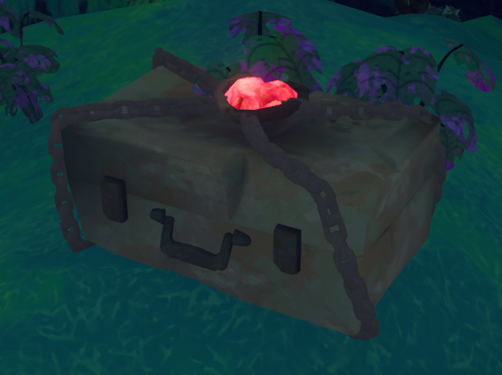](https://peak.wiki.gg/wiki/File%3AAncient_Luggage.png)

**Ancient Luggage** is a rare luggage box that contains a single [Mystical](https://peak.wiki.gg/wiki/Mystical) item. The box is dark colored, sealed with chains and a large heart-shaped gem in the middle. Opening an Ancient Luggage inflicts [](Stamina%20bar.md#Injury) **20** [Injury](Stamina%20bar.md#Injury).[[n 5]](#cite_note-5) Ancient Luggage's item spawn pool differs based on the number of players.

[Co-op](#Co-op-3)[Solo](#Solo-3)

Ancient Luggage Items - Co-op

| Item | Chance |
| --- | --- |
| [Anti-Rope Cannon](Anti-Rope%20Cannon.md) | 8.8% |
| [Anti-Rope Spool](Anti-Rope%20Spool.md) | 8.8% |
| [Anti-Zooka](Anti-Zooka.md) | 8.8% |
| [Book of Bones](https://peak.wiki.gg/wiki/Book_of_Bones) | 8.8% |
| [Bugle of Friendship](Bugle%20of%20Friendship.md) | 8.8% |
| [Cure-All](Cure-All.md) | 8.8% |
| [Cursed Skull](Cursed%20Skull.md) | 8.8% |
| [Faerie Lantern](Faerie%20Lantern.md) | 8.8% |
| [Pandora's Lunchbox](Pandora%27s%20Lunchbox.md) | 8.8% |
| [Ritual Dagger](Ritual%20Dagger.md) | 8.8% |
| [Scout Effigy](Scout%20Effigy.md) | 8.8% |
| [Scoutmaster's Bugle](Scoutmaster%27s%20Bugle.md) | 3.5% |

Ancient Luggage Items - Solo

| Item | Chance |
| --- | --- |
| [Anti-Rope Cannon](Anti-Rope%20Cannon.md) | 13.5% |
| [Anti-Rope Spool](Anti-Rope%20Spool.md) | 13.5% |
| [Anti-Zooka](Anti-Zooka.md) | 13.5% |
| [Book of Bones](https://peak.wiki.gg/wiki/Book_of_Bones) | 13.5% |
| [Cure-All](Cure-All.md) | 13.5% |
| [Faerie Lantern](Faerie%20Lantern.md) | 13.5% |
| [Pandora's Lunchbox](Pandora%27s%20Lunchbox.md) | 13.5% |
| [Scoutmaster's Bugle](Scoutmaster%27s%20Bugle.md) | 5.4% |

### Clown Luggage

---

[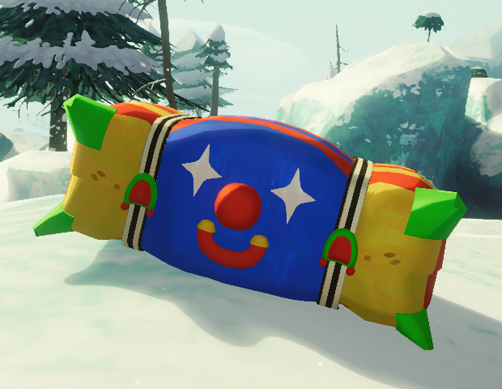](https://peak.wiki.gg/wiki/File%3AClown_Luggage.png)

**Clown Luggage** is a very big, rare luggage featuring a colorful design and decorations resembling a clown face. The box always holds 6 items. All items besides [](Balloon.md) [Balloons](Balloon.md) and [](Balloon%20Bunch.md) [Balloon Bunches](Balloon%20Bunch.md) will be ejected out of the luggage upon opening it.

The [](Yellow%20Berrynana%20Peel.md) [Yellow Berrynana Peels](Yellow%20Berrynana%20Peel.md), which are almost always among the contents, can be dangerous when combined with the potential to find lit [](Dynamite.md) [Dynamite](Dynamite.md) within.

Opening two Clown Luggages in a single run unlocks the [](https://peak.wiki.gg/wiki/Jester_Badge) [Jester Badge](https://peak.wiki.gg/wiki/Jester_Badge).

Clown Luggage Items

| Item | Chance per slot[[n 1]](#cite_note-cps-1) | Total chance[[n 3]](#cite_note-tot-3) | Avg. count per box[[n 4]](#cite_note-apb-4) |
| --- | --- | --- | --- |
| [Yellow Berrynana Peel](Yellow%20Berrynana%20Peel.md) | 31.6% | 89.8% | 1.9 |
| [Balloon](Balloon.md) | 12.7% | 55.6% | 0.76 |
| [Bugle](Bugle.md) | 12.7% | 55.6% | 0.76 |
| [Parasol](Parasol.md) | 12.7% | 55.6% | 0.76 |
| [Big Lollipop](Big%20Lollipop.md) | 9.5% | 45% | 0.57 |
| [Dynamite](Dynamite.md) | 9.5% | 45% | 0.57 |
| [Balloon Bunch](Balloon%20Bunch.md) | 3.8% | 20.7% | 0.23 |
| [Rocketpack](Rocketpack.md) | 3.8% | 20.7% | 0.23 |
| [Scout Cannon](Scout%20Cannon.md) | 3.8% | 20.7% | 0.23 |

### Luggage Trap

---

[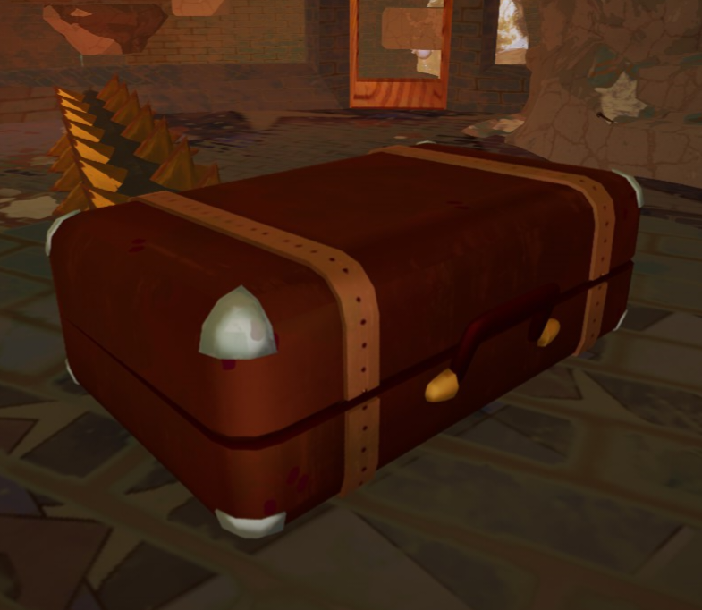](https://peak.wiki.gg/wiki/File%3AMimic_Luggage.png)
[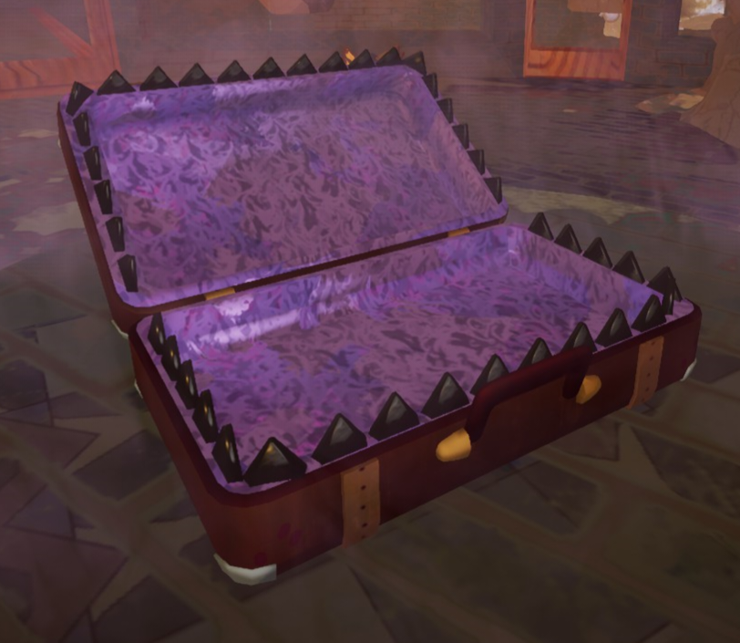](https://peak.wiki.gg/wiki/File%3AMimic_Luggage_Open.png)

The **Luggage Trap** is a rare luggage-shaped trap that spawns in [The Citadel](The%20Citadel.md). It contains no items and upon opening a burst of gas is released, inflicting [](Stamina%20bar.md#Drowsy) **5** [Drowsy](Stamina%20bar.md#Drowsy) every **0.5 seconds** to any scouts within **16 meters**.

The Luggage Trap has an initial appearance of a [Regular Luggage](https://peak.wiki.gg/wiki/Regular_Luggage), but with some subtle differences; the trap luggage is slightly open and its handle is pointed upwards, unlike the handles on other luggages. Inside it has teeth and purple lining, as opposed to the green lining of the Regular Luggage.

## Gallery

- [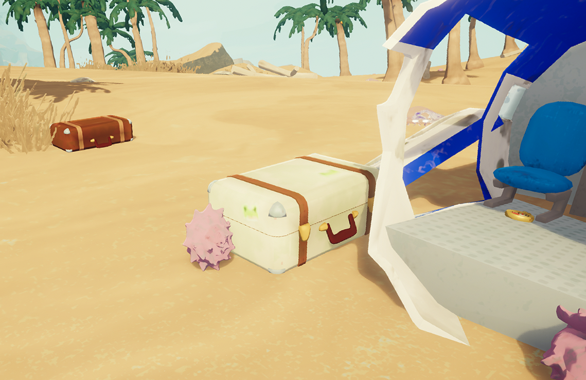](https://peak.wiki.gg/wiki/File%3ALuggage_crash_site.png)
  Regular and Big Luggage located at the [Crash Site](Shore.md#Crash_Site).
- [](https://peak.wiki.gg/wiki/File%3ATropics_Explorer%27s_Luggage_on_Spiky_Giant_Root.png)
  Explorer's Luggage on a [Thorny Giant Ivy](Tropics.md#Thorny_Giant_Ivy) in the [Tropics](Tropics.md).
- [](https://peak.wiki.gg/wiki/File%3AHoliday_luggage.jpg)
  Festively decorated luggage during the [2025 Holiday Season](1.50.a.md)

## Notes

- ↑ [1.00](#cite_ref-cps_1-0) [1.01](#cite_ref-cps_1-1) [1.02](#cite_ref-cps_1-2) [1.03](#cite_ref-cps_1-3) [1.04](#cite_ref-cps_1-4) [1.05](#cite_ref-cps_1-5) [1.06](#cite_ref-cps_1-6) [1.07](#cite_ref-cps_1-7) [1.08](#cite_ref-cps_1-8) [1.09](#cite_ref-cps_1-9) [1.10](#cite_ref-cps_1-10) [1.11](#cite_ref-cps_1-11) [1.12](#cite_ref-cps_1-12) [1.13](#cite_ref-cps_1-13) [1.14](#cite_ref-cps_1-14) [1.15](#cite_ref-cps_1-15) [1.16](#cite_ref-cps_1-16) [1.17](#cite_ref-cps_1-17) [1.18](#cite_ref-cps_1-18) [1.19](#cite_ref-cps_1-19) [1.20](#cite_ref-cps_1-20) [1.21](#cite_ref-cps_1-21) [1.22](#cite_ref-cps_1-22) [1.23](#cite_ref-cps_1-23) [1.24](#cite_ref-cps_1-24) [1.25](#cite_ref-cps_1-25) [1.26](#cite_ref-cps_1-26) [1.27](#cite_ref-cps_1-27) [1.28](#cite_ref-cps_1-28) [1.29](#cite_ref-cps_1-29) [1.30](#cite_ref-cps_1-30) Item spawn odds per luggage slot.
- ↑ [2.00](#cite_ref-tot-nodupe_2-0) [2.01](#cite_ref-tot-nodupe_2-1) [2.02](#cite_ref-tot-nodupe_2-2) [2.03](#cite_ref-tot-nodupe_2-3) [2.04](#cite_ref-tot-nodupe_2-4) [2.05](#cite_ref-tot-nodupe_2-5) [2.06](#cite_ref-tot-nodupe_2-6) [2.07](#cite_ref-tot-nodupe_2-7) [2.08](#cite_ref-tot-nodupe_2-8) [2.09](#cite_ref-tot-nodupe_2-9) [2.10](#cite_ref-tot-nodupe_2-10) [2.11](#cite_ref-tot-nodupe_2-11) [2.12](#cite_ref-tot-nodupe_2-12) [2.13](#cite_ref-tot-nodupe_2-13) [2.14](#cite_ref-tot-nodupe_2-14) [2.15](#cite_ref-tot-nodupe_2-15) [2.16](#cite_ref-tot-nodupe_2-16) [2.17](#cite_ref-tot-nodupe_2-17) [2.18](#cite_ref-tot-nodupe_2-18) [2.19](#cite_ref-tot-nodupe_2-19) [2.20](#cite_ref-tot-nodupe_2-20) [2.21](#cite_ref-tot-nodupe_2-21) [2.22](#cite_ref-tot-nodupe_2-22) [2.23](#cite_ref-tot-nodupe_2-23) [2.24](#cite_ref-tot-nodupe_2-24) [2.25](#cite_ref-tot-nodupe_2-25) [2.26](#cite_ref-tot-nodupe_2-26) [2.27](#cite_ref-tot-nodupe_2-27) Chance of the item appearing in the box, accounting for the number of slots the box can have and the changing pool of items (no duplicates in Regular and Big Luggage).
- ↑ [3.0](#cite_ref-tot_3-0) [3.1](#cite_ref-tot_3-1) [3.2](#cite_ref-tot_3-2) Chance of at least one copy of the item appearing in the box, accounting for the number of slots the box has.
- ↑ [4.0](#cite_ref-apb_4-0) [4.1](#cite_ref-apb_4-1) [4.2](#cite_ref-apb_4-2) Average number of copies found per box, accounting for the number of slots the box can have.
- [↑](#cite_ref-5) [](Stamina%20bar.md#Injury) [Injury](Stamina%20bar.md#Injury) inflicted by the Ancient Luggage is not affected by the multiplier from being a [Skeleton](The%20Book%20of%20Bones.md).

## Patch history

 **[1.0](1.0.md) (2025-06-16):** Introduced.
 **[1.1.a](1.1.a.md) (2025-06-17):** Brought in item rarities slightly so you'll see rarer items a bit more, and the most common ones will be less over-represented.
 **[1.20.a](1.20.a.md) (2025-08-11):**

- Adjusted luggage collision to prevent players from getting their legs stuck in it
- Fixed an issue where biome-specific loot could sometimes show up in luggage in the wrong biome.

 **[1.50.a](1.50.a.md) (2025-12-16):** The Ancient Luggage no longer one-shots you if you're a skeleton from the Book of Bones.
 **[2.0.a](2.0.a.md) (2026-08-11):**

- Introduced Clown Luggage.
- Ancient Luggage spawns slightly more commonly in all biomes
- Made Checkpoint Flag a bit rarer & removed it from Climber Luggage.

---

# Magic Bean

Magic Bean
[](https://peak.wiki.gg/wiki/File%3AMagic_Bean.png)
[Item type](Items.md)- [Deployable](https://peak.wiki.gg/wiki/Deployable)
Biome- [Shore](Shore.md)
- [Tropics](Tropics.md)
- [Roots](Roots.md)
- [Alpine](Alpine.md)
- [Mesa](Mesa.md)
Weight
[](Stamina%20bar.md#Weight) **2.5**

The **Magic Bean** is an [deployable](https://peak.wiki.gg/wiki/Deployable) item in *[PEAK](Peak%20%28game%29.md)*. It can be found growing on the environment in the [Shore](Shore.md), [Tropics](Tropics.md), [Roots](Roots.md), [Alpine](Alpine.md) or [Mesa](Mesa.md).

When dropped or thrown, and after a **3 seconds** wait, the bean will begin to grow a large beanstalk that can reach up to **12 meters** tall if unobstructed. Players climbing the beanstalk will move twice as quickly at no additional stamina cost. The bean can be picked up before it begins to grow.

## Patch history

 **[1.2.a](1.2.a.md) (2025-06-18):** Introduced.
 **[1.25.a](1.25.a.md) (2025-08-21):** You now climb the Magic Beanstalk twice as fast to make it more useful when placed vertically.

---

# Mandrake

Mandrake
[](https://peak.wiki.gg/wiki/File%3AMandrake.png)
[Item type](Items.md)- [Food](Food.md)
- [Natural food](https://peak.wiki.gg/wiki/Natural_food)
Biome- [Roots](Roots.md)
Weight
[](Stamina%20bar.md#Weight) **2.5**
Base Status Effects
[](Stamina%20bar.md#Hunger)Hunger
-10
[](Stamina%20bar.md#Numb)Numb
60 seconds
Cooked Bonuses
[](Stamina%20bar.md#Hunger)Hunger
-20 (-20 total)
[](Stamina%20bar.md#Bonus_stamina)Bonus Stamina
10 (10 total)

The **Mandrake** is a natural [food](Food.md) item in *[PEAK](Peak%20%28game%29.md)*. It has a 28.57% chance to spawn instead of a [](Medicinal%20Root.md) [Medicinal Root](Medicinal%20Root.md) in [Roots](Roots.md). Until uprooted, it looks identical to a Medicinal Root.

Once uprooted and near a conscious player, the Mandrake will scream loudly for **3 seconds**, followed by a cooldown of **0.75-2 seconds**. While it is screaming, players within **16 meters** gain [](Stamina%20bar.md#Drowsy) **5** [Drowsy](Stamina%20bar.md#Drowsy) every quarter second. [Cooking](Cooking.md) the Mandrake will stop the screaming. The Mandrake cannot be stored in a player's inventory slots, but it can be stored in a backpack.

Eating (or being fed) a [cooked](https://peak.wiki.gg/wiki/Cooked) Mandrake grants the player the [](https://peak.wiki.gg/wiki/Cryptogastronomy_Badge) [Cryptogastronomy Badge](https://peak.wiki.gg/wiki/Cryptogastronomy_Badge) and removes [](Stamina%20bar.md#Curse) **25** [Curse](Stamina%20bar.md#Curse). Cooking the Mandrake stops it from screaming.

Eating (or being fed) a raw Mandrake applies the [numb](https://peak.wiki.gg/wiki/Numb) effect to the player for **60 seconds**.

[](https://peak.wiki.gg/wiki/File%3AStamina_Bar_Numb.jpg)

Stamina bar hidden by the [Numb](Stamina%20bar.md#Numb) effect.

## Tips

- If the [](https://peak.wiki.gg/wiki/Cryptogastronomy_Badge) [Cryptogastronomy Badge](https://peak.wiki.gg/wiki/Cryptogastronomy_Badge) has been completed then players should quickly throw the Mandrake away, as the scream it produces builds up [](Stamina%20bar.md#Drowsy) [Drowsy](Stamina%20bar.md#Drowsy) quickly.- If the goal is to complete the [](https://peak.wiki.gg/wiki/Cryptogastronomy_Badge) [Cryptogastronomy Badge](https://peak.wiki.gg/wiki/Cryptogastronomy_Badge), then having a [](Portable%20Stove.md) [Portable Stove](Portable%20Stove.md) is almost a necessity, as players cannot store the Mandrake outside of a [backpack](Backpack.md), and even then it continues to scream.
- After using [](The%20Book%20of%20Bones.md) [The Book of Bones](The%20Book%20of%20Bones.md), you are immune to the [](Stamina%20bar.md#Drowsy) [Drowsy](Stamina%20bar.md#Drowsy) the Mandrake normally provides, allowing you to safely carry it. However, be careful around other players!

## Trivia

- If the player's sound effects volume is set to 0, they won't be affected by the Mandrake's scream drowsiness effect.

## Gallery

- [](https://peak.wiki.gg/wiki/File%3AMandrake_hold.jpg)
  A screaming Mandrake held by a player.

## Patch history

 **[1.40.a](1.40.a.md) (2025-11-05):** Introduced.
 **[1.47.a](1.47.a.md) (2025-12-01):** Fixed an issue where unpocketable items (Mandrakes, [Scorpions](Scorpion.md), etc) could be pocketed while climbing under certain circumstances.

[Food](Food.md)
Natural food
Berries
Berrynanas- [](Yellow%20Berrynana.md) [Yellow Berrynana](Yellow%20Berrynana.md)
- [](Pink%20Berrynana.md) [Pink Berrynana](Pink%20Berrynana.md)
- [](Blue%20Berrynana.md) [Blue Berrynana](Blue%20Berrynana.md)
- [](Brown%20Berrynana.md) [Brown Berrynana](Brown%20Berrynana.md)
Clusterberries- [](Red%20Clusterberry.md) [Red Clusterberry](Red%20Clusterberry.md)
- [](Yellow%20Clusterberry.md) [Yellow Clusterberry](Yellow%20Clusterberry.md)
- [](Black%20Clusterberry.md) [Black Clusterberry](Black%20Clusterberry.md)
Crispberries- [](Green%20Crispberry.md) [Green Crispberry](Green%20Crispberry.md)
- [](Yellow%20Crispberry.md) [Yellow Crispberry](Yellow%20Crispberry.md)
- [](Red%20Crispberry.md) [Red Crispberry](Red%20Crispberry.md)
Kingberries- [](Green%20Kingberry.md) [Green Kingberry](Green%20Kingberry.md)
- [](Yellow%20Kingberry.md) [Yellow Kingberry](Yellow%20Kingberry.md)
- [](Purple%20Kingberry.md) [Purple Kingberry](Purple%20Kingberry.md)
Prickleberries- [](Red%20Prickleberry.md) [Red Prickleberry](Red%20Prickleberry.md)
- [](Gold%20Prickleberry.md) [Gold Prickleberry](Gold%20Prickleberry.md)
Shroomberries- [](Red%20Shroomberry.md) [Red Shroomberry](Red%20Shroomberry.md)
- [](Yellow%20Shroomberry.md) [Yellow Shroomberry](Yellow%20Shroomberry.md)
- [](Green%20Shroomberry.md) [Green Shroomberry](Green%20Shroomberry.md)
- [](Blue%20Shroomberry.md) [Blue Shroomberry](Blue%20Shroomberry.md)
- [](Purple%20Shroomberry.md) [Purple Shroomberry](Purple%20Shroomberry.md)
Winterberries- [](Orange%20Winterberry.md) [Orange Winterberry](Orange%20Winterberry.md)
- [](Yellow%20Winterberry.md) [Yellow Winterberry](Yellow%20Winterberry.md)
Other- [](Napberry.md) [Napberry](Napberry.md)
- [](Scorchberry.md) [Scorchberry](Scorchberry.md)
Campfire food- [](Marshmallow.md) [Marshmallow](Marshmallow.md)
- [](Hot%20Dog.md) [Hot Dog](Hot%20Dog.md)
Mushrooms- [](Bugle%20Shroom.md) [Bugle Shroom](Bugle%20Shroom.md)
- [](Button%20Shroom.md) [Button Shroom](Button%20Shroom.md)
- [](Chubby%20Shroom.md) [Chubby Shroom](Chubby%20Shroom.md)
- [](Cluster%20Shroom.md) [Cluster Shroom](Cluster%20Shroom.md)
Mystical food- [](Cure-All.md) [Cure-All](Cure-All.md)
- [](Pandora%27s%20Lunchbox.md) [Pandora's Lunchbox](Pandora%27s%20Lunchbox.md)
Other- [](Cooked%20Bird.md) [Cooked Bird](Cooked%20Bird.md)
- [](Egg.md) [Egg](Egg.md)
- [](Frog%20Legs.md) [Frog Legs](Frog%20Legs.md)
- [](Honeycomb.md) [Honeycomb](Honeycomb.md)
- [](Half-Coconut.md) [Half-Coconut](Half-Coconut.md)
- [](Medicinal%20Root.md) [Medicinal Root](Medicinal%20Root.md)
- [](Mandrake.md) Mandrake
- [](Scorpion.md) [Scorpion](Scorpion.md)
- [](Tick.md) [Tick](Tick.md)
- [](The%20Early%20Worm.md) [The Early Worm](The%20Early%20Worm.md)
Packaged food
All packaged foods- [](Airline%20Food.md) [Airline Food](Airline%20Food.md)
- [](Big%20Lollipop.md) [Big Lollipop](Big%20Lollipop.md)
- [](Energy%20Drink.md) [Energy Drink](Energy%20Drink.md)
- [](Fortified%20Milk.md) [Fortified Milk](Fortified%20Milk.md)
- [](Granola%20Bar.md) [Granola Bar](Granola%20Bar.md)
- [](Scout%20Cookies.md) [Scout Cookies](Scout%20Cookies.md)
- [](Sports%20Drink.md) [Sports Drink](Sports%20Drink.md)
- [](Trail%20Mix.md) [Trail Mix](Trail%20Mix.md)

---

# Marshmallow

Marshmallow
[](https://peak.wiki.gg/wiki/File%3AMarshmallow.png)
[Item type](Items.md)- [Food](Food.md)
- [Natural food](https://peak.wiki.gg/wiki/Natural_food)
Rarity
[Uncommon](https://peak.wiki.gg/wiki/Uncommon)
Source- [Campfires](https://peak.wiki.gg/wiki/Campfires)
Weight
[](Stamina%20bar.md#Weight) **2.5**
Base Status Effects
[](Stamina%20bar.md#Hunger)Hunger
-15
Cooked Bonuses
[](Stamina%20bar.md#Hunger)Hunger
-15 (-30 total)
[](Stamina%20bar.md#Bonus_stamina)Bonus Stamina
10 (10 total)

The **Marshmallow** is a natural [food](Food.md) in *[PEAK](Peak%20%28game%29.md)* found near the [campfires](Campfire.md).

At each campfire, either a Marshmallow (62.5% chance) or a [](Hot%20Dog.md) [Hot Dog](Hot%20Dog.md) (37.5% chance) spawns for each player in the expedition.

## Trivia

- As part of a collaboration with *[Fortnite](https://en.wikipedia.org/wiki/Fortnite)*, the Marshmallow is used as a Pickaxe cosmetic called "Scout's Marshmallow" with an item description of "Time to cook!". The pickaxe is available for purchased on its own for 800 V-Bucks or with the PEAK Bundle for 2,500 V-Bucks.

## Patch history

 **[1.0](1.0.md) (2025-06-16):** Introduced.
 **[1.40.a](1.40.a.md) (2025-11-05):** Now reduces [](Stamina%20bar.md#Hunger) [Hunger](Stamina%20bar.md#Hunger) by 15 (previously 20).

[Food](Food.md)
Natural food
Berries
Berrynanas- [](Yellow%20Berrynana.md) [Yellow Berrynana](Yellow%20Berrynana.md)
- [](Pink%20Berrynana.md) [Pink Berrynana](Pink%20Berrynana.md)
- [](Blue%20Berrynana.md) [Blue Berrynana](Blue%20Berrynana.md)
- [](Brown%20Berrynana.md) [Brown Berrynana](Brown%20Berrynana.md)
Clusterberries- [](Red%20Clusterberry.md) [Red Clusterberry](Red%20Clusterberry.md)
- [](Yellow%20Clusterberry.md) [Yellow Clusterberry](Yellow%20Clusterberry.md)
- [](Black%20Clusterberry.md) [Black Clusterberry](Black%20Clusterberry.md)
Crispberries- [](Green%20Crispberry.md) [Green Crispberry](Green%20Crispberry.md)
- [](Yellow%20Crispberry.md) [Yellow Crispberry](Yellow%20Crispberry.md)
- [](Red%20Crispberry.md) [Red Crispberry](Red%20Crispberry.md)
Kingberries- [](Green%20Kingberry.md) [Green Kingberry](Green%20Kingberry.md)
- [](Yellow%20Kingberry.md) [Yellow Kingberry](Yellow%20Kingberry.md)
- [](Purple%20Kingberry.md) [Purple Kingberry](Purple%20Kingberry.md)
Prickleberries- [](Red%20Prickleberry.md) [Red Prickleberry](Red%20Prickleberry.md)
- [](Gold%20Prickleberry.md) [Gold Prickleberry](Gold%20Prickleberry.md)
Shroomberries- [](Red%20Shroomberry.md) [Red Shroomberry](Red%20Shroomberry.md)
- [](Yellow%20Shroomberry.md) [Yellow Shroomberry](Yellow%20Shroomberry.md)
- [](Green%20Shroomberry.md) [Green Shroomberry](Green%20Shroomberry.md)
- [](Blue%20Shroomberry.md) [Blue Shroomberry](Blue%20Shroomberry.md)
- [](Purple%20Shroomberry.md) [Purple Shroomberry](Purple%20Shroomberry.md)
Winterberries- [](Orange%20Winterberry.md) [Orange Winterberry](Orange%20Winterberry.md)
- [](Yellow%20Winterberry.md) [Yellow Winterberry](Yellow%20Winterberry.md)
Other- [](Napberry.md) [Napberry](Napberry.md)
- [](Scorchberry.md) [Scorchberry](Scorchberry.md)
Campfire food- [](Marshmallow.md) Marshmallow
- [](Hot%20Dog.md) [Hot Dog](Hot%20Dog.md)
Mushrooms- [](Bugle%20Shroom.md) [Bugle Shroom](Bugle%20Shroom.md)
- [](Button%20Shroom.md) [Button Shroom](Button%20Shroom.md)
- [](Chubby%20Shroom.md) [Chubby Shroom](Chubby%20Shroom.md)
- [](Cluster%20Shroom.md) [Cluster Shroom](Cluster%20Shroom.md)
Mystical food- [](Cure-All.md) [Cure-All](Cure-All.md)
- [](Pandora%27s%20Lunchbox.md) [Pandora's Lunchbox](Pandora%27s%20Lunchbox.md)
Other- [](Cooked%20Bird.md) [Cooked Bird](Cooked%20Bird.md)
- [](Egg.md) [Egg](Egg.md)
- [](Frog%20Legs.md) [Frog Legs](Frog%20Legs.md)
- [](Honeycomb.md) [Honeycomb](Honeycomb.md)
- [](Half-Coconut.md) [Half-Coconut](Half-Coconut.md)
- [](Medicinal%20Root.md) [Medicinal Root](Medicinal%20Root.md)
- [](Mandrake.md) [Mandrake](Mandrake.md)
- [](Scorpion.md) [Scorpion](Scorpion.md)
- [](Tick.md) [Tick](Tick.md)
- [](The%20Early%20Worm.md) [The Early Worm](The%20Early%20Worm.md)
Packaged food
All packaged foods- [](Airline%20Food.md) [Airline Food](Airline%20Food.md)
- [](Big%20Lollipop.md) [Big Lollipop](Big%20Lollipop.md)
- [](Energy%20Drink.md) [Energy Drink](Energy%20Drink.md)
- [](Fortified%20Milk.md) [Fortified Milk](Fortified%20Milk.md)
- [](Granola%20Bar.md) [Granola Bar](Granola%20Bar.md)
- [](Scout%20Cookies.md) [Scout Cookies](Scout%20Cookies.md)
- [](Sports%20Drink.md) [Sports Drink](Sports%20Drink.md)
- [](Trail%20Mix.md) [Trail Mix](Trail%20Mix.md)

---

# Medicinal Root

Medicinal Root
[](https://peak.wiki.gg/wiki/File%3AMedicinal_Root.png)
[Item type](Items.md)- [Food](Food.md)
- [Natural food](https://peak.wiki.gg/wiki/Natural_food)
Biome- [Shore](Shore.md)
- [Tropics](Tropics.md)
- [Roots](Roots.md)
- [Mesa](Mesa.md)
Weight
[](Stamina%20bar.md#Weight) **2.5**
Base Status Effects
[](Stamina%20bar.md#Hunger)Hunger
-5
[](Stamina%20bar.md#Poison)Poison
-25
[](Stamina%20bar.md#Injury)Injury
-10
[](Stamina%20bar.md#Spores)Spores
-25
Cooked Bonuses
[](Stamina%20bar.md#Hunger)Hunger
-5 (-10 total)
[](Stamina%20bar.md#Bonus_stamina)Bonus Stamina
10 (10 total)

The **Medicinal Root** is a natural [food](Food.md) in *[PEAK](Peak%20%28game%29.md)* found growing out of the ground in the [Shore](Shore.md), [Tropics](Tropics.md), [Roots](Roots.md), and [Mesa](Mesa.md).

[Cooking](Cooking.md) a Medicinal Root causes it to remove an extra [](Stamina%20bar.md#Poison) **20** [Poison](Stamina%20bar.md#Poison) and [](Stamina%20bar.md#Spores) **20** [Spores](Stamina%20bar.md#Spores), in addition to the normal effects.

## Notes

- In the [Roots](Roots.md) biome there is a 50% chance that a Medicinal Root will be replaced by a [Mandrake](Mandrake.md) when uprooted.

## Gallery

- [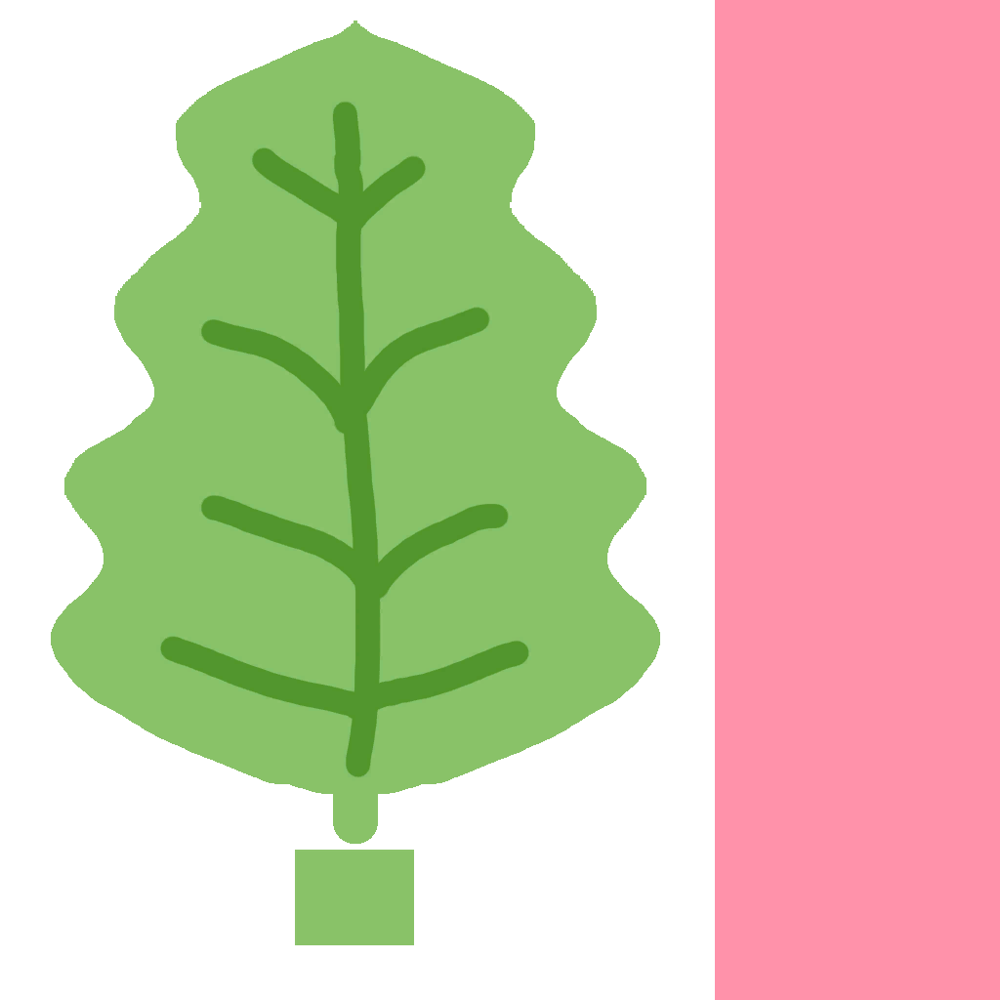](https://peak.wiki.gg/wiki/File%3AMedicinalroot_0.png)
  Medicinal Root texture

## Patch history

 **[1.0](1.0.md) (2025-06-16):** Introduced.
 **[1.10.a](1.10.a.md) (2025-07-30):** Fixed an issue where [Trail Mix](Trail%20Mix.md), [Granola Bar](Granola%20Bar.md), Medicinal Root, and [Airline Food](Airline%20Food.md) would not give extra hunger reduction after cooked.
 **[1.40.a](1.40.a.md) (2025-11-05):** Cooked medicinal root heals additional poison.

[Food](Food.md)
Natural food
Berries
Berrynanas- [](Yellow%20Berrynana.md) [Yellow Berrynana](Yellow%20Berrynana.md)
- [](Pink%20Berrynana.md) [Pink Berrynana](Pink%20Berrynana.md)
- [](Blue%20Berrynana.md) [Blue Berrynana](Blue%20Berrynana.md)
- [](Brown%20Berrynana.md) [Brown Berrynana](Brown%20Berrynana.md)
Clusterberries- [](Red%20Clusterberry.md) [Red Clusterberry](Red%20Clusterberry.md)
- [](Yellow%20Clusterberry.md) [Yellow Clusterberry](Yellow%20Clusterberry.md)
- [](Black%20Clusterberry.md) [Black Clusterberry](Black%20Clusterberry.md)
Crispberries- [](Green%20Crispberry.md) [Green Crispberry](Green%20Crispberry.md)
- [](Yellow%20Crispberry.md) [Yellow Crispberry](Yellow%20Crispberry.md)
- [](Red%20Crispberry.md) [Red Crispberry](Red%20Crispberry.md)
Kingberries- [](Green%20Kingberry.md) [Green Kingberry](Green%20Kingberry.md)
- [](Yellow%20Kingberry.md) [Yellow Kingberry](Yellow%20Kingberry.md)
- [](Purple%20Kingberry.md) [Purple Kingberry](Purple%20Kingberry.md)
Prickleberries- [](Red%20Prickleberry.md) [Red Prickleberry](Red%20Prickleberry.md)
- [](Gold%20Prickleberry.md) [Gold Prickleberry](Gold%20Prickleberry.md)
Shroomberries- [](Red%20Shroomberry.md) [Red Shroomberry](Red%20Shroomberry.md)
- [](Yellow%20Shroomberry.md) [Yellow Shroomberry](Yellow%20Shroomberry.md)
- [](Green%20Shroomberry.md) [Green Shroomberry](Green%20Shroomberry.md)
- [](Blue%20Shroomberry.md) [Blue Shroomberry](Blue%20Shroomberry.md)
- [](Purple%20Shroomberry.md) [Purple Shroomberry](Purple%20Shroomberry.md)
Winterberries- [](Orange%20Winterberry.md) [Orange Winterberry](Orange%20Winterberry.md)
- [](Yellow%20Winterberry.md) [Yellow Winterberry](Yellow%20Winterberry.md)
Other- [](Napberry.md) [Napberry](Napberry.md)
- [](Scorchberry.md) [Scorchberry](Scorchberry.md)
Campfire food- [](Marshmallow.md) [Marshmallow](Marshmallow.md)
- [](Hot%20Dog.md) [Hot Dog](Hot%20Dog.md)
Mushrooms- [](Bugle%20Shroom.md) [Bugle Shroom](Bugle%20Shroom.md)
- [](Button%20Shroom.md) [Button Shroom](Button%20Shroom.md)
- [](Chubby%20Shroom.md) [Chubby Shroom](Chubby%20Shroom.md)
- [](Cluster%20Shroom.md) [Cluster Shroom](Cluster%20Shroom.md)
Mystical food- [](Cure-All.md) [Cure-All](Cure-All.md)
- [](Pandora%27s%20Lunchbox.md) [Pandora's Lunchbox](Pandora%27s%20Lunchbox.md)
Other- [](Cooked%20Bird.md) [Cooked Bird](Cooked%20Bird.md)
- [](Egg.md) [Egg](Egg.md)
- [](Frog%20Legs.md) [Frog Legs](Frog%20Legs.md)
- [](Honeycomb.md) [Honeycomb](Honeycomb.md)
- [](Half-Coconut.md) [Half-Coconut](Half-Coconut.md)
- [](Medicinal%20Root.md) Medicinal Root
- [](Mandrake.md) [Mandrake](Mandrake.md)
- [](Scorpion.md) [Scorpion](Scorpion.md)
- [](Tick.md) [Tick](Tick.md)
- [](The%20Early%20Worm.md) [The Early Worm](The%20Early%20Worm.md)
Packaged food
All packaged foods- [](Airline%20Food.md) [Airline Food](Airline%20Food.md)
- [](Big%20Lollipop.md) [Big Lollipop](Big%20Lollipop.md)
- [](Energy%20Drink.md) [Energy Drink](Energy%20Drink.md)
- [](Fortified%20Milk.md) [Fortified Milk](Fortified%20Milk.md)
- [](Granola%20Bar.md) [Granola Bar](Granola%20Bar.md)
- [](Scout%20Cookies.md) [Scout Cookies](Scout%20Cookies.md)
- [](Sports%20Drink.md) [Sports Drink](Sports%20Drink.md)
- [](Trail%20Mix.md) [Trail Mix](Trail%20Mix.md)

---

# Mesa

Mesa
[](https://peak.wiki.gg/wiki/File%3AMesa_Location.png)
Details
Type
[Biome](https://peak.wiki.gg/wiki/Biome)
Region
**3**/6

The **Mesa** is one of the two possible third [biomes](https://peak.wiki.gg/wiki/Biome) in *[PEAK](Peak%20%28game%29.md)*, replacing the [Alpine](Alpine.md) every two days. It follows the [Tropics](Tropics.md) or the [Roots](Roots.md) and precedes the [Caldera](Caldera.md) or the [Gloom](Gloom.md). It is a dry, hot desert separated by a large canyon.

The main hazard of the Mesa is its unique blistering [sun](https://peak.wiki.gg/wiki/Sun) which forces players to stay in the shade.

Reaching the top and lighting the [campfire](Campfire.md) dispels the fog to the next biome and grants all living [Scouts](https://peak.wiki.gg/wiki/Scouts) the [](https://peak.wiki.gg/wiki/Nomad_Badge) [Nomad Badge](https://peak.wiki.gg/wiki/Nomad_Badge) if they have not already obtained it.

## Areas & Features

### Plateau

---

[](https://peak.wiki.gg/wiki/File%3AMesa_3.jpg)

The **Plateau** is the first area of the Mesa, preceding the [Canyon](#Canyon). Lots of [Big Cacti](#Cacti) can be found here, along with various rock formations, some of which occasionally form arches.

The Plateau houses some of the Mesa's exclusive [hazards](#Hazards), such as [tornadoes](Tornado.md) and [antlion traps](Antlion.md). [Tumbleweeds](Tumbleweed.md) can also be seen rolling around the Plateau, knocking unaware [Scouts](https://peak.wiki.gg/wiki/Scouts) over.

The Plateau is largely open to the Mesa's [sun](https://peak.wiki.gg/wiki/Sun), so players have to plan their route carefully and use the rock formations to stay in the shade.

#### Oasis

[](https://peak.wiki.gg/wiki/File%3AMesa_oasis_2.jpg)

An **Oasis** can be found on the Plateau. It is comprised of a small pool of cold water surrounded by palm trees with [](Coconut.md) [coconuts](Coconut.md). The pool houses two [capybaras](Capybara.md), one of which is guaranteed to hold a [](Yellow%20Winterberry.md) [Yellow Winterberry](Yellow%20Winterberry.md) on its head while the other wears a cowboy hat. Standing in the pool removes any accumulated [](Stamina%20bar.md#Heat) [Heat](Stamina%20bar.md#Heat) over a short period of time.

The Oasis is the Mesa's equivalent to the [Hot Spring](Alpine.md#Hot_Spring) in the [Alpine](Alpine.md).

#### Tomb entrance

Main article: [Tomb](Tomb.md)
[](https://peak.wiki.gg/wiki/File%3ATomb_hole.jpg)

An entrance to the [Tomb](Tomb.md) can be found on the Plateau. Whether or not the entrance is open is dependent on the current map rotation, though the exit may be randomly blocked by map generation. Refer to [this guide](https://steamcommunity.com/sharedfiles/filedetails/?id=3553972295) for more details.

### Canyon

---

[](https://peak.wiki.gg/wiki/File%3AMesa_canyon_1.jpg)

The **Canyon** is the second area of the Mesa which separates the Plateau and the [Caves](#Caves). Players need to climb down and then back up again to pass the Canyon. Alternatively, they may use a [](Scout%20Cannon.md) [Scout Cannon](Scout%20Cannon.md) to fly past the area, which grants the [](https://peak.wiki.gg/wiki/Daredevil_Badge) [Daredevil Badge](https://peak.wiki.gg/wiki/Daredevil_Badge).

The deeper parts of the Canyon are hidden from the [sun](https://peak.wiki.gg/wiki/Sun), although players should be careful around the surface, as the sun can still reach them there. The [](Warp%20Fungus.md) [Warp Fungus](Warp%20Fungus.md) can be used to teleport across the **Canyon.**

### Caves

- [](https://peak.wiki.gg/wiki/File%3AMesa_wall.png)
  The vertical portion of Mesa containing the Caves
- [](https://peak.wiki.gg/wiki/File%3AMesa_caves_1.jpg)
  The Caves up-close

The **Caves** are the final area of the Mesa. Players will have to climb all the way up to reach the [campfire](Campfire.md). The inner caves are well-hidden from the [sun](https://peak.wiki.gg/wiki/Sun), even though occasionally players may have to climb the outer parts of the Caves which are exposed to the sun.

#### Mine Shafts

[](https://peak.wiki.gg/wiki/File%3AMineshaft_2.jpg)

Maze-like **Mine Shafts** can occasionally be found in the caves. They usually hold at least 1 [regular luggage](Luggage.md#Regular_Luggage) crate, but will more often than not also contain several pieces of [](Dynamite.md) [Dynamite](Dynamite.md), which can often catch players off guard.

#### Pickaxes

[](https://peak.wiki.gg/wiki/File%3APickaxe.png)

Old **[Pickaxes](Piton.md#Pickaxes)** can spawn naturally in the cliffs of the Caves. They perform identically to [Rusty Pitons](Piton.md), breaking after **6 seconds** of being held on to.

### Mirages

- [](https://peak.wiki.gg/wiki/File%3AMirage_luggage.jpg)
  A mirage of [Big Luggage](https://peak.wiki.gg/wiki/Big_Luggage)
- [](https://peak.wiki.gg/wiki/File%3AMirage_oasis.jpg)
  A mirage of an [Oasis](#Oasis)
- [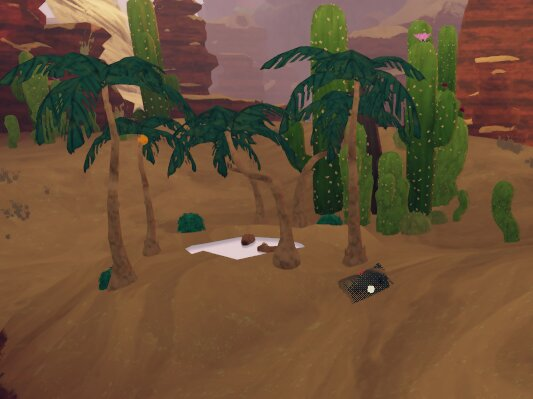](https://peak.wiki.gg/wiki/File%3AMirage_Ancient.jpg)
  A mirage of [Ancient Luggage](https://peak.wiki.gg/wiki/Ancient_Luggage) near a non-mirage [Oasis](https://peak.wiki.gg/wiki/Oasis)

**Mirages** happen exclusively in the Mesa. Players may see mirages of [Luggage](Luggage.md) or even entire [oases](#Oasis). They appear like normal objects from far away, but will begin to fade out as the player approaches them.

## Hazards

| Hazard | Image | Description |
| --- | --- | --- |
| **Blazing Sun** | [Mesa sun.jpg](https://peak.wiki.gg/wiki/File%3AMesa_sun.jpg) | The **Sun** in the Mesa is blisteringly hot. It will inflict [Heat](Stamina%20bar.md#Heat) **2.5** [Heat](Stamina%20bar.md#Heat) every **0.5 seconds** on all players in direct sunlight during the day. Players staying in the shade, using the  [Parasol](Parasol.md),  [Glider](Glider.md), or wearing  [Sunscreen](Sunscreen.md) are not affected by the sun. Using  [Aloe Vera](Aloe%20Vera.md) can also help mitigate any gained heat. Looking directly into the sun with binoculars awards the [Astronomy Badge](https://peak.wiki.gg/wiki/Astronomy_Badge) [Astronomy Badge](https://peak.wiki.gg/wiki/Astronomy_Badge). |
| **Cacti** | [Big cacti.png](https://peak.wiki.gg/wiki/File%3ABig_cacti.png) | Various **[Big Cacti](Big%20Cacti.md)** and small **[Cactus](Cactus.md)** balls can both be found in the Mesa. Coming into contact with a cactus inflicts [Thorns](Stamina%20bar.md#Thorns) [Thorns](Stamina%20bar.md#Thorns) and makes the player temporarily stick to the cactus. Scouts can use **Helping Hand** to free another scout from the cactus. |
| **[Tumbleweeds](Tumbleweed.md)** | [Tumbleweed.png](https://peak.wiki.gg/wiki/File%3ATumbleweed.png) | **[Tumbleweeds](Tumbleweed.md)** are ball-like dry plants rolling around the Mesa. They seek out unaware players and knock them over, inflicting [Thorns](Stamina%20bar.md#Thorns) [Thorns](Stamina%20bar.md#Thorns) in the process and occasionally even sending them flying. |
| **[Tornadoes](Tornado.md)** | [Mesa tornado.png](https://peak.wiki.gg/wiki/File%3AMesa_tornado.png) | **[Tornadoes](Tornado.md)** can spawn on the Mesa's Plateau. They will move unpredictably around the Plateau, picking up caught players and sending them flying. |
| **[Antlion](Antlion.md)** | [Antlion trap.png](https://peak.wiki.gg/wiki/File%3AAntlion_trap.png) | **[Antlions](Antlion.md)** lure the players in with fake [Explorer's Luggage](https://peak.wiki.gg/wiki/Explorer%27s_Luggage) in their traps and inflict serious amounts of [Injury](Stamina%20bar.md#Injury) [Injury](Stamina%20bar.md#Injury) on caught players. |
| **[Scorpions](Scorpion.md)** | [Scorpion closeup.png](https://peak.wiki.gg/wiki/File%3AScorpion_closeup.png) | **[Scorpions](Scorpion.md)** are a natural enemy found in the Caves of the Mesa. They sting careless players, dealing a significant amount of [Poison](Stamina%20bar.md#Poison) [Poison](Stamina%20bar.md#Poison). They can also be cooked and eaten. |
| **[Dynamite](Dynamite.md)** | [Dynamite closeup.png](https://peak.wiki.gg/wiki/File%3ADynamite_closeup.png) | **[Dynamite](Dynamite.md)** is scattered all throughout the Caves, embedded into the ground and walls. It lights up when a player is nearby and explodes shortly after, [Injury](Stamina%20bar.md#Injury) [injuring](Stamina%20bar.md#Injury) close players and knocking them back. |

## Food

The following food items can be found in the Mesa, excluding packaged food from Luggage.

- [](Coconut.md) [Coconut](Coconut.md) (removes [](Stamina%20bar.md#Heat) [Heat](Stamina%20bar.md#Heat))
- [](Yellow%20Winterberry.md) [Yellow Winterberry](Yellow%20Winterberry.md) (heals [](Stamina%20bar.md#Injury) [Injury](Stamina%20bar.md#Injury))
- [](Red%20Prickleberry.md) [Red Prickleberry](Red%20Prickleberry.md) ([](Stamina%20bar.md#Thorns) [Thorns](Stamina%20bar.md#Thorns))
- [](Gold%20Prickleberry.md) [Gold Prickleberry](Gold%20Prickleberry.md) ([](Stamina%20bar.md#Thorns) [Thorns](Stamina%20bar.md#Thorns), heals [](Stamina%20bar.md#Injury) [Injury](Stamina%20bar.md#Injury))
- [](Button%20Shroom.md) [Button Shroom](Button%20Shroom.md)
- [](https://peak.wiki.gg/wiki/Button_Shroom_%28Poisonous%29) [Button Shroom (Poisonous)](https://peak.wiki.gg/wiki/Button_Shroom_%28Poisonous%29)
- [](Bugle%20Shroom.md) [Bugle Shroom](Bugle%20Shroom.md)
- [](https://peak.wiki.gg/wiki/Bugle_Shroom_%28Poisonous%29) [Bugle Shroom (Poisonous)](https://peak.wiki.gg/wiki/Bugle_Shroom_%28Poisonous%29)
- [](Cluster%20Shroom.md) [Cluster Shroom](Cluster%20Shroom.md)
- [](https://peak.wiki.gg/wiki/Cluster_Shroom_%28Poisonous%29) [Cluster Shroom (Poisonous)](https://peak.wiki.gg/wiki/Cluster_Shroom_%28Poisonous%29)
- [](Chubby%20Shroom.md) [Chubby Shroom](Chubby%20Shroom.md)
- [](Scorpion.md) [Scorpion](Scorpion.md) (requires [cooking](Cooking.md) using fire or [](Dynamite.md) [Dynamite](Dynamite.md))
- [](Medicinal%20Root.md) [Medicinal Root](Medicinal%20Root.md)

## Natural Items

The following natural items can appear in the Mesa.

- [](Aloe%20Vera.md) [Aloe Vera](Aloe%20Vera.md)
- [](Dynamite.md) [Dynamite](Dynamite.md)
- [](Shelf%20Fungus.md) [Shelf Fungus](Shelf%20Fungus.md)
- [](Remedy%20Fungus.md) [Remedy Fungus](Remedy%20Fungus.md)
- [](Warp%20Fungus.md) [Warp Fungus](Warp%20Fungus.md)
- [](Magic%20Bean.md) [Magic Bean](Magic%20Bean.md)

## Variants

While the game is generating the Mesa, it randomly selects a variant to apply. Each variant has its own chance of appearing:

Mesa Variants

| Variant | Weight | Image | Description |
| --- | --- | --- | --- |
| No Variant | 10 |  | Does nothing. |
| Cactus Forest | 5 | [Mesa Cactus Forest.jpg](https://peak.wiki.gg/wiki/File%3AMesa_Cactus_Forest.jpg) | Significantly more [Cacti](#Cacti) spawn on the plateau than usual. |
| Cactus Hell | 5 | [Mesa Cactus Hell.jpg](https://peak.wiki.gg/wiki/File%3AMesa_Cactus_Hell.jpg) | Significantly more [Cacti](#Cacti) spawn on the climb than usual. |
| Dynamite Hell | 5 | [Mesa Dynamite Hell.jpg](https://peak.wiki.gg/wiki/File%3AMesa_Dynamite_Hell.jpg) | Significantly more  [Dynamite](Dynamite.md) spawns on the ground. |
| Scorpions Hell | 5 | [Mesa Scorpions Hell.jpg](https://peak.wiki.gg/wiki/File%3AMesa_Scorpions_Hell.jpg) | Significantly more  [Scorpions](Scorpion.md) spawn. |
| Tumbler Hell | 3 | [Mesa Tumbler Hell.jpg](https://peak.wiki.gg/wiki/File%3AMesa_Tumbler_Hell.jpg) | Tumblers are 2.5x as common as normal. |

Removed Mesa Variants

| Variant | Weight | Image | Description |
| --- | --- | --- | --- |
| Tornado Hell | 2 | [Mesa Tornado Hell.jpg](https://peak.wiki.gg/wiki/File%3AMesa_Tornado_Hell.jpg) | Tornadoes spawned much more frequently. Removed in [1.64.a](1.64.a.md). |

## Tips & Tricks

- Mirages can be determined by using the ping system. If the ping hand lands on the [Luggage](Luggage.md) or [Oasis](#Oasis) tree normally, then it is real, but if it hits the ground behind it instead, it's a mirage. This method can be used to avoid going after fake luggage and wasting time.
- If possible, wait until night time to traverse the Mesa's first half. The lack of burning sun will make the journey to the [Canyon](#Canyon) much smoother. This might not be applicable on [Ascent 5](Ascents.md) and higher, due to the night's [](Stamina%20bar.md#Cold) [Cold](Stamina%20bar.md#Cold) nature.
- If it is *not* ideal to wait until night to cross the Plateau, players can time their movements with the shadows, which shift rather quickly as the sun moves across the sky, in order to avoid gaining [](Stamina%20bar.md#Heat) [Heat](Stamina%20bar.md#Heat).
- Use the Canyon's depth to your advantage during the day, as it will protect you from the sun until you reach the cliffside.
- Both [](Scorpion.md) [Scorpions](Scorpion.md) and [](Dynamite.md) [Dynamite](Dynamite.md) can be quickly picked up and tossed away with the right timing. If you see a Scorpion or Dynamite in your path, grab it and toss it as far as you can. You can charge the throw meter almost all the way up before the Scorpion even begins to charge its attack.
- You can stop the sun from burning you by holding an item and pointing it directly at the sun. The game only checks for a line of sight between the sun and your [Scout](Scout.md)'s center, so breaking it will prevent the sun from causing [](Stamina%20bar.md#Heat) [Heat](Stamina%20bar.md#Heat).
- [Tornadoes](Tornado.md) can be difficult to keep track of; they move quickly and unpredictably and can approach from any direction, including from behind rock formations. A visual swirling-up of sand serves to alert players when a tornado is extremely nearby. In these situations, it is often too late to run away from the tornado, but crouching is sometimes enough to avoid being caught up and thrown. Grabbing onto a wall rarely helps.

## Trivia

- The Mesa is the first [biome](https://peak.wiki.gg/wiki/Biome) to be added after the game's initial launch.
- The Mesa is the first biome that can potentially replace another biome in an [island](Island.md) rotation.
- When you are in this biome, your Steam Now Playing will say "Surviving the Mesa".

## Gallery

### General

---

- [](https://peak.wiki.gg/wiki/File%3AMesa_oasis.png)
  Another Oasis
- [](https://peak.wiki.gg/wiki/File%3AMesa_oasis_mirage.png)
  Another mirage of an Oasis
- [](https://peak.wiki.gg/wiki/File%3AAfter_canyon.jpg)
  The area between the Canyon and the Caves
- [](https://peak.wiki.gg/wiki/File%3ATitle_screen_Mesa.png)
  Mesa on the title screen of Patch [1.28.a](1.28.a.md)

### Plateau

---

- [](https://peak.wiki.gg/wiki/File%3AMesa_Location.png)
- [](https://peak.wiki.gg/wiki/File%3AMesa_2.jpg)
- [](https://peak.wiki.gg/wiki/File%3AMesa_3.jpg)

### Canyon

---

- [](https://peak.wiki.gg/wiki/File%3AMesa_canyon_1.jpg)
- [](https://peak.wiki.gg/wiki/File%3AMesa_canyon.png)
- [](https://peak.wiki.gg/wiki/File%3AMesa_canyon_2.jpg)

### Caves

---

- [](https://peak.wiki.gg/wiki/File%3AMesa_caves_2.jpg)
- [](https://peak.wiki.gg/wiki/File%3AMesa_caves_3.jpg)
- [](https://peak.wiki.gg/wiki/File%3AMesa_caves_4.jpg)
- [](https://peak.wiki.gg/wiki/File%3ALots_of_cacti.jpg)
  A cave with lots of small [](Cactus.md) [Cacti](Cactus.md)

### Mine shafts

---

- [](https://peak.wiki.gg/wiki/File%3AMineshaft_1.jpg)
- [](https://peak.wiki.gg/wiki/File%3AMineshaft_2.jpg)
- [](https://peak.wiki.gg/wiki/File%3AMineshaft_3.jpg)
- [](https://peak.wiki.gg/wiki/File%3AMineshaft_top.jpg)
  Mine shafts can have an additional entrance at the top

## Patch history

 **[1.20.a](1.20.a.md) (2025-08-11):** Introduced.
 **[1.23.a](1.23.a.md) (2025-08-13):**

- [Tumbleweed](Tumbleweed.md) damage and knockback has been made more consistent.
- Tumbleweeds now deal [Thorns](https://peak.wiki.gg/wiki/Thorns) damage instead of [Injury](https://peak.wiki.gg/wiki/Injury).
- [Dynamite](Dynamite.md) now spawns in [luggage](Luggage.md) slightly less often.
- [Scorpions](Scorpion.md) will now deal less [Poison](https://peak.wiki.gg/wiki/Poison) damage depending on how close you already are to passing out.
- Scorpions will now require line-of-sight to aggro you.
- Tumbleweed damage and knockback now scales with the size of the tumbleweed.
- Dynamite will no longer damage you through walls.
- Reduced scorpion aggro radius and movement speed slightly.
- Performance has been improved in the MESA.
- Fixed an issue where MESA-specific items wouldn’t spawn until the end of the MESA.

 **[1.23.b](1.23.b.md) (2025-08-14):** This hotfix just fixes the bug where players screens would turn green/black/glitchy during the climb up the MESA.
 **[1.27.a](1.27.a.md) (2025-08-27):**

- The [ALPINE](Alpine.md) and the MESA will now alternate every other day.
- A [secret entrance](Tomb.md) in the MESA is now open 50% of the time instead of 25%. Feels fair considering the MESA itself is now open 50% of the time as well.

 **[1.28.a](1.28.a.md) (2025-09-08):**

- Slightly reduced the commonness of the "Tornado Hell" biome variant.
- It is now wayyy less likely that the maze is blocked after entering the [TOMB](Tomb.md).

 **[1.64.a](1.64.a.md) (2026-06-24):** Removed BombBeetles and TornadoHell from the list of potential variants for [Roots](Roots.md) and Mesa.

---

# Mesa/ru

Столовая гора

---

# Misc


Candidate for Deletion

This page lacks relevance for **PEAK Wiki** and is a candidate for **deletion**.

In PEAK, miscellaneous items are the non-food, non-gear objects that serve utility, fun, achievement, or special effects rather than directly healing or climbing. Common misc items include things like Flares (visible light/smoke for marking or finding teammates), Lanterns (light source that helps against cold), Compasses and Pirate’s Compasses (navigation or luggage tracking), Binoculars (zoom to scout routes), and Flying Discs (throwable fun item) — many of which are mostly utility or fun with limited impact on survival. There are also collectibles and achievement items like Bing Bong (plush), Bugles (used for specific quests/achievements), and Scrolls for lore or badges. Legendary or special misc items include the Bugle of Friendship (grants team-wide infinite stamina briefly) and the Cursed Skull (a risky item that sacrifices the user to revive teammates and clear status effects). Rare mystical items like the Ancient Idol grant unique effects such as temporary invincibility when held and are tied to badge progress rather than core survival functions.

For Items, click [here.](https://peak.wiki.gg/wiki/Category%3AItems)

---

# Modifications


This page is a [stub](https://support.wiki.gg/wiki/Stub). You can help **PEAK Wiki** by expanding it.


Disclaimer

*[PEAK](Peak%20%28game%29.md)* modifications are made by the community and are not tested by the [developers](https://peak.wiki.gg/wiki/Developers). Install and use them at your own risk.

**Modifications** in *[PEAK](Peak%20%28game%29.md)* allow the players to customize their experience. [Thunderstore.io](https://thunderstore.io/c/peak/) is currently a very popular mod repository among the *PEAK* community.

To enable mods, the most common method is to install a third-party framework called BepInEx, which is a popular modding framework for Unity-based games. This allows players to easily install and manage mods. Most mods are client-side, meaning they only affect the player's local game experience.

## How to Install Mods

### Manual Installation

- **Download BepInEx** Visit the official BepInEx website or the *PEAK* modding community page to download the version compatible with your game.
- **Install BepInEx** Extract the contents of the BepInEx zip file into your PEAK game directory (where the game executable is located).
- **Add Mods** Download mods from trusted sources like NexusMods or Thunderstore. Place the `.dll` files into the `BepInEx/plugins` folder in the game’s files.
- **Launch the Game** Start PEAK normally. BepInEx will load automatically, and any installed mods will be applied.

**Important Notice:**

If your game crashes, open the `BepInEx/config` folder and enable the console log to identify which mod may be causing issues.

### Mod Managers

Mod Managers allow for easier management of mods by allowing users to have separate profiles containing different mods. Mods can easily be enabled or disabled in one profile without affecting other profiles. Mod managers also handle installing dependencies for a mod. They allow sharing profiles with other users. Mod managers can also inform users when installed mods have newer versions available.

Mod managers should only be installed from their official sources. There are currently 3 established mod managers that source mods from <https://thunderstore.io/>:

- [Thunderstore Mod Manager](https://www.overwolf.com/app/thunderstore-thunderstore_mod_manager) - Ad-supported mod manager by Thunderstore built using the Overwolf client.
- [r2modman](https://thunderstore.io/c/peak/p/ebkr/r2modman/) - Ad-free open source mod manager with a similar interface to Thunderstore Mod Manager.
- [Gale](https://thunderstore.io/c/peak/p/Kesomannen/GaleModManager/) - Ad-free open source manager focused on looking modern and being lightweight.

For installation instructions, see the relevant mod manager's website.

## What to Remember

- **Use mods at your own risk!** *PEAK* does not officially support modding, and the developers will not provide support for issues caused by mods.
- Mods can break the game. Some mods may cause crashes, bugs, or performance problems.- *PEAK* updates may also break mod compatibility. If bugs begin to occur after a game update, check for a newer version of the mod.
- Always **backup your game files** before installing mods.
- Only download mods from **trusted sources** to avoid malicious files.
- Mods can significantly change the intended experience of *PEAK*, which may ruin the pacing, challenge, or original design of the game.
- Mods can also ruin the experience for other players.

## Community and Support

The *PEAK* modding community is active and helpful, making it easier to find mods, share ideas, and troubleshoot issues. Here are some great places to find support:

- **Discord servers** dedicated to PEAK modding — where modders and players discuss new mods, updates, and problems.
- **Reddit communities** for PEAK or Unity game modding in general.
- **Official forums or Steam discussions** — these often have modding guides and user support.

When installing mods, it’s a good idea to check community feedback and reviews to ensure the mods are stable and safe.

## Troubleshooting Tips

- If the game crashes after installing mods, try removing all mods and adding them back one by one to identify the problematic mod.
- Make sure BepInEx is updated to the latest compatible version with PEAK.
- Always read mod descriptions carefully — some mods may require additional dependencies or specific install steps.
- Backup your game files regularly, especially before installing new mods.
- If you encounter bugs, check the BepInEx console log for errors to help pinpoint issues. Bepinex console can be activated inside the bepinex.cfg inside the config files.

---

# Morale Boost

**Morale Boost** is a mechanic in *[PEAK](Peak%20%28game%29.md)* which occurs upon lighting a [Campfire](Campfire.md) or using the [](Scoutmaster%27s%20Bugle.md) [Scoutmaster's Bugle](Scoutmaster%27s%20Bugle.md).

When a Morale Boost is activated, the text "Morale Boost!" will briefly appear above the [Stamina bar](Stamina%20bar.md) and grant [](Stamina%20bar.md#Bonus_stamina) **25** [Bonus stamina](Stamina%20bar.md#Bonus_stamina) to each alive Scout if triggered by a [Campfire](Campfire.md) or [](Stamina%20bar.md#Bonus_stamina) **100** [Bonus stamina](Stamina%20bar.md#Bonus_stamina) to each alive player (regardless of distance) if triggered the [](Scoutmaster%27s%20Bugle.md) [Scoutmaster's Bugle](Scoutmaster%27s%20Bugle.md).

---

# Movement


This page is a [stub](https://support.wiki.gg/wiki/Stub). You can help **PEAK Wiki** by expanding it.

*[PEAK](Peak%20%28game%29.md)* has a variety of **movement** mechanics.

## Walking & sprinting

Pressing W will make the character move forward a to move left s to move backwards d to move right

# Jumping

The space bar will make the player jump

## Climbing

hold lmb (left mouse button) while facing a wall and you will start climbing. w to climb up

## Lunging

pressing shift while climbing with low stamina will lunge the player about 1.ft up.

---

# Nadir


Spoilers ahead!

This page contains **spoilers** for *[PEAK](Peak%20%28game%29.md)*. View at your own discretion.

Nadir
[](https://peak.wiki.gg/wiki/File%3ANadir.jpg)
Details
Type
[Secret Location](https://peak.wiki.gg/wiki/Secret_Location)
Region
**7**/6

**Nadir** is a secret [biome](https://peak.wiki.gg/wiki/Biome) in *[PEAK](Peak%20%28game%29.md)*, serving as the optional seventh and final biome for the game, following the [Peak](Peak%20%28biome%29.md). It is a monochrome island surrounded by an endless black void, and seemingly serves as some form of afterlife or underworld.

The only way to access the biome is to activate the [](Scout%27s%20Honor.md) [Scout's Honor](Scout%27s%20Honor.md) after having bestowed the four [Amulets](https://peak.wiki.gg/wiki/Amulet) upon the [Stone Scout](https://peak.wiki.gg/wiki/Stone_Scout) behind the Peak. When entering Nadir, all [](Stamina%20bar.md#Hunger) [Hunger](Stamina%20bar.md#Hunger) and [](Stamina%20bar.md#Petrify) **20** [Petrify](Stamina%20bar.md#Petrify) is removed from every Scout, and any dead [Scouts](https://peak.wiki.gg/wiki/Scouts) are revived.

Similar to the [Peak](Peak%20%28biome%29.md), Nadir does not have a [campfire](Campfire.md) nor an [Ancient Statue](Ancient%20Statue.md).

Escaping Nadir grants all Scouts the [](https://peak.wiki.gg/wiki/Rule_Zero_Badge) [Rule Zero Badge](https://peak.wiki.gg/wiki/Rule_Zero_Badge), regardless of if they survived or not, and plays the secret ending. On [Ascent 8](https://peak.wiki.gg/wiki/Ascent_8), it is required to enter and escape Nadir to win the run.

## Areas & Features

### False Shore

---

Upon loading in, the Scouts spawn on a shore, with a crashed sailboat beached on some rocks. Three [Explorer's Luggages](https://peak.wiki.gg/wiki/Explorer%27s_Luggage) can be found in front of the Scouts' spawning location, with some stairs leading to a stone platform further ahead of them.

#### Scoutmaster's Soul

[](https://peak.wiki.gg/wiki/File%3ANadir_Scoutmaster_Soul.png)

Ascending the steps reveals [Scoutmaster Myres](Scoutmaster%20Myres.md)' soul trapped within a green bubble, which any Scout can commune with. Once communed, the bubble shatters and Myres' soul ascends freely into the dark. Moments later, Myres' soul will begin to follow and circle around the Scout who communed with him and the False Climb will be unveiled.

### False Climb

---

[](https://peak.wiki.gg/wiki/File%3ANadir.jpg)

The **False Climb** is revealed after communing with Myres' spirit, appearing to be a shattered and distorted version of the [Shore](Shore.md)'s cliffside, with elements from multiple other biomes included as well. The Lost Souls begin rising as soon as the climb is revealed.

It lacks any natural item spawns with the exception of a solitary [](Bing%20Bong.md) [Bing Bong](Bing%20Bong.md) tucked away inside a crashed plane.

#### The Lost Souls

[](https://peak.wiki.gg/wiki/File%3ANadir_Lost_Souls.png)

The **Lost Souls** are an environmental hazard and time limit similar to the [Fog](Fog.md), the rising lava of [The Kiln](The%20Kiln.md) or the rising Gloom of [The Citadel](The%20Citadel.md). The Lost Souls appear as a inky black liquid with Scout ghosts that occasionally fly up from the liquid. It slowly ascends from the False Shore up the climb, moving faster than the other time limit hazards. Scouts submerged in the Lost Souls are gradually inflicted with [](Stamina%20bar.md#Petrify) [Petrify](Stamina%20bar.md#Petrify), and if they are submerged too deep, they take a large amount of [](Stamina%20bar.md#Injury) [Injury](Stamina%20bar.md#Injury) at once and are instantly killed.

Unlike other time limit hazards, "The lost souls are rising" notification is not disabled on [Tenderfoot](https://peak.wiki.gg/wiki/Tenderfoot). However, the actual effect is disabled and the lost souls will never actually inflict [](Stamina%20bar.md#Petrify) [Petrify](Stamina%20bar.md#Petrify) or [](Stamina%20bar.md#Injury) [Injury](Stamina%20bar.md#Injury).

#### Anti-Spheres

[](https://peak.wiki.gg/wiki/File%3ANadir_Anti-Sphere.png)

**Anti-Spheres** identical to the ones produced by the [](Anti-Zooka.md) [Anti-Zooka](Anti-Zooka.md) can appear in the False Climb. They invert the gravity of any Scouts or items inside, allowing for easy ascension.

#### Monochrome Bridges

[](https://peak.wiki.gg/wiki/File%3ANadir_Bridge.png)

**Monochrome Bridges** can appear in the False Climb, acting similar to their counterparts in the [Shore](Shore.md). Unlike the Shore's bridges, the bridges in Nadir cannot collapse, making them perfectly safe to use.

#### Monochrome Chains

[](https://peak.wiki.gg/wiki/File%3ANadir_Chain.png)

**Monochrome Chains** can appear in the False Climb, acting similar to their counterparts in the [Caldera](Caldera.md). They can be grabbed onto to cross spaces, providing reduced stamina cost when traveling on them.

#### Twisted Ladders

[](https://peak.wiki.gg/wiki/File%3ANadir_Ladder.png)

**Twisted Ladders** can appear in the False Climb, acting similar to their counterparts in [The Citadel](The%20Citadel.md). They provide reduced stamina cost when climbing them.

### The Gate

---

[](https://peak.wiki.gg/wiki/File%3ANadir_Gate.png)

Atop the False Climb is a platform supporting **The Gate**, a portal leading back to the [PEAK](Peak%20%28biome%29.md). Beside the Gate is a single [](Flare.md) [Flare](Flare.md). Once a Scout interacts with the Gate, the ending cutscene begins.

## Ending cutscene

The surviving Scouts are shown falling onto the Peak from above and look up through the night toward the flag. One Scout ambles forward, taking a flare from the crate and peering up at the flag, when a skeletal green hand reaches over the crest of the Peak, heaving up the mottled form of the Scoutmaster. The Scouts retreat in terror and surprise, but the loose rocks beneath the Scoutmaster crumble and he begins to plummet downward.

The host Scout suddenly reaches out their hand and clutches the Scoutmaster's, with any other living Scouts clinging onto each other as an anchor. The Scouts manage to successfully hoist the Scoutmaster over the crest of the Peak and fall to the ground, winded.

The two parties gape at each other in disbelief for a brief moment before something behind the Scouts catches the eye of the Scoutmaster. Both groups turn to look at the soul of the Scoutmaster. The soul hovers in the air before rushing into the body of the Scoutmaster, who recoils, his eyes flashing brightly before revealing humanlike irises. The Scoutmaster peers down at his hands and looks back and forth, surprised.

The Scouts stare in disbelief. One of them, shocked and in a stupor, drops the flare, which promptly lights itself after rolling. Both parties turn toward the smoke billowing from the flare. The rescue helicopter appears after a few moments and positions itself above the Peak. After staring up at the helicopter for a few seconds, the Scoutmaster salutes the Scouts, clearly proud of their accomplishments. The Scouts salute back.

After the Scouts climb aboard, the Scoutmaster then tumbles inside as well. From his position on the floor of the helicopter, he turns ominously toward the camera. The [Scouting Report](Scouting%20Report.md) is then shown, however on the report, when the scouts are in Nadir, they are shown 1920 meters below ground, cutting into the [badge](https://peak.wiki.gg/wiki/Badge) section before the helicopter flies off and the credits roll.

## Tips & Tricks

- Anti-Spheres can be used to reach platforms higher up.
- If you are lucky enough to find one prior to entering Nadir, the [](Scoutmaster%27s%20Bugle.md) [Scoutmaster's Bugle](Scoutmaster%27s%20Bugle.md) can be used after the False Climb is revealed to gain [](Stamina%20bar.md#Bonus_stamina) [Bonus stamina](Stamina%20bar.md#Bonus_stamina) with a significantly lesser risk, as the Scoutmaster has a very high chance to spawn under the map and be unable to reach you.
- Successfully finishing Nadir's ascent allows the player to complete [Ascent 4](https://peak.wiki.gg/wiki/Ascent_4) and higher without a [](Flare.md) [Flare](Flare.md). Despite there being one provided at Nadir's exit gate, the player can safely leave without grabbing it as the cinematic will play regardless.

## Gallery

- [](https://peak.wiki.gg/wiki/File%3ANadir_Title_Card.jpg)
  The Title Card for Nadir.
- [](https://peak.wiki.gg/wiki/File%3ANighttime.png)
  The ending after completing Nadir.
- [](https://peak.wiki.gg/wiki/File%3AHelping_Scoutmaster.jpg)
  The scouts helping the scoutmaster up.
- [](https://peak.wiki.gg/wiki/File%3AHelicopter_secret.jpg)
  The Scoutmaster in the helicopter during the secret ending cutscene.
- [](https://peak.wiki.gg/wiki/File%3AScouting_Report_Stars.webp)
  The Scouting Report after the ending cutscene.

## Trivia

- "Nadir" is an astronomical term used to denote the point on the celestial sphere directly below an observer.- "Nadir" can also mean a "low point," typically within one's spirit.
- When entering Nadir, the day will not be shown, instead displaying "Day ???" below the biome reveal.
- The scouting report shows Nadir to be below 0 meters, with the altitude graph dipping down over the section for acquired badges. Dying in the Nadir will display a final altitude of at least -900 meters and potentially more than -1200 meters.
- The Lost Souls appear regardless of ascent level, but will not rise above the initial height on [Tenderfoot](https://peak.wiki.gg/wiki/Tenderfoot), contrary to the message that displays.
- The Bing Bong found in Nadir is the same asset used in the airport. It is outwards facing and cannot be stored by normal means by the player.
- Despite the Gate depicting the Peak at day, the ending cutscene always takes place at night.
- The moon is full in the ending cutscene, whereas at all other times it appears as a crescent moon at night.
- During the ending cutscene, the dropped flare always emits red smoke.
- In [Ascent 4](Ascents.md) and higher, the crate of flares will be absent from the ending cutscene as well and it will cut directly from the Scouts shuffling toward the flag to a Scout pulling out a flare at the summit.

## Patch history

 **[2.0.a](2.0.a.md) (2026-08-11):** Added Nadir. **(Undocumented)**
 **[2.01.a](https://peak.wiki.gg/wiki/2.01.a) :**

- Fixed an issue with the collision of the backpack-shaped rock in [REDACTED].
- Fixed an issue where the level generation in [REDACTED] could soft-lock a run by placing a rock in the wrong place.

---

# Napberry

Napberry
[](https://peak.wiki.gg/wiki/File%3ANapberry.png)
[Item type](Items.md)- [Food](Food.md)
- [Natural food](https://peak.wiki.gg/wiki/Natural_food)
- [Berry](https://peak.wiki.gg/wiki/Berry)
Biome- [Alpine](Alpine.md)
Weight
[](Stamina%20bar.md#Weight) **2.5**
Base Status Effects
[](Stamina%20bar.md#Hunger)Hunger
-100
[](Stamina%20bar.md#Drowsy)Drowsy
100
Removes all status effects except [](Stamina%20bar.md#Curse) [Curse](Stamina%20bar.md#Curse).
Cooked Bonuses
[](Stamina%20bar.md#Hunger)Hunger
-100 (-200 total)
[](Stamina%20bar.md#Bonus_stamina)Bonus Stamina
10 (10 total)

The **Napberry** is a natural [food](Food.md) in *[PEAK](Peak%20%28game%29.md)* found growing in the mountain caves of the [Alpine](Alpine.md). Eating it will remove all status effects except [](Stamina%20bar.md#Curse) [Curse](Stamina%20bar.md#Curse) and [](Stamina%20bar.md#Petrify) [Petrify](Stamina%20bar.md#Petrify), but replaces the entire stamina bar with [](Stamina%20bar.md#Drowsy) [Drowsy](Stamina%20bar.md#Drowsy) in the process, knocking the player out for a time until gradually fading away. Players also gain [](Stamina%20bar.md#Drowsy) [Drowsy](Stamina%20bar.md#Drowsy) from being in the vicinity of an unpicked Napberry plant and having it in their camera view.

## Trivia

- The Napberry is what caused [Scoutmaster Myres](Scoutmaster%20Myres.md) to pass out, leading to his Scouts abandoning him.

## Gallery

- [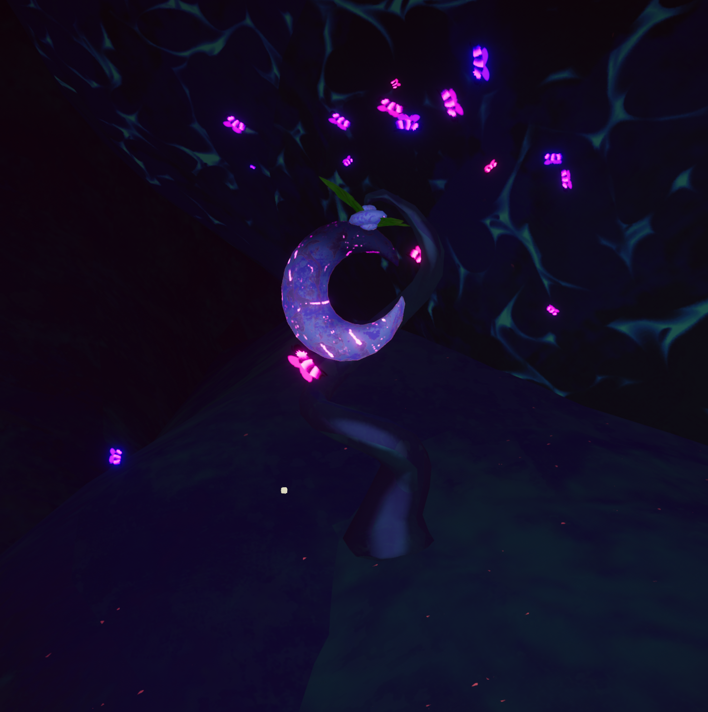](https://peak.wiki.gg/wiki/File%3ANapberry_Plant.png)
  Napberry Plant in an Alpine cave.

## Patch history

 **[1.0](1.0.md) (2025-06-16):** Introduced.
 **[1.8](1.8.md) (2025-07-21):** The Napberry Plant should function properly again.
 **[1.10.a](1.10.a.md) (2025-07-30):** THE NAPBERRY PLANT IS TEMPORARILY DISABLED. Some folks were having issues with lag and crashes due to our implementation of the Napberry Plant. Trust me its a weird one. While we work on a better implementation asap, the Napberry Plant won't show up in the level.
 **[1.40.a](1.40.a.md) (2025-11-05):** The Napberry Plant spawns again in the Alpine!

[Food](Food.md)
Natural food
Berries
Berrynanas- [](Yellow%20Berrynana.md) [Yellow Berrynana](Yellow%20Berrynana.md)
- [](Pink%20Berrynana.md) [Pink Berrynana](Pink%20Berrynana.md)
- [](Blue%20Berrynana.md) [Blue Berrynana](Blue%20Berrynana.md)
- [](Brown%20Berrynana.md) [Brown Berrynana](Brown%20Berrynana.md)
Clusterberries- [](Red%20Clusterberry.md) [Red Clusterberry](Red%20Clusterberry.md)
- [](Yellow%20Clusterberry.md) [Yellow Clusterberry](Yellow%20Clusterberry.md)
- [](Black%20Clusterberry.md) [Black Clusterberry](Black%20Clusterberry.md)
Crispberries- [](Green%20Crispberry.md) [Green Crispberry](Green%20Crispberry.md)
- [](Yellow%20Crispberry.md) [Yellow Crispberry](Yellow%20Crispberry.md)
- [](Red%20Crispberry.md) [Red Crispberry](Red%20Crispberry.md)
Kingberries- [](Green%20Kingberry.md) [Green Kingberry](Green%20Kingberry.md)
- [](Yellow%20Kingberry.md) [Yellow Kingberry](Yellow%20Kingberry.md)
- [](Purple%20Kingberry.md) [Purple Kingberry](Purple%20Kingberry.md)
Prickleberries- [](Red%20Prickleberry.md) [Red Prickleberry](Red%20Prickleberry.md)
- [](Gold%20Prickleberry.md) [Gold Prickleberry](Gold%20Prickleberry.md)
Shroomberries- [](Red%20Shroomberry.md) [Red Shroomberry](Red%20Shroomberry.md)
- [](Yellow%20Shroomberry.md) [Yellow Shroomberry](Yellow%20Shroomberry.md)
- [](Green%20Shroomberry.md) [Green Shroomberry](Green%20Shroomberry.md)
- [](Blue%20Shroomberry.md) [Blue Shroomberry](Blue%20Shroomberry.md)
- [](Purple%20Shroomberry.md) [Purple Shroomberry](Purple%20Shroomberry.md)
Winterberries- [](Orange%20Winterberry.md) [Orange Winterberry](Orange%20Winterberry.md)
- [](Yellow%20Winterberry.md) [Yellow Winterberry](Yellow%20Winterberry.md)
Other- [](Napberry.md) Napberry
- [](Scorchberry.md) [Scorchberry](Scorchberry.md)
Campfire food- [](Marshmallow.md) [Marshmallow](Marshmallow.md)
- [](Hot%20Dog.md) [Hot Dog](Hot%20Dog.md)
Mushrooms- [](Bugle%20Shroom.md) [Bugle Shroom](Bugle%20Shroom.md)
- [](Button%20Shroom.md) [Button Shroom](Button%20Shroom.md)
- [](Chubby%20Shroom.md) [Chubby Shroom](Chubby%20Shroom.md)
- [](Cluster%20Shroom.md) [Cluster Shroom](Cluster%20Shroom.md)
Mystical food- [](Cure-All.md) [Cure-All](Cure-All.md)
- [](Pandora%27s%20Lunchbox.md) [Pandora's Lunchbox](Pandora%27s%20Lunchbox.md)
Other- [](Cooked%20Bird.md) [Cooked Bird](Cooked%20Bird.md)
- [](Egg.md) [Egg](Egg.md)
- [](Frog%20Legs.md) [Frog Legs](Frog%20Legs.md)
- [](Honeycomb.md) [Honeycomb](Honeycomb.md)
- [](Half-Coconut.md) [Half-Coconut](Half-Coconut.md)
- [](Medicinal%20Root.md) [Medicinal Root](Medicinal%20Root.md)
- [](Mandrake.md) [Mandrake](Mandrake.md)
- [](Scorpion.md) [Scorpion](Scorpion.md)
- [](Tick.md) [Tick](Tick.md)
- [](The%20Early%20Worm.md) [The Early Worm](The%20Early%20Worm.md)
Packaged food
All packaged foods- [](Airline%20Food.md) [Airline Food](Airline%20Food.md)
- [](Big%20Lollipop.md) [Big Lollipop](Big%20Lollipop.md)
- [](Energy%20Drink.md) [Energy Drink](Energy%20Drink.md)
- [](Fortified%20Milk.md) [Fortified Milk](Fortified%20Milk.md)
- [](Granola%20Bar.md) [Granola Bar](Granola%20Bar.md)
- [](Scout%20Cookies.md) [Scout Cookies](Scout%20Cookies.md)
- [](Sports%20Drink.md) [Sports Drink](Sports%20Drink.md)
- [](Trail%20Mix.md) [Trail Mix](Trail%20Mix.md)

---

# Non-player character

A non-player character (NPC) is a character in game that is not controlled by a player.

There are two types of NPCs in *[PEAK](Peak%20%28game%29.md)*:

### Hostile NPCs

- [Antlion](Antlion.md)
- [Bees](Beehive.md)
- [Beetle](Beetle.md)
- [Big Ghost](Big%20Ghost.md)
- [Condor](Condor.md)
- [Frog](Frog.md)
- [Flytraps](Flytrap.md)
- [Scorpion](Scorpion.md)
- [Scoutmaster Myres](Scoutmaster%20Myres.md)
- [Spider](Spider.md)
- [Zombie](Zombie.md)

### Non-hostile NPCs

- [Capybara](Capybara.md)
- [Looker](Looker.md)

---

# Orange Winterberry

Orange Winterberry
[](https://peak.wiki.gg/wiki/File%3AOrange_Winterberry.png)
[Item type](Items.md)- [Food](Food.md)
- [Natural food](https://peak.wiki.gg/wiki/Natural_food)
- [Berry](https://peak.wiki.gg/wiki/Berry)
Biome- [Alpine](Alpine.md)
Weight
[](Stamina%20bar.md#Weight) **2.5**
Base Status Effects
[](Stamina%20bar.md#Hunger)Hunger
-15
[](Stamina%20bar.md#Heat)Heat
-30
Cooked Bonuses
[](Stamina%20bar.md#Hunger)Hunger
-15 (-30 total)
[](Stamina%20bar.md#Bonus_stamina)Bonus Stamina
10 (10 total)

The **Orange [Winterberry](https://peak.wiki.gg/wiki/Winterberry)** is a natural [food](Food.md) in *[PEAK](Peak%20%28game%29.md)* found growing on trees in the [Alpine](Alpine.md).

## Patch history

 **[1.0](1.0.md) (2025-06-16):** Introduced.

[Food](Food.md)
Natural food
Berries
Berrynanas- [](Yellow%20Berrynana.md) [Yellow Berrynana](Yellow%20Berrynana.md)
- [](Pink%20Berrynana.md) [Pink Berrynana](Pink%20Berrynana.md)
- [](Blue%20Berrynana.md) [Blue Berrynana](Blue%20Berrynana.md)
- [](Brown%20Berrynana.md) [Brown Berrynana](Brown%20Berrynana.md)
Clusterberries- [](Red%20Clusterberry.md) [Red Clusterberry](Red%20Clusterberry.md)
- [](Yellow%20Clusterberry.md) [Yellow Clusterberry](Yellow%20Clusterberry.md)
- [](Black%20Clusterberry.md) [Black Clusterberry](Black%20Clusterberry.md)
Crispberries- [](Green%20Crispberry.md) [Green Crispberry](Green%20Crispberry.md)
- [](Yellow%20Crispberry.md) [Yellow Crispberry](Yellow%20Crispberry.md)
- [](Red%20Crispberry.md) [Red Crispberry](Red%20Crispberry.md)
Kingberries- [](Green%20Kingberry.md) [Green Kingberry](Green%20Kingberry.md)
- [](Yellow%20Kingberry.md) [Yellow Kingberry](Yellow%20Kingberry.md)
- [](Purple%20Kingberry.md) [Purple Kingberry](Purple%20Kingberry.md)
Prickleberries- [](Red%20Prickleberry.md) [Red Prickleberry](Red%20Prickleberry.md)
- [](Gold%20Prickleberry.md) [Gold Prickleberry](Gold%20Prickleberry.md)
Shroomberries- [](Red%20Shroomberry.md) [Red Shroomberry](Red%20Shroomberry.md)
- [](Yellow%20Shroomberry.md) [Yellow Shroomberry](Yellow%20Shroomberry.md)
- [](Green%20Shroomberry.md) [Green Shroomberry](Green%20Shroomberry.md)
- [](Blue%20Shroomberry.md) [Blue Shroomberry](Blue%20Shroomberry.md)
- [](Purple%20Shroomberry.md) [Purple Shroomberry](Purple%20Shroomberry.md)
Winterberries- [](Orange%20Winterberry.md) Orange Winterberry
- [](Yellow%20Winterberry.md) [Yellow Winterberry](Yellow%20Winterberry.md)
Other- [](Napberry.md) [Napberry](Napberry.md)
- [](Scorchberry.md) [Scorchberry](Scorchberry.md)
Campfire food- [](Marshmallow.md) [Marshmallow](Marshmallow.md)
- [](Hot%20Dog.md) [Hot Dog](Hot%20Dog.md)
Mushrooms- [](Bugle%20Shroom.md) [Bugle Shroom](Bugle%20Shroom.md)
- [](Button%20Shroom.md) [Button Shroom](Button%20Shroom.md)
- [](Chubby%20Shroom.md) [Chubby Shroom](Chubby%20Shroom.md)
- [](Cluster%20Shroom.md) [Cluster Shroom](Cluster%20Shroom.md)
Mystical food- [](Cure-All.md) [Cure-All](Cure-All.md)
- [](Pandora%27s%20Lunchbox.md) [Pandora's Lunchbox](Pandora%27s%20Lunchbox.md)
Other- [](Cooked%20Bird.md) [Cooked Bird](Cooked%20Bird.md)
- [](Egg.md) [Egg](Egg.md)
- [](Frog%20Legs.md) [Frog Legs](Frog%20Legs.md)
- [](Honeycomb.md) [Honeycomb](Honeycomb.md)
- [](Half-Coconut.md) [Half-Coconut](Half-Coconut.md)
- [](Medicinal%20Root.md) [Medicinal Root](Medicinal%20Root.md)
- [](Mandrake.md) [Mandrake](Mandrake.md)
- [](Scorpion.md) [Scorpion](Scorpion.md)
- [](Tick.md) [Tick](Tick.md)
- [](The%20Early%20Worm.md) [The Early Worm](The%20Early%20Worm.md)
Packaged food
All packaged foods- [](Airline%20Food.md) [Airline Food](Airline%20Food.md)
- [](Big%20Lollipop.md) [Big Lollipop](Big%20Lollipop.md)
- [](Energy%20Drink.md) [Energy Drink](Energy%20Drink.md)
- [](Fortified%20Milk.md) [Fortified Milk](Fortified%20Milk.md)
- [](Granola%20Bar.md) [Granola Bar](Granola%20Bar.md)
- [](Scout%20Cookies.md) [Scout Cookies](Scout%20Cookies.md)
- [](Sports%20Drink.md) [Sports Drink](Sports%20Drink.md)
- [](Trail%20Mix.md) [Trail Mix](Trail%20Mix.md)

---

# PEAK Wiki

## Welcome to the PEAK Wiki!

We are currently maintaining [357 articles](https://peak.wiki.gg/wiki/Special%3AAllPages). Please feel free to contribute by creating new articles or expanding existing ones.

## Latest updates

[](https://peak.wiki.gg/wiki/File%3APeak_Badge.png)
**[Patch 2.6.a](2.6.a.md)** (Oct 2, 2026)

## About PEAK

*[PEAK](Peak%20%28game%29.md)* is a co-op climbing game where the slightest mistake can spell your doom. Either solo or as a group of lost nature scouts, your only hope of rescue from a mysterious island is to scale the mountain at its center. Do you have what it takes to reach the PEAK?

[Read more...](Peak%20%28game%29.md)

## Next island reset:

loading...

---

Today's biomes:

## Useful wiki pages

- [](How%20to%20play.md)[How to play](How%20to%20play.md)
- [](Cosmetics.md)[Cosmetics](Cosmetics.md)
- [](Badges.md)[Badges](Badges.md)
- [](Food.md)[Food](Food.md)
- [](Equipment.md)[Equipment](Equipment.md)
- [](Locations.md)[Locations](Locations.md)

## Contribute to the wiki

PEAK Wiki is a collaborative wiki resource that is open for anyone to edit. You don't need special permission beyond [registering](https://peak.wiki.gg/wiki/Special%3AUserLogin/signup) an account to edit most pages, and your contributions can grow the wiki and help other players.

Adding content
:   - If you are unsure of what to do or how to create a page, search for a few articles on the same topic and see what they look like. You can always view the source code in a wiki and learn from what others have done.
    - An edit doesn't have to be massive; if you feel you don't want to create whole articles, then just fixing spelling errors and broken links is enough.
    - [Register](https://peak.wiki.gg/wiki/Special%3AUserLogin/signup) to edit and track your contributions.

## External links

- [](https://peakpeakpeak.com/)[Official PEAK website](https://peakpeakpeak.com/)
- [](https://discord.gg/peakgame)[Official PEAK Discord](https://discord.gg/peakgame)
- [](https://s.team/a/3527290)[PEAK on Steam](https://s.team/a/3527290)
- [](https://x.com/AggroCrabGames)[Aggro Crab on X](https://x.com/AggroCrabGames)
- [](https://x.com/LandfallGames)[Landfall on X](https://x.com/LandfallGames)

---

# PEAK Wiki/about

## About PEAK

*[PEAK](Peak%20%28game%29.md)* is a co-op climbing game where the slightest mistake can spell your doom. Either solo or as a group of lost nature scouts, your only hope of rescue from a mysterious island is to scale the mountain at its center. Do you have what it takes to reach the PEAK?

[Read more...](Peak%20%28game%29.md)

---

# PEAK Wiki/contribute

## Contribute to the wiki

PEAK Wiki is a collaborative wiki resource that is open for anyone to edit. You don't need special permission beyond [registering](https://peak.wiki.gg/wiki/Special%3AUserLogin/signup) an account to edit most pages, and your contributions can grow the wiki and help other players.

Adding content
:   - If you are unsure of what to do or how to create a page, search for a few articles on the same topic and see what they look like. You can always view the source code in a wiki and learn from what others have done.
    - An edit doesn't have to be massive; if you feel you don't want to create whole articles, then just fixing spelling errors and broken links is enough.
    - [Register](https://peak.wiki.gg/wiki/Special%3AUserLogin/signup) to edit and track your contributions.

---

# PEAK Wiki/external

## External links

- [](https://peakpeakpeak.com/)[Official PEAK website](https://peakpeakpeak.com/)
- [](https://discord.gg/peakgame)[Official PEAK Discord](https://discord.gg/peakgame)
- [](https://s.team/a/3527290)[PEAK on Steam](https://s.team/a/3527290)
- [](https://x.com/AggroCrabGames)[Aggro Crab on X](https://x.com/AggroCrabGames)
- [](https://x.com/LandfallGames)[Landfall on X](https://x.com/LandfallGames)

---

# PEAK Wiki/ko

## PEAK Wiki에 온 걸 환영합니다!

현재 [문서 357개](https://peak.wiki.gg/wiki/Special%3AAllPages)가 유지보수되고 있습니다. 문서 작성을 주저하지 말고, 위키에 기여해 보세요!

## 최신 업데이트

[](https://peak.wiki.gg/wiki/File%3APeak_Badge.png)
**패치 2.6.a** (2026년 10월 2일)

## PEAK란?

*[PEAK](Peak%20%28game%29.md)*는 작은 실수 하나가 치명적인 결과를 초래할 수 있는 협동 등반 게임입니다. 혼자서든, 길 잃은 자연 스카우트와 함께든, 신비한 섬에서 구조될 유일한 희망은 중앙에 우뚝 솟은 산을 오르는 것뿐입니다. 당신은 과연 정상에 오를 수 있을까요?

더 알아보기...

## 다음 섬 재설정:

불러오는 중...

---

오늘의 바이옴:

## 유용한 위키 문서

- [](https://peak.wiki.gg/wiki/How_to_play/ko)플레이하는 법
- [](https://peak.wiki.gg/wiki/Cosmetics/ko)치장품
- [](https://peak.wiki.gg/wiki/Badges/ko)배지
- [](https://peak.wiki.gg/wiki/Food/ko)음식
- [](https://peak.wiki.gg/wiki/Equipment/ko)장비
- [](https://peak.wiki.gg/wiki/Locations/ko)장소

## 위키에 기여하기

PEAK Wiki는 모두에게 열려있고, 모두가 기여할 수 있는 리소스입니다. 대부분의 페이지 편집에는 [회원가입](https://peak.wiki.gg/wiki/Special%3AUserLogin/signup)이 필요하지 않으며, 여러분의 기여는 위키가 성장하고 다른 플레이어를 도울 수 있을 것입니다.

참고
:   - 페이지를 작성하거나 무엇을 해야할지 모르겠다면, 같은 주제의 여러 문서를 보며 익숙함을 키워보세요. 여러분은 언제나 위키의 원본 코드를 보고 다른 사람의 발자취를 보며 배워갈 수 있습니다.
    - 편집은 꼭 장대할 필요가 없습니다. 문서를 만들고 싶은게 아니더라도, 오타나 잘못된 정보를 수정하는 것만으로도 기여할 명분은 충분합니다.
    - [회원가입](https://peak.wiki.gg/wiki/Special%3AUserLogin/signup)하면 본인의 편집과 기여를 더 잘 알아볼 수 있습니다.

## 외부 링크

- [](https://peakpeakpeak.com/)[공식 PEAK 웹사이트](https://peakpeakpeak.com/)
- [](https://discord.gg/peakgame)[공식 PEAK Discord](https://discord.gg/peakgame)
- [](https://s.team/a/3527290)[Steam 내 PEAK](https://s.team/a/3527290)
- [](https://x.com/AggroCrabGames)[X에서의 Aggro Crab](https://x.com/AggroCrabGames)
- [](https://x.com/LandfallGames)[X에서의 Landfall](https://x.com/LandfallGames)

---

# PEAK Wiki/ko/about

## PEAK란?

*[PEAK](Peak%20%28game%29.md)*는 작은 실수 하나가 치명적인 결과를 초래할 수 있는 협동 등반 게임입니다. 혼자서든, 길 잃은 자연 스카우트와 함께든, 신비한 섬에서 구조될 유일한 희망은 중앙에 우뚝 솟은 산을 오르는 것뿐입니다. 당신은 과연 정상에 오를 수 있을까요?

더 알아보기...

---

# PEAK Wiki/ko/contribute

## 위키에 기여하기

PEAK Wiki는 모두에게 열려있고, 모두가 기여할 수 있는 리소스입니다. 대부분의 페이지 편집에는 [회원가입](https://peak.wiki.gg/wiki/Special%3AUserLogin/signup)이 필요하지 않으며, 여러분의 기여는 위키가 성장하고 다른 플레이어를 도울 수 있을 것입니다.

참고
:   - 페이지를 작성하거나 무엇을 해야할지 모르겠다면, 같은 주제의 여러 문서를 보며 익숙함을 키워보세요. 여러분은 언제나 위키의 원본 코드를 보고 다른 사람의 발자취를 보며 배워갈 수 있습니다.
    - 편집은 꼭 장대할 필요가 없습니다. 문서를 만들고 싶은게 아니더라도, 오타나 잘못된 정보를 수정하는 것만으로도 기여할 명분은 충분합니다.
    - [회원가입](https://peak.wiki.gg/wiki/Special%3AUserLogin/signup)하면 본인의 편집과 기여를 더 잘 알아볼 수 있습니다.

---

# PEAK Wiki/ko/external

## 외부 링크

- [](https://peakpeakpeak.com/)[공식 PEAK 웹사이트](https://peakpeakpeak.com/)
- [](https://discord.gg/peakgame)[공식 PEAK Discord](https://discord.gg/peakgame)
- [](https://s.team/a/3527290)[Steam 내 PEAK](https://s.team/a/3527290)
- [](https://x.com/AggroCrabGames)[X에서의 Aggro Crab](https://x.com/AggroCrabGames)
- [](https://x.com/LandfallGames)[X에서의 Landfall](https://x.com/LandfallGames)

---

# PEAK Wiki/ko/maptimer

## 다음 섬 재설정:

불러오는 중...

---

오늘의 바이옴:

---

# PEAK Wiki/ko/news

## 최신 업데이트

[](https://peak.wiki.gg/wiki/File%3APeak_Badge.png)
**패치 2.6.a** (2026년 10월 2일)

---

# PEAK Wiki/ko/pages

## 유용한 위키 문서

- [](https://peak.wiki.gg/wiki/How_to_play/ko)플레이하는 법
- [](https://peak.wiki.gg/wiki/Cosmetics/ko)치장품
- [](https://peak.wiki.gg/wiki/Badges/ko)배지
- [](https://peak.wiki.gg/wiki/Food/ko)음식
- [](https://peak.wiki.gg/wiki/Equipment/ko)장비
- [](https://peak.wiki.gg/wiki/Locations/ko)장소

---

# PEAK Wiki/ko/welcome

## PEAK Wiki에 온 걸 환영합니다!

현재 [문서 357개](https://peak.wiki.gg/wiki/Special%3AAllPages)가 유지보수되고 있습니다. 문서 작성을 주저하지 말고, 위키에 기여해 보세요!

---

# PEAK Wiki/maptimer

## Next island reset:

loading...

---

Today's biomes:

---

# PEAK Wiki/news

## Latest updates

[](https://peak.wiki.gg/wiki/File%3APeak_Badge.png)
**[Patch 2.4.c](2.4.c.md)** (Sep 14, 2026)

---

# PEAK Wiki/pages

## Useful wiki pages

- [](How%20to%20play.md)[How to play](How%20to%20play.md)
- [](Cosmetics.md)[Cosmetics](Cosmetics.md)
- [](Badges.md)[Badges](Badges.md)
- [](Food.md)[Food](Food.md)
- [](Equipment.md)[Equipment](Equipment.md)
- [](Locations.md)[Locations](Locations.md)

---

# PEAK Wiki/rss

## Recent Updates

**[Patch Notes 2.6.b](https://steamcommunity.com/games/3527290/announcements/detail/672881728134580627)**
:   Hiii Scouts! Just a small set of patches to address some of the outstanding weirdness players experience when joining an in-progress run.

    **Bugfixes**

    - Fixed issue that would sometimes prevent players rev...
:   aggro.devin 2026-10-06 19:10:29

**[Patch Notes 2.6.a](https://steamcommunity.com/games/3527290/announcements/detail/672881728134579559)**
:   Map PoolYou may have noticed this last week's maps have been weirdly consistent in terms of biome selection, with each day being either all old or all new maps. This patch will replace the current ...
:   aggro.devin 2026-10-02 20:45:33

**[Patch 2.5.a](https://steamcommunity.com/games/3527290/announcements/detail/688643694674315300)**
:   **Bug Fixes**

    - Reconnecting players will no longer come back dead in cases where they should still be alive
    - Fixed bug where players loading a save from the Citadel campfire could not earn the Medieval His...
:   aggro.devin 2026-09-28 20:06:27

**[Patch 2.4.c: Bookworm badge fix, lag fix and more](https://steamcommunity.com/games/3527290/announcements/detail/683012924902474845)**
:   Hello Scouts! Here’s a new patch for you

    In the previous build, we had some issues with the Bookworm badge where the progress would be reset at the start of every run, and the Guidebook Scrolls w...
:   Botten Hanna 2026-09-14 19:13:33

---

# PEAK Wiki/welcome

## Welcome to the PEAK Wiki!

We are currently maintaining [357 articles](https://peak.wiki.gg/wiki/Special%3AAllPages). Please feel free to contribute by creating new articles or expanding existing ones.

---

# PEAK x bbno$ concert


Expired event

This event is no longer available. It lasted from 12th to 16th December 2025; see [patch history](#Patch_history).


This page is a [stub](https://support.wiki.gg/wiki/Stub). You can help **PEAK Wiki** by expanding it.

PEAK x bbno$ concert
[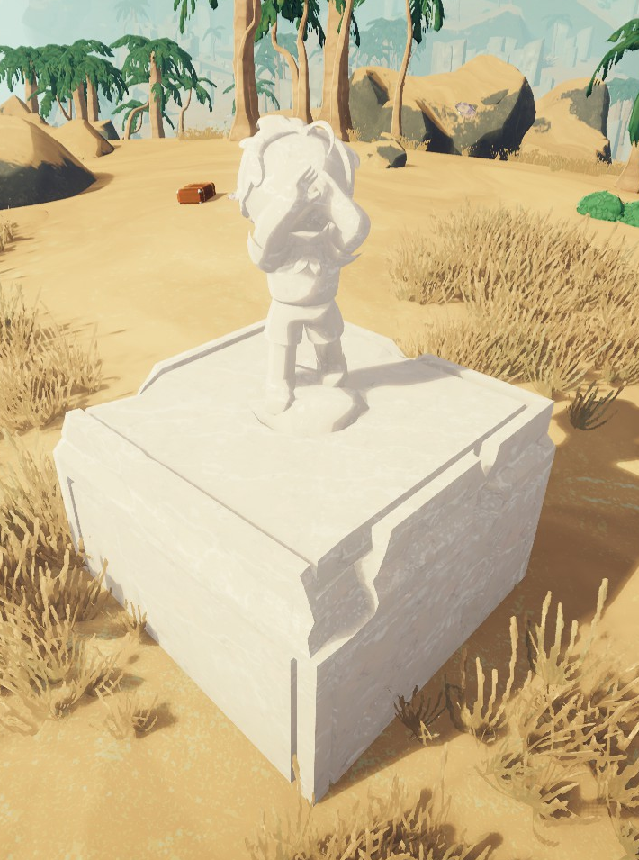](https://peak.wiki.gg/wiki/File%3AShore_Statue.png)
General
Type
Event
Biome- [Shore](Shore.md)
Location- [Crash Site](https://peak.wiki.gg/wiki/Crash_Site)

**PEAK x bbno$ concert** was a collaboration event between *[PEAK](Peak%20%28game%29.md)* and Canadian rapper [bbno$](https://en.wikipedia.org/wiki/Bbno$). In patch [1.48.a](1.48.a.md), a marble statue of bbno$ was added next to the [Crash Site](https://peak.wiki.gg/wiki/Crash_Site) in the [Shore](Shore.md). In the following patch ([1.49.a](1.49.a.md)) a bugle was added in the statue's hands. Playing the bugle provided full morale boost and started the concert, lasting around 8 minutes featuring 3 songs by bbno$:

### Song list

- "1-800" (ft. ironmouse)
- "two"
- "bing bong" (ft. Vanillamace)

## Full concert

Load video
YouTube
YouTube might collect personal data. [Privacy Policy](https://www.youtube.com/howyoutubeworks/user-settings/privacy/)
Continue
Dismiss

## Gallery

- [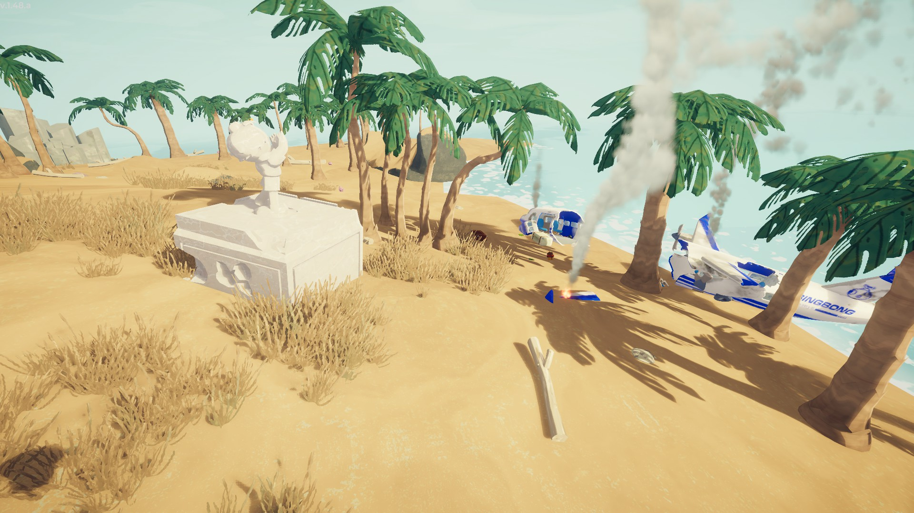](https://peak.wiki.gg/wiki/File%3AShore_Statue_Crash_Site.png)
  The Shore Statue seen next to the [Crash Site](https://peak.wiki.gg/wiki/Crash_Site) in version [1.48.a](1.48.a.md).
- [](https://peak.wiki.gg/wiki/File%3ABugle%3F.png)
  "Bugle?" held by the statue.
- [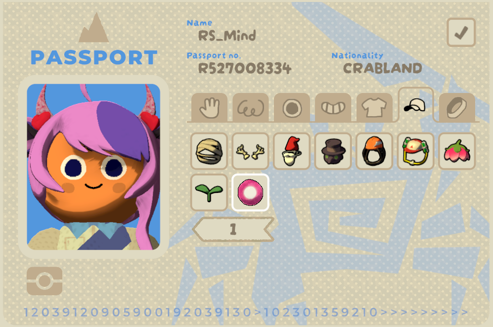](https://peak.wiki.gg/wiki/File%3AIronmouse_hair_passport.png)
  Ironmouse's wig hat seen in the [passport](Passport.md).
- [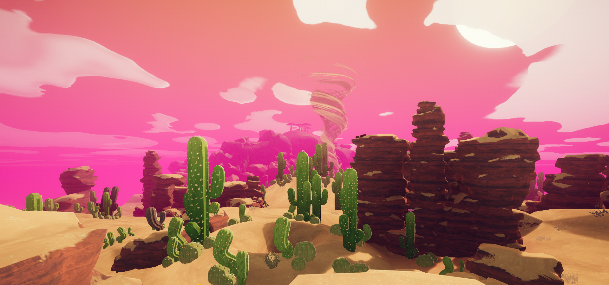](https://peak.wiki.gg/wiki/File%3AConcert_sky_in_the_Mesa.png)
  The effects of the Bugle? on the sky, seen here in the [Mesa](Mesa.md).
- [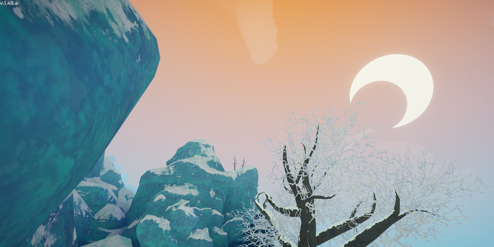](https://peak.wiki.gg/wiki/File%3AConcert_sky_in_the_Alpine.png)
  The [Alpine](Alpine.md) with an orange-and-blue night sky post-concert.

## Trivia

- The bugle, called "Bugle?", held by the statue shared the inventory icon with [](Scoutmaster%27s%20Bugle.md) [Scoutmaster's Bugle](Scoutmaster%27s%20Bugle.md) but was technically a new item.- The 3D model had a distinct color and played a unique sound effect.
  - Like the Scoutmaster's Bugle, it provided a [Morale Boost](Morale%20Boost.md) for [](Stamina%20bar.md#Bonus_stamina) **100** [Bonus stamina](Stamina%20bar.md#Bonus_stamina) when played, and could unlock the [](https://peak.wiki.gg/wiki/Animal_Serenading_Badge) [Animal Serenading Badge](https://peak.wiki.gg/wiki/Animal_Serenading_Badge) if played at the [Oasis](Mesa.md#Oasis) or [Hot Spring](Alpine.md#Hot_Spring).
- The bugle could be played in any biome for audible music and the Morale Boost. The giant performers were only visible from the [Shore](Shore.md), but the visual effects would appear up until the [Caldera](Caldera.md) and the multicolored sky would persist from the end of the last song until the lighting of the next biome's [Campfire](Campfire.md).- If the bugle was played in or shortly before entering the [Mesa](Mesa.md), the sun would be prevented from inflicting [Heat](Stamina%20bar.md#Heat) damage while the colorful sky effects were present.
- Pressing  (seven) on the keyboard seven times while in the [Airport](Airport.md) unlocked ironmouse's wig, a secret [Hat](https://peak.wiki.gg/wiki/Hat) cosmetic. The hat would disappear from the [Passport](Passport.md) upon quitting the game but it would remain equipped.- The hat used the [Strange Gem](Strange%20Gem.md) as a placeholder icon.
- [Bing Bong](Bing%20Bong.md) is bbno$'s biggest fan.

## Patch history

 **[1.48.a](1.48.a.md) (2025-12-10):** The Statue has been added to the Shore.
 **[1.49.a](1.49.a.md) (2025-12-12):** Added BBNO$ concert to The Shore.
 **[1.50.a](1.50.a.md) (2025-12-16):** Concert and statue removed

---

# Pandora's Lunchbox

Pandora's Lunchbox
[](https://peak.wiki.gg/wiki/File%3APandora%27s_Lunchbox.png)
[Item type](Items.md)- [Consumable](https://peak.wiki.gg/wiki/Consumable)
- [Mystical item](https://peak.wiki.gg/wiki/Mystical_item)
Rarity
[Legendary](https://peak.wiki.gg/wiki/Legendary)
Source- [Ancient Luggage](https://peak.wiki.gg/wiki/Ancient_Luggage)
- [Ancient Statue](Ancient%20Statue.md)
Uses
3
Weight
[](Stamina%20bar.md#Weight) **2.5**
Base Status Effects
[](Stamina%20bar.md#Hunger)Hunger
?
[](Stamina%20bar.md#Bonus_stamina)Bonus Stamina
?
[](Stamina%20bar.md#Heat)Heat
?
[](Stamina%20bar.md#Cold)Cold
?
[](Stamina%20bar.md#Poison)Poison
?
[](Stamina%20bar.md#Drowsy)Drowsy
?
[](Stamina%20bar.md#Injury)Injury
?
[](Stamina%20bar.md#Spores)Spores
?
[](Stamina%20bar.md#Curse)Curse
?

The **Pandora's Lunchbox** is a [consumable](https://peak.wiki.gg/wiki/Consumable) [mystical item](https://peak.wiki.gg/wiki/Mystical_item) in *[PEAK](Peak%20%28game%29.md)*. When used, it clears all status effects besides [](Stamina%20bar.md#Petrify) [Petrify](Stamina%20bar.md#Petrify) (including [](Stamina%20bar.md#Bonus_stamina) [Bonus stamina](Stamina%20bar.md#Bonus_stamina) and [](Stamina%20bar.md#Curse) [Curse](Stamina%20bar.md#Curse)), then gives the player a random amount of [](Stamina%20bar.md#Hunger) [Hunger](Stamina%20bar.md#Hunger), [](Stamina%20bar.md#Bonus_stamina) [Bonus stamina](Stamina%20bar.md#Bonus_stamina), [](Stamina%20bar.md#Heat) [Heat](Stamina%20bar.md#Heat), [](Stamina%20bar.md#Cold) [Cold](Stamina%20bar.md#Cold), [](Stamina%20bar.md#Poison) [Poison](Stamina%20bar.md#Poison), [](Stamina%20bar.md#Drowsy) [Drowsy](Stamina%20bar.md#Drowsy), [](Stamina%20bar.md#Injury) [Injury](Stamina%20bar.md#Injury) [](Stamina%20bar.md#Spores) [Spores](Stamina%20bar.md#Spores), and [](Stamina%20bar.md#Curse) [Curse](Stamina%20bar.md#Curse). It does not remove status over time effects, such as those gained from eating poisonous food or from a [Zombie Bite](Zombie.md) although the zombie infection will stop if the player has [](Stamina%20bar.md#Spores) **0** [Spores](Stamina%20bar.md#Spores) after using Pandora's Lunchbox.

Pandora's Lunchbox can give anywhere from **0-100** total statuses, with an average amount of **40**. Half as much [](Stamina%20bar.md#Curse) [Curse](Stamina%20bar.md#Curse) is applied on average compared to other statuses. A player can receive anywhere from **0-100** [](Stamina%20bar.md#Bonus_stamina) [Bonus stamina](Stamina%20bar.md#Bonus_stamina) (limited by [](Stamina%20bar.md#Petrify) [Petrify](Stamina%20bar.md#Petrify)), with an average amount of **30**. The effects of Pandora's Lunchbox bypass [](Stamina%20bar.md#Invincibility) [Invincibility](Stamina%20bar.md#Invincibility).

[Cooking](Cooking.md) Pandora's Lunchbox causes it to explode, applying its effects to all players within **4.8 meters**.

## Tips

- It is recommended not to use Pandora's Lunchbox while having a lot of [](Stamina%20bar.md#Bonus_stamina) [Bonus stamina](Stamina%20bar.md#Bonus_stamina) due to the fact that it will often remove much of it.
- If the player is a [skeleton](Skeleton.md), using Pandora's Lunchbox will often prove fatal due to the [](Stamina%20bar.md#Injury) [Injury](Stamina%20bar.md#Injury) multiplier applied to skeletons.
- As Pandora's Lunchbox can also give non-decaying statuses such as [](Stamina%20bar.md#Hunger) [Hunger](Stamina%20bar.md#Hunger), [](Stamina%20bar.md#Injury) [Injury](Stamina%20bar.md#Injury) or [](Stamina%20bar.md#Curse) [Curse](Stamina%20bar.md#Curse), using it is a bit risky, especially on the last use. With multiple uses remaining, there are more chances to get a favorable outcome.
- If multiple scouts are in a dire need of a Pandora's Lunchbox dose and there is only one use left, gathering close and [Cooking](Cooking.md) it might be a worthy try.

## Trivia

- The symbol on the front is Evil Landfall?'s logo.

## Patch history

 **[1.0](1.0.md) (2025-06-16):** Introduced.
 **[1.40.a](1.40.a.md) (2025-11-05):**

- Pandora's Lunchbox can now apply spores.
- Cooking Pandora's Lunchbox will cause it to explode.

 **[1.60.c](1.60.c.md) (2026-04-01):** Sprite changed to show Evil Landfall?'s logo.
 **[2.02.a](https://peak.wiki.gg/wiki/2.02.a) :**

- Pandora’s Lunchbox can now add some Curse to you sometimes. Use at your own risk…
- Pandora’s Lunchbox will ignore Invincibility when adding statuses to you. It was just a bit too good, sorry!!
[Food](Food.md)
Natural food
Berries
Berrynanas- [](Yellow%20Berrynana.md) [Yellow Berrynana](Yellow%20Berrynana.md)
- [](Pink%20Berrynana.md) [Pink Berrynana](Pink%20Berrynana.md)
- [](Blue%20Berrynana.md) [Blue Berrynana](Blue%20Berrynana.md)
- [](Brown%20Berrynana.md) [Brown Berrynana](Brown%20Berrynana.md)
Clusterberries- [](Red%20Clusterberry.md) [Red Clusterberry](Red%20Clusterberry.md)
- [](Yellow%20Clusterberry.md) [Yellow Clusterberry](Yellow%20Clusterberry.md)
- [](Black%20Clusterberry.md) [Black Clusterberry](Black%20Clusterberry.md)
Crispberries- [](Green%20Crispberry.md) [Green Crispberry](Green%20Crispberry.md)
- [](Yellow%20Crispberry.md) [Yellow Crispberry](Yellow%20Crispberry.md)
- [](Red%20Crispberry.md) [Red Crispberry](Red%20Crispberry.md)
Kingberries- [](Green%20Kingberry.md) [Green Kingberry](Green%20Kingberry.md)
- [](Yellow%20Kingberry.md) [Yellow Kingberry](Yellow%20Kingberry.md)
- [](Purple%20Kingberry.md) [Purple Kingberry](Purple%20Kingberry.md)
Prickleberries- [](Red%20Prickleberry.md) [Red Prickleberry](Red%20Prickleberry.md)
- [](Gold%20Prickleberry.md) [Gold Prickleberry](Gold%20Prickleberry.md)
Shroomberries- [](Red%20Shroomberry.md) [Red Shroomberry](Red%20Shroomberry.md)
- [](Yellow%20Shroomberry.md) [Yellow Shroomberry](Yellow%20Shroomberry.md)
- [](Green%20Shroomberry.md) [Green Shroomberry](Green%20Shroomberry.md)
- [](Blue%20Shroomberry.md) [Blue Shroomberry](Blue%20Shroomberry.md)
- [](Purple%20Shroomberry.md) [Purple Shroomberry](Purple%20Shroomberry.md)
Winterberries- [](Orange%20Winterberry.md) [Orange Winterberry](Orange%20Winterberry.md)
- [](Yellow%20Winterberry.md) [Yellow Winterberry](Yellow%20Winterberry.md)
Other- [](Napberry.md) [Napberry](Napberry.md)
- [](Scorchberry.md) [Scorchberry](Scorchberry.md)
Campfire food- [](Marshmallow.md) [Marshmallow](Marshmallow.md)
- [](Hot%20Dog.md) [Hot Dog](Hot%20Dog.md)
Mushrooms- [](Bugle%20Shroom.md) [Bugle Shroom](Bugle%20Shroom.md)
- [](Button%20Shroom.md) [Button Shroom](Button%20Shroom.md)
- [](Chubby%20Shroom.md) [Chubby Shroom](Chubby%20Shroom.md)
- [](Cluster%20Shroom.md) [Cluster Shroom](Cluster%20Shroom.md)
Mystical food- [](Cure-All.md) [Cure-All](Cure-All.md)
- [](Pandora%27s%20Lunchbox.md) Pandora's Lunchbox
Other- [](Cooked%20Bird.md) [Cooked Bird](Cooked%20Bird.md)
- [](Egg.md) [Egg](Egg.md)
- [](Frog%20Legs.md) [Frog Legs](Frog%20Legs.md)
- [](Honeycomb.md) [Honeycomb](Honeycomb.md)
- [](Half-Coconut.md) [Half-Coconut](Half-Coconut.md)
- [](Medicinal%20Root.md) [Medicinal Root](Medicinal%20Root.md)
- [](Mandrake.md) [Mandrake](Mandrake.md)
- [](Scorpion.md) [Scorpion](Scorpion.md)
- [](Tick.md) [Tick](Tick.md)
- [](The%20Early%20Worm.md) [The Early Worm](The%20Early%20Worm.md)
Packaged food
All packaged foods- [](Airline%20Food.md) [Airline Food](Airline%20Food.md)
- [](Big%20Lollipop.md) [Big Lollipop](Big%20Lollipop.md)
- [](Energy%20Drink.md) [Energy Drink](Energy%20Drink.md)
- [](Fortified%20Milk.md) [Fortified Milk](Fortified%20Milk.md)
- [](Granola%20Bar.md) [Granola Bar](Granola%20Bar.md)
- [](Scout%20Cookies.md) [Scout Cookies](Scout%20Cookies.md)
- [](Sports%20Drink.md) [Sports Drink](Sports%20Drink.md)
- [](Trail%20Mix.md) [Trail Mix](Trail%20Mix.md)

---

# Parasol

Parasol
[](https://peak.wiki.gg/wiki/File%3AParasol.png)
[Item type](Items.md)- [Equipment](Equipment.md)
Biome- [Roots](Roots.md)
- [Mesa](Mesa.md)
Source- [Regular Luggage](https://peak.wiki.gg/wiki/Regular_Luggage)
- [Big Luggage](https://peak.wiki.gg/wiki/Big_Luggage)
- [Clown Luggage](https://peak.wiki.gg/wiki/Clown_Luggage)
Weight
[](Stamina%20bar.md#Weight) **2.5**

The **Parasol** is an [equipment](Equipment.md) item in *[PEAK](Peak%20%28game%29.md)* found in [luggages](Luggage.md) in [Roots](Roots.md) and [Mesa](Mesa.md), and in [Clown Luggage](https://peak.wiki.gg/wiki/Clown_Luggage) regardless of biome.

It can be used to slow a player's descent while falling, allowing them to safely land without taking damage, and it also provides some protection from the [hot sun](Mesa.md#Sun). However, it should not be used when jumping to clear gaps, as horizontal movement is slowed significantly while falling with the parasol open.

When being blown around by strong winds in the Roots, opening the parasol will instead cause players to be pulled further at greater speed.

## Patch history

 **[1.20.a](1.20.a.md) (2025-08-11):** Introduced.
 **[1.40.a](1.40.a.md) (2025-11-05):** The Parasol now drops in the Roots.
 **[1.43.a](1.43.a.md) (2025-11-07):** Fixed an issue where you would jump unnaturally high on mushrooms if falling with a parasol.

---

# Passport

This article is about the item. For the list of cosmetics, see [Cosmetics](Cosmetics.md).
Passport
[](https://peak.wiki.gg/wiki/File%3APassport.png)
[Item type](Items.md)- [Misc](Misc.md)
Biome- [Airport](Airport.md)
Weight
[](Stamina%20bar.md#Weight) **−2.5**

The **Passport** is a [lobby](Airport.md) exclusive [item](https://peak.wiki.gg/wiki/Item) in *[PEAK](Peak%20%28game%29.md)* which allows players to [customize](Cosmetics.md) the appearance of their [Scout](Scout.md). Available customization options include skin color, hair, eyes, mouth, fit (clothing/costumes), hats, and sashes.

The Passport is only accessible in the [Airport](Airport.md) and cannot be dropped.

## Trivia

- The Passport states your nationality as "Crabland", which is a reference to the [developers](https://peak.wiki.gg/wiki/Developers) of the game;*Landcrab* (*AggroCrab* & *Landfall*).
- The Passport had a different logo prior to version 1.60.c[[confirmation needed](https://peak.wiki.gg/wiki/Category%3APages_needing_confirmation)]. When it was changed to match *Landcrab'*s new logo.[[1]](#cite_note-1)

## Gallery

- [](https://peak.wiki.gg/wiki/File%3APassport_HUD.png)
  The customization menu that appears when using the Passport.

## References

- [↑](#cite_ref-1) [Landfall Day Stream where they showed their new logo](https://www.youtube.com/watch?v=6qlBqUpostE)

## Patch history

 **[1.0](1.0.md) (2025-06-16):** Introduced.
 **[1.6.a](1.6.a.md) (2025-07-04):** Fixed an issue where the Passport wouldn't properly update your cosmetics when returning to the airport after a win.
 **[1.27.a](1.27.a.md) (2025-08-27):** You can now change your [sash](https://peak.wiki.gg/wiki/Sash) in the Passport to any you've unlocked via [ascents](Ascents.md)!
 **[1.60.c](1.60.c.md) (2026-04-01):** Changed Passport item icon.[[confirmation needed](https://peak.wiki.gg/wiki/Category%3APages_needing_confirmation)] (**Undocumented Change**)

---

# Pawn

Pawn
Black
White
[](https://peak.wiki.gg/wiki/File%3APawn_Black.png)
[](https://peak.wiki.gg/wiki/File%3APawn_White.png)
[Item type](Items.md)- [Misc](Misc.md)
Biome- [Airport](Airport.md)
Weight
[](Stamina%20bar.md#Weight) **2.5**

The **Pawn** is an [item](https://peak.wiki.gg/wiki/Item) in *[PEAK](Peak%20%28game%29.md)* that can be found in the [Airport](Airport.md). When dropped, chess pieces will automatically lock into place on the floor to avoid being accidentally displaced.

There are 16 pawns in total to be found in the Airport, with eight of each color set up on the the chess board.

## Patch history

 **[1.30.a](1.30.a.md) (2025-09-23):** Introduced.

---

# Peak (biome)

For the article about the game, see [Peak (game)](Peak%20%28game%29.md).
Peak (biome)
[](https://peak.wiki.gg/wiki/File%3APeak_%28biome%29.png)
Details
Type
[Biome](https://peak.wiki.gg/wiki/Biome)
Region
**6**/6

The **Peak** is the sixth and final [biome](https://peak.wiki.gg/wiki/Biome) in *[PEAK](Peak%20%28game%29.md)*, following [The Kiln](The%20Kiln.md) or [The Citadel](The%20Citadel.md). It is a grassy mountain peak covered in various wild flowers. The Peak is connected to the top of The Kiln by a bridge-like rock formation and to the top of The Citadel by being right beside the tower.

It does not have a [campfire](Campfire.md) or a usable [Ancient Statue](Ancient%20Statue.md), and is the only biome without any hazards.

## The Flag

[](https://peak.wiki.gg/wiki/File%3APeak_peak.png)

At the very top of the Peak is a blue scout flag with a white icon of a seagull[[1]](#cite_note-1). A crate of [](Flare.md) [Flares](Flare.md) is placed near the flag. The flares are absent from this crate on [Ascent 4](https://peak.wiki.gg/wiki/Ascent_4) or higher.

## End game countdown

Once a [](Flare.md) [Flare](Flare.md) is lit anywhere on the Peak (not necessarily the very top), an orange rescue helicopter will be called and arrive soon after at the Peak. The helicopter will throw down a rope, after which a **10 second** countdown (30 seconds if not all players are present at the Peak) will begin. After the countdown ends, a small cinematic cutscene will play, showing all the living [Scouts](Scout.md) getting on board. The players *do not* need to hold the rope to be rescued; the only requirement is to be present at the Peak (indicated by the word "PEAK" appearing on the screen).

When the cutscene ends, the [Scouting Report](Scouting%20Report.md) will be shown, after which the helicopter will fly off into the sunset as the game's credits roll, ending the expedition. After the credits end or are skipped, all players are brought back to the [Airport](Airport.md).

## Stone Scout

[](https://peak.wiki.gg/wiki/File%3AWarning_Icon.png) **Spoilers!** - The following section contains spoilers for *[PEAK](Peak%20%28game%29.md)*.

Going behind the Peak reveals a white stone statue of a Scout, holding the [](Strange%20Gem.md) [Strange Gem](Strange%20Gem.md) in its hands. Besides the gem the Stone Scout features a sash with four empty sockets. Finding and inserting four specific items in the sockets - the four [Amulets](Amulets.md), transforms the gem into [](Scout%27s%20Honor.md) [Scout's Honor](Scout%27s%20Honor.md). Which, upon activation, transports all Scouts to [Nadir](Nadir.md).

## Tips & Tricks

- Always remember to bring a [](Flare.md) [Flare](Flare.md) with you when playing on [Ascent 4](https://peak.wiki.gg/wiki/Ascent_4) or higher, as these difficulties lack the flares usually found in a crate near the flag. The [Crash Site](https://peak.wiki.gg/wiki/Crash_Site) always has one Flare.- If you are planning to enter [Nadir](Nadir.md), a Flare is not required, as the ending cutscene for escaping through Nadir's gate triggers regardless.

## Trivia

- When ascending from the [Citadel](https://peak.wiki.gg/wiki/Citadel), the grass on the back of the Peak is the same texture as that of the [Tropics](Tropics.md). This is noticeable when the Tropics generates with the Ivy variant, as the grass everywhere but the summit will also turn purple. The version connected to the [Kiln](https://peak.wiki.gg/wiki/Kiln) is covered in volcanic rock and lava instead.
- Aesthetically, the time of the day is eternally sunset at the Peak, as the sun is completely stationary. If you venture off the Peak and go out of bounds, the stationary sunset will switch back to the sky that changes based on the time of the day in-game.
- When you are in this biome, your Steam Now Playing will say "At the PEAK".

## Gallery

- [](https://peak.wiki.gg/wiki/File%3APeakBiome.png)
  A far-away view of the Peak. Note that this biome is stuck in eternal sunset
- [](https://peak.wiki.gg/wiki/File%3AKiln_peak_bridge.jpg)
  The bridge between [The Kiln](The%20Kiln.md) and the Peak.
- [](https://peak.wiki.gg/wiki/File%3AStrange_gem_statue.png)
  The [Stone Scout](https://peak.wiki.gg/wiki/Stone_Scout) holding the [](Strange%20Gem.md) [Strange Gem](Strange%20Gem.md) pre-[2.0.a](2.0.a.md).
- [](https://peak.wiki.gg/wiki/File%3APeak_crate_no_flares.png)
  The crate atop the Peak without any [](Flare.md) [Flares](Flare.md), as seen in [Ascent 4](https://peak.wiki.gg/wiki/Ascent_4) and higher.
- [](https://peak.wiki.gg/wiki/File%3ABerries2.png)
  The foot of the Peak, with [Red Crispberries](Red%20Crispberry.md) growing on a bush.
- [](https://peak.wiki.gg/wiki/File%3AEnding_cutscene_clambering_into_helicopter.png)
  The beginning of the ending cutscene: The first [Scout](Scout.md) to be rescued climbs into the helicopter.
- [](https://peak.wiki.gg/wiki/File%3AEnding_cutscene_in_helicopter_1_player.png)
  The majority of the ending cutscene: All alive Scouts sit inside the helicopter. Single-player example.
- [](https://peak.wiki.gg/wiki/File%3AMulticoloredPeak.png)
  The grass on the back of the Peak when both the Citadel and the Ivy variant of the Tropics are present.

## Notes

- [↑](#cite_ref-1) Confirmed by the texture name.

---

# Peak (disambiguation)


This is a disambiguation page for "Peak".

The following is a list of links related to Peak.

**Peak** may refer to:

- *[Peak (game)](Peak%20%28game%29.md)* - The title of the videogame.
- [Peak (biome)](Peak%20%28biome%29.md) - The goal biome to reach in order to complete a game session.
- [Peak (difficulty)](Ascents.md#Peak) - The [Island](Island.md)'s default difficulty.

---

# Peak (game)

For the biome, see [Peak (biome)](Peak%20%28biome%29.md).
PEAK
[](https://peak.wiki.gg/wiki/File%3APEAK_KeyArt_1080p.jpg)
Details
Developers
[Team PEAK](https://peak.wiki.gg/wiki/Team_PEAK)
Publishers
[Aggro Crab](https://en.wikipedia.org/wiki/Aggro_Crab), [Landfall Games](https://en.wikipedia.org/wiki/Landfall_Games)
Composers
Erik Skog[[1]](#cite_note-1)
Engine
[Unity](https://en.wikipedia.org/wiki/Unity_(game_engine))
Platforms
Windows (Steam),
Genre
Co-op survival climbing
Modes
[Single-player](https://en.wikipedia.org/wiki/Single-player_video_game), [Multiplayer](https://en.wikipedia.org/wiki/Multiplayer_video_game)
Release dates
 Steam
June 16, 2025

**Peak** (stylized as **PEAK**) is a co-operative climbing game developed and published by [Aggro Crab](https://en.wikipedia.org/wiki/Aggro_Crab) and [Landfall](https://en.wikipedia.org/wiki/Landfall_Games), released on June 16, 2025 on [Steam](https://store.steampowered.com/app/3527290/PEAK/) for Windows, and is verified Steam Deck compatible.

## Overview

PEAK's gameplay revolves around lone [Scouts](https://peak.wiki.gg/wiki/Scouts), or Scout troops of up to 4 members, waking up after a plane belonging to [BingBong Airlines](https://peak.wiki.gg/wiki/BingBong_Airlines) [crashes](https://peak.wiki.gg/wiki/Crash_Site) on the [Shore](Shore.md) of the [Island](Island.md). Their goal is to make it to the [Peak](Peak%20%28biome%29.md), the highest point on the Island, where a rescue [helicopter](https://peak.wiki.gg/wiki/Helicopter) can be summoned using a [](Flare.md) [Flare](Flare.md). The game has a number of difficulty levels called *[Ascents](Ascents.md)* which progressively add stacking downsides and make the climb harder for everyone.

The terrain, [biomes](https://peak.wiki.gg/wiki/Biomes) (separated by [campfires](https://peak.wiki.gg/wiki/Campfires)) and land-based hazards of the Island are [randomized](Island.md) each day at [17:00 UTC](https://dateful.com/convert/utc?t=17), while naturally spawning [food](Food.md) and the contents of scattered [luggage](Luggage.md) are [randomized](Rarity.md) each expedition. There are also environmental hazards that can be found in every biome, such as [Shore](Shore.md)'s [giant urchins](https://peak.wiki.gg/wiki/Giant_urchin), [Tropics](Tropics.md)' [rain](Tropics.md#Rain), [Roots](Roots.md)' [wind](Roots.md), [Alpine](Alpine.md)'s [blizzards](https://peak.wiki.gg/wiki/Blizzards), [Mesa](Mesa.md)'s hot [sun](https://peak.wiki.gg/wiki/Sun), and [Caldera](Caldera.md)'s [lava](Caldera.md#Lava). If playing on the [Peak](Ascents.md#Peak) [Ascent](https://peak.wiki.gg/wiki/Ascent) or higher, the [Fog](Fog.md) is also present and will slowly encroach on the Scout troop if they take too long to ascend.

Playing PEAK is very much a trial-and-error affair, with the game itself leaving a lot for players to discover on their own. Some of the most important things learnt by the players include what [foods](https://peak.wiki.gg/wiki/Foods) are poisonous, when to take and how to use the various pieces of [equipment](Equipment.md) found in [luggage](Luggage.md), and how to most effectively manage their [stamina](https://peak.wiki.gg/wiki/Stamina).

PEAK's seemingly simple but deeply complex gameplay and aesthetics have allowed it to achieve a rating of *Overwhelmingly Positive* on [Steam](https://en.wikipedia.org/wiki/Steam_(service)) and have spawned an underground meme culture that has gone on to be recognized by the game's developers, culminating in a reference to *[Jonathan Frisbee](https://www.youtube.com/watch?v=ZvkYRdqlY3s)* being added to the [texture](https://peak.wiki.gg/wiki/File%3AFrisbee_texture.png) of the [](Flying%20Disc.md) [Flying Disc](Flying%20Disc.md).

## Steam Description

*(Revision as of 2025-08-21)*

PEAK is a co-op climbing game where the slightest mistake can spell your doom. Either solo or as a group of lost nature scouts, your only hope of rescue from a mysterious island is to scale the mountain at its center. Do you have what it takes to reach the [PEAK](Peak%20%28biome%29.md)?

**WORK TOGETHER**

Need a Hand? You’ll need to rely on your friends to have any hope of scaling the mountain, which [changes](Island.md) every single day. Help each other up ledges, or place [](Rope%20Spool.md) [ropes](Rope%20Spool.md) and [](Piton.md) [climbing spikes](Piton.md)[[2]](#cite_note-2) to make the way easier for those who come after.

**CLIMB**

The Mountain Takes no Prisoners! Climb through 4 [biomes](https://peak.wiki.gg/wiki/Biomes) on your way to the [PEAK](Peak%20%28biome%29.md), each with their own life-threatening obstacles. You’ll need to scavenge for questionable [food](Food.md) to survive, and manage your [](Stamina%20bar.md#Injury) [injuries](Stamina%20bar.md#Injury) carefully - every setback limits your [stamina](https://peak.wiki.gg/wiki/Stamina), making it harder to climb.

**SURVIVE**

Prepare For the Worst: Discover a variety of helpful survival [items](Items.md), from [](Energy%20Drink.md) [Energy drinks](Energy%20Drink.md) to [](Piton.md) [climbing spikes](Piton.md) to the mysterious [](Anti-Rope.md) [Anti-Rope](Anti-Rope.md). You’ve got no hope of making it to the [PEAK](Peak%20%28biome%29.md) unless you press every advantage given to you.

**A NEW ISLAND EACH DAY**

The game's [map](Island.md) rotates out every 24 hours! Try out the new layout each day, or give the same island multiple attempts in a day until you conquer it.

**EARN BADGES**

A Well-Seasoned Scout: Show off your survival prowess with dozens of [badges](Badges.md) to earn and [cosmetics](Cosmetics.md) to unlock.

**CLIMBING IS BETTER WITH FRIENDS**

Multiplayer in PEAK is friends-only - invite up to three other scouts through Steam to climb together, or face the mountain alone if you're *really* brave!

**FEATURES**

- Climb with a total of 4 friends
- Communicate through proximity chat
- 4 different [biomes](https://peak.wiki.gg/wiki/Biomes) to ascend through[[3]](#cite_note-3)
- A bunch of questionable [foods](Food.md)
- Lots of different climbing [items](Items.md)
- [Campfires](https://peak.wiki.gg/wiki/Campfires) and [](Marshmallow.md) [marshmallows](Marshmallow.md)
- Character [customization](https://peak.wiki.gg/wiki/Customization)
- Online co-op and offline single player
- [Ghosts](https://peak.wiki.gg/wiki/Ghost)

## Trivia

- The font primarily used in Peak and its menus is called [Darumadrop One](https://fonts.google.com/specimen/Darumadrop+One). This includes the game's logo itself (excluding the capital A used in the logo, which seems to be custom). This font is also used on the packaging of the [](Scout%20Cookies.md) [Scout Cookies](Scout%20Cookies.md), as well as the key prompts.

## See also

- [Credits](Credits.md)
- [Soundtrack](Soundtrack.md)
- [Steam Community Items](Steam%20Community%20Items.md)

## External links

- [PEAK on Steam](https://store.steampowered.com/app/3527290/PEAK/)

## Notes

- [↑](#cite_ref-1) [Landfall Games on Bluesky](https://bsky.app/profile/landfall.se/post/3lwhb7rkfz222) ([screenshot](https://peak.wiki.gg/wiki/File%3ALandfall_BSky_Response.png))
- [↑](#cite_ref-2) The description refers to "climbing spikes", which is the old name for the [](Piton.md) [Piton](Piton.md).
- [↑](#cite_ref-3) Outdated since [1.20.a](1.20.a.md) with the addition of the [Mesa](Mesa.md). As of [2.3.a](2.3.a.md), there are 9 different biomes.

---

# Peak (game)/es-419

*PEAK*
[](https://peak.wiki.gg/wiki/File%3APEAK_KeyArt_1080p.jpg)
Detalles
Desarrollador
[Team PEAK](https://peak.wiki.gg/wiki/Team_PEAK)
Editor
[Aggro Crab](https://en.wikipedia.org/wiki/Aggro_Crab), [Landfall Games](https://en.wikipedia.org/wiki/Landfall_Games)
Compositor
Erik Skog[[1]](#cite_note-1)
Motor
[Unity](https://es.wikipedia.org/wiki/Unity%20(motor%20de%20videojuego))
Plataforma
Windows (Steam),
Género
Escalada de superviviencia cooperativa
Modo
[Un Jugador](https://es.wikipedia.org/wiki/Videojuego_de_un_jugador), [Multijugador](https://es.wikipedia.org/wiki/Videojuego_multijugador)
Fechas de Lanzamiento
 Steam
16 de junio de 2025

**Peak** (estilizado como **PEAK**) es un juego de escalada en cooperativo desarrollado y publicado por [Aggro Crab](https://en.wikipedia.org/wiki/Aggro_Crab) y [Landfall Games](https://en.wikipedia.org/wiki/Landfall_Games) el 16 de junio de 2025 en [Steam](https://store.steampowered.com/app/3527290/PEAK/?) para Windows, Steam Deck y próximamente consolas.

## Descripción General

La jugabilidad de *PEAK* gira en torno a [Exploradores](Scout_es-419.md) solitarios o tropas de hasta 4 Exploradores que despiertan luego de que un avión de las [Aerolíneas BingBong](Airport_es-419.md) se [estrella](Shore_es-419.md#Lugar_del_Accidente) en la [Costa](Shore_es-419.md) de la [Isla](Island_es-419.md). Su objetivo es llegar a la [Cima](Peak%20%28biome%29.md), el punto más alto de la Isla, para llamar la atención de un [helicóptero de rescate](https://peak.wiki.gg/wiki/Helicopter) usando una [](Flare.md) [Bengala](Flare.md). El juego tiene varios niveles de dificultad llamados [Ascensos](Ascents.md) que progresivamente añaden desventajas acumulativas, lo que resulta en expediciones más difíciles para todos.

El terreno, los [biomas](Locations_es-419.md#Biomas) y los [peligros ambientales](Hazards.md) de la Isla se generan aleatoriamente cada día a las [17:00 UTC](https://dateful.com/convert/utc?t=17), mientras que la [comida natural](Food.md#Natural_food) y el contenido de las [maletas](Luggage.md) se generan [aleatoriamente](Rarity.md) en cada expedición. Cada bioma tiene sus peligros ambientales que lo distingue de los demás, pero en una expedición en *[Ascenso Cima](Ascents_es-419.md#Cima)* o superior, la [niebla](Fog.md) siempre está presente, hostigando a los Exploradores que tarden demasiado en subir.

Jugar *PEAK* es un proceso de prueba y error, ya que el juego deja mucho por descubrir para los Exploradores por sí mismos. Algunas de las cosas más importantes que los Exploradores deben aprender son a identificar [comidas](Food.md) venenosas, qué [objetos](Items_es-419.md) agarrar, cuándo y cómo usarlos y cómo gestionar su [Resistencia](https://peak.wiki.gg/wiki/Stamina) de forma efectiva.

La jugabilidad y estética de *PEAK*, que aparentan ser simples pero son en realidad complejas, le permitieron obtener reseñas extremadamente positivas en [Steam](https://es.wikipedia.org/wiki/Steam) y generar una comunidad que compartió grandes cantidades de momentos divertidos y memes, siendo destacable el de *[Jonathan Frisbee](https://www.youtube.com/watch?v=ZvkYRdqlY3s)* por su inclusión al juego como referencia en la [textura](https://peak.wiki.gg/wiki/File%3AFrisbee_texture.png) del [](Flying%20Disc.md) [Disco Volador](Flying%20Disc.md).

## Descripción de Steam

*(Revisión del 30-08-2026)*

PEAK es un juego de escalada cooperativo, donde el más mínimo error puede significar tu perdición. Ya sea en solitario o con un grupo de exploradores perdidos, tu única esperanza de que te rescaten de una misteriosa isla es escalar la montaña central. ¿Tienes lo necesario para llegar a la [cima](Peak%20%28biome%29.md)?

**TRABAJEN JUNTOS**

¿Necesitas ayuda? Tendrás que confiar en tus amigos si quieres tener alguna esperanza de escalar la montaña, que [cambiará](Island_es-419.md) todos los días. Ayúdense mutuamente para subir por las salientes o coloquen [](Rope%20Spool.md) [cuerdas](Rope%20Spool.md) y [](Piton.md) [picos de escalada](Piton.md)[[2]](#cite_note-2) para facilitarles el camino a quienes estén más abajo.

**ESCALA**

¡La montaña es implacable! Sube por 4 [biomas](Locations_es-419.md#Biomas) en tu camino a la [cima](Peak%20%28biome%29.md), cada uno con sus propios obstáculos mortales. Tendrás que buscar [comida](Food.md) de dudosa calidad para sobrevivir y tratar tus [](Stamina%20bar.md#Injury) [heridas](Stamina%20bar.md#Injury) con cuidado: cada contratiempo limita tu [resistencia](https://peak.wiki.gg/wiki/Stamina), lo que hará que sea más difícil escalar.

**SOBREVIVE**

Prepárate para lo peor: descubre una variedad de [objetos](Items_es-419.md) de supervivencia útiles, desde [](Energy%20Drink.md) [bebidas energéticas](Energy%20Drink.md) hasta [](Piton.md) [picos de escalada](Piton.md) y la misteriosa [](Anti-Rope.md) [anticuerda](Anti-Rope.md). No tendrás esperanza de llegar hasta la [cima](Peak%20%28biome%29.md) a menos que aproveches cada ventaja.

**UNA ISLA NUEVA CADA DÍA**

¡El [mapa](Island_es-419.md) del juego cambia cada 24 horas! Prueba el nuevo diseño cada día o realiza varios intentos en la misma isla en un solo día hasta que la conquistes.

**OBTÉN INSIGNIAS**

Experiencia de explorador: obtén docenas de [insignias](Badges_es-419.md) y desbloquea [contenido cosmético](Cosmetics_es-419.md) para demostrar tus habilidades de supervivencia.

**ESCALAR ES MEJOR CON AMIGOS**

El modo multijugador en PEAK es solo para amigos: invita hasta a otros tres exploradores a través de Steam para escalar juntos, ¡o enfrenta la [montaña](Island_es-419.md) en solitario si eres muy valiente!

**CARACTERÍSTICAS**

- Escala con un total de 4 amigos
- Comunícate mediante el chat de proximidad
- Asciende a través de 4 [biomas](Locations_es-419.md#Biomas) diferentes[[3]](#cite_note-3)
- Prueba un montón de [alimentos](Food.md) de calidad dudosa
- Una gran variedad de [objetos](Items_es-419.md) de escalada
- [Fogatas](Campfire.md) y [](Marshmallow.md) [malvaviscos](Marshmallow.md)
- [Personalización](Cosmetics_es-419.md) de personajes
- Modo cooperativo en línea y modo individual sin conexión
- [Fantasmas](Scout_es-419.md#Fantasma)

## Curiosidades

- La fuente que se usa principalmente en PEAK y sus menús se llama [Darumadrop One](https://fonts.google.com/specimen/Darumadrop+One) (excepto la A en el logo, que parece ser personalizada). Esta fuente también se usa en el paquete de las [](Scout%20Cookies.md) [Galletas de Explorador](Scout%20Cookies.md), así como en las indicaciones de los controles.

## Véase También

- [Créditos](Credits.md)
- [Banda sonora](Soundtrack.md)
- [Objetos de la comunidad de Steam](Steam%20Community%20Items.md)

## Enlaces Externos

- [PEAK en Steam](https://store.steampowered.com/app/3527290/PEAK/?)

## Notas

- [↑](#cite_ref-1) [Landfall Games en Bluesky.](https://bsky.app/profile/landfall.se/post/3lwhb7rkfz222) ([captura de pantalla](https://peak.wiki.gg/wiki/File%3ALandfall_BSky_Response.png))
- [↑](#cite_ref-2) La descripción de Steam se refiere a la [](Piton.md) [Clavija](Piton.md), cuyo antiguo nombre era "Pico de Escalada".
- [↑](#cite_ref-3) Información errónea desde la versión [1.20.a](1.20.a.md), que añadió la [Mesa](Mesa.md). Hasta la versión [2.3.a](2.3.a.md), hay 9 biomas diferentes.

---

# Photosensitivity Mode

**Photosensitivity Mode** is a [setting](https://peak.wiki.gg/wiki/Setting) in *[PEAK](Peak%20%28game%29.md)* that reduces the intensity of certain visual effects to better accommodate players with photosensitivity. It was first introduced in Beta patch 0.26.a and was finally released in Patch [1.27.a](1.27.a.md).

The Photosensitivity Mode changes the following effects:

- [](Dynamite.md) [Dynamite](Dynamite.md), [](Flare.md) [Flare](Flare.md), and [](Scout%20Cannon.md) [Scout Cannon](Scout%20Cannon.md) lit fuse effects become less flashy
- Screen shake intensity is reduced
- Bright lights from the [dynamite](Dynamite.md) explosion become disabled
- Fullscreen VFX from taking various sources of [damage](https://peak.wiki.gg/wiki/Status_effects) become less intense and more gradual
- Fullscreen VFX from the [](Energy%20Drink.md) [Energy Drink](Energy%20Drink.md), [](Big%20Lollipop.md) [Big Lollipop](Big%20Lollipop.md), and [](Heat%20Pack.md) [Heat Pack](Heat%20Pack.md) become less intense

---

# Pink Berrynana Peel

Pink Berrynana Peel
Normal
Colorblind
[](https://peak.wiki.gg/wiki/File%3APink_Berrynana_Peel.png)
[](https://peak.wiki.gg/wiki/File%3APink_Berrynana_Peel_CB.png)
[Item type](Items.md)- [Misc](Misc.md)
Biome- [Tropics](Tropics.md)
Source- [Pink Berrynana](Pink%20Berrynana.md)
Weight
[](Stamina%20bar.md#Weight) **2.5**

The **Pink Berrynana Peel** is an [item](https://peak.wiki.gg/wiki/Item) in *[PEAK](Peak%20%28game%29.md)* that is acquired after eating [](Pink%20Berrynana.md) [Pink Berrynanas](Pink%20Berrynana.md) from the [Tropics](Tropics.md). Players walking over a peel will [slip](https://peak.wiki.gg/wiki/Slippery_effect) and fall to the ground, losing control for a moment.

## Patch history

 **[1.0](1.0.md) (2025-06-16):** Introduced.

---

# Pink Berrynana

Pink Berrynana
Normal
Colorblind
[](https://peak.wiki.gg/wiki/File%3APink_Berrynana.png)
[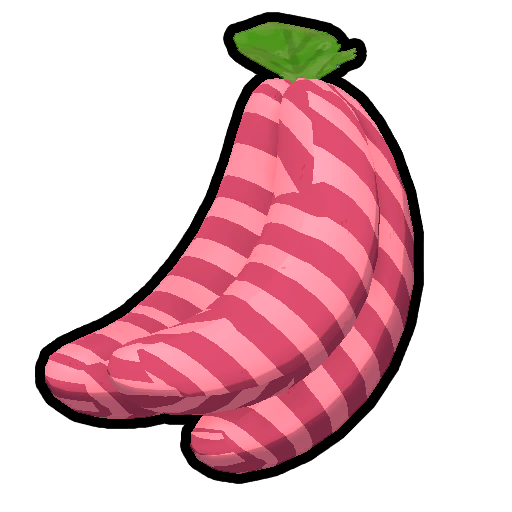](https://peak.wiki.gg/wiki/File%3APink_Berrynana_CB.png)
[Item type](Items.md)- [Food](Food.md)
- [Natural food](https://peak.wiki.gg/wiki/Natural_food)
- [Berry](https://peak.wiki.gg/wiki/Berry)
Biome- [Tropics](Tropics.md)
Weight
[](Stamina%20bar.md#Weight) **2.5**
Base Status Effects
[](Stamina%20bar.md#Hunger)Hunger
-15
[](Stamina%20bar.md#Poison)Poison
15
Cooked Bonuses
[](Stamina%20bar.md#Hunger)Hunger
-15 (-30 total)
[](Stamina%20bar.md#Bonus_stamina)Bonus Stamina
10 (10 total)

The **Pink Berrynana** is a natural [food](Food.md) in *[PEAK](Peak%20%28game%29.md)* found growing on [vines](Vines.md) in the [Tropics](Tropics.md). Eating a Pink Berrynana will restore [](Stamina%20bar.md#Hunger) **15** [Hunger](Stamina%20bar.md#Hunger) and will slowly inflict [](Stamina%20bar.md#Poison) **15** [Poison](Stamina%20bar.md#Poison) over 6 seconds beginning 2 seconds after eating. After eating the Berrynana, the player receives a [](Pink%20Berrynana%20Peel.md) [Pink Berrynana Peel](Pink%20Berrynana%20Peel.md). If the Pink Berrynana is fed to another, the other player will receive the peel. If the other player's inventory and hands are full, the peel will drop at their feet.

[Cooking](Cooking.md) a Pink Berrynana removes the [](Stamina%20bar.md#Poison) [Poison](Stamina%20bar.md#Poison) effect.

## Gallery

- [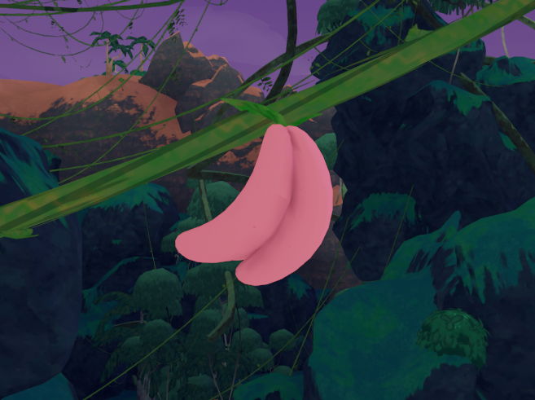](https://peak.wiki.gg/wiki/File%3ABerrynana_pink_closeup.png)
  A Pink Berrynana growing on a [vine](https://peak.wiki.gg/wiki/Vine) in the [Tropics](Tropics.md)

## Patch history

 **[1.0](1.0.md) (2025-06-16):** Introduced.
 **[1.40.a](1.40.a.md) (2025-11-05):** Cooked poisonous berries will now be safe to eat.

[Food](Food.md)
Natural food
Berries
Berrynanas- [](Yellow%20Berrynana.md) [Yellow Berrynana](Yellow%20Berrynana.md)
- [](Pink%20Berrynana.md) Pink Berrynana
- [](Blue%20Berrynana.md) [Blue Berrynana](Blue%20Berrynana.md)
- [](Brown%20Berrynana.md) [Brown Berrynana](Brown%20Berrynana.md)
Clusterberries- [](Red%20Clusterberry.md) [Red Clusterberry](Red%20Clusterberry.md)
- [](Yellow%20Clusterberry.md) [Yellow Clusterberry](Yellow%20Clusterberry.md)
- [](Black%20Clusterberry.md) [Black Clusterberry](Black%20Clusterberry.md)
Crispberries- [](Green%20Crispberry.md) [Green Crispberry](Green%20Crispberry.md)
- [](Yellow%20Crispberry.md) [Yellow Crispberry](Yellow%20Crispberry.md)
- [](Red%20Crispberry.md) [Red Crispberry](Red%20Crispberry.md)
Kingberries- [](Green%20Kingberry.md) [Green Kingberry](Green%20Kingberry.md)
- [](Yellow%20Kingberry.md) [Yellow Kingberry](Yellow%20Kingberry.md)
- [](Purple%20Kingberry.md) [Purple Kingberry](Purple%20Kingberry.md)
Prickleberries- [](Red%20Prickleberry.md) [Red Prickleberry](Red%20Prickleberry.md)
- [](Gold%20Prickleberry.md) [Gold Prickleberry](Gold%20Prickleberry.md)
Shroomberries- [](Red%20Shroomberry.md) [Red Shroomberry](Red%20Shroomberry.md)
- [](Yellow%20Shroomberry.md) [Yellow Shroomberry](Yellow%20Shroomberry.md)
- [](Green%20Shroomberry.md) [Green Shroomberry](Green%20Shroomberry.md)
- [](Blue%20Shroomberry.md) [Blue Shroomberry](Blue%20Shroomberry.md)
- [](Purple%20Shroomberry.md) [Purple Shroomberry](Purple%20Shroomberry.md)
Winterberries- [](Orange%20Winterberry.md) [Orange Winterberry](Orange%20Winterberry.md)
- [](Yellow%20Winterberry.md) [Yellow Winterberry](Yellow%20Winterberry.md)
Other- [](Napberry.md) [Napberry](Napberry.md)
- [](Scorchberry.md) [Scorchberry](Scorchberry.md)
Campfire food- [](Marshmallow.md) [Marshmallow](Marshmallow.md)
- [](Hot%20Dog.md) [Hot Dog](Hot%20Dog.md)
Mushrooms- [](Bugle%20Shroom.md) [Bugle Shroom](Bugle%20Shroom.md)
- [](Button%20Shroom.md) [Button Shroom](Button%20Shroom.md)
- [](Chubby%20Shroom.md) [Chubby Shroom](Chubby%20Shroom.md)
- [](Cluster%20Shroom.md) [Cluster Shroom](Cluster%20Shroom.md)
Mystical food- [](Cure-All.md) [Cure-All](Cure-All.md)
- [](Pandora%27s%20Lunchbox.md) [Pandora's Lunchbox](Pandora%27s%20Lunchbox.md)
Other- [](Cooked%20Bird.md) [Cooked Bird](Cooked%20Bird.md)
- [](Egg.md) [Egg](Egg.md)
- [](Frog%20Legs.md) [Frog Legs](Frog%20Legs.md)
- [](Honeycomb.md) [Honeycomb](Honeycomb.md)
- [](Half-Coconut.md) [Half-Coconut](Half-Coconut.md)
- [](Medicinal%20Root.md) [Medicinal Root](Medicinal%20Root.md)
- [](Mandrake.md) [Mandrake](Mandrake.md)
- [](Scorpion.md) [Scorpion](Scorpion.md)
- [](Tick.md) [Tick](Tick.md)
- [](The%20Early%20Worm.md) [The Early Worm](The%20Early%20Worm.md)
Packaged food
All packaged foods- [](Airline%20Food.md) [Airline Food](Airline%20Food.md)
- [](Big%20Lollipop.md) [Big Lollipop](Big%20Lollipop.md)
- [](Energy%20Drink.md) [Energy Drink](Energy%20Drink.md)
- [](Fortified%20Milk.md) [Fortified Milk](Fortified%20Milk.md)
- [](Granola%20Bar.md) [Granola Bar](Granola%20Bar.md)
- [](Scout%20Cookies.md) [Scout Cookies](Scout%20Cookies.md)
- [](Sports%20Drink.md) [Sports Drink](Sports%20Drink.md)
- [](Trail%20Mix.md) [Trail Mix](Trail%20Mix.md)

---

# Pirate's Compass

Pirate's Compass
[](https://peak.wiki.gg/wiki/File%3APirate%27s_Compass.png)
[Item type](Items.md)- [Equipment](Equipment.md)
Rarity
[Ridiculously Rare](https://peak.wiki.gg/wiki/Ridiculously_Rare)
Source- [Regular Luggage](https://peak.wiki.gg/wiki/Regular_Luggage)
- [Big Luggage](https://peak.wiki.gg/wiki/Big_Luggage)
Weight
[](Stamina%20bar.md#Weight) **0**

The **Pirate's Compass** is an [equipment](Equipment.md) item in *[PEAK](Peak%20%28game%29.md)*. The compass points to the nearest unopened [luggage](Luggage.md) or unused [Ancient Statue](Ancient%20Statue.md).

## See also

- [](Compass.md) [Compass](Compass.md)

# = Patch history

 **[1.0](1.0.md) (2025-06-16):** Introduced.

---

# Pirate


This is a disambiguation page for "Pirate".

The following is a list of links related to Pirate.

**Pirate** may refer to:

- [](Pirate%27s%20Compass.md) [Pirate's Compass](Pirate%27s%20Compass.md)
- [](https://peak.wiki.gg/wiki/Plunderer_Badge) [Plunderer Badge](https://peak.wiki.gg/wiki/Plunderer_Badge)

---

# Piton

Piton
[](https://peak.wiki.gg/wiki/File%3APiton.png)
[Item type](Items.md)- [Deployable](https://peak.wiki.gg/wiki/Deployable)
Rarity
[Epic](https://peak.wiki.gg/wiki/Epic)
Source- [Regular Luggage](https://peak.wiki.gg/wiki/Regular_Luggage)
- [Big Luggage](https://peak.wiki.gg/wiki/Big_Luggage)
- [Explorer's Luggage](https://peak.wiki.gg/wiki/Explorer%27s_Luggage)
Weight
[](Stamina%20bar.md#Weight) **2.5**

The **Piton** (pē- tän) is a [deployable](https://peak.wiki.gg/wiki/Deployable) item in *[PEAK](Peak%20%28game%29.md)*.

When present in the inventory, a [Scout](Scout.md) can place it on the cliff while climbing without letting go. Once placed, it becomes a permanent handhold, letting Scouts recover their [stamina](https://peak.wiki.gg/wiki/Stamina) while holding onto it. Only one [Scout](Scout.md) can hang on a piton at a time.

Grabbing a piton is accomplished by looking at it and pressing the interact button (). Players do not need to hold the climbing button to hang on the piton.

While inserting a piton into a cliff, a preview will be shown of the piton's position. Placing a piton is only possible when the preview is blue. During the insertion, the [Scout's](Scout.md) [stamina](https://peak.wiki.gg/wiki/Stamina) drains considerably slower, although any movement will reset the insertion progress.

## Rusty Pitons

### In the [Alpine](Alpine.md)

[](https://peak.wiki.gg/wiki/File%3ARusty_piton_alpine.png)

A rusty piton found in the [Alpine](Alpine.md).

In the [Alpine](Alpine.md), already placed Pitons can be found on the mountain. These pitons, having a rusted appearance, will break after **6 seconds** of being held on to.

### Pickaxes

[](https://peak.wiki.gg/wiki/File%3APickaxe.png)

A pickaxe stuck into a cliff in the [Mesa](Mesa.md).

**Pickaxes** are a naturally spawning feature exclusive to the [Mesa](Mesa.md). They are found stuck in rock walls, and act identically to Pitons in the [Alpine](Alpine.md), letting scouts rest for up to **6 seconds** before they break. They can not be obtained as an item, and will only ever appear already placed in the wall.

## Tips & Tricks

- Pitons are best placed near the very end of a climb, when [stamina](https://peak.wiki.gg/wiki/Stamina) is particularly low. However, always make sure you have enough [stamina](https://peak.wiki.gg/wiki/Stamina) to reach the piton again if you're placing it to cross a large horizontal distance.
- On the topic of reaching Pitons, they have a rather large interaction distance which is often quite handy.
- Instead of jumping off a piton, simply hold the climbing button () and start moving. Doing this will not consume any additional [stamina](https://peak.wiki.gg/wiki/Stamina) as you will not be grabbing a wall mid-air.
- If you cook a piton at a [Campfire](Campfire.md) or a [Portable Stove](Portable%20Stove.md), it will become incinerated and you won't be able to use it anymore.
- Pitons must be held in one of the hand slots, it cannot be used if it is in a [](Backpack.md) [Backpack](Backpack.md).
- Some items can be used while hanging onto a Piton, such as the [](Energy%20Drink.md) [Energy Drink](Energy%20Drink.md).

## Gallery

- [](https://peak.wiki.gg/wiki/File%3APiton_grabbed_on_ground.png)
  A [Scout](Scout.md) grabbing a piton affixed to the ground. Since Scouts are physically simulated, this Scout is stuck to the piton by its foot.

## Patch history

 **[1.0](1.0.md) (2025-06-16):** Introduced.
 **[1.7](1.7.md) (2025-07-10):** Players will now fall off pitons when passed out, fixing an issue where, on revival, they don’t experience teleporting back to the piton.
 **[1.8](1.8.md) (2025-07-21):** Fixed an issue where your weight on the [stamina bar](Stamina%20bar.md) didn't update after placing a piton while climbing.
 **[1.44.a](1.44.a.md) (2025-11-13):** Fixed players not being able to grab a piton while hanging from a [vine](https://peak.wiki.gg/wiki/Vine).
 **[2.0.a](2.0.a.md) (2026-08-11):** Fixed an issue where being prompted to grab pitons would sometimes not work, especially when directly on top of the piton.

---

# Portable Stove

Portable Stove
[](https://peak.wiki.gg/wiki/File%3APortable_Stove.png)
[Item type](Items.md)- [Deployable](https://peak.wiki.gg/wiki/Deployable)
Rarity
[Legendary](https://peak.wiki.gg/wiki/Legendary)
Biome- [Roots](Roots.md)
- [Tropics](Tropics.md)
- [Alpine](Alpine.md)
- [Mesa](Mesa.md)
- [Caldera](Caldera.md)
- [The Kiln](The%20Kiln.md)
Source- [Regular Luggage](https://peak.wiki.gg/wiki/Regular_Luggage)
- [Big Luggage](https://peak.wiki.gg/wiki/Big_Luggage)
Weight
[](Stamina%20bar.md#Weight) **5**

The **Portable Stove** is an [deployable](https://peak.wiki.gg/wiki/Deployable) item in *[PEAK](Peak%20%28game%29.md)* found in [luggages](Luggage.md) anywhere outside of the [Shore](Shore.md). It can be placed down, allowing you to cook items and removing [](Stamina%20bar.md#Cold) **5** [Cold](Stamina%20bar.md#Cold) per second from players within **3.2 meters**.. The Portable Stove extinguishes itself after 1 minute.

[Cooking](Cooking.md) a Portable Stove causes it to explode, dealing up to [](Stamina%20bar.md#Injury) **20** [Injury](Stamina%20bar.md#Injury) to scouts within within **4.8 meters**, depending on their distance.

## Patch history

 **[1.0](1.0.md) (2025-06-16):** Introduced.
 **[1.40.a](1.40.a.md) (2025-11-05):** Cooking a portable stove causes it to explode.
 **[2.01.a](https://peak.wiki.gg/wiki/2.01.a) :** Portable Stove cooking time restored to 60 seconds. Oops!

---

# Prickleberry


Candidate for Deletion

This page lacks relevance for **PEAK Wiki** and is a candidate for **deletion**.

---

# Purple Kingberry

Purple Kingberry
Normal
Colorblind
[](https://peak.wiki.gg/wiki/File%3APurple_Kingberry.png)
[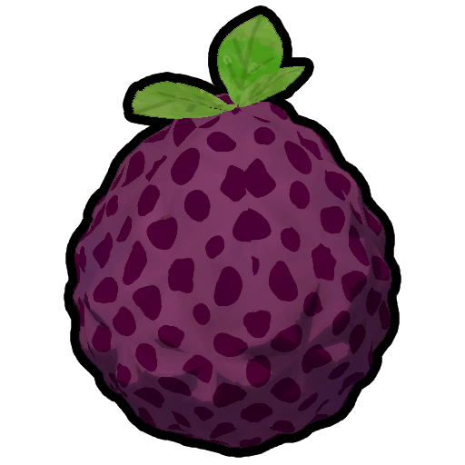](https://peak.wiki.gg/wiki/File%3APurple_Kingberry_CB.png)
[Item type](Items.md)- [Food](Food.md)
- [Natural food](https://peak.wiki.gg/wiki/Natural_food)
- [Berry](https://peak.wiki.gg/wiki/Berry)
Biome- [Tropics](Tropics.md)
Weight
[](Stamina%20bar.md#Weight) **5**
Base Status Effects
[](Stamina%20bar.md#Hunger)Hunger
-30
[](Stamina%20bar.md#Bonus_stamina)Bonus Stamina
35
Cooked Bonuses
[](Stamina%20bar.md#Hunger)Hunger
-30 (-60 total)
[](Stamina%20bar.md#Bonus_stamina)Bonus Stamina
17.5 (52.5 total)

The **Purple [Kingberry](https://peak.wiki.gg/wiki/Kingberry)** is a natural [food](Food.md) in *[PEAK](Peak%20%28game%29.md)* found growing on trees in the [Tropics](Tropics.md). Eating it will restore [](Stamina%20bar.md#Hunger) **30** [Hunger](Stamina%20bar.md#Hunger) and give [](Stamina%20bar.md#Bonus_stamina) **35** [Bonus stamina](Stamina%20bar.md#Bonus_stamina).

Unlike with other types of [Kingberries](https://peak.wiki.gg/wiki/Kingberries), eating a Purple Kingberry has no negative effects.

## Gallery

- [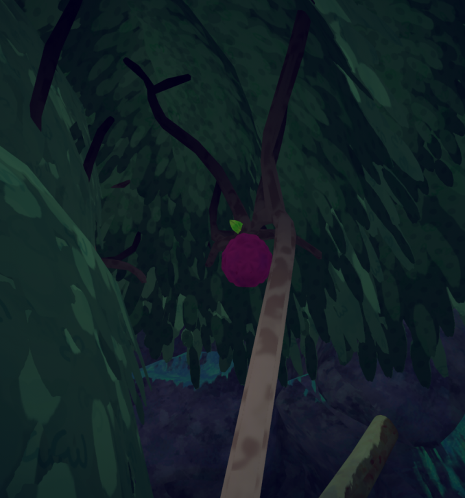](https://peak.wiki.gg/wiki/File%3AKingberry_purple.png)
  A Purple Kingberry growing on a tree in the [Tropics](Tropics.md).
- [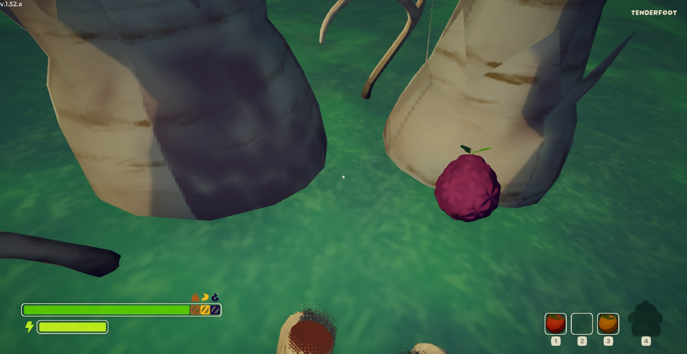](https://peak.wiki.gg/wiki/File%3APurple_kingberry.jpg)

## Patch history

 **[1.0](1.0.md) (2025-06-16):** Introduced.

[Food](Food.md)
Natural food
Berries
Berrynanas- [](Yellow%20Berrynana.md) [Yellow Berrynana](Yellow%20Berrynana.md)
- [](Pink%20Berrynana.md) [Pink Berrynana](Pink%20Berrynana.md)
- [](Blue%20Berrynana.md) [Blue Berrynana](Blue%20Berrynana.md)
- [](Brown%20Berrynana.md) [Brown Berrynana](Brown%20Berrynana.md)
Clusterberries- [](Red%20Clusterberry.md) [Red Clusterberry](Red%20Clusterberry.md)
- [](Yellow%20Clusterberry.md) [Yellow Clusterberry](Yellow%20Clusterberry.md)
- [](Black%20Clusterberry.md) [Black Clusterberry](Black%20Clusterberry.md)
Crispberries- [](Green%20Crispberry.md) [Green Crispberry](Green%20Crispberry.md)
- [](Yellow%20Crispberry.md) [Yellow Crispberry](Yellow%20Crispberry.md)
- [](Red%20Crispberry.md) [Red Crispberry](Red%20Crispberry.md)
Kingberries- [](Green%20Kingberry.md) [Green Kingberry](Green%20Kingberry.md)
- [](Yellow%20Kingberry.md) [Yellow Kingberry](Yellow%20Kingberry.md)
- [](Purple%20Kingberry.md) Purple Kingberry
Prickleberries- [](Red%20Prickleberry.md) [Red Prickleberry](Red%20Prickleberry.md)
- [](Gold%20Prickleberry.md) [Gold Prickleberry](Gold%20Prickleberry.md)
Shroomberries- [](Red%20Shroomberry.md) [Red Shroomberry](Red%20Shroomberry.md)
- [](Yellow%20Shroomberry.md) [Yellow Shroomberry](Yellow%20Shroomberry.md)
- [](Green%20Shroomberry.md) [Green Shroomberry](Green%20Shroomberry.md)
- [](Blue%20Shroomberry.md) [Blue Shroomberry](Blue%20Shroomberry.md)
- [](Purple%20Shroomberry.md) [Purple Shroomberry](Purple%20Shroomberry.md)
Winterberries- [](Orange%20Winterberry.md) [Orange Winterberry](Orange%20Winterberry.md)
- [](Yellow%20Winterberry.md) [Yellow Winterberry](Yellow%20Winterberry.md)
Other- [](Napberry.md) [Napberry](Napberry.md)
- [](Scorchberry.md) [Scorchberry](Scorchberry.md)
Campfire food- [](Marshmallow.md) [Marshmallow](Marshmallow.md)
- [](Hot%20Dog.md) [Hot Dog](Hot%20Dog.md)
Mushrooms- [](Bugle%20Shroom.md) [Bugle Shroom](Bugle%20Shroom.md)
- [](Button%20Shroom.md) [Button Shroom](Button%20Shroom.md)
- [](Chubby%20Shroom.md) [Chubby Shroom](Chubby%20Shroom.md)
- [](Cluster%20Shroom.md) [Cluster Shroom](Cluster%20Shroom.md)
Mystical food- [](Cure-All.md) [Cure-All](Cure-All.md)
- [](Pandora%27s%20Lunchbox.md) [Pandora's Lunchbox](Pandora%27s%20Lunchbox.md)
Other- [](Cooked%20Bird.md) [Cooked Bird](Cooked%20Bird.md)
- [](Egg.md) [Egg](Egg.md)
- [](Frog%20Legs.md) [Frog Legs](Frog%20Legs.md)
- [](Honeycomb.md) [Honeycomb](Honeycomb.md)
- [](Half-Coconut.md) [Half-Coconut](Half-Coconut.md)
- [](Medicinal%20Root.md) [Medicinal Root](Medicinal%20Root.md)
- [](Mandrake.md) [Mandrake](Mandrake.md)
- [](Scorpion.md) [Scorpion](Scorpion.md)
- [](Tick.md) [Tick](Tick.md)
- [](The%20Early%20Worm.md) [The Early Worm](The%20Early%20Worm.md)
Packaged food
All packaged foods- [](Airline%20Food.md) [Airline Food](Airline%20Food.md)
- [](Big%20Lollipop.md) [Big Lollipop](Big%20Lollipop.md)
- [](Energy%20Drink.md) [Energy Drink](Energy%20Drink.md)
- [](Fortified%20Milk.md) [Fortified Milk](Fortified%20Milk.md)
- [](Granola%20Bar.md) [Granola Bar](Granola%20Bar.md)
- [](Scout%20Cookies.md) [Scout Cookies](Scout%20Cookies.md)
- [](Sports%20Drink.md) [Sports Drink](Sports%20Drink.md)
- [](Trail%20Mix.md) [Trail Mix](Trail%20Mix.md)

---

# Purple Shroomberry

Purple Shroomberry
[](https://peak.wiki.gg/wiki/File%3APurple_Shroomberry.png)
[Item type](Items.md)- [Food](Food.md)
- [Natural food](https://peak.wiki.gg/wiki/Natural_food)
- [Berry](https://peak.wiki.gg/wiki/Berry)
Biome- [Roots](Roots.md)
Weight
[](Stamina%20bar.md#Weight) **2.5**
Base Status Effects
[](Stamina%20bar.md#Hunger)Hunger
-10
[](Stamina%20bar.md#Spores)Spores
5
Cooked Bonuses
[](Stamina%20bar.md#Hunger)Hunger
-10 (-20 total)
[](Stamina%20bar.md#Bonus_stamina)Bonus Stamina
10 (10 total)

The **Purple Shroomberry** is a type of [Shroomberry](Shroomberry.md). It produces a random [good or bad effect](Shroomberry.md#Effects) when eaten.

[Cooking](Cooking.md) a Purple Shroomberry removes the [](Stamina%20bar.md#Spores) [Spores](Stamina%20bar.md#Spores) effect.

## Patch history

 **[1.40.a](1.40.a.md) (2025-11-05):** Introduced.

[Food](Food.md)
Natural food
Berries
Berrynanas- [](Yellow%20Berrynana.md) [Yellow Berrynana](Yellow%20Berrynana.md)
- [](Pink%20Berrynana.md) [Pink Berrynana](Pink%20Berrynana.md)
- [](Blue%20Berrynana.md) [Blue Berrynana](Blue%20Berrynana.md)
- [](Brown%20Berrynana.md) [Brown Berrynana](Brown%20Berrynana.md)
Clusterberries- [](Red%20Clusterberry.md) [Red Clusterberry](Red%20Clusterberry.md)
- [](Yellow%20Clusterberry.md) [Yellow Clusterberry](Yellow%20Clusterberry.md)
- [](Black%20Clusterberry.md) [Black Clusterberry](Black%20Clusterberry.md)
Crispberries- [](Green%20Crispberry.md) [Green Crispberry](Green%20Crispberry.md)
- [](Yellow%20Crispberry.md) [Yellow Crispberry](Yellow%20Crispberry.md)
- [](Red%20Crispberry.md) [Red Crispberry](Red%20Crispberry.md)
Kingberries- [](Green%20Kingberry.md) [Green Kingberry](Green%20Kingberry.md)
- [](Yellow%20Kingberry.md) [Yellow Kingberry](Yellow%20Kingberry.md)
- [](Purple%20Kingberry.md) [Purple Kingberry](Purple%20Kingberry.md)
Prickleberries- [](Red%20Prickleberry.md) [Red Prickleberry](Red%20Prickleberry.md)
- [](Gold%20Prickleberry.md) [Gold Prickleberry](Gold%20Prickleberry.md)
Shroomberries- [](Red%20Shroomberry.md) [Red Shroomberry](Red%20Shroomberry.md)
- [](Yellow%20Shroomberry.md) [Yellow Shroomberry](Yellow%20Shroomberry.md)
- [](Green%20Shroomberry.md) [Green Shroomberry](Green%20Shroomberry.md)
- [](Blue%20Shroomberry.md) [Blue Shroomberry](Blue%20Shroomberry.md)
- [](Purple%20Shroomberry.md) Purple Shroomberry
Winterberries- [](Orange%20Winterberry.md) [Orange Winterberry](Orange%20Winterberry.md)
- [](Yellow%20Winterberry.md) [Yellow Winterberry](Yellow%20Winterberry.md)
Other- [](Napberry.md) [Napberry](Napberry.md)
- [](Scorchberry.md) [Scorchberry](Scorchberry.md)
Campfire food- [](Marshmallow.md) [Marshmallow](Marshmallow.md)
- [](Hot%20Dog.md) [Hot Dog](Hot%20Dog.md)
Mushrooms- [](Bugle%20Shroom.md) [Bugle Shroom](Bugle%20Shroom.md)
- [](Button%20Shroom.md) [Button Shroom](Button%20Shroom.md)
- [](Chubby%20Shroom.md) [Chubby Shroom](Chubby%20Shroom.md)
- [](Cluster%20Shroom.md) [Cluster Shroom](Cluster%20Shroom.md)
Mystical food- [](Cure-All.md) [Cure-All](Cure-All.md)
- [](Pandora%27s%20Lunchbox.md) [Pandora's Lunchbox](Pandora%27s%20Lunchbox.md)
Other- [](Cooked%20Bird.md) [Cooked Bird](Cooked%20Bird.md)
- [](Egg.md) [Egg](Egg.md)
- [](Frog%20Legs.md) [Frog Legs](Frog%20Legs.md)
- [](Honeycomb.md) [Honeycomb](Honeycomb.md)
- [](Half-Coconut.md) [Half-Coconut](Half-Coconut.md)
- [](Medicinal%20Root.md) [Medicinal Root](Medicinal%20Root.md)
- [](Mandrake.md) [Mandrake](Mandrake.md)
- [](Scorpion.md) [Scorpion](Scorpion.md)
- [](Tick.md) [Tick](Tick.md)
- [](The%20Early%20Worm.md) [The Early Worm](The%20Early%20Worm.md)
Packaged food
All packaged foods- [](Airline%20Food.md) [Airline Food](Airline%20Food.md)
- [](Big%20Lollipop.md) [Big Lollipop](Big%20Lollipop.md)
- [](Energy%20Drink.md) [Energy Drink](Energy%20Drink.md)
- [](Fortified%20Milk.md) [Fortified Milk](Fortified%20Milk.md)
- [](Granola%20Bar.md) [Granola Bar](Granola%20Bar.md)
- [](Scout%20Cookies.md) [Scout Cookies](Scout%20Cookies.md)
- [](Sports%20Drink.md) [Sports Drink](Sports%20Drink.md)
- [](Trail%20Mix.md) [Trail Mix](Trail%20Mix.md)

---

# Queen

Queen
Black
White
[](https://peak.wiki.gg/wiki/File%3AQueen_Black.png)
[](https://peak.wiki.gg/wiki/File%3AQueen_White.png)
[Item type](Items.md)- [Misc](Misc.md)
Biome- [Airport](Airport.md)
Weight
[](Stamina%20bar.md#Weight) **2.5**

The **Queen** is an [item](https://peak.wiki.gg/wiki/Item) in *[PEAK](Peak%20%28game%29.md)* that can be found in the [Airport](Airport.md). When dropped, chess pieces will automatically lock into place on the floor to avoid being accidentally displaced.

There are four queen pieces in total to be found in the Airport: one of each color will spawn on the the chess board, and another queen piece of each color of will be off to the side.

## Patch history

 **[1.30.a](1.30.a.md) (2025-09-23):** Introduced.

---

# Rarity

**Rarity** is a game [mechanic](https://peak.wiki.gg/wiki/Category%3AMechanics) in *[PEAK](Peak%20%28game%29.md)* which controls the spawn rates of [items](Items.md). The higher an item's rarity, the less often it appears.

There are 7 levels of rarity present in the game, each with a corresponding weight:

| Rarity | Weight |
| --- | --- |
| Common | 100 |
| Uncommon | 50 |
| Rare | 35 |
| Epic | 20 |
| Legendary | 15 |
| Mythic | 6 |
| Ridiculously Rare | 3 |

An item's weight in a given spawn pool is dependent upon its rarity. The weight determines how many "copies" of an item are in a pool.

In general, the chance of any given item appearing from a spawn pool can be expressed as the fraction: `ItemWeight / TotalWeight`, where `ItemWeight` is the weight of the item, determined by its rarity, and `TotalWeight` is the sum of the weights of all the items in the pool.

## Example

A spawn pool with an Uncommon, an Epic, and 2 Legendary items would have the following spawn chances:

| Item | Chance |
| --- | --- |
| Uncommon Item | 50% (50/100) |
| Epic Item | 20% (20/100) |
| Legendary Item 1 | 15% (15/100) |
| Legendary Item 2 | 15% (15/100) |

## See Also

The following pages contain spawn pools with listed chances of items appearing:

- [Luggage](Luggage.md)
- [Ancient Statue](Ancient%20Statue.md)

---

# Red Clusterberry

Red Clusterberry
Normal
Colorblind
[](https://peak.wiki.gg/wiki/File%3ARed_Clusterberry.png)
[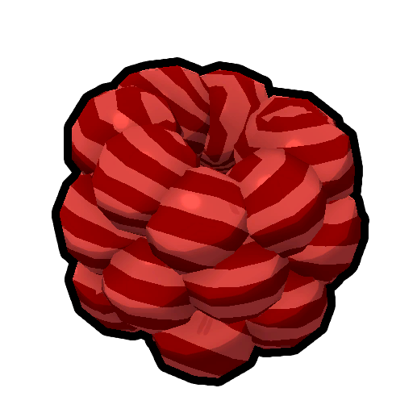](https://peak.wiki.gg/wiki/File%3ARed_Clusterberry_CB.png)
[Item type](Items.md)- [Food](Food.md)
- [Natural food](https://peak.wiki.gg/wiki/Natural_food)
- [Berry](https://peak.wiki.gg/wiki/Berry)
Biome- [Tropics](Tropics.md)
Weight
[](Stamina%20bar.md#Weight) **2.5**
Base Status Effects
[](Stamina%20bar.md#Hunger)Hunger
-10
[](Stamina%20bar.md#Injury)Injury
-20
Cooked Bonuses
[](Stamina%20bar.md#Hunger)Hunger
-10 (-20 total)
[](Stamina%20bar.md#Bonus_stamina)Bonus Stamina
10 (10 total)

The **Red Clusterberry** is a natural [food](Food.md) in *[PEAK](Peak%20%28game%29.md)* found growing on Giant Ivy in the [Tropics](Tropics.md).

## Patch history

 **[1.0](1.0.md) (2025-06-16):** Introduced.

[Food](Food.md)
Natural food
Berries
Berrynanas- [](Yellow%20Berrynana.md) [Yellow Berrynana](Yellow%20Berrynana.md)
- [](Pink%20Berrynana.md) [Pink Berrynana](Pink%20Berrynana.md)
- [](Blue%20Berrynana.md) [Blue Berrynana](Blue%20Berrynana.md)
- [](Brown%20Berrynana.md) [Brown Berrynana](Brown%20Berrynana.md)
Clusterberries- [](Red%20Clusterberry.md) Red Clusterberry
- [](Yellow%20Clusterberry.md) [Yellow Clusterberry](Yellow%20Clusterberry.md)
- [](Black%20Clusterberry.md) [Black Clusterberry](Black%20Clusterberry.md)
Crispberries- [](Green%20Crispberry.md) [Green Crispberry](Green%20Crispberry.md)
- [](Yellow%20Crispberry.md) [Yellow Crispberry](Yellow%20Crispberry.md)
- [](Red%20Crispberry.md) [Red Crispberry](Red%20Crispberry.md)
Kingberries- [](Green%20Kingberry.md) [Green Kingberry](Green%20Kingberry.md)
- [](Yellow%20Kingberry.md) [Yellow Kingberry](Yellow%20Kingberry.md)
- [](Purple%20Kingberry.md) [Purple Kingberry](Purple%20Kingberry.md)
Prickleberries- [](Red%20Prickleberry.md) [Red Prickleberry](Red%20Prickleberry.md)
- [](Gold%20Prickleberry.md) [Gold Prickleberry](Gold%20Prickleberry.md)
Shroomberries- [](Red%20Shroomberry.md) [Red Shroomberry](Red%20Shroomberry.md)
- [](Yellow%20Shroomberry.md) [Yellow Shroomberry](Yellow%20Shroomberry.md)
- [](Green%20Shroomberry.md) [Green Shroomberry](Green%20Shroomberry.md)
- [](Blue%20Shroomberry.md) [Blue Shroomberry](Blue%20Shroomberry.md)
- [](Purple%20Shroomberry.md) [Purple Shroomberry](Purple%20Shroomberry.md)
Winterberries- [](Orange%20Winterberry.md) [Orange Winterberry](Orange%20Winterberry.md)
- [](Yellow%20Winterberry.md) [Yellow Winterberry](Yellow%20Winterberry.md)
Other- [](Napberry.md) [Napberry](Napberry.md)
- [](Scorchberry.md) [Scorchberry](Scorchberry.md)
Campfire food- [](Marshmallow.md) [Marshmallow](Marshmallow.md)
- [](Hot%20Dog.md) [Hot Dog](Hot%20Dog.md)
Mushrooms- [](Bugle%20Shroom.md) [Bugle Shroom](Bugle%20Shroom.md)
- [](Button%20Shroom.md) [Button Shroom](Button%20Shroom.md)
- [](Chubby%20Shroom.md) [Chubby Shroom](Chubby%20Shroom.md)
- [](Cluster%20Shroom.md) [Cluster Shroom](Cluster%20Shroom.md)
Mystical food- [](Cure-All.md) [Cure-All](Cure-All.md)
- [](Pandora%27s%20Lunchbox.md) [Pandora's Lunchbox](Pandora%27s%20Lunchbox.md)
Other- [](Cooked%20Bird.md) [Cooked Bird](Cooked%20Bird.md)
- [](Egg.md) [Egg](Egg.md)
- [](Frog%20Legs.md) [Frog Legs](Frog%20Legs.md)
- [](Honeycomb.md) [Honeycomb](Honeycomb.md)
- [](Half-Coconut.md) [Half-Coconut](Half-Coconut.md)
- [](Medicinal%20Root.md) [Medicinal Root](Medicinal%20Root.md)
- [](Mandrake.md) [Mandrake](Mandrake.md)
- [](Scorpion.md) [Scorpion](Scorpion.md)
- [](Tick.md) [Tick](Tick.md)
- [](The%20Early%20Worm.md) [The Early Worm](The%20Early%20Worm.md)
Packaged food
All packaged foods- [](Airline%20Food.md) [Airline Food](Airline%20Food.md)
- [](Big%20Lollipop.md) [Big Lollipop](Big%20Lollipop.md)
- [](Energy%20Drink.md) [Energy Drink](Energy%20Drink.md)
- [](Fortified%20Milk.md) [Fortified Milk](Fortified%20Milk.md)
- [](Granola%20Bar.md) [Granola Bar](Granola%20Bar.md)
- [](Scout%20Cookies.md) [Scout Cookies](Scout%20Cookies.md)
- [](Sports%20Drink.md) [Sports Drink](Sports%20Drink.md)
- [](Trail%20Mix.md) [Trail Mix](Trail%20Mix.md)

---

# Red Crispberry

Red Crispberry
[](https://peak.wiki.gg/wiki/File%3ARed_Crispberry.png)
[Item type](Items.md)- [Food](Food.md)
- [Natural food](https://peak.wiki.gg/wiki/Natural_food)
- [Berry](https://peak.wiki.gg/wiki/Berry)
Biome- [Shore](Shore.md)
- [Tropics](Tropics.md)
- [Roots](Roots.md)
- [Mesa](Mesa.md)
- [Alpine](Alpine.md)
- [Peak](Peak%20%28biome%29.md)
Weight
[](Stamina%20bar.md#Weight) **2.5**
Base Status Effects
[](Stamina%20bar.md#Hunger)Hunger
-5
Cooked Bonuses
[](Stamina%20bar.md#Hunger)Hunger
-5 (-10 total)
[](Stamina%20bar.md#Bonus_stamina)Bonus Stamina
10 (10 total)

The **Red Crispberry** is a natural [food](Food.md) in *[PEAK](Peak%20%28game%29.md)* found growing on bushes commonly in the [Shore](Shore.md) and [Tropics](Tropics.md). The bushes around the [Campfire](Campfire.md) in the [Roots](Roots.md), near the [Hot Spring](Alpine.md#Hot_Spring) and [Campfire](Campfire.md) in the [Alpine](Alpine.md), the [Oasis](Mesa.md#Oasis) in the [Mesa](Mesa.md), and at the foot of the [Peak](Peak%20%28biome%29.md) occasionally also grow them.

[Cooking](Cooking.md) once doubles the removed [](Stamina%20bar.md#Hunger) [Hunger](Stamina%20bar.md#Hunger) and gains [](Stamina%20bar.md#Bonus_stamina) **10** [Bonus stamina](Stamina%20bar.md#Bonus_stamina).

## Patch history

 **[1.0](1.0.md) (2025-06-16):** Introduced.

[Food](Food.md)
Natural food
Berries
Berrynanas- [](Yellow%20Berrynana.md) [Yellow Berrynana](Yellow%20Berrynana.md)
- [](Pink%20Berrynana.md) [Pink Berrynana](Pink%20Berrynana.md)
- [](Blue%20Berrynana.md) [Blue Berrynana](Blue%20Berrynana.md)
- [](Brown%20Berrynana.md) [Brown Berrynana](Brown%20Berrynana.md)
Clusterberries- [](Red%20Clusterberry.md) [Red Clusterberry](Red%20Clusterberry.md)
- [](Yellow%20Clusterberry.md) [Yellow Clusterberry](Yellow%20Clusterberry.md)
- [](Black%20Clusterberry.md) [Black Clusterberry](Black%20Clusterberry.md)
Crispberries- [](Green%20Crispberry.md) [Green Crispberry](Green%20Crispberry.md)
- [](Yellow%20Crispberry.md) [Yellow Crispberry](Yellow%20Crispberry.md)
- [](Red%20Crispberry.md) Red Crispberry
Kingberries- [](Green%20Kingberry.md) [Green Kingberry](Green%20Kingberry.md)
- [](Yellow%20Kingberry.md) [Yellow Kingberry](Yellow%20Kingberry.md)
- [](Purple%20Kingberry.md) [Purple Kingberry](Purple%20Kingberry.md)
Prickleberries- [](Red%20Prickleberry.md) [Red Prickleberry](Red%20Prickleberry.md)
- [](Gold%20Prickleberry.md) [Gold Prickleberry](Gold%20Prickleberry.md)
Shroomberries- [](Red%20Shroomberry.md) [Red Shroomberry](Red%20Shroomberry.md)
- [](Yellow%20Shroomberry.md) [Yellow Shroomberry](Yellow%20Shroomberry.md)
- [](Green%20Shroomberry.md) [Green Shroomberry](Green%20Shroomberry.md)
- [](Blue%20Shroomberry.md) [Blue Shroomberry](Blue%20Shroomberry.md)
- [](Purple%20Shroomberry.md) [Purple Shroomberry](Purple%20Shroomberry.md)
Winterberries- [](Orange%20Winterberry.md) [Orange Winterberry](Orange%20Winterberry.md)
- [](Yellow%20Winterberry.md) [Yellow Winterberry](Yellow%20Winterberry.md)
Other- [](Napberry.md) [Napberry](Napberry.md)
- [](Scorchberry.md) [Scorchberry](Scorchberry.md)
Campfire food- [](Marshmallow.md) [Marshmallow](Marshmallow.md)
- [](Hot%20Dog.md) [Hot Dog](Hot%20Dog.md)
Mushrooms- [](Bugle%20Shroom.md) [Bugle Shroom](Bugle%20Shroom.md)
- [](Button%20Shroom.md) [Button Shroom](Button%20Shroom.md)
- [](Chubby%20Shroom.md) [Chubby Shroom](Chubby%20Shroom.md)
- [](Cluster%20Shroom.md) [Cluster Shroom](Cluster%20Shroom.md)
Mystical food- [](Cure-All.md) [Cure-All](Cure-All.md)
- [](Pandora%27s%20Lunchbox.md) [Pandora's Lunchbox](Pandora%27s%20Lunchbox.md)
Other- [](Cooked%20Bird.md) [Cooked Bird](Cooked%20Bird.md)
- [](Egg.md) [Egg](Egg.md)
- [](Frog%20Legs.md) [Frog Legs](Frog%20Legs.md)
- [](Honeycomb.md) [Honeycomb](Honeycomb.md)
- [](Half-Coconut.md) [Half-Coconut](Half-Coconut.md)
- [](Medicinal%20Root.md) [Medicinal Root](Medicinal%20Root.md)
- [](Mandrake.md) [Mandrake](Mandrake.md)
- [](Scorpion.md) [Scorpion](Scorpion.md)
- [](Tick.md) [Tick](Tick.md)
- [](The%20Early%20Worm.md) [The Early Worm](The%20Early%20Worm.md)
Packaged food
All packaged foods- [](Airline%20Food.md) [Airline Food](Airline%20Food.md)
- [](Big%20Lollipop.md) [Big Lollipop](Big%20Lollipop.md)
- [](Energy%20Drink.md) [Energy Drink](Energy%20Drink.md)
- [](Fortified%20Milk.md) [Fortified Milk](Fortified%20Milk.md)
- [](Granola%20Bar.md) [Granola Bar](Granola%20Bar.md)
- [](Scout%20Cookies.md) [Scout Cookies](Scout%20Cookies.md)
- [](Sports%20Drink.md) [Sports Drink](Sports%20Drink.md)
- [](Trail%20Mix.md) [Trail Mix](Trail%20Mix.md)

---

# Red Prickleberry

Red Prickleberry
[](https://peak.wiki.gg/wiki/File%3ARed_Prickleberry.png)
[Item type](Items.md)- [Food](Food.md)
- [Natural food](https://peak.wiki.gg/wiki/Natural_food)
- [Berry](https://peak.wiki.gg/wiki/Berry)
Biome- [Mesa](Mesa.md)
Weight
[](Stamina%20bar.md#Weight) **2.5**
Base Status Effects
[](Stamina%20bar.md#Hunger)Hunger
-15
[](Stamina%20bar.md#Heat)Heat
-10
[](Stamina%20bar.md#Thorns)Thorns
10
Cooked Bonuses
[](Stamina%20bar.md#Hunger)Hunger
-15 (-30 total)
[](Stamina%20bar.md#Bonus_stamina)Bonus Stamina
10 (10 total)

The **Red [Prickleberry](Prickleberry.md)** is a natural [food](Food.md) in *[PEAK](Peak%20%28game%29.md)* found growing on [Big Cacti](Big%20Cacti.md) in the [Mesa](Mesa.md). Eating it restores [](Stamina%20bar.md#Hunger) **15** [Hunger](Stamina%20bar.md#Hunger) and [](Stamina%20bar.md#Heat) **10** [Heat](Stamina%20bar.md#Heat) and attaches 2 [thorns](https://peak.wiki.gg/wiki/Thorns) to the [Scout](Scout.md)'s head, inflicting [](Stamina%20bar.md#Thorns) **10** [Thorns](Stamina%20bar.md#Thorns). Because the thorns are attached to the head, you cannot remove them yourself.

[Cooking](Cooking.md) a Red Prickleberry removes the [](Stamina%20bar.md#Thorns) [Thorns](Stamina%20bar.md#Thorns) effect, in addition to the normal effects of cooking.

## Gallery

- [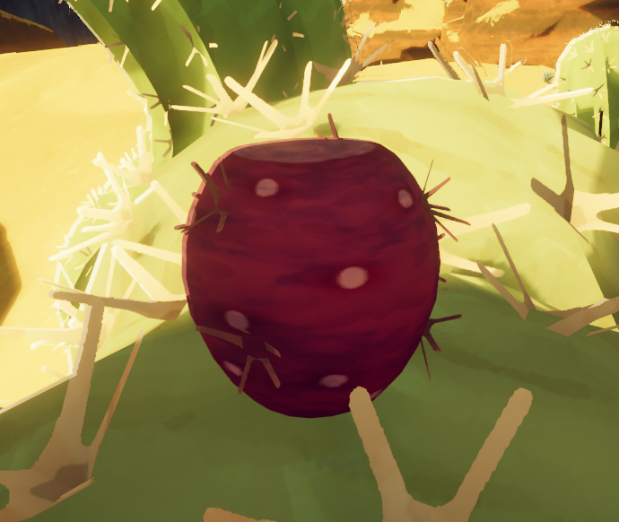](https://peak.wiki.gg/wiki/File%3APrickleberry_red.png)
  A close-up of a Red Prickleberry
- [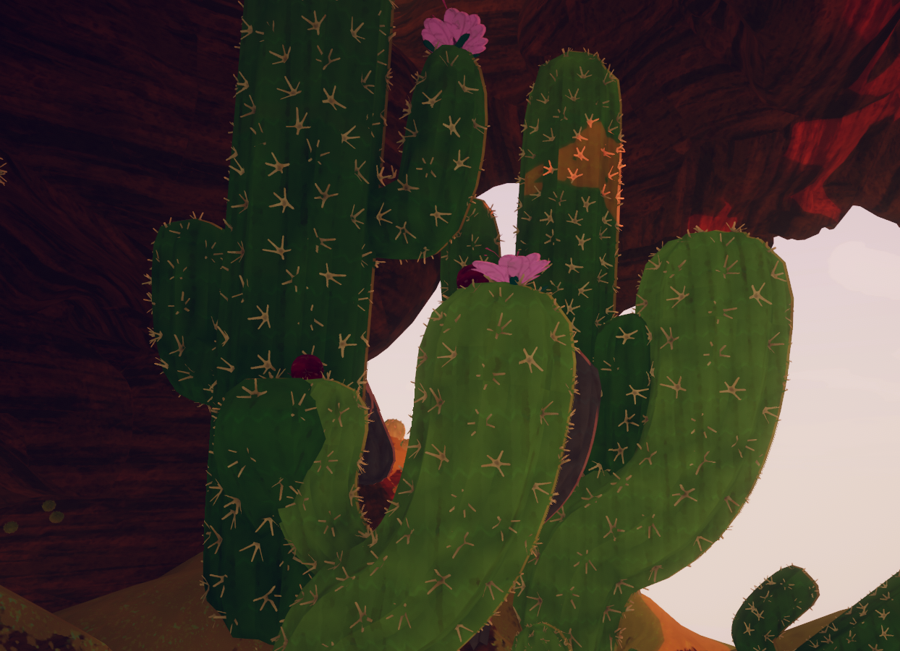](https://peak.wiki.gg/wiki/File%3AMesa_cacti.png)
  A Red Prickleberry growing on a [Big Cactus](https://peak.wiki.gg/wiki/Big_Cactus) in the [Mesa](Mesa.md)
- [](https://peak.wiki.gg/wiki/File%3APrickleberry.png)
  Red Prickleberry texture

## Patch history

 **[1.20.a](1.20.a.md) (2025-08-11):** Introduced.
 **[1.40.a](1.40.a.md) (2025-11-05):** Cooking prickleberries now removes the thorns.

[Food](Food.md)
Natural food
Berries
Berrynanas- [](Yellow%20Berrynana.md) [Yellow Berrynana](Yellow%20Berrynana.md)
- [](Pink%20Berrynana.md) [Pink Berrynana](Pink%20Berrynana.md)
- [](Blue%20Berrynana.md) [Blue Berrynana](Blue%20Berrynana.md)
- [](Brown%20Berrynana.md) [Brown Berrynana](Brown%20Berrynana.md)
Clusterberries- [](Red%20Clusterberry.md) [Red Clusterberry](Red%20Clusterberry.md)
- [](Yellow%20Clusterberry.md) [Yellow Clusterberry](Yellow%20Clusterberry.md)
- [](Black%20Clusterberry.md) [Black Clusterberry](Black%20Clusterberry.md)
Crispberries- [](Green%20Crispberry.md) [Green Crispberry](Green%20Crispberry.md)
- [](Yellow%20Crispberry.md) [Yellow Crispberry](Yellow%20Crispberry.md)
- [](Red%20Crispberry.md) [Red Crispberry](Red%20Crispberry.md)
Kingberries- [](Green%20Kingberry.md) [Green Kingberry](Green%20Kingberry.md)
- [](Yellow%20Kingberry.md) [Yellow Kingberry](Yellow%20Kingberry.md)
- [](Purple%20Kingberry.md) [Purple Kingberry](Purple%20Kingberry.md)
Prickleberries- [](Red%20Prickleberry.md) Red Prickleberry
- [](Gold%20Prickleberry.md) [Gold Prickleberry](Gold%20Prickleberry.md)
Shroomberries- [](Red%20Shroomberry.md) [Red Shroomberry](Red%20Shroomberry.md)
- [](Yellow%20Shroomberry.md) [Yellow Shroomberry](Yellow%20Shroomberry.md)
- [](Green%20Shroomberry.md) [Green Shroomberry](Green%20Shroomberry.md)
- [](Blue%20Shroomberry.md) [Blue Shroomberry](Blue%20Shroomberry.md)
- [](Purple%20Shroomberry.md) [Purple Shroomberry](Purple%20Shroomberry.md)
Winterberries- [](Orange%20Winterberry.md) [Orange Winterberry](Orange%20Winterberry.md)
- [](Yellow%20Winterberry.md) [Yellow Winterberry](Yellow%20Winterberry.md)
Other- [](Napberry.md) [Napberry](Napberry.md)
- [](Scorchberry.md) [Scorchberry](Scorchberry.md)
Campfire food- [](Marshmallow.md) [Marshmallow](Marshmallow.md)
- [](Hot%20Dog.md) [Hot Dog](Hot%20Dog.md)
Mushrooms- [](Bugle%20Shroom.md) [Bugle Shroom](Bugle%20Shroom.md)
- [](Button%20Shroom.md) [Button Shroom](Button%20Shroom.md)
- [](Chubby%20Shroom.md) [Chubby Shroom](Chubby%20Shroom.md)
- [](Cluster%20Shroom.md) [Cluster Shroom](Cluster%20Shroom.md)
Mystical food- [](Cure-All.md) [Cure-All](Cure-All.md)
- [](Pandora%27s%20Lunchbox.md) [Pandora's Lunchbox](Pandora%27s%20Lunchbox.md)
Other- [](Cooked%20Bird.md) [Cooked Bird](Cooked%20Bird.md)
- [](Egg.md) [Egg](Egg.md)
- [](Frog%20Legs.md) [Frog Legs](Frog%20Legs.md)
- [](Honeycomb.md) [Honeycomb](Honeycomb.md)
- [](Half-Coconut.md) [Half-Coconut](Half-Coconut.md)
- [](Medicinal%20Root.md) [Medicinal Root](Medicinal%20Root.md)
- [](Mandrake.md) [Mandrake](Mandrake.md)
- [](Scorpion.md) [Scorpion](Scorpion.md)
- [](Tick.md) [Tick](Tick.md)
- [](The%20Early%20Worm.md) [The Early Worm](The%20Early%20Worm.md)
Packaged food
All packaged foods- [](Airline%20Food.md) [Airline Food](Airline%20Food.md)
- [](Big%20Lollipop.md) [Big Lollipop](Big%20Lollipop.md)
- [](Energy%20Drink.md) [Energy Drink](Energy%20Drink.md)
- [](Fortified%20Milk.md) [Fortified Milk](Fortified%20Milk.md)
- [](Granola%20Bar.md) [Granola Bar](Granola%20Bar.md)
- [](Scout%20Cookies.md) [Scout Cookies](Scout%20Cookies.md)
- [](Sports%20Drink.md) [Sports Drink](Sports%20Drink.md)
- [](Trail%20Mix.md) [Trail Mix](Trail%20Mix.md)

---

# Red Shroomberry

Red Shroomberry
[](https://peak.wiki.gg/wiki/File%3ARed_Shroomberry.png)
[Item type](Items.md)- [Food](Food.md)
- [Natural food](https://peak.wiki.gg/wiki/Natural_food)
- [Berry](https://peak.wiki.gg/wiki/Berry)
Biome- [Roots](Roots.md)
Weight
[](Stamina%20bar.md#Weight) **2.5**
Base Status Effects
[](Stamina%20bar.md#Hunger)Hunger
-10
[](Stamina%20bar.md#Spores)Spores
5
Cooked Bonuses
[](Stamina%20bar.md#Hunger)Hunger
-10 (-20 total)
[](Stamina%20bar.md#Bonus_stamina)Bonus Stamina
10 (10 total)

The **Red Shroomberry** is a type of [Shroomberry](Shroomberry.md). It produces a random [good effect](Shroomberry.md#Good_effects) when eaten.

[Cooking](Cooking.md) a Red Shroomberry removes the [](Stamina%20bar.md#Spores) [Spores](Stamina%20bar.md#Spores) effect.

## Patch history

 **[1.40.a](1.40.a.md) (2025-11-05):** Introduced.

[Food](Food.md)
Natural food
Berries
Berrynanas- [](Yellow%20Berrynana.md) [Yellow Berrynana](Yellow%20Berrynana.md)
- [](Pink%20Berrynana.md) [Pink Berrynana](Pink%20Berrynana.md)
- [](Blue%20Berrynana.md) [Blue Berrynana](Blue%20Berrynana.md)
- [](Brown%20Berrynana.md) [Brown Berrynana](Brown%20Berrynana.md)
Clusterberries- [](Red%20Clusterberry.md) [Red Clusterberry](Red%20Clusterberry.md)
- [](Yellow%20Clusterberry.md) [Yellow Clusterberry](Yellow%20Clusterberry.md)
- [](Black%20Clusterberry.md) [Black Clusterberry](Black%20Clusterberry.md)
Crispberries- [](Green%20Crispberry.md) [Green Crispberry](Green%20Crispberry.md)
- [](Yellow%20Crispberry.md) [Yellow Crispberry](Yellow%20Crispberry.md)
- [](Red%20Crispberry.md) [Red Crispberry](Red%20Crispberry.md)
Kingberries- [](Green%20Kingberry.md) [Green Kingberry](Green%20Kingberry.md)
- [](Yellow%20Kingberry.md) [Yellow Kingberry](Yellow%20Kingberry.md)
- [](Purple%20Kingberry.md) [Purple Kingberry](Purple%20Kingberry.md)
Prickleberries- [](Red%20Prickleberry.md) [Red Prickleberry](Red%20Prickleberry.md)
- [](Gold%20Prickleberry.md) [Gold Prickleberry](Gold%20Prickleberry.md)
Shroomberries- [](Red%20Shroomberry.md) Red Shroomberry
- [](Yellow%20Shroomberry.md) [Yellow Shroomberry](Yellow%20Shroomberry.md)
- [](Green%20Shroomberry.md) [Green Shroomberry](Green%20Shroomberry.md)
- [](Blue%20Shroomberry.md) [Blue Shroomberry](Blue%20Shroomberry.md)
- [](Purple%20Shroomberry.md) [Purple Shroomberry](Purple%20Shroomberry.md)
Winterberries- [](Orange%20Winterberry.md) [Orange Winterberry](Orange%20Winterberry.md)
- [](Yellow%20Winterberry.md) [Yellow Winterberry](Yellow%20Winterberry.md)
Other- [](Napberry.md) [Napberry](Napberry.md)
- [](Scorchberry.md) [Scorchberry](Scorchberry.md)
Campfire food- [](Marshmallow.md) [Marshmallow](Marshmallow.md)
- [](Hot%20Dog.md) [Hot Dog](Hot%20Dog.md)
Mushrooms- [](Bugle%20Shroom.md) [Bugle Shroom](Bugle%20Shroom.md)
- [](Button%20Shroom.md) [Button Shroom](Button%20Shroom.md)
- [](Chubby%20Shroom.md) [Chubby Shroom](Chubby%20Shroom.md)
- [](Cluster%20Shroom.md) [Cluster Shroom](Cluster%20Shroom.md)
Mystical food- [](Cure-All.md) [Cure-All](Cure-All.md)
- [](Pandora%27s%20Lunchbox.md) [Pandora's Lunchbox](Pandora%27s%20Lunchbox.md)
Other- [](Cooked%20Bird.md) [Cooked Bird](Cooked%20Bird.md)
- [](Egg.md) [Egg](Egg.md)
- [](Frog%20Legs.md) [Frog Legs](Frog%20Legs.md)
- [](Honeycomb.md) [Honeycomb](Honeycomb.md)
- [](Half-Coconut.md) [Half-Coconut](Half-Coconut.md)
- [](Medicinal%20Root.md) [Medicinal Root](Medicinal%20Root.md)
- [](Mandrake.md) [Mandrake](Mandrake.md)
- [](Scorpion.md) [Scorpion](Scorpion.md)
- [](Tick.md) [Tick](Tick.md)
- [](The%20Early%20Worm.md) [The Early Worm](The%20Early%20Worm.md)
Packaged food
All packaged foods- [](Airline%20Food.md) [Airline Food](Airline%20Food.md)
- [](Big%20Lollipop.md) [Big Lollipop](Big%20Lollipop.md)
- [](Energy%20Drink.md) [Energy Drink](Energy%20Drink.md)
- [](Fortified%20Milk.md) [Fortified Milk](Fortified%20Milk.md)
- [](Granola%20Bar.md) [Granola Bar](Granola%20Bar.md)
- [](Scout%20Cookies.md) [Scout Cookies](Scout%20Cookies.md)
- [](Sports%20Drink.md) [Sports Drink](Sports%20Drink.md)
- [](Trail%20Mix.md) [Trail Mix](Trail%20Mix.md)

---

# Remedy Fungus

Remedy Fungus
[](https://peak.wiki.gg/wiki/File%3ARemedy_Fungus.png)
[Item type](Items.md)- [Consumable](https://peak.wiki.gg/wiki/Consumable)
Weight
[](Stamina%20bar.md#Weight) **2.5**
Base Status Effects
[](Stamina%20bar.md#Poison)Poison
-35
[](Stamina%20bar.md#Injury)Injury
-52.5
[](Stamina%20bar.md#Spores)Spores
-35

The **Remedy Fungus** is a [consumable](https://peak.wiki.gg/wiki/Consumable) item in *[PEAK](Peak%20%28game%29.md)*. When dropped or thrown, it releases an explosion that immediately heals players within **8 meters** for [](Stamina%20bar.md#Injury) **17.5** [Injury](Stamina%20bar.md#Injury) with an additional [](Stamina%20bar.md#Injury) **35** [Injury](Stamina%20bar.md#Injury), [](Stamina%20bar.md#Poison) [Poison](Stamina%20bar.md#Poison), and [](Stamina%20bar.md#Spores) [Spores](Stamina%20bar.md#Spores) removed over the course of **14 seconds** if they remain in the area of effect.

## Tips

- The Remedy Fungus can be used to negate [fall damage](https://peak.wiki.gg/wiki/Fall_damage). The healing cloud will remove a certain amount of [](Stamina%20bar.md#Injury) [Injury](Stamina%20bar.md#Injury) when the item is dropped, either manually by the player before landing, or automatically upon [losing consciousness](https://peak.wiki.gg/wiki/Death) (provided the Remedy Fungus was in one of the inventory slots).

## Gallery

- [](https://peak.wiki.gg/wiki/File%3ARemedy_fungus_closeup.png)
  A Remedy Fungus close up.

## Patch history

 **[1.2.a](1.2.a.md) (2025-06-18):** Introduced.
 **[1.10.a](1.10.a.md) (2025-07-30):** Remedy Fungus now also cures poison in addition to injury, because it seems like it would.

---

# Rescue Claw

Rescue Claw
[](https://peak.wiki.gg/wiki/File%3ARescue_Claw.png)
[Item type](Items.md)- [Consumable](https://peak.wiki.gg/wiki/Consumable)
- [Equipment](Equipment.md)
Rarity
[Legendary](https://peak.wiki.gg/wiki/Legendary)
Source- [Regular Luggage](https://peak.wiki.gg/wiki/Regular_Luggage)
- [Big Luggage](https://peak.wiki.gg/wiki/Big_Luggage)
- [Explorer's Luggage](https://peak.wiki.gg/wiki/Explorer%27s_Luggage)
Uses
3
Weight
[](Stamina%20bar.md#Weight) **2.5**

The **Rescue Claw** is a [consumable](https://peak.wiki.gg/wiki/Consumable) item in *[PEAK](Peak%20%28game%29.md)* found in regular and large [luggage](Luggage.md) throughout the [island](Island.md). It can be used to pull the wielding player towards terrain, or to pull other scouts towards them. When aiming at all upwards, the claw has a range of **48 meters**. When aiming downwards, the claw has a range of **64 meters**.

Using a Rescue Claw to pull an [unconscious](Scout.md#Unconsciousness_&_Death) scout player **30 meters** will grant you the [](https://peak.wiki.gg/wiki/Disaster_Response_Badge) [Disaster Response Badge](https://peak.wiki.gg/wiki/Disaster_Response_Badge).

[Cooking](Cooking.md) a Rescue Claw immediately incinerates it, making it unusable.

## Tips

- Using a Rescue Claw to climb up or across surfaces may cause the player to be thrown if used on an odd angle/surface. Movement inertia is not accounted for if the player fails to hold onto a surface they hooked on, making them plummet.
- Players are advised to **carefully** select safe surfaces to grapple onto. You must unequip the rescue claw and hold onto surfaces as soon as the claw retraction ends to avoid being thrown.
- You should be very cautious when rescuing scouts with the Rescue Claw. It can be easy for them to not be able to grab onto a ledge in time, or have the opportunity to, and plummet.
- The Rescue Claw is a high risk, high reward item. It can help you get through tough spots in places like [Alpine](Alpine.md) and [The Kiln](The%20Kiln.md), but a mistimed grapple or the game physics betraying you can send you falling to your death. It is recommended to use the item as your last resort if a successful grapple would be very risky, more necessary if the [Fog](Fog.md) is catching up to you.
- You should never use a Rescue Claw on a [Zombie](Zombie.md), as the claw will pull it towards you and have an opportunity to lunge at you.

## Infinite Variant

[](https://peak.wiki.gg/wiki/File%3AInfinite_Rescue_Claw.png)

Infinite Rescue Claw

Selecting "Grapple mode" in [Custom Runs](https://peak.wiki.gg/wiki/Custom_Runs) gives each Scout a gold Rescue Claw with no usage limit. The gold Claw cannot be dropped.

## Patch history

 **[1.40.a](1.40.a.md) (2025-11-05):** Introduced.
 **[1.60.a](1.60.a.md) (2026-03-30):** Rescue Hook now doesn't put you in a [ragdolled state](Scout.md#Ragdoll_State) for as long, making it easier to use.
 **[2.4.a](2.4.a.md) (2026-09-02):** Using the Rescue Claw on a friend will [ragdoll](Scout.md#Ragdoll_State) them for less time, making it easier for them to grab onto something once the claw completes.

---

# Ritual Dagger

Ritual Dagger
[](https://peak.wiki.gg/wiki/File%3ARitual_Dagger.png)
[Item type](Items.md)- [Mystical item](https://peak.wiki.gg/wiki/Mystical_item)
Source- [Ancient Luggage](https://peak.wiki.gg/wiki/Ancient_Luggage)
- [Ancient Statue](Ancient%20Statue.md)
Weight
[](Stamina%20bar.md#Weight) **2.5**
Base Status Effects
[](Stamina%20bar.md#Hunger)Hunger
-100
[](Stamina%20bar.md#Bonus_stamina)Bonus Stamina
100
[](Stamina%20bar.md#Heat)Heat
-100
[](Stamina%20bar.md#Cold)Cold
-100
[](Stamina%20bar.md#Poison)Poison
-100
[](Stamina%20bar.md#Drowsy)Drowsy
-100
[](Stamina%20bar.md#Injury)Injury
-100
[](Stamina%20bar.md#Spores)Spores
-100

The **Ritual Dagger** is a [consumable](https://peak.wiki.gg/wiki/Consumable) [Mystical](https://peak.wiki.gg/wiki/Mystical) item in *[PEAK](Peak%20%28game%29.md)*. It can be obtained from [Ancient Luggages](https://peak.wiki.gg/wiki/Ancient_Luggage) or an [Ancient Statues](Ancient%20Statue.md) when playing co-op. The dagger can be used by "sacrificing" another Scout from behind, killing that Scout and healing the user (in a small AOE) of most negative status effects.

The Ritual Dagger can be [cooked](Cooking.md) but its functionality or effects don't change.

Removing more than 75% negative status effects in one use grants the user the [](https://peak.wiki.gg/wiki/Last_Resort_Badge) [Last Resort Badge](https://peak.wiki.gg/wiki/Last_Resort_Badge).

## Usage Mechanics

To use the dagger, the following conditions must be met:

- The victim must face away from the user.
- The victim must appear as a Scout and not as a [cooked chicken](Cannibalism.md).

Once used, the following happens:

- The victim's [Bonus Stamina](Stamina%20bar.md#Bonus_Stamina) bar gets completely filled with [](Stamina%20bar.md#Petrify) [Petrify](Stamina%20bar.md#Petrify), killing them immediately.
- The user of the dagger is cured of most negative status effects.- This does not include [](Stamina%20bar.md#Weight) [Weight](Stamina%20bar.md#Weight), [](Stamina%20bar.md#Thorns) [Thorns](Stamina%20bar.md#Thorns), [](Stamina%20bar.md#Arrow) [Arrow](Stamina%20bar.md#Arrow)[[confirmation needed](https://peak.wiki.gg/wiki/Category%3APages_needing_confirmation)], [](Stamina%20bar.md#Curse) [Curse](Stamina%20bar.md#Curse), or [](Stamina%20bar.md#Petrify) [Petrify](Stamina%20bar.md#Petrify).
  - The user also gains [](Stamina%20bar.md#Bonus_stamina) **100** [Bonus stamina](Stamina%20bar.md#Bonus_stamina).

## Notes

- Despite appearing and behaving similarly to Scouts, [Zombies](Zombie.md) cannot be sacrificed.

## Patch history

 **[2.0.a](2.0.a.md) (2026-08-11):** Introduced.
 **[2.01.a](https://peak.wiki.gg/wiki/2.01.a) :**

- Fixed an issue where the Ritual Dagger could be used indefinitely.
- Fixed an issue where killing a player who had placed a [Checkpoint Flag](Checkpoint%20Flag.md) with the Ritual Dagger could break their voice chat and mess up their character animations.

---

# Rocketpack

Rocketpack
[](https://peak.wiki.gg/wiki/File%3ARocketpack.png)
[Item type](Items.md)- [Equipment](Equipment.md)
Rarity
[Mythic](https://peak.wiki.gg/wiki/Mythic)
Source- [Regular Luggage](https://peak.wiki.gg/wiki/Regular_Luggage)
- [Big Luggage](https://peak.wiki.gg/wiki/Big_Luggage)
- [Clown Luggage](https://peak.wiki.gg/wiki/Clown_Luggage)
Weight
[](Stamina%20bar.md#Weight) **2.5**

The **Rocketpack** is a wearable [Equipment](Equipment.md) [item](https://peak.wiki.gg/wiki/Item) in *[PEAK](Peak%20%28game%29.md)*. It takes the fourth equipment slot similar to the [](Backpack.md) [Backpack](Backpack.md), and you cannot wear both at the same time.

While equipped, another [Scout](Scout.md) or the wearer (with the right angle) can light the fuse to the Rocketpack. After **3 seconds**, the rocket ignites for **3 seconds** and causes the wearer to fly. While flying, you can use your movement keys to slightly steer the flying direction, but control over movement is very negligible.

After the flying time is up, the rocket explodes into fireworks, dealing up to [](Stamina%20bar.md#Injury) **20** [Injury](Stamina%20bar.md#Injury) to nearby Scouts.

## Gallery

- [](https://peak.wiki.gg/wiki/File%3AFireworks.png)
  A Rocketpack exploding into fireworks.

## Patch history

 **[2.0.a](2.0.a.md) (2026-08-11):** Introduced.

---

# Rook

Rook
Black
White
[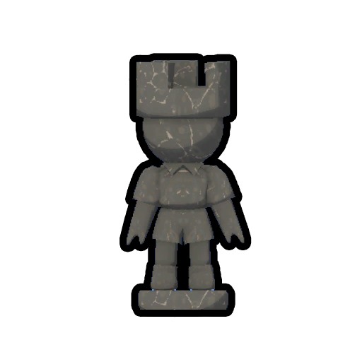](https://peak.wiki.gg/wiki/File%3ARook_Black.png)
[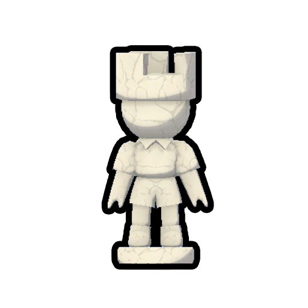](https://peak.wiki.gg/wiki/File%3ARook_White.png)
[Item type](Items.md)- [Misc](Misc.md)
Biome- [Airport](Airport.md)
Weight
[](Stamina%20bar.md#Weight) **2.5**

The **Rook** is an [item](https://peak.wiki.gg/wiki/Item) in *[PEAK](Peak%20%28game%29.md)* that can be found in the [Airport](Airport.md). When dropped, chess pieces will automatically lock into place on the floor to avoid being accidentally displaced.

There are four rook pieces in total to be found in the Airport, with two of each color set up on the the chess board.

## Patch history

 **[1.30.a](1.30.a.md) (2025-09-23):** Introduced.

---

# Roots

Roots
[](https://peak.wiki.gg/wiki/File%3ARoots_Location.jpg)
Details
Type
[Biome](https://peak.wiki.gg/wiki/Biome)
Region
**2**/6

The **Roots** is one of the two possible second [biomes](https://peak.wiki.gg/wiki/Biome) in *[PEAK](Peak%20%28game%29.md)* (the other being the [Tropics](Tropics.md)). It follows the [Shore](Shore.md) and precedes either the [Alpine](Alpine.md) or the [Mesa](Mesa.md), depending on the map [seed](https://peak.wiki.gg/wiki/Seed). It is comprised of a redwood forest infested with mushrooms.

Reaching the top and lighting the [campfire](Campfire.md) dispels the fog wall blocking access to the next biome and grants all living [Scouts](https://peak.wiki.gg/wiki/Scouts) the [](https://peak.wiki.gg/wiki/Forestry_Badge) [Forestry Badge](https://peak.wiki.gg/wiki/Forestry_Badge) if they haven't already obtained it.

When playing on the [Peak Ascent](Ascents.md) or higher, the [Fog](Fog.md) will eventually start rising in this biome.

## Features

### Redwood Trees

---

[](https://peak.wiki.gg/wiki/File%3ARoots_redwood_tree.png)

**Redwood Trees** with thick trunks and conical crowns appear in the Roots. Small natural shelf fungi can be found scattered upon their trunks. They often feature wooden platforms you can stand on, and can have [](Bounce%20Fungus.md) [Bounce Fungi](Bounce%20Fungus.md) [](Cloud%20Fungus.md) [Cloud Fungi](Cloud%20Fungus.md), and [](Shelf%20Fungus.md) [Shelf Fungi](Shelf%20Fungus.md) to pick up. The trees' canopies are standable locations, which can be useful for traversal.

### Redwood Stumps

---

- [](https://peak.wiki.gg/wiki/File%3ARoots_stump.png)
- [](https://peak.wiki.gg/wiki/File%3AHollow_trunk_honeycomb.jpg)

**Redwood Stumps** appear all around the Roots. Some of these stumps are hollow, with an entrance at the bottom and top. These hollow stumps may contain a [](Honeycomb.md) [Honeycomb](Honeycomb.md).

### Vines

---

[](https://peak.wiki.gg/wiki/File%3ARoots_vines.png)

**Vines** can be found throughout the Roots that connect various points on the mountain. They can be grappled onto similar to [rope](Rope.md), taking very little [stamina](https://peak.wiki.gg/wiki/Stamina) while doing so. Moving along the vines takes some stamina, but much less than climbing. Hanging on a vine without moving drains stamina at a very slow rate.

[Shroomberries](https://peak.wiki.gg/wiki/Shroomberries) can sometimes be found growing on vines.

### Giant Shelf Fungi

---

[](https://peak.wiki.gg/wiki/File%3ARoots_shelf_fungus.png)

**Giant Shelf Fungi** can be found growing on the trees and on the climb in the Roots. They act as platforms to help scouts maneuver the biome.

### Bouncy Mushrooms

---

[](https://peak.wiki.gg/wiki/File%3ARoots_red_shroom.jpg)

**Bouncy Mushrooms** can be found all throughout the Roots. Landing on the top of one will bounce a scout and restore a small amount of stamina, identical to a [](Bounce%20Fungus.md) [Bounce Fungus](Bounce%20Fungus.md).

### Water

---

[](https://peak.wiki.gg/wiki/File%3ARoots_water.png)

**Water** can be found covering the lowest parts of the Roots. Scouts' movement speed is reduced while wading through the water.

### Waterfalls

---

[](https://peak.wiki.gg/wiki/File%3ARoots_waterfall.png)

**Waterfalls** can also spawn in the Roots, similar to those seen in the [Tropics](Tropics.md). The water may make it harder to see the terrain behind it, but otherwise waterfalls are completely benign. Touching the water will knock a [Scout](Scout.md) over for a couple of seconds without doing any damage.

## Hazards

| Hazard | Image | Description |
| --- | --- | --- |
| **Wind** | [Roots wind.jpg](https://peak.wiki.gg/wiki/File%3ARoots_wind.jpg) | **Wind** is the main environmental hazard in the Roots, unique to the biome, and the counterpart of the Rain in the [Tropics](Tropics.md). Periodically, it will begin to gust, pushing all physics objects to either the left or right side of the biome, somewhat similar to how [Tornadoes](Tornado.md) work in the [Mesa](Mesa.md). Additionally, while a player is affected by wind, their stamina consumption when gripping onto a wall without moving becomes similar to regular climbing. Stamina consumption while climbing is also increased. Increased stamina consumption applied only for the usual climbing and not for using vines, ropes or chains [[confirmation needed](https://peak.wiki.gg/wiki/Category%3APages_needing_confirmation)] |
| **[Bridges](Bridge.md)** | [Roots Bridge.png](https://peak.wiki.gg/wiki/File%3ARoots_Bridge.png) | **Bridges** connect some tree platforms together. Each bridge has a weight limit from 1-5. If a number of [Scouts](Scout.md) equal to or greater than the weight limit stand on a bridge, it will break after a few seconds. |
| **Mushroom Spore Clouds** | [Roots spores outside.jpg](https://peak.wiki.gg/wiki/File%3ARoots_spores_outside.jpg)[Roots spore emitter.jpg](https://peak.wiki.gg/wiki/File%3ARoots_spore_emitter.jpg) | **Mushroom Spore Clouds** are areas of glowing pink fog that inflict [Spores](Stamina%20bar.md#Spores) [Spores](Stamina%20bar.md#Spores) as players remain within them. When the wind is blowing, the clouds will temporarily dissipate. Found within these areas are glowing pink mushrooms. However, these mushrooms are non-interactive, and deal no additional [Spores](Stamina%20bar.md#Spores) [Spores](Stamina%20bar.md#Spores) damage to the players. The cloud is produced by a **Spore Emitter**, which can be found at its center. |
| **Evil Bouncy Mushrooms** | [Evil Bounce Fungus.png](https://peak.wiki.gg/wiki/File%3AEvil_Bounce_Fungus.png) | **Evil Bouncy Mushrooms** are similar to **Bouncy Mushrooms**, with a more purple, cracked appearance. Landing on one will bounce you as usual, and will additionally apply [Spores](Stamina%20bar.md#Spores) **5** [Spores](Stamina%20bar.md#Spores) each bounce. They only generate in the Clearcut variant. |
| **Spore Bombs** | [Roots bombshroom.jpg](https://peak.wiki.gg/wiki/File%3ARoots_bombshroom.jpg) | **Spore Bombs** can usually be found on the ground, especially near the edges. They explode upon contact, releasing a purple gas cloud that inflicts [Spores](Stamina%20bar.md#Spores) [Spores](Stamina%20bar.md#Spores) on any [Scouts](Scout.md) caught in it. The cloud dissipates after a certain amount of time or when the wind blows. |
| **Explosive Spore Bombs** | [Spore Bomb - explosive - closeup.png](https://peak.wiki.gg/wiki/File%3ASpore_Bomb_-_explosive_-_closeup.png) | **Explosive Spore Bombs** can be found on the ground or on the cliffs. They explode upon contact, sending [Scouts](Scout.md) flying in the direction they came in. They are primarily yellow with splotches of green all over them. They can also be found in the [Tropics](Tropics.md). |
| **[Beetles](Beetle.md)** | [Beetle.jpg](https://peak.wiki.gg/wiki/File%3ABeetle.jpg) | **Beetles** are a creature players can encounter in the climb of the Roots. They chase [Scouts](Scout.md) and attempt to throw them, but do not deal damage themselves. |
| **[Spiders](Spider.md)** | [Spider closeup.jpg](https://peak.wiki.gg/wiki/File%3ASpider_closeup.jpg) | **Spiders** are an enemy found hanging from the trees and cliffs of the Roots. They grab careless [Scouts](Scout.md), dealing [Web](Stamina%20bar.md#Web) **25** [Web](Stamina%20bar.md#Web) and a significant amount of [Poison](Stamina%20bar.md#Poison) [Poison](Stamina%20bar.md#Poison). Throwing objects at spiders, on hit, will stun them for a period of time, allowing Scouts to pass by beneath completely unharmed. |
| **[Zombies](Zombie.md)** | [Zombie run.jpg](https://peak.wiki.gg/wiki/File%3AZombie_run.jpg) | **Zombies** are enemies found throughout the Roots on [Peak ascent](Ascents.md#Peak) or higher. They chase and climb after [Scouts](Scout.md), biting them and inflicting [Spores](Stamina%20bar.md#Spores) [Spores](Stamina%20bar.md#Spores) and [Injury](Stamina%20bar.md#Injury) [Injury](Stamina%20bar.md#Injury) until they die. Much like the [Scoutmaster](https://peak.wiki.gg/wiki/Scoutmaster), activating the [Campfire](Campfire.md) will cause them to die. |

## Food

The following natural [foods](Food.md) can be found in the Roots:

- [](Red%20Shroomberry.md) [Red Shroomberry](Red%20Shroomberry.md)
- [](Yellow%20Shroomberry.md) [Yellow Shroomberry](Yellow%20Shroomberry.md)
- [](Green%20Shroomberry.md) [Green Shroomberry](Green%20Shroomberry.md)
- [](Blue%20Shroomberry.md) [Blue Shroomberry](Blue%20Shroomberry.md)
- [](Purple%20Shroomberry.md) [Purple Shroomberry](Purple%20Shroomberry.md)
- [](Medicinal%20Root.md) [Medicinal Root](Medicinal%20Root.md)
- [](Mandrake.md) [Mandrake](Mandrake.md)
- [](Button%20Shroom.md) [Button Shroom](Button%20Shroom.md)
- [](https://peak.wiki.gg/wiki/Button_Shroom_%28Poisonous%29) [Button Shroom (Poisonous)](https://peak.wiki.gg/wiki/Button_Shroom_%28Poisonous%29)
- [](Bugle%20Shroom.md) [Bugle Shroom](Bugle%20Shroom.md)
- [](https://peak.wiki.gg/wiki/Bugle_Shroom_%28Poisonous%29) [Bugle Shroom (Poisonous)](https://peak.wiki.gg/wiki/Bugle_Shroom_%28Poisonous%29)
- [](Cluster%20Shroom.md) [Cluster Shroom](Cluster%20Shroom.md)
- [](https://peak.wiki.gg/wiki/Cluster_Shroom_%28Poisonous%29) [Cluster Shroom (Poisonous)](https://peak.wiki.gg/wiki/Cluster_Shroom_%28Poisonous%29)
- [](Chubby%20Shroom.md) [Chubby Shroom](Chubby%20Shroom.md)
- [](Honeycomb.md) [Honeycomb](Honeycomb.md)

## Natural Items

The following natural items can spawn in the Roots.

- [](Bounce%20Fungus.md) [Bounce Fungus](Bounce%20Fungus.md)
- [](Cloud%20Fungus.md) [Cloud Fungus](Cloud%20Fungus.md)
- [](Shelf%20Fungus.md) [Shelf Fungus](Shelf%20Fungus.md)
- [](Remedy%20Fungus.md) [Remedy Fungus](Remedy%20Fungus.md)
- [](Warp%20Fungus.md) [Warp Fungus](Warp%20Fungus.md)
- [](Magic%20Bean.md) [Magic Bean](Magic%20Bean.md)

## Variants

Roots Variants

| Variant | Weight | Image | Description |
| --- | --- | --- | --- |
| **Default** | 100 | [Roots Default.JPG](https://peak.wiki.gg/wiki/File%3ARoots_Default.JPG) | The default generation of Roots |
| **Cave Mania** | 10 | [Roots Cave Mania.jpg](https://peak.wiki.gg/wiki/File%3ARoots_Cave_Mania.jpg) | Rock formations generate in the center of the biome. Generation generally creates more caves. |
| **Clearcut** | 25 | [Roots Clearcut.jpg](https://peak.wiki.gg/wiki/File%3ARoots_Clearcut.jpg) | No redwood trees generate on the approach, being replaced by a significant amount of **Bouncy Mushrooms**. **Evil Bouncy Mushrooms** also generate. |
| **Deep Water** | 25 | [Roots Deep Water.jpg](https://peak.wiki.gg/wiki/File%3ARoots_Deep_Water.jpg) | The water at the bottom of the biome is deeper and has a red hue. Less trees generate in the center of the biome. More **Waterfalls** generate. The water will constantly inflict [Spores](Stamina%20bar.md#Spores) [Spores](Stamina%20bar.md#Spores) to any [Scouts](https://peak.wiki.gg/wiki/Scouts) in contact with it. |
| **Deep Woods** | 25 | [Roots Deep Woods.jpg](https://peak.wiki.gg/wiki/File%3ARoots_Deep_Woods.jpg) | Significantly more trees generate, creating a very dense forest. |

Removed Roots Variants

| Variant | Weight | Image | Description |
| --- | --- | --- | --- |
| **Bomb Beetle** | 25 | [Roots Bomb Beetle.jpg](https://peak.wiki.gg/wiki/File%3ARoots_Bomb_Beetle.jpg) | Significantly more **Beetles** and **Explosive Bombshrooms** generate. Removed in [1.64.a](1.64.a.md). |

## Tips & tricks

- The trees are often not connected well, so traversing along the floor is advised.
- [Zombies](Zombie.md) only activate while you are in their line of sight. If you see one, run away before it sees you.
- Climbing giant redwoods near the cliff face can get you very high before getting onto the face.
- Similar to [Blizzards](Blizzard.md) in the [Alpine](Alpine.md), wind is less dangerous when rock formations or trees are used as cover. Running against the wind or grabbing onto nearby surfaces can help prevent your [Scout](Scout.md) from getting blown off from a high place or into a hazard.
- It is wise to wait until wind has just passed before attempting lengthy or risky maneuvers (i.e. crossing bridges between redwood tree platforms).
- Due to the high number of entity hazards in the biome, maintaining awareness is important. Audio cues can alert players to the presence of nearby [Spiders](Spider.md) or [Beetles](Beetle.md), as well as signalling when a player is being targeted by an active [zombie](Zombie.md).
- It is often impossible to find a route completely unobstructed by spore clouds. As a result, [](Stamina%20bar.md#Spores) [Spores](Stamina%20bar.md#Spores) can accumulate quickly and in large amounts while in the Roots, and the [status effect](Stamina%20bar.md) is among the slowest-decaying in the game. [](Fortified%20Milk.md) [Fortified Milk](Fortified%20Milk.md) is helpful to mitigate the accumulation of [](Stamina%20bar.md#Spores) [Spores](Stamina%20bar.md#Spores) when moving through particularly difficult areas. Most healing items also remove [](Stamina%20bar.md#Spores) [Spores](Stamina%20bar.md#Spores), with the exception of [](Bandages.md) [Bandages](Bandages.md).

## Trivia

- When you are in this biome, your Steam Now Playing will say "Traversing the Roots".

## Gallery

- [](https://peak.wiki.gg/wiki/File%3ARoots_spore_emitter.jpg)
  A [spore emitter](Spore%20emitter.md) found inside a spore cloud.
- [](https://peak.wiki.gg/wiki/File%3ARoots_glowing_shrooms.jpg)
  Glowing pink mushrooms can be seen growing throughout the biome.
- [](https://peak.wiki.gg/wiki/File%3ARoots_tree_cavity.jpg)
  A cavity in a **redwood** tree.
- [](https://peak.wiki.gg/wiki/File%3ARoots_top.jpg)
  The top of the Roots.
- [](https://peak.wiki.gg/wiki/File%3ARoots_campfire.jpg)
  The [Campfire](Campfire.md) at the very top of the biome, surrounded by large mushrooms.
- [](https://peak.wiki.gg/wiki/File%3ATooManyBeetles.png)
  A large group of [Beetles](Beetle.md) pushing around the same scout in the Bomb Beetle variant.

## Patch history

 **[1.40.a](1.40.a.md) (2025-11-05):** Introduced.
 **[1.44.a](1.44.a.md) (2025-11-13):**

- Fixed an issue where [scouts](https://peak.wiki.gg/wiki/Scouts) in a [ragdoll](https://peak.wiki.gg/wiki/Ragdoll) state would bounce off [mushrooms](#Bouncy_Mushrooms) way too high.
- Fixed an issue where a spawn point could spawn a [Zombie](Zombie.md) more than once if an old one died, resulting in some comedic infinite spawns if the spawned [Zombie](Zombie.md) [ragdolled](Scout.md#Ragdoll_State) off a cliff.

 **[1.45.a](1.45.a.md) (2025-11-17):**

- The Roots now has [biome variants](#Variants). You know how sometimes the [Tropics](Tropics.md) is freaky and full of more [bombs](Tropics.md#Hazards) than usual? We did a pass like that to the Roots.
- Thickened [giant mushroom](#Bouncy_Mushrooms) colliders to make it less likely to get stuck in them when falling from a great height.

 **[1.64.a](1.64.a.md) (2026-06-24):** Removed BombBeetles and TornadoHell from the list of potential variants for Roots and [Mesa](Mesa.md).

---

# Rope Cannon

Rope Cannon
[](https://peak.wiki.gg/wiki/File%3ARope_Cannon.png)
[Item type](Items.md)- [Deployable](https://peak.wiki.gg/wiki/Deployable)
Rarity
[Legendary](https://peak.wiki.gg/wiki/Legendary)
Source- [Regular Luggage](https://peak.wiki.gg/wiki/Regular_Luggage)
- [Big Luggage](https://peak.wiki.gg/wiki/Big_Luggage)
- [Explorer's Luggage](https://peak.wiki.gg/wiki/Explorer%27s_Luggage)
Weight
[](Stamina%20bar.md#Weight) **2.5**

The **Rope Cannon** is a [deployable](https://peak.wiki.gg/wiki/Deployable) item in *[PEAK](Peak%20%28game%29.md)*. Using a rope cannon allows the player to attach a **7.5 meter** rope to a surface up to **48 meters** away, embedding one end of it into the surface via a hook. It is the normal version of the [](Anti-Rope%20Cannon.md) [Anti-Rope Cannon](Anti-Rope%20Cannon.md).

[Cooking](Cooking.md) a Rope Cannon immediately incinerates it, making it unusable.

## Physics

The physics of the ropes deployed by the Rope Cannon are mostly identical to the [](Rope%20Spool.md) [Rope Spool](Rope%20Spool.md), with the following caveats:

When a rope is deployed, it gradually extends from the exposed end of its associated hook. However, the initial direction the rope begins extending is indeterminate. Depending on the initial placement of the hook, this can cause the rope to unspool itself in an inconvenient place that renders it useless.

To avoid bad unspools, it is recommended to shoot hooks at vertically-oriented surfaces, slightly down from the top of the surface and away from any flatter surrounding surfaces. Also avoid situations where there are sloped surfaces of any kind beneath the rope, as it is unlikely to unspool down the full distance of these slopes.

## See also

- [](Anti-Rope%20Cannon.md) [Anti-Rope Cannon](Anti-Rope%20Cannon.md)

## Patch history

 **[1.0](1.0.md) (2025-06-16):** Introduced.
 **[1.1.a](1.1.a.md) (2025-06-17):** Prevented the Rope Shooter from firing and being wasted on a target that's out of range, like the [Chain Shooter](Chain%20Launcher.md) does
 **[1.7](1.7.md) (2025-07-10):** Rope Shooters and [Anti-Rope Shooters](Anti-Rope%20Cannon.md) shoot 50% more rope!
 **[1.60.a](1.60.a.md) (2026-03-30):** Fixed a long-standing issue where interacting with a rope shooter's rope immediately after it was fired could cause a division by zero, causing chaotic behaviour, including locking the player's controls or sending them to the void.

---

# Rope Spool

Rope Spool
[](https://peak.wiki.gg/wiki/File%3ARope_Spool.png)
[Item type](Items.md)- [Deployable](https://peak.wiki.gg/wiki/Deployable)
Rarity
[Rare](https://peak.wiki.gg/wiki/Rare)
Source- [Regular Luggage](https://peak.wiki.gg/wiki/Regular_Luggage)
- [Big Luggage](https://peak.wiki.gg/wiki/Big_Luggage)
- [Explorer's Luggage](https://peak.wiki.gg/wiki/Explorer%27s_Luggage)
Weight
[](Stamina%20bar.md#Weight) **2.5**

The **Rope Spool** is an [deployable](https://peak.wiki.gg/wiki/Deployable) item in *[PEAK](Peak%20%28game%29.md)*. It provides a total of **12.5 meters** of climbable rope, placeable in lengths from **0.75m** to **10m** long. The rope will then allow [Scouts](https://peak.wiki.gg/wiki/Scouts) to climb it while using less [stamina](https://peak.wiki.gg/wiki/Stamina) than normal. The [](Anti-Rope%20Spool.md) [Anti-Rope Spool](Anti-Rope%20Spool.md) is a gravity-defying variant of the Rope Spool.

[Cooking](Cooking.md) a Rope Spool immediately incinerates it, making it unusable.

## Usage

When placing rope, first have the spool in hand and use the scroll wheel to unravel the rope to the desired length. To secure the rope, hold  for 2 seconds while aiming at the surface where the knot should be tied. A preview of the rope's anchor will shown in blue when the surface is valid, or red when the attempting to tie to an invalid surface.

Rope can be grabbed by using the interact key () on it, and climbing is done using forward and backward movement. To let go of the rope, simply jump ().

## Physics

Ropes are physically simulated in *[PEAK](Peak%20%28game%29.md)* with regards to the environment only. They are not affected by the weight or momentum of any Scouts climbing them.

For more information on rope physics, refer to how they behave when deployed by the [](Rope%20Cannon.md) [Rope Cannon](Rope%20Cannon.md).

## See also

- [](Anti-Rope%20Spool.md) [Anti-Rope Spool](Anti-Rope%20Spool.md)

## Patch history

 **[1.0](1.0.md) (2025-06-16):** Introduced.
 **[1.6.a](1.6.a.md) (2025-07-04):** Fixed an issue where the rope anchor preview would spawn on walls at weird angles
 **[1.7](1.7.md) (2025-07-10):** Rope Spool now has a weight of 1 instead of 0. Anti-Rope Spool and Anti-Rope Shooter now have a weight of -1
 **[1.8](1.8.md) (2025-07-21):** Fixed an issue where your controls could get soft-locked if a held Rope Spool was incinerated by lava while you tried to tie it off.

---

# Rope


This is a disambiguation page for "Rope".

The following is a list of links related to Rope.

**Rope** may refer to:

## Items

- [](Rope%20Spool.md) [Rope Spool](Rope%20Spool.md) - Provides up to a total of 12.5 meters of climbable rope.
- [](Rope%20Cannon.md) [Rope Cannon](Rope%20Cannon.md) - Fires 7.5 meters of rope that mounts to a surface up to 30 meters away.
- [](Anti-Rope%20Spool.md) [Anti-Rope Spool](Anti-Rope%20Spool.md) - Similar to the [Rope Spool](Rope%20Spool.md) but the rope has anti-gravity properties.
- [](Anti-Rope%20Cannon.md) [Anti-Rope Cannon](Anti-Rope%20Cannon.md) - Similar to the [Rope Cannon](Rope%20Cannon.md) but the rope has anti-gravity properties.

---

# Scorchberry

Scorchberry
[](https://peak.wiki.gg/wiki/File%3AScorchberry.png)
[Item type](Items.md)- [Food](Food.md)
- [Natural food](https://peak.wiki.gg/wiki/Natural_food)
- [Berry](https://peak.wiki.gg/wiki/Berry)
Biome- [Tropics](Tropics.md)
- [Roots](Roots.md)
- [Alpine](Alpine.md)
Weight
[](Stamina%20bar.md#Weight) **2.5**
Base Status Effects
[](Stamina%20bar.md#Hunger)Hunger
-10
[](Stamina%20bar.md#Heat)Heat
25
Cooked Bonuses
[](Stamina%20bar.md#Hunger)Hunger
-10 (-20 total)
[](Stamina%20bar.md#Bonus_stamina)Bonus Stamina
10 (10 total)

The **Scorchberry** is a natural [food](Food.md) in *[PEAK](Peak%20%28game%29.md)* found growing on bushes in the [Tropics](Tropics.md), near by the [campfire](Campfire.md) of the [Roots](Roots.md) or [Alpine](Alpine.md), and near the [hot spring](Alpine.md#Hot_Spring) of the Alpine.

## Gallery

- [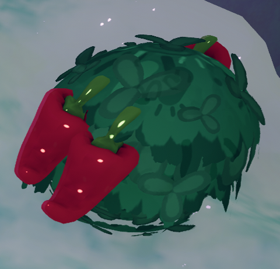](https://peak.wiki.gg/wiki/File%3AAlpine_scorchberries.png)
  Scorchberries growing on a small bush next to the Alpine's hot spring.

## Patch history

 **[1.0](1.0.md) (2025-06-16):** Introduced.
 **[1.10.a](1.10.a.md) (2025-07-30):** Fixed an issue where eating a Scorchberry wouldn't contribute toward the [Forager Badge](https://peak.wiki.gg/wiki/Foraging_Badge).

[Food](Food.md)
Natural food
Berries
Berrynanas- [](Yellow%20Berrynana.md) [Yellow Berrynana](Yellow%20Berrynana.md)
- [](Pink%20Berrynana.md) [Pink Berrynana](Pink%20Berrynana.md)
- [](Blue%20Berrynana.md) [Blue Berrynana](Blue%20Berrynana.md)
- [](Brown%20Berrynana.md) [Brown Berrynana](Brown%20Berrynana.md)
Clusterberries- [](Red%20Clusterberry.md) [Red Clusterberry](Red%20Clusterberry.md)
- [](Yellow%20Clusterberry.md) [Yellow Clusterberry](Yellow%20Clusterberry.md)
- [](Black%20Clusterberry.md) [Black Clusterberry](Black%20Clusterberry.md)
Crispberries- [](Green%20Crispberry.md) [Green Crispberry](Green%20Crispberry.md)
- [](Yellow%20Crispberry.md) [Yellow Crispberry](Yellow%20Crispberry.md)
- [](Red%20Crispberry.md) [Red Crispberry](Red%20Crispberry.md)
Kingberries- [](Green%20Kingberry.md) [Green Kingberry](Green%20Kingberry.md)
- [](Yellow%20Kingberry.md) [Yellow Kingberry](Yellow%20Kingberry.md)
- [](Purple%20Kingberry.md) [Purple Kingberry](Purple%20Kingberry.md)
Prickleberries- [](Red%20Prickleberry.md) [Red Prickleberry](Red%20Prickleberry.md)
- [](Gold%20Prickleberry.md) [Gold Prickleberry](Gold%20Prickleberry.md)
Shroomberries- [](Red%20Shroomberry.md) [Red Shroomberry](Red%20Shroomberry.md)
- [](Yellow%20Shroomberry.md) [Yellow Shroomberry](Yellow%20Shroomberry.md)
- [](Green%20Shroomberry.md) [Green Shroomberry](Green%20Shroomberry.md)
- [](Blue%20Shroomberry.md) [Blue Shroomberry](Blue%20Shroomberry.md)
- [](Purple%20Shroomberry.md) [Purple Shroomberry](Purple%20Shroomberry.md)
Winterberries- [](Orange%20Winterberry.md) [Orange Winterberry](Orange%20Winterberry.md)
- [](Yellow%20Winterberry.md) [Yellow Winterberry](Yellow%20Winterberry.md)
Other- [](Napberry.md) [Napberry](Napberry.md)
- [](Scorchberry.md) Scorchberry
Campfire food- [](Marshmallow.md) [Marshmallow](Marshmallow.md)
- [](Hot%20Dog.md) [Hot Dog](Hot%20Dog.md)
Mushrooms- [](Bugle%20Shroom.md) [Bugle Shroom](Bugle%20Shroom.md)
- [](Button%20Shroom.md) [Button Shroom](Button%20Shroom.md)
- [](Chubby%20Shroom.md) [Chubby Shroom](Chubby%20Shroom.md)
- [](Cluster%20Shroom.md) [Cluster Shroom](Cluster%20Shroom.md)
Mystical food- [](Cure-All.md) [Cure-All](Cure-All.md)
- [](Pandora%27s%20Lunchbox.md) [Pandora's Lunchbox](Pandora%27s%20Lunchbox.md)
Other- [](Cooked%20Bird.md) [Cooked Bird](Cooked%20Bird.md)
- [](Egg.md) [Egg](Egg.md)
- [](Frog%20Legs.md) [Frog Legs](Frog%20Legs.md)
- [](Honeycomb.md) [Honeycomb](Honeycomb.md)
- [](Half-Coconut.md) [Half-Coconut](Half-Coconut.md)
- [](Medicinal%20Root.md) [Medicinal Root](Medicinal%20Root.md)
- [](Mandrake.md) [Mandrake](Mandrake.md)
- [](Scorpion.md) [Scorpion](Scorpion.md)
- [](Tick.md) [Tick](Tick.md)
- [](The%20Early%20Worm.md) [The Early Worm](The%20Early%20Worm.md)
Packaged food
All packaged foods- [](Airline%20Food.md) [Airline Food](Airline%20Food.md)
- [](Big%20Lollipop.md) [Big Lollipop](Big%20Lollipop.md)
- [](Energy%20Drink.md) [Energy Drink](Energy%20Drink.md)
- [](Fortified%20Milk.md) [Fortified Milk](Fortified%20Milk.md)
- [](Granola%20Bar.md) [Granola Bar](Granola%20Bar.md)
- [](Scout%20Cookies.md) [Scout Cookies](Scout%20Cookies.md)
- [](Sports%20Drink.md) [Sports Drink](Sports%20Drink.md)
- [](Trail%20Mix.md) [Trail Mix](Trail%20Mix.md)

---

# Scorpion

Scorpion
Normal
Bug Phobia Mode
[](https://peak.wiki.gg/wiki/File%3AScorpion.png)
[](https://peak.wiki.gg/wiki/File%3AScorpionBingBong.png)
[Item type](Items.md)- [Enemy](https://peak.wiki.gg/wiki/Enemy)
- [Food](Food.md)
Biome- [Mesa](Mesa.md)
Weight
[](Stamina%20bar.md#Weight) **2.5**
Cooked Bonuses
[](Stamina%20bar.md#Hunger)Hunger
-20 (-20 total)
[](Stamina%20bar.md#Bonus_stamina)Bonus Stamina
10 (10 total)

The **Scorpion** is a creature found in the [Mesa](Mesa.md), specifically in the canyons and the cliffs of the biome. It wanders around aimlessly until it spots a [Scout](Scout.md), at which point it will attempt to sting them.

## Mechanics

When picked up or approached, it will ready its stinger, stabbing the [Scout](Scout.md) if in range. The Scorpion's sting will immediately deal [](Stamina%20bar.md#Poison) **2.5** [Poison](Stamina%20bar.md#Poison), and will apply [](Stamina%20bar.md#Poison) **50 to 100** [Poison](Stamina%20bar.md#Poison) over the next **15 seconds**. The sting also applies a small amount of knockback to the player in the direction the Scorpion is looking.

The poison over time is equal to the amount of available stamina the player has when stung, with a minimum value of **50**. As a result, a player will always end with **at least 102.5** total affliction after the poison finishes (assuming nothing else changed the player's affliction).

A scout can pick up a Scorpion, but cannot put it into an inventory slot or backpack. If the scout is quick, they may can throw it, cook it, or use it as fuel for a [Jetpack](Jetpack.md) before being stung.

After being [cooked](Cooking.md), a Scorpion can be eaten. It can no longer move or attack, but it still cannot be stored in the inventory or a backpack.

## Gallery

- [](https://peak.wiki.gg/wiki/File%3AScorpion_closeup.png)
  Close-up view of a Scorpion.
- [](https://peak.wiki.gg/wiki/File%3AScorpion_attack.png)
  A Scorpion about to attack a Scout.
- [](https://peak.wiki.gg/wiki/File%3AScorpion_bugphobia.png)
  A Scorpion with [Bug Phobia Mode](Bug%20Phobia%20Mode.md) enabled.

## Patch history

 **[1.20.a](1.20.a.md) (2025-08-11):** Added.
 **[1.23.a](1.23.a.md) (2025-08-13):** Rebalanced the scorpion.
 **[1.50.a](1.50.a.md) (2025-12-16):** Beetles and scorpions will no longer attempt to DDoS non-host players by sending 1 million data over the network.
 **[1.51.a](1.51.a.md) (2025-12-19):** Scorpions immediately try to sting the player when picked up. (bug mentioned in [1.52.a](1.52.a.md))
 **[1.53.a](1.53.a.md) (2026-01-27):** Scorpions will stop stinging you immediately when picked up. You once again have enough time to throw them before they sting

[Food](Food.md)
Natural food
Berries
Berrynanas- [](Yellow%20Berrynana.md) [Yellow Berrynana](Yellow%20Berrynana.md)
- [](Pink%20Berrynana.md) [Pink Berrynana](Pink%20Berrynana.md)
- [](Blue%20Berrynana.md) [Blue Berrynana](Blue%20Berrynana.md)
- [](Brown%20Berrynana.md) [Brown Berrynana](Brown%20Berrynana.md)
Clusterberries- [](Red%20Clusterberry.md) [Red Clusterberry](Red%20Clusterberry.md)
- [](Yellow%20Clusterberry.md) [Yellow Clusterberry](Yellow%20Clusterberry.md)
- [](Black%20Clusterberry.md) [Black Clusterberry](Black%20Clusterberry.md)
Crispberries- [](Green%20Crispberry.md) [Green Crispberry](Green%20Crispberry.md)
- [](Yellow%20Crispberry.md) [Yellow Crispberry](Yellow%20Crispberry.md)
- [](Red%20Crispberry.md) [Red Crispberry](Red%20Crispberry.md)
Kingberries- [](Green%20Kingberry.md) [Green Kingberry](Green%20Kingberry.md)
- [](Yellow%20Kingberry.md) [Yellow Kingberry](Yellow%20Kingberry.md)
- [](Purple%20Kingberry.md) [Purple Kingberry](Purple%20Kingberry.md)
Prickleberries- [](Red%20Prickleberry.md) [Red Prickleberry](Red%20Prickleberry.md)
- [](Gold%20Prickleberry.md) [Gold Prickleberry](Gold%20Prickleberry.md)
Shroomberries- [](Red%20Shroomberry.md) [Red Shroomberry](Red%20Shroomberry.md)
- [](Yellow%20Shroomberry.md) [Yellow Shroomberry](Yellow%20Shroomberry.md)
- [](Green%20Shroomberry.md) [Green Shroomberry](Green%20Shroomberry.md)
- [](Blue%20Shroomberry.md) [Blue Shroomberry](Blue%20Shroomberry.md)
- [](Purple%20Shroomberry.md) [Purple Shroomberry](Purple%20Shroomberry.md)
Winterberries- [](Orange%20Winterberry.md) [Orange Winterberry](Orange%20Winterberry.md)
- [](Yellow%20Winterberry.md) [Yellow Winterberry](Yellow%20Winterberry.md)
Other- [](Napberry.md) [Napberry](Napberry.md)
- [](Scorchberry.md) [Scorchberry](Scorchberry.md)
Campfire food- [](Marshmallow.md) [Marshmallow](Marshmallow.md)
- [](Hot%20Dog.md) [Hot Dog](Hot%20Dog.md)
Mushrooms- [](Bugle%20Shroom.md) [Bugle Shroom](Bugle%20Shroom.md)
- [](Button%20Shroom.md) [Button Shroom](Button%20Shroom.md)
- [](Chubby%20Shroom.md) [Chubby Shroom](Chubby%20Shroom.md)
- [](Cluster%20Shroom.md) [Cluster Shroom](Cluster%20Shroom.md)
Mystical food- [](Cure-All.md) [Cure-All](Cure-All.md)
- [](Pandora%27s%20Lunchbox.md) [Pandora's Lunchbox](Pandora%27s%20Lunchbox.md)
Other- [](Cooked%20Bird.md) [Cooked Bird](Cooked%20Bird.md)
- [](Egg.md) [Egg](Egg.md)
- [](Frog%20Legs.md) [Frog Legs](Frog%20Legs.md)
- [](Honeycomb.md) [Honeycomb](Honeycomb.md)
- [](Half-Coconut.md) [Half-Coconut](Half-Coconut.md)
- [](Medicinal%20Root.md) [Medicinal Root](Medicinal%20Root.md)
- [](Mandrake.md) [Mandrake](Mandrake.md)
- [](Scorpion.md) Scorpion
- [](Tick.md) [Tick](Tick.md)
- [](The%20Early%20Worm.md) [The Early Worm](The%20Early%20Worm.md)
Packaged food
All packaged foods- [](Airline%20Food.md) [Airline Food](Airline%20Food.md)
- [](Big%20Lollipop.md) [Big Lollipop](Big%20Lollipop.md)
- [](Energy%20Drink.md) [Energy Drink](Energy%20Drink.md)
- [](Fortified%20Milk.md) [Fortified Milk](Fortified%20Milk.md)
- [](Granola%20Bar.md) [Granola Bar](Granola%20Bar.md)
- [](Scout%20Cookies.md) [Scout Cookies](Scout%20Cookies.md)
- [](Sports%20Drink.md) [Sports Drink](Sports%20Drink.md)
- [](Trail%20Mix.md) [Trail Mix](Trail%20Mix.md)

---

# Scout Cannon

Scout Cannon
[](https://peak.wiki.gg/wiki/File%3AScout_Cannon.png)
[Item type](Items.md)- [Deployable](https://peak.wiki.gg/wiki/Deployable)
Rarity
[Legendary](https://peak.wiki.gg/wiki/Legendary)
Source- [Regular Luggage](https://peak.wiki.gg/wiki/Regular_Luggage)
- [Big Luggage](https://peak.wiki.gg/wiki/Big_Luggage)
- [Explorer's Luggage](https://peak.wiki.gg/wiki/Explorer%27s_Luggage)
- [Clown Luggage](https://peak.wiki.gg/wiki/Clown_Luggage)
Weight
[](Stamina%20bar.md#Weight) **10**
Base Status Effects
[](Stamina%20bar.md#Injury)Injury
50 (when cooked)

The **Scout Cannon** is a [deployable](https://peak.wiki.gg/wiki/Deployable) item in *[PEAK](Peak%20%28game%29.md)* found in [luggage](Luggage.md). Cannons can be used to launch players across great distances. To setup a cannon, first adjust the angle and desired placement, then place the cannon. To activate, light the fuse and have a player enter the cannon's opening. The fuse lasts roughly **3 seconds** before firing.

As a player begins to fall after being launched, an effect is applied lasting **5 seconds** which slows the player's descent to prevent injury, much like the effect of an open [Parasol](Parasol.md).

[Cooking](Cooking.md) a Scout Cannon causes it to explode identically to [](Dynamite.md) [Dynamite](Dynamite.md), although the extra damage from being held does not apply.

## Patch history

 **[1.20.a](1.20.a.md) (2025-08-11):** Introduced.
 **[1.23.a](1.23.a.md) (2025-08-13):** Added 3 more seconds of fall damage prevention when shooting from the Scout Cannon.
 **[1.25.a](1.25.a.md) (2025-08-21):** Fixed an issue with the Scout Cannon’s colliders that would cause players to get stuck.
 **[1.28.a](1.28.a.md) (2025-09-08):** Fixed an issue where placing a Scout Cannon atop a jellyfish could cause a softlock.
 **[1.40.a](1.40.a.md) (2025-11-05):** Cooking a scout cannon now causes it to explode.
 **[1.43.a](1.43.a.md) (2025-11-07):** Re-allowed the Scout Cannon Glitch but only with the backpack.
 **[1.44.a](1.44.a.md) (2025-11-13):**

- Scout Cannons can launch [zombies](https://peak.wiki.gg/wiki/Zombies) now.
- Scout Cannon weight reduced 6 -> 4
- Scout Cannon forced [ragdoll](Scout.md#Ragdoll_State) time reduced 2 -> 1
- Made the Scout Cannon slightly easier to jump out of.

---

# Scout Cookies

Scout Cookies
[](https://peak.wiki.gg/wiki/File%3AScout_Cookies.png)
[Item type](Items.md)- [Food](Food.md)
- [Packaged food](https://peak.wiki.gg/wiki/Packaged_food)
Rarity
[Legendary](https://peak.wiki.gg/wiki/Legendary)
Source- [Regular Luggage](https://peak.wiki.gg/wiki/Regular_Luggage)
- [Big Luggage](https://peak.wiki.gg/wiki/Big_Luggage)
Uses
4
Weight
[](Stamina%20bar.md#Weight) **5**
Base Status Effects
[](Stamina%20bar.md#Hunger)Hunger
-10
[](Stamina%20bar.md#Bonus_stamina)Bonus Stamina
10
Cooked Bonuses
[](Stamina%20bar.md#Hunger)Hunger
-10 (-20 total)
[](Stamina%20bar.md#Bonus_stamina)Bonus Stamina
5 (15 total)
Meyers approved![[1]](#cite_note-1)

The **Scout Cookies** is a packaged [food](Food.md) in *[PEAK](Peak%20%28game%29.md)* found in regular or large [luggage](Luggage.md). It can be consumed 4 times, restoring [](Stamina%20bar.md#Hunger) **10** [Hunger](Stamina%20bar.md#Hunger) and granting [](Stamina%20bar.md#Bonus_stamina) **10** [Bonus stamina](Stamina%20bar.md#Bonus_stamina).

## Gallery

- [](https://peak.wiki.gg/wiki/File%3AThick_mints.png)
  Scout Cookies texture

## Notes

- [↑](#cite_ref-1) Sic. Quite likely a typo of [Myres](Scoutmaster%20Myres.md).

## Patch history

 **[1.0](1.0.md) (2025-06-16):** Introduced.
 **[2.0.a](2.0.a.md) (2026-08-11):** Fixed issues related to incinerated Scout Cookies giving poison damage incorrectly.

[Food](Food.md)
Natural food
Berries
Berrynanas- [](Yellow%20Berrynana.md) [Yellow Berrynana](Yellow%20Berrynana.md)
- [](Pink%20Berrynana.md) [Pink Berrynana](Pink%20Berrynana.md)
- [](Blue%20Berrynana.md) [Blue Berrynana](Blue%20Berrynana.md)
- [](Brown%20Berrynana.md) [Brown Berrynana](Brown%20Berrynana.md)
Clusterberries- [](Red%20Clusterberry.md) [Red Clusterberry](Red%20Clusterberry.md)
- [](Yellow%20Clusterberry.md) [Yellow Clusterberry](Yellow%20Clusterberry.md)
- [](Black%20Clusterberry.md) [Black Clusterberry](Black%20Clusterberry.md)
Crispberries- [](Green%20Crispberry.md) [Green Crispberry](Green%20Crispberry.md)
- [](Yellow%20Crispberry.md) [Yellow Crispberry](Yellow%20Crispberry.md)
- [](Red%20Crispberry.md) [Red Crispberry](Red%20Crispberry.md)
Kingberries- [](Green%20Kingberry.md) [Green Kingberry](Green%20Kingberry.md)
- [](Yellow%20Kingberry.md) [Yellow Kingberry](Yellow%20Kingberry.md)
- [](Purple%20Kingberry.md) [Purple Kingberry](Purple%20Kingberry.md)
Prickleberries- [](Red%20Prickleberry.md) [Red Prickleberry](Red%20Prickleberry.md)
- [](Gold%20Prickleberry.md) [Gold Prickleberry](Gold%20Prickleberry.md)
Shroomberries- [](Red%20Shroomberry.md) [Red Shroomberry](Red%20Shroomberry.md)
- [](Yellow%20Shroomberry.md) [Yellow Shroomberry](Yellow%20Shroomberry.md)
- [](Green%20Shroomberry.md) [Green Shroomberry](Green%20Shroomberry.md)
- [](Blue%20Shroomberry.md) [Blue Shroomberry](Blue%20Shroomberry.md)
- [](Purple%20Shroomberry.md) [Purple Shroomberry](Purple%20Shroomberry.md)
Winterberries- [](Orange%20Winterberry.md) [Orange Winterberry](Orange%20Winterberry.md)
- [](Yellow%20Winterberry.md) [Yellow Winterberry](Yellow%20Winterberry.md)
Other- [](Napberry.md) [Napberry](Napberry.md)
- [](Scorchberry.md) [Scorchberry](Scorchberry.md)
Campfire food- [](Marshmallow.md) [Marshmallow](Marshmallow.md)
- [](Hot%20Dog.md) [Hot Dog](Hot%20Dog.md)
Mushrooms- [](Bugle%20Shroom.md) [Bugle Shroom](Bugle%20Shroom.md)
- [](Button%20Shroom.md) [Button Shroom](Button%20Shroom.md)
- [](Chubby%20Shroom.md) [Chubby Shroom](Chubby%20Shroom.md)
- [](Cluster%20Shroom.md) [Cluster Shroom](Cluster%20Shroom.md)
Mystical food- [](Cure-All.md) [Cure-All](Cure-All.md)
- [](Pandora%27s%20Lunchbox.md) [Pandora's Lunchbox](Pandora%27s%20Lunchbox.md)
Other- [](Cooked%20Bird.md) [Cooked Bird](Cooked%20Bird.md)
- [](Egg.md) [Egg](Egg.md)
- [](Frog%20Legs.md) [Frog Legs](Frog%20Legs.md)
- [](Honeycomb.md) [Honeycomb](Honeycomb.md)
- [](Half-Coconut.md) [Half-Coconut](Half-Coconut.md)
- [](Medicinal%20Root.md) [Medicinal Root](Medicinal%20Root.md)
- [](Mandrake.md) [Mandrake](Mandrake.md)
- [](Scorpion.md) [Scorpion](Scorpion.md)
- [](Tick.md) [Tick](Tick.md)
- [](The%20Early%20Worm.md) [The Early Worm](The%20Early%20Worm.md)
Packaged food
All packaged foods- [](Airline%20Food.md) [Airline Food](Airline%20Food.md)
- [](Big%20Lollipop.md) [Big Lollipop](Big%20Lollipop.md)
- [](Energy%20Drink.md) [Energy Drink](Energy%20Drink.md)
- [](Fortified%20Milk.md) [Fortified Milk](Fortified%20Milk.md)
- [](Granola%20Bar.md) [Granola Bar](Granola%20Bar.md)
- [](Scout%20Cookies.md) Scout Cookies
- [](Sports%20Drink.md) [Sports Drink](Sports%20Drink.md)
- [](Trail%20Mix.md) [Trail Mix](Trail%20Mix.md)

---

# Scout Effigy

Scout Effigy
[](https://peak.wiki.gg/wiki/File%3AScout_Effigy.png)
[Item type](Items.md)- [Consumable](https://peak.wiki.gg/wiki/Consumable)
- [Mystical item](https://peak.wiki.gg/wiki/Mystical_item)
Rarity
[Legendary](https://peak.wiki.gg/wiki/Legendary)
Source- [Ancient Luggage](https://peak.wiki.gg/wiki/Ancient_Luggage)
- [Ancient Statue](Ancient%20Statue.md)
Weight
[](Stamina%20bar.md#Weight) **5**
Cooked Bonuses
[](Stamina%20bar.md#Bonus_stamina)Bonus Stamina
10 (10 total)

The **Scout Effigy** is a [consumable](https://peak.wiki.gg/wiki/Consumable) [mystical item](https://peak.wiki.gg/wiki/Mystical_item) in *[PEAK](Peak%20%28game%29.md)* that can be obtained from Ancient Luggage or the [Ancient Statues](https://peak.wiki.gg/wiki/Ancient_Statues). The effigy can be used to resurrect a random dead or unconscious player at the target location.

If the effigy is placed while there are no ghost scouts, the effigy is still consumed without resurrecting any player.

[Cooking](Cooking.md) a Scout Effigy causes it to grant [](Stamina%20bar.md#Bonus_stamina) **10** [Bonus stamina](Stamina%20bar.md#Bonus_stamina) when used. Incinerating gives the user [](Stamina%20bar.md#Poison) [Poison](Stamina%20bar.md#Poison), as usual for food.

The **Scout Effigy** will not spawn when playing alone.

## Trivia

- The Scout Effigy is visually a smaller version of the [Ancient Statues](https://peak.wiki.gg/wiki/Ancient_Statues).
- This is the one of the only items in the game that is able to [resurrect Scouts](Scout.md#Resurrection) while not giving them any [](Stamina%20bar.md#Curse) [Curse](Stamina%20bar.md#Curse), the other being [](Checkpoint%20Flag.md) [Checkpoint Flag](Checkpoint%20Flag.md).

## Patch history

 **[1.0](1.0.md) (2025-06-16):** Introduced.
 **[1.9.a](1.9.a.md) (2025-07-22):** Using a Scout Effigy will now count towards completion of the [Clutch Badge](https://peak.wiki.gg/wiki/Clutch_Badge).

---

# Scout Statue (disambiguation)


Candidate for Deletion

This page lacks relevance for **PEAK Wiki** and is a candidate for **deletion**.

---

# Scout's Ambition

Scout's Ambition
[](https://peak.wiki.gg/wiki/File%3AScout%27s_Ambition.png)
[Item type](Items.md)- [Amulet](https://peak.wiki.gg/wiki/Amulet)
- [Mystical item](https://peak.wiki.gg/wiki/Mystical_item)
Source- [Scout Statue](https://peak.wiki.gg/wiki/Scout_Statue)
Uses
Infinite
Weight
[](Stamina%20bar.md#Weight) **2.5**
Base Status Effects
[](Stamina%20bar.md#Petrify)Petrify
30
[](Stamina%20bar.md#Infinite_Stamina)Infinite Stamina
8 seconds
Cooked Bonuses
[](Stamina%20bar.md#Bonus_stamina)Bonus Stamina
10 (10 total)

The **Scout's Ambition** is a [mystical item](https://peak.wiki.gg/wiki/Mystical_item) in *[PEAK](Peak%20%28game%29.md)*. As an [amulet](Amulets.md), it can be obtained from one of the [Amulet Statues](https://peak.wiki.gg/wiki/Amulet_Statues) found across the mountain. Upon use, a yellow bubble is formed for **8 seconds** around the user with a range of **9.6 meters**, granting [](Stamina%20bar.md#Infinite_Stamina) [Infinite Stamina](Stamina%20bar.md#Infinite_Stamina) to the user and all Scouts within the bubble. The user gains [](Stamina%20bar.md#Petrify) **30** [Petrify](Stamina%20bar.md#Petrify) upon use.

Scout's Ambition cannot be [cooked](https://peak.wiki.gg/wiki/Cooked).

## Other uses

[](https://peak.wiki.gg/wiki/File%3AWarning_Icon.png) **Spoilers!** - The following section contains spoilers for *[PEAK](Peak%20%28game%29.md)*.

Placing it on the sash of the [Stone Scout](https://peak.wiki.gg/wiki/Stone_Scout) statue behind the [Peak](Peak%20%28biome%29.md) along with the other three Scout's [Amulets](Amulets.md) transform the [](Strange%20Gem.md) [Strange Gem](Strange%20Gem.md) into [](Scout%27s%20Honor.md) [Scout's Honor](Scout%27s%20Honor.md).

## Interpretation

Each [amulet](Amulets.md) and its respective ability embodies a particular trait that [Scoutmaster Myres](Scoutmaster%20Myres.md)' troop had. Ambition is defined as the *"strong desire to achieve a particular end."* In this context, the objective would be to reach the [Peak](Peak%20%28biome%29.md), and to have [](Stamina%20bar.md#Infinite_Stamina) [Infinite Stamina](Stamina%20bar.md#Infinite_Stamina) is to show ambition to do so. From a philosophical perspective, one could imagine each [amulet](Amulets.md) to greatly intensify the already present traits within the [player character](Scout.md) to allow to achieve otherwise impossible feats rather than to directly have supernatural abilities.

## Patch history

 **[2.0.a](2.0.a.md) (2026-08-11):** Introduced. **(Undocumented)**

---

# Scout's Generosity

Scout's Generosity
[](https://peak.wiki.gg/wiki/File%3AScout%27s_Generosity.png)
[Item type](Items.md)- [Amulet](https://peak.wiki.gg/wiki/Amulet)
- [Mystical item](https://peak.wiki.gg/wiki/Mystical_item)
Location- [Scout Statue](https://peak.wiki.gg/wiki/Scout_Statue)
Weight
[](Stamina%20bar.md#Weight) **2.5**
Base Status Effects
[](Stamina%20bar.md#Petrify)Petrify
25 / 45
Cooked Bonuses
[](Stamina%20bar.md#Bonus_stamina)Bonus Stamina
10 (10 total)

The **Scout's Generosity** is a [mystical item](https://peak.wiki.gg/wiki/Mystical_item) in *[PEAK](Peak%20%28game%29.md)*. As an [amulet](Amulets.md), it can be obtained from one of the [Amulet Statues](https://peak.wiki.gg/wiki/Amulet_Statues) found across the mountain. On use, it duplicates an item sitting close enough to be highlighted. When duplicating an item, the user either gains [](Stamina%20bar.md#Petrify) **25** [Petrify](Stamina%20bar.md#Petrify) for a normal item or [](Stamina%20bar.md#Petrify) **45** [Petrify](Stamina%20bar.md#Petrify) for a mystical item.

[Amulets](https://peak.wiki.gg/wiki/Amulet),[](Scout%20Effigy.md) [Scout Effigies](Scout%20Effigy.md) and [](Checkpoint%20Flag.md) [Checkpoint Flags](Checkpoint%20Flag.md) cannot be duplicated by the Scout's Generosity.

Scout's Generosity cannot be [cooked](https://peak.wiki.gg/wiki/Cooked).

## Other uses

[](https://peak.wiki.gg/wiki/File%3AWarning_Icon.png) **Spoilers!** - The following section contains spoilers for *[PEAK](Peak%20%28game%29.md)*.

It can be bestowed upon the sash of the Scout Statue behind the [Peak](Peak%20%28biome%29.md) along with the other three Scout's Items to transform the [](Strange%20Gem.md) [Strange Gem](Strange%20Gem.md) into [](Scout%27s%20Honor.md) [Scout's Honor](Scout%27s%20Honor.md).

## Tips

- Duplicated items will have the same number of uses available as the original item, so it is advisable to wait until afterwards to use an item if planning to duplicate it.
- Since [](Stamina%20bar.md#Petrify) **20** [Petrify](Stamina%20bar.md#Petrify) is removed upon lighting a campfire, it is strictly beneficial to spread out your uses across Scouts to maximize cloning capabilities. This lets you potentially reach up to 4 cloned items per biome, with only [](Stamina%20bar.md#Petrify) **5** [Petrify](Stamina%20bar.md#Petrify) as a drawback.
- Since all similar type items inflict the same amount of [](Stamina%20bar.md#Petrify) [Petrify](Stamina%20bar.md#Petrify), it's important to use it on superior items to maximize value. For example, choose the [](Cursed%20Skull.md) [Cursed Skull](Cursed%20Skull.md) over the [](Ritual%20Dagger.md) [Ritual Dagger](Ritual%20Dagger.md) and [](Scout%20Cookies.md) [Scout Cookies](Scout%20Cookies.md) over [](Airline%20Food.md) [Airline Food](Airline%20Food.md).
- How useful this Amulet is depends greatly on the current [Ascent](Ascents.md). On lower difficulties and on the standard gamemode,[](Stamina%20bar.md#Hunger) [Hunger](Stamina%20bar.md#Hunger) is generally not a concern if the player is moving at a decent rate. However, on higher Ascents (especially 6 and beyond), where pausing for even just a moment can cause critical damage to a run, being able to duplicate an item like cooked Scout Cookies can easily save a climb.

## Trivia

- The shape of the amulet resembles [](Bing%20Bong.md) [Bing Bong](Bing%20Bong.md).

## Interpretation

Each [amulet](Amulets.md) and its respective ability embodies a particular trait that [Scoutmaster Myres](Scoutmaster%20Myres.md)' troop had. To be generous is to be *"characterized by a noble or kindly spirit."* One who is generous may give away possessions out of the kindness of their heart. In this context, bringing more items to the group could be interpreted as showing such kindness and therefore generosity. From a philosophical perspective, one could imagine each [amulet](Amulets.md) to greatly intensify the already present traits within the [player character](Scout.md) to allow to achieve otherwise impossible feats rather than to directly have supernatural abilities.

## Patch history

 **[2.0.a](2.0.a.md) (2026-08-11):** Introduced. **(Undocumented)**
 **[2.02.a](https://peak.wiki.gg/wiki/2.02.a) :** The Scout’s Generosity amulet can no longer clone Scout Effigy. As a note, the Checkpoint Flag and other Amulets are also not cloneable.

---

# Scout's Honor


Spoilers ahead!

This page contains **spoilers** for *[PEAK](Peak%20%28game%29.md)*. View at your own discretion.

Scout's Honor
[](https://peak.wiki.gg/wiki/File%3AScout%27s_Honor.png)
[Item type](Items.md)- [Mystical item](https://peak.wiki.gg/wiki/Mystical_item)
Biome- [Peak](Peak%20%28biome%29.md)
Location- [Stone Scout](Peak%20%28biome%29.md#Stone_Scout)
Weight
[](Stamina%20bar.md#Weight) **2.5**

The **Scout's Honor** is an [mystical item](Equipment.md#Mystical_Items) in *[PEAK](Peak%20%28game%29.md)* that is obtained by transforming the [](Strange%20Gem.md) [Strange Gem](Strange%20Gem.md) after bestowing the four [amulets](Amulets.md) upon the [Stone Scout](https://peak.wiki.gg/wiki/Stone_Scout) found at the [Peak](Peak%20%28biome%29.md). Scouts can hold  **Left Mouse** to commune with it, distorting the screen heavily before transporting all players to [Nadir](Nadir.md).

When [cooked](https://peak.wiki.gg/wiki/Cooked), the Scout's Honor explodes into a **40 meter** Anti-Sphere that launches all scouts within away from the center before quickly vanishing. Additionally, the [Scoutmaster](https://peak.wiki.gg/wiki/Scoutmaster) will be spawned targeting the player who cooked it, chasing them for up to **1 hour**.

- [](https://peak.wiki.gg/wiki/File%3AHonor_statue.png)
  Scout's Honor, held by the [Stone Scout](https://peak.wiki.gg/wiki/Stone_Scout)

## Patch history

 **[2.0.a](2.0.a.md) (2026-08-11):** Introduced. **(Undocumented)**

---

# Scout's Initiative

Scout's Initiative
[](https://peak.wiki.gg/wiki/File%3AScout%27s_Initiative.png)
[Item type](Items.md)- [Amulet](https://peak.wiki.gg/wiki/Amulet)
- [Mystical item](https://peak.wiki.gg/wiki/Mystical_item)
Location- [Scout Statue](https://peak.wiki.gg/wiki/Scout_Statue)
Weight
[](Stamina%20bar.md#Weight) **2.5**
Base Status Effects
[](Stamina%20bar.md#Petrify)Petrify
7
Cooked Bonuses
[](Stamina%20bar.md#Bonus_stamina)Bonus Stamina
10 (10 total)

The **Scout's Initiative** is a [mystical item](https://peak.wiki.gg/wiki/Mystical_item) in *[PEAK](Peak%20%28game%29.md)*. As an [amulet](Amulets.md), it can be obtained from one of the [Amulet Statues](https://peak.wiki.gg/wiki/Amulet_Statues) found across the mountain. Upon use, it applies **slow falling** for **.55** to the user and all [Scouts](https://peak.wiki.gg/wiki/Scouts) within **12.8 meters** of the user, then applies [wind walking](Wind%20walking.md) for **3 seconds** to all affected Scouts. Upon use, the user gains [](Stamina%20bar.md#Petrify) **7** [Petrify](Stamina%20bar.md#Petrify).

Scout's Initiative cannot be [cooked](https://peak.wiki.gg/wiki/Cooked).

## Other uses

[](https://peak.wiki.gg/wiki/File%3AWarning_Icon.png) **Spoilers!** - The following section contains spoilers for *[PEAK](Peak%20%28game%29.md)*.

It can be placed on the sash of the Scout Statue behind the [Peak](Peak%20%28biome%29.md) along with the other three Scout's Items to transform the [](Strange%20Gem.md) [Strange Gem](Strange%20Gem.md) into [](Scout%27s%20Honor.md) [Scout's Honor](Scout%27s%20Honor.md).

## Interpretation

Each [amulet](Amulets.md) and its respective ability embodies a particular trait that [Scoutmaster Myres](Scoutmaster%20Myres.md)' troop had. To display initiative is to show *"energy or aptitude in initiation of action; the inclination to do something before others do."* In this context, saving yourself and/or your friends from a fall could be interpreted as showing initiative; by acting before you or your teammates land, you're the first to assist and prevent injury rather than waiting to land and letting your team get hurt. From a philosophical perspective, one could imagine each [amulet](Amulets.md) to greatly intensify the already present traits within the [player character](Scout.md) to allow to achieve otherwise impossible feats rather than to directly have supernatural abilities.

## Patch history

 **[2.0.a](2.0.a.md) (2026-08-11):** Introduced. **(Undocumented)**

---

# Scout's Tenacity

Scout's Tenacity
[](https://peak.wiki.gg/wiki/File%3AScout%27s_Tenacity.png)
[Item type](Items.md)- [Amulet](https://peak.wiki.gg/wiki/Amulet)
- [Mystical item](https://peak.wiki.gg/wiki/Mystical_item)
Source- [Scout Statue](https://peak.wiki.gg/wiki/Scout_Statue)
Uses
Infinite
Weight
[](Stamina%20bar.md#Weight) **2.5**
Base Status Effects
[](Stamina%20bar.md#Heat)Heat
-60
[](Stamina%20bar.md#Cold)Cold
-60
[](Stamina%20bar.md#Poison)Poison
-60
[](Stamina%20bar.md#Drowsy)Drowsy
-60
[](Stamina%20bar.md#Injury)Injury
-60
[](Stamina%20bar.md#Spores)Spores
-60
[](Stamina%20bar.md#Petrify)Petrify
10 - 30
Cooked Bonuses
[](Stamina%20bar.md#Bonus_stamina)Bonus Stamina
10 (10 total)

The **Scout's Tenacity** is a [mystical item](https://peak.wiki.gg/wiki/Mystical_item) in *[PEAK](Peak%20%28game%29.md)*. As an [amulet](Amulets.md), it can be obtained from one of the [Amulet Statues](https://peak.wiki.gg/wiki/Amulet_Statues) found across the mountain. It can be used on the holder or another Scout, which heals up to **60** total amount of the following effects, in the specific order:

- [](Stamina%20bar.md#Injury) [Injury](Stamina%20bar.md#Injury)
- [](Stamina%20bar.md#Spores) [Spores](Stamina%20bar.md#Spores)
- [](Stamina%20bar.md#Poison) [Poison](Stamina%20bar.md#Poison)
- [](Stamina%20bar.md#Cold) [Cold](Stamina%20bar.md#Cold)
- [](Stamina%20bar.md#Heat) [Heat](Stamina%20bar.md#Heat)
- [](Stamina%20bar.md#Drowsy) [Drowsy](Stamina%20bar.md#Drowsy)

After which it applies [](Stamina%20bar.md#Petrify) [Petrify](Stamina%20bar.md#Petrify) to the user based on the amount of injury healed, ranging from [](Stamina%20bar.md#Petrify) **10** to a maximum of [](Stamina%20bar.md#Petrify) **30** [Petrify](Stamina%20bar.md#Petrify) and **10 seconds** of [](Stamina%20bar.md#Invincibility) [Invincibility](Stamina%20bar.md#Invincibility).

Scout's Tenacity cannot be [cooked](https://peak.wiki.gg/wiki/Cooked).

## Other uses

[](https://peak.wiki.gg/wiki/File%3AWarning_Icon.png) **Spoilers!** - The following section contains spoilers for *[PEAK](Peak%20%28game%29.md)*.

It can be bestowed upon the sash of the Scout Statue behind the [Peak](Peak%20%28biome%29.md) along with the other three Scout's Items to transform the [](Strange%20Gem.md) [Strange Gem](Strange%20Gem.md) into [](Scout%27s%20Honor.md) [Scout's Honor](Scout%27s%20Honor.md).

## Interpretation

Each [amulet](Amulets.md) and its respective ability embodies a particular trait that [Scoutmaster Myres](Scoutmaster%20Myres.md)' troop had. To be tenacious is to *"endure, especially when challenged."* In this context, to heal and prevent damage such to push forward even when hurt can be interpreted as showing tenacity. From a philosophical perspective, one could imagine each [amulet](Amulets.md) to greatly intensify the already present traits within the [player character](Scout.md) to allow to achieve otherwise impossible feats rather than to directly have supernatural abilities.

## Patch history

 **[2.0.a](2.0.a.md) (2026-08-11):** Introduced. **(Undocumented)**

---

# Scout

Scout
[](https://peak.wiki.gg/wiki/File%3AScout_variant_0.png)

**Scouts** are the player characters in *[PEAK](Peak%20%28game%29.md)*. They are colorful humanoids of ambiguous gender and age with big round heads.

In multiplayer, the player's username is shown above their Scout's head.

## Appearance

The **appearance** of a Scout can be [customized](Cosmetics.md) in the [Airport](Airport.md) by using the [](Passport.md) [Passport](Passport.md), which allows the player to select their Scout's [skin color](Cosmetics.md#Colors), [head accessory](Cosmetics.md#Accessories), [eyes](Cosmetics.md#Eyes), [mouth](Cosmetics.md#Mouths), [headwear](Cosmetics.md#Hats), [outfit](Cosmetics.md#Clothing), and [sash](Cosmetics.md#Sashes).

**Various Scout Appearances**

|  |
| --- |
| - [Scout variant 1.png](https://peak.wiki.gg/wiki/File%3AScout_variant_1.png) - [Scout variant 2.png](https://peak.wiki.gg/wiki/File%3AScout_variant_2.png) - [Scout variant 3.png](https://peak.wiki.gg/wiki/File%3AScout_variant_3.png) - [Scout variant 4.png](https://peak.wiki.gg/wiki/File%3AScout_variant_4.png) |

## Ragdoll state

A Scout can be put into a **ragdoll** state where the player can't control their movement and the Scout's body will instead move by unpredictable [ragdoll physics](https://en.wikipedia.org/wiki/ragdoll_physics). The following are all the ways a scout can enter Ragdoll State:

- Performing the "Play dead" or the "Backflip" [emote](https://peak.wiki.gg/wiki/Emote) and failing it.
- Falling from a [great height](https://peak.wiki.gg/wiki/Fall_damage).
- Being hit by an [item](https://peak.wiki.gg/wiki/Item) in the [Ragdoll-inducing projectile](https://peak.wiki.gg/wiki/Category%3ARagdoll-Inducing_Projectile) category or by a [swinging mace](https://peak.wiki.gg/wiki/Swinging_mace).
- Being close to an explosion.
- Stepping on a [jellyfish](https://peak.wiki.gg/wiki/Jellyfish) or a [Berrynana](Berrynana%20%28disambiguation%29.md) Peel.
- Being dragged by the current of a [waterfall](https://peak.wiki.gg/wiki/Waterfall) or by a [](Rescue%20Claw.md) [Rescue Claw](Rescue%20Claw.md).
- Suffering a bad effect from a [Shroomberry](Shroomberry.md).
- Being attacked by a [Beetle](Beetle.md), [Zombie](Zombie.md), [Antlion](Antlion.md), [Frog](Frog.md), [Big Ghost](Big%20Ghost.md), or the [Scoutmaster](https://peak.wiki.gg/wiki/Scoutmaster).
- Being launched by a [Geyser](Geyser.md) or a [](Scout%20Cannon.md) [Scout Cannon](Scout%20Cannon.md).

Jumping repeatedly while in this state will prolong the ragdoll state's duration.

## Unconscious state & Death

[](https://peak.wiki.gg/wiki/File%3AUnconscious_Eyes.png)

**Unconscious Eyes**

A Scout will become **unconscious** when the [Stamina Bar](https://peak.wiki.gg/wiki/Stamina_Bar) has been filled with [Status Effects](https://peak.wiki.gg/wiki/Status_Effects); they will slowly lose control over their body and start falling into a ragdoll state and players won't be able to use [items](Items.md) or talk (although they can still [emote](https://peak.wiki.gg/wiki/Emote) to a degree). An unconscious Scout will also drop all items from their inventory and hands, though a [](Backpack.md) [Backpack](Backpack.md) will remain equipped with all their items inside if the player wasn't holding it in their hands.

### Death timer

---

Once a scout has become unconscious, a **death timer** begins. This timer will slowly tick down, but can be stopped if the Scout is carried in the **Backpack Slot** () (unless they are inflicted with [](Stamina%20bar.md#Spores) **50** [Spores](Stamina%20bar.md#Spores) or more), which unequips the carrier's [](Backpack.md) [Backpack](Backpack.md) if they were wearing one. The timer will speed up if the player is unlikely to recover from their [](Stamina%20bar.md#Injury) [Injury](Stamina%20bar.md#Injury), is in the [fog](Fog.md), or is **giving up** ().

An unconscious Scout (and their troop) must use the duration of the death timer to try to recover. The majority of [Status Effects](https://peak.wiki.gg/wiki/Status_Effects) decay over time, so there's no reason to give up. If the accumulated [Status Effects](https://peak.wiki.gg/wiki/Status_Effects) don't decay over time, the other Scouts need to help them recover with healing [items](Items.md), such as [](Bandages.md) [Bandages](Bandages.md), [](First%20Aid%20Kit.md) [First Aid Kit](First%20Aid%20Kit.md) or [](Cure-All.md) [Cure-All](Cure-All.md).

- [](https://peak.wiki.gg/wiki/File%3AScouts_revive.png)
  A player reviving another player with a [](First%20Aid%20Kit.md) [First Aid Kit](First%20Aid%20Kit.md)
- [](https://peak.wiki.gg/wiki/File%3AScout_skeleton.png)
  A skeleton of a dead Scout. A dropped [](Bugle.md) [Bugle](Bugle.md) can be seen nearby.

If the death timer expires and the [Stamina Bar](https://peak.wiki.gg/wiki/Stamina_Bar) is still full of [Status Effects](https://peak.wiki.gg/wiki/Status_Effects), the Scout dies and becomes a [Ghost](#Ghost), leaving a skeleton behind.

If the death timer expires and the Scout was afflicted with [](Stamina%20bar.md#Spores) **50** [Spores](Stamina%20bar.md#Spores) or more, the Scout dies and becomes a [Ghost](#Ghost), but their corpse will become a [Zombie](Zombie.md).

If the death timer expires but the Scout has an active [](Checkpoint%20Flag.md) [Checkpoint Flag](Checkpoint%20Flag.md), they won't die and will instead respawn at the Checkpoint Flag's location.

See [Checkpoint Flag Mechanics](Checkpoint%20Flag.md#Mechanics) for details.

Communing with a [](Cursed%20Skull.md) [Cursed Skull](Cursed%20Skull.md) immediately kills the user, causing them to become a [Ghost](#Ghost) and leave a skeleton behind.

### Resurrection

---

Dead Scouts can be resurrected by living Scouts using an [Ancient Statue](Ancient%20Statue.md) or a [](Scout%20Effigy.md) [Scout Effigy](Scout%20Effigy.md).

[](The%20Book%20of%20Bones.md) [The Book of Bones](The%20Book%20of%20Bones.md) can be used on a dead Scout's skeleton to resurrect them as a [Living Skeleton](#Living_Skeleton).

Any dead Scouts are instantly revived upon entering [Nadir](Nadir.md).

## Ghost

Ghost
[](https://peak.wiki.gg/wiki/File%3ADefault_Ghost.png)
Not to be confused with [Big Ghost](Big%20Ghost.md).

When a Scout [dies](#Unconscious_State_&_Death), they become a **Ghost**. Ghosts can spectate living Scouts and communicate with them using the in-game voice chat. They can rotate around the Scout they are watching by **Moving the Mouse** (). They can also move in and out by **Scrolling** () or by **Scrolling Forward** () and **Scrolling Backward** (). The Scout being watched can be changed pressing **Item Slot 1** () to go to the previous one and **Item Slot 2** () to go to the next one.

Living Scouts are able to see and hear all Ghosts. Ghosts switch between players visually, making it possible to discern the location of other living Scouts based on their movement. There is also a pronounced [Doppler effect](https://en.wikipedia.org/wiki/Doppler_effect) if they are talking while switching players.

## Living Skeleton

Living Skeleton
[](https://peak.wiki.gg/wiki/File%3ADefault_Living_Skeleton.png)

**Living Skeletons** are immune to [](Stamina%20bar.md#Hunger) [Hunger](Stamina%20bar.md#Hunger), [](Stamina%20bar.md#Poison) [Poison](Stamina%20bar.md#Poison), [](Stamina%20bar.md#Spores) [Spores](Stamina%20bar.md#Spores), [](Stamina%20bar.md#Cold) [Cold](Stamina%20bar.md#Cold), [](Stamina%20bar.md#Heat) [Heat](Stamina%20bar.md#Heat), [](Stamina%20bar.md#Drowsy) [Drowsy](Stamina%20bar.md#Drowsy), and [](Stamina%20bar.md#Thorns) [Thorns](Stamina%20bar.md#Thorns), but are very fragile and receive [](Stamina%20bar.md#Injury) **8x** [Injury](Stamina%20bar.md#Injury) from most sources, except in the following cases:

- Opening an [Ancient Luggage](https://peak.wiki.gg/wiki/Ancient_Luggage) still inflicts [](Stamina%20bar.md#Injury) **20** [Injury](Stamina%20bar.md#Injury).
- Being bitten by a [Zombie](Zombie.md) inflicts [](Stamina%20bar.md#Injury) **20** [Injury](Stamina%20bar.md#Injury).

Because of this, some [hazards](Hazards.md) are especially dangerous for Living Skeletons:

- [Lava](Lava.md) instantly kills Living Skeletons.
- Removing an [](Stamina%20bar.md#Arrow) [Arrow](Stamina%20bar.md#Arrow) instantly kills Living Skeletons.
- Explosions instantly kill Living Skeletons in most cases.
- [Fall damage](https://peak.wiki.gg/wiki/Fall_damage) is more dangerous, as the Injury multiplier means that the minimum amount they can receive this way is [](Stamina%20bar.md#Injury) **40** [Injury](Stamina%20bar.md#Injury).- The fall damage multiplier from *[Ascent 1](https://peak.wiki.gg/wiki/Ascent_1)* and higher stacks with the Living Skeleton's one, for an effective **16x** fall damage multiplier. This means that the minimum amount they can receive is [](Stamina%20bar.md#Injury) **80** [Injury](Stamina%20bar.md#Injury).

The [fog](Fog.md) will deal [](Stamina%20bar.md#Injury) [Injury](Stamina%20bar.md#Injury) to Living Skeletons instead of [](Stamina%20bar.md#Cold) [Cold](Stamina%20bar.md#Cold), but it's not affected by the Injury multiplier.

However, not everything's bad, as Living Skeletons cannot stick to [cacti](Cactus%20%28disambiguation%29.md) and the [](Fortified%20Milk.md) [Fortified Milk](Fortified%20Milk.md) heals [](Stamina%20bar.md#Injury) **100** [Injury](Stamina%20bar.md#Injury) to them alongside applying [](Stamina%20bar.md#Invincibility) [Invincibility](Stamina%20bar.md#Invincibility). This makes it the best healing [item](https://peak.wiki.gg/wiki/Item) for a Living Skeleton, letting living Scouts take items such as a [](First%20Aid%20Kit.md) [First Aid Kit](First%20Aid%20Kit.md).

A Living Skeleton cannot enter [Unconscious State](#Unconscious_State_&_Death) and will instead die immediately when their [Stamina Bar](https://peak.wiki.gg/wiki/Stamina_Bar) is filled with [Status Effects](https://peak.wiki.gg/wiki/Status_Effects), scattering their bones as if by an explosion. If the Living Skeleton had an active [](Checkpoint%20Flag.md) [Checkpoint Flag](Checkpoint%20Flag.md), they won't die and instead will respawn at the Checkpoint Flag's location.

## Trivia

- The body of a Scout is physically simulated in *[PEAK](Peak%20%28game%29.md)*. This makes the act of climbing, moving through thin or tight passages, and holding or stepping on [items](Items.md) more realistic.- On occasion, the arms and/or legs of a Scout can become locked in positions they shouldn't be, yet mechanically behaving normally for the player controlling the Scout.
- The Scouts have appeared in other game media, either as a reference to or as an official collaboration with *[PEAK](Peak%20%28game%29.md)*.- [*Fortnite*](https://en.wikipedia.org/wiki/Fortnite) includes the Scout as a purchasable skin, along with a small number of other *PEAK*-themed cosmetics. A Scout NPC was added to the Battle Royale island during the duration of the *Override* season which ran from August 2026 to November 2026, with a story quest involving him.
  - [*Crashout Crew*](https://store.steampowered.com/app/3583210/Crashout_Crew/%7C), another game by AggroCrab, has the Scout appear in the TipTap app.
  - [*Gunny Ascend*](https://store.steampowered.com/app/2886300/Gunny_Ascend/%7C) includes a Scout as a playable character.
- The face of a [Ghost](#Ghosts) will always stare directly at whoever is watching it, regardless of the direction the Ghost is facing.

## Gallery

- [](https://peak.wiki.gg/wiki/File%3AYour_backpack_cannot_help_you_now.png)
  An [unconscious](#Unconscious_State_&_Death) Scout with a [](Backpack.md) [Backpack](Backpack.md) on, falling through the [fog](Fog.md).
- [](https://peak.wiki.gg/wiki/File%3AScout_skeleton_T-posing.png)
  A T-posed skeleton, spawned when a disconnected player rejoins after a [campfire](Campfire.md) is lit.
- [](https://peak.wiki.gg/wiki/File%3AScout_and_Ghost_size_comparison.png)
  A close-up [Ghost](#Ghost) and a Scout side-by-side.
- [](https://peak.wiki.gg/wiki/File%3AScout_physics_bug.png)
  A Scout with bugged arms holding a [](Chain%20Launcher.md) [Chain Launcher](Chain%20Launcher.md).

## Patch history

 **[1.0](1.0.md) (2025-06-16):** Introduced.
 **[1.40.a](1.40.a.md) (2025-11-05):** Added [Living Skeletons](#Living_Skeleton). **(Undocumented)**
 **[1.50.a](1.50.a.md) (2025-12-16):** The [Ancient Luggage](https://peak.wiki.gg/wiki/Ancient_Luggage) no longer one-shots you if you're a [skeleton](#Living_Skeleton) from [](The%20Book%20of%20Bones.md) [the Book of Bones](The%20Book%20of%20Bones.md).
 **[1.60.a](1.60.a.md) (2026-03-30):** Scouts that were [skeletons](#Living_Skeleton) when they disconnected will still be skeletons when they reconnect.
 **[2.0.a](2.0.a.md) (2026-08-11):** Heavily reduced the frequency that arms would twist unnaturally when holding an item in your hands.
 **[2.1.a](2.1.a.md) (2026-08-13):** [Skeleton Scouts](#Living_Skeleton) are now affected by [spiders](Spider.md), [flytraps](Flytrap.md), and [arrow traps](The%20Citadel.md#Arrow_Traps). (Be especially careful around the arrow traps…)

---

# Scout/es-419

Explorador
[](https://peak.wiki.gg/wiki/File%3AScout_variant_0.png)

Los **Exploradores** son los protagonistas de *[PEAK](Peak%20%28game%29_es-419.md)*. Son humanoides coloridos con grandes cabezas redondas, sin género ni edad aparentes.

Al jugar en tropa, los nombres de usuario de [Steam](https://es.wikipedia.org/wiki/Steam) se mostrarán arriba de cada Explorador.

## Apariencia

La **apariencia** de un Explorador se puede [personalizar](Cosmetics_es-419.md) en el [Aeropuerto](Airport_es-419.md) usando un [](Passport.md) [Pasaporte](Passport.md), que permite cambiar su [color](Cosmetics_es-419.md#Colores), [accesorio](Cosmetics_es-419.md#Accesorios), [ojos](Cosmetics_es-419.md#Ojos), [boca](Cosmetics_es-419.md#Bocas), [vestimenta](Cosmetics_es-419.md#Vestimentas), [sombrero](Cosmetics_es-419.md#Sombreros) y [banda](Cosmetics_es-419.md#Bandas).

**Exploradores con diferentes apariencias**

|  |
| --- |
| - [Scout variant 1.png](https://peak.wiki.gg/wiki/File%3AScout_variant_1.png) - [Scout variant 2.png](https://peak.wiki.gg/wiki/File%3AScout_variant_2.png) - [Scout variant 3.png](https://peak.wiki.gg/wiki/File%3AScout_variant_3.png) - [Scout variant 4.png](https://peak.wiki.gg/wiki/File%3AScout_variant_4.png) |

## Estado Ragdoll

Un Explorador en **Estado Ragdoll** no puede controlar su cuerpo y, en cambio, se moverá mediante [físicas ragdoll](https://es.wikipedia.org/wiki/Física_ragdoll), haciendo que sus movimientos sean impredecibles. La siguiente lista contiene todas las maneras de entrar en Estado Ragdoll:

- Usar el [gesto](Emotes.md) "Hacerse el muerto" o "Voltereta hacia atrás" y fallarla.
- Caer desde [muy alto](https://peak.wiki.gg/wiki/Fall_damage).
- Ser golpeado por un [objeto](Items_es-419.md) en la categoría [Objeto causante de Estado Ragdoll](https://peak.wiki.gg/wiki/Category%3ARagdoll-Inducing_Projectile) o por una [maza oscilante](https://peak.wiki.gg/wiki/Swinging_mace).
- Estar cerca de una explosión.
- Pisar una [medusa](Shore_es-419.md#Medusa) o la [](Yellow%20Berrynana%20Peel.md) [Cáscara de una Bayanana](Yellow%20Berrynana%20Peel.md).
- Ser arrastrado por la corriente de una [cascada](https://peak.wiki.gg/wiki/Waterfall) o por una [](Rescue%20Claw.md) [Garra de Rescate](Rescue%20Claw.md).
- Sufrir un efecto negativo de una [](Shroomberry.md) [Champibaya](Shroomberry.md).
- Ser atacado por un [Escarabajo](Beetle.md), [Zombi](Zombie.md), [Hormiga León](Antlion.md), [Rana](Frog.md), [Gran Fantasma](Big%20Ghost.md) o el [Jefe de Tropa](https://peak.wiki.gg/wiki/Scoutmaster).
- Ser lanzado por un [géiser](Geyser.md) o un [](Scout%20Cannon.md) [Cañón de Exploradores](Scout%20Cannon.md).

Muchos Exploradores empiezan a **Saltar** () repetidamente para intentar "recuperarse" de este estado más rápido, pero esto solo desestabiliza el cuerpo del Explorador y alarga el tiempo en Estado Ragdoll, ya que un Explorador se recupera más rápido al estar recostado en el suelo.

## Estado Inconsciente y Muerte

[](https://peak.wiki.gg/wiki/File%3AUnconscious_Eyes.png)

**Ojos Inconscientes**

Cuando un Explorador tiene toda su [Barra de Resistencia](https://peak.wiki.gg/wiki/Stamina_Bar) ocupada por [Efectos de Estado](https://peak.wiki.gg/wiki/Status), poco a poco irá perdiendo control sobre su cuerpo y empezará a caerse, finalmente entrando en **Estado Inconsciente**. Un Explorador inconsciente entrará en [Estado Ragdoll](#Estado_Ragdoll), por lo que no podrá moverse, pero además no podrá usar [objetos](Items_es-419.md) ni hablar (aunque podrá **Usar Gestos** () en cierta medida). Un Explorador inconsciente soltará todos los objetos de su inventario y de sus manos, aunque una [](Backpack.md) [Mochila](Backpack.md) quedará equipada con todos sus objetos dentro si no la sostenía en sus manos.

### Temporizador de muerte

---

Cuando un Explorador entra en [Estado Inconsciente](#Estado_Inconsciente_y_Muerte), empieza un **temporizador de muerte**. Este temporizador se agotará lentamente, pero puede detenerse si se carga a dicho Explorador en el **Espacio de Mochila** () (a menos que tenga [](Stamina%20bar.md#Spores) **50** [Esporas](Stamina%20bar.md#Spores) o más), lo que dejará cualquier tipo de mochila puesto en el suelo. El temporizador se agotará más rápido si es poco probable que el Explorador se recupere de sus [](Stamina%20bar.md#Injury) [Lesiones](Stamina%20bar.md#Injury), si está en la [niebla](Fog.md) o si se está dando por vencido pulsando **Interactuar** ().

Un Explorador inconsciente (y su tropa, si tiene) debe aprovechar la duración del temporizador de muerte para intentar recuperarse. La mayoría de [Efectos de Estado](https://peak.wiki.gg/wiki/Status) se reducen con el tiempo, así que no hay por qué rendirse. Si los Efectos de Estado acumulados no se reducen con el tiempo, los demás Exploradores deberán ayudarlo a recuperarse con [objetos](Items_es-419.md) curativos como [](Bandages.md) [Vendas](Bandages.md), [](First%20Aid%20Kit.md) [Kits de Primeros Auxilios](First%20Aid%20Kit.md) o [](Cure-All.md) [Curatodo](Cure-All.md).

[](https://peak.wiki.gg/wiki/File%3AScouts_revive.png)

Un Explorador curando a otro inconsciente con un [](First%20Aid%20Kit.md) [Kit de Primeros Auxilios](First%20Aid%20Kit.md).
[](https://peak.wiki.gg/wiki/File%3AScout_skeleton.png)

El esqueleto de un Explorador muerto. Se puede ver un [](Bugle.md) [Clarín](Bugle.md) soltado por él.

Si el temporizador de muerte se agota y la [Barra de Resistencia](https://peak.wiki.gg/wiki/Stamina_Bar) sigue ocupada en su totalidad por Efectos de Estado, el Explorador muere y se convierte en un [Fantasma](#Fantasma), dejando un esqueleto en su lugar.

Si el temporizador de muerte se agota y el Explorador tiene [](Stamina%20bar.md#Spores) **50** [Esporas](Stamina%20bar.md#Spores) o más, el Explorador muere y se convierte en un [Fantasma](#Fantasma), pero su cuerpo se transforma en un [Zombi](Zombie.md).

Si el temporizador de muerte se agota y el Explorador tiene una [](Checkpoint%20Flag.md) [Bandera de Reaparición](Checkpoint%20Flag.md) activa, el Explorador no muere, sino que reaparece en el lugar de la bandera.

*Véase [Mecánicas de la Bandera de Reaparición](Checkpoint%20Flag.md#Mechanics) para más detalles.*

Comunicarse con un [](Cursed%20Skull.md) [Cráneo Maldito](Cursed%20Skull.md) mata al Explorador instantáneamente, convirtiéndolo en un [Fantasma](#Fantasma) y dejando un esqueleto en su lugar.

## Resurrección

Los Exploradores muertos pueden ser revividos por Exploradores vivos con una [Estatua Antigua](Ancient%20Statue.md) o con una [](Scout%20Effigy.md) [Efigie de Explorador](Scout%20Effigy.md).

[](The%20Book%20of%20Bones.md) [El Libro de Huesos](The%20Book%20of%20Bones.md) puede usarse en el esqueleto de un Explorador para revivirlo como un [Esqueleto Viviente](#Esqueleto_Viviente).

Todos los Exploradores muertos reviven al llegar a [Nadir](Nadir.md).

## Fantasma

Fantasma
[](https://peak.wiki.gg/wiki/File%3ADefault_Ghost.png)
No confundir con [Gran Fantasma](Big%20Ghost.md)

Cuando un Explorador [muere](#Estado_Inconsciente_y_Muerte), se convierte en un **Fantasma**. Los Fantasmas pueden observar a Exploradores vivos y comunicarse con ellos usando el chat de voz de proximidad del juego. Pueden rotar alrededor del Explorador **Moviendo el Mouse** (). También pueden acercarse o alejarse **Desplazando la Rueda del Mouse** (), o pulsando **Desplazar hacia Adelante** () y **Desplazar hacia Atrás** (). Se puede cambiar el Explorador observado pulsando **Espacio de Objeto 1** () para seleccionar al anterior y **Espacio de Objeto 2** () para seleccionar al siguiente.

Los Exploradores vivos son capaces de ver y escuchar a todos los Fantasmas. Los Fantasmas se mueven visualmente de un Explorador a otro cuando cambian el Explorador al que están observando, lo que hace posible estimar la ubicación de otros Exploradores vivos basándose en el movimiento del Fantasma. El sonido también es afectado por el movimiento, por lo que si un Fantasma está hablando mientras se mueve rápidamente hacia otro Explorador vivo, su voz experimentará el [efecto Doppler](https://es.wikipedia.org/wiki/Efecto_Doppler).

## Esqueleto Viviente

Esqueleto Viviente
[](https://peak.wiki.gg/wiki/File%3ADefault_Living_Skeleton.png)

Los **Esqueletos Vivientes** no pueden recibir [](Stamina%20bar.md#Hunger) [Hambre](Stamina%20bar.md#Hunger), [](Stamina%20bar.md#Poison) [Veneno](Stamina%20bar.md#Poison), [](Stamina%20bar.md#Spores) [Esporas](Stamina%20bar.md#Spores), [](Stamina%20bar.md#Cold) [Frío](Stamina%20bar.md#Cold), [](Stamina%20bar.md#Heat) [Calor](Stamina%20bar.md#Heat), [](Stamina%20bar.md#Drowsy) [Sueño](Stamina%20bar.md#Drowsy) y [](Stamina%20bar.md#Thorns) [Espinas](Stamina%20bar.md#Thorns), pero son muy frágiles y reciben [](Stamina%20bar.md#Injury) **8x** [Lesión](Stamina%20bar.md#Injury) de la mayoría de las fuentes, excepto en los siguientes casos:

- Abrir una [Maleta Antigua](https://peak.wiki.gg/wiki/Ancient_Luggage) sigue infligiendo [](Stamina%20bar.md#Injury) **20** [Lesión](Stamina%20bar.md#Injury).
- Recibir una mordida de [Zombi](Zombie.md) inflige [](Stamina%20bar.md#Injury) **20** [Lesión](Stamina%20bar.md#Injury).

Debido a esto, algunos [peligros](Hazards.md) son especialmente peligrosos para los Esqueletos Vivientes:

- La [lava](Lava.md) mata instantáneamente a un Esqueleto Viviente.
- Quitar una [](Stamina%20bar.md#Arrow) [Flecha](Stamina%20bar.md#Arrow) mata instantáneamente a un Esqueleto Viviente.
- Las explosiones matan instantáneamente a un Esqueleto Viviente en la mayoría de casos.
- El [daño de caída](https://peak.wiki.gg/wiki/Fall_damage) es más peligroso, ya que el multiplicador de Lesión hace que la cantidad mínima que puede recibir de este modo es [](Stamina%20bar.md#Injury) **40** [Lesión](Stamina%20bar.md#Injury).- El multiplicador de daño de caída en *[Ascenso 1](Ascents_es-419.md#Ascenso_1)* o superior se acumula con el del Esqueleto Viviente, resultando en un multiplicador de **16x**. Esto hace que la cantidad mínima de daño de caída que puede recibir sea [](Stamina%20bar.md#Injury) **80** [Lesión](Stamina%20bar.md#Injury).

La [niebla](Fog.md) infligirá [](Stamina%20bar.md#Injury) [Lesión](Stamina%20bar.md#Injury) a los Esqueletos Vivientes en lugar de [](Stamina%20bar.md#Cold) [Frío](Stamina%20bar.md#Cold), pero esto no se ve afectado por el multiplicador de Lesión.

Sin embargo, no todo es malo, ya que los Esqueletos Vivientes no pueden pegarse a [cactus](Cactus%20%28disambiguation%29.md) y la [](Fortified%20Milk.md) [Leche Enriquecida](Fortified%20Milk.md) les reduce [](Stamina%20bar.md#Injury) **100** [Lesión](Stamina%20bar.md#Injury) además de otorgar [](Stamina%20bar.md#Invincibility) [Invencibilidad](Stamina%20bar.md#Invincibility). Esto la convierte en el mejor [objeto](Items_es-419.md) de curación para un Esqueleto Viviente y permite guardar otros objetos curativos, como el [](First%20Aid%20Kit.md) [Kit de Primeros Auxilios](First%20Aid%20Kit.md), para Exploradores vivos.

Un Esqueleto Viviente no puede entrar en [Estado Inconsciente](#Estado_Inconsciente_y_Muerte), y al tener toda su [Barra de Resistencia](https://peak.wiki.gg/wiki/Stamina_Bar) ocupada por [Efectos de Estado](https://peak.wiki.gg/wiki/Status) morirá instantáneamente, desarmándose y haciendo que sus huesos se dispersen. Si el Esqueleto Viviente tenía una [](Checkpoint%20Flag.md) [Bandera de Reaparición](Checkpoint%20Flag.md) activa, reaparecerá en ella y no morirá.

## Curiosidades

- El cuerpo de un Explorador está simulado físicamente en *[PEAK](Peak%20%28game%29_es-419.md)*. Esto hace que acciones como escalar, pasar por lugares estrechos y sostener o pisar [objetos](Items_es-419.md) sean más realistas.- En ocasiones, los brazos y/o piernas de un Explorador pueden torcerse o quedar trabados en posiciones anómalas, aunque mecánicamente se comporten con normalidad.
- Los Exploradores han aparecido en otros videojuegos, ya sea como una referencia o como una colaboración oficial con *[PEAK](Peak%20%28game%29_es-419.md)*.- [*Fortnite*](https://es.wikipedia.org/wiki/Fortnite) incluye al Explorador como un aspecto (*skin*) comprable, junto con otros cosméticos con la temática *PEAK*. Durante la temporada *Glitch* (*Override*), que transcurrió entre agosto y noviembre de 2026, se podía encontrar a un Explorador [PNJ](https://es.wikipedia.org/wiki/Personaje_no_jugador) (*NPC*) en la isla de [*Battle Royale*](https://es.wikipedia.org/wiki/Fortnite#Fortnite:_Battle_Royale), acompañado de una misión vinculada a él.
  - En [*Crashout Crew*](https://store.steampowered.com/app/3583210/Crashout_Crew/%7C), otro juego hecho por AggroCrab, el Explorador aparece en la aplicación TipTap.
  - [*Gunny Ascend*](https://store.steampowered.com/app/2886300/Gunny_Ascend/%7C) incluye al Explorador como un personaje jugable.
- La cara de un [Fantasma](#Fantasma) siempre mirará fijamente a quién lo esté observando, independientemente de la dirección a la que esté mirando el Fantasma.

## Galería

- [](https://peak.wiki.gg/wiki/File%3AYour_backpack_cannot_help_you_now.png)
  Un Explorador [inconsciente](#Estado_Inconsciente_y_Muerte) cayendo a través de la [niebla](Fog.md).
- [](https://peak.wiki.gg/wiki/File%3AScout_skeleton_T-posing.png)
  Un esqueleto en pose T, generado cuando un Explorador desconectado se reconecta luego de encender una [fogata](Campfire.md).
- [](https://peak.wiki.gg/wiki/File%3AScout_and_Ghost_size_comparison.png)
  Un [Fantasma](#Fantasma) y un Explorador lado a lado.
- [](https://peak.wiki.gg/wiki/File%3AScout_physics_bug.png)
  Un Explorador con los brazos torcidos sosteniendo un [](Chain%20Launcher.md) [Lanzacadenas](Chain%20Launcher.md).

## Historial de versiones

 **[1.0](1.0.md) (2025-06-16):** Se introdujeron los Exploradores, esqueletos y [Fantasmas](#Fantasma).

 **[1.40.a](1.40.a.md) (2025-11-05):** Se añadieron los [Esqueletos Vivientes](#Esqueleto_Viviente). **(Cambio no documentado)**

 **[1.50.a](1.50.a.md) (2025-12-16):** La [Maleta Antigua](https://peak.wiki.gg/wiki/Ancient_Luggage) ya no te mata instantáneamente siendo un [esqueleto](#Esqueleto_Viviente) con [](The%20Book%20of%20Bones.md) [El Libro de Huesos](The%20Book%20of%20Bones.md).

 **[1.60.a](1.60.a.md) (2026-03-30):** Los Exploradores que eran [esqueletos](#Esqueleto_Viviente) al desconectarse seguirán siendo esqueletos al reconectarse.

 **[2.0.a](2.0.a.md) (2026-08-11):** Se redujo considerablemente la frecuencia con la que los brazos se torcían anormalmente al sostener un [objeto](Items_es-419.md).

 **[2.1.a](2.1.a.md) (2026-08-13):** Los [Exploradores Esqueletos](#Esqueleto_Vivientes) ahora son afectados por [arañas](Spider.md), [atrapamoscas](Flytrap.md) y [trampas de flechas](https://peak.wiki.gg/wiki/Arrow_Trap). (Sé especialmente cuidadoso con las trampas de flechas...)

---

# Scouting Report

Scouting Report
[](https://peak.wiki.gg/wiki/File%3AScouting_Report_1_player_peaked.png)
General
Type
[Mechanic](https://peak.wiki.gg/wiki/Mechanic)

The **Scouting Report** is the end-of-game report that displays various notable statistics about the expedition. It shows the total elapsed time of the expedition, the names of all participating [Scouts](Scout.md), their final altitudes, the altitude graph, as well as any new received [Badges](Badges.md).

## Details

### Top ribbon

---

The topmost ribbon will have a different message and color depending on the outcome of the expedition:

- "**YOU PEAKED**" (yellow) if the player was in the [PEAK biome](Peak%20%28biome%29.md) when the end-game countdown ended.
- "**YOU PEAKED**" (purple with stars) if the player was nearby the gateway portal in [Nadir](Nadir.md) when it was activated.
- "**YOUR FRIENDS LEFT YOU TO DIE**" (red) if the player was dead or not in the Peak biome when the end-game countdown ended.
- "**YOUR BODY WAS NEVER FOUND**" (red) if the entire team died.

### Time and Scouts

---

The total time of the expedition is shown below the ribbon. The time is synced to the host as of [Patch 1.8](1.8.md), meaning the time will be the same for everyone for the purposes of the [](https://peak.wiki.gg/wiki/Hasty_Badge) [Hasty Badge](https://peak.wiki.gg/wiki/Hasty_Badge).

To the right of the time is a list of all participating [Scouts](Scout.md) and their current altitudes. Players who have successfully reached the [Peak](Peak%20%28biome%29.md) will have 1920 m as their altitude.

### Altitude graph

---

Below the total time and the [Scouts](Scout.md)' names is a graph showing how the team climbed, with icons marking certain events:

- Falling [unconscious](Scout.md#Unconsciousness_&_Death) is marked with an **X**.
- Dying is marked with a dead Scout icon [](Scout.md#Unconsciousness_&_Death).
- Being [revived](Scout.md#Resurrecting_scouts) is marked with a heart ❤︎.

Each line and icon on the graph has the same color as the Scout it corresponds to.

### Obtained badges

---

At the bottom of the report is a list of all the [Badges](Badges.md) the player obtained during the expedition. A popup will be shown for each of the badges, revealing the unlocked [cosmetic](https://peak.wiki.gg/wiki/Cosmetic) item. Already obtained badges are not shown here even if the player meets the criteria for them.

### Continuing

---

Once the Scouting Report finishes printing, the **Next** button will appear below the page. Once more than half of the players have clicked this button, the rest of the [ending cutscene](Peak%20%28biome%29.md#End_game_countdown) will play if anyone PEAKED, and then all will be returned back to the [Airport](Airport.md).

## Trivia

- If a player disconnects and reconnects at any point during the game, the Scouting Report will be broken for them, not displaying any activity on the graph or any new [badges](Badges.md). The only functional element of the Scouting Report in this state is the total time of the expedition.
- The [Scouts](Scout.md)' positions are logged once every 10 seconds, so any height fluctuations faster than this cannot be displayed.
- Revivals caused by the [](Checkpoint%20Flag.md) [Checkpoint Flag](Checkpoint%20Flag.md) are not displayed on the graph, since the item activates before the player truly dies.
- When in [Nadir](Nadir.md), the scouting report shows the scout thousands of meters below ground, cutting into the "[Badges](Badges.md)" setion of the report.

## Patch history

 **[1.0](1.0.md) (2025-06-16):** Introduced.
 **[1.8](1.8.md) (2025-07-21):** Total run time is now synced to the host’s time, making sure everyone either does or does not get the Speedrun achievement together.
 **[1.60.a](1.60.a.md) (2026-03-30):** Made the endgame scout report work properly after disconnecting and reconnecting to a game.

---

# Scoutmaster Myres


Spoilers ahead!

This page contains **spoilers** for *[PEAK](Peak%20%28game%29.md)*. View at your own discretion.


This page does not meet **PEAK Wiki**'s page quality standards. You can edit it to help fix grammar, formatting, or code issues.

Scoutmaster Myres
[](https://peak.wiki.gg/wiki/File%3AScoutmaster_face.png)
General
Type
[Enemy](https://peak.wiki.gg/wiki/Enemy)
Hey, [Scouts](https://peak.wiki.gg/wiki/Scouts)! This is Scoutmaster Myres of troop number 437. This will be my... final journal entry. When we crashed in [this place](Island.md), I thought it a freak accident. Now, I am beginning to believe... it was providence. This island has been drawing me here since the moment I was born, and it intends to keep me forever. Please... someone, anyone... come back for me.[[1]](#cite_note-1)

**Scoutmaster Myres**, also known simply as **The Scoutmaster**, is a hostile [NPC](https://peak.wiki.gg/wiki/NPC) in *[PEAK](Peak%20%28game%29.md)*. He can be encountered in any [biome](https://peak.wiki.gg/wiki/Biome) under the right conditions, with the exception of the [PEAK](Peak%20%28biome%29.md) and [Nadir](Nadir.md), although he can still spawn in either biome if The Scoutmaster's Bugle is used.

## Lore

Scoutmaster Myres was the leader of his own troop of [Scouts](https://peak.wiki.gg/wiki/Scouts), troop 437, having spent over 40 years as a Scoutmaster. He wrote the [](Guidebook.md) [Guidebook](Guidebook.md) found at the [crash site](Shore.md#Crash_Site) on the [Shore](Shore.md), and his diary also makes up the [](Scroll.md) [scrolls](Scroll.md) found at the [campfires](Campfire.md).

[](https://peak.wiki.gg/wiki/File%3AGuidebook_Scoutmaster.png)

Scoutmaster Myres as depicted in his [Guidebook](Guidebook.md).

According to his diary, he and his [scouts](https://peak.wiki.gg/wiki/Scouts) were stranded on the [island](Island.md) after their ship had crashed. They worked together to climb and reach the [Peak](Peak%20%28biome%29.md). The Scoutmaster was documenting their journey in his diary, while also writing additional pages for his famous guidebook.

While climbing the [Alpine](Alpine.md), Myres came across a [](Napberry.md) [Napberry](Napberry.md) and ended up falling asleep. While he was unconscious, his scouts left him behind to continue their climb. After waking up, Scoutmaster Myres lost his mind over the scouts leaving him for dead. At some point, it is assumed that he died and became the vengeful, skeletal undead monster that he appears as in the game.

In reality, the Scoutmaster's soul was trapped in [Nadir](Nadir.md) after his death while his corpse transformed into the monster it is now. After being freed from Nadir by the Scouts, Myres' soul reunites with his body at the top of the Peak, restoring his humanity and sanity. He boards the rescue helicopter with the Scouts and flies off with them, finally freed from the island.

## Gameplay

The Scoutmaster primarily serves a threat to Scouts who leave their fellow scouts behind while climbing up the mountain.

Every **30 seconds**, the game checks the conditions required to spawn the Scoutmaster[[2]](#cite_note-2). For the Scoutmaster to spawn, there must be at least two active (i.e. not dead or unconscious) players. The current highest player must also be below **1320 meters** and above the second highest player by at least **160 meters**. If these conditions are met, the Scoutmaster will spawn and begin chasing the current highest player.

If the distance from the Scoutmaster to his current target player is more than 128 meters, he will try to teleport within **80** to **112** meters of them, although this teleportation can only happen once every five seconds. Once the Scoutmaster is sufficiently close, he will chase his target, climbing the mountain if necessary. After reaching the target player, the Scoutmaster will grab them, dealing [](Stamina%20bar.md#Injury) **25** [Injury](Stamina%20bar.md#Injury), and throw them in the direction that will potentially result in the longest fall down. He will then wait for two seconds before attempting to throw his target again.

The Scoutmaster will stop chasing his current target when any of the following criteria are met:

- The target player passes out or dies.
- The target player gets above **1320 meters**.
- The target player stops being the highest.
- The target player gets within **128 meters** (vertically) of the second highest player.
- There is another player within **24 meters** of the target player.

When the Scoutmaster has no current target, he will try to flee from the first player who sees him and will despawn once **0.5 seconds** pass since he has been seen by anybody. Before he despawns, he will continue to check for a new target every **30 seconds**.

The Scoutmaster can also be summoned on demand by playing the [](Scoutmaster%27s%20Bugle.md) [Scoutmaster's Bugle](Scoutmaster%27s%20Bugle.md), which is the only way he can appear in solo play. Playing this bugle will force him to chase its user for **2 minutes**. During this time, the Scoutmaster cannot target other players even if they meet the targeting criteria or play the bugle again.

The Scoutmaster can also be summoned by cooking the [](Scout%27s%20Honor.md) [Scout's Honor](Scout%27s%20Honor.md), which will cause him to chase whichever Scout cooked it for **1 hour**.

When a player is targeted by the Scoutmaster, their screen will become desaturated and covered in static. The intensity of these effects depends on the distance to the Scoutmaster, reaching its maximum at **8 meters** and fading out completely at **80 meters**.

Getting within **40 meters** of the Scoutmaster unlocks the [](https://peak.wiki.gg/wiki/Mentorship_Badge) [Mentorship Badge](https://peak.wiki.gg/wiki/Mentorship_Badge) for the target player.

In [Nadir](Nadir.md), the Scoutmaster's spirit can be communed with in order to bring him with you back to the [PEAK](Peak%20%28biome%29.md), looking similar in appearance to the spectator Ghosts of dead players. Once communed, he will follow the Scout who communed with him.

## Trivia

- The Scoutmaster is the only humanoid character in the game that does not share a model with the Scouts, [Scout Zombies](Zombie.md), and the [Looker](Looker.md).
- The Scoutmaster's model can be found inside the [airport](Airport.md) in a small room out of bounds. The model's inclusion here may possibly serve to preload his assets.
- A useful strategy to avoiding the Scoutmaster's attack effortlessly is to place a [](Piton.md) [Piton](Piton.md) high up onto a wall and stay on it. The Scoutmaster will climb close to the player and attempt to grab them, failing almost every time. In some cases, this breaks his pathfinding after a few tries.
- In the teaser trailer for the Final Ascent update, Scoutmaster Myres is voiced by [Xalavier Nelson Jr.](https://en.wikipedia.org/wiki/Xalavier_Nelson_Jr.), founder of the indie game studio Strange Scaffold, which developed the 2023 award winning game *[El Paso, Elsewhere](https://en.wikipedia.org/wiki/El_Paso,_Elsewhere)*.
- The Scoutmaster's troop number is censored with audio glitching in the Final Ascent teaser trailer, with the subtitle also glitching visibly. However, going frame by frame reveals the number to be *437*.

## Gallery

- [](https://peak.wiki.gg/wiki/File%3AScoutmaster.png)
  A close-up of the Scoutmaster's face with the static effect.
- [](https://peak.wiki.gg/wiki/File%3AScoutmaster_far_away.png)
  The Scoutmaster chasing the camera, moving slowly from far away. Note the dithering effect.
- [](https://peak.wiki.gg/wiki/File%3AScoutmaster_chase.png)
  Scoutmaster Myres chasing his target.
- [](https://peak.wiki.gg/wiki/File%3AScoutmaster_grab.png)
  The Scoutmaster having grabbed a [Scout](Scout.md).
- [](https://peak.wiki.gg/wiki/File%3AScoutmaster_throw.png)
  The Scoutmaster about to throw a grabbed Scout. Tooting the [](Bugle.md) [Bugle](Bugle.md) has no effect on Mr. Myres.
- [](https://peak.wiki.gg/wiki/File%3AScoutmaster_run_away.png)
  The Scoutmaster running away.
- [](https://peak.wiki.gg/wiki/File%3AMyres_tpose.png)
  An A-posing model of Scoutmaster Myres found in an out of bounds room in the [Airport](Airport.md).

## Patch history

 **[1.0](1.0.md) (2025-06-16):** Introduced.

- [↑](#cite_ref-1) [PEAK: Final Ascent Teaser Trailer](https://www.youtube.com/watch?v=FN82qEvzhkY)
- [↑](#cite_ref-2) This check is set to only succeed **10%** of the time it is performed in addition to the timer.

---

# Scoutmaster's Bugle


Spoilers ahead!

This page contains **spoilers** for *[PEAK](Peak%20%28game%29.md)*. View at your own discretion.

Scoutmaster's Bugle
[](https://peak.wiki.gg/wiki/File%3AScoutmaster%27s_Bugle.png)
[Item type](Items.md)- [Equipment](Equipment.md)
- [Mystical item](https://peak.wiki.gg/wiki/Mystical_item)
- [Consumable](https://peak.wiki.gg/wiki/Consumable)
Rarity
[Ridiculously Rare](https://peak.wiki.gg/wiki/Ridiculously_Rare)
Source- [Ancient Luggage](https://peak.wiki.gg/wiki/Ancient_Luggage)
- [Ancient Statue](Ancient%20Statue.md)
Weight
[](Stamina%20bar.md#Weight) **2.5**
Base Status Effects
[](Stamina%20bar.md#Bonus_stamina)Bonus Stamina
100

The **Scoutmaster's Bugle** is a [mystical](https://peak.wiki.gg/wiki/Mystical) [equipment](Equipment.md) item in *[PEAK](Peak%20%28game%29.md)*. It has an extremely rare chance of being obtained from [Ancient Luggage](Luggage.md#Ancient_Luggage) or an [Ancient Statue](Ancient%20Statue.md).

Blowing the bugle will produce a distorted noise, drastically different than the standard [Bugle](Bugle.md). The Scoutmaster's Bugle can only be used once.

When consumed, it will grant a [Morale Boost](Morale%20Boost.md) to the user and all other [Scouts](https://peak.wiki.gg/wiki/Scouts), granting [](Stamina%20bar.md#Bonus_stamina) **100** [Bonus stamina](Stamina%20bar.md#Bonus_stamina). It will also summon [The Scoutmaster](Scoutmaster%20Myres.md), who will mark the bugle's user as his target. The Scoutmaster doesn't appear on Tenderfoot difficulty.

The Scoutmaster will chase his target for **2 minutes** before despawning, ignoring his normal despawn conditions.

If the Scoutmaster's Bugle is incinerated, it will inflict [](Stamina%20bar.md#Poison) [Poison](Stamina%20bar.md#Poison) on the user when played, in the same way as consuming incinerated [Food](Food.md).

Despite not naturally spawning there, the Scoutmaster's Bugle will still spawn The Scoutmaster in [Nadir](Nadir.md).

Playing a Scoutmaster's Bugle while standing next to a [capybara](Capybara.md) grants the user the [](https://peak.wiki.gg/wiki/Animal_Serenading_Badge) [Animal Serenading Badge](https://peak.wiki.gg/wiki/Animal_Serenading_Badge). The bugle does not need to be consumed to unlock the badge.

## See also

- [](Bugle.md) [Bugle](Bugle.md)
- [](Bugle%20of%20Friendship.md) [Bugle of Friendship](Bugle%20of%20Friendship.md)

## Patch history

 **[1.0](1.0.md) (2025-06-16):** Introduced.
 **[1.1.a](1.1.a.md) (2025-06-17):** Made the Scoutmaster's Bugle even more terrifying
 **[2.0.a](2.0.a.md) (2026-08-11):** Made Scoutmaster's Bugle slightly more common, though still rarer than most other Mystical items.

---

# Scroll


This page is a [stub](https://support.wiki.gg/wiki/Stub). You can help **PEAK Wiki** by expanding it.


Spoilers ahead!

This page contains **spoilers** for *[PEAK](Peak%20%28game%29.md)*. View at your own discretion.

Scroll
[](https://peak.wiki.gg/wiki/File%3AScroll.png)
[Item type](Items.md)- [Misc](Misc.md)
Location- [Campfire](Campfire.md)
Weight
[](Stamina%20bar.md#Weight) **0**
Cooked Bonuses
[](Stamina%20bar.md#Bonus_stamina)Bonus Stamina
10 (10 total)

The **Scroll** is an item in *[PEAK](Peak%20%28game%29.md)*. It can be found at the [campfires](Campfire.md) located at the top of each biome, excluding the [Caldera](Caldera.md) and [Gloom](Gloom.md).

The scroll can be opened to reveal a **Torn Page**. The exact page revealed depends on the player who opens the scroll. When the scroll is opened, the highest-numbered unread page that player meets the requirements for is revealed. If that player has read all the currently available pages, then an available page is spawned at random. Biome requirements are based on the closest campfire, regardless of whether it's been lit. Revealing or reading page 12 unlocks the [](https://peak.wiki.gg/wiki/Bookworm_Badge) [Bookworm Badge](https://peak.wiki.gg/wiki/Bookworm_Badge).

Each torn page is a diary entry from [Scoutmaster Myres](Scoutmaster%20Myres.md), detailing his experience on the island.

[Cooking](Cooking.md) a scroll will cause it to give [](Stamina%20bar.md#Bonus_stamina) **10** [Bonus stamina](Stamina%20bar.md#Bonus_stamina) upon use.

## Torn Pages

| Page | Preview | Requirements |
| --- | --- | --- |
| **0** | [Page 0](https://peak.wiki.gg/wiki/File%3AScroll_00.jpg) | Always available |
| **1** | [Page 0](https://peak.wiki.gg/wiki/File%3AScroll_01.jpg) | - Already read page 0 |
| **2** | [Page 0](https://peak.wiki.gg/wiki/File%3AScroll_02.jpg) | - Already read page 1 |
| **3** | [Page 0](https://peak.wiki.gg/wiki/File%3AScroll_03.jpg) | - Already read page 2 |
| **4** | [Page 0](https://peak.wiki.gg/wiki/File%3AScroll_04.jpg) | - Already read page 3 - Next biome is [Tropics](Tropics.md) |
| **5** | [Page 0](https://peak.wiki.gg/wiki/File%3AScroll_05.jpg) | - Already read page 3 - Next biome is [Roots](Roots.md) |
| **6** | [Page 0](https://peak.wiki.gg/wiki/File%3AScroll_06.jpg) | - Already read page 3 - Next biome is [Alpine](Alpine.md) |
| **7** | [Page 0](https://peak.wiki.gg/wiki/File%3AScroll_07.jpg) | - Already read page 3 - Next biome is [Mesa](Mesa.md) |
| **8** | [Page 0](https://peak.wiki.gg/wiki/File%3AScroll_08.jpg) | - Already read page 3 - Next biome is [Caldera](Caldera.md) |
| **9** | [Page 0](https://peak.wiki.gg/wiki/File%3AScroll_09.jpg) | - Already read page 3 - Next biome is [Gloom](Gloom.md) |
| **10** | [Page 0](https://peak.wiki.gg/wiki/File%3AScroll_10.jpg) | - Already read at least 6 unique pages - Next biome is [Alpine](Alpine.md) |
| **11** | [Page 0](https://peak.wiki.gg/wiki/File%3AScroll_11.jpg) | - Already read at least 7 unique pages - Next biome is not [Tropics](Tropics.md)/[Roots](Roots.md) |
| **12** | [Page 0](https://peak.wiki.gg/wiki/File%3AScroll_12.jpg) | - Already read page 10 - Next biome is not [Tropics](Tropics.md)/[Roots](Roots.md) |

## Notes

- Only page 12 needs to be read to unlock the [](https://peak.wiki.gg/wiki/Bookworm_Badge) [Bookworm Badge](https://peak.wiki.gg/wiki/Bookworm_Badge). Therefore it's possible to receive the badge by only reading page 12, if another player that meets its requirements opens the scroll and gets it.
- It is impossible to see page 11 between reading pages 10 and 12, despite them seeming intended to be read in order.

## Trivia

- The Bonus rules might not have been written in numerical order.- Bonus rule 8 implies it was written after 10, despite numerically coming before it.
  - Bonus rule 10 describes the [Alpine](Alpine.md), which appears on the island before the [Gloom](Gloom.md) and [Caldera](Caldera.md), which are featured in bonus rules 8 and 9.

## Patch history

 **[1.0](1.0.md) (2025-06-16):** Introduced.
 **[1.1.a](1.1.a.md) (2025-06-17):** Fixed issue where guidebook pages on the ground could turn invisible
 **[1.8](1.8.md) (2025-07-21):** Guidebook Scrolls now spawn in chronological order, no matter where you are on the mountain. This should make the [Bookworm Badge](https://peak.wiki.gg/wiki/Bookworm_Badge) significantly less exhausting to get. Also, they now have a chance to spawn every time you play, instead of being determined by the daily seed. Sorry to everyone who did it the hard way...
 **[1.10.a](1.10.a.md) (2025-07-30):** You can no longer get the Bookworm Badge by simply reading the final page without the others.
 **[1.10.a](1.10.a.md) (2025-07-30):** Fixed an issue where reading the guidebook pages out of order could result in inconsistent stat tracking for the Bookworm Badge.
 **[1.61.b](1.61.b.md) (2026-04-22):** Guidebook pages will no longer spawn in custom runs
 **[2.0.a](2.0.a.md) (2026-08-11):** Guidebook pages 4, 5, 7, 8, and 9 added. Pages renumbered to fit the new pages **(Undocumented)**
 **[2.4.c](2.4.c.md) (2026-09-14):** Guidebook scrolls should no longer disappear when opened

---

# Settings

The **Settings** menu allows the player to fine-tune their gameplay experience. Multiple tabs are found along the top of the menu that allow the player to navigate the various groups of settings.

On Windows, the settings are stored in the registry under `HKEY_CURRENT_USER/SOFTWARE/LandCrab/PEAK`.

## List of settings

### General

| Setting | Default | Options & Notes |
| --- | --- | --- |
| Language | System language | - English - Français - Italiano - Deutsch - Español (España) - Español (LatAm) - Português (BR) - Русский - Українська - 简体中文 - 繁體中文 - 日本語 - 한국어 - Polski - Türkçe |
| Field Of View | 70.00 | 60.00 – 100.00 |
| Climbing Extra Field Of View | 40.00 | 0.00 – 50.00 |
| Lobby Mode | Invite Only | - Open To Friends - Invite Only |
| Hide Room Code | On | - Off - On |

### Controls

| Setting | Default | Options & Notes |
| --- | --- | --- |
| Mouse Sensitivity | 2.00 | 0.10 – 5.00 |
| Controller Sensitivity | 2.00 | 0.10 – 5.00 |
| Input Icons | Auto | - Auto - Gamepad Style 1 - Gamepad Style 2 - Keyboard & Mouse |
| Invert X | Off | - Off - On |
| Invert Y | Off | - Off - On |
| Jump To Grab Wall | On | - Off - On |

### Accessibility

These settings can only be adjusted on the main menu, and not during a game session.

| Setting | Default | Options & Notes |
| --- | --- | --- |
| Reduce Camera Bobbing | Off | - Off - On |
| Enable [Cannibalism](Cannibalism.md) | On | - Off - On |
| [Bug Phobia Mode](Bug%20Phobia%20Mode.md) | Off | - Off - On |
| [Zombie Phobia Mode](Zombie%20Phobia%20Mode.md) | Off | - Off - On |
| [Photosensitivity Mode](Photosensitivity%20Mode.md) | Off | - Off - On |
| [Color Blindness Mode](Color%20Blindness%20Mode.md) | Off | - Off - On |
| Enable The [Looker](Looker.md) | On | - Off - On |

### Graphics

| Setting | Default | Options & Notes |
| --- | --- | --- |
| Window Mode | Windowed Fullscreen | - Windowed - Fullscreen - Windowed Fullscreen |
| Resolution | System's resolution | - Set the desired screen resolution for gameplay based on a list of resolutions supported by the player's hardware. |
| Max Framerate | 400.00 | 30.00 – 600.00 |
| Vsync | Off | - Off - On |
| Render Scale | - High - (Medium on Steam Deck) | - Native - High - Medium - Low |
| Shadow Distance | - Medium - (Low on Steam Deck) | - High - Medium - Low - Off |
| Texture Quality | - Native - (High on Steam Deck) | - Native - High - Medium - Low |
| World Quality | - Medium - (Low on Steam Deck) | - Low - Medium - High |
| Ambient Occlusion | - On - (Off on Steam Deck) | - Off - On |

### Audio

| Setting | Default | Options & Notes |
| --- | --- | --- |
| Microphone | User choice | - Set the desired connected microphone for in-game communication. - Upon first launch, the game will present a list of available microphones. |
| Microphone Mode | Voice Activation | - Voice Activation - Push To talk - Push To Mute |
| Master Volume | 1.00 | 0.00 – 1.00 |
| SFX Volume | 1.00 | 0.00 – 1.00 |
| Music Volume | 1.00 | 0.00 – 1.00 |
| Voices Volume | 1.00 | 0.00 – 1.00 |

## Patch history

 **[1.0](1.0.md) (2025-06-16):** Introduced.
 **[1.1.a](1.1.a.md) (2025-06-17):** Added a framerate cap to the settings menu. This should be your second step to try!
 **[1.2.a](1.2.a.md) (2025-06-18):**

- Added Invert X and Y settings to the options menu.
- Fixed issue where push-to-talk could break when travelling to the island from the airport.

 **[1.4.a](1.4.a.md) (2025-06-22):**

- The game will now default to a new fullscreen mode: "Fullscreen Windowed". This will hopefully fix issues where people aren’t seeing the cursor in Fullscreen Exclusive mode as well as issues when alt-tabbing.
- There is now a settings option called "Lobby Mode" The default is the same as it is now but you can change it to "Invite Only" which will prevent others from being able to join the game without an invite.

 **[1.6.a](1.6.a.md) (2025-07-04):**

- Fixed an issue where the Max Framerate setting wouldn't work.
- Fixed an issue where Invert X is displayed as Invert Y in the Settings
- Fixed bug where switching scenes didn't apply voice volume slider settings correctly
- Fixed Push To Talk disables itself on every loading screen

 **[1.7](1.7.md) (2025-07-10):**

- Translations are in! The game is now available in the following languages:- English, French, Italian, German, Spanish (Spain), Spanish (LATAM), Brazilian Portuguese, Russian, Ukrainian, Chinese (Simplified), Japanese, Korean

 **[1.8](1.8.md) (2025-07-21):**

- REDUCE CAMERA BOBBING OPTION - You can now go into the settings (ON THE MAIN MENU) to enable this option to reduce camera bobbing...- Please note that since this game is entirely physics-based we had to do a workaround solution that’s not entirely perfect. Hopefully this is enough to make the game more playable for those with motion sickness so please try it out and give us your feedback!
  - [!!] NOTE: This had bugs when toggled during gameplay in beta so for now it is only accessible via the main menu.

 **[1.9.a](1.9.a.md) (2025-07-22):** Undid a change to Fullscreen Windowed mode.
 **[1.10.a](1.10.a.md) (2025-07-30):**

- Polish and Turkish translations are in!
- New Setting: "Climbing Extra Field Of View". This lets you adjust how the FOV changes while climbing.
- New Setting: PUSH TO MUTE. This works the opposite way of "Push To Talk." No more having to listen to your streamer friend talk to chat.
- Settings that were previously hidden outside of the Main Menu will now show up but be disabled. Hopefully this reduces some confusion!

 **[1.11.a](1.11.a.md) (2025-08-01):** Added an option called "ENABLE CANNIBALISM" which is on by default. For folks who don’t want to engage with this mechanic simply turn it off at the Main Menu. By turning it off you will no longer see other players become chickens or be able to eat them and other players will not be allowed to see you as a chicken or eat you.
 **[1.20.a](1.20.a.md) (2025-08-11):**

- There is now a "Bug Phobia Mode" option for players who don’t want to see arachnids and other creepy crawlies because you guessed it the Mesa has some of those.
- The Settings menu is now navigable via controller. Finally!

 **[1.27.a](1.27.a.md) (2025-08-27):**

- NEW GRAPHICS SETTING: Texture Quality- This is actually huge. You can now lower the texture quality across the game, which is important for players with low VRAM. This can resolve issues with low framerate, missing graphics, and even crashes. Also it doesn’t even look much worse. Check it out!
- NEW ACCESSIBILITY SETTING: Photosensitive Mode.- This mode changes the following:- [Dynamite](Dynamite.md), [Flare](Flare.md), and [Scout Cannon](Scout%20Cannon.md) lit fuse effects are less flashy
    - Screenshake is lessened.
    - Bright lights from the dynamite explosion are disabled.
    - Fullscreen VFX from taking various sources of damage are less intense and more gradual.
    - Fullscreen VFX from the [Energy Drink](Energy%20Drink.md), [Lollipop](Big%20Lollipop.md), and [Heat Pack](Heat%20Pack.md) are less intense.

 **[1.28.a](1.28.a.md) (2025-09-08):**

- FEATURES- Color Blindness Mode! This adds patterns to differently-colored [berries](https://peak.wiki.gg/wiki/Berry) to further differentiate them.
- MINOR FIXES- Removed [Scoutmaster](https://peak.wiki.gg/wiki/Scoutmaster) grain effect in Photosensitive Mode.
  - Rainbow [stamina bar](Stamina%20bar.md) is now slower in Photosensitive Mode.

 **[1.31.a](1.31.a.md) (2025-09-25):** Added a "Jump to Grab Wall" option in General Settings that is on by default.
 **[2.0.a](2.0.a.md) (2026-08-11):** The game is now localized in Traditional Chinese!
 **[2.4.a](2.4.a.md) (2026-09-02):** In the Settings menu, there is an option to hide the room code

---

# Shelf Fungus

Shelf Fungus
[](https://peak.wiki.gg/wiki/File%3AShelf_Fungus.png)
[Item type](Items.md)- [Deployable](https://peak.wiki.gg/wiki/Deployable)
Weight
[](Stamina%20bar.md#Weight) **2.5**

The **Shelf Fungus** is an [deployable](https://peak.wiki.gg/wiki/Deployable) item in *[PEAK](Peak%20%28game%29.md)* found on steep surfaces in most [Biomes](https://peak.wiki.gg/wiki/Biome). It can be thrown or dropped to create a platform at the point of impact with terrain, an item, player, or other object with valid collision.

Thrown items and falling players can also trigger a shelf fungus to become a platform.

## Trivia

- The Shelf Fungus resembles the real-life *Laetiporus*  genus of fungi, also known as [chicken of the woods](https://en.wikipedia.org/wiki/Laetiporus).

## Gallery

- [](https://peak.wiki.gg/wiki/File%3AShell_fungus.png)
  A Shelf Fungus spawned on a cliff in [Alpine](Alpine.md).
- [](https://peak.wiki.gg/wiki/File%3AShell_fungus_grown.png)
  A Shelf Fungus platform after throwing it into a cliff.
- [](https://peak.wiki.gg/wiki/File%3AShelfShroom.png)
  Shelf Fungus texture

## Patch history

 **[1.2.a](1.2.a.md) (2025-06-18):** Introduced.

---

# Shore

Shore
[](https://peak.wiki.gg/wiki/File%3AShore_Location.png)
Details
Type
[Biome](https://peak.wiki.gg/wiki/Biome)
Region
**1**/6

The **Shore** is the first [biome](https://peak.wiki.gg/wiki/Biome) in *[PEAK](Peak%20%28game%29.md)*. It precedes either the [Tropics](Tropics.md) or the [Roots](Roots.md) and is comprised of a long, sandy beach on the outskirts on the [island](Island.md) with a large mountain cliff ahead of it. Multiple [](Conch.md) [Conches](Conch.md) are scattered across the beach.

Reaching the top of the Shore and lighting the [campfire](Campfire.md) opens the mist to the [Tropics](Tropics.md) or [Roots](Roots.md), as well as granting all living Scouts the [](https://peak.wiki.gg/wiki/Beachcomber_Badge) [Beachcomber Badge](https://peak.wiki.gg/wiki/Beachcomber_Badge) if they haven't already obtained it.

When playing on the "Peak" [difficulty](Ascents.md) or higher, the [Fog](Fog.md) will gradually rise up in this biome, forcing the players to get up fast.

## Features

### Crash Site

[](https://peak.wiki.gg/wiki/File%3ACrashSite.png)

[](https://peak.wiki.gg/wiki/File%3ACrashsite_fire.png)

The fire from the plane crash can be used to [cook](Cooking.md) [food](Food.md)
[](https://peak.wiki.gg/wiki/File%3ACrashsite_equipment.png)

Various equipment can be found at the crash site

The **Crash Site** is the starting area of the Shore where all Scouts wake up at the beginning of a run. It is the wreckage of the airplane that took off from the [Airport](Airport.md).

A [Regular Luggage](Luggage.md#Regular_Luggage) and [Big Luggage](Luggage.md#Big_Luggage) always spawn near the plane along with a number of guaranteed item spawns, some of which are unique to the site itself:

- 1x [](Backpack.md) [Backpack](Backpack.md)
- 1x [](Lantern.md) [Lantern](Lantern.md)
- 1x [](Flare.md) [Flare](Flare.md)
- 1x [](Bugle.md) [Bugle](Bugle.md)
- 1x [](Compass.md) [Compass](Compass.md) *(unique)*
- 1x [](Guidebook.md) [Guidebook](Guidebook.md) *(unique)*
- 1x [](Binoculars.md) [Binoculars](Binoculars.md) *(unique)*
- 1x [](Flying%20Disc.md) [Flying Disc](Flying%20Disc.md) *(unique)*
- 1x [](Bing%20Bong.md) [Bing Bong](Bing%20Bong.md) plush *(unique)*

A small fire can also be found at the crash site, allowing players to cook any items they may have, similar to a [campfire](Campfire.md).

### Backshore

[](https://peak.wiki.gg/wiki/File%3AShore_backshore.png)

The **Backshore** of the biome is a relatively flat plain containing large groups of vertical, polygonal rock formations and palm trees, as well as sizeable but easily scalable terrain. [Jellyfish](#Jellyfish) are the only hazard to be found in this portion of the biome. It is an ideal starting location for *[PEAK](Peak%20%28game%29.md)*, as it teaches players simple climbing and maneuvering while they still have a lot of [stamina](https://peak.wiki.gg/wiki/Stamina), and has long sightlines allowing for them to monitor and call out to straggling players.

### Cliff

- [](https://peak.wiki.gg/wiki/File%3AShore_cliffs.png)
  The Cliff
- [](https://peak.wiki.gg/wiki/File%3AShore_clifftop.png)
  Smoother terrain near the top of the cliff.

The **Cliff** comprises the rest of the biome, stretching vertically but to a lesser extent than vertical terrain found in other [biomes](https://peak.wiki.gg/wiki/Biomes). It is at the cliff where the other hazards of Shore become apparent.

## Hazards

| Hazard | Image | Description |
| --- | --- | --- |
| **Jellyfish** | [Jellyfish.png](https://peak.wiki.gg/wiki/File%3AJellyfish.png) | **Jellyfish** are scattered across the entire biome. If a [Scout](Scout.md) makes contact with a Jellyfish, they receive [Poison](Stamina%20bar.md#Poison) **5** [Poison](Stamina%20bar.md#Poison) and slip, entering a [ragdoll](https://peak.wiki.gg/wiki/Ragdoll) state for **2 seconds**. |
| **Giant Urchins** | [Urchin.png](https://peak.wiki.gg/wiki/File%3AUrchin.png) | **Giant Urchins** inflict [Poison](Stamina%20bar.md#Poison) **10** [Poison](Stamina%20bar.md#Poison) once every second while a [Scout](Scout.md) is in contact with them. |
| **[Bridges](Bridge.md)** | [Bridge.png](https://peak.wiki.gg/wiki/File%3ABridge.png) | **[Bridges](Bridge.md)** connect parts of the mountain together. Each bridge has a weight limit from 1-5. If a number of Scouts equal to or greater than the weight limit stand on a bridge, it will break after a few seconds. |

## Variants

The Shore is generated as one of the following below. Red, blue and black sand/beaches are rarer to find.

- [](https://peak.wiki.gg/wiki/File%3AShore_Default.jpg)
  Default variant.
- [](https://peak.wiki.gg/wiki/File%3AShore_Blue_Beach.jpg)
  **"Blue Beach":**
  Sand is bluish-gray.
- [](https://peak.wiki.gg/wiki/File%3AShore_Black_Sand.jpg)
  **"Black Sand":**
  Sand is black. Giant Urchins spawn much more frequently, and bridges are replaced by [Chains](Chain.md).
- [](https://peak.wiki.gg/wiki/File%3AShore_Jelly_Hell.jpg)
  **"Jelly Hell":**
  Increased spawn rates for Jellyfish.
- [](https://peak.wiki.gg/wiki/File%3AShore_Red_Beach.jpg)
  **"Red Beach":**
  Sand is more red than normal.
- [](https://peak.wiki.gg/wiki/File%3AShore_Snake_Beach.jpg)
  **"Snake Beach":**
  Large snake-like rock formations generate around the biome.

## Food

The following food items can be found in the Shore, excluding packaged food found in luggage boxes.

- [](Coconut.md) [Coconut](Coconut.md) (removes [](Stamina%20bar.md#Heat) [Heat](Stamina%20bar.md#Heat))
- [](Red%20Crispberry.md) [Red Crispberry](Red%20Crispberry.md)
- [](Yellow%20Crispberry.md) [Yellow Crispberry](Yellow%20Crispberry.md) ([](Stamina%20bar.md#Bonus_stamina) [Bonus stamina](Stamina%20bar.md#Bonus_stamina))
- [](Green%20Crispberry.md) [Green Crispberry](Green%20Crispberry.md) ([](Stamina%20bar.md#Poison) [Poison](Stamina%20bar.md#Poison))
- [](Medicinal%20Root.md) [Medicinal Root](Medicinal%20Root.md) (heals [](Stamina%20bar.md#Injury) [Injury](Stamina%20bar.md#Injury))
- [](Button%20Shroom.md) [Button Shroom](Button%20Shroom.md)
- [](https://peak.wiki.gg/wiki/Button_Shroom_%28Poisonous%29) [Button Shroom (Poisonous)](https://peak.wiki.gg/wiki/Button_Shroom_%28Poisonous%29)
- [](Bugle%20Shroom.md) [Bugle Shroom](Bugle%20Shroom.md)
- [](https://peak.wiki.gg/wiki/Bugle_Shroom_%28Poisonous%29) [Bugle Shroom (Poisonous)](https://peak.wiki.gg/wiki/Bugle_Shroom_%28Poisonous%29)
- [](Cluster%20Shroom.md) [Cluster Shroom](Cluster%20Shroom.md)
- [](https://peak.wiki.gg/wiki/Cluster_Shroom_%28Poisonous%29) [Cluster Shroom (Poisonous)](https://peak.wiki.gg/wiki/Cluster_Shroom_%28Poisonous%29)
- [](Chubby%20Shroom.md) [Chubby Shroom](Chubby%20Shroom.md)

## Natural Items

The following natural items can spawn in the Shore.

- [](Shelf%20Fungus.md) [Shelf Fungus](Shelf%20Fungus.md)
- [](Remedy%20Fungus.md) [Remedy Fungus](Remedy%20Fungus.md)
- [](Warp%20Fungus.md) [Warp Fungus](Warp%20Fungus.md)
- [](Magic%20Bean.md) [Magic Bean](Magic%20Bean.md)

## Tips & Tricks

- Being the first and easiest biome, the Shore is perfect for learning how to plan your path if you're a new player, as having less hazards and events to worry about means more time to focus on getting the hang of pathfinding and [stamina](https://peak.wiki.gg/wiki/Stamina) management.
- Be wary of the [jellyfish](#Jellyfish) when climbing up, especially if you can't see the ground right away. While the poison is a meager amount and manageable, the [ragdolling](Scout.md#Ragdoll_State) can really screw you over. One wrong step and you might find yourself sliding all the way back down.
- [Bridges](Bridge.md) have a hidden weight limit. Too many [Scouts](https://peak.wiki.gg/wiki/Scouts) can cause a collapse, so it’s safest to cross one at a time.
- Starting with [Ascent 4](Ascents.md), grabbing the [](Flare.md) [Flare](Flare.md) from the crash site is advantageous as it is the only guaranteed spawn. If you are planning to visit [Nadir](Nadir.md), this flare will not be necessary.
- Starting with [Ascent 5](Ascents.md), grabbing the [](Lantern.md) [Lantern](Lantern.md) from the crash site is near essential to fight the cold off during the night, so make sure to grab it right away.

## Gallery

- [](https://peak.wiki.gg/wiki/File%3ACrashsite_bingbong.png)
  A [](Bing%20Bong.md) [Bing Bong](Bing%20Bong.md) plushie found at the crash site.
- [](https://peak.wiki.gg/wiki/File%3AShore_2.png)
  The Blue Beach variant of Shore up-close.
- [](https://peak.wiki.gg/wiki/File%3AShore_variant_Black_Sand.png)
  The Black Sand variant of Shore up-close. Note the large concentration of Giant Urchins and chains.

## Trivia

- The presence of [basalt](https://en.wikipedia.org/wiki/Basalt) — a type of volcanic rock — in the Shore foreshadows the appearance of a [volcano](The%20Kiln.md) after the [Caldera](Caldera.md).
- The Shore is one of two biomes that do not rotate out with an alternative one, along with [the Peak](Peak%20%28biome%29.md).
- When you are in this biome, your Steam Now Playing will say "At the Shore".

## Patch history

 **[1.0](1.0.md) (2025-06-16):** Introduced.
 **[1.1.a](1.1.a.md) (2025-06-17):** Made jellyfish even harder to see.
 **[1.8](1.8.md) (2025-07-21):**

- New biome-specific sunset/sunrise music!
- Added two new items to the crash site: the "Flying Disc" and Binoculars.

---

# Shore/es-419

Costa
[](https://peak.wiki.gg/wiki/File%3AShore_Location.png)
Detalles
Tipo
[Bioma](Locations_es-419.md#Biomas)
Sección
**1**/6

La **Costa** es el primer [bioma](Locations_es-419.md#Biomas) en *[PEAK](Peak%20%28game%29_es-419.md)*, ubicado antes de la [Zona Tropical](Tropics.md) o de las [Raíces](Roots.md). Está compuesta por una gran playa con [](Conch.md) [Caracolas](Conch.md) y palmeras junto al océano, mientras que al otro lado se alza un gran acantilado con más peligros que la playa.

En una expedición en cualquier [Ascenso](Ascents_es-419.md) exceptuando *[Pies Blandos](Ascents_es-419.md#Pies_Blandos)*, la [niebla](Fog.md) irá subiendo gradualmente, evitando que los [Exploradores](Scout_es-419.md) puedan permanecer en la Costa por mucho tiempo.

Encender la [fogata](Campfire.md) en la cima de la Costa desvanecerá la neblina y revelará el siguiente bioma, otorgando a todos los Exploradores vivos la [](https://peak.wiki.gg/wiki/Beachcomber_Badge) [Beachcomber Badge](https://peak.wiki.gg/wiki/Beachcomber_Badge) si no la tenían.

## Características

### Lugar del accidente

El **lugar del accidente** es la zona inicial de la Costa, donde todos los [Exploradores](Scout_es-419.md) se despiertan y comienzan su expedición. El avión que despegó del [Aeropuerto](Airport_es-419.md) se encuentra estrellado aquí y está separado en tres partes. La cabina contiene una [](Lantern.md) [Linterna](Lantern.md), una [](Flare.md) [Bengala](Flare.md), un [](Bugle.md) [Clarín](Bugle.md), una [](Compass.md) [Brújula](Compass.md), unos [](Binoculars.md) [Binoculares](Binoculars.md) y un [](Flying%20Disc.md) [Disco Volador](Flying%20Disc.md). La sección de pasajeros contiene a [](Bing%20Bong.md) [Bing Bong](Bing%20Bong.md) y tiene el ala rota. El ala está en llamas, y puede usarse como una [fogata](Campfire.md) para cocinar [objetos](Items_es-419.md).

Cerca del avión también se pueden encontrar una [Maleta Normal](https://peak.wiki.gg/wiki/Regular_Luggage), una [Maleta Grande](https://peak.wiki.gg/wiki/Big_Luggage), una [](Backpack.md) [Mochila](Backpack.md) y una [](Guidebook.md) [Guía](Guidebook.md).

- [](https://peak.wiki.gg/wiki/File%3ACrashSite.png)
  Lugar del accidente
- [](https://peak.wiki.gg/wiki/File%3ACrashsite_equipment.png)
  Parte de la cabina
- [](https://peak.wiki.gg/wiki/File%3ACrashsite_bingbong.png)
  Parte de los pasajeros
- [](https://peak.wiki.gg/wiki/File%3ACrashsite_fire.png)
  El fuego del ala rota puede usarse para [cocinar](Cooking.md).

## Peligros

| Peligro | Imagen | Descripción |
| --- | --- | --- |
| **Medusa** | [Jellyfish.png](https://peak.wiki.gg/wiki/File%3AJellyfish.png) | Las **medusas** se encuentran a lo largo de toda la Costa. Si un [Explorador](Scout_es-419.md) toca una medusa, recibirá [Poison](Stamina%20bar.md#Poison) **5** [Veneno](Stamina%20bar.md#Poison) y se resbalará, entrando en [Estado Ragdoll](Scout_es-419.md#Estado_Ragdoll) por **2 segundos**. |
| **Erizo de mar gigante** | [Urchin.png](https://peak.wiki.gg/wiki/File%3AUrchin.png) | Los **erizos de mar gigantes** se encuentran en el acantilado de la Costa, e infligen [Poison](Stamina%20bar.md#Poison) **10** [Veneno](Stamina%20bar.md#Poison) por **cada segundo** que un [Explorador](Scout_es-419.md) esté en contacto con él. |
| **[Puente](Bridge.md)** | [Bridge.png](https://peak.wiki.gg/wiki/File%3ABridge.png) | Los **[puentes](Bridge.md)** se encuentran en el acantilado de la Costa. Estos conectan partes del acantilado entre sí, pero algunos no son muy resistentes, y se destruirán si muchos [Exploradores](Scout_es-419.md) caminan sobre ellos a la vez. |

## Comidas naturales

- [](Coconut.md) [Coco](Coconut.md)
- [](Red%20Crispberry.md) [Crujibaya Roja](Red%20Crispberry.md)
- [](Green%20Crispberry.md) [Crujibaya Verde](Green%20Crispberry.md)
- [](Yellow%20Crispberry.md) [Crujibaya Amarilla](Yellow%20Crispberry.md)
- [](Chubby%20Shroom.md) [Hongo Rechoncho](Chubby%20Shroom.md)
- [](Button%20Shroom.md)|[](Button%20Shroom.md) [Hongo Botón](Button%20Shroom.md)
- [](Bugle%20Shroom.md)|[](Bugle%20Shroom.md) [Hongo Clarín](Bugle%20Shroom.md)
- [](Cluster%20Shroom.md)|[](Cluster%20Shroom.md) [Hongo en Racimo](Cluster%20Shroom.md)
- [](Medicinal%20Root.md) [Raíz Medicinal](Medicinal%20Root.md)

## Objetos naturales

- [](Magic%20Bean.md) [Frijol Mágico](Magic%20Bean.md)
- [](Remedy%20Fungus.md) [Hongo Curativo](Remedy%20Fungus.md)
- [](Shelf%20Fungus.md) [Hongo de Repisa](Shelf%20Fungus.md)
- [](Warp%20Fungus.md) [Hongo de Teletransportación](Warp%20Fungus.md)

## Variantes

| Variante | Rareza | Imagen | Descripción |
| --- | --- | --- | --- |
| **Predeterminado** | 100 | [Shore Default.jpg](https://peak.wiki.gg/wiki/File%3AShore_Default.jpg) | La variante predeterminada de la Costa. |
| **Playa roja** | 40 | [Shore Red Beach.jpg](https://peak.wiki.gg/wiki/File%3AShore_Red_Beach.jpg) | La arena es de color rojizo. |
| **Playa azul** | 20 | [Shore Blue Beach.jpg](https://peak.wiki.gg/wiki/File%3AShore_Blue_Beach.jpg) | La arena es de color gris azulado. |
| **Playa serpenteada** | 20 | [Shore Snake Beach.jpg](https://peak.wiki.gg/wiki/File%3AShore_Snake_Beach.jpg) | Contiene formaciones rocosas con forma de serpiente. |
| **Playa negra** | 10 | [Shore Black Sand.jpg](https://peak.wiki.gg/wiki/File%3AShore_Black_Sand.jpg) | La arena es negra, contiene más [erizos de mar gigantes](#Erizo_de_Mar_Gigante) y los [puentes](Bridge.md) se reemplazan con [cadenas](Chain.md). |
| **Infierno de medusas** | 10 | [Shore Jelly Hell.jpg](https://peak.wiki.gg/wiki/File%3AShore_Jelly_Hell.jpg) | Contiene más [medusas](#Medusa). |

## Trucos y consejos

- Al ser el primer bioma y el más fácil, la Costa es perfecta para aprender a planificar tus caminos si eres un [Explorador](Scout_es-419.md) novato, ya que no pierdes tiempo con peligros difíciles de evadir y puedes mejorar tus habilidades para encontrar caminos óptimos y gestionar tu [Resistencia](https://peak.wiki.gg/wiki/Stamina).
- Ten cuidado con las [medusas](#Medusa) mientras escalas el acantilado, sobre todo si no llegas a ver dónde vas a pararte. El [](Stamina%20bar.md#Poison) [Veneno](Stamina%20bar.md#Poison) que infligen no suele ser un gran problema, pero entrar en [Estado Ragdoll](Scout_es-419.md#Estado_Ragdoll) puede hacer que pierdas todo el progreso que habías conseguido, o peor aún, llevarte a la muerte.
- La resistencia de cada [puente](Bridge.md) es aleatoria en cada expedición, así que siempre es más seguro cruzarlos de a uno.
- En una expedición en [Ascenso 4](Ascents_es-419.md#Ascenso_4) o superior, recoger la [](Flare.md) [Bengala](Flare.md) del [lugar del accidente](#Lugar_del_accidente) es muy recomendable, ya que nada garantiza que puedas conseguir otra en una [maleta](Luggage.md). Si estás planeando liberar el alma del [Jefe de Tropa](https://peak.wiki.gg/wiki/Scoutmaster), no necesitarás una Bengala.
- En una expedición en [Ascenso 5](Ascents_es-419.md#Ascenso_5) o superior, recoger la [](Lantern.md) [Linterna](Lantern.md) del [lugar del accidente](#Lugar_del_accidente) es esencial para sobrevivir las noches frías, así que recógela rápidamente y aprovecha el día para escalar todo lo que puedas.

## Curiosidades

- La presencia de [basalto](https://es.wikipedia.org/wiki/Basalto), un tipo de roca volcánica, en la Costa presagia la aparición de un [volcán](The%20Kiln.md).
- La Costa es uno de los dos biomas que no tienen un bioma alternativo; el otro es la [Cima](Peak%20%28biome%29.md).

## Historial de versiones

 **[1.0](1.0.md) (2025-06-16):** Se introdujo la Costa.

 **[1.1.a](1.1.a.md) (2025-06-17):** Se hizo más difícil ver a las [medusas](#Medusa).

 **[1.8](1.8.md) (2025-07-21):**

- ¡Nueva música de amanecer/atardecer específica de cada bioma!
- Se añadieron dos [objetos](Items_es-419.md) nuevos al [lugar del accidente](#Lugar_del_accidente): el “[](Flying%20Disc.md) [Disco Volador](Flying%20Disc.md)” y los [](Binoculars.md) [Binoculares](Binoculars.md).

---

# Shroom (disambiguation)


This is a disambiguation page for "Shroom".

The following is a list of links related to Shroom.

**Shroom** may refer to:

- Shrooms:- [](Bugle%20Shroom.md) [Bugle Shroom](Bugle%20Shroom.md)
  - [](Button%20Shroom.md) [Button Shroom](Button%20Shroom.md)
  - [](Chubby%20Shroom.md) [Chubby Shroom](Chubby%20Shroom.md)
  - [](Cluster%20Shroom.md) [Cluster Shroom](Cluster%20Shroom.md)
- [Shroomberries](Shroomberry.md):- [](Blue%20Shroomberry.md) [Blue Shroomberry](Blue%20Shroomberry.md)
  - [](Green%20Shroomberry.md) [Green Shroomberry](Green%20Shroomberry.md)
  - [](Purple%20Shroomberry.md) [Purple Shroomberry](Purple%20Shroomberry.md)
  - [](Red%20Shroomberry.md) [Red Shroomberry](Red%20Shroomberry.md)
  - [](Yellow%20Shroomberry.md) [Yellow Shroomberry](Yellow%20Shroomberry.md)

### Note

[Shroomberries](Shroomberry.md) do **not** count as Shrooms for the purposes of the [](https://peak.wiki.gg/wiki/Mycology_Badge) [Mycology Badge](https://peak.wiki.gg/wiki/Mycology_Badge).

---

# Shroomberry

**Shroomberry** is a type of [food](Food.md) found in the [Roots](Roots.md). Consuming a Shroomberry produces a random effect that depends on the [map](https://peak.wiki.gg/wiki/Map) and Shroomberry type.

The Shroomberry has the following variations:

- [](Red%20Shroomberry.md) [Red Shroomberry](Red%20Shroomberry.md)
- [](Yellow%20Shroomberry.md) [Yellow Shroomberry](Yellow%20Shroomberry.md)
- [](Green%20Shroomberry.md) [Green Shroomberry](Green%20Shroomberry.md)
- [](Blue%20Shroomberry.md) [Blue Shroomberry](Blue%20Shroomberry.md)
- [](Purple%20Shroomberry.md) [Purple Shroomberry](Purple%20Shroomberry.md)

## Effects

There are 10 possible effects a Shroomberry can have, out of which at least 2 good and 2 bad effects are chosen for the current map's five Shroomberries. The effect of one Shroomberry is consistent during that day's map. In addition to an effect, each Shroomberry gives **0–15** [](Stamina%20bar.md#Bonus_stamina) [Bonus stamina](Stamina%20bar.md#Bonus_stamina), [](Stamina%20bar.md#Spores) **5** [Spores](Stamina%20bar.md#Spores), and removes [](Stamina%20bar.md#Hunger) **10** [Hunger](Stamina%20bar.md#Hunger). [Cooking](Cooking.md) a Shroomberry removes the base [](Stamina%20bar.md#Spores) **5** [Spores](Stamina%20bar.md#Spores).

| Random Effect | Variant |
| --- | --- |
| Guaranteed good | [Red Shroomberry](Red%20Shroomberry.md) [Yellow Shroomberry](Yellow%20Shroomberry.md) |
| Guaranteed bad | [Green Shroomberry](Green%20Shroomberry.md) [Blue Shroomberry](Blue%20Shroomberry.md) |
| Unpredictable | [Purple Shroomberry](Purple%20Shroomberry.md) |

### Good effects

- 4 seconds of **[](Stamina%20bar.md#Infinite_Stamina) [Infinite Stamina](Stamina%20bar.md#Infinite_Stamina)** after a 3 second delay.
- +150% **faster climbing** speed and +50% **movement speed** for 5 seconds (similar to an [](Energy%20Drink.md) [Energy Drink](Energy%20Drink.md)).
- 15 second **[wind walking](Wind%20walking.md)** after a 3 second delay.
- **[](Stamina%20bar.md#Invincibility) [Invincibility](Stamina%20bar.md#Invincibility)** for 10 seconds.
- Remove **15** extra [](Stamina%20bar.md#Hunger) [Hunger](Stamina%20bar.md#Hunger) (total of **25**), [](Stamina%20bar.md#Injury) **15** [Injury](Stamina%20bar.md#Injury), [](Stamina%20bar.md#Poison) **15** [Poison](Stamina%20bar.md#Poison), [](Stamina%20bar.md#Spores) **15** [Spores](Stamina%20bar.md#Spores) and stop all poison-over-time effects (including [Zombie bite](Zombie.md#Zombie_infection)).

### Bad effects

(Majority trigger after a 3 second delay)

- **[](Stamina%20bar.md#Numb) [Numb](Stamina%20bar.md#Numb)** for 60 seconds.
- Loud **particle explosion** that blows away nearby [Scouts](https://peak.wiki.gg/wiki/Scouts).
- **Blindness** for 60 seconds.
- **[Ragdoll](https://peak.wiki.gg/wiki/Ragdoll)** state for 8 seconds.
- Inflict **25** extra [](Stamina%20bar.md#Spores) [Spores](Stamina%20bar.md#Spores) (total of **30**) - *without delay*.

## Badges

- Eating (or feeding another player) all 5 types of Shroomberry in a single expedition grants the player the [](https://peak.wiki.gg/wiki/Advanced_Mycology_Badge) [Advanced Mycology Badge](https://peak.wiki.gg/wiki/Advanced_Mycology_Badge).
- Shroomberries count as [berries](https://peak.wiki.gg/wiki/Berries) for the [](https://peak.wiki.gg/wiki/Foraging_Badge) [Foraging Badge](https://peak.wiki.gg/wiki/Foraging_Badge).
- Although the name may suggest otherwise, Shroomberries are not considered [mushrooms](https://peak.wiki.gg/wiki/Mushrooms) and therefore do not count for the [](https://peak.wiki.gg/wiki/Mycology_Badge) [Mycology Badge](https://peak.wiki.gg/wiki/Mycology_Badge).

## Patch history

 **[1.40.a](1.40.a.md) (2025-11-05):** Introduced.
 **[1.44.a](1.44.a.md) (2025-11-13):**

- Fixed shroomberries spawning on the wrong side of the vine.
- Removed the ability to fly if you have the [wind walking](Wind%20walking.md) ability from a Shroomberry and one [balloon](Balloon.md). You now need at least [three balloons](Balloon%20Bunch.md).
- Fixed an issue where you would take increased [fall damage](https://peak.wiki.gg/wiki/Fall_damage) if your [wind walking](Wind%20walking.md) from a Shroomberry expired while in midair.

---

# Skeleton


This is a disambiguation page for "Skeleton".

The following is a list of links related to Skeleton.

**Skeleton** may refer to:

- The skeleton left by a [dead Scout](Scout.md#Unconscious_State_&_Death)
- A player that has become a [living skeleton](https://peak.wiki.gg/wiki/Skeleton_Scouts) using [](The%20Book%20of%20Bones.md) [The Book of Bones](The%20Book%20of%20Bones.md)

---

# Slipping

**Slipping** is a mechanic in *[PEAK](Peak%20%28game%29.md)* that makes some objects slippery. Stepping on such objects causes the player to slip and fall temporarily.

Examples of slippery objects include [Berrynana](https://peak.wiki.gg/wiki/Berrynana) peels and [Jellyfish](https://peak.wiki.gg/wiki/Jellyfish).

## Audio

The following audio clips are played at the same time upon slipping:

Slip sound

Splat sound

---

# Small Egg


This page is a [stub](https://support.wiki.gg/wiki/Stub). You can help **PEAK Wiki** by expanding it.

Small Egg
[](https://peak.wiki.gg/wiki/File%3ASmall_Egg.png)
[Item type](Items.md)- [Misc](Misc.md)
Biome- [Gloom](Gloom.md)
Weight
[](Stamina%20bar.md#Weight) **2.5**

The **Small Egg** is an [item](https://peak.wiki.gg/wiki/Item) in *[PEAK](Peak%20%28game%29.md)* found in the [Gloom](Gloom.md) inside Raven nests.
A Small Egg can be cracked open to receive an [](Egg.md) [Egg](Egg.md) similar to the [](Big%20Egg.md) [Big Egg](Big%20Egg.md). Has a 99% chance to spawn [Egg](Egg.md) when cracked and 1% chance to spawn a [](Cooked%20Bird.md) [Cooked Bird](Cooked%20Bird.md).
Cooking an [](Egg.md) [Egg](Egg.md) is required for the [](https://peak.wiki.gg/wiki/Gourmand_Badge) [Gourmand Badge](https://peak.wiki.gg/wiki/Gourmand_Badge), as the [](Cooked%20Bird.md) [Cooked Bird](Cooked%20Bird.md) will not count..

## Trivia

- Cooking the Egg causes the resulting [Egg](Egg.md) to also be cooked when cracked open.

## Patch history

 **[2.0.a](2.0.a.md) (2026-08-11):** Introduced. **(Undocumented)**

---

# Snowball

Snowball
[](https://peak.wiki.gg/wiki/File%3ASnowball.png)
[Item type](Items.md)- [Misc](Misc.md)
Biome- [Alpine](Alpine.md)
Weight
[](Stamina%20bar.md#Weight) **2.5**

The **Snowball** is an [item](https://peak.wiki.gg/wiki/Item) in *[PEAK](Peak%20%28game%29.md)* that can gained by picking up Snow Piles on the ground. Snowballs can be thrown and will be destroyed if they impact a player or the environment at a fast enough velocity. Throwing a Snowball at a player will cause the player to gain [](Stamina%20bar.md#Cold) **5 to 10** [Cold](Stamina%20bar.md#Cold) and will cause the player to enter a [ragdoll](https://peak.wiki.gg/wiki/Ragdoll) state. Cooking a Snowball will inflict [](Stamina%20bar.md#Cold) [Cold](Stamina%20bar.md#Cold) to the player but will not knock them down.

Rolling a Snowball on snowy ground causes it to get larger but has no effect on its [](Stamina%20bar.md#Weight) [Weight](Stamina%20bar.md#Weight). Larger snowballs apply more knockback when thrown at a player. Once a Snowball is sufficiently large, it can no longer be picked up.

## Interactions

- Thrown Snowballs can be used to knock down [Zombies](Zombie.md).
- Thrown Snowballs can be used to knock down various fruits and [](Beehive.md) [Beehives](Beehive.md).
- Thrown Snowballs will not trigger Explosive Bombshrooms or Poison Bombshrooms but Snowballs that are rolled into or dropped onto either kind of Bombshroom will trigger them.
- A [](Scout%20Cannon.md) [Scout Cannon](Scout%20Cannon.md) can launch a Snowball provided that it can fit in the barrel of the cannon.

## Gallery

- [](https://peak.wiki.gg/wiki/File%3ASnow_pile.jpg)
  A Snow Pile on Shore
- [](https://peak.wiki.gg/wiki/File%3ALarge_snowball.jpg)
  A large Snowball that can no longer be picked up

## Patch History

 **[1.50.a](1.50.a.md) (2025-12-16):** You should also be able to find snow mounds throughout the level, interact with them to form....a snowball. The ultimate weapon for enraging your friends.
 **[1.51.a](1.51.a.md) (2025-12-19):** Snowballs should be slightly less glitchy
 **[1.52.a](1.52.a.md) (2026-01-06):** Removed the holiday event changes (except snow piles which can still be found in Alpine)
 **[1.53.a](1.53.a.md) (2026-01-27):** Scouts can once again roll snowballs to make them bigger in Alpine

---

# Soundtrack


This page is a [stub](https://support.wiki.gg/wiki/Stub). You can help **PEAK Wiki** by expanding it.

The **Soundtrack,** also known as the OST (Original Sound Track), is the composition of all the music used in [PEAK](Peak%20%28game%29.md).

Different songs will play at certain moments, such as the sunrise, sunset, or upon entering a new [biome](https://peak.wiki.gg/wiki/Biomes).

The game's soundtrack was composed by Erik Snog. He also worked on the OST for Content Warning, one of Landfall's other games.

| **Name** | Context |
| --- | --- |
| [Title](https://www.youtube.com/watch?v=FOGnUdry9O4) | Plays on the title screen. Gets swapped out when a new biome releases. |
| [Title - Mesa](https://www.youtube.com/watch?v=UKICZfzNoLs) | Played on the title screen after the [Mesa update](1.20.a.md). |
| [Airport](https://www.youtube.com/watch?v=si8MFGL_NE8) | Plays in the [airport lobby](Airport.md). |
| [Takeoff](https://www.youtube.com/watch?v=7jPexHWi8lg) | Plays during the loading screen before waking up on the island. |
| [Shore](https://www.youtube.com/watch?v=sl8Qk7BNnVM) | Plays shortly after waking up on the [Shore](Shore.md). |
| [Sunset 1](https://www.youtube.com/watch?v=BgpPHYxn04w) | Plays during a sunset. |
| [Night 1](https://www.youtube.com/watch?v=YNoVHLX3TrQ) | Plays during the night. |
| [Sunrise 1](https://www.youtube.com/watch?v=lywJqFFhTEk) | Plays during a sunrise. |
| [Sunset 2](https://www.youtube.com/watch?v=zR6Z4Ex98xo) | Plays during a sunset. |
| [Night 2](https://www.youtube.com/watch?v=2mJqJA2_CeQ) | Plays during the night. |
| [Sunrise 2](https://www.youtube.com/watch?v=XOVTpyAXeb0) | Plays during a sunrise. |
| [Tropics](https://www.youtube.com/watch?v=roc28wBEhZk) | Plays shortly after entering the [Tropics](Tropics.md). |
| [Reveal - Roots](https://www.youtube.com/watch?v=BsUBIeoXZp8) | Plays when you enter the [Roots](Roots.md), after the [fog](Fog.md) clears. |
| [Exploring - Roots](https://www.youtube.com/watch?v=2o__4m0MDwM) | Plays shortly after entering the [Roots](Roots.md). |
| [Sunset - Roots](https://www.youtube.com/watch?v=5qUw3xJno6Y) | Plays during a sunset in the [Roots](Roots.md) and on the title screen. |
| [Sunrise - Roots](https://www.youtube.com/watch?v=Y91warqICi4) | Plays during a sunrise in the [Roots](Roots.md). |
| [Alpine](https://www.youtube.com/watch?v=RWvAAlt6z5g) | Plays shortly after entering the [Alpine](Alpine.md). |
| [Theme 1 - Mesa](https://www.youtube.com/watch?v=g_hz8pl_eyI) | Plays when you enter the [Mesa](Mesa.md), after the [fog](Fog.md) clears. |
| [Sunset - Mesa](https://www.youtube.com/watch?v=GNnsoMQlTEk) | Plays during a sunset in the [Mesa](Mesa.md). |
| [Theme 2 - Mesa](https://www.youtube.com/watch?v=3nB0lB36oZw) | Plays during the night in the [Mesa](Mesa.md). |
| [Sunrise - Mesa](https://www.youtube.com/watch?v=oszfueVUFR0) | Plays during a sunrise in the [Mesa](Mesa.md). |
| [Caldera](https://www.youtube.com/watch?v=XPeg1fKrgb8) | Plays shortly after entering the [Caldera](Caldera.md). |
| [Kiln](https://www.youtube.com/watch?v=-41fIYOHs6Q) | Plays shortly after entering [The Kiln](The%20Kiln.md). |
| [Peak](https://www.youtube.com/watch?v=kqSvdPLo6Lc) | Plays when you reach the [PEAK](Peak%20%28biome%29.md). |
| [Fear Myres](https://www.youtube.com/watch?v=BMeVriHDBJk) | Plays when [Scoutmaster Myres](Scoutmaster%20Myres.md) appears. |

---

# Spider

Spider
[](https://peak.wiki.gg/wiki/File%3ASpider_closeup.jpg)
General
Type
[Enemy](https://peak.wiki.gg/wiki/Enemy)
Biome- [Roots](Roots.md)

**Spiders** are hostile [NPCs](https://peak.wiki.gg/wiki/NPC) found in the [Roots](Roots.md). They can catch unaware [Scouts](Scout.md) in a web, inflicting [](Stamina%20bar.md#Poison) [Poison](Stamina%20bar.md#Poison) until the Scout escapes.

## Mechanics

When a [Scout](Scout.md) walks below a Spider, it will descend straight down and grab any Scout it touches. The grabbed Scout is immediately inflicted with [](Stamina%20bar.md#Web) **25** [Web](Stamina%20bar.md#Web) and slowly pulled up to the Spider's original location. The grabbed Scout can struggle out of the web by pressing jump (), removing [](Stamina%20bar.md#Web) **5** [Web](Stamina%20bar.md#Web) per press of the key. Note that struggling requires [stamina](https://peak.wiki.gg/wiki/Stamina) and stamina is still regained while grabbed. A grabbed Scout cannot use any items or access their [backpack](Backpack.md).

Once the Spider has fully raised its victim, it will begin dealing [](Stamina%20bar.md#Poison) **5** [Poison](Stamina%20bar.md#Poison) to them every **0.8 seconds**.
After escaping, [Scouts](Scout.md) will likely fall a large distance due to the fact that Spiders spawn in high places.

Throwing an [item](https://peak.wiki.gg/wiki/Item) at a Spider will briefly stun it, preventing it from grabbing any [Scouts](Scout.md) and causing it to drop any webbed Scout it may have grabbed.

Other [Scouts](Scout.md) can also free a webbed Scout by grabbing them with **Helping Hand**.

Escaping a Spider's web unlocks the [](https://peak.wiki.gg/wiki/Web_Security_Badge) [Web Security Badge](https://peak.wiki.gg/wiki/Web_Security_Badge).

## Interactions

- A player with [invincibility](Stamina%20bar.md#Invincibility) will be immediately dropped after being grabbed by a Spider. This will still briefly knock the player down.
- A player that is grabbed can be freed from afar by shooting them with a [](Blowgun.md) [Blowgun](Blowgun.md).
- A player can also be freed by being fed a [](Napberry.md) [Napberry](Napberry.md). If the grabbed player is close enough to be fed, it is probably best to instead use **Helping Hand**.

## Gallery

- [](https://peak.wiki.gg/wiki/File%3ASpider_full.jpg)
  A spider hanging on its web.
- [](https://peak.wiki.gg/wiki/File%3AStunned_spider.jpg)
  A spider that been stunned after being hit with an item.
- [](https://peak.wiki.gg/wiki/File%3ASpideyBong.png)
  A spider with [Bug Phobia Mode](Bug%20Phobia%20Mode.md) on

## Patch History

 **[1.40.a](1.40.a.md) (2025-11-05):** Introduced.

 **[2.1.a](2.1.a.md) (2026-08-13):** Made so scouts that are a living skeleton are affected.

---

# Spore emitter


Candidate for Deletion

This page is a candidate for **deletion**. Reason: May be better to include this as part of [Roots#Features](Roots.md#Features) or to simply just leave it in [Roots#Gallery](Roots.md#Gallery) since a dedicated article couldn't be more than a stub. Most other naturally occuring features do not have their own articles.

**Spore Emitters** are fungals that are founding spore clouds in the [peak](Peak%20%28game%29.md) [roots biome](Roots.md).

---

# Sports Drink

Sports Drink
[](https://peak.wiki.gg/wiki/File%3ASports_Drink.png)
[Item type](Items.md)- [Food](Food.md)
- [Packaged food](https://peak.wiki.gg/wiki/Packaged_food)
Rarity
[Uncommon](https://peak.wiki.gg/wiki/Uncommon)
Source- [Regular Luggage](https://peak.wiki.gg/wiki/Regular_Luggage)
- [Big Luggage](https://peak.wiki.gg/wiki/Big_Luggage)
Weight
[](Stamina%20bar.md#Weight) **2.5**
Base Status Effects
[](Stamina%20bar.md#Bonus_stamina)Bonus Stamina
30
[](Stamina%20bar.md#Heat)Heat
-200
Cooked Bonuses
[](Stamina%20bar.md#Bonus_stamina)Bonus Stamina
15 (45 total)

The **Sports Drink** is a packaged [food](Food.md) in *[PEAK](Peak%20%28game%29.md)* found in regular or big [luggage](Luggage.md). Drinking the Sports Drink restores [](Stamina%20bar.md#Bonus_stamina) **30** [Bonus stamina](Stamina%20bar.md#Bonus_stamina) and removes [](Stamina%20bar.md#Heat) **200** [Heat](Stamina%20bar.md#Heat) from the user. Cooking the Sports Drink gives 15 more stamina to the Scout, for [](Stamina%20bar.md#Bonus_stamina) **45** [Bonus stamina](Stamina%20bar.md#Bonus_stamina) total.

[Cooking](Cooking.md) a Sports Drink beyond the first stage, including incineration, has no effect.

## Strategy

- While enticing to drink as soon as possible in the earlier biomes, Sports Drinks may prove life-saving in biomes such as [Mesa](Mesa.md), [Caldera](Caldera.md) and [The Kiln](The%20Kiln.md) where [Heat](https://peak.wiki.gg/wiki/Heat) is common and builds up quickly. Consider saving Sports Drinks for these biomes.
- Sports Drinks are one of the few foods that do not have a penalty upon being incinerated, making salvaging them from a bad throw more worthwhile in places like [Caldera](Caldera.md), as long as they don't burn up completely in the rising lava.

## Trivia

- The bottle's label is a reference to [Pocari Sweat](https://en.wikipedia.org/wiki/Pocari_Sweat), a Japanese sports drink.- The bottom text on the label is describing [Lorem ipsum](https://en.wikipedia.org/wiki/Lorem_ipsum), a commonly used placeholder text. The full text reads:

    ```
    Lorem Ipsum has been the industry's standard dummy text ever since the 1500s, when an unknown printer took a galley of type and scrambled it to make a type specimen book. It has survived not only five centuries, but also the leap into electronic typesetting, remaining essentially unchanged. It was popularised in the 1960s with the release of Letraset sheets.
    ```

## Gallery

- [](https://peak.wiki.gg/wiki/File%3ASportsDrink.png)
  Sports Drink texture

## Patch history

 **[1.0](1.0.md) (2025-06-16):** Introduced.
 **[1.40.a](1.40.a.md) (2025-11-05):** Overcooking a sports drink no longer has an effect.

[Food](Food.md)
Natural food
Berries
Berrynanas- [](Yellow%20Berrynana.md) [Yellow Berrynana](Yellow%20Berrynana.md)
- [](Pink%20Berrynana.md) [Pink Berrynana](Pink%20Berrynana.md)
- [](Blue%20Berrynana.md) [Blue Berrynana](Blue%20Berrynana.md)
- [](Brown%20Berrynana.md) [Brown Berrynana](Brown%20Berrynana.md)
Clusterberries- [](Red%20Clusterberry.md) [Red Clusterberry](Red%20Clusterberry.md)
- [](Yellow%20Clusterberry.md) [Yellow Clusterberry](Yellow%20Clusterberry.md)
- [](Black%20Clusterberry.md) [Black Clusterberry](Black%20Clusterberry.md)
Crispberries- [](Green%20Crispberry.md) [Green Crispberry](Green%20Crispberry.md)
- [](Yellow%20Crispberry.md) [Yellow Crispberry](Yellow%20Crispberry.md)
- [](Red%20Crispberry.md) [Red Crispberry](Red%20Crispberry.md)
Kingberries- [](Green%20Kingberry.md) [Green Kingberry](Green%20Kingberry.md)
- [](Yellow%20Kingberry.md) [Yellow Kingberry](Yellow%20Kingberry.md)
- [](Purple%20Kingberry.md) [Purple Kingberry](Purple%20Kingberry.md)
Prickleberries- [](Red%20Prickleberry.md) [Red Prickleberry](Red%20Prickleberry.md)
- [](Gold%20Prickleberry.md) [Gold Prickleberry](Gold%20Prickleberry.md)
Shroomberries- [](Red%20Shroomberry.md) [Red Shroomberry](Red%20Shroomberry.md)
- [](Yellow%20Shroomberry.md) [Yellow Shroomberry](Yellow%20Shroomberry.md)
- [](Green%20Shroomberry.md) [Green Shroomberry](Green%20Shroomberry.md)
- [](Blue%20Shroomberry.md) [Blue Shroomberry](Blue%20Shroomberry.md)
- [](Purple%20Shroomberry.md) [Purple Shroomberry](Purple%20Shroomberry.md)
Winterberries- [](Orange%20Winterberry.md) [Orange Winterberry](Orange%20Winterberry.md)
- [](Yellow%20Winterberry.md) [Yellow Winterberry](Yellow%20Winterberry.md)
Other- [](Napberry.md) [Napberry](Napberry.md)
- [](Scorchberry.md) [Scorchberry](Scorchberry.md)
Campfire food- [](Marshmallow.md) [Marshmallow](Marshmallow.md)
- [](Hot%20Dog.md) [Hot Dog](Hot%20Dog.md)
Mushrooms- [](Bugle%20Shroom.md) [Bugle Shroom](Bugle%20Shroom.md)
- [](Button%20Shroom.md) [Button Shroom](Button%20Shroom.md)
- [](Chubby%20Shroom.md) [Chubby Shroom](Chubby%20Shroom.md)
- [](Cluster%20Shroom.md) [Cluster Shroom](Cluster%20Shroom.md)
Mystical food- [](Cure-All.md) [Cure-All](Cure-All.md)
- [](Pandora%27s%20Lunchbox.md) [Pandora's Lunchbox](Pandora%27s%20Lunchbox.md)
Other- [](Cooked%20Bird.md) [Cooked Bird](Cooked%20Bird.md)
- [](Egg.md) [Egg](Egg.md)
- [](Frog%20Legs.md) [Frog Legs](Frog%20Legs.md)
- [](Honeycomb.md) [Honeycomb](Honeycomb.md)
- [](Half-Coconut.md) [Half-Coconut](Half-Coconut.md)
- [](Medicinal%20Root.md) [Medicinal Root](Medicinal%20Root.md)
- [](Mandrake.md) [Mandrake](Mandrake.md)
- [](Scorpion.md) [Scorpion](Scorpion.md)
- [](Tick.md) [Tick](Tick.md)
- [](The%20Early%20Worm.md) [The Early Worm](The%20Early%20Worm.md)
Packaged food
All packaged foods- [](Airline%20Food.md) [Airline Food](Airline%20Food.md)
- [](Big%20Lollipop.md) [Big Lollipop](Big%20Lollipop.md)
- [](Energy%20Drink.md) [Energy Drink](Energy%20Drink.md)
- [](Fortified%20Milk.md) [Fortified Milk](Fortified%20Milk.md)
- [](Granola%20Bar.md) [Granola Bar](Granola%20Bar.md)
- [](Scout%20Cookies.md) [Scout Cookies](Scout%20Cookies.md)
- [](Sports%20Drink.md) Sports Drink
- [](Trail%20Mix.md) [Trail Mix](Trail%20Mix.md)

---

# Sprinting


It has been proposed that this page be merged with [Movement](Movement.md).

---

# Stamina Bar/ru

## Шкала выносливости

---

# Stamina bar

Stamina bar
[](https://peak.wiki.gg/wiki/File%3AOwBar.png)
General
Type
[Mechanic](https://peak.wiki.gg/wiki/Mechanic)

The **stamina bar** is one of the core game mechanics in *[PEAK](Peak%20%28game%29.md)*. It displays the amount of **stamina** available to the player, as well as any **status effects** they currently have. Managing the stamina bar presents one of the major challenges of the game.

Stamina and all status effects are measured in points or their effective percentage of the full bar, which constitutes a total of **100**. Status effects may add up to more than 100%, and extend beyond the bounds of the stamina bar, and marked with a dashed outline. The sum of all status effects is capped at 200%.

With the exception of stamina, [](Stamina%20bar.md#Bonus_stamina) [Bonus stamina](#Bonus_stamina), and [](Stamina%20bar.md#Petrify) [Petrify](#Petrify), all status effect amounts are divisible by **2.5**, which constitutes a so-called "tick".

## Stamina

[](https://peak.wiki.gg/wiki/File%3AGuidebook_Stamina.png)

Maintaining a high level of available stamina is a top priority of a [Scout](Scout.md)

**Stamina** is the most important quantity displayed on the stamina bar. It dictates the player's ability to climb or sprint.

Climbing, sprinting, or jumping consumes the player's stamina, which is immediately displayed on the stamina bar. When the stamina reaches 0, the player can no longer climb or sprint until it regenerates back.

Regeneration of stamina can happen under any of the following conditions:

- The player is hanging on a [](Piton.md) [Piton](Piton.md) or a [Pickaxe](https://peak.wiki.gg/wiki/Pickaxe).
- The player is currently stuck (e.g. on a [cactus](Mesa.md#Cacti)).
- The player has been grounded for at least **0.2 seconds** *AND* either:- At least **1 second** has passed since the player stopped using stamina while still having a non-zero amount of it. For example, climbing a wall with full stamina for 1 second and then letting go.
  - At least **2 seconds** have passed since the player has run out of stamina completely (including [](Stamina%20bar.md#Bonus_stamina) [Bonus stamina](#Bonus_stamina)).

When the conditions allow, stamina regenerates at a rate of **20 per second**.

All stamina (including [](Stamina%20bar.md#Bonus_stamina) [Bonus stamina](#Bonus_stamina)) is consumed 40% faster when playing on [Ascent 6](https://peak.wiki.gg/wiki/Ascent_6) or higher.

Stamina Usage

| Action | Usage |
| --- | --- |
| Sprinting | **5** per second |
| Jumping | **5** |
| Jumping while sprinting | **15** |

### Status Bonus stamina.png Bonus stamina

---

**Bonus stamina** is a secondary source of stamina which serves as a reserve. It is displayed as a separate bar below the main stamina bar.

Bonus stamina is only consumed when the player is out of primary stamina, although it cannot be used for sprinting. Jumping without sprinting will not consume bonus stamina.

Bonus stamina does not regenerate and can only be gained by consuming certain [food](Food.md) or using the [](Pandora%27s%20Lunchbox.md) [Pandora's Lunchbox](Pandora%27s%20Lunchbox.md). [Cooking](Cooking.md) food can increase the amount of Bonus stamina it provides.

Actions that consume more primary stamina than the player has do not consume Bonus stamina (e.g. consuming 5 stamina when the player has 2 regular stamina and 10 Bonus stamina will leave them with 0 regular stamina and 10 Bonus stamina still).

[](Stamina%20bar.md#Petrify) [Petrify](#Petrify) is the only status effect that impacts the Bonus stamina bar.

## Status effects

[](https://peak.wiki.gg/wiki/File%3AGuidebook_Pain.png)

Having too many status effects drastically reduces the available stamina

**Status effects** decrease the maximum amount of stamina available to the player. If the status effects leave no available room for stamina to regenerate, the player will [pass out](https://peak.wiki.gg/wiki/Passing_out).

### Status Weight.png Weight

---

**Weight** is gained from carrying [items](Items.md) in the hands, inventory, and the equipped [](Backpack.md) [Backpack](Backpack.md). Certain items like [](Anti-Rope%20Spool.md) [Anti-Rope Spool](Anti-Rope%20Spool.md) and [](Balloon.md) [Balloons](Balloon.md) reduce weight instead when carried. Dropping or consuming an item immediately removes the corresponding amount of weight.

Weight does not affect movement speed, fall damage, or the collapsing behavior of [Bridges](Bridge.md).

When playing on [Ascent 3](https://peak.wiki.gg/wiki/Ascent_3) or higher, all items (except the [](Backpack.md) [Backpack](Backpack.md)) have a flat increase in weight of **2.5** (e.g. a [](Cure-All.md) [Cure-All](Cure-All.md) will weigh 7.5 instead of 5). This also applies to items with negative weight, though does not prevent them from flying away as physical mass and carry weight are two different unrelated values from the game's perspective.

### Status Hunger.png Hunger

---

[](https://peak.wiki.gg/wiki/File%3AGuidebook_Food.png)

Making the right food choices helps keep Hunger low and prevents gaining [Poison](#Poison)

**Hunger** is gained naturally over time at a rate of **0.05 per second**, or equivalently, **2.5 per 50 seconds**. Amounts below 2.5 are not visible and do not affect the stamina bar. Hunger can be reduced by eating [food](Food.md) or using certain [mystical items](https://peak.wiki.gg/wiki/Mystical_item) like the [](Cure-All.md) [Cure-All](Cure-All.md) or [](Pandora%27s%20Lunchbox.md) [Pandora's Lunchbox](Pandora%27s%20Lunchbox.md).

Hunger grows 30% slower (2.5 every ~71.43 seconds) when playing on [Tenderfoot](https://peak.wiki.gg/wiki/Tenderfoot) and 60% faster (2.5 every 31.25 seconds) when playing on [Ascent 2](https://peak.wiki.gg/wiki/Ascent_2) or higher.

Consuming food does not reset the Hunger timer, which may result in the player getting 2.5 Hunger right after eating. However, having the [Invincibility status](#Invincibility) does stop the Hunger timer.

### Status Injury.png Injury

---

**Injury** is primarily gained by falling from great heights. Other sources of Injury include:

- Touching a [Lava Tube](https://peak.wiki.gg/wiki/Lava_Tube), the lava pool in [The Citadel](The%20Citadel.md), or the lava in the [Caldera](Caldera.md) or [Kiln](The%20Kiln.md)
- [](Dynamite.md) [Dynamite](Dynamite.md) explosions
- [Antlion](Antlion.md) attacks
- Opening [Ancient Luggage](https://peak.wiki.gg/wiki/Ancient_Luggage)
- Cooking a [](Flare.md) [Flare](Flare.md), [](Lantern.md) [Lantern](Lantern.md), [](Scout%20Cannon.md) [Scout Cannon](Scout%20Cannon.md) or other flammable item
- Crashing while using a [](Rocketpack.md) [Rocketpack](Rocketpack.md)
- Getting bit by a [Zombie](Zombie.md)
- Removing an [Arrow](The%20Citadel.md#Arrow_Trap).
- Getting grabbed by [The Scoutmaster](https://peak.wiki.gg/wiki/The_Scoutmaster)
- Standing on top of a Wrought-Iron Fence in the [Gloom](Gloom.md)
- Being in the [Fog](Fog.md) as a [skeleton](The%20Book%20of%20Bones.md)
- Falling into [The Lost Souls](https://peak.wiki.gg/wiki/The_Lost_Souls) in [Nadir](Nadir.md)

Injury does not go away on its own and has to be healed manually. Sources of healing include:

- Lighting a [Campfire](Campfire.md)
- [](Bandages.md) [Bandages](Bandages.md) and [](First%20Aid%20Kit.md) [First Aid Kits](First%20Aid%20Kit.md)
- Healing [food](Food.md): [](Medicinal%20Root.md) [Medicinal Root](Medicinal%20Root.md), [](Yellow%20Winterberry.md) [Yellow Winterberry](Yellow%20Winterberry.md), [](Gold%20Prickleberry.md) [Gold Prickleberry](Gold%20Prickleberry.md), [](Red%20Clusterberry.md) [Red Clusterberry](Red%20Clusterberry.md).
- [](Remedy%20Fungus.md) [Remedy Fungus](Remedy%20Fungus.md)'s spore cloud
- [](Cure-All.md) [Cure-All](Cure-All.md)
- [](Faerie%20Lantern.md) [Faerie Lantern](Faerie%20Lantern.md)
- [](Pandora%27s%20Lunchbox.md) [Pandora's Lunchbox](Pandora%27s%20Lunchbox.md) (by randomizing status effects)
- [](Scout%27s%20Tenacity.md) [Scout's Tenacity](Scout%27s%20Tenacity.md).

#### Fall damage

**Fall damage** calculations are based on the total fall duration (impact velocity is largely irrelevant).

Only falls lasting **1.5 seconds** or longer cause damage. The minimum amount of Injury inflicted upon landing is **5**, while the maximum is calculated based on the player's vertical velocity (see the [calculations](#Fall_damage_calculations) section). At 1.5 seconds, fall damage is minimal (5 Injury), while at **3 seconds** or more, fall damage is at its highest (up to **100** Injury). Jumping before the fall subtracts **0.5 seconds** from its total duration (e.g. a 3-second fall is treated as a 2.5-second one).

All fall damage is multiplied by **2** when playing on [Ascent 1](https://peak.wiki.gg/wiki/Ascent_1) or higher.

Taking any fall damage prevents the player from obtaining the [](https://peak.wiki.gg/wiki/Balloon_Badge) [Balloon Badge](https://peak.wiki.gg/wiki/Balloon_Badge) in the same run (note that this only applies to fall damage, not Injury in general).

Fall damage calculations

*This section was last updated for Patch [1.27.a](1.27.a.md).*

Values

| Name | Value |
| --- | --- |
| Min Time | **1.5** |
| Max Time | **3.0** |
| Fall Damage Multiplier | - **1.0** on Tenderfoot and Peak [Ascents](https://peak.wiki.gg/wiki/Ascent) - **2.0** on [Ascent 1](https://peak.wiki.gg/wiki/Ascent_1) and higher |

- Total *Fall Time* is checked. Fall time is defined as the minimum between "time since last jump" and "time since has last been on ground". Jumping 0.05 seconds (50 ms) or less before the fall begins (e.g. jumping down from a height, not simply walking off the ledge) subtracts 0.5 seconds (500 ms) from the total fall time.- If the calculated total fall time is not greater than 1.5 seconds, the calculations stop and no damage is dealt.
- The *Fall Factor* is calculated using the following formula: Fall Factor=clamp(Fall Time−Min TimeMax Time−Min Time)1.5, where clamp constrains the argument to be between 0 and 1 (inclusive).
- The *Max Velocity Damage* is calculated: M.V.D.=clamp(|V|−10.020.0−10.0)1.5, where V is defined as V=min⁡(Player Velocity Y,0).
- *Damage* is set to equal min⁡(max⁡(Fall Factor,0.05),M.V.D.), which effectively sets a minimum of 5 Injury and a maximum of *Max Velocity Damage*.
- If the previously calculated *Damage* is at least 0.025 (2.5 Injury), then it is multiplied by the *Fall Damage Multiplier* and inflicted on the player.- Additionally, if the *Damage* is greater than 0.3 (30 Injury), the player will fall for 5⋅Damage seconds (i.e. at least 1.5 seconds).

### Status Poison.png Poison

---

**Poison** can be gained in multiple ways:

- Consuming poisonous or [incinerated](Cooking.md#Incinerated) [food](Food.md)
- Touching a [Giant Urchin](https://peak.wiki.gg/wiki/Giant_Urchin) in the [Shore](Shore.md)
- Slipping on a [Jellyfish](https://peak.wiki.gg/wiki/Jellyfish) in the [Shore](Shore.md)
- Staying in a [Spider](Spider.md) web in the [Roots](Roots.md)
- Being captured by a [Flytrap](Flytrap.md) in the [Gloom](Gloom.md)
- Touching [Giant Roots](Tropics.md#Giant_Roots) or [Poison Ivy](Tropics.md#Poison_Ivy) in the [Tropics](Tropics.md)
- Standing inside a poison cloud created by a [Poison Bombshroom](Tropics.md#Poison_Bombshroom) in the [Tropics](Tropics.md)
- Getting stung by a [](Scorpion.md) [Scorpion](Scorpion.md) in the [Mesa](Mesa.md) or by [bees](Beehive.md) in the [Tropics](Tropics.md)
- Having a [](Tick.md) [Tick](Tick.md) attached

Poison goes away on its own after **30 seconds** of not taking any Poison damage at a rate of **0.4 per second** (2.5 per 6.25 seconds). Additional ways to reduce Poison include:

- Eating a [](Medicinal%20Root.md) [Medicinal Root](Medicinal%20Root.md)
- Using a [](First%20Aid%20Kit.md) [First Aid Kit](First%20Aid%20Kit.md)
- Drinking [](Antidote.md) [Antidote](Antidote.md)
- Standing in a [](Remedy%20Fungus.md) [Remedy Fungus](Remedy%20Fungus.md)'s spore cloud
- Using [mystical items](https://peak.wiki.gg/wiki/Mystical_item), such as the [](Cure-All.md) [Cure-All](Cure-All.md), [](Faerie%20Lantern.md) [Faerie Lantern](Faerie%20Lantern.md), [](Pandora%27s%20Lunchbox.md) [Pandora's Lunchbox](Pandora%27s%20Lunchbox.md), and [](Scout%27s%20Tenacity.md) [Scout's Tenacity](Scout%27s%20Tenacity.md).

### Status Spores.png Spores

---

**Spores** are gained in the following ways:

- Eating [Shroomberries](https://peak.wiki.gg/wiki/Shroomberries) (random, see page for details).
- Being inside a [Spore Cloud](Roots.md#Mushroom_Spore_Clouds) in the [Roots](Roots.md).
- Being infected by a [Zombie](Zombie.md) bite.
- Being in the water in the Deep Water variant of the Roots.
- Bouncing on [Evil Bounce Fungi](Roots.md#Evil_Bounce_Fungi) in the Clearcut variant of the Roots.

Spores decay at a rate of **0.5 per second** after 45 seconds of not receiving any more Spores, provided the player is not [infected](Zombie.md#Zombie_infection).

Other ways to remove Spores include:

- [](Medicinal%20Root.md) [Medicinal Root](Medicinal%20Root.md)
- [](Antidote.md) [Antidote](Antidote.md)
- [](First%20Aid%20Kit.md) [First Aid Kit](First%20Aid%20Kit.md)
- [](Faerie%20Lantern.md) [Faerie Lantern](Faerie%20Lantern.md)
- [](Cure-All.md) [Cure-All](Cure-All.md)
- [](Pandora%27s%20Lunchbox.md) [Pandora's Lunchbox](Pandora%27s%20Lunchbox.md)
- Standing in a [](Remedy%20Fungus.md) [Remedy Fungus](Remedy%20Fungus.md)'s spore cloud
- [Shroomberries](https://peak.wiki.gg/wiki/Shroomberries) (occasionally, see page for details)

[Cooking](Cooking.md) [Shroomberries](https://peak.wiki.gg/wiki/Shroomberries) removes the **5** guaranteed Spores gained from them.

### Status Cold.png Cold

---

[](https://peak.wiki.gg/wiki/File%3AGuidebook_Cold.png)

Huddling helps mitigate Cold

**Cold** can be gained from the following sources:

- [Blizzards](Blizzard.md) and [Ice rocks](Ice%20Rocks.md) in the [Alpine](Alpine.md)
- [Fog](Fog.md)
- Cold nights on [Ascent 5](https://peak.wiki.gg/wiki/Ascent_5) and higher
- Being caught in the [Ghost](https://peak.wiki.gg/wiki/Ghost_%28npc%29)'s explosion

Cold goes away over time, so long as the player is not still exposed to any Cold. This property of the Cold status effect is the greatest threat during Ascent 5 and higher's cold nights, since nowhere is safe from the slow infliction of **100** total Cold.

Other ways to mitigate Cold include:

- Huddling with other players
- Using a [](Lantern.md) [Lantern](Lantern.md) or [](Faerie%20Lantern.md) [Faerie Lantern](Faerie%20Lantern.md)
- Using a [](Heat%20Pack.md) [Heat Pack](Heat%20Pack.md)
- Drinking the [](Cure-All.md) [Cure-All](Cure-All.md)
- Using the [](Scout%27s%20Tenacity.md) [Scout's Tenacity](Scout%27s%20Tenacity.md).
- Staying in the [Hot Spring](Alpine.md#Hot_Spring) on [Alpine](Alpine.md)
- Staying near a [Geyser](Geyser.md) in the Alpine
- Staying near a lit [Campfire](Campfire.md), the fire at the [Crash site](https://peak.wiki.gg/wiki/Crash_site) or a [Portable Stove](Portable%20Stove.md)

Cold cannot stack with [](Stamina%20bar.md#Heat) [Heat](#Heat). Any attempt to inflict Cold while Heat is present will instead remove the corresponding amount of Heat.

#### Huddling

All [Scouts](Scout.md) within **3.2 meters** of another Scout will have **1.5 units** of Cold removed from them **every second** (2.5 every ~1.67 seconds), provided they didn't take Cold damage in the previous **3 seconds**. Scouts also heat up from themselves using this exact mechanic.

#### Cold Nights

The [nights](https://peak.wiki.gg/wiki/Night) are cold on [Ascent 5](https://peak.wiki.gg/wiki/Ascent_5) and higher. In total, **~100 (97.5)** Cold will be inflicted during the night. This effect ends from the [Caldera](Caldera.md) and [Gloom](Gloom.md) onwards.

### Status Heat.png Heat

---

**Heat** is gained in the following ways:

- Eating a [](Scorchberry.md) [Scorchberry](Scorchberry.md) found in the [Tropics](Tropics.md)
- Getting hit by a [cooked](Cooking.md) [](Blowgun.md) [Blowgun](Blowgun.md)
- Being exposed to the [Mesa](Mesa.md)'s scorching [sun](Mesa.md#Sun)
- Touching hot rocks in the [Caldera](Caldera.md#Flare-Ups) or [The Kiln](The%20Kiln.md#Hot_Rocks)
- Touching any kind of [Lava](Lava.md)
- Touching any kind of fire (including the fire from [Campfires](Campfire.md))

Heat begins to decay at a rate of **1.3 per second** (2.5 every ~2 seconds) after **8 seconds** of not receiving Heat damage. Other ways to reduce Heat include:

- Drinking the [](Sports%20Drink.md) [Sports Drink](Sports%20Drink.md), [](Energy%20Drink.md) [Energy Drink](Energy%20Drink.md), [](Fortified%20Milk.md) [Fortified Milk](Fortified%20Milk.md), or [](Antidote.md) [Antidote](Antidote.md)
- Using the [](Faerie%20Lantern.md) [Faerie Lantern](Faerie%20Lantern.md) or the [](Cure-All.md) [Cure-All](Cure-All.md)
- Eating any kind of [Winterberry](https://peak.wiki.gg/wiki/Winterberry) or [Prickleberry](Prickleberry.md)
- Eating a [](Half-Coconut.md) [Half-Coconut](Half-Coconut.md)
- Using the [](Aloe%20Vera.md) [Aloe Vera](Aloe%20Vera.md)
- Using the [](Pandora%27s%20Lunchbox.md) [Pandora's Lunchbox](Pandora%27s%20Lunchbox.md) (randomizes status effects)
- Using the [](Scout%27s%20Tenacity.md) [Scout's Tenacity](Scout%27s%20Tenacity.md).
- Staying in the [pool](Mesa.md#Oasis) in [Mesa](Mesa.md) or [Hot Spring](Alpine.md#Hot_Spring) on [Alpine](Alpine.md)

Heat cannot stack with [](Stamina%20bar.md#Cold) [Cold](#Cold) and behaves in a similar way.

### Status Drowsy.png Drowsy

---

**Drowsy** can be gained in the following ways:

- Getting hit by the dart from an uncooked [](Blowgun.md) [Blowgun](Blowgun.md)
- Drinking uncooked [](Energy%20Drink.md) [Energy Drink](Energy%20Drink.md) (inflicts Drowsy when the effect wears off)
- Eating uncooked [](Big%20Lollipop.md) [Big Lollipop](Big%20Lollipop.md) (inflicts Drowsy when the effect wears off)
- Being near an unpicked [](Napberry.md) [Napberry](Napberry.md) Plant
- Eating the [](Napberry.md) [Napberry](Napberry.md) (replaces all status effects except Curse with Drowsy)
- Being near a screaming [](Mandrake.md) [Mandrake](Mandrake.md)
- Walking in the fog of the [Gloom](Gloom.md)

Drowsy begins to decay at a rate of **1.5 per second** (2.5 every ~1.67 seconds) after **10 seconds** of not taking any Drowsy damage. Other ways to reduce Drowsy include:

- Using the [](Cure-All.md) [Cure-All](Cure-All.md), [](Faerie%20Lantern.md) [Faerie Lantern](Faerie%20Lantern.md) or [](Pandora%27s%20Lunchbox.md) [Pandora's Lunchbox](Pandora%27s%20Lunchbox.md)
- Drinking the [](Energy%20Drink.md) [Energy Drink](Energy%20Drink.md) (removes **all** Drowsy and adds its own 25 Drowsy when the effect runs out if not cooked)
- Consuming the [](The%20Early%20Worm.md) [The Early Worm](The%20Early%20Worm.md)
- Using the [](Scout%27s%20Tenacity.md) [Scout's Tenacity](Scout%27s%20Tenacity.md)

Using a [](Candlestick.md) [Candlestick](Candlestick.md) or being near a belltower in the [Gloom](Gloom.md) makes Drowsy begin decaying instantly at twice the speed.

### Status Thorns.png Thorns

---

**Thorns** are gained by getting prickled by thorns from various sources:

- Big [Cacti](https://peak.wiki.gg/wiki/Cacti) in the [Mesa](Mesa.md)
- Small [](Cactus.md) [Cactus](Cactus.md) balls
- Eating [Prickleberries](Prickleberry.md)
- Getting hit by a [Tumbleweed](Tumbleweed.md)

Thorns have a physical appearance on the player's [Scout](Scout.md) and can be removed similarly to a [](Tick.md) [Tick](Tick.md). Up to 36 physical thorns may be attached to a [Scout](Scout.md) at the same time. Every attached thorn inflicts [](Stamina%20bar.md#Thorns) **5** [Thorns](#Thorns). Physical thorns disappear on their own after **30** seconds in solo or **120** seconds in multiplayer.

Thorns gained from holding a [](Cactus.md) [Cactus](Cactus.md) are removed instantly upon letting go.

### Status Arrow.png Arrow

---

**Arrow** is an effect obtained by getting shot by an Arrow Trap in [The Citadel](The%20Citadel.md). A single arrow will inflict [](Stamina%20bar.md#Arrow) **7.5** [Arrow](#Arrow). Similarly to [](Stamina%20bar.md#Thorns) [Thorns](#Thorns), they can be pulled out but upon doing so inflicts [](Stamina%20bar.md#Injury) **12.5** [Injury](#Injury) to the Scout. If the arrow hits a skeleton, it will die if pulled out.

### Status Web.png Web

---

Main article: [Spider](Spider.md)

**Web** is a status effect unique to encounters with [Spiders](Spider.md). It is gained when a Spider wraps the player in a web and is removed manually by repeatedly pressing  **Space** (by default).

### Status Flytrap.png Flytrap

---

Main article: [Flytrap](Flytrap.md)

**Flytrap** is an effect similar to [](Stamina%20bar.md#Web) [Web](#Web), unique to the [Flytrap](Flytrap.md), a hazard present in the [Gloom](Gloom.md). Upon coming into contact with the Flytrap, the [Scout](Scout.md) will be captured, [](Stamina%20bar.md#Flytrap) **30** [Flytrap](#Flytrap) will be inflicted immediately, and then [](Stamina%20bar.md#Poison) **5** [Poison](#Poison) will be dealt additionally every second. Pressing the jump button ( **Space** by default) will remove [](Stamina%20bar.md#Flytrap) **2.5** [Flytrap](#Flytrap) per press. Reducing it to zero this way makes the Flytrap release the Scout.

### Status Curse.png Curse

---

[](https://peak.wiki.gg/wiki/File%3AGuidebook_Occult.png)

**Curse** is gained in the following ways:

- Being revived by an [Ancient Statue](Ancient%20Statue.md).
- Engaging in [Cannibalism](Cannibalism.md).
- Using [](The%20Book%20of%20Bones.md) [The Book of Bones](The%20Book%20of%20Bones.md).
- Automatically applied at the start of a run on [Ascent 7](https://peak.wiki.gg/wiki/Ascent_7) and [Ascent 8](https://peak.wiki.gg/wiki/Ascent_8).

Curse is not removed naturally. It can be removed with the following items:

- [](Cure-All.md) [Cure-All](Cure-All.md)
- [](Pandora%27s%20Lunchbox.md) [Pandora's Lunchbox](Pandora%27s%20Lunchbox.md)
- [](Mandrake.md) [Mandrake](Mandrake.md) (cooked)

### Status Petrify.png Petrify

---

**Petrify** can be gained in the following ways:

- Using the [Amulets](Amulets.md)
- Walking on [Petrifying Stones](https://peak.wiki.gg/wiki/Petrifying_Stones)
- Being sacrificed with the [](Ritual%20Dagger.md) [Ritual Dagger](Ritual%20Dagger.md)
- Falling into [The Lost Souls](https://peak.wiki.gg/wiki/The_Lost_Souls) in [Nadir](Nadir.md)

Unlike other status effects, Petrify limits the maximum *bonus stamina* bar instead of the main stamina bar, and is applied in **1%** increments. If the entire bonus stamina bar is filled with Petrify, the [Scout](Scout.md) will die after a short delay, crystallizing and turning into a statue.

Petrify is not affected by [Invincibility](https://peak.wiki.gg/wiki/Invincibility) and continues to accumulate if a source is present.

Petrify does not decay naturally, although [](Stamina%20bar.md#Petrify) **20** [Petrify](#Petrify) will be removed upon lighting a [Campfire](Campfire.md) or entering [Nadir](Nadir.md).

## Special Effects

Special effects (also called "afflictions" in the game's code) are temporary effects that alter the behavior or appearance of the stamina bar.

### Status Infinite Stamina.png Infinite Stamina

---

**Infinite Stamina** is an effect that makes the player not consume any stamina for the duration of the effect, and if applied for long enough, regenerate any lost stamina at the same delay as being grounded. Having infinite stamina gives a rainbow effect to the stamina bar.

Infinite Stamina can be obtained in the following ways:

- Eating the [](Big%20Lollipop.md) [Big Lollipop](Big%20Lollipop.md).
- Using the [](Bugle%20of%20Friendship.md) [Bugle of Friendship](Bugle%20of%20Friendship.md).
- Eating a [Shroomberry](Shroomberry.md) (occasionally; see page for details).
- Using the [](Scout%27s%20Ambition.md) [Scout's Ambition](Scout%27s%20Ambition.md).

### Status Numb.png Numb

---

[](https://peak.wiki.gg/wiki/File%3AStamina_Bar_Numb.jpg)

Stamina bar hidden by the **Numb** effect.

**Numb** is an effect that completely hides the player's Stamina bar for the duration of the effect. It does not prevent gaining new status effects or the usage of stamina.

Numb is gained in the following ways:

- Eating a [Shroomberry](Shroomberry.md) (occasionally; see page for details).
- Eating a raw [](Mandrake.md) [Mandrake](Mandrake.md).

### Status Invincibility.png Invincibility

---

**Invincibility**, indicated by a shield effect around the stamina bar and a golden glow on the [Scout](Scout.md)'s skin. While active, statuses that would be applied to the stamina bar, other than [](Stamina%20bar.md#Weight) [Weight](#Weight) and [](Stamina%20bar.md#Curse) [Curse](#Curse), are ignored (it however stops the [Hunger timer](#Hunger) while active). Invincibility does not protect from other afflictions, such as Zombie Bite or Blindness.

Invincibility does not affect stamina drain. Knockback from sources such as [](Dynamite.md) [Dynamite](Dynamite.md) explosions can still affect someone with Invincibility.

**Invincibility** can be obtained in the following ways:

- Holding the [](Ancient%20Idol.md) [Ancient Idol](Ancient%20Idol.md).
- Drinking the [](Fortified%20Milk.md) [Fortified Milk](Fortified%20Milk.md).
- Eating a [Shroomberry](Shroomberry.md) (occasionally; see page for details).
- Using the [](Scout%27s%20Tenacity.md) [Scout's Tenacity](Scout%27s%20Tenacity.md).

Invincibility does not stop [](Stamina%20bar.md#Petrify) [Petrify](#Petrify) from accumulating.

## Notes

- Sprinting while airborne does not consume stamina.

## Patch history

 **[1.0](1.0.md) (2025-06-16):** Introduced.
 **[1.20.a](1.20.a.md) (2025-08-11):**

- The Heat status will now decay faster, but it will take a bit longer to start decaying, and the hot rocks in the [Caldera](Caldera.md) will inflict more Heat on you.
- Adds status effect "Thorns"

 **[1.30.a](1.30.a.md) (2025-09-23):** It now takes less stamina to let go and regrab the wall at the same or lower position.
 **[1.40.a](1.40.a.md) (2025-11-05):**

- Adds status effects "Spores" and "Web"
- Fixed an issue where status over time (hunger, poison, etc) could result in the stamina bar being visually full of status, but the player would not pass out.
- Extra stamina will now reset to 0 when a scout is killed.

---

# Statue (disambiguation)


This is a disambiguation page for "Statue".

The following is a list of links related to Statue.

**Statue** may refer to:

- [Ancient Statue](Ancient%20Statue.md) - Statues near [Campfires](Campfire.md) used for reviving Scouts or obtaining Mystical items.
- [Amulet Statue](Amulet%20Statue.md) - Statues with a glowing blue aura holding [Amulets](Amulets.md)
- [Stone Scout](Peak%20%28biome%29.md#Stone_Scout) - Statue in the [Peak](Peak%20%28biome%29.md) biome holding the [Strange Gem](Strange%20Gem.md).
- [Frozen Scout](Gloom.md#Frozen_Scouts) - Petrified Scouts found in [The Citadel](The%20Citadel.md) and in the [Gloom](Gloom.md), where they towards the nearest [Luggage](Luggage.md).
- [Gold Statues](The%20Citadel.md#Gold_Statues) - Decorations in [The Citadel](The%20Citadel.md)
- [Scout Effigy](Scout%20Effigy.md) - Mystical item used for reviving Scouts.

---

# Steam Community Items

**Steam community items** for *[PEAK](Peak%20%28game%29.md)* were added to Steam on August 28, 2025. They feature artwork by [Gina](https://x.com/SaiyaGina). They include [Steam Trading Cards](https://steamcommunity.com/tradingcards), booster packs, badges, emoticons, and profile backgrounds. Only emoticons and profile backgrounds are available for purchase from the [Steam Points Shop](https://store.steampowered.com/points/shop/app/3527290) while emoticons, backgrounds, and trading cards and booster packs can be purchased from the [Steam Community Market](https://steamcommunity.com/market/search?appid=753&category_753_Game%5B%5D=tag_app_3527290). Badges can only be obtained through crafting.

## Trading Cards

There are a total of 15 Steam Trading Cards for *[PEAK](Peak%20%28game%29.md)*. [Steam Trading Cards](https://steamcommunity.com/tradingcards) are Steam Marketplace commodities. This means that each item is not unique, and can be bought and/or sold in bulk. Each is available in basic and foil rarity. Trading cards are used to craft [Steam Badges](https://steamcommunity.com/tradingcards/faq). Trading cards can also be acquired through booster packs.

Trading Cards are automatically awarded to players while playing the game on Steam. Players can receive up to eight cards while playing for the first four hours.

While prices fluctuate with availability and demand, the basic trading cards cost around $0.05 USD, with foil cards costing between $0.19 USD and $0.40 USD (as of November 2025).

| Basic | Foil | Wallpaper | Number | Name |
| --- | --- | --- | --- | --- |
| [Steam Trading Card 01 - At The Gate.png](https://peak.wiki.gg/wiki/File%3ASteam_Trading_Card_01_-_At_The_Gate.png) | [Steam Trading Card 01 - At The Gate (Foil).png](https://peak.wiki.gg/wiki/File%3ASteam_Trading_Card_01_-_At_The_Gate_%28Foil%29.png) | [Steam Wallpaper 01 - At The Gate.jpg](https://peak.wiki.gg/wiki/File%3ASteam_Wallpaper_01_-_At_The_Gate.jpg) | 1 | At The Gate |
| [Steam Trading Card 02 - A Quick Dip.png](https://peak.wiki.gg/wiki/File%3ASteam_Trading_Card_02_-_A_Quick_Dip.png) | [Steam Trading Card 02 - A Quick Dip (Foil).png](https://peak.wiki.gg/wiki/File%3ASteam_Trading_Card_02_-_A_Quick_Dip_%28Foil%29.png) | [Steam Wallpaper 02 - A Quick Dip.jpg](https://peak.wiki.gg/wiki/File%3ASteam_Wallpaper_02_-_A_Quick_Dip.jpg) | 2 | A Quick Dip |
| [Steam Trading Card 03 - Scoutmaster Myres.png](https://peak.wiki.gg/wiki/File%3ASteam_Trading_Card_03_-_Scoutmaster_Myres.png) | [Steam Trading Card 03 - Scoutmaster Myres (Foil).png](https://peak.wiki.gg/wiki/File%3ASteam_Trading_Card_03_-_Scoutmaster_Myres_%28Foil%29.png) | [Steam Wallpaper 03 - Scoutmaster Myres.jpg](https://peak.wiki.gg/wiki/File%3ASteam_Wallpaper_03_-_Scoutmaster_Myres.jpg) | 3 | Scoutmaster Myres |
| [Steam Trading Card 04 - Zip Line.png](https://peak.wiki.gg/wiki/File%3ASteam_Trading_Card_04_-_Zip_Line.png) | [Steam Trading Card 04 - Zip Line (Foil).png](https://peak.wiki.gg/wiki/File%3ASteam_Trading_Card_04_-_Zip_Line_%28Foil%29.png) | [Steam Wallpaper 04 - Zip Line.jpg](https://peak.wiki.gg/wiki/File%3ASteam_Wallpaper_04_-_Zip_Line.jpg) | 4 | Zip Line |
| [Steam Trading Card 05 - The Ultimate Carry.png](https://peak.wiki.gg/wiki/File%3ASteam_Trading_Card_05_-_The_Ultimate_Carry.png) | [Steam Trading Card 05 - The Ultimate Carry (Foil).png](https://peak.wiki.gg/wiki/File%3ASteam_Trading_Card_05_-_The_Ultimate_Carry_%28Foil%29.png) | [Steam Wallpaper 05 - The Ultimate Carry.jpg](https://peak.wiki.gg/wiki/File%3ASteam_Wallpaper_05_-_The_Ultimate_Carry.jpg) | 5 | The Ultimate Carry |
| [Steam Trading Card 06 - Campfire.png](https://peak.wiki.gg/wiki/File%3ASteam_Trading_Card_06_-_Campfire.png) | [Steam Trading Card 06 - Campfire (Foil).png](https://peak.wiki.gg/wiki/File%3ASteam_Trading_Card_06_-_Campfire_%28Foil%29.png) | [Steam Wallpaper 06 - Campfire.jpg](https://peak.wiki.gg/wiki/File%3ASteam_Wallpaper_06_-_Campfire.jpg) | 6 | Campfire |
| [Steam Trading Card 07 - You Fell Off.png](https://peak.wiki.gg/wiki/File%3ASteam_Trading_Card_07_-_You_Fell_Off.png) | [Steam Trading Card 07 - You Fell Off (Foil).png](https://peak.wiki.gg/wiki/File%3ASteam_Trading_Card_07_-_You_Fell_Off_%28Foil%29.png) | [Steam Wallpaper 07 - You Fell Off.jpg](https://peak.wiki.gg/wiki/File%3ASteam_Wallpaper_07_-_You_Fell_Off.jpg) | 7 | You Fell Off |
| [Steam Trading Card 08 - PEAK!.png](https://peak.wiki.gg/wiki/File%3ASteam_Trading_Card_08_-_PEAK%21.png) | [Steam Trading Card 08 - PEAK! (Foil).png](https://peak.wiki.gg/wiki/File%3ASteam_Trading_Card_08_-_PEAK%21_%28Foil%29.png) | [Steam Wallpaper 08 - PEAK!.jpg](https://peak.wiki.gg/wiki/File%3ASteam_Wallpaper_08_-_PEAK%21.jpg) | 8 | PEAK! |
| [Steam Trading Card 09 - Bing Bong.png](https://peak.wiki.gg/wiki/File%3ASteam_Trading_Card_09_-_Bing_Bong.png) | [Steam Trading Card 09 - Bing Bong (Foil).png](https://peak.wiki.gg/wiki/File%3ASteam_Trading_Card_09_-_Bing_Bong_%28Foil%29.png) | [Steam Wallpaper 09 - Bing Bong.jpg](https://peak.wiki.gg/wiki/File%3ASteam_Wallpaper_09_-_Bing_Bong.jpg) | 9 | Bing Bong |
| [Steam Trading Card 10 - Don't Eat That!.png](https://peak.wiki.gg/wiki/File%3ASteam_Trading_Card_10_-_Don%27t_Eat_That%21.png) | [Steam Trading Card 10 - Don't Eat That! (Foil).png](https://peak.wiki.gg/wiki/File%3ASteam_Trading_Card_10_-_Don%27t_Eat_That%21_%28Foil%29.png) | [Steam Wallpaper 10 - Don't Eat That!.jpg](https://peak.wiki.gg/wiki/File%3ASteam_Wallpaper_10_-_Don%27t_Eat_That%21.jpg) | 10 | Don't Eat That! |
| [Steam Trading Card 11 - Taking Inventory.png](https://peak.wiki.gg/wiki/File%3ASteam_Trading_Card_11_-_Taking_Inventory.png) | [Steam Trading Card 11 - Taking Inventory (Foil).png](https://peak.wiki.gg/wiki/File%3ASteam_Trading_Card_11_-_Taking_Inventory_%28Foil%29.png) | [Steam Wallpaper 11 - Taking Inventory.jpg](https://peak.wiki.gg/wiki/File%3ASteam_Wallpaper_11_-_Taking_Inventory.jpg) | 11 | Taking Inventory |
| [Steam Trading Card 12 - Slip Up.png](https://peak.wiki.gg/wiki/File%3ASteam_Trading_Card_12_-_Slip_Up.png) | [Steam Trading Card 12 - Slip Up (Foil).png](https://peak.wiki.gg/wiki/File%3ASteam_Trading_Card_12_-_Slip_Up_%28Foil%29.png) | [Steam Wallpaper 12 - Slip Up.jpg](https://peak.wiki.gg/wiki/File%3ASteam_Wallpaper_12_-_Slip_Up.jpg) | 12 | Slip Up |
| [Steam Trading Card 13 - Stick Together.png](https://peak.wiki.gg/wiki/File%3ASteam_Trading_Card_13_-_Stick_Together.png) | [Steam Trading Card 13 - Stick Together (Foil).png](https://peak.wiki.gg/wiki/File%3ASteam_Trading_Card_13_-_Stick_Together_%28Foil%29.png) | [Steam Wallpaper 13 - Stick Together.jpg](https://peak.wiki.gg/wiki/File%3ASteam_Wallpaper_13_-_Stick_Together.jpg) | 13 | Stick Together |
| [Steam Trading Card 14 - Ka-boom.png](https://peak.wiki.gg/wiki/File%3ASteam_Trading_Card_14_-_Ka-boom.png) | [Steam Trading Card 14 - Ka-boom (Foil).png](https://peak.wiki.gg/wiki/File%3ASteam_Trading_Card_14_-_Ka-boom_%28Foil%29.png) | [Steam Wallpaper 14 - Ka-boom.jpg](https://peak.wiki.gg/wiki/File%3ASteam_Wallpaper_14_-_Ka-boom.jpg) | 14 | Ka-boom |
| [Steam Trading Card 15 - Sugar Rush.png](https://peak.wiki.gg/wiki/File%3ASteam_Trading_Card_15_-_Sugar_Rush.png) | [Steam Trading Card 15 - Sugar Rush (Foil).png](https://peak.wiki.gg/wiki/File%3ASteam_Trading_Card_15_-_Sugar_Rush_%28Foil%29.png) | [Steam Wallpaper 15 - Sugar Rush.jpg](https://peak.wiki.gg/wiki/File%3ASteam_Wallpaper_15_-_Sugar_Rush.jpg) | 15 | Sugar Rush |

## Booster Packs

Booster Packs can be opened for three random trading cards. Each booster pack has a 1-in-100 chance of containing a foil trading card.

A Steam account is eligible to receive a random booster pack drop once the player has collected all eight initial card drops. Random drops occur every time another Steam user crafts a Steam badge for the same game. Booster packs can also be purchased from the [Steam Community Market](https://steamcommunity.com/market/listings/753/3527290-PEAK%20Booster%20Pack), or crafted on the [booster crafting page](https://steamcommunity.com/tradingcards/boostercreator) using gems.

[](https://peak.wiki.gg/wiki/File%3ASteam_Booster_Pack.png)

## Badges

Steam Badges should not be confused with *[PEAK](Peak%20%28game%29.md)'*s own in-game [Badges](Badges.md).

[Steam Badges](https://steamcommunity.com/tradingcards/faq) can be crafted by collecting a full set of trading cards. As Steam Badges are crafted, the affiliated Steam account is awarded with Steam level XP, as well Background and Emoticon. The basic badge can be crafted and upgraded up to five badge levels while the foil badge can only be crafted once. The highest level of basic badge and/or the foil badge can be displayed on the player's Steam Profile badge showcase or as their Featured Badge. Lower levels of the basic badge can not be displayed once a higher level has been crafted.

### Badges

| Image | Level | Name | Steam XP |
| --- | --- | --- | --- |
| [Steam Badge Level 1 - Happy Camper Badge.png](https://peak.wiki.gg/wiki/File%3ASteam_Badge_Level_1_-_Happy_Camper_Badge.png) | 1 | Happy Camper Badge | 100 |
| [Steam Badge Level 2 - Beachcomber Badge.png](https://peak.wiki.gg/wiki/File%3ASteam_Badge_Level_2_-_Beachcomber_Badge.png) | 2 | Beachcomber Badge | 200 |
| [Steam Badge Level 3 - Trailblazer Badge.png](https://peak.wiki.gg/wiki/File%3ASteam_Badge_Level_3_-_Trailblazer_Badge.png) | 3 | Trailblazer Badge | 300 |
| [Steam Badge Level 4 - Alpinist Badge.png](https://peak.wiki.gg/wiki/File%3ASteam_Badge_Level_4_-_Alpinist_Badge.png) | 4 | Alpinist Badge | 400 |
| [Steam Badge Level 5 - Volcanology Badge.png](https://peak.wiki.gg/wiki/File%3ASteam_Badge_Level_5_-_Volcanology_Badge.png) | 5 | Volcanology Badge | 500 |

### Foil Badges

| Image | Level | Name | Steam XP |
| --- | --- | --- | --- |
| [Steam Foil Badge - PEAK Badge.png](https://peak.wiki.gg/wiki/File%3ASteam_Foil_Badge_-_PEAK_Badge.png) | 1 | PEAK Badge | 100 |

## Emoticons

There are 10 Steam Emoticons for *[PEAK](Peak%20%28game%29.md)*. They can be acquired from crafting Steam Badges, or purchase on the [Steam Points Shop](https://store.steampowered.com/points/shop/app/3527290) for 100 points each. Emoticons can be used in Steam Chat or any text field on Steam such as comments and reviews. Emoticons can also be converted into gems unless purchased from the Points Shop.

| Image | Name | Rarity | Steam Points |
| --- | --- | --- | --- |
| [Steam Emoticon - PEAKactually.png](https://peak.wiki.gg/wiki/File%3ASteam_Emoticon_-_PEAKactually.png) | :PEAKactually: | Common | Steam Points 100 |
| [Steam Emoticon - PEAKbingbong.png](https://peak.wiki.gg/wiki/File%3ASteam_Emoticon_-_PEAKbingbong.png) | :PEAKbingbong: | Rare | Steam Points 100 |
| [Steam Emoticon - PEAKblush.png](https://peak.wiki.gg/wiki/File%3ASteam_Emoticon_-_PEAKblush.png) | :PEAKblush: | Common | Steam Points 100 |
| [Steam Emoticon - PEAKcapy.png](https://peak.wiki.gg/wiki/File%3ASteam_Emoticon_-_PEAKcapy.png) | :PEAKcapy: | Rare | Steam Points 100 |
| [Steam Emoticon - PEAKghost.png](https://peak.wiki.gg/wiki/File%3ASteam_Emoticon_-_PEAKghost.png) | :PEAKghost: | Uncommon | Steam Points 100 |
| [Steam Emoticon - PEAKpoint.png](https://peak.wiki.gg/wiki/File%3ASteam_Emoticon_-_PEAKpoint.png) | :PEAKpoint: | Common | Steam Points 100 |
| [Steam Emoticon - PEAKsalute.png](https://peak.wiki.gg/wiki/File%3ASteam_Emoticon_-_PEAKsalute.png) | :PEAKsalute: | Common | Steam Points 100 |
| [Steam Emoticon - PEAKslip.png](https://peak.wiki.gg/wiki/File%3ASteam_Emoticon_-_PEAKslip.png) | :PEAKslip: | Uncommon | Steam Points 100 |
| [Steam Emoticon - PEAKsob.png](https://peak.wiki.gg/wiki/File%3ASteam_Emoticon_-_PEAKsob.png) | :PEAKsob: | Common | Steam Points 100 |
| [Steam Emoticon - PEAKthink.png](https://peak.wiki.gg/wiki/File%3ASteam_Emoticon_-_PEAKthink.png) | :PEAKthink: | Common | Steam Points 100 |

## Profile Backgrounds

There are eight Steam Profile Backgrounds and one Mini-Profile Background for *[PEAK](Peak%20%28game%29.md)*. Seven of which can be acquired by crafting Steam Badges, or purchased on the [Steam Points Shop](https://store.steampowered.com/points/shop/app/3527290) for  500 Steam Points each, while the Animated Background and Mini-Profile Background are exclusively available through the Points Shop for  2,000 each. Profile backgrounds can be equipped to the player's Steam Profile. Profile backgrounds can be converted into gems unless purchased from the Points Shop.

### Profile Backgrounds

| Image | Name | Rarity | Steam Points |
| --- | --- | --- | --- |
| [Steam Background - Alpine.jpg](https://peak.wiki.gg/wiki/File%3ASteam_Background_-_Alpine.jpg) | Alpine | Common | Steam Points 500 |
| [Steam Background - Caldera.jpg](https://peak.wiki.gg/wiki/File%3ASteam_Background_-_Caldera.jpg) | Caldera | Common | Steam Points 500 |
| [Steam Background - Mesa.jpg](https://peak.wiki.gg/wiki/File%3ASteam_Background_-_Mesa.jpg) | Mesa | Uncommon | Steam Points 500 |
| [Steam Background - PEAK.jpg](https://peak.wiki.gg/wiki/File%3ASteam_Background_-_PEAK.jpg) | PEAK | Rare | Steam Points 500 |
| [Steam Background - Shore.jpg](https://peak.wiki.gg/wiki/File%3ASteam_Background_-_Shore.jpg) | Shore | Common | Steam Points 500 |
| [Steam Background - The Kiln.jpg](https://peak.wiki.gg/wiki/File%3ASteam_Background_-_The_Kiln.jpg) | The Kiln | Uncommon | Steam Points 500 |
| [Steam Background - Tropics.jpg](https://peak.wiki.gg/wiki/File%3ASteam_Background_-_Tropics.jpg) | Tropics | Common | Steam Points 500 |
|  | Capybaras in the Alpines (Animated Background) | n/a | Steam Points 2,000 |

### Mini-Profile Backgrounds

There is one Mini-Profile Background for *[PEAK](Peak%20%28game%29.md)* available from the Steam Points Shop.

| Image | Name | Rarity | Steam Points |
| --- | --- | --- | --- |
|  | Capybaras in the Alpines | Common | Steam Points 2,000 |

## Animated Stickers

There are four Animated Stickers for *[PEAK](Peak%20%28game%29.md)* available from the Steam Points Shop.

| Image | Name | Steam Points |
| --- | --- | --- |
| [Steam Animated Sticker - Climbing Scout.webp](https://peak.wiki.gg/wiki/File%3ASteam_Animated_Sticker_-_Climbing_Scout.webp) | Climbing Scout | Steam Points 1,000 |
| [Steam Animated Sticker - Falling Scout.webp](https://peak.wiki.gg/wiki/File%3ASteam_Animated_Sticker_-_Falling_Scout.webp) | Falling Scout | Steam Points 1,000 |
| [Steam Animated Sticker - Keeping It Together.webp](https://peak.wiki.gg/wiki/File%3ASteam_Animated_Sticker_-_Keeping_It_Together.webp) | Keeping It Together | Steam Points 1,000 |
| [Steam Animated Sticker - Smug Scout.webp](https://peak.wiki.gg/wiki/File%3ASteam_Animated_Sticker_-_Smug_Scout.webp) | Smug Scout | Steam Points 1,000 |

## Avatar Frames

There are two Avatar Frames for *[PEAK](Peak%20%28game%29.md)* available from the Steam Points Shop.

| Image | Name | Steam Points |
| --- | --- | --- |
| [Steam Avatar Frame - Banana!.webp](https://peak.wiki.gg/wiki/File%3ASteam_Avatar_Frame_-_Banana%21.webp) | Banana! | Steam Points 2,000 |
| [Steam Avatar Frame - Bing Bong on the Beach.webp](https://peak.wiki.gg/wiki/File%3ASteam_Avatar_Frame_-_Bing_Bong_on_the_Beach.webp) | Bing Bong on the Beach | Steam Points 2,000 |

## Animated Avatars

There are four Animated Avatars for *[PEAK](Peak%20%28game%29.md)* available from the Steam Points Shop.

| Image | Name | Steam Points |
| --- | --- | --- |
| [Steam Animated Avatar - Bing Bong.gif](https://peak.wiki.gg/wiki/File%3ASteam_Animated_Avatar_-_Bing_Bong.gif) | Bing Bong | Steam Points 3,000 |
| [Steam Animated Avatar - Campfire.gif](https://peak.wiki.gg/wiki/File%3ASteam_Animated_Avatar_-_Campfire.gif) | Campfire | Steam Points 3,000 |
| [Steam Animated Avatar - Dancing Scout.gif](https://peak.wiki.gg/wiki/File%3ASteam_Animated_Avatar_-_Dancing_Scout.gif) | Dancing Scout | Steam Points 3,000 |
| [Steam Animated Avatar - PEAK Scout.gif](https://peak.wiki.gg/wiki/File%3ASteam_Animated_Avatar_-_PEAK_Scout.gif) | PEAK Scout | Steam Points 3,000 |

## Startup Movie

There is one Startup Movie for *[PEAK](Peak%20%28game%29.md)* available from the Steam Points Shop.

| Image | Name | Steam Points |
| --- | --- | --- |
|  | LOADING | Steam Points 3,000 |

---

# Strange Gem

Strange Gem
[](https://peak.wiki.gg/wiki/File%3AStrange_Gem.png)
[Item type](Items.md)- [Amulet](https://peak.wiki.gg/wiki/Amulet)
- [Mystical item](https://peak.wiki.gg/wiki/Mystical_item)
Biome- [Peak](Peak%20%28biome%29.md)
Source- [Stone Scout](https://peak.wiki.gg/wiki/Stone_Scout)
Weight
[](Stamina%20bar.md#Weight) **2.5**

The **Strange Gem** is an [mystical item](https://peak.wiki.gg/wiki/Mystical_item) in *[PEAK](Peak%20%28game%29.md)* found in the hands of the Stone Scout behind the mountain top of the [PEAK](Peak%20%28biome%29.md). Picking up the gem and pressing  **Left Click** displays a message reading "Gem Activated" in the top left corner of the screen, doing it again displays another message reading "Gem Deactivated".

[Cooking](Cooking.md) the strange gem will cause it to apply [](Stamina%20bar.md#Bonus_stamina) **10** [Bonus stamina](Stamina%20bar.md#Bonus_stamina) when bestowed. Burning it will apply [](Stamina%20bar.md#Poison) [Poison](Stamina%20bar.md#Poison) under the same circumstances.

## Purpose

[](https://peak.wiki.gg/wiki/File%3AWarning_Icon.png) **Spoilers!** - The following section contains spoilers for *[PEAK](Peak%20%28game%29.md)*.

Prior to the [Final Ascent](2.0.a.md) update the Strange Gem had no use other than displaying the text messages. After the update the [Stone Scout](https://peak.wiki.gg/wiki/Stone_Scout) statue holding it was changed, now featuring four [Amulet](https://peak.wiki.gg/wiki/Amulet) slots in its sash. If all four Scout's Amulets are bestowed onto the statue's sash, they will transform the Strange Gem into [](Scout%27s%20Honor.md) [Scout's Honor](Scout%27s%20Honor.md).

## Trivia

- The Strange Gem is likely a reference to the "Chat Gem" from the role-playing video game [Diablo II](https://en.wikipedia.org/wiki/Diablo_II). Diablo II's Chat Gem appeared at the bottom of games's chat window and clicking on it would switch its color between blue and magenta and display the message "Gem Activated" or "Gem Deactivated". Apart from displaying the text messages it served no gameplay purpose.

## Gallery

- [](https://peak.wiki.gg/wiki/File%3AStrange_Gem_in_hands.png)
  The strange gem in-game prior to [2.0.a](2.0.a.md).

## Patch history

 **[1.20.a](1.20.a.md) (2025-08-11):** Introduced.
 **[1.40.a](1.40.a.md) (2025-11-05):** Can now be "activated."
 **[2.0.a](2.0.a.md) (2026-08-11):**

- Updated the Gem's model. **(Undocumented)**
- Added the ability to transform into [Scout's Honor](Scout%27s%20Honor.md) after all four [Amulets](Amulets.md) are placed on the scout statue. **(Undocumented)**

## Notes

---

# Sunscreen

Sunscreen
[](https://peak.wiki.gg/wiki/File%3ASunscreen.png)
[Item type](Items.md)- [Consumable](https://peak.wiki.gg/wiki/Consumable)
Rarity
[Epic](https://peak.wiki.gg/wiki/Epic)
Biome- [Mesa](Mesa.md)
Source- [Regular Luggage](https://peak.wiki.gg/wiki/Regular_Luggage)
- [Big Luggage](https://peak.wiki.gg/wiki/Big_Luggage)
Uses
3
Weight
[](Stamina%20bar.md#Weight) **2.5**

The **Sunscreen** is a [consumable](https://peak.wiki.gg/wiki/Consumable) item in *[PEAK](Peak%20%28game%29.md)* found in [luggage](Luggage.md) in the [Mesa](Mesa.md). It can be used to create a small cloud spanning **4.8 meters** that will apply a sunscreen effect to any players passing through it, offering **90 seconds** of protection from the sun's [](Stamina%20bar.md#Heat) [Heat](Stamina%20bar.md#Heat) damage in the [Mesa](Mesa.md). Sunscreen will appear as a white sheen on the [Scout](Scout.md)'s skin and a white cloudy texture around the edges of the screen. The sunscreen cloud will dissipate after **4 seconds**.

[Cooking](Cooking.md) a Sunscreen causes it to explode, creating a cloud **9.6 meters** across that gives any scouts within the sunscreen effect for the normal **90 seconds**. This cloud also dissipates after **4 seconds**.

## Gallery

- [](https://peak.wiki.gg/wiki/File%3ASunscreen_texture.png)
  Sunscreen texture

## Patch history

 **[1.20.a](1.20.a.md) (2025-08-11):** Introduced.
 **[1.40.a](1.40.a.md) (2025-11-05):** Cooking sunscreen now causes it to explode.

---

# Temple


This is a disambiguation page for "Temple".

The following is a list of links related to Temple.

**Temple** may refer to:

## Locations

- The [temple](Caldera.md#Temple) in the [Caldera](Caldera.md)
- The [Tomb](Tomb.md) in the [Mesa](Mesa.md)

---

# The Book of Bones

[](https://peak.wiki.gg/wiki/File%3ADisambig.svg) This page is about **the item that turns scouts into a [Living Skeleton](https://peak.wiki.gg/wiki/Skeleton_Scouts)**. For other uses, see [Skeleton](Skeleton.md).
The Book of Bones
[](https://peak.wiki.gg/wiki/File%3AThe_Book_of_Bones.png)
[Item type](Items.md)- [Consumable](https://peak.wiki.gg/wiki/Consumable)
- [Mystical item](https://peak.wiki.gg/wiki/Mystical_item)
Source- [Ancient Luggage](https://peak.wiki.gg/wiki/Ancient_Luggage)
- [Ancient Statues](https://peak.wiki.gg/wiki/Ancient_Statues)
Weight
[](Stamina%20bar.md#Weight) **2.5**
Base Status Effects
[](Stamina%20bar.md#Curse)Curse
25
Removes all status effects except [](Stamina%20bar.md#Curse) [Curse](Stamina%20bar.md#Curse) and [](Stamina%20bar.md#Petrify) [Petrify](Stamina%20bar.md#Petrify).

**The Book of Bones** is a [consumable](https://peak.wiki.gg/wiki/Consumable) [mystical item](https://peak.wiki.gg/wiki/Mystical_item) in *[PEAK](Peak%20%28game%29.md)*. It can be used to turn dead [Scouts](https://peak.wiki.gg/wiki/Scouts) (and alive ones) into [Living Skeletons](https://peak.wiki.gg/wiki/Skeleton_Scouts). The Book of Bones can only be acquired from [Ancient Statues](Ancient%20Statue.md) and [Ancient Luggage](https://peak.wiki.gg/wiki/Ancient_Luggage).

[Cooking](Cooking.md) The Book of Bones has no effect, even when incinerated.

Using The Book of Bones on another dead player grants the [](https://peak.wiki.gg/wiki/Applied_Esoterica_Badge) [Applied Esoterica Badge](https://peak.wiki.gg/wiki/Applied_Esoterica_Badge).

## Usage mechanics

The Book of Bones can be used once either on the player wielding the book, or on another player's dead skeleton. It does not work on the skeletons of [Zombies](Zombie.md), even those of dead players.

The following effects are applied to the target:

- All status effects except [](Stamina%20bar.md#Curse) [Curse](Stamina%20bar.md#Curse) and [](Stamina%20bar.md#Petrify) [Petrify](Stamina%20bar.md#Petrify) are cleared.
- If the target is a normal Scout or dead skeleton, they will become a [Living Skeleton](https://peak.wiki.gg/wiki/Skeleton_Scouts). If they were already a Living Skeleton, the target becomes a normal Scout.- A dead skeleton can be targeted even if its associated player is currently alive. The target player will be revived as a [Living Skeleton](https://peak.wiki.gg/wiki/Skeleton_Scouts) where the dead skeleton was. All of the target player's dead skeletons will be removed.
- The target will either gain or lose [](Stamina%20bar.md#Curse) [Curse](Stamina%20bar.md#Curse) depending on several factors.- If the target is now a normal Scout, they will lose [](Stamina%20bar.md#Curse) **25** [Curse](Stamina%20bar.md#Curse).
  - If the target was a dead skeleton that has been revived, they will gain [](Stamina%20bar.md#Curse) **5** [Curse](Stamina%20bar.md#Curse).
  - If the target was the player holding the book and they became a [Living Skeleton](https://peak.wiki.gg/wiki/Skeleton_Scouts), they will gain [](Stamina%20bar.md#Curse) **25** [Curse](Stamina%20bar.md#Curse), even if currently [](Stamina%20bar.md#Invincibility) [Invincible](Stamina%20bar.md#Invincibility).

Petrified scouts lack skeletons, and therefore cannot be revived as [Living Skeletons](https://peak.wiki.gg/wiki/Skeleton_Scouts) (unless one of their skeletons was already present).

## Trivia

- The text on the right page is quoting [Helan Går](https://en.wikipedia.org/wiki/Helan_G%C3%A5r), a popular Swedish drinking song.
- It is possible to reach the [Peak](Peak%20%28biome%29.md) and be part of the ending cutscene as a [Living Skeleton](https://peak.wiki.gg/wiki/Skeleton_Scouts) using this item.

## Gallery

- [](https://peak.wiki.gg/wiki/File%3ABoB_hold.jpg)
  The Book of Bones when held.
- [](https://peak.wiki.gg/wiki/File%3ABoB_use.jpg)
  The Book of Bones being used.
- [](https://peak.wiki.gg/wiki/File%3AEnding_cutscene_with_skeleton.png)
  The ending cutscene with one player as a [Living Skeleton](https://peak.wiki.gg/wiki/Skeleton_Scouts), accomplished with The Book of Bones.
- [](https://peak.wiki.gg/wiki/File%3ABoB_texture.png)
  Cover texture.
- [](https://peak.wiki.gg/wiki/File%3ABoB_graphic_1.png)
  Left page texture.
- [](https://peak.wiki.gg/wiki/File%3ABoB_graphic_2.png)
  Right page texture.

## Patch history

 **[1.40.a](1.40.a.md) (2025-11-05):** Introduced.
 **[1.43.a](1.43.a.md) (2025-11-07):** The [Cursed Skull](Cursed%20Skull.md) and Book of Bones ambient sfx are now muted when in the [backpack](Backpack.md).
 **[1.44.a](1.44.a.md) (2025-11-13):** Fixed visual issues relating to using the Book of Bones with the [Third Eye](https://peak.wiki.gg/wiki/Third_Eye) accessory equipped.
 **[2.02.a](https://peak.wiki.gg/wiki/2.02.a) :** Cooking the Book of Bones will no longer provide any benefit.

---

# The Citadel


This page is a [stub](https://support.wiki.gg/wiki/Stub). You can help **PEAK Wiki** by expanding it.

The Citadel
[](https://peak.wiki.gg/wiki/File%3ACitadel.jpg)
Details
Type
[Biome](https://peak.wiki.gg/wiki/Biome)
Region
**5**/6

**The Citadel** is one of two possible fifth and penultimate [biomes](https://peak.wiki.gg/wiki/Biomes) (the other being [The Kiln](The%20Kiln.md)) in *[PEAK](Peak%20%28game%29.md)*, following the [Gloom](Gloom.md) and preceding the [Peak](Peak%20%28biome%29.md) of the [mountain](Island.md). It is the inside of a tall tower, filled to the brim with traps and ruined structures.

On the ["Peak" ascent](Ascents.md#Peak) or higher, the Sleepy Gloom will eventually begin to rise from the bottom, gradually making its way to the top similarly to the [fog](Fog.md) or [The Kiln](The%20Kiln.md)'s rising lava.

The Citadel can only appear if its preceding biome is the Gloom. If the preceding biome is the [Caldera](Caldera.md), [The Kiln](The%20Kiln.md) will always appear as the fifth biome of the run.

Climbing past the citadel without getting hit by any traps grants the [](https://peak.wiki.gg/wiki/Medieval_History_Badge) [Medieval History Badge](https://peak.wiki.gg/wiki/Medieval_History_Badge).

## Areas

The Citadel is comprised of two cylinders, a larger "outside" and a smaller "center." The terrain generation depends on the given area. Hazard and prop generation is done seperately.

### Citadel Center

---

The center of the Citadel is comprised of a hollow pillar, which can be traversed through cracks and golden doorways on the floors. The smaller radius makes for easier climbing, but each floor has more traps. The majority of [luggages](Luggage.md) are also here.

7 floors are selected from the following options without repeats:

- **Roller:** 2 horizontal spike rollers rotate around a possible luggage spot. The platform above has a hole in the middle.
- **Roller 2:** Like Roller, but with 4 spike rollers and a lot more traps in general.
- **Stairs:** The inside is sparse, but walkable. A spiral staircase surrounds the outside of the central wall.
- **Stairs Broken:** Like Stairs, but the outer staircase has 2 gaps. These gaps contain buzzsaws.
- **Spike Balls:** Swinging Maces adorn several straight platforms leading to the Citadel's outside.
- **Spike Ball Stairs:** Like Spike Balls, but with a spiral staircase on the outside.
- **Rings:** Several layers of spike traps.
- **Rings Evil:** Same as Rings, but with a vertical spike roller in the middle.

### Citadel Outside

---

The outside edges of the Citadel are away from the large pillar in the center. Chunks of the floor still stand, allowing for some traversal by foot. There are fewer climbing opportunities here, but it is almost trap-free.

The following options are shuffled and placed in that order until 14 total floors have been placed:

- **Empty:** The majority of the floor is missing, leaving a crescent shape on the outer edge.
- **Edges:** About 40% of the floor's circumference is missing. Shattered platforms dot the other edge.
- **Stairs:** The only walking space is a long staircase that (sometimes) connects the floors above and below.
- **Bridge:** It is possible to walk the entire circumference. The missing chunks of floor create a bridged design.
- **Partial Bridge:** Similar to Bridge, but the floor's inner circle is mostly gone.
- **Statues:** Similar to Bridge, but one side contains three golden statues. The middle statue is tipped over.

### Bottom of the Tower

---

The bottom 2 floors are unique:

- The first floor has several kneeling statues holding up the Citadel's center. Inside, A stone staircase wraps around a golden sun on the floor. This sun often has [luggage](Luggage.md) on top of it.
- The second floor contains a crucible of lava. Surrounding the crucible are four golden statues, including one of [The Scoutmaster](https://peak.wiki.gg/wiki/The_Scoutmaster).

### Top of the Tower

---

The top 2 floors are unique as well:

- The second-to-last floor of the Citadel is marked by a golden platform. Numerous weathered murals line the spaces between the windows. A stone staircase leads to the top floor.
- The very top of The Citadel bears a large weathered platform. Surrounding the platform are numerous golden Scout statues, including one of [The Scoutmaster](https://peak.wiki.gg/wiki/The_Scoutmaster). The Peak's entrance is marked by an archway with a star on top.

## Features

### Golden Chains

---

**Golden Chains** can be found scattered across the Citadel, functioning similarly to the ones found in the [caldera](Caldera.md).

### Ladders

---

[](https://peak.wiki.gg/wiki/File%3ACitadel_Ladder.png)

Golden **Ladders** can be found scattered across the Citadel. They provide a reduced stamina rate and increased speed while climbing, as indicated by the player's crosshair changing to a white ladder.

### Lamps

---

[](https://peak.wiki.gg/wiki/File%3ALamp_Citadel.png)

**Lamps** can be found scattered across the Citadel. They provide a small amount of light, which is contained in a golden hoop that sticks out from the wall. They can be climbed on.

### Scout Statues

---

[](https://peak.wiki.gg/wiki/File%3AGolden_scout_statue.png)

Golden **Scout Statues** can be found across the center and outside of the Citadel, bearing a resemblance to the [Ancient Statues](Ancient%20Statue.md). Multiple will be found on the floor they generated on, equally spaced from the ones around it. Some of them have fallen over. They can be climbed on.

### Staircases

---

**Staircases** can be found across the Citadel in various states of disrepair. The ones on the very top and bottom of the tower are the least broken.

They can be both walked and climbed on for easy traversal.

### Windows

---

Windows can be found across the Citadel. They cannot be walked through, but stick out far enough to be stood upon if climbed. They typically have light pouring through them.

## Hazards

| Hazard | Image | Description |
| --- | --- | --- |
| **Arrow Traps** | [Arrow Trap.png](https://peak.wiki.gg/wiki/File%3AArrow_Trap.png) | **Arrow Traps** are scattered across the walls and ceilings of The Citadel. If a [Scout](Scout.md) or item makes contact with the thin blue line, an arrow will shoot out. If the arrow hits the Scout, they are afflicted with [Arrow](Stamina%20bar.md#Arrow) **7.5** [Arrow](Stamina%20bar.md#Arrow). Similar to [Thorns](Stamina%20bar.md#Thorns) [Thorns](Stamina%20bar.md#Thorns), the arrows can be removed, but doing so will inflict [Injury](Stamina%20bar.md#Injury) **12.5** [Injury](Stamina%20bar.md#Injury). An arrow trap deactivates after firing 3 arrows, at which point its blue line will disappear. |
| **Spike Traps** | [SpikeTrap.png](https://peak.wiki.gg/wiki/File%3ASpikeTrap.png) | **Spike Traps** are pressure plates that can be found on the ground. When a Scout stands on a pressure plate, the spikes will arm themselves for **0.8 seconds** before shooting up, then receding back into the plate after a second. If a Scout is hit by the spikes, they take [Injury](Stamina%20bar.md#Injury) **15** [Injury](Stamina%20bar.md#Injury). Spike Traps can sometimes hit through floors when a platform generates close enough. |
| **Swinging Maces** | [SwingingMace.png](https://peak.wiki.gg/wiki/File%3ASwingingMace.png) | **Swinging Maces** are large, spiked balls hung from platforms inside The Citadel. They swing back and forth perpetually, granting small openings for Scouts to run through. Obstacles may sometimes impede the full swing of the mace, causing it to bounce off whatever it hit, shortening the swing. If a Swinging Mace hits a Scout, they take up to [Injury](Stamina%20bar.md#Injury) **25** [Injury](Stamina%20bar.md#Injury) and enter a [ragdoll](https://peak.wiki.gg/wiki/Ragdoll) state. |
| **Buzzsaws** | [Sawblade.png](https://peak.wiki.gg/wiki/File%3ASawblade.png) | **Buzzsaws** are large circular-bladed saws that move up and down in vertical tracks on the Citadel walls, sometimes intersecting floors, staircases, or windows. They inflict [Injury](Stamina%20bar.md#Injury) [Injury](Stamina%20bar.md#Injury) on contact. |
| **[Luggage Trap](Luggage.md#Luggage_Trap)** | [MimicLuggage.png](https://peak.wiki.gg/wiki/File%3AMimicLuggage.png) | **[Luggage Traps](Luggage.md#Luggage_Trap)** are traps made to look like [Regular Luggage](https://peak.wiki.gg/wiki/Regular_Luggage) but with the handle up and appearing slightly opened. When opened, a cloud of gas explodes out from the Luggage Trap, which inflicts [Drowsy](Stamina%20bar.md#Drowsy) [Drowsy](Stamina%20bar.md#Drowsy). |
| **Petrifying Stones** | [PetrifyingRocks.png](https://peak.wiki.gg/wiki/File%3APetrifyingRocks.png) | **Petrifying Stones** are rocks that form on the walls of The Citadel (and [The Kiln](The%20Kiln.md)), similar to the [Ice Rocks](Ice%20Rocks.md) of the [Alpine](Alpine.md). While any part of a Scout is touching a Petrifying Stone, they are inflicted with [Petrify](Stamina%20bar.md#Petrify) **2** [Petrify](Stamina%20bar.md#Petrify) every second. |
| **Vertical Spike Rollers** | [RotatingVerticalCrusher.png](https://peak.wiki.gg/wiki/File%3ARotatingVerticalCrusher.png) | **Vertical Spike Rollers** are large round metal beams dotted with spikes that appear in the center of The Citadel. They spin in place on the vertical axis, inflicting [Injury](Stamina%20bar.md#Injury) **5** [Injury](Stamina%20bar.md#Injury) every **0.25 seconds** while in contact. |
| **Horizontal Spike Rollers** | [RotatingHorizontalCrushers.png](https://peak.wiki.gg/wiki/File%3ARotatingHorizontalCrushers.png) | **Horizontal Spike Rollers** are round metal beams dotted with spikes that appear in the center of The Citadel. Two or four crushers spin clockwise in a circle around an elevated center, inflicting [Injury](Stamina%20bar.md#Injury) **5** [Injury](Stamina%20bar.md#Injury) every **0.25 seconds** while in contact. A luggage or a luggage trap can occasionally spawn on the center platform. |
| **Crucible of Lava** | [Crucible of lava.png](https://peak.wiki.gg/wiki/File%3ACrucible_of_lava.png) | The **Crucible of Lava** is a thin pool of lava inside a deep golden basin. Steam emits from the liquid inside. It always spawns in the center of the second floor, allowing scouts to easily walk around it. Making contact with the lava inflicts [Heat](Stamina%20bar.md#Heat) [Heat](Stamina%20bar.md#Heat). |

## Tips & Tricks

- [](Stamina%20bar.md#Invincibility) [Invincibility](Stamina%20bar.md#Invincibility) can allow a Scout to remove an arrow without taking subsequent [](Stamina%20bar.md#Injury) [Injury](Stamina%20bar.md#Injury), making items such as [](Fortified%20Milk.md) [Fortified Milk](Fortified%20Milk.md) helpful in the event of triggering an arrow trap.
- The crucible of lava can be used as a substitute for the lava of [The Kiln](The%20Kiln.md) for the [](https://peak.wiki.gg/wiki/24_Karat_Badge) [24 Karat Badge](https://peak.wiki.gg/wiki/24_Karat_Badge).
- The [](https://peak.wiki.gg/wiki/Medieval_History_Badge) [Medieval History Badge](https://peak.wiki.gg/wiki/Medieval_History_Badge) can be earned on the same run as the [](https://peak.wiki.gg/wiki/Archery_Badge) [Archery Badge](https://peak.wiki.gg/wiki/Archery_Badge), as the first badge is automatically earned after reaching the Peak, allowing you to descend back down into The Citadel and trigger the arrow traps needed for the second.

## Gallery

- [](https://peak.wiki.gg/wiki/File%3ACitadel_top.png)
  The top floor of the Citadel.

## Trivia

- The Citadel, alongside the Gloom, were the final two biomes added to *Peak* post-launch.
- When The Citadel was first released alongside the Gloom, it was locked into rotation for three weeks, preventing them from cycling with the Caldera and The Kiln.
- Luggage Traps are possibly a reference to *Dungeons and Dragons'* [Mimic](https://en.wikipedia.org/wiki/Mimic_(Dungeons_%26_Dragons)).
- The Citadel, [The Kiln](The%20Kiln.md), and [Nadir](Nadir.md) are the only biomes that- do not have a [campfire](Campfire.md) or an [Ancient Statue](Ancient%20Statue.md) at the end, instead immediately opening up to the next biome.
  - do not have a statue wielding an amulet.
  - do not have any natural [food](Food.md) items, only packaged food inside [Luggage](Luggage.md).
- When you are in this biome, your Steam Now Playing will say "Ascending the Citadel".

## Patch history

 **[2.0.a](2.0.a.md) (2026-08-11):** Introduced.

---

# The Early Worm

The Early Worm
[](https://peak.wiki.gg/wiki/File%3AThe_Early_Worm.png)
[Item type](Items.md)- [Food](Food.md)
- [Natural food](https://peak.wiki.gg/wiki/Natural_food)
Biome- [Gloom](Gloom.md)
Weight
[](Stamina%20bar.md#Weight) **0**
Base Status Effects
[](Stamina%20bar.md#Hunger)Hunger
-5
[](Stamina%20bar.md#Drowsy)Drowsy
-100

**The Early Worm** is a NPC and [natural food](https://peak.wiki.gg/wiki/Natural_food) item in *[PEAK](Peak%20%28game%29.md)*. It can be found on the ground in the [Gloom](Gloom.md), moving in circles. It can be consumed, removing [](Stamina%20bar.md#Hunger) **5** [Hunger](Stamina%20bar.md#Hunger) and clearing any [](Stamina%20bar.md#Drowsy) [Drowsy](Stamina%20bar.md#Drowsy) the player has. Consuming The Early Worm grants the player the [](https://peak.wiki.gg/wiki/Well_Rested_Badge) [Well Rested Badge](https://peak.wiki.gg/wiki/Well_Rested_Badge).

When you are nearby or holding a living early worm, you can hear its distinct moving sound cue.

When [cooked](Cooking.md), it causes the worm to stop moving, but gains no additional bonuses.

## Patch history

 **[2.0.a](2.0.a.md) (2026-08-11):** Introduced. **(Undocumented)**

[Food](Food.md)
Natural food
Berries
Berrynanas- [](Yellow%20Berrynana.md) [Yellow Berrynana](Yellow%20Berrynana.md)
- [](Pink%20Berrynana.md) [Pink Berrynana](Pink%20Berrynana.md)
- [](Blue%20Berrynana.md) [Blue Berrynana](Blue%20Berrynana.md)
- [](Brown%20Berrynana.md) [Brown Berrynana](Brown%20Berrynana.md)
Clusterberries- [](Red%20Clusterberry.md) [Red Clusterberry](Red%20Clusterberry.md)
- [](Yellow%20Clusterberry.md) [Yellow Clusterberry](Yellow%20Clusterberry.md)
- [](Black%20Clusterberry.md) [Black Clusterberry](Black%20Clusterberry.md)
Crispberries- [](Green%20Crispberry.md) [Green Crispberry](Green%20Crispberry.md)
- [](Yellow%20Crispberry.md) [Yellow Crispberry](Yellow%20Crispberry.md)
- [](Red%20Crispberry.md) [Red Crispberry](Red%20Crispberry.md)
Kingberries- [](Green%20Kingberry.md) [Green Kingberry](Green%20Kingberry.md)
- [](Yellow%20Kingberry.md) [Yellow Kingberry](Yellow%20Kingberry.md)
- [](Purple%20Kingberry.md) [Purple Kingberry](Purple%20Kingberry.md)
Prickleberries- [](Red%20Prickleberry.md) [Red Prickleberry](Red%20Prickleberry.md)
- [](Gold%20Prickleberry.md) [Gold Prickleberry](Gold%20Prickleberry.md)
Shroomberries- [](Red%20Shroomberry.md) [Red Shroomberry](Red%20Shroomberry.md)
- [](Yellow%20Shroomberry.md) [Yellow Shroomberry](Yellow%20Shroomberry.md)
- [](Green%20Shroomberry.md) [Green Shroomberry](Green%20Shroomberry.md)
- [](Blue%20Shroomberry.md) [Blue Shroomberry](Blue%20Shroomberry.md)
- [](Purple%20Shroomberry.md) [Purple Shroomberry](Purple%20Shroomberry.md)
Winterberries- [](Orange%20Winterberry.md) [Orange Winterberry](Orange%20Winterberry.md)
- [](Yellow%20Winterberry.md) [Yellow Winterberry](Yellow%20Winterberry.md)
Other- [](Napberry.md) [Napberry](Napberry.md)
- [](Scorchberry.md) [Scorchberry](Scorchberry.md)
Campfire food- [](Marshmallow.md) [Marshmallow](Marshmallow.md)
- [](Hot%20Dog.md) [Hot Dog](Hot%20Dog.md)
Mushrooms- [](Bugle%20Shroom.md) [Bugle Shroom](Bugle%20Shroom.md)
- [](Button%20Shroom.md) [Button Shroom](Button%20Shroom.md)
- [](Chubby%20Shroom.md) [Chubby Shroom](Chubby%20Shroom.md)
- [](Cluster%20Shroom.md) [Cluster Shroom](Cluster%20Shroom.md)
Mystical food- [](Cure-All.md) [Cure-All](Cure-All.md)
- [](Pandora%27s%20Lunchbox.md) [Pandora's Lunchbox](Pandora%27s%20Lunchbox.md)
Other- [](Cooked%20Bird.md) [Cooked Bird](Cooked%20Bird.md)
- [](Egg.md) [Egg](Egg.md)
- [](Frog%20Legs.md) [Frog Legs](Frog%20Legs.md)
- [](Honeycomb.md) [Honeycomb](Honeycomb.md)
- [](Half-Coconut.md) [Half-Coconut](Half-Coconut.md)
- [](Medicinal%20Root.md) [Medicinal Root](Medicinal%20Root.md)
- [](Mandrake.md) [Mandrake](Mandrake.md)
- [](Scorpion.md) [Scorpion](Scorpion.md)
- [](Tick.md) [Tick](Tick.md)
- [](The%20Early%20Worm.md) The Early Worm
Packaged food
All packaged foods- [](Airline%20Food.md) [Airline Food](Airline%20Food.md)
- [](Big%20Lollipop.md) [Big Lollipop](Big%20Lollipop.md)
- [](Energy%20Drink.md) [Energy Drink](Energy%20Drink.md)
- [](Fortified%20Milk.md) [Fortified Milk](Fortified%20Milk.md)
- [](Granola%20Bar.md) [Granola Bar](Granola%20Bar.md)
- [](Scout%20Cookies.md) [Scout Cookies](Scout%20Cookies.md)
- [](Sports%20Drink.md) [Sports Drink](Sports%20Drink.md)
- [](Trail%20Mix.md) [Trail Mix](Trail%20Mix.md)

---

# The Kiln

The Kiln
[](https://peak.wiki.gg/wiki/File%3AThe_Kiln.png)
Details
Type
[Biome](https://peak.wiki.gg/wiki/Biome)
Region
**5**/6

**The Kiln** is one of two possible fifth and penultimate [biomes](https://peak.wiki.gg/wiki/Biomes) (the other being [The Citadel](The%20Citadel.md)) in *[PEAK](Peak%20%28game%29.md)*, following the [Caldera](Caldera.md) and preceding the [Peak](Peak%20%28biome%29.md) of the [mountain](Island.md). It is the inside of a tall volcano with a pool of lava at the bottom.

When playing on the [Peak Ascent](Ascents.md) or higher, the lava at the bottom will eventually begin to rise. The lava in The Kiln is the equivalent of [Fog](Fog.md) in other biomes.

The Kiln can only appear if its preceding biome is the Caldera. If the preceding biome is the [Gloom](Gloom.md), The Citadel will always appear as the fifth biome of the run.

## Features

|  |  |
| --- | --- |
| [Kiln bottom 2.jpg](https://peak.wiki.gg/wiki/File%3AKiln_bottom_2.jpg) | At the bottom of The Kiln is a long platform that extends from the tunnel all the way to the center. Several smaller rocks also appear, surrounded by lava. Players will need to jump across the lava to reach the rocks in the walls and begin their climb. |
| [Kiln top view.png](https://peak.wiki.gg/wiki/File%3AKiln_top_view.png) | The bulk of The Kiln is comprised of many small rocks embedded in its otherwise smooth walls. Most of these rocks are climbable and can be stood on, but sections with few rocks and/or large overhanging structures may necessitate the use of [equipment](Equipment.md) to climb. |
| [Kiln bridge.jpg](https://peak.wiki.gg/wiki/File%3AKiln_bridge.jpg) | The middle of the volcano is mostly empty. Occasionally, bridge-like rock formations appear that extend from one side to the other. These rock bridges sometimes have gaps in them. |
| [Kiln luggage.jpg](https://peak.wiki.gg/wiki/File%3AKiln_luggage.jpg) | [Luggage](Luggage.md) in The Kiln is less common than in other biomes, but can still appear. It very frequently spawns on bridge-like rock formations. |
| [Kiln top 2.jpg](https://peak.wiki.gg/wiki/File%3AKiln_top_2.jpg) | Eventually, players reach the top of The Kiln, which has a bridge-like rock formation leading to the [Peak](Peak%20%28biome%29.md). |

## Hazards

| Hazard | Image | Description |
| --- | --- | --- |
| **Hot Rocks** | [Hot rock.png](https://peak.wiki.gg/wiki/File%3AHot_rock.png) | **Hot Rocks** can be found embedded in the walls throughout The Kiln, dealing [Heat](Stamina%20bar.md#Heat) [Heat](Stamina%20bar.md#Heat) damage on contact or when staying nearby. |
| **[Lava Rivers](https://peak.wiki.gg/wiki/Lava_River)** | [Lava tube kiln.jpg](https://peak.wiki.gg/wiki/File%3ALava_tube_kiln.jpg) | **Lava Rivers** can sometimes be found in The Kiln, dealing significant [Heat](Stamina%20bar.md#Heat) [Heat](Stamina%20bar.md#Heat) damage, as well as [Injury](Stamina%20bar.md#Injury) [Injury](Stamina%20bar.md#Injury), to players in direct contact with them. |
| **Hot Rock Bridges** | [Hot rock bridge.jpg](https://peak.wiki.gg/wiki/File%3AHot_rock_bridge.jpg) | **Hot Rock Bridges** can be found extending between the sides of The Kiln like the normal bridge-like rock formations, but touching them will deal [Heat](Stamina%20bar.md#Heat) [Heat](Stamina%20bar.md#Heat) damage. Unlike the Hot Rocks embedded in the walls, they do not produce [Heat](Stamina%20bar.md#Heat) [Heat](Stamina%20bar.md#Heat) around them. |
| **Petrifying Stones** | [Kiln Petrify Rock.png](https://peak.wiki.gg/wiki/File%3AKiln_Petrify_Rock.png) | **Petrifying Stones** are rocks that form on the walls of The Kiln (and [The Citadel](The%20Citadel.md)), similar to the [Ice Rocks](Ice%20Rocks.md) of the [Alpine](Alpine.md). While any part of a Scout is touching a Petrifying Stone, they are inflicted with  **2** [Petrify](Stamina%20bar.md#Petrify) [Petrify](Stamina%20bar.md#Petrify) every second. |

## Tips & Tricks

- [](Chain%20Launcher.md) [Chain Launchers](Chain%20Launcher.md), [](Piton.md) [Pitons](Piton.md), [](Anti-Rope%20Spool.md) [Anti-Rope Spools](Anti-Rope%20Spool.md) and [](Anti-Rope%20Cannon.md) [Anti-Rope Cannons](Anti-Rope%20Cannon.md) are best used here above all previous biomes. If possible, preserve them when found before The Kiln unless absolutely necessary to progress.- Chain launchers allow significant portions of The Kiln to be circumvented given the Kiln's constricted and circular layout. They should be prioritized over other climbing items such as rope guns that may bunch up or are limited to vertical movement..
  - 3 to 4 chain launchers are usually enough to provide a high success rate for climbing the Kiln and are best used for middle sections with tricky layouts. The lowest and highest sections of The Kiln have plenty of climbable surfaces and easy paths that rarely require equipment use.
  - Rescue Claws may be used for a similar function to chain launchers albeit with a higher risk of being thrown if used on an odd wall or platform angle.- Aim for flat surfaces and be ready to climb surfaces near the end of the retraction to avoid falling while in the [ragdoll](https://peak.wiki.gg/wiki/Ragdoll) state.
- The lack of any [food](Food.md), aside from packaged meals inside [Luggage](Luggage.md), necessitates stocking up on food as well. Thankfully, the [Caldera](Caldera.md)'s [temple](Caldera.md#Temple) will usually yield some due to the sheer number of Luggage surrounding it.
- While **Hot Rocks** deal significant damage over time, do not be afraid to climb or rest on them if necessary, as it can often be safer than going out of your way to avoid them.
- Planning out routes in The Kiln is often more challenging than other biomes as it is more difficult to check for safe spots to stand on.- Use multiple angles to check routes. If necessary, climb up short paths that can be backtracked from midclimb especially if no apparent rest spot is viewable from below.

## Trivia

- The exterior of The Kiln is only visible from [Caldera](Caldera.md).
- Contrary to other biomes, a [](Backpack.md) [Backpack](Backpack.md) does not appear at the Kiln campfire.
- The Kiln, [The Citadel](The%20Citadel.md), and [Nadir](Nadir.md) the only biomes that- do not have a [campfire](Campfire.md) or an [Ancient Statue](Ancient%20Statue.md) at the end, instead immediately opening up to the next biome.
  - do not have a statue wielding an amulet.
  - do not have any natural [food](Food.md) items, only packaged food inside [Luggage](Luggage.md).
- When you are in this biome, your Steam Now Playing will say "Inside the Kiln".

## Gallery

- [](https://peak.wiki.gg/wiki/File%3AKiln_bridge_luggage.png)
  [Regular Luggage](https://peak.wiki.gg/wiki/Regular_Luggage) on a rock bridge
- [](https://peak.wiki.gg/wiki/File%3AKiln_hot_rocks.jpg)
  Multiple Hot Rocks in the wall
- [](https://peak.wiki.gg/wiki/File%3AThe_Kiln_unconscious_in_lava.png)
  A [Scout](Scout.md) unconscious in the rising lava
- [](https://peak.wiki.gg/wiki/File%3AThe_Kiln_near_top.png)
  Near The Kiln's [crater](https://en.wikipedia.org/wiki/Volcanic_crater), a rock bridge is visible
- [](https://peak.wiki.gg/wiki/File%3AKiln_peak_bridge.jpg)
  The bridge to the [Peak](Peak%20%28biome%29.md)
- [](https://peak.wiki.gg/wiki/File%3AKiln_Lava_Max.png)
  Rising lava reaching its max height

## Patch history

 **[1.0](1.0.md) (2025-06-16):** Introduced.
 **[1.8](1.8.md) (2025-07-21):** We've improved performance in the [Caldera](Caldera.md) and Kiln. To folks noting the abnormally low framerate in these areas, please let us know if it's still happening. (We don't have access to a big variety of computer specs!)
 **[1.20.a](1.20.a.md) (2025-08-11):** There may be a surprise waiting for you in The Kiln… (Added lava rising in [Peak](Ascents.md#Peak) and later [difficulties](Ascents.md).)
 **[1.23.a](1.23.a.md) (2025-08-13):**

- The lava rising in THE KILN has an issue where it is desynced across players. We've disabled this feature until we find a solution!
- Fixed an issue where the fog walls in THE KILN were misaligned.

 **[1.25.a](1.25.a.md) (2025-08-21):** The hot rocks in THE KILN now properly deal more [damage](https://peak.wiki.gg/wiki/Heat) to you if you’re touching them directly.
 **[1.27.a](1.27.a.md) (2025-08-27):**

- The Lava Rises again in THE KILN. Admittedly, we didn't fix the issue with it--but since we weren't able to reproduce the issue on our end, we figured it would be helpful to put it back up and get more reports in. If the lava becomes desynced for you, please send us a video or logs!
- Wait time until the lava rises increased by 1 minute.
- The time for the lava to reach the top once it starts is increased by 3 minutes.

 **[1.29.a](1.29.a.md) (2025-09-16):** Re-disabled the lava rising. Thanks to your reports, we've probably got enough logs to fix the situation soon, so for now we're re-disabling it.
 **[1.31.a](1.31.a.md) (2025-09-25):** Re-enabled Lava rising in The Kiln. If it still doesn't work that's really embarrassing for us. But we put it on the beta branch and you guys didn't say it was broken so it'll be embarrassing for you too!!
 **[1.51.a](1.51.a.md) (2025-12-19):** Blocked scouts from being able to leave Kiln tunnel after the campfire is lit (and getting stuck on the wrong side of an invisible wall)
 **[2.4.a](2.4.a.md) (2026-09-02):**

- Petrifying rocks have been added to THE KILN
- Hot rock bridges have been added to THE KILN
- Added 2 more luggages in the spawner for THE KILN and removed 1 luggage from the statue area at the end of the CALDERA, but made it guaranteed to spawn better luggage.

---

# Tick

Tick
Normal
Bug Phobia Mode
[](https://peak.wiki.gg/wiki/File%3ATick.png)
[](https://peak.wiki.gg/wiki/File%3ABugfixBingBong.png)
[Item type](Items.md)- [Food](Food.md)
Biome- [Tropics](Tropics.md)
Weight
[](Stamina%20bar.md#Weight) **2.5**
Base Status Effects
[](Stamina%20bar.md#Hunger)Hunger
-20
Cooked Bonuses
[](Stamina%20bar.md#Hunger)Hunger
-20 (-40 total)
[](Stamina%20bar.md#Bonus_stamina)Bonus Stamina
10 (10 total)

The **Tick** is a natural [food](Food.md) in *[PEAK](Peak%20%28game%29.md)*. They have a 1% chance to spawn on a [Scout](Scout.md) as they walk through [Monstera](Tropics.md#Monstera) plants in the [Tropics](Tropics.md) and will inflict up to [](Stamina%20bar.md#Poison) **50** [Poison](Stamina%20bar.md#Poison) over time until removed. Once removed, it can be eaten to restore [](Stamina%20bar.md#Hunger) **20** [Hunger](Stamina%20bar.md#Hunger).

While latched onto a Scout, it will grow overtime. The size of the tick has no effect on how much Hunger it restores.

As with other bug-like creatures, turning on [Bug Phobia Mode](Bug%20Phobia%20Mode.md) in the [Settings](Settings.md) will turn the Tick into its [Bing Bong](Bing%20Bong.md) variant.

## Tips

- If you are slowly taking small increments of [](Stamina%20bar.md#Poison) [Poison](Stamina%20bar.md#Poison) damage overtime without reason, a Tick has likely latched onto you.
- It is ideal to let another Scout remove the Tick for you. If you are playing solo, a good way to remove the Tick yourself is by flicking the camera left and right until you can select it.
- If you are willing to let it poison you for an extended period of time, you can preserve a Tick on you to later consume it for extra food as you can only receive [](Stamina%20bar.md#Poison) **50** [Poison](Stamina%20bar.md#Poison) maximum. It also does not increase [](Stamina%20bar.md#Weight) [Weight](Stamina%20bar.md#Weight) while attached.

## Trivia

- The Tick has no limit on how big it can grow, able to become larger than the Scout it is leeching off of and beyond if you let it.
- If you make it to the [PEAK](Peak%20%28biome%29.md) while a Tick is attached to you, it will not appear after you board the helicopter.

## Patch history

 **[1.0](1.0.md) (2025-06-16):** Introduced.
 **[1.2.a](1.2.a.md) (2025-06-18):** Capped the max poison you receive from a Tick at 50%
 **[1.7](1.7.md) (2025-07-10):** Made ticks easier to remove in Solo Play
 **[1.8](1.8.md) (2025-07-21):** You can no longer get multiple ticks on you at once. *See we're not that evil.*
 **[1.10.a](1.10.a.md) (2025-07-30):** Fixed an issue where Ticks counted as berries toward the [Foraging Badge](https://peak.wiki.gg/wiki/Foraging_Badge), lol.

[Food](Food.md)
Natural food
Berries
Berrynanas- [](Yellow%20Berrynana.md) [Yellow Berrynana](Yellow%20Berrynana.md)
- [](Pink%20Berrynana.md) [Pink Berrynana](Pink%20Berrynana.md)
- [](Blue%20Berrynana.md) [Blue Berrynana](Blue%20Berrynana.md)
- [](Brown%20Berrynana.md) [Brown Berrynana](Brown%20Berrynana.md)
Clusterberries- [](Red%20Clusterberry.md) [Red Clusterberry](Red%20Clusterberry.md)
- [](Yellow%20Clusterberry.md) [Yellow Clusterberry](Yellow%20Clusterberry.md)
- [](Black%20Clusterberry.md) [Black Clusterberry](Black%20Clusterberry.md)
Crispberries- [](Green%20Crispberry.md) [Green Crispberry](Green%20Crispberry.md)
- [](Yellow%20Crispberry.md) [Yellow Crispberry](Yellow%20Crispberry.md)
- [](Red%20Crispberry.md) [Red Crispberry](Red%20Crispberry.md)
Kingberries- [](Green%20Kingberry.md) [Green Kingberry](Green%20Kingberry.md)
- [](Yellow%20Kingberry.md) [Yellow Kingberry](Yellow%20Kingberry.md)
- [](Purple%20Kingberry.md) [Purple Kingberry](Purple%20Kingberry.md)
Prickleberries- [](Red%20Prickleberry.md) [Red Prickleberry](Red%20Prickleberry.md)
- [](Gold%20Prickleberry.md) [Gold Prickleberry](Gold%20Prickleberry.md)
Shroomberries- [](Red%20Shroomberry.md) [Red Shroomberry](Red%20Shroomberry.md)
- [](Yellow%20Shroomberry.md) [Yellow Shroomberry](Yellow%20Shroomberry.md)
- [](Green%20Shroomberry.md) [Green Shroomberry](Green%20Shroomberry.md)
- [](Blue%20Shroomberry.md) [Blue Shroomberry](Blue%20Shroomberry.md)
- [](Purple%20Shroomberry.md) [Purple Shroomberry](Purple%20Shroomberry.md)
Winterberries- [](Orange%20Winterberry.md) [Orange Winterberry](Orange%20Winterberry.md)
- [](Yellow%20Winterberry.md) [Yellow Winterberry](Yellow%20Winterberry.md)
Other- [](Napberry.md) [Napberry](Napberry.md)
- [](Scorchberry.md) [Scorchberry](Scorchberry.md)
Campfire food- [](Marshmallow.md) [Marshmallow](Marshmallow.md)
- [](Hot%20Dog.md) [Hot Dog](Hot%20Dog.md)
Mushrooms- [](Bugle%20Shroom.md) [Bugle Shroom](Bugle%20Shroom.md)
- [](Button%20Shroom.md) [Button Shroom](Button%20Shroom.md)
- [](Chubby%20Shroom.md) [Chubby Shroom](Chubby%20Shroom.md)
- [](Cluster%20Shroom.md) [Cluster Shroom](Cluster%20Shroom.md)
Mystical food- [](Cure-All.md) [Cure-All](Cure-All.md)
- [](Pandora%27s%20Lunchbox.md) [Pandora's Lunchbox](Pandora%27s%20Lunchbox.md)
Other- [](Cooked%20Bird.md) [Cooked Bird](Cooked%20Bird.md)
- [](Egg.md) [Egg](Egg.md)
- [](Frog%20Legs.md) [Frog Legs](Frog%20Legs.md)
- [](Honeycomb.md) [Honeycomb](Honeycomb.md)
- [](Half-Coconut.md) [Half-Coconut](Half-Coconut.md)
- [](Medicinal%20Root.md) [Medicinal Root](Medicinal%20Root.md)
- [](Mandrake.md) [Mandrake](Mandrake.md)
- [](Scorpion.md) [Scorpion](Scorpion.md)
- [](Tick.md) Tick
- [](The%20Early%20Worm.md) [The Early Worm](The%20Early%20Worm.md)
Packaged food
All packaged foods- [](Airline%20Food.md) [Airline Food](Airline%20Food.md)
- [](Big%20Lollipop.md) [Big Lollipop](Big%20Lollipop.md)
- [](Energy%20Drink.md) [Energy Drink](Energy%20Drink.md)
- [](Fortified%20Milk.md) [Fortified Milk](Fortified%20Milk.md)
- [](Granola%20Bar.md) [Granola Bar](Granola%20Bar.md)
- [](Scout%20Cookies.md) [Scout Cookies](Scout%20Cookies.md)
- [](Sports%20Drink.md) [Sports Drink](Sports%20Drink.md)
- [](Trail%20Mix.md) [Trail Mix](Trail%20Mix.md)

---

# Tomb


Spoilers ahead!

This page contains **spoilers** for *[PEAK](Peak%20%28game%29.md)*. View at your own discretion.

The **Tomb** is a secret location in the [Mesa](Mesa.md). It can occasionally be accessed by finding its entrance, provided it is open in the current [map generation](Island.md).

Refer to [this guide](https://steamcommunity.com/sharedfiles/filedetails/?id=3553972295) to see whether or not the Tomb is accessible today.

## Entrance

[](https://peak.wiki.gg/wiki/File%3ATomb_hole.jpg)

The entrance of the Tomb can be found in the first half of the [Mesa](Mesa.md), on the plateau prior to the [canyon](Mesa.md#Canyon). It's signaled by a large lump of ground with an opening in the middle. The opening has a **50%** chance of being blocked by terrain, so entering the Tomb is not guaranteed every time [Mesa](Mesa.md) appears on the map.

Climbing down into the opening reveals a large, downward pit that players must scale down to reach the Tomb's proper opening. Once inside, players find themselves in a large room with a ramp leading down into the maze. A [](Torch.md) [Torch](Torch.md) is placed above the ramp. Two additional unlit [Torches](Torch.md) can be picked up and lit. Several unusable [Ancient Statues](https://peak.wiki.gg/wiki/Ancient_Statues) line the hall as well.

[](https://peak.wiki.gg/wiki/File%3ATomb_hallway.jpg)

## Maze

[](https://peak.wiki.gg/wiki/File%3ATomb_blocked_passageway.jpg)

The **Maze** is the first obstacle of the Tomb. It is a series of hallways that are mostly blocked by rock and terrain. [Scouts](https://peak.wiki.gg/wiki/Scouts) will need to try and squeeze past the rocks to find the correct path.

The correct path leads into a very narrow hallway with another [Torch](Torch.md), connected to the **Challenge Chamber**.

## Challenge Chamber

|  |  |  |
| --- | --- | --- |
| [Tomb challenge.jpg](https://peak.wiki.gg/wiki/File%3ATomb_challenge.jpg) | [Tomb challenge entrance.jpg](https://peak.wiki.gg/wiki/File%3ATomb_challenge_entrance.jpg) | [Tomb challenge exit.jpg](https://peak.wiki.gg/wiki/File%3ATomb_challenge_exit.jpg) |
| Overview | Entrance | Exit |

The **Challenge Chamber** is the main obstacle of the Tomb. It consists of a giant, dark pit where the only floor comes in form of protruding rocks from the walls of the chamber.

A large door similar to the one at the entrance is at the opposite side of the **Challenge Chamber**, which leads into a ramp descending into the **Idol Room**.

If you are unable to make it across, it is entirely possible to go back the way you came.

## Idol Room

[](https://peak.wiki.gg/wiki/File%3APeakTombIdolRoom.png)

The **Idol Room** is a large room consisting of a suspended platform with a giant [Ancient Statue](Ancient%20Statue.md) towering over it with its hands splayed out. In the center of the platform lies the [](Ancient%20Idol.md) [Ancient Idol](Ancient%20Idol.md) on a pedestal.

Beneath the ramp leading into the room is another that leads into the Tomb's **Exit**.

[](https://peak.wiki.gg/wiki/File%3ATomb_entrance.jpg)

## Exit

[](https://peak.wiki.gg/wiki/File%3ATomb_exit.jpg)

The **Exit** to the Tomb can be accessed by a ramp beneath the one leading from the Challenge Chamber. It is another narrow hallway with an upward walk, followed by a climb consisting of large steps, similar to the [Caldera](Caldera.md)'s [temple](Caldera.md#Temple).

Reaching the top of this path reveals a carved-out rectangular exit door in the side of the environment, leading back to the surface of [Mesa](Mesa.md).

[](https://peak.wiki.gg/wiki/File%3ATombExitOutside.png)

## Tips & Tricks

- [](Chain%20Launcher.md) [Chain Launchers](Chain%20Launcher.md) and [](Piton.md) [Pitons](Piton.md) are useful for easily clearing the Challenge Room, especially if you're low on stamina or bonus stamina.
- If there's a hole in the maze that's too small to go through normally, you may be able you get through it by grabbing an item (especially a [](Backpack.md) [Backpack](Backpack.md)) while running towards it
- Be patient, as the [fog](Fog.md) does not rise in the Tomb.

## Trivia

- The Tomb is the only non-[biome](https://peak.wiki.gg/wiki/Biome) [location](Locations.md) in the game to have a title card when entering it.

## Gallery

- [](https://peak.wiki.gg/wiki/File%3ATomb_chamber.jpg)
  The Idol Room with its entrance and exit
- [](https://peak.wiki.gg/wiki/File%3ATomb_giant_statue.jpg)
  The giant [Ancient Statue](Ancient%20Statue.md) in the Idol Room
- [](https://peak.wiki.gg/wiki/File%3ATomb_hallway_statues.jpg)
  [Ancient Statues](Ancient%20Statue.md) in the Entrance
- [](https://peak.wiki.gg/wiki/File%3ATomb_hallway_statue.jpg)
  Close-up of an [Ancient Statue](Ancient%20Statue.md)
- [](https://peak.wiki.gg/wiki/File%3ATomb_hole2.jpg)
  The hole at the bottom of the entrance pit
- [](https://peak.wiki.gg/wiki/File%3ATomb_idol.jpg)
  The [Ancient Idol](Ancient%20Idol.md) on a pedestal in the Idol Room
- [](https://peak.wiki.gg/wiki/File%3APeakTombExitStairs.png)
  The exit stairs (view from the bottom)
- [](https://peak.wiki.gg/wiki/File%3ATombPit.png)
  The Challenge room, viewed from the bottom of the pit

## Patch history

 **[1.20.a](1.20.a.md) (2025-08-11):** Introduced.
 **[1.27.a](1.27.a.md) (2025-08-27):** A secret entrance in the MESA is now open 50% of the time instead of 25%. Feels fair considering the MESA itself is now open 50% of the time as well.
 **[1.28.a](1.28.a.md) (2025-09-08):** It is now wayyy less likely that the maze is blocked after entering the TOMB.
 **[1.30.a](1.30.a.md) (2025-09-23):** The Tomb maze is now less likely to be blocked off.

---

# Torch

Torch
[](https://peak.wiki.gg/wiki/File%3ATorch.png)
[Item type](Items.md)- [Equipment](Equipment.md)
Biome- [Mesa](Mesa.md)
Location- [Tomb](Tomb.md)
Weight
[](Stamina%20bar.md#Weight) **0**

**Torches** are an [equipment](Equipment.md) item in *[PEAK](Peak%20%28game%29.md)*. They are found exclusively inside the [Tomb](Tomb.md), serving as lighting.

When an unlit torch is in hand, it can be activated and lit up, providing an additional lighting source.

## Patch history

 **[1.20.a](1.20.a.md) (2025-08-11):** Introduced.

---

# Tornado

[](https://peak.wiki.gg/wiki/File%3AMesa_tornado.png)

[](https://peak.wiki.gg/wiki/File%3AMesa_caught_in_tornado.png)

The current and a second player caught in the tornado.

**Tornadoes** appear in the [Mesa](Mesa.md)'s [plateau](Mesa.md#Plateau) moving around in an unpredictable manner. They pick up unaware players and send them flying in a random direction.

## Behavior

Tornadoes are created by an invisible tornado spawner object. The spawner will create its first tornado after **30-120 seconds**. After that, it creates a new tornado every **1-5 minutes**.

On the "[Tornado Hell](Mesa.md#Variants)" variant[*[currently disabled]*](1.64.a.md) of the [Mesa](Mesa.md), the spawner will always spawn its first tornado between **0-30 seconds**, and will spawn a new tornado every **30-120** seconds.

Once spawned, a tornado will itself remain active for **30-120** seconds. Tornadoes move towards invisible target points, periodically switching to a new random target point. They do not attempt to move towards players.

When a tornado gets close to a player, it exerts a pulling force that gets stronger the closer they are to the center of the tornado. This force is reduced by **75%** while the player is crouching. Once the pulling force on the player reaches a certain threshold, they will be picked up and spun around until they get stuck on the terrain or the tornado dissipates.

A player tossed by a tornado will often end up with [](Stamina%20bar.md#Injury) [Injury](Stamina%20bar.md#Injury) from falling and sometimes [](Stamina%20bar.md#Thorns) [Thorns](Stamina%20bar.md#Thorns) from hitting a cactus.

## Patch History

 **[1.20.a](1.20.a.md) (2025-08-11):** Introduced.
 **[1.28.a](1.28.a.md) (2025-09-08):**

- Reduced the maximum time before the first tornado can spawn.
- Slightly increased the minimum time before a tornado can spawn again.
- Slightly reduced the commonness of the "Tornado Hell" biome variant,
- Fixed an issue where, rarely, getting caught in a tornado would cause the game to freeze on the loading screen upon failing a run.

---

# Totem


This is a disambiguation page for "Totem".

The following is a list of links related to Totem.

**Totem** may refer to:

- [Ancient Statues](Ancient%20Statue.md)
- [](Scout%20Effigy.md) [Scout Effigy](Scout%20Effigy.md)

---

# Trail Mix

Trail Mix
[](https://peak.wiki.gg/wiki/File%3ATrail_Mix.png)
[Item type](Items.md)- [Food](Food.md)
- [Packaged food](https://peak.wiki.gg/wiki/Packaged_food)
Rarity
[Uncommon](https://peak.wiki.gg/wiki/Uncommon)
Source- [Regular Luggage](https://peak.wiki.gg/wiki/Regular_Luggage)
- [Big Luggage](https://peak.wiki.gg/wiki/Big_Luggage)
Weight
[](Stamina%20bar.md#Weight) **2.5**
Base Status Effects
[](Stamina%20bar.md#Hunger)Hunger
-10
[](Stamina%20bar.md#Bonus_stamina)Bonus Stamina
10
Cooked Bonuses
[](Stamina%20bar.md#Hunger)Hunger
-10 (-20 total)
[](Stamina%20bar.md#Bonus_stamina)Bonus Stamina
5 (15 total)

The **Trail Mix** is a packaged [food](Food.md) in *[PEAK](Peak%20%28game%29.md)* found in regular or large [luggage](Luggage.md).

## Gallery

- [](https://peak.wiki.gg/wiki/File%3ATrailmix.png)
  Trail Mix texture
- [](https://peak.wiki.gg/wiki/File%3ATrailmixbag.png)
  Trail Mix bag texture

## Patch history

 **[1.0](1.0.md) (2025-06-16):** Introduced.
 **[1.10.a](1.10.a.md) (2025-07-30):** Fixed an issue where Trail Mix, [Granola Bar](Granola%20Bar.md), [Medicinal Root](Medicinal%20Root.md), and [Airline Food](Airline%20Food.md) would not give extra hunger reduction after cooked.

[Food](Food.md)
Natural food
Berries
Berrynanas- [](Yellow%20Berrynana.md) [Yellow Berrynana](Yellow%20Berrynana.md)
- [](Pink%20Berrynana.md) [Pink Berrynana](Pink%20Berrynana.md)
- [](Blue%20Berrynana.md) [Blue Berrynana](Blue%20Berrynana.md)
- [](Brown%20Berrynana.md) [Brown Berrynana](Brown%20Berrynana.md)
Clusterberries- [](Red%20Clusterberry.md) [Red Clusterberry](Red%20Clusterberry.md)
- [](Yellow%20Clusterberry.md) [Yellow Clusterberry](Yellow%20Clusterberry.md)
- [](Black%20Clusterberry.md) [Black Clusterberry](Black%20Clusterberry.md)
Crispberries- [](Green%20Crispberry.md) [Green Crispberry](Green%20Crispberry.md)
- [](Yellow%20Crispberry.md) [Yellow Crispberry](Yellow%20Crispberry.md)
- [](Red%20Crispberry.md) [Red Crispberry](Red%20Crispberry.md)
Kingberries- [](Green%20Kingberry.md) [Green Kingberry](Green%20Kingberry.md)
- [](Yellow%20Kingberry.md) [Yellow Kingberry](Yellow%20Kingberry.md)
- [](Purple%20Kingberry.md) [Purple Kingberry](Purple%20Kingberry.md)
Prickleberries- [](Red%20Prickleberry.md) [Red Prickleberry](Red%20Prickleberry.md)
- [](Gold%20Prickleberry.md) [Gold Prickleberry](Gold%20Prickleberry.md)
Shroomberries- [](Red%20Shroomberry.md) [Red Shroomberry](Red%20Shroomberry.md)
- [](Yellow%20Shroomberry.md) [Yellow Shroomberry](Yellow%20Shroomberry.md)
- [](Green%20Shroomberry.md) [Green Shroomberry](Green%20Shroomberry.md)
- [](Blue%20Shroomberry.md) [Blue Shroomberry](Blue%20Shroomberry.md)
- [](Purple%20Shroomberry.md) [Purple Shroomberry](Purple%20Shroomberry.md)
Winterberries- [](Orange%20Winterberry.md) [Orange Winterberry](Orange%20Winterberry.md)
- [](Yellow%20Winterberry.md) [Yellow Winterberry](Yellow%20Winterberry.md)
Other- [](Napberry.md) [Napberry](Napberry.md)
- [](Scorchberry.md) [Scorchberry](Scorchberry.md)
Campfire food- [](Marshmallow.md) [Marshmallow](Marshmallow.md)
- [](Hot%20Dog.md) [Hot Dog](Hot%20Dog.md)
Mushrooms- [](Bugle%20Shroom.md) [Bugle Shroom](Bugle%20Shroom.md)
- [](Button%20Shroom.md) [Button Shroom](Button%20Shroom.md)
- [](Chubby%20Shroom.md) [Chubby Shroom](Chubby%20Shroom.md)
- [](Cluster%20Shroom.md) [Cluster Shroom](Cluster%20Shroom.md)
Mystical food- [](Cure-All.md) [Cure-All](Cure-All.md)
- [](Pandora%27s%20Lunchbox.md) [Pandora's Lunchbox](Pandora%27s%20Lunchbox.md)
Other- [](Cooked%20Bird.md) [Cooked Bird](Cooked%20Bird.md)
- [](Egg.md) [Egg](Egg.md)
- [](Frog%20Legs.md) [Frog Legs](Frog%20Legs.md)
- [](Honeycomb.md) [Honeycomb](Honeycomb.md)
- [](Half-Coconut.md) [Half-Coconut](Half-Coconut.md)
- [](Medicinal%20Root.md) [Medicinal Root](Medicinal%20Root.md)
- [](Mandrake.md) [Mandrake](Mandrake.md)
- [](Scorpion.md) [Scorpion](Scorpion.md)
- [](Tick.md) [Tick](Tick.md)
- [](The%20Early%20Worm.md) [The Early Worm](The%20Early%20Worm.md)
Packaged food
All packaged foods- [](Airline%20Food.md) [Airline Food](Airline%20Food.md)
- [](Big%20Lollipop.md) [Big Lollipop](Big%20Lollipop.md)
- [](Energy%20Drink.md) [Energy Drink](Energy%20Drink.md)
- [](Fortified%20Milk.md) [Fortified Milk](Fortified%20Milk.md)
- [](Granola%20Bar.md) [Granola Bar](Granola%20Bar.md)
- [](Scout%20Cookies.md) [Scout Cookies](Scout%20Cookies.md)
- [](Sports%20Drink.md) [Sports Drink](Sports%20Drink.md)
- [](Trail%20Mix.md) Trail Mix

---

# Tricky Ravens

Tricky Ravens
[](https://peak.wiki.gg/wiki/File%3ATricky_raven.png)
General
Type
[Enemy](https://peak.wiki.gg/wiki/Enemy)
Biome- [Gloom](Gloom.md)

Tricky Ravens are creatures found within the [Gloom](Gloom.md) that make the biome more treacherous by stealing lost scout's voices.

## Mechanics

After a Scout has been within the fog of the [Gloom](Gloom.md) for 3 seconds, a Tricky Ravens will steal their voice if possible. A perch is chosen to spawn the Tricky Ravens. The perch is as close to **40 meters** away from all conscious Scouts besides the target, no more than an average of **168 meters** away from those Scouts, and cannot be visible to any of them. If, for some reason, no valid perch is found, the game will retry the search every frame until successful (or the target is no longer valid). Once the Tricky Ravens is spawned, the target's voice will be stolen, causing all voice chat to originate from the Tricky Ravens instead of the affected Scout from the perspective of any Scout that cannot see them. Any Scouts who can see the affected target (based on potential line of sight, not current camera orientation) hear their voice normally.

The effect lasts for **20-60 seconds**, until the affected Scout leaves the Gloom, or until the Tricky Ravens stealing their voice is scared off by any Scout approaching within **12.8 meters** of it, whichever comes first. After the effect ends, the target's voice cannot be stolen again for **5 seconds**.

No Scout's voice can be stolen if all Scouts (living or dead) are within **40 meters** of all other Scouts.

---

# Tropics

Tropics
[](https://peak.wiki.gg/wiki/File%3ATropics_Location.png)
Details
Type
[Biome](https://peak.wiki.gg/wiki/Biome)
Region
**2**/6

The **Tropics** is one of the two possible second [biomes](https://peak.wiki.gg/wiki/Biome) in *[PEAK](Peak%20%28game%29.md)* (the other being [Roots](Roots.md)). It follows the [Shore](Shore.md) and precedes either the [Alpine](Alpine.md) or the [Mesa](Mesa.md), depending on the map [seed](https://peak.wiki.gg/wiki/Seed). It is comprised of a jungle with giant ivy roots, trees, and vines scattered throughout the cliffside.

Reaching the top and lighting the [campfire](Campfire.md) dispels the fog wall blocking access to the next biome and grants all living [Scouts](https://peak.wiki.gg/wiki/Scouts) the [](https://peak.wiki.gg/wiki/Trailblazer_Badge) [Trailblazer Badge](https://peak.wiki.gg/wiki/Trailblazer_Badge) if they haven't already obtained it.

When playing on the [Peak Ascent](Ascents.md) or higher, the [Fog](Fog.md) will eventually start rising in this biome.

## Features

### Trees

---

#### Big Trees

[](https://peak.wiki.gg/wiki/File%3ATropics_big_tree.jpg)

**Big Trees** with thick trunks and branches appear in the Tropics. Their crowns can be climbed and stood on. [Luggage](Luggage.md) may also appear on top of Big Trees.

Reaching the top of a Big Tree grants the [](https://peak.wiki.gg/wiki/Arborist_Badge) [Arborist Badge](https://peak.wiki.gg/wiki/Arborist_Badge).

#### Willows

[](https://peak.wiki.gg/wiki/File%3ATropics_trees.png)

**Willows**[[1]](#cite_note-1) can also be found in the Tropics. Their trunks are too thin to be climbed, which makes gathering various [Kingberries](https://peak.wiki.gg/wiki/Kingberry) growing on them more difficult. Their trunks can however be slid down to help prevent fall damage.

### Vines

---

[](https://peak.wiki.gg/wiki/File%3ATropics_vines.png)

**Vines** can be found throughout the Tropics that connect various points on the mountain. They can be grappled onto similar to [](Rope%20Spool.md) [ropes](Rope%20Spool.md), taking very little [stamina](Stamina%20bar.md) while doing so. Moving along the vines takes some [stamina](Stamina%20bar.md), but much less than climbing. Hanging on a vine without moving drains stamina at a very slow rate.

Various [berrynanas](Berrynana%20%28disambiguation%29.md) can grow on vines.

### Giant Ivy

---

Not to be confused with [Vines](Vines.md).
[](https://peak.wiki.gg/wiki/File%3ATropics_roots.png)

**Giant Ivy** are long roots that burrow in and out of the mountainside. Some of these can be climbed and walked on safely, although this is rare. It is more common for them to be a hazard, see [Thorny Giant Ivy](#Thorny_Giant_Ivy). [Clusterberries](https://peak.wiki.gg/wiki/Clusterberry) may be found growing on Giant Ivy.

### Waterfalls

---

- [](https://peak.wiki.gg/wiki/File%3ATropics_waterfall_1.png)
- [](https://peak.wiki.gg/wiki/File%3ATropics_waterfall_2.png)

**Waterfalls** can also spawn in the Tropics. The water may make it harder to see the terrain behind it, but otherwise waterfalls are completely benign. Touching the water will knock the player over for a couple of seconds without doing any damage.

### Fireflies

---

[](https://peak.wiki.gg/wiki/File%3ATropics_butterflies.png)

**Fireflies** frequently appear in the Tropics. They are purely visual and have no gameplay effects.

## Hazards

| Hazard | Image | Description |
| --- | --- | --- |
| **Rain** | [Tropics rain trees.png](https://peak.wiki.gg/wiki/File%3ATropics_rain_trees.png) | **Rain** is the main hazard in the Tropics, unique to the biome. Periodically, it will begin to downpour, making all unsheltered surfaces wet and slippery. Climbing on wet surfaces is much slower than usual and consumes more [stamina](Stamina%20bar.md). Additionally, players will slide downwards when holding still. Occasionally this can cause the player to go effectively nowhere or even slide backwards when climbing a sloped wall. |
| **Explosive Spore Bombs** | [Spore Bomb - explosive - closeup.png](https://peak.wiki.gg/wiki/File%3ASpore_Bomb_-_explosive_-_closeup.png) | **Explosive Spore Bombs** can be found on the ground or on the cliffs. They explode upon contact, sending [Scouts](https://peak.wiki.gg/wiki/Scouts) flying in the direction they came in. They are primarily yellow with splotches of green all over them. |
| **Poison Spore Bomb** | [Spore Bomb - poisonous - closeup.png](https://peak.wiki.gg/wiki/File%3ASpore_Bomb_-_poisonous_-_closeup.png) | **Poison Spore Bombs** can usually be found on the ground, especially near the edges. They explode upon contact, releasing a purple gas cloud that inflicts [Poison](Stamina%20bar.md#Poison) [Poison](Stamina%20bar.md#Poison) on any [Scouts](https://peak.wiki.gg/wiki/Scouts) caught in it. The cloud dissipates after a certain amount of time. Poison Spore Bombs are primarily green with many tiny magenta spots. In the Ivy variant, they are dark bluish purple instead. |
| **Poison Ivy** plants | [Tropics poison bush.png](https://peak.wiki.gg/wiki/File%3ATropics_poison_bush.png) | **Poison Ivy** plants are scattered around the Tropics and inflict [Poison](Stamina%20bar.md#Poison) **2.5** [Poison](Stamina%20bar.md#Poison) when touched. |
| **Monstera** plants | [Tropics monstera.jpg](https://peak.wiki.gg/wiki/File%3ATropics_monstera.jpg) | **Monstera** plants look similar to Poison Ivy, but have no purple spots and do not inflict any [Poison](Stamina%20bar.md#Poison) [Poison](Stamina%20bar.md#Poison). Instead, there is a 1% chance of a  [Tick](Tick.md) being attached to the [Scout](Scout.md) who walks through them. [Ticks](Tick.md) will slowly fill the [Stamina bar](Stamina%20bar.md) with [Poison](Stamina%20bar.md#Poison) [Poison](Stamina%20bar.md#Poison) up to a maximum of **50** while slowly growing in size. They can be easily removed either by the [Scout](Scout.md) or their allies, turning it into a food that restores [Hunger](Stamina%20bar.md#Hunger) **20** [Hunger](Stamina%20bar.md#Hunger). |
| **Waterfalls** | [Tropics waterfall 1.png](https://peak.wiki.gg/wiki/File%3ATropics_waterfall_1.png) | While they do no damage themselves, they can prove a challenge on rockfaces because they knock a scout down. |
| **Thorny Giant Ivy** | [Tropics 1.png](https://peak.wiki.gg/wiki/File%3ATropics_1.png) | **Thorny Giant Ivy** are long roots covered in thorns which inflict [Poison](Stamina%20bar.md#Poison) [Poison](Stamina%20bar.md#Poison) on contact, as well as slightly knocking back the [Scout](Scout.md). This quality makes them useful as a quick stepping stone for an otherwise impossible-to-climb rock face. |
| **[Beehives](Beehive.md)** | [Bees closeup.png](https://peak.wiki.gg/wiki/File%3ABees_closeup.png) | **[Beehives](Beehive.md)** can occasionally spawn on [Willows](#Willows). Any [Scout](Scout.md) that gets too close to a Beehive or picks it up will be targeted by the bees. The bees will sting the provoking player, inflicting [Poison](Stamina%20bar.md#Poison) **2.5** [Poison](Stamina%20bar.md#Poison) for every second the player is close enough to the angry bee swarm. Beehives can be broken by throwing them against a surface, creating four edible  [Honeycombs](Honeycomb.md), similar to the  [Coconuts](Coconut.md). Alternatively, throwing an item at a Beehive can also crack it open. |
| **[Lava Tubes](https://peak.wiki.gg/wiki/Lava_Tube)** | [Lava tube1.jpg](https://peak.wiki.gg/wiki/File%3ALava_tube1.jpg) | In the Lava variant, **[Lava Tubes](https://peak.wiki.gg/wiki/Lava_Tube)** are present in the Tropics. The lava deals a significant amount of [Heat](Stamina%20bar.md#Heat) [Heat](Stamina%20bar.md#Heat) damage, as well as [Injury](Stamina%20bar.md#Injury) [Injury](Stamina%20bar.md#Injury), to players in direct contact with it. Similar to the Thorny Giant Ivy, touching the lava causes knockback. |

## Variants

The Tropics generates as one of the following variants, each with equal chance of appearing:

- [](https://peak.wiki.gg/wiki/File%3ATropics_Default.jpg)
  Default variant.
- [](https://peak.wiki.gg/wiki/File%3ATropics_Bombs.jpg)
  **"Bombs":**
  Significantly more Explosive Bombshrooms generate. The trees have a yellow hue to match.
- [](https://peak.wiki.gg/wiki/File%3ATropics_Ivy.png)
  **"Ivy":**
  Purple colored tropics and increased poison flora generation.
- [](https://peak.wiki.gg/wiki/File%3ATropics_Lava.jpg)
  **"Lava":**
  Generates with [Lava Tubes](https://peak.wiki.gg/wiki/Lava_Tube).
- [](https://peak.wiki.gg/wiki/File%3ATropics_Pillars.jpg)
  **"Pillars":**
  Generates more, taller pillars of terrain.
- [](https://peak.wiki.gg/wiki/File%3ATropics_Sky_Jungle.jpg)
  **"Sky Jungle":**
  Floating islands generate throughout the biome, sometimes connected by Giant Ivy.
- [](https://peak.wiki.gg/wiki/File%3ATropics_Thorny.jpg)
  **"Thorny":**
  Significantly more Thorny Giant Ivy generates.

## Food

The following food items can be found in the Tropics, excluding packaged food from [luggage](Luggage.md).

- [](Coconut.md) [Coconut](Coconut.md) (removes [](Stamina%20bar.md#Heat) [Heat](Stamina%20bar.md#Heat))
- [](Red%20Crispberry.md) [Red Crispberry](Red%20Crispberry.md)
- [](Yellow%20Crispberry.md) [Yellow Crispberry](Yellow%20Crispberry.md) ([](Stamina%20bar.md#Bonus_stamina) [Bonus stamina](Stamina%20bar.md#Bonus_stamina))
- [](Green%20Crispberry.md) [Green Crispberry](Green%20Crispberry.md) ([](Stamina%20bar.md#Poison) [Poison](Stamina%20bar.md#Poison))
- [](Medicinal%20Root.md) [Medicinal Root](Medicinal%20Root.md) (heals [](Stamina%20bar.md#Injury) [Injury](Stamina%20bar.md#Injury))
- [](Scorchberry.md) [Scorchberry](Scorchberry.md) ([](Stamina%20bar.md#Heat) [Heat](Stamina%20bar.md#Heat))
- [](Purple%20Kingberry.md) [Purple Kingberry](Purple%20Kingberry.md)
- [](Yellow%20Kingberry.md) [Yellow Kingberry](Yellow%20Kingberry.md) ([](Stamina%20bar.md#Poison) [Poison](Stamina%20bar.md#Poison))
- [](Green%20Kingberry.md) [Green Kingberry](Green%20Kingberry.md) ([](Stamina%20bar.md#Poison) [Poison](Stamina%20bar.md#Poison)[[2]](#cite_note-2))
- [](Yellow%20Berrynana.md) [Yellow Berrynana](Yellow%20Berrynana.md)
- [](Pink%20Berrynana.md) [Pink Berrynana](Pink%20Berrynana.md) ([](Stamina%20bar.md#Poison) [Poison](Stamina%20bar.md#Poison))
- [](Blue%20Berrynana.md) [Blue Berrynana](Blue%20Berrynana.md)
- [](Brown%20Berrynana.md) [Brown Berrynana](Brown%20Berrynana.md) ([](Stamina%20bar.md#Bonus_stamina) [Bonus stamina](Stamina%20bar.md#Bonus_stamina))
- [](Honeycomb.md) [Honeycomb](Honeycomb.md) ([](Stamina%20bar.md#Bonus_stamina) [Bonus stamina](Stamina%20bar.md#Bonus_stamina))
- [](Tick.md) [Tick](Tick.md)
- [](Red%20Clusterberry.md) [Red Clusterberry](Red%20Clusterberry.md) (heals [](Stamina%20bar.md#Injury) [Injury](Stamina%20bar.md#Injury))
- [](Yellow%20Clusterberry.md) [Yellow Clusterberry](Yellow%20Clusterberry.md) ([](Stamina%20bar.md#Bonus_stamina) [Bonus stamina](Stamina%20bar.md#Bonus_stamina))
- [](Black%20Clusterberry.md) [Black Clusterberry](Black%20Clusterberry.md)
- [](Button%20Shroom.md) [Button Shroom](Button%20Shroom.md)
- [](https://peak.wiki.gg/wiki/Button_Shroom_%28Poisonous%29) [Button Shroom (Poisonous)](https://peak.wiki.gg/wiki/Button_Shroom_%28Poisonous%29)
- [](Bugle%20Shroom.md) [Bugle Shroom](Bugle%20Shroom.md)
- [](https://peak.wiki.gg/wiki/Bugle_Shroom_%28Poisonous%29) [Bugle Shroom (Poisonous)](https://peak.wiki.gg/wiki/Bugle_Shroom_%28Poisonous%29)
- [](Cluster%20Shroom.md) [Cluster Shroom](Cluster%20Shroom.md)
- [](https://peak.wiki.gg/wiki/Cluster_Shroom_%28Poisonous%29) [Cluster Shroom (Poisonous)](https://peak.wiki.gg/wiki/Cluster_Shroom_%28Poisonous%29)
- [](Chubby%20Shroom.md) [Chubby Shroom](Chubby%20Shroom.md)

## Natural Items

The following natural items can spawn in the Tropics.

- [](Shelf%20Fungus.md) [Shelf Fungus](Shelf%20Fungus.md)
- [](Remedy%20Fungus.md) [Remedy Fungus](Remedy%20Fungus.md)
- [](Warp%20Fungus.md) [Warp Fungus](Warp%20Fungus.md)
- [](Magic%20Bean.md) [Magic Bean](Magic%20Bean.md)

## Tips & Tricks

- There is a number of useful tricks involving vines:- Holding the interact button () while falling near a vine will make you grab it. This can be useful when falling from a great height as you don't have to spam the key in panic. Grabbing a vine in mid-air resets your vertical velocity and allows you to descend safely.
  - Similar to [](Rope%20Spool.md) [ropes](Rope%20Spool.md), their teleportation properties can occasionally become handy to reach certain places by giving you a small vertical boost without consuming your [stamina](Stamina%20bar.md).
  - If the [rain](#Rain) starts just before you get off a vine, it's usually fine to hang on for a bit until the rain stops, provided you have at least a bit of [stamina](Stamina%20bar.md), since it depletes at a very slow rate when you're idle.
- It is possible to traverse along Thorny Giant Ivy for short distances, though poison damage will be inflicted and the bouncing physics make movement somewhat difficult to control.
- Explosive Spore Bombs and Poison Spore Bombs blocking narrow pathways can be avoided by climbing above and around them on a nearby cliff face, or activated from afar using thrown items.

## Trivia

- Sometimes the environment is colored purple rather than green. This is a purely cosmetic change present on some of the maps.
- When you are in this biome, your Steam Now Playing will say "Climbing the Tropics".

## Notes

- [↑](#cite_ref-1) `Jungle_Willow_Tall` and similar in the game files.
- [↑](#cite_ref-2) Although the [](Green%20Kingberry.md) [Green Kingberry](Green%20Kingberry.md) is poisonous, it's almost always beneficial to eat it, since the amount of hunger restored ([](Stamina%20bar.md#Hunger) **30** [Hunger](Stamina%20bar.md#Hunger)) far outweighs the amount of poison received ([](Stamina%20bar.md#Poison) **5** [Poison](Stamina%20bar.md#Poison)).

## Patch history

 **[1.0](1.0.md) (2025-06-16):** Introduced.
 **[1.1.a](1.1.a.md) (2025-06-17):**

- Made the bombshrooms in the Tropics even more dangerous.
- Increased vine climb speed.

 **[1.2.a](1.2.a.md) (2025-06-18):**

- Added new items that spawn on the island: Shelf Fungus, Remedy Fungus, and Magic Bean.
- Added new ambient SFX to the Tropics and the Peak.

 **[1.8](1.8.md) (2025-07-21):**

- New biome-specific sunset/sunrise music!
- Further reduced the intensity of the explosive spore visual effect to hopefully fix crashes related to explosions. Please tell us if this still happens.

---

# Tropics/es-419

Zona Tropical
[](https://peak.wiki.gg/wiki/File%3ATropics_Location.png)
Detalles
Tipo
[Bioma](Locations_es-419.md#Biomas)
Sección
**2**/6

La **Zona Tropical** es uno de los dos posibles segundos [biomas](Locations_es-419.md#Biomas) en *[PEAK](Peak%20%28game%29_es-419.md)* (el otro es [Raíces](Roots.md)), ubicado luego de la [Costa](Shore_es-419.md) y antes de la [Zona Alpina](Alpine.md) o la [Mesa](Mesa.md). Está compuesta por una jungla con varios tipos de árboles, raíces de [hiedra gigante](#Hiedra_gigante) y [enredaderas](Vines.md) dispersas por todo el bioma.

En una expedición en cualquier [Ascenso](Ascents_es-419.md) exceptuando *[Pies Blandos](Ascents_es-419.md#Pies_Blandos)*, la [niebla](Fog.md) irá subiendo gradualmente, evitando que los [Exploradores](Scout_es-419.md) puedan permanecer en la Zona Tropical por mucho tiempo.

Encender la [fogata](Campfire.md) en la cima de la Zona Tropical desvanecerá la neblina y revelará el siguiente bioma, otorgando a todos los Exploradores vivos la [](https://peak.wiki.gg/wiki/Trailblazer_Badge) [Trailblazer Badge](https://peak.wiki.gg/wiki/Trailblazer_Badge) si no la tenían.

## Características

| Característica | Imagen | Descripción |
| --- | --- | --- |
| **Árbol grande** | [Tropics big tree.jpg](https://peak.wiki.gg/wiki/File%3ATropics_big_tree.jpg) | A lo largo de la Zona Tropical se pueden encontrar **árboles grandes**, con troncos y ramas gruesas. Sus frondas se pueden escalar y caminar sobre ellas. También pueden aparecer [maletas](Luggage.md) en sus copas. Alcanzar la cima de un árbol grande otorga la [Arborist Badge](https://peak.wiki.gg/wiki/Arborist_Badge) [Arborist Badge](https://peak.wiki.gg/wiki/Arborist_Badge). |
| **Sauce** | [Tropics trees.png](https://peak.wiki.gg/wiki/File%3ATropics_trees.png) | En la Zona Tropical encontrarás **sauces**[[1]](#cite_note-1). Sus troncos son muy finos como para escalarlos, lo que dificulta recoger las  [Bayarreyes](Green%20Kingberry.md) que crecen en ellos, pero pueden usarse para descender de manera segura y evitar [daño de caída](https://peak.wiki.gg/wiki/Fall_damage). |
| **[Enredadera](Vines.md)** | [Tropics vines.png](https://peak.wiki.gg/wiki/File%3ATropics_vines.png) | Las **[enredaderas](Vines.md)** conectan puntos de la Zona Tropical entre sí. Puedes sujetarte en ellas como si fuera una [cuerda](Rope%20Spool.md), consumiendo muy poca [Resistencia](https://peak.wiki.gg/wiki/Stamina). Moverte por ella consume Resistencia, pero mucho menos que escalar. En ellas pueden crecer  [Bayananas](Yellow%20Berrynana.md). |
| **Hiedra gigante** | [Tropics roots.png](https://peak.wiki.gg/wiki/File%3ATropics_roots.png) | Las **hiedras gigantes** son raíces que se abren paso entrando y saliendo de la [montaña](Island_es-419.md). Pueden servir para escalar y caminar sobre ellas, aunque es más común que aparezcan como un [peligro](Hazards.md), véase [hiedra gigante espinosa](#Hiedra_gigante_espinosa). En ellas pueden crecer  [Clusterbayas](Black%20Clusterberry.md). |
| **Luciérnagas** | [Tropics butterflies.png](https://peak.wiki.gg/wiki/File%3ATropics_butterflies.png) | Las **luciérnagas** aparecen frecuentemente en la Zona Tropical. Son pura ambientación visual y no tienen efectos en la jugabilidad. |

## Peligros (WIP)

| Peligro | Imagen | Descripción |
| --- | --- | --- |
| **Lluvia** | [Tropics rain trees.png](https://peak.wiki.gg/wiki/File%3ATropics_rain_trees.png) | **Rain** is the main hazard in the Tropics, unique to the biome. Periodically, it will begin to downpour, making all unsheltered surfaces wet and slippery. Climbing on wet surfaces is much slower than usual and consumes more [stamina](Stamina%20bar.md). Additionally, players will slide downwards when holding still. Occasionally this can cause the player to go effectively nowhere or even slide backwards when climbing a sloped wall. |
| **Hongo de esporas explosivo** | [Spore Bomb - explosive - closeup.png](https://peak.wiki.gg/wiki/File%3ASpore_Bomb_-_explosive_-_closeup.png) | **Explosive Spore Bombs** can be found on the ground or on the cliffs. They explode upon contact, sending [Scouts](https://peak.wiki.gg/wiki/Scouts) flying in the direction they came in. They are primarily yellow with splotches of green all over them. |
| **Hongo de esporas venenoso** | [Spore Bomb - poisonous - closeup.png](https://peak.wiki.gg/wiki/File%3ASpore_Bomb_-_poisonous_-_closeup.png) | **Poison Spore Bombs** can usually be found on the ground, especially near the edges. They explode upon contact, releasing a purple gas cloud that inflicts [Poison](Stamina%20bar.md#Poison) [Poison](Stamina%20bar.md#Poison) on any [Scouts](https://peak.wiki.gg/wiki/Scouts) caught in it. The cloud dissipates after a certain amount of time. Poison Spore Bombs are primarily green with many tiny magenta spots. In the Ivy variant, they are dark bluish purple instead. |
| **Monstera** | [Tropics monstera.jpg](https://peak.wiki.gg/wiki/File%3ATropics_monstera.jpg) | **Monstera** plants look similar to Poison Ivy, but have no purple spots and do not inflict any [Poison](Stamina%20bar.md#Poison) [Poison](Stamina%20bar.md#Poison). Instead, there is a 1% chance of a  [Tick](Tick.md) being attached to the [Scout](Scout.md) who walks through them. [Ticks](Tick.md) will slowly fill the [Stamina bar](Stamina%20bar.md) with [Poison](Stamina%20bar.md#Poison) [Poison](Stamina%20bar.md#Poison) up to a maximum of **50** while slowly growing in size. They can be easily removed either by the [Scout](Scout.md) or their allies, turning it into a food that restores [Hunger](Stamina%20bar.md#Hunger) **20** [Hunger](Stamina%20bar.md#Hunger). |
| **Hiedra venenosa** | [Tropics poison bush.png](https://peak.wiki.gg/wiki/File%3ATropics_poison_bush.png) | **Poison Ivy** plants are scattered around the Tropics and inflict [Poison](Stamina%20bar.md#Poison) **2.5** [Poison](Stamina%20bar.md#Poison) when touched. |
| **Hiedra gigante espinosa** | [Tropics 1.png](https://peak.wiki.gg/wiki/File%3ATropics_1.png) | **Thorny Giant Ivy** are long roots covered in thorns which inflict [Poison](Stamina%20bar.md#Poison) [Poison](Stamina%20bar.md#Poison) on contact, as well as slightly knocking back the [Scout](Scout.md). This quality makes them useful as a quick stepping stone for an otherwise impossible-to-climb rock face. |
| **Abejas** | [Bees closeup.png](https://peak.wiki.gg/wiki/File%3ABees_closeup.png) | **[Beehives](Beehive.md)** can occasionally spawn on [Willows](#Willows). Any [Scout](Scout.md) that gets too close to a Beehive or picks it up will be targeted by the bees. The bees will sting the provoking player, inflicting [Poison](Stamina%20bar.md#Poison) **2.5** [Poison](Stamina%20bar.md#Poison) for every second the player is close enough to the angry bee swarm. Beehives can be broken by throwing them against a surface, creating four edible  [Honeycombs](Honeycomb.md), similar to the  [Coconuts](Coconut.md). Alternatively, throwing an item at a Beehive can also crack it open. |
| **Cascada** | [Tropics waterfall 1.png](https://peak.wiki.gg/wiki/File%3ATropics_waterfall_1.png) | **Waterfalls** may make it harder to see the terrain behind it, and while they do no damage themselves, they can prove a challenge on rockfaces because they knock scouts down. |
| **[Río de lava](https://peak.wiki.gg/wiki/Lava_River)** | [Lava tube1.jpg](https://peak.wiki.gg/wiki/File%3ALava_tube1.jpg) | In the Lava variant, **[Lava Tubes](https://peak.wiki.gg/wiki/Lava_Tube)** are present in the Tropics. The lava deals a significant amount of [Heat](Stamina%20bar.md#Heat) [Heat](Stamina%20bar.md#Heat) damage, as well as [Injury](Stamina%20bar.md#Injury) [Injury](Stamina%20bar.md#Injury), to players in direct contact with it. Similar to the Thorny Giant Ivy, touching the lava causes knockback. |

## Objetos naturales

| Comidas | | | |
| --- | --- | --- | --- |
| [Coco](Coconut.md) | [Crujibaya Roja](Red%20Crispberry.md) | [Crujibaya Verde](Green%20Crispberry.md) | [Crujibaya Amarilla](Yellow%20Crispberry.md) |
| [Baya Picante](Scorchberry.md) | [Bayarrey Verde](Green%20Kingberry.md) | [Bayarrey Amarillo](Yellow%20Kingberry.md) | [Bayarrey Violeta](Purple%20Kingberry.md) |
| [Bayanana Amarilla](Yellow%20Berrynana.md) | [Bayanana Marrón](Brown%20Berrynana.md) | [Bayanana Rosa](Pink%20Berrynana.md) | [Bayanana Azul](Blue%20Berrynana.md) |
| [Clusterbaya Negra](Black%20Clusterberry.md) | [Clusterbaya Roja](Red%20Clusterberry.md) | [Clusterbaya Amarilla](Yellow%20Clusterberry.md) | [Panal](Honeycomb.md) |
| [Hongo Rechoncho](Chubby%20Shroom.md) | | [Hongo Botón](Button%20Shroom.md) | | [Hongo Clarín](Bugle%20Shroom.md) | | [Hongo en Racimo](Cluster%20Shroom.md) |
| [Garrapata](Tick.md) | | [Raíz Medicinal](Medicinal%20Root.md) | |
| Herramientas | | | |
| [Frijol Mágico](Magic%20Bean.md) | [Hongo Curativo](Remedy%20Fungus.md) | [Hongo de Repisa](Shelf%20Fungus.md) | [Hongo de Teletransportación](Warp%20Fungus.md) |
| Misceláneos | | | |
| [Colmena](Beehive.md) | | | |

## Notas

- [↑](#cite_ref-1) Se llaman `Jungle_Willow_Tall` y similares en los archivos del juego.

---

# Tumbleweed

Tumbleweed
[](https://peak.wiki.gg/wiki/File%3ATumbleweed.png)
General
Type
Environmental hazard
Biome- [Mesa](Mesa.md)

The Tumbleweed is an environmental hazard found in the [Mesa](Mesa.md) that rolls around the biome and inflicts [](Stamina%20bar.md#Thorns) [Thorns](Stamina%20bar.md#Thorns) on the [Scouts](https://peak.wiki.gg/wiki/Scouts) it hits.

When a tumbleweed first spawns, it will quickly grow into its maximum size. It will then accelerate towards the nearest player, inflicting [](Stamina%20bar.md#Thorns) **5−10** [Thorns](Stamina%20bar.md#Thorns) upon contact and knocking the affected player over. A higher impact velocity will deal more damage and make the fall last longer. After 15 seconds of rolling around, the tumbleweed shrinks down and finally despawns, regardless of whether or not it has hit any players during its lifetime.

## Gallery

- [](https://peak.wiki.gg/wiki/File%3ATumbleweed_stuck.png)
  A Tumbleweed stuck in some [Big Cacti](Big%20Cacti.md)

## Patch history

 **[1.20.a](1.20.a.md) (2025-08-11):** Introduced
 **[1.23.a](1.23.a.md) (2025-08-13):**

- Tumbleweed damage and knockback has been made more consistent.
- Tumbleweeds now deal [](Stamina%20bar.md#Thorns) [Thorns](Stamina%20bar.md#Thorns) damage instead of [](Stamina%20bar.md#Injury) [Injury](Stamina%20bar.md#Injury).
- Tumbleweed damage and knockback now scales with the size of the tumbleweed.

---

# Tumbleweed/ru

Перекати Поле

---

# Unused content

**Unused content** describes content found in the *[PEAK](Peak%20%28game%29.md)* files that is unobtainable through normal gameplay. This includes incomplete or unreleased items, features or files intended for testing purposes.

## Unused items

Unity prefab names are given in parentheses if they differ from the item name, which is derived from the attached `Item` script.

| Icon | Name | Description |
| --- | --- | --- |
| [Parachute.png](https://peak.wiki.gg/wiki/File%3AParachute.png) | Auto-Parachute | Blue parachute that deploys if a Scout with the parachute in their inventory starts falling, preventing fall damage similarly to the  [Parasol](Parasol.md). Consumed upon use, weighs [Weight](Stamina%20bar.md#Weight) **2.5** [Weight](Stamina%20bar.md#Weight). |
| [Bugle?.png](https://peak.wiki.gg/wiki/File%3ABugle%3F.png) | Bugle? | A silver bugle with a neon orange rope tied around the mouth of the tube with a miniature  [Strange Gem](Strange%20Gem.md) inside the tube. It was used during the [PEAK x bbno$ concert](PEAK%20x%20bbno%24%20concert.md) in patch [1.49.a](1.49.a.md) to summon bbno$, ironmouse, and Vanillamace as giant performers at the [crash site](https://peak.wiki.gg/wiki/Crash_site) in the [Shore](Shore.md) for a short concert. Each player is granted [Bonus stamina](Stamina%20bar.md#Bonus_stamina) **100** [Bonus stamina](Stamina%20bar.md#Bonus_stamina).- If used in a biome beyond the Shore, the performers would not appear, and if used in the [Caldera](Caldera.md) or later, the visuals would be entirely absent. The music and bonus stamina were applied in all biomes. |
| [Climbing Chalk.png](https://peak.wiki.gg/wiki/File%3AClimbing_Chalk.png) | Climbing Chalk | No model or texture. Reduces stamina usage while climbing by 20% for 20 seconds. |
| [Cure-All.png](https://peak.wiki.gg/wiki/File%3ACure-All.png) | Cure-Some | 1 use. Removes [Poison](Stamina%20bar.md#Poison) **100** [Poison](Stamina%20bar.md#Poison), [Injury](Stamina%20bar.md#Injury) **25** [Injury](Stamina%20bar.md#Injury), [Drowsy](Stamina%20bar.md#Drowsy) **25** [Drowsy](Stamina%20bar.md#Drowsy), [Cold](Stamina%20bar.md#Cold) **25** [Cold](Stamina%20bar.md#Cold), [Heat](Stamina%20bar.md#Heat) **25** [Heat](Stamina%20bar.md#Heat), and [Hunger](Stamina%20bar.md#Hunger) **25** [Hunger](Stamina%20bar.md#Hunger). |
| [Energy Elixir.png](https://peak.wiki.gg/wiki/File%3AEnergy_Elixir.png) | Energy Elixir | Like the  [Energy Drink](Energy%20Drink.md), but without the bonus pre-climbing time, and it triples your climbing speed. |
| [Lollipop Evil.png](https://peak.wiki.gg/wiki/File%3ALollipop_Evil.png) | Follypop ("Lollypop_Evil") | A pink version of  [Big Lollipop](Big%20Lollipop.md). Restores [Hunger](Stamina%20bar.md#Hunger) **10** [Hunger](Stamina%20bar.md#Hunger) and applies infinite stamina for **16 seconds**, but inflicts [Drowsy](Stamina%20bar.md#Drowsy) **100** [Drowsy](Stamina%20bar.md#Drowsy) at the end instead of  [Big Lollipop](Big%20Lollipop.md)'s [Drowsy](Stamina%20bar.md#Drowsy) **32.5** [Drowsy](Stamina%20bar.md#Drowsy). Weighs [Weight](Stamina%20bar.md#Weight) **2.5**. |
| [Clusterberry Green.png](https://peak.wiki.gg/wiki/File%3AClusterberry_Green.png) | Green Clusterberry ("Clusterberry_UNUSED") | Unused Green [Clusterberry](https://peak.wiki.gg/wiki/Clusterberry). Weighs [Weight](Stamina%20bar.md#Weight) **2.5**, restores [Hunger](Stamina%20bar.md#Hunger) **10** [Hunger](Stamina%20bar.md#Hunger) and removes [Poison](Stamina%20bar.md#Poison) **30** [Poison](Stamina%20bar.md#Poison). |
| [Matchbook.png](https://peak.wiki.gg/wiki/File%3AMatchbook.png) | Matchbook | A matchbox of the "Myres' Fires" brand. Weighs [Weight](Stamina%20bar.md#Weight) **2.5**. Shows the binoculars overlay when used. |
| [Megaphone.png](https://peak.wiki.gg/wiki/File%3AMegaphone.png) | Megaphone | A megaphone. Could possibly amplify the player's voice to extend its range. Weighs [Weight](Stamina%20bar.md#Weight) **0**. |
| [Propeller.png](https://peak.wiki.gg/wiki/File%3APropeller.png) | Propeller | A piece of the [crashed airplane's](https://peak.wiki.gg/wiki/Crash_site) propeller. Usage unknown. Weighs [Weight](Stamina%20bar.md#Weight) **5**. |
| [Scoutmaster's Soul.png](https://peak.wiki.gg/wiki/File%3AScoutmaster%27s_Soul.png) | Scoutmaster's Soul | No model or texture. Shatters when thrown. |
| [Six-slot Backpack.png](https://peak.wiki.gg/wiki/File%3ASix-slot_Backpack.png) | Six-slot Backpack | A  [Backpack](Backpack.md) variant with six item slots. |
| [Cursed Skull.png](https://peak.wiki.gg/wiki/File%3ACursed_Skull.png) | Skull | A version of the  [Cursed Skull](Cursed%20Skull.md) without the purple and black effects and texture, does nothing. Makes creepy noises when nearby. Weighs [Weight](Stamina%20bar.md#Weight) **2.5** [Weight](Stamina%20bar.md#Weight) |
| [FireWood.png](https://peak.wiki.gg/wiki/File%3AFireWood.png) | Stick ("FireWood") | Weighs [Weight](Stamina%20bar.md#Weight) **2.5**. Based on the name, it would've been used to create campfires. Likely replaced by the  [Portable Stove](Portable%20Stove.md) or was for a removed [Ascent](Ascents.md) modifier. |
| [Stone.png](https://peak.wiki.gg/wiki/File%3AStone.png) | Stone | A stone. Weighs [Weight](Stamina%20bar.md#Weight) **2.5**. Has code for being heated at a campfire to prevent [Cold](Stamina%20bar.md#Cold) [Cold](Stamina%20bar.md#Cold) later, but it doesn't appear to be functional. |
| [Flag Plantable Seagull.png](https://peak.wiki.gg/wiki/File%3AFlag_Plantable_Seagull.png) | Turtle Flag ("Flag_Plantable_Seagull") | A blue flag with a stylized depiction of a seagull to be placed down for an unknown use. Weighs [Weight](Stamina%20bar.md#Weight) **2.5**.- The prefab and texture names suggest it's supposed to be named "Seagull Flag" rather than "Turtle Flag". |
| [Flag Plantable Turtle.png](https://peak.wiki.gg/wiki/File%3AFlag_Plantable_Turtle.png) | Turtle Flag ("Flag_Plantable_Turtle") | A green flag with a stylized depiction of a turtle to be placed down for an unknown use. Weighs [Weight](Stamina%20bar.md#Weight) **2.5**. |
| [Scout Cookies Vanilla.png](https://peak.wiki.gg/wiki/File%3AScout_Cookies_Vanilla.png) | Vanilla Scout Cookies ("ScoutCookies_Vanilla") | Variant of  [Scout Cookies](Scout%20Cookies.md). Weighs [Weight](Stamina%20bar.md#Weight) **5**, restores [Hunger](Stamina%20bar.md#Hunger) **10** [Hunger](Stamina%20bar.md#Hunger) and gives [Bonus stamina](Stamina%20bar.md#Bonus_stamina) **10** [Bonus stamina](Stamina%20bar.md#Bonus_stamina). Can be consumed 4 times. |
| [Warp Compass.png](https://peak.wiki.gg/wiki/File%3AWarp_Compass.png) | [Warp Compass](Warp%20Compass.md) | A compass that allowed the player to teleport to a random [Scout](Scout.md). This was removed in version [1.1.a](1.1.a.md) due to bugs. It can still be obtained in-game via console commands, but using it does not do anything beyond its warp visual effect. |
| [Warpsketball.png](https://peak.wiki.gg/wiki/File%3AWarpsketball.png) | Warpsketball | A retextured version of the  [Basketball](Basketball.md). Teleports players wherever it lands like the  [Warp Fungus](Warp%20Fungus.md) and is consumed upon use, weighs [Weight](Stamina%20bar.md#Weight) **2.5** [Weight](Stamina%20bar.md#Weight). |
| [Weird Shroom.png](https://peak.wiki.gg/wiki/File%3AWeird_Shroom.png) | Weird Shroom ("Mushroom Glow") | A type of mushroom with no poisonous variety. Weighs [Weight](Stamina%20bar.md#Weight) **2.5**, can be eaten twice, and restores [Hunger](Stamina%20bar.md#Hunger) **10** [Hunger](Stamina%20bar.md#Hunger). Tries to give a glowing effect, but a necessary object on the player for the effect to work is missing. |
| [Wonderberry.png](https://peak.wiki.gg/wiki/File%3AWonderberry.png) | Wonderberry | An unused rainbow berry. Weighs [Weight](Stamina%20bar.md#Weight) **2.5**, restores [Hunger](Stamina%20bar.md#Hunger) **20** [Hunger](Stamina%20bar.md#Hunger), and gives 10 seconds of infinite stamina, similarly to a  [Big Lollipop](Big%20Lollipop.md) but without inflicting any [Drowsy](Stamina%20bar.md#Drowsy) [Drowsy](Stamina%20bar.md#Drowsy) afterwards. |

### Gallery

- [](https://peak.wiki.gg/wiki/File%3AScout_falling_with_Auto-Parachute.png)
  Scout falling with the activated Auto-Parachute
- [](https://peak.wiki.gg/wiki/File%3AAuto-Parachute_top.png)
  Top view of the Auto-Parachute
- [](https://peak.wiki.gg/wiki/File%3AScout_Cookies_Vanilla_texture.png)
  Vanilla Scout Cookies texture

## Unused cosmetics

| Icon | Name | Description |
| --- | --- | --- |
| [OrangeSpacesuit.png](https://peak.wiki.gg/wiki/File%3AOrangeSpacesuit.png) | Orange Spacesuit | An orange variant of the spacesuit granted by the [Aeronautics Badge](https://peak.wiki.gg/wiki/Aeronautics_Badge) [Aeronautics Badge](https://peak.wiki.gg/wiki/Aeronautics_Badge). |
| [Raccoon Hat.png](https://peak.wiki.gg/wiki/File%3ARaccoon_Hat.png) | Raccoon Hat | No model, unfinished texture. |
| [VR.png](https://peak.wiki.gg/wiki/File%3AVR.png) | VR Headset | Fully modelled and textured. |

## Other unused content

- An unused status effect called "Crab" exists in the game's source code. It's red on the [stamina bar](Stamina%20bar.md) with a question mark as its icon. It can only be inflicted through the use of console commands. This may have been used for testing the stamina bar mechanics during development.
- A [](Scroll.md) [Scroll](Scroll.md) page can be found in the files and spawned using mods, written from the perspective of [Scoutmaster Myres](Scoutmaster%20Myres.md)' scouts. It's canonicity is dubious due to its unused nature.
- Textures and models can be found for entities named "Hellephant", "ZomBear", "ZomBunny", and "My Robot Kyle". These files are from a [Unity Tutorial Project](https://assetstore.unity.com/packages/templates/tutorials/zombie-toys-chapter-1-20-243482).
- [](https://peak.wiki.gg/wiki/File%3AIC_Crab.png)
  Crab icon meant for the **Crab** status effect, however the in game the effect uses question mark icon (as of [1.25.a](1.25.a.md)).
- [](https://peak.wiki.gg/wiki/File%3AQuestionMark.png)
  The question mark icon used for the **Crab** status effect.
- [](https://peak.wiki.gg/wiki/File%3ACrab_affliction.png)
  [Stamina bar](Stamina%20bar.md) with 20 units of **Crab** applied.
- [](https://peak.wiki.gg/wiki/File%3ATorn_page_9.png)
  An unused [](Scroll.md) [Scroll](Scroll.md) page called `GuidebookPage_8_FirstTeams`.
- [](https://peak.wiki.gg/wiki/File%3AGomez.png)
  A cat picture found in the game files.
- [](https://peak.wiki.gg/wiki/File%3ALuggage_ancient_texture.png)
  Possibly a placeholder texture for the [Ancient Luggage](https://peak.wiki.gg/wiki/Ancient_Luggage) depicting a crudely drawn version of [Bing Bong](Bing%20Bong.md).

## Patch History

-  **[2.0.a](2.0.a.md) (2026-08-11):** [Flapper Hat](Cosmetics.md#Hats) made obtainable as a reward for getting the [](https://peak.wiki.gg/wiki/Wanderer_Badge) [Wanderer Badge](https://peak.wiki.gg/wiki/Wanderer_Badge).

---

# Version history

The following is the **version history** of *[PEAK](Peak%20%28game%29.md)*. The latest version of the game is [2.4.c](2.4.c.md).

## Version history

| Version | Release date | Type |
| --- | --- | --- |
| [2.4.c](2.4.c.md) | September 14, 2026 | Patch |
| [2.4.b](2.4.b.md) | September 2, 2026 | Patch |
| [2.4.a](2.4.a.md) | September 2, 2026 | Patch |
| [2.3.a](2.3.a.md) | August 27, 2026 | Patch |
| [2.2.a](2.2.a.md) | August 18, 2026 | Patch |
| [2.1.a](2.1.a.md) | August 13, 2026 | Patch |
| [2.0.a](2.0.a.md) | August 11, 2026 | Patch |
| [1.65.a](1.65.a.md) | July 23, 2026 | Patch |
| [1.64.a](1.64.a.md) | June 24, 2026 | Patch |
| [1.63.a](1.63.a.md) | June 3, 2026 | Patch |
| [1.62.a](1.62.a.md) | May 12, 2026 | Patch |
| [1.61.b](1.61.b.md) | April 22, 2026 | Patch |
| [1.61.a](1.61.a.md) | April 13, 2026 | Patch |
| [1.60.d](1.60.d.md) | April 2, 2026 | Patch |
| [1.60.c](1.60.c.md) | April 1, 2026 | Patch |
| [1.60.b](1.60.b.md) | March 30, 2026 | Patch |
| [1.60.a](1.60.a.md) | March 30, 2026 | Patch |
| [1.54.c](1.54.c.md) | March 3, 2026 | Patch |
| [1.54.b](1.54.b.md) | February 18, 2026 | Patch |
| [1.54.a](1.54.a.md) | February 17, 2026 | Patch |
| [1.53.a](1.53.a.md) | January 27, 2026 | Patch |
| [1.52.a](1.52.a.md) | January 6, 2026 | Patch |
| [1.51.a](1.51.a.md) | December 19, 2025 | Patch |
| [1.50.a](1.50.a.md) | December 16, 2025 | Patch |
| [1.49.a](1.49.a.md) | December 12, 2025 | Patch |
| [1.48.a](1.48.a.md) | December 10, 2025 | Patch |
| [1.47.a](1.47.a.md) | December 1, 2025 | Patch |
| [1.46.a](1.46.a.md) | November 17, 2025 | Patch |
| [1.45.a](1.45.a.md) | November 17, 2025 | Patch |
| [1.44.a](1.44.a.md) | November 13, 2025 | Patch |
| [1.43.a](1.43.a.md) | November 7, 2025 | Patch |
| [1.42.a](1.42.a.md) | November 5, 2025 | Hotfix |
| [1.41.a](1.41.a.md) | November 5, 2025 | Hotfix |
| [1.40.a](1.40.a.md) | November 5, 2025 | Patch |
| [1.35.a](1.35.a.md) | October 31, 2025 | Patch |
| [1.34.a](1.34.a.md) | October 21, 2025 | Patch |
| [1.33.a](1.33.a.md) | October 6, 2025 | Patch |
| [1.32.a](1.32.a.md) | October 2, 2025 | Patch |
| [1.31.b](1.31.b.md) | September 25, 2025 | Patch |
| [1.31.a](1.31.a.md) | September 25, 2025 | Patch |
| [1.30.a](1.30.a.md) | September 23, 2025 | Patch |
| [1.29.a](1.29.a.md) | September 16, 2025 | Patch |
| [1.28.a](1.28.a.md) | September 8, 2025 | Patch |
| [1.27.a](1.27.a.md) | August 27, 2025 | Patch |
| [1.26.a](1.26.a.md) | August 25, 2025 | Hotfix |
| [1.25.a](1.25.a.md) | August 21, 2025 | Patch |
| [1.24.a](1.24.a.md) | August 18, 2025 | Patch |
| [1.23.b](1.23.b.md) | August 14, 2025 | Hotfix |
| [1.23.a](1.23.a.md) | August 13, 2025 | Patch |
| [1.22.a](1.22.a.md) | August 11, 2025 | Patch |
| [1.21.a](1.21.a.md) | August 11, 2025 | Patch |
| [1.20.a](1.20.a.md) | August 11, 2025 | Patch |
| [1.11.a](1.11.a.md) | August 1, 2025 | Patch |
| [1.10.a](1.10.a.md) | July 30, 2025 | Patch |
| [1.9.a](1.9.a.md) | July 22, 2025 | Hotfix |
| [1.8](1.8.md) | July 21, 2025 | Patch |
| [1.7](1.7.md) | July 10, 2025 | Patch |
| [1.6.a](1.6.a.md) | July 4, 2025 | Patch |
| [1.5.a](1.5.a.md) | June 24, 2025 | Patch |
| [1.4.a](1.4.a.md) | June 22, 2025 | Patch |
| [1.3.b](1.3.b.md) | June 21, 2025 | Patch |
| [1.3.a](1.3.a.md) | June 19, 2025 | Patch |
| [1.2.a](1.2.a.md) | June 18, 2025 | Patch |
| [1.1.a](1.1.a.md) | June 17, 2025 | Patch |
| [1.0.c](1.0.c.md) | June 17, 2025 | Patch |
| [1.0.b](1.0.b.md) | June 16, 2025 | Patch |
| [1.0](1.0.md) | June 16, 2025 | Release |

---

# Vines

Vines
[](https://peak.wiki.gg/wiki/File%3ATropics_vines.png)
General
Biome- [Tropics](Tropics.md)
- [Roots](Roots.md)
- [Gloom](Gloom.md)

**Vines** are climbable plants found in the [Tropics](Tropics.md), the [Roots](Roots.md), and the [Gloom](Gloom.md). They connect two points and allow for easier movement between two places. They function identically to [chains](Chain.md) in the [Caldera](Caldera.md), but unlike the chains, vines can connect two points with very large differences in altitude.

Vines use a relatively low amount of [stamina](https://peak.wiki.gg/wiki/Stamina) to climb across, and an even lower amount to hang on to without moving. It is possible to hold out and use [items](Items.md) while on a Vine, similar to a [](Piton.md) [Piton](Piton.md). Grabbing onto a Vine while falling will **break the fall** and, if falling fast enough, cause the [Scout](Scout.md) to slide across the vine.

Vines are a useful source of [food](Food.md) due to the abundance of [Berrynanas](https://peak.wiki.gg/wiki/Berrynana) that generate on them, which can be picked up either by jumping up and grabbing them (if the Vine is close enough to the ground), or by climbing along the Vine and then picking them up or dropping them below.

## Tips

- Because you can still take fall damage once you let go of the Vine, it's advised to reach the end of it and climb down/up to safety that way instead of dropping down.
- Because Vines have a relatively large range in which they can be grabbed, you can occasionally use them to get a little bit more height before a climb even if the Vine itself just leads into the rock-face, similar to the [](Rope.md) [Rope](Rope.md) in some situations.
- You can keep climbing into the end of the Vine and waste your [stamina](https://peak.wiki.gg/wiki/Stamina), so be aware of the end of the Vine to minimize your risk of falling.
- Using an [](Energy%20Drink.md) [Energy Drink](Energy%20Drink.md) increases the speed with which you cross Vines. This can be helpful for climbing unusually long Vines.
- It can sometimes be difficult to grab the [Berrynana](https://peak.wiki.gg/wiki/Berrynana) instead of the Vine, so make sure you're selecting the Berrynana and *not* the Vine itself before you interact. It helps to move your cursor slowly.

## Gallery

- [](https://peak.wiki.gg/wiki/File%3APurple_Vines_with_Berrynana.png)
  A purple vine in the [Ivy variation](Tropics.md#Variants) of the [Tropics](Tropics.md) with [](Yellow%20Berrynana.md) [Yellow Berrynanas](Yellow%20Berrynana.md).

## Patch history

 **[1.0](1.0.md) (2025-06-16):** Introduced.
 **[1.44.a](1.44.a.md) (2025-11-13):** Fixed players not being able to grab a [piton](Piton.md) while hanging from a [vine](https://peak.wiki.gg/wiki/Vine).
 **[1.48.a](1.48.a.md) (2025-12-10):** Climbing on vines and [chains](Chain.md) should do less Weird Stuff if the game lags.

---

# Warp Compass


Disabled item

This item is temporarily disabled. See [patch history](#Patch_history).

Warp Compass
[](https://peak.wiki.gg/wiki/File%3AWarp_Compass.png)
[Item type](Items.md)- [Equipment](Equipment.md)
- [Mystical item](https://peak.wiki.gg/wiki/Mystical_item)
Rarity
[Legendary](https://peak.wiki.gg/wiki/Legendary)
Uses
3
Weight
[](Stamina%20bar.md#Weight) **5**

The **Warp Compass** is a [mystical](https://peak.wiki.gg/wiki/Mystical) [equipment](Equipment.md) item in *[PEAK](Peak%20%28game%29.md)*. The warp compass is no longer available to acquire during regular gameplay since patch [1.1.a](1.1.a.md) due to it not behaving properly. When used, the intended result is for the compass to teleport the player to another random player. It has no effect during single-player sessions.

The item was removed the day after it was introduced due to a bug that teleported players off the map when used. It is unlikely that it will be re-added in the future.

## See also

- [](Compass.md) [Compass](Compass.md)
- [](Pirate%27s%20Compass.md) [Pirate's Compass](Pirate%27s%20Compass.md)

## Patch history

 **[1.0](1.0.md) (2025-06-16):** Introduced.
 **[1.1.a](1.1.a.md) (2025-06-17):** Removed Warp Compass temporarily as it seems to send people to the void more often than not. While unlikely, the Warp Compass may reappear in a future update.

---

# Warp Fungus


This page is a [stub](https://support.wiki.gg/wiki/Stub). You can help **PEAK Wiki** by expanding it.

Warp Fungus
[](https://peak.wiki.gg/wiki/File%3AWarp_Fungus.png)
[Item type](Items.md)- [Consumable](https://peak.wiki.gg/wiki/Consumable)
Weight
[](Stamina%20bar.md#Weight) **2.5**

The **Warp Fungus** is a [consumable](https://peak.wiki.gg/wiki/Consumable) item in *[PEAK](Peak%20%28game%29.md)*. When dropped or thrown, it teleports the user to the location that it lands. The **Warp Fungus** can be found in all biomes except biomes past the [Alpine](Alpine.md) and [Mesa](Mesa.md). The **Warp Fungus** is extremely rare to find especially in the [Alpine](Alpine.md) due too its icy walls that are a similar color to the **Warp Fungus**.

## Gallery

[](https://peak.wiki.gg/wiki/File%3AScreenshot_2026-09-27_091849.png)

A **Warp Fungus** found in the [Tropics](Tropics.md)

## Patch history

 **[2.0.a](2.0.a.md) (2026-08-11):** Introduced.

---

# Wind walking


This page is a [stub](https://support.wiki.gg/wiki/Stub). You can help **PEAK Wiki** by expanding it.

**Wind walking** is a temporary player state in *[PEAK](Peak%20%28game%29.md)* that produces a low-gravity movement effect. It is gained after activating [](Scout%27s%20Initiative.md) [Scout's Initiative](Scout%27s%20Initiative.md) and occasionally by eating a [](Red%20Shroomberry.md) [Red Shroomberry](Red%20Shroomberry.md), [](Yellow%20Shroomberry.md) [Yellow Shroomberry](Yellow%20Shroomberry.md), or (more rarely) a [](Purple%20Shroomberry.md) [Purple Shroomberry](Purple%20Shroomberry.md).

While wind walking is active, the player experiences lighter, floatier physics, which affects jumps and falls. The effect lasts for 3 seconds after activating [](Scout%27s%20Initiative.md) [Scout's Initiative](Scout%27s%20Initiative.md), and for 15 seconds, beginning 3 seconds after when eating a [Shroomberry](Shroomberry.md).

If a [Scout](Scout.md) has 3 or more [](Balloon.md) [Balloons](Balloon.md) equipped while the wind walking is active, they will begin floating up.

## Patch history

 **[1.40.a](1.40.a.md) (2025-11-05):** Introduced.
 **[1.44.a](1.44.a.md) (2025-11-13):**

- Removed the ability to fly if you have the wind walking ability from a [Shroomberry](Shroomberry.md) and one [balloon](Balloon.md). You now need at least [three balloons](Balloon%20Bunch.md).
- Fixed an issue where you would take increased [fall damage](https://peak.wiki.gg/wiki/Fall_damage) if your wind walking from a [Shroomberry](Shroomberry.md) expired while in midair.

---

# Winter Map

During the 2025 Holiday Season, the maps for all [locations](https://peak.wiki.gg/wiki/Location) were updated to foster some holiday cheer. While the Winter Update was in effect, the following features were active:

- The [Airport](Airport.md) was decorated with Christmas lights, wreathes, ornaments and gifts.
- All biomes except the Caldera were snowed over. A cosmetic snowing effect could be seen at times.
- Snow piles would generate throughout the map and could be picked up to obtain a [](Snowball.md) [Snowball](Snowball.md). Snow piles could be found in the following biomes:- [Shore](Shore.md)
  - [Roots](Roots.md)
  - [Mesa](Mesa.md)
  - [Alpine](Alpine.md)
- [Luggage](Luggage.md) were reskinned to look like Christmas gifts.
- [Bing Bong](Bing%20Bong.md) and [Ancient Idol](Ancient%20Idol.md) wore Santa hats.

## Gallery

- [](https://peak.wiki.gg/wiki/File%3AHoliday_2025_airport_photobooth.jpg)
  The [Airport Photobooth](Airport.md#Photobooth) featured a wreath and Christmas gifts
- [](https://peak.wiki.gg/wiki/File%3AHoliday_2025_airport_wide_view.jpg)
  A view of the Airport showing off various Christmas decorations
- [](https://peak.wiki.gg/wiki/File%3AHoliday_2025_airport_wreath_and_presents.jpg)
  A large wreath and a pile of presents in the Airport
- [](https://peak.wiki.gg/wiki/File%3AHoliday_2025_airport_tree_in_corner.jpg)
  A Christmas tree in the corner near the climbing wall in the Airport
- [](https://peak.wiki.gg/wiki/File%3AHoliday_2025_shore.jpg)
  A view of [Shore](Shore.md) covered in snow
- [](https://peak.wiki.gg/wiki/File%3AHoliday_2025_roots.jpg)
  A view of the [Roots](Roots.md) covered in snow
- [](https://peak.wiki.gg/wiki/File%3AHoliday_2025_tropics.jpg)
  A view of the [Tropics](Tropics.md) covered in snow
- [](https://peak.wiki.gg/wiki/File%3AHoliday_2025_mesa.jpg)
  A snowy [Mesa](Mesa.md) where the sun's heat would still burn players
- [](https://peak.wiki.gg/wiki/File%3AHoliday_2025_kiln_from_outside.jpg)
  The volcano with a snowy summit as seen from the [Caldera](Caldera.md)
- [](https://peak.wiki.gg/wiki/File%3AHoliday_2025_peak.jpg)
  The [Peak](Peak%20%28biome%29.md) covered in snow
- [](https://peak.wiki.gg/wiki/File%3AHoliday_luggage.jpg)
  [Luggage](Luggage.md) decorated like Christmas presents
- [](https://peak.wiki.gg/wiki/File%3ABingbong_with_santa_hat.jpg)
  [Bing Bong](Bing%20Bong.md) with a Santa hat
- [](https://peak.wiki.gg/wiki/File%3AAncient_statue_with_santa_hat.jpg)
  The [Ancient Idol](Ancient%20Idol.md) with a Santa hat

## Patch history

 **[1.50.a](1.50.a.md) (2025-12-16):**

- WINTER UPDATE We just updated the game with some holiday cheer! You'll find the airport lobby is looking a little more festive BUT THAT'S NOT ALL...
- Biomes will now be snowed over where applicable! Obviously The Caldera won't have snow because well....lava.... BUT the rest of them should be snowed over for PEAK holiday vibes. If you live in the southern hemisphere like some of us do, just don't worry about it.
- You should also be able to find snow mounds throughout the level, interact with them to form....a snowball. The ultimate weapon for enraging your friends.

 **[1.52.a](1.52.a.md) (2026-01-06):** Removed the holiday event changes (except snow piles which can still be found in Alpine)

---

# Winterberry (disambiguation)


This is a disambiguation page for "Winterberry (disambiguation)".

The following is a list of links related to Winterberry (disambiguation).

**Winterberry** may refer to:

## Foods

- [](Orange%20Winterberry.md) [Orange Winterberry](Orange%20Winterberry.md)
- [](Yellow%20Winterberry.md) [Yellow Winterberry](Yellow%20Winterberry.md)

---

# Yellow Berrynana Peel

Yellow Berrynana Peel
[](https://peak.wiki.gg/wiki/File%3AYellow_Berrynana_Peel.png)
[Item type](Items.md)- [Misc](Misc.md)
Biome- [Tropics](Tropics.md)
- [Gloom](Gloom.md)
Source- [Yellow Berrynana](Yellow%20Berrynana.md)
- [Clown Luggage](https://peak.wiki.gg/wiki/Clown_Luggage)
Weight
[](Stamina%20bar.md#Weight) **2.5**

The **Yellow Berrynana Peel** is an [item](https://peak.wiki.gg/wiki/Item) in *[PEAK](Peak%20%28game%29.md)* that is acquired after eating [](Yellow%20Berrynana.md) [Yellow Berrynanas](Yellow%20Berrynana.md) from the [Tropics](Tropics.md) or the [Gloom](Gloom.md). Players walking over a peel will [slip](https://peak.wiki.gg/wiki/Slippery_effect) and fall to the ground, losing control for a moment. It can also be obtained on its own in [Clown Luggage](https://peak.wiki.gg/wiki/Clown_Luggage).

## Patch history

 **[1.0](1.0.md) (2025-06-16):** Introduced.

---

# Yellow Berrynana

Yellow Berrynana
[](https://peak.wiki.gg/wiki/File%3AYellow_Berrynana.png)
[Item type](Items.md)- [Food](Food.md)
- [Natural food](https://peak.wiki.gg/wiki/Natural_food)
- [Berry](https://peak.wiki.gg/wiki/Berry)
Biome- [Tropics](Tropics.md)
- [Gloom](Gloom.md)
Weight
[](Stamina%20bar.md#Weight) **2.5**
Base Status Effects
[](Stamina%20bar.md#Hunger)Hunger
-15
Cooked Bonuses
[](Stamina%20bar.md#Hunger)Hunger
-15 (-30 total)
[](Stamina%20bar.md#Bonus_stamina)Bonus Stamina
10 (10 total)

The **Yellow Berrynana** is a natural [food](Food.md) in *[PEAK](Peak%20%28game%29.md)* found growing on vines in the [Tropics](Tropics.md) and the [Gloom](Gloom.md). After eating the Berrynana, the player receives a [](Yellow%20Berrynana%20Peel.md) [Yellow Berrynana Peel](Yellow%20Berrynana%20Peel.md). If the Yellow Berrynana is fed to another, the other player will receive the peel. If the other player's inventory and hands are full, the peel will drop at their feet.

## Gallery

- [](https://peak.wiki.gg/wiki/File%3AYellow_berrynana_closeup.png)
  A Yellow Berrynana growing on a [vine](https://peak.wiki.gg/wiki/Vine) in the [Tropics](Tropics.md)

## Patch history

 **[1.0](1.0.md) (2025-06-16):** Introduced.

[Food](Food.md)
Natural food
Berries
Berrynanas- [](Yellow%20Berrynana.md) Yellow Berrynana
- [](Pink%20Berrynana.md) [Pink Berrynana](Pink%20Berrynana.md)
- [](Blue%20Berrynana.md) [Blue Berrynana](Blue%20Berrynana.md)
- [](Brown%20Berrynana.md) [Brown Berrynana](Brown%20Berrynana.md)
Clusterberries- [](Red%20Clusterberry.md) [Red Clusterberry](Red%20Clusterberry.md)
- [](Yellow%20Clusterberry.md) [Yellow Clusterberry](Yellow%20Clusterberry.md)
- [](Black%20Clusterberry.md) [Black Clusterberry](Black%20Clusterberry.md)
Crispberries- [](Green%20Crispberry.md) [Green Crispberry](Green%20Crispberry.md)
- [](Yellow%20Crispberry.md) [Yellow Crispberry](Yellow%20Crispberry.md)
- [](Red%20Crispberry.md) [Red Crispberry](Red%20Crispberry.md)
Kingberries- [](Green%20Kingberry.md) [Green Kingberry](Green%20Kingberry.md)
- [](Yellow%20Kingberry.md) [Yellow Kingberry](Yellow%20Kingberry.md)
- [](Purple%20Kingberry.md) [Purple Kingberry](Purple%20Kingberry.md)
Prickleberries- [](Red%20Prickleberry.md) [Red Prickleberry](Red%20Prickleberry.md)
- [](Gold%20Prickleberry.md) [Gold Prickleberry](Gold%20Prickleberry.md)
Shroomberries- [](Red%20Shroomberry.md) [Red Shroomberry](Red%20Shroomberry.md)
- [](Yellow%20Shroomberry.md) [Yellow Shroomberry](Yellow%20Shroomberry.md)
- [](Green%20Shroomberry.md) [Green Shroomberry](Green%20Shroomberry.md)
- [](Blue%20Shroomberry.md) [Blue Shroomberry](Blue%20Shroomberry.md)
- [](Purple%20Shroomberry.md) [Purple Shroomberry](Purple%20Shroomberry.md)
Winterberries- [](Orange%20Winterberry.md) [Orange Winterberry](Orange%20Winterberry.md)
- [](Yellow%20Winterberry.md) [Yellow Winterberry](Yellow%20Winterberry.md)
Other- [](Napberry.md) [Napberry](Napberry.md)
- [](Scorchberry.md) [Scorchberry](Scorchberry.md)
Campfire food- [](Marshmallow.md) [Marshmallow](Marshmallow.md)
- [](Hot%20Dog.md) [Hot Dog](Hot%20Dog.md)
Mushrooms- [](Bugle%20Shroom.md) [Bugle Shroom](Bugle%20Shroom.md)
- [](Button%20Shroom.md) [Button Shroom](Button%20Shroom.md)
- [](Chubby%20Shroom.md) [Chubby Shroom](Chubby%20Shroom.md)
- [](Cluster%20Shroom.md) [Cluster Shroom](Cluster%20Shroom.md)
Mystical food- [](Cure-All.md) [Cure-All](Cure-All.md)
- [](Pandora%27s%20Lunchbox.md) [Pandora's Lunchbox](Pandora%27s%20Lunchbox.md)
Other- [](Cooked%20Bird.md) [Cooked Bird](Cooked%20Bird.md)
- [](Egg.md) [Egg](Egg.md)
- [](Frog%20Legs.md) [Frog Legs](Frog%20Legs.md)
- [](Honeycomb.md) [Honeycomb](Honeycomb.md)
- [](Half-Coconut.md) [Half-Coconut](Half-Coconut.md)
- [](Medicinal%20Root.md) [Medicinal Root](Medicinal%20Root.md)
- [](Mandrake.md) [Mandrake](Mandrake.md)
- [](Scorpion.md) [Scorpion](Scorpion.md)
- [](Tick.md) [Tick](Tick.md)
- [](The%20Early%20Worm.md) [The Early Worm](The%20Early%20Worm.md)
Packaged food
All packaged foods- [](Airline%20Food.md) [Airline Food](Airline%20Food.md)
- [](Big%20Lollipop.md) [Big Lollipop](Big%20Lollipop.md)
- [](Energy%20Drink.md) [Energy Drink](Energy%20Drink.md)
- [](Fortified%20Milk.md) [Fortified Milk](Fortified%20Milk.md)
- [](Granola%20Bar.md) [Granola Bar](Granola%20Bar.md)
- [](Scout%20Cookies.md) [Scout Cookies](Scout%20Cookies.md)
- [](Sports%20Drink.md) [Sports Drink](Sports%20Drink.md)
- [](Trail%20Mix.md) [Trail Mix](Trail%20Mix.md)

---

# Yellow Clusterberry

Yellow Clusterberry
Normal
Colorblind
[](https://peak.wiki.gg/wiki/File%3AYellow_Clusterberry.png)
[](https://peak.wiki.gg/wiki/File%3AYellow_Clusterberry_CB.png)
[Item type](Items.md)- [Food](Food.md)
- [Natural food](https://peak.wiki.gg/wiki/Natural_food)
- [Berry](https://peak.wiki.gg/wiki/Berry)
Biome- [Tropics](Tropics.md)
Weight
[](Stamina%20bar.md#Weight) **2.5**
Base Status Effects
[](Stamina%20bar.md#Hunger)Hunger
-10
[](Stamina%20bar.md#Bonus_stamina)Bonus Stamina
10
Cooked Bonuses
[](Stamina%20bar.md#Hunger)Hunger
-10 (-20 total)
[](Stamina%20bar.md#Bonus_stamina)Bonus Stamina
5 (15 total)

The **Yellow Clusterberry** is a natural [food](Food.md) in *[PEAK](Peak%20%28game%29.md)* found growing on Giant Ivy in the [Tropics](Tropics.md).

## Patch history

 **[1.0](1.0.md) (2025-06-16):** Introduced.

[Food](Food.md)
Natural food
Berries
Berrynanas- [](Yellow%20Berrynana.md) [Yellow Berrynana](Yellow%20Berrynana.md)
- [](Pink%20Berrynana.md) [Pink Berrynana](Pink%20Berrynana.md)
- [](Blue%20Berrynana.md) [Blue Berrynana](Blue%20Berrynana.md)
- [](Brown%20Berrynana.md) [Brown Berrynana](Brown%20Berrynana.md)
Clusterberries- [](Red%20Clusterberry.md) [Red Clusterberry](Red%20Clusterberry.md)
- [](Yellow%20Clusterberry.md) Yellow Clusterberry
- [](Black%20Clusterberry.md) [Black Clusterberry](Black%20Clusterberry.md)
Crispberries- [](Green%20Crispberry.md) [Green Crispberry](Green%20Crispberry.md)
- [](Yellow%20Crispberry.md) [Yellow Crispberry](Yellow%20Crispberry.md)
- [](Red%20Crispberry.md) [Red Crispberry](Red%20Crispberry.md)
Kingberries- [](Green%20Kingberry.md) [Green Kingberry](Green%20Kingberry.md)
- [](Yellow%20Kingberry.md) [Yellow Kingberry](Yellow%20Kingberry.md)
- [](Purple%20Kingberry.md) [Purple Kingberry](Purple%20Kingberry.md)
Prickleberries- [](Red%20Prickleberry.md) [Red Prickleberry](Red%20Prickleberry.md)
- [](Gold%20Prickleberry.md) [Gold Prickleberry](Gold%20Prickleberry.md)
Shroomberries- [](Red%20Shroomberry.md) [Red Shroomberry](Red%20Shroomberry.md)
- [](Yellow%20Shroomberry.md) [Yellow Shroomberry](Yellow%20Shroomberry.md)
- [](Green%20Shroomberry.md) [Green Shroomberry](Green%20Shroomberry.md)
- [](Blue%20Shroomberry.md) [Blue Shroomberry](Blue%20Shroomberry.md)
- [](Purple%20Shroomberry.md) [Purple Shroomberry](Purple%20Shroomberry.md)
Winterberries- [](Orange%20Winterberry.md) [Orange Winterberry](Orange%20Winterberry.md)
- [](Yellow%20Winterberry.md) [Yellow Winterberry](Yellow%20Winterberry.md)
Other- [](Napberry.md) [Napberry](Napberry.md)
- [](Scorchberry.md) [Scorchberry](Scorchberry.md)
Campfire food- [](Marshmallow.md) [Marshmallow](Marshmallow.md)
- [](Hot%20Dog.md) [Hot Dog](Hot%20Dog.md)
Mushrooms- [](Bugle%20Shroom.md) [Bugle Shroom](Bugle%20Shroom.md)
- [](Button%20Shroom.md) [Button Shroom](Button%20Shroom.md)
- [](Chubby%20Shroom.md) [Chubby Shroom](Chubby%20Shroom.md)
- [](Cluster%20Shroom.md) [Cluster Shroom](Cluster%20Shroom.md)
Mystical food- [](Cure-All.md) [Cure-All](Cure-All.md)
- [](Pandora%27s%20Lunchbox.md) [Pandora's Lunchbox](Pandora%27s%20Lunchbox.md)
Other- [](Cooked%20Bird.md) [Cooked Bird](Cooked%20Bird.md)
- [](Egg.md) [Egg](Egg.md)
- [](Frog%20Legs.md) [Frog Legs](Frog%20Legs.md)
- [](Honeycomb.md) [Honeycomb](Honeycomb.md)
- [](Half-Coconut.md) [Half-Coconut](Half-Coconut.md)
- [](Medicinal%20Root.md) [Medicinal Root](Medicinal%20Root.md)
- [](Mandrake.md) [Mandrake](Mandrake.md)
- [](Scorpion.md) [Scorpion](Scorpion.md)
- [](Tick.md) [Tick](Tick.md)
- [](The%20Early%20Worm.md) [The Early Worm](The%20Early%20Worm.md)
Packaged food
All packaged foods- [](Airline%20Food.md) [Airline Food](Airline%20Food.md)
- [](Big%20Lollipop.md) [Big Lollipop](Big%20Lollipop.md)
- [](Energy%20Drink.md) [Energy Drink](Energy%20Drink.md)
- [](Fortified%20Milk.md) [Fortified Milk](Fortified%20Milk.md)
- [](Granola%20Bar.md) [Granola Bar](Granola%20Bar.md)
- [](Scout%20Cookies.md) [Scout Cookies](Scout%20Cookies.md)
- [](Sports%20Drink.md) [Sports Drink](Sports%20Drink.md)
- [](Trail%20Mix.md) [Trail Mix](Trail%20Mix.md)

---

# Yellow Crispberry

Yellow Crispberry
Normal
Colorblind
[](https://peak.wiki.gg/wiki/File%3AYellow_Crispberry.png)
[](https://peak.wiki.gg/wiki/File%3AYellow_Crispberry_CB.png)
[Item type](Items.md)- [Food](Food.md)
- [Natural food](https://peak.wiki.gg/wiki/Natural_food)
- [Berry](https://peak.wiki.gg/wiki/Berry)
Biome- [Shore](Shore.md)
- [Tropics](Tropics.md)
- [Roots](Roots.md)
- [Alpine](Alpine.md)
- [Mesa](Mesa.md)
- [Peak](Peak%20%28biome%29.md)
Weight
[](Stamina%20bar.md#Weight) **2.5**
Base Status Effects
[](Stamina%20bar.md#Hunger)Hunger
-5
[](Stamina%20bar.md#Bonus_stamina)Bonus Stamina
10
Cooked Bonuses
[](Stamina%20bar.md#Hunger)Hunger
-5 (-10 total)
[](Stamina%20bar.md#Bonus_stamina)Bonus Stamina
5 (15 total)

The **Yellow [Crispberry](https://peak.wiki.gg/wiki/Crispberry)** is a natural [food](Food.md) in *[PEAK](Peak%20%28game%29.md)* found growing on bushes in the [Shore](Shore.md) and [Tropics](Tropics.md). It is also possible for them to grow on the bushes near the [Campfire](Campfire.md) in the [Roots](Roots.md) and [Alpine](Alpine.md), around the Alpine's [Hot Spring](Alpine.md#Hot_Spring) and Mesa's [Oasis](Mesa.md#Oasis), and at the foot of the [Peak](Peak%20%28biome%29.md).

## Gallery

- [](https://peak.wiki.gg/wiki/File%3AAlpineCrispberries.png)
  Yellow Crispberries growing on a bush at the top of the Alpine.

## Patch history

 **[1.0](1.0.md) (2025-06-16):** Introduced.

[Food](Food.md)
Natural food
Berries
Berrynanas- [](Yellow%20Berrynana.md) [Yellow Berrynana](Yellow%20Berrynana.md)
- [](Pink%20Berrynana.md) [Pink Berrynana](Pink%20Berrynana.md)
- [](Blue%20Berrynana.md) [Blue Berrynana](Blue%20Berrynana.md)
- [](Brown%20Berrynana.md) [Brown Berrynana](Brown%20Berrynana.md)
Clusterberries- [](Red%20Clusterberry.md) [Red Clusterberry](Red%20Clusterberry.md)
- [](Yellow%20Clusterberry.md) [Yellow Clusterberry](Yellow%20Clusterberry.md)
- [](Black%20Clusterberry.md) [Black Clusterberry](Black%20Clusterberry.md)
Crispberries- [](Green%20Crispberry.md) [Green Crispberry](Green%20Crispberry.md)
- [](Yellow%20Crispberry.md) Yellow Crispberry
- [](Red%20Crispberry.md) [Red Crispberry](Red%20Crispberry.md)
Kingberries- [](Green%20Kingberry.md) [Green Kingberry](Green%20Kingberry.md)
- [](Yellow%20Kingberry.md) [Yellow Kingberry](Yellow%20Kingberry.md)
- [](Purple%20Kingberry.md) [Purple Kingberry](Purple%20Kingberry.md)
Prickleberries- [](Red%20Prickleberry.md) [Red Prickleberry](Red%20Prickleberry.md)
- [](Gold%20Prickleberry.md) [Gold Prickleberry](Gold%20Prickleberry.md)
Shroomberries- [](Red%20Shroomberry.md) [Red Shroomberry](Red%20Shroomberry.md)
- [](Yellow%20Shroomberry.md) [Yellow Shroomberry](Yellow%20Shroomberry.md)
- [](Green%20Shroomberry.md) [Green Shroomberry](Green%20Shroomberry.md)
- [](Blue%20Shroomberry.md) [Blue Shroomberry](Blue%20Shroomberry.md)
- [](Purple%20Shroomberry.md) [Purple Shroomberry](Purple%20Shroomberry.md)
Winterberries- [](Orange%20Winterberry.md) [Orange Winterberry](Orange%20Winterberry.md)
- [](Yellow%20Winterberry.md) [Yellow Winterberry](Yellow%20Winterberry.md)
Other- [](Napberry.md) [Napberry](Napberry.md)
- [](Scorchberry.md) [Scorchberry](Scorchberry.md)
Campfire food- [](Marshmallow.md) [Marshmallow](Marshmallow.md)
- [](Hot%20Dog.md) [Hot Dog](Hot%20Dog.md)
Mushrooms- [](Bugle%20Shroom.md) [Bugle Shroom](Bugle%20Shroom.md)
- [](Button%20Shroom.md) [Button Shroom](Button%20Shroom.md)
- [](Chubby%20Shroom.md) [Chubby Shroom](Chubby%20Shroom.md)
- [](Cluster%20Shroom.md) [Cluster Shroom](Cluster%20Shroom.md)
Mystical food- [](Cure-All.md) [Cure-All](Cure-All.md)
- [](Pandora%27s%20Lunchbox.md) [Pandora's Lunchbox](Pandora%27s%20Lunchbox.md)
Other- [](Cooked%20Bird.md) [Cooked Bird](Cooked%20Bird.md)
- [](Egg.md) [Egg](Egg.md)
- [](Frog%20Legs.md) [Frog Legs](Frog%20Legs.md)
- [](Honeycomb.md) [Honeycomb](Honeycomb.md)
- [](Half-Coconut.md) [Half-Coconut](Half-Coconut.md)
- [](Medicinal%20Root.md) [Medicinal Root](Medicinal%20Root.md)
- [](Mandrake.md) [Mandrake](Mandrake.md)
- [](Scorpion.md) [Scorpion](Scorpion.md)
- [](Tick.md) [Tick](Tick.md)
- [](The%20Early%20Worm.md) [The Early Worm](The%20Early%20Worm.md)
Packaged food
All packaged foods- [](Airline%20Food.md) [Airline Food](Airline%20Food.md)
- [](Big%20Lollipop.md) [Big Lollipop](Big%20Lollipop.md)
- [](Energy%20Drink.md) [Energy Drink](Energy%20Drink.md)
- [](Fortified%20Milk.md) [Fortified Milk](Fortified%20Milk.md)
- [](Granola%20Bar.md) [Granola Bar](Granola%20Bar.md)
- [](Scout%20Cookies.md) [Scout Cookies](Scout%20Cookies.md)
- [](Sports%20Drink.md) [Sports Drink](Sports%20Drink.md)
- [](Trail%20Mix.md) [Trail Mix](Trail%20Mix.md)

---

# Yellow Kingberry

Yellow Kingberry
Normal
Colorblind
[](https://peak.wiki.gg/wiki/File%3AYellow_Kingberry.png)
[](https://peak.wiki.gg/wiki/File%3AYellow_Kingberry_CB.png)
[Item type](Items.md)- [Food](Food.md)
- [Natural food](https://peak.wiki.gg/wiki/Natural_food)
- [Berry](https://peak.wiki.gg/wiki/Berry)
Biome- [Tropics](Tropics.md)
Weight
[](Stamina%20bar.md#Weight) **5**
Base Status Effects
[](Stamina%20bar.md#Hunger)Hunger
-30
[](Stamina%20bar.md#Poison)Poison
25
Cooked Bonuses
[](Stamina%20bar.md#Hunger)Hunger
-30 (-60 total)
[](Stamina%20bar.md#Bonus_stamina)Bonus Stamina
10 (10 total)

The **Yellow [Kingberry](https://peak.wiki.gg/wiki/Kingberry)** is a natural [food](Food.md) in *[PEAK](Peak%20%28game%29.md)* found growing on trees in the [Tropics](Tropics.md). Eating it restores [](Stamina%20bar.md#Hunger) **30** [Hunger](Stamina%20bar.md#Hunger) and will slowly inflict [](Stamina%20bar.md#Poison) **25** [Poison](Stamina%20bar.md#Poison) over 10 seconds, beginning 3 seconds after eating.

[Cooking](Cooking.md) a Yellow Kingberry removes the [](Stamina%20bar.md#Poison) [Poison](Stamina%20bar.md#Poison) effect.

## Patch history

 **[1.0](1.0.md) (2025-06-16):** Introduced.
 **[1.40.a](1.40.a.md) (2025-11-05):** Cooked poisonous berries will now be safe to eat.

[Food](Food.md)
Natural food
Berries
Berrynanas- [](Yellow%20Berrynana.md) [Yellow Berrynana](Yellow%20Berrynana.md)
- [](Pink%20Berrynana.md) [Pink Berrynana](Pink%20Berrynana.md)
- [](Blue%20Berrynana.md) [Blue Berrynana](Blue%20Berrynana.md)
- [](Brown%20Berrynana.md) [Brown Berrynana](Brown%20Berrynana.md)
Clusterberries- [](Red%20Clusterberry.md) [Red Clusterberry](Red%20Clusterberry.md)
- [](Yellow%20Clusterberry.md) [Yellow Clusterberry](Yellow%20Clusterberry.md)
- [](Black%20Clusterberry.md) [Black Clusterberry](Black%20Clusterberry.md)
Crispberries- [](Green%20Crispberry.md) [Green Crispberry](Green%20Crispberry.md)
- [](Yellow%20Crispberry.md) [Yellow Crispberry](Yellow%20Crispberry.md)
- [](Red%20Crispberry.md) [Red Crispberry](Red%20Crispberry.md)
Kingberries- [](Green%20Kingberry.md) [Green Kingberry](Green%20Kingberry.md)
- [](Yellow%20Kingberry.md) Yellow Kingberry
- [](Purple%20Kingberry.md) [Purple Kingberry](Purple%20Kingberry.md)
Prickleberries- [](Red%20Prickleberry.md) [Red Prickleberry](Red%20Prickleberry.md)
- [](Gold%20Prickleberry.md) [Gold Prickleberry](Gold%20Prickleberry.md)
Shroomberries- [](Red%20Shroomberry.md) [Red Shroomberry](Red%20Shroomberry.md)
- [](Yellow%20Shroomberry.md) [Yellow Shroomberry](Yellow%20Shroomberry.md)
- [](Green%20Shroomberry.md) [Green Shroomberry](Green%20Shroomberry.md)
- [](Blue%20Shroomberry.md) [Blue Shroomberry](Blue%20Shroomberry.md)
- [](Purple%20Shroomberry.md) [Purple Shroomberry](Purple%20Shroomberry.md)
Winterberries- [](Orange%20Winterberry.md) [Orange Winterberry](Orange%20Winterberry.md)
- [](Yellow%20Winterberry.md) [Yellow Winterberry](Yellow%20Winterberry.md)
Other- [](Napberry.md) [Napberry](Napberry.md)
- [](Scorchberry.md) [Scorchberry](Scorchberry.md)
Campfire food- [](Marshmallow.md) [Marshmallow](Marshmallow.md)
- [](Hot%20Dog.md) [Hot Dog](Hot%20Dog.md)
Mushrooms- [](Bugle%20Shroom.md) [Bugle Shroom](Bugle%20Shroom.md)
- [](Button%20Shroom.md) [Button Shroom](Button%20Shroom.md)
- [](Chubby%20Shroom.md) [Chubby Shroom](Chubby%20Shroom.md)
- [](Cluster%20Shroom.md) [Cluster Shroom](Cluster%20Shroom.md)
Mystical food- [](Cure-All.md) [Cure-All](Cure-All.md)
- [](Pandora%27s%20Lunchbox.md) [Pandora's Lunchbox](Pandora%27s%20Lunchbox.md)
Other- [](Cooked%20Bird.md) [Cooked Bird](Cooked%20Bird.md)
- [](Egg.md) [Egg](Egg.md)
- [](Frog%20Legs.md) [Frog Legs](Frog%20Legs.md)
- [](Honeycomb.md) [Honeycomb](Honeycomb.md)
- [](Half-Coconut.md) [Half-Coconut](Half-Coconut.md)
- [](Medicinal%20Root.md) [Medicinal Root](Medicinal%20Root.md)
- [](Mandrake.md) [Mandrake](Mandrake.md)
- [](Scorpion.md) [Scorpion](Scorpion.md)
- [](Tick.md) [Tick](Tick.md)
- [](The%20Early%20Worm.md) [The Early Worm](The%20Early%20Worm.md)
Packaged food
All packaged foods- [](Airline%20Food.md) [Airline Food](Airline%20Food.md)
- [](Big%20Lollipop.md) [Big Lollipop](Big%20Lollipop.md)
- [](Energy%20Drink.md) [Energy Drink](Energy%20Drink.md)
- [](Fortified%20Milk.md) [Fortified Milk](Fortified%20Milk.md)
- [](Granola%20Bar.md) [Granola Bar](Granola%20Bar.md)
- [](Scout%20Cookies.md) [Scout Cookies](Scout%20Cookies.md)
- [](Sports%20Drink.md) [Sports Drink](Sports%20Drink.md)
- [](Trail%20Mix.md) [Trail Mix](Trail%20Mix.md)

---

# Yellow Shroomberry

Yellow Shroomberry
[](https://peak.wiki.gg/wiki/File%3AYellow_Shroomberry.png)
[Item type](Items.md)- [Food](Food.md)
- [Natural food](https://peak.wiki.gg/wiki/Natural_food)
- [Berry](https://peak.wiki.gg/wiki/Berry)
Biome- [Roots](Roots.md)
Weight
[](Stamina%20bar.md#Weight) **2.5**
Base Status Effects
[](Stamina%20bar.md#Hunger)Hunger
-10
[](Stamina%20bar.md#Spores)Spores
5
Cooked Bonuses
[](Stamina%20bar.md#Hunger)Hunger
-10 (-20 total)
[](Stamina%20bar.md#Bonus_stamina)Bonus Stamina
10 (10 total)

The **Yellow Shroomberry** is a type of [Shroomberry](Shroomberry.md). It produces a random [good effect](Shroomberry.md#Good_effects) when eaten.

[Cooking](Cooking.md) a Yellow Shroomberry removes the [](Stamina%20bar.md#Spores) [Spores](Stamina%20bar.md#Spores) effect.

## Patch history

 **[1.40.a](1.40.a.md) (2025-11-05):** Introduced.

[Food](Food.md)
Natural food
Berries
Berrynanas- [](Yellow%20Berrynana.md) [Yellow Berrynana](Yellow%20Berrynana.md)
- [](Pink%20Berrynana.md) [Pink Berrynana](Pink%20Berrynana.md)
- [](Blue%20Berrynana.md) [Blue Berrynana](Blue%20Berrynana.md)
- [](Brown%20Berrynana.md) [Brown Berrynana](Brown%20Berrynana.md)
Clusterberries- [](Red%20Clusterberry.md) [Red Clusterberry](Red%20Clusterberry.md)
- [](Yellow%20Clusterberry.md) [Yellow Clusterberry](Yellow%20Clusterberry.md)
- [](Black%20Clusterberry.md) [Black Clusterberry](Black%20Clusterberry.md)
Crispberries- [](Green%20Crispberry.md) [Green Crispberry](Green%20Crispberry.md)
- [](Yellow%20Crispberry.md) [Yellow Crispberry](Yellow%20Crispberry.md)
- [](Red%20Crispberry.md) [Red Crispberry](Red%20Crispberry.md)
Kingberries- [](Green%20Kingberry.md) [Green Kingberry](Green%20Kingberry.md)
- [](Yellow%20Kingberry.md) [Yellow Kingberry](Yellow%20Kingberry.md)
- [](Purple%20Kingberry.md) [Purple Kingberry](Purple%20Kingberry.md)
Prickleberries- [](Red%20Prickleberry.md) [Red Prickleberry](Red%20Prickleberry.md)
- [](Gold%20Prickleberry.md) [Gold Prickleberry](Gold%20Prickleberry.md)
Shroomberries- [](Red%20Shroomberry.md) [Red Shroomberry](Red%20Shroomberry.md)
- [](Yellow%20Shroomberry.md) Yellow Shroomberry
- [](Green%20Shroomberry.md) [Green Shroomberry](Green%20Shroomberry.md)
- [](Blue%20Shroomberry.md) [Blue Shroomberry](Blue%20Shroomberry.md)
- [](Purple%20Shroomberry.md) [Purple Shroomberry](Purple%20Shroomberry.md)
Winterberries- [](Orange%20Winterberry.md) [Orange Winterberry](Orange%20Winterberry.md)
- [](Yellow%20Winterberry.md) [Yellow Winterberry](Yellow%20Winterberry.md)
Other- [](Napberry.md) [Napberry](Napberry.md)
- [](Scorchberry.md) [Scorchberry](Scorchberry.md)
Campfire food- [](Marshmallow.md) [Marshmallow](Marshmallow.md)
- [](Hot%20Dog.md) [Hot Dog](Hot%20Dog.md)
Mushrooms- [](Bugle%20Shroom.md) [Bugle Shroom](Bugle%20Shroom.md)
- [](Button%20Shroom.md) [Button Shroom](Button%20Shroom.md)
- [](Chubby%20Shroom.md) [Chubby Shroom](Chubby%20Shroom.md)
- [](Cluster%20Shroom.md) [Cluster Shroom](Cluster%20Shroom.md)
Mystical food- [](Cure-All.md) [Cure-All](Cure-All.md)
- [](Pandora%27s%20Lunchbox.md) [Pandora's Lunchbox](Pandora%27s%20Lunchbox.md)
Other- [](Cooked%20Bird.md) [Cooked Bird](Cooked%20Bird.md)
- [](Egg.md) [Egg](Egg.md)
- [](Frog%20Legs.md) [Frog Legs](Frog%20Legs.md)
- [](Honeycomb.md) [Honeycomb](Honeycomb.md)
- [](Half-Coconut.md) [Half-Coconut](Half-Coconut.md)
- [](Medicinal%20Root.md) [Medicinal Root](Medicinal%20Root.md)
- [](Mandrake.md) [Mandrake](Mandrake.md)
- [](Scorpion.md) [Scorpion](Scorpion.md)
- [](Tick.md) [Tick](Tick.md)
- [](The%20Early%20Worm.md) [The Early Worm](The%20Early%20Worm.md)
Packaged food
All packaged foods- [](Airline%20Food.md) [Airline Food](Airline%20Food.md)
- [](Big%20Lollipop.md) [Big Lollipop](Big%20Lollipop.md)
- [](Energy%20Drink.md) [Energy Drink](Energy%20Drink.md)
- [](Fortified%20Milk.md) [Fortified Milk](Fortified%20Milk.md)
- [](Granola%20Bar.md) [Granola Bar](Granola%20Bar.md)
- [](Scout%20Cookies.md) [Scout Cookies](Scout%20Cookies.md)
- [](Sports%20Drink.md) [Sports Drink](Sports%20Drink.md)
- [](Trail%20Mix.md) [Trail Mix](Trail%20Mix.md)

---

# Yellow Winterberry

Yellow Winterberry
Normal
Colorblind
[](https://peak.wiki.gg/wiki/File%3AYellow_Winterberry.png)
[](https://peak.wiki.gg/wiki/File%3AYellow_Winterberry_CB.png)
[Item type](Items.md)- [Food](Food.md)
- [Natural food](https://peak.wiki.gg/wiki/Natural_food)
- [Berry](https://peak.wiki.gg/wiki/Berry)
Biome- [Alpine](Alpine.md)
Weight
[](Stamina%20bar.md#Weight) **2.5**
Base Status Effects
[](Stamina%20bar.md#Hunger)Hunger
-30
[](Stamina%20bar.md#Bonus_stamina)Bonus Stamina
35
[](Stamina%20bar.md#Heat)Heat
-50
[](Stamina%20bar.md#Injury)Injury
-20
Cooked Bonuses
[](Stamina%20bar.md#Hunger)Hunger
-30 (-60 total)
[](Stamina%20bar.md#Bonus_stamina)Bonus Stamina
17.5 (52.5 total)

The **Yellow [Winterberry](https://peak.wiki.gg/wiki/Winterberry)** is a natural [food](Food.md) in *[PEAK](Peak%20%28game%29.md)*, found growing on trees in the [Alpine](Alpine.md).

They will also appear on the heads of [capybaras](Capybara.md) which can be found in the hot spring of the Alpine and the oasis of the [Mesa](Mesa.md).

[](https://peak.wiki.gg/wiki/File%3ACapybara_closeup.png)

A Yellow Winterberry atop the head of a capybara in the [Alpine](Alpine.md).

The Yellow Winterberry has a very low chance (0.5%) to spawn on trees. The most reliable way to acquire them (for the [](https://peak.wiki.gg/wiki/Gourmand_Badge) [Gourmand Badge](https://peak.wiki.gg/wiki/Gourmand_Badge), for example) is to locate the capybaras in either the [Hot spring](https://peak.wiki.gg/wiki/Hot_spring) (in the [Alpine](Alpine.md)) or [Oasis](https://peak.wiki.gg/wiki/Oasis) (in the [Mesa](Mesa.md)) as Yellow Winterberries have a 100% chance to spawn in this location.

Yellow Winterberries count towards the [](https://peak.wiki.gg/wiki/Foraging_Badge) [Foraging Badge](https://peak.wiki.gg/wiki/Foraging_Badge) if an [](Orange%20Winterberry.md) [Orange Winterberry](Orange%20Winterberry.md) has not been consumed.

## Patch history

 **[1.0](1.0.md) (2025-06-16):** Introduced.

[Food](Food.md)
Natural food
Berries
Berrynanas- [](Yellow%20Berrynana.md) [Yellow Berrynana](Yellow%20Berrynana.md)
- [](Pink%20Berrynana.md) [Pink Berrynana](Pink%20Berrynana.md)
- [](Blue%20Berrynana.md) [Blue Berrynana](Blue%20Berrynana.md)
- [](Brown%20Berrynana.md) [Brown Berrynana](Brown%20Berrynana.md)
Clusterberries- [](Red%20Clusterberry.md) [Red Clusterberry](Red%20Clusterberry.md)
- [](Yellow%20Clusterberry.md) [Yellow Clusterberry](Yellow%20Clusterberry.md)
- [](Black%20Clusterberry.md) [Black Clusterberry](Black%20Clusterberry.md)
Crispberries- [](Green%20Crispberry.md) [Green Crispberry](Green%20Crispberry.md)
- [](Yellow%20Crispberry.md) [Yellow Crispberry](Yellow%20Crispberry.md)
- [](Red%20Crispberry.md) [Red Crispberry](Red%20Crispberry.md)
Kingberries- [](Green%20Kingberry.md) [Green Kingberry](Green%20Kingberry.md)
- [](Yellow%20Kingberry.md) [Yellow Kingberry](Yellow%20Kingberry.md)
- [](Purple%20Kingberry.md) [Purple Kingberry](Purple%20Kingberry.md)
Prickleberries- [](Red%20Prickleberry.md) [Red Prickleberry](Red%20Prickleberry.md)
- [](Gold%20Prickleberry.md) [Gold Prickleberry](Gold%20Prickleberry.md)
Shroomberries- [](Red%20Shroomberry.md) [Red Shroomberry](Red%20Shroomberry.md)
- [](Yellow%20Shroomberry.md) [Yellow Shroomberry](Yellow%20Shroomberry.md)
- [](Green%20Shroomberry.md) [Green Shroomberry](Green%20Shroomberry.md)
- [](Blue%20Shroomberry.md) [Blue Shroomberry](Blue%20Shroomberry.md)
- [](Purple%20Shroomberry.md) [Purple Shroomberry](Purple%20Shroomberry.md)
Winterberries- [](Orange%20Winterberry.md) [Orange Winterberry](Orange%20Winterberry.md)
- [](Yellow%20Winterberry.md) Yellow Winterberry
Other- [](Napberry.md) [Napberry](Napberry.md)
- [](Scorchberry.md) [Scorchberry](Scorchberry.md)
Campfire food- [](Marshmallow.md) [Marshmallow](Marshmallow.md)
- [](Hot%20Dog.md) [Hot Dog](Hot%20Dog.md)
Mushrooms- [](Bugle%20Shroom.md) [Bugle Shroom](Bugle%20Shroom.md)
- [](Button%20Shroom.md) [Button Shroom](Button%20Shroom.md)
- [](Chubby%20Shroom.md) [Chubby Shroom](Chubby%20Shroom.md)
- [](Cluster%20Shroom.md) [Cluster Shroom](Cluster%20Shroom.md)
Mystical food- [](Cure-All.md) [Cure-All](Cure-All.md)
- [](Pandora%27s%20Lunchbox.md) [Pandora's Lunchbox](Pandora%27s%20Lunchbox.md)
Other- [](Cooked%20Bird.md) [Cooked Bird](Cooked%20Bird.md)
- [](Egg.md) [Egg](Egg.md)
- [](Frog%20Legs.md) [Frog Legs](Frog%20Legs.md)
- [](Honeycomb.md) [Honeycomb](Honeycomb.md)
- [](Half-Coconut.md) [Half-Coconut](Half-Coconut.md)
- [](Medicinal%20Root.md) [Medicinal Root](Medicinal%20Root.md)
- [](Mandrake.md) [Mandrake](Mandrake.md)
- [](Scorpion.md) [Scorpion](Scorpion.md)
- [](Tick.md) [Tick](Tick.md)
- [](The%20Early%20Worm.md) [The Early Worm](The%20Early%20Worm.md)
Packaged food
All packaged foods- [](Airline%20Food.md) [Airline Food](Airline%20Food.md)
- [](Big%20Lollipop.md) [Big Lollipop](Big%20Lollipop.md)
- [](Energy%20Drink.md) [Energy Drink](Energy%20Drink.md)
- [](Fortified%20Milk.md) [Fortified Milk](Fortified%20Milk.md)
- [](Granola%20Bar.md) [Granola Bar](Granola%20Bar.md)
- [](Scout%20Cookies.md) [Scout Cookies](Scout%20Cookies.md)
- [](Sports%20Drink.md) [Sports Drink](Sports%20Drink.md)
- [](Trail%20Mix.md) [Trail Mix](Trail%20Mix.md)

---

# Zombie Phobia Mode

**Zombie Phobia Mode** is an option in *[PEAK](Peak%20%28game%29.md)* which replaces the [Zombie](Zombie.md) default model to an enlarged [Chubby Shroom](Chubby%20Shroom.md) with limbs to make the game less scary. It can be toggled in the [settings](Settings.md).

Despite appearing as mushrooms with limbs, Zombies will still become skeletons upon death with Zombie Phobia Mode on.

Zombie Phobia Mode has no effect on gameplay and only changes the model and sound effects of the [Zombies](Zombie.md).

## Gallery

- [](https://peak.wiki.gg/wiki/File%3AZombie_Phobia_Mode_Zombie.png)
  The [Zombie](Zombie.md) once Zombie Phobia Mode is toggled on.
- [](https://peak.wiki.gg/wiki/File%3AScreenshot_2026-07-18_122030.png)
  Ditto.

## Patch history

 **[1.60.a](1.60.a.md) (2026-03-30):** Introduced.

---

# Zombie

Zombie
[](https://peak.wiki.gg/wiki/File%3AZombie_run.jpg)
General
Type
[Enemy](https://peak.wiki.gg/wiki/Enemy)
Biome- [Roots](Roots.md)

**Zombies** are a hostile [NPC](https://peak.wiki.gg/wiki/NPC) encountered in the [Roots](Roots.md) when playing on [Peak ascent](Ascents.md#Peak) or higher. They are corpses of [Scouts](https://peak.wiki.gg/wiki/Scouts), reanimated by parasitic fungi.

## Spawning and behavior

Zombies spawn asleep, lying on the ground of the biome. If a player gets within the line of sight of a Zombie, it will wake up and begin to chase after them. Every **10 seconds**, the Zombie will switch its target to the closest player. Zombies have infinite stamina and can climb any surfaces to reach their target players.

Once close enough to the targeted player, the Zombie will lunge at them, [ragdolling](Scout.md#Ragdoll_State) in the process. Zombies do not lunge at players while jumping on [bouncy mushrooms](Bounce%20Fungus.md). If the Zombie makes contact with the target while lunging, it will bite them, inflicting [](Stamina%20bar.md#Injury) **10** [Injury](Stamina%20bar.md#Injury) and [](Stamina%20bar.md#Spores) **10** [Spores](Stamina%20bar.md#Spores), while also giving them the zombie infection. If the player does not have any Spores and is [invincible](Stamina%20bar.md#Invincibility) when bitten, the player will not be infected. If the target becomes unconscious, the Zombie will select a new one.

After chasing the target for **~2 minutes**[[1]](#cite_note-1), or after the [campfire](Campfire.md) at the top of the biome is lit, the Zombie will die the next time it [ragdolls](Scout.md#Ragdoll_State), leaving a [skeleton](Skeleton.md) behind.

## Zombie infection

**Zombie infection** is the result of a Zombie bite. An infected player will gain [](Stamina%20bar.md#Spores) **0.5** [Spores](Stamina%20bar.md#Spores) every second (2.5 every 5 seconds) until cured. The infection can be cured in the following ways:

- Using any [item](https://peak.wiki.gg/wiki/Item) that removes [](Stamina%20bar.md#Spores) [Spores](Stamina%20bar.md#Spores).
- Maintaining [Invincibility](Stamina%20bar.md#Invincibility) for a continuous 45 seconds to allow natural spore decay.
- Surviving 60 seconds to let the infection run its course. Additional bites while infected do not reset this timer.
- Reducing the player's spores to zero. This can be achieved by various means:- A player resurrected by a [](Checkpoint%20Flag.md) [Checkpoint Flag](Checkpoint%20Flag.md) will be cured if they had [](Stamina%20bar.md#Spores) **0** [Spores](Stamina%20bar.md#Spores) when the flag was placed.
  - A lucky [](Pandora%27s%20Lunchbox.md) [Pandora's Lunchbox](Pandora%27s%20Lunchbox.md) roll.
  - Thrown and cooked [](Antidote.md) [Antidote](Antidote.md) or [](Cure-All.md) [Cure-All](Cure-All.md) only stop the infection when the player has [](Stamina%20bar.md#Spores) **0** [Spores](Stamina%20bar.md#Spores).
  - Using [](Scout%27s%20Tenacity.md) [Scout's Tenacity](Scout%27s%20Tenacity.md) to remove all spores.
  - Using a [](https://peak.wiki.gg/wiki/Book_of_Bones) [Book of Bones](https://peak.wiki.gg/wiki/Book_of_Bones) to transform into a skeleton will clear all [](Stamina%20bar.md#Spores) [Spores](Stamina%20bar.md#Spores) immediately.

Dying with at least [](Stamina%20bar.md#Spores) **50** [Spores](Stamina%20bar.md#Spores) makes the player's corpse into a new Zombie.

An infected player will receive the [](https://peak.wiki.gg/wiki/Undead_Encounter_Badge) [Undead Encounter Badge](https://peak.wiki.gg/wiki/Undead_Encounter_Badge) once all of their [](Stamina%20bar.md#Spores) [Spores](Stamina%20bar.md#Spores) are removed.

## Interactions

Zombies interact with their environment similarly to Scouts in certain aspects.

- Certain thrown items can bonk a Zombie, causing them to enter a [ragdoll](https://peak.wiki.gg/wiki/Ragdoll) state. These include:- [](Coconut.md) [Coconut](Coconut.md)
  - [](Flying%20Disc.md) [Flying Disc](Flying%20Disc.md)
  - [](Cure-All.md) [Cure-All](Cure-All.md)
  - [](Antidote.md) [Antidote](Antidote.md)
- The [](Rescue%20Claw.md) [Rescue Claw](Rescue%20Claw.md) can be used to pull Zombies.
- Zombies are immune to most status effects but are affected by [](Stamina%20bar.md#Drowsy) [Drowsy](Stamina%20bar.md#Drowsy). If sufficient Drowsy is inflicted on a Zombie, it will be knocked out and die after ~60 seconds. Drowsy can be applied using the following methods:- Shooting a Zombie with a [](Blowgun.md) [Blowgun](Blowgun.md). This will knock out a Zombie long enough for it to die.
  - A [](Mandrake.md) [Mandrake](Mandrake.md) near a player will scream and apply Drowsy to a Zombie if it is close enough and the player does not have their sound effects volume set to 0 . The Zombie may regain consciousness after some time if the Mandrake stops screaming.
- Zombies are affected by certain environmental hazards:- Zombies can trigger [Explosive Bombshrooms](Roots.md#Explosive_Bombshroom) and are affected by their knockback.
  - Zombies can trigger [Spore Bombshrooms](Roots.md#Spore_Bombshroom).
  - Zombies will bounce on [Giant Bounce Fungi](Roots.md#Giant_Bounce_Fungi) and [Bounce Fungus](Bounce%20Fungus.md).
  - Zombies will cause [Spiders](Spider.md) to drop down but will not be grabbed.
  - [Wind](Roots.md#Wind) will push Zombies.
  - [Beetles](Roots.md#Beetle) will not target Zombies.
  - [Waterfalls](Roots.md#Waterfalls) will knock over Zombies that touch them.
- Zombies are affected by knockback caused by explosions.
- Zombies in a [](Scout%20Cannon.md) [Scout Cannon](Scout%20Cannon.md) can be launched.
- A Scout with a Zombie above them can crouch jump to hurl the Zombie into the air.
- Zombies do not [ragdoll](Scout.md#Ragdoll_State) when falling great heights.

## Tips

- Zombies lunge in a straight line, so it's not too hard to sidestep the lunge and send the Zombie flying down the mountain
- If a player sees a Zombie before it sees them, it's generally a good idea to avoid waking the Zombie up.
- Zombies will wait a few seconds after waking up or getting up from being [ragdolled](Scout.md#Ragdoll_State) before lunging again, so make distance before attempting to dodge its lunge. When the Zombie is about to lunge, it will sprint toward a Scout instead of walking.
- Zombies appear as anthropomorphic [](Chubby%20Shroom.md) [Chubby Shrooms](Chubby%20Shroom.md) while using [Zombie Phobia Mode](Zombie%20Phobia%20Mode.md). This mode also disables their grunting sound effect.

## Gallery

- [](https://peak.wiki.gg/wiki/File%3AZombie_run.jpg)
  A Zombie chasing the player.
- [](https://peak.wiki.gg/wiki/File%3AZombie_charge.jpg)
  A Zombie lunging at the player.
- [](https://peak.wiki.gg/wiki/File%3AZombie_climb.jpg)
  A Zombie climbing a cliff.
- [](https://peak.wiki.gg/wiki/File%3AScreenshot_2025-11-09_004014.png)
  A Zombie taking the appearance of a player.
- [](https://peak.wiki.gg/wiki/File%3ABouncyMushroomZombie.png)
  A Zombie jumping alongside a player on a Giant Bounce Fungus.
- [](https://peak.wiki.gg/wiki/File%3AZombieSitting.png)
  A Zombie sitting in a Spore Cloud.
- [](https://peak.wiki.gg/wiki/File%3AZombie_Phobia_Mode_Zombie.png)
  A Zombie with [Zombie Phobia Mode](Zombie%20Phobia%20Mode.md) turned on.
- [](https://peak.wiki.gg/wiki/File%3AZombie_Eyes.png)
  Zombie Eyes.
- [](https://peak.wiki.gg/wiki/File%3AZombie_Mouth.png)
  Zombie Mouth when lunging.

## Trivia

- The Zombies appear to reference the parasitic behavior of various [cordyceps](https://en.wikipedia.org/wiki/Cordyceps) mushrooms found in nature.
- If a player's body is reanimated through zombie infection, the newly created Zombie retains all cosmetics of the host, with the exception of the eyes.- The eyes and spores of Zombies are compatible with living Scouts, but it is impossible to obtain these cosmetics without using mods.
- The original Zombie shares a striking resemblance to the [Looker](Looker.md) NPC.
- In the unlikely event of a Zombie ending up in the [Gloom](Gloom.md), it will not accumulate Drowsy from traversing the fog cloud, despite being susceptible to other sources of Drowsy.
- It is possible for [Arrows](https://peak.wiki.gg/wiki/Arrows) to get stuck in a Zombie's body just like living Scouts, although the chances of a Zombie finding its way into [the Citadel](The%20Citadel.md) to get hit by an Arrow Trap are extremely low. Should this happen, the arrows will not hinder the Zombie.

## Patch history

 **[1.40.a](1.40.a.md) (2025-11-05):** Introduced.
 **[1.42.a](1.42.a.md) (2025-11-05):**

- Removed zombies entirely from Tenderfoot difficulty.
- Significantly reduced the number of zombie spawn points on the map.
- Slightly reduced zombie walk and sprint speed.
- Increased the amount of time a zombie will take to recover after a lunge.
- Reduced the radius at which a sleeping zombie will wake up and begin chasing the player.
- Reduced the distance at which a zombie will go from a walk to a sprint.
- Zombies now attack skeletonised players.

 **[1.43.a](1.43.a.md) (2025-11-07):**

- Zombies will now recalculate their aggro target and begin chasing the closest player every ~10 seconds.
- Fixed an issue where a player's zombie could bite you on the first frame they turned into a zombie.

 **[1.44.a](1.44.a.md) (2025-11-13):**

- The death timer now still ticks down even when carried by another scout if you have enough spores to become a zombie. Good luck...
- Fixed an issue where Zombie footsteps would play from the wrong position.
- Fixed an issue where a spawn point could spawn a zombie more than once if an old one died, resulting in some comedic infinite spawns if the spawned zombie ragdolled off a cliff.
- [Scout Cannons](Scout%20Cannon.md) can launch zombies now.

 **[1.45.a](1.45.a.md) (2025-11-17):** Fixed an issue where players could still become zombies in [Tenderfoot](https://peak.wiki.gg/wiki/Tenderfoot), despite zombies not spawning in the world.

## Notes

- [↑](#cite_ref-1) The time of 2 minutes is precise, but Zombies only check if they should die periodically, meaning they'll be active for a little longer than 2 minutes.

---

# 岩釘

岩釘
[](https://peak.wiki.gg/wiki/File%3A%E5%B2%A9%E9%87%98.png)
類型- 放置物
稀有度
稀有
來源- 行李箱、大型行李箱、探險家行李
重量
[](%E8%83%BD%E9%87%8F%E6%A2%9D.md#重量) **2.5** [重量](%E8%83%BD%E9%87%8F%E6%A2%9D.md#重量)

**岩釘**是Template:PEAK 遊戲中一個可放置的物品。

若放在物品欄中，童軍可以在攀岩的途中直接使用而不需要放手。一旦放置完成便會形成一個可以讓童軍休息恢復體力的抓握點。

同時只能有一位童軍使用同一個岩釘。

玩家只須面對岩釘並按下互動鍵()即可抓住岩釘，而不需要持續壓著攀爬鍵。

放置岩釘時，玩家能看見擺放位置的預覽，只有當預覽呈現藍色時才是可以放置的位置。放置期間童軍的體力消耗會變得非常低，但一旦進行其他移動便需要重新讀取岩釘的放置進度。

## 生鏽岩釘

### 冰原中

[](https://peak.wiki.gg/wiki/File%3ARusty_piton_alpine.png)

冰原中的生鏽岩釘。

在冰原中，玩家隨處可發現已放置好的岩釘。它們的外觀會與玩家放置的有些微差異，並且會在抓握滿**6秒**後自行毀損。

### 十字鎬

[](https://peak.wiki.gg/wiki/File%3APickaxe.png)

[方山](%E6%96%B9%E5%B1%B1.md)岩壁上的十字鎬。

**十字鎬**是[方山](%E6%96%B9%E5%B1%B1.md)中自然生成的資源，它們的特徵跟[生鏽岩釘](#生鏽岩釘)一模一樣。十字鎬生成時就已經鑲嵌在牆壁中，無法拾取或放進物品欄，並且在供童軍抓握共**6秒**後毀損。

## 使用訣竅

- 岩釘最適當的使用時機是在攀爬的最尾聲，也就是當體力已經幾乎見底的時候。不過一定要注意岩釘放置的距離足夠自己或隊友再次使用。
- 童軍可以抓到岩釘的距離其實比你想像中的長。
- 離開岩釘時只需按住攀爬鍵()並開始移動即可，這樣就不會因半空攀爬而耗損額外的體力。
- 岩釘[烹飪](%E7%83%B9%E9%A3%AA.md)後就會燒毀而變得無法使用。
- 一定要記得只有在物品欄的岩釘才能在攀爬時直接使用，如果是放在[背包](https://peak.wiki.gg/wiki/Special%3AUpload%3FwpDestFile%3D%E8%83%8C%E5%8C%85.png) 背包中的話就不行。

## 圖集

- [](https://peak.wiki.gg/wiki/File%3APiton_grabbed_on_ground.png)
  由於遊戲有物理引擎，抓住鑲嵌在地面的岩釘會讓童軍被自己的腳卡住。

## 版本歷程

 **[1.0](1.0.md) (2025-06-16):** 初版。
 **[1.7](1.7.md) (2025-07-10):** 玩家暈倒後會脫離岩釘，修正後玩家恢復意識時不會傳送回岩釘上。
 **[1.8](1.8.md) (2025-07-21):** 修正攀爬時使用岩釘後不會降低相對應的[](%E8%83%BD%E9%87%8F%E6%A2%9D.md#重量) [重量](%E8%83%BD%E9%87%8F%E6%A2%9D.md#重量)
 **[1.44.a](1.44.a.md) (2025-11-13):** 修正玩家抓住藤蔓時無法使用岩釘。

---

# 方山

方山
[File:方山.png](https://peak.wiki.gg/wiki/Special%3AUpload%3FwpDestFile%3D%E6%96%B9%E5%B1%B1.png)
一般
類型
生態系

**方山**是Template:PEAK 遊戲中可能出現的第三關卡之一，與森蕈每隔兩天會輪流一次。這個生態系又熱又乾並且被一條[大峽谷](#大峽谷)分割成兩邊。

方山最主要的危害來自於[太陽](#烈陽)，玩家在白天時需要四處尋找陰影躲避。

達到方山山頂並點燃營火便能讓所有存活的童軍獲得Template:獎章。

## 地貌

### 高原區

---

[](https://peak.wiki.gg/wiki/File%3AMesa_3.jpg)

**高原**是方山最開始的區域，也就是在大峽谷以前的區塊。這裡有大量的[仙人掌](#仙人掌)和各種樣式的石柱，有些石柱也會形成天然拱門和遮蔽處。

高原區也有許多專有的[危害](#危害)，像是龍捲風、[風滾草](#風滾草)和蟻獅，但這裡因為遮蔽物較少，因此最主要的危害仍是[烈陽](#烈陽)，玩家在行動時需要更小心地規劃路線。

#### 綠洲

[](https://peak.wiki.gg/wiki/File%3AMesa_oasis_2.jpg)

綠洲位於高原區，地貌組成會有一小池的泉水和圍繞在四周的椰子樹。泉水中可以見到數隻水豚，其中一隻頭上會頂著[黃雪莓](https://peak.wiki.gg/wiki/Special%3AUpload%3FwpDestFile%3D%E9%BB%83%E9%9B%AA%E8%8E%93.png) 黃雪莓供玩家食用，四周椰子樹上也會生成[椰子](https://peak.wiki.gg/wiki/Special%3AUpload%3FwpDestFile%3D%E6%A4%B0%E5%AD%90.png) 椰子。當玩家站在泉水中可以降溫，幫助玩家消除累積的[](%E8%83%BD%E9%87%8F%E6%A2%9D.md#燒傷) [燒傷](%E8%83%BD%E9%87%8F%E6%A2%9D.md#燒傷)。

方山中的綠洲與森蕈中的溫泉有著相同的效果和定位。

#### 墓穴入口

Main article: 墓穴
[](https://peak.wiki.gg/wiki/File%3ATomb_hole.jpg)

高原區可以找到通往墓穴的入口，但並非每一次輪到方山地圖都會有墓穴入口，隨機生成的地形有機會將入口處封死。

#### 海市蜃樓

- [](https://peak.wiki.gg/wiki/File%3AMirage_luggage.jpg)
  大型行李箱的海市蜃樓。
- [](https://peak.wiki.gg/wiki/File%3AMirage_oasis.jpg)
  [綠洲](#綠洲)的海市蜃樓。

**海市蜃樓**是方山獨有的特色。玩家會看見遠處行李箱或甚至整片綠洲的海市蜃樓，但靠近之後這些幻影便會消失。

### 大峽谷

---

[](https://peak.wiki.gg/wiki/File%3AMesa_canyon_1.jpg)

大峽谷是方山的第二個區域，他將整個方山隔成了[高原](#高原)和[洞穴](#洞穴)兩個區塊。玩家可能需要一路向下到谷底再往回爬才能穿越大峽谷，但[童子軍大砲](https://peak.wiki.gg/wiki/Special%3AUpload%3FwpDestFile%3D%E7%AB%A5%E5%AD%90%E8%BB%8D%E5%A4%A7%E7%A0%B2.png) 童子軍大砲可以幫助玩家快速通過大峽谷並獲得Template:獎章。

### 洞穴區

---

- [](https://peak.wiki.gg/wiki/File%3AMesa_wall.png)
  方山包含洞穴區的垂直攀爬區。
- [](https://peak.wiki.gg/wiki/File%3AMesa_caves_1.jpg)
  洞穴區近照。

**洞穴區**是方山中的最後區塊，玩家要嘗試攀越錯藂複雜的地形來抵達營火。洞穴內側能夠很好的遮蔽[烈陽](#烈陽)，但玩家大多數時候還是需要在洞穴外側攀爬。

#### 礦井

[](https://peak.wiki.gg/wiki/File%3AMineshaft_2.jpg)

礦井是洞穴區偶爾會找到的一個小迷宮，內部通常會含有一個一般行李箱，但也同時布滿許多[炸藥](https://peak.wiki.gg/wiki/Special%3AUpload%3FwpDestFile%3D%E7%82%B8%E8%97%A5.png) 炸藥，在探索時要特別小心。

#### 十字鎬

[](https://peak.wiki.gg/wiki/File%3APickaxe.png)

老舊的 **[十字鎬](%E5%B2%A9%E9%87%98.md#十字鎬)** 會隨機生成在洞穴區的岩壁上，它們的用法語[](%E5%B2%A9%E9%87%98.md) [岩釘](%E5%B2%A9%E9%87%98.md)相同，但在握住**6秒**後毀損。

## 危害

| 危害 | 圖片 | 說明 |
| --- | --- | --- |
| **烈陽** | [Mesa sun.jpg](https://peak.wiki.gg/wiki/File%3AMesa_sun.jpg) | 方山的烈陽非常燙，它會讓曝曬的玩家以每秒獲得[燒傷](%E8%83%BD%E9%87%8F%E6%A2%9D.md#燒傷) **5** [燒傷](%E8%83%BD%E9%87%8F%E6%A2%9D.md#燒傷)。玩家需要找到遮蔽物、使用[太陽傘](https://peak.wiki.gg/wiki/Special%3AUpload%3FwpDestFile%3D%E5%A4%AA%E9%99%BD%E5%82%98.png) 太陽傘或[防曬噴霧](https://peak.wiki.gg/wiki/Special%3AUpload%3FwpDestFile%3D%E9%98%B2%E6%9B%AC%E5%99%B4%E9%9C%A7.png) 防曬噴霧來阻擋陽光的危害。使用[蘆薈](https://peak.wiki.gg/wiki/Special%3AUpload%3FwpDestFile%3D%E8%98%86%E8%96%88.png) 蘆薈可以有效地緩解燒傷。 |
| **仙人掌** | [Big cacti.png](https://peak.wiki.gg/wiki/File%3ABig_cacti.png) | 方山隨處可見許多[仙人掌](https://peak.wiki.gg/wiki/%E4%BB%99%E4%BA%BA%E6%8E%8C)和[仙人掌球](https://peak.wiki.gg/wiki/Special%3AUpload%3FwpDestFile%3D%E4%BB%99%E4%BA%BA%E6%8E%8C%E7%90%83.png) 仙人掌球。玩家誤觸時會被短暫地刺在仙人掌上無法動彈，並同時獲得[尖刺](%E8%83%BD%E9%87%8F%E6%A2%9D.md#尖刺) [尖刺](%E8%83%BD%E9%87%8F%E6%A2%9D.md#尖刺)。多人模式下，玩家可以透過**幫助鍵Mouse right.png**來幫助其他人脫離仙人掌。 |
| **風滾草** | [Tumbleweed.png](https://peak.wiki.gg/wiki/File%3ATumbleweed.png) | 風滾草是方山中隨風滾動的球狀物乾草堆。它們會撞擊粗心的玩家，造成[尖刺](%E8%83%BD%E9%87%8F%E6%A2%9D.md#尖刺) [尖刺](%E8%83%BD%E9%87%8F%E6%A2%9D.md#尖刺)的同時將玩家撞飛到危險的區域。 |
| **龍捲風** | [Mesa tornado.png](https://peak.wiki.gg/wiki/File%3AMesa_tornado.png) | **龍捲風**會生成在方山的高原區。它的行動軌跡無法預測，會將所有靠近的玩家捲入並吹飛。 |
| **蟻獅** | [Antlion trap.png](https://peak.wiki.gg/wiki/File%3AAntlion_trap.png) | 蟻獅坑中心會有一個**假的**探險家行李作為誘餌，當玩家靠近時會攻擊玩家造成大量的[受傷](%E8%83%BD%E9%87%8F%E6%A2%9D.md#受傷) [受傷](%E8%83%BD%E9%87%8F%E6%A2%9D.md#受傷)。 |
| **蠍子** | [Scorpion closeup.png](https://peak.wiki.gg/wiki/File%3AScorpion_closeup.png) | 洞穴區遍布許多[蠍子](https://peak.wiki.gg/wiki/Special%3AUpload%3FwpDestFile%3D%E8%A0%8D%E5%AD%90.png) 蠍子。它們會主動攻擊靠近的玩家，給予大量的[中毒](%E8%83%BD%E9%87%8F%E6%A2%9D.md#中毒) [中毒](%E8%83%BD%E9%87%8F%E6%A2%9D.md#中毒)。 |
| **[Dynamite](Dynamite.md)** | [Dynamite closeup.png](https://peak.wiki.gg/wiki/File%3ADynamite_closeup.png) | **[Dynamite](Dynamite.md)** is scattered all throughout the Caves, embedded into the ground and walls. It lights up when a player is nearby and explodes shortly after, [Injury](Stamina%20bar.md#Injury) [injuring](Stamina%20bar.md#Injury) close players and knocking them back. |

## Food

The following food items can be found in the Mesa, excluding packaged food from Luggage.

- [](Coconut.md) [Coconut](Coconut.md) (removes [](Stamina%20bar.md#Heat) [Heat](Stamina%20bar.md#Heat))
- [](Yellow%20Winterberry.md) [Yellow Winterberry](Yellow%20Winterberry.md) (heals [](Stamina%20bar.md#Injury) [Injury](Stamina%20bar.md#Injury))
- [](Red%20Prickleberry.md) [Red Prickleberry](Red%20Prickleberry.md) ([](Stamina%20bar.md#Thorns) [Thorns](Stamina%20bar.md#Thorns))
- [](Gold%20Prickleberry.md) [Gold Prickleberry](Gold%20Prickleberry.md) ([](Stamina%20bar.md#Thorns) [Thorns](Stamina%20bar.md#Thorns), heals [](Stamina%20bar.md#Injury) [Injury](Stamina%20bar.md#Injury))
- [](Button%20Shroom.md) [Button Shroom](Button%20Shroom.md)
- [](https://peak.wiki.gg/wiki/Button_Shroom_%28Poisonous%29) [Button Shroom (Poisonous)](https://peak.wiki.gg/wiki/Button_Shroom_%28Poisonous%29)
- [](Bugle%20Shroom.md) [Bugle Shroom](Bugle%20Shroom.md)
- [](https://peak.wiki.gg/wiki/Bugle_Shroom_%28Poisonous%29) [Bugle Shroom (Poisonous)](https://peak.wiki.gg/wiki/Bugle_Shroom_%28Poisonous%29)
- [](Cluster%20Shroom.md) [Cluster Shroom](Cluster%20Shroom.md)
- [](https://peak.wiki.gg/wiki/Cluster_Shroom_%28Poisonous%29) [Cluster Shroom (Poisonous)](https://peak.wiki.gg/wiki/Cluster_Shroom_%28Poisonous%29)
- [](Chubby%20Shroom.md) [Chubby Shroom](Chubby%20Shroom.md)
- [](Scorpion.md) [Scorpion](Scorpion.md) (requires [cooking](Cooking.md) using fire or [](Dynamite.md) [Dynamite](Dynamite.md))

## Natural Items

The following natural items can appear in the Mesa.

- [](Aloe%20Vera.md) [Aloe Vera](Aloe%20Vera.md)
- [](Dynamite.md) [Dynamite](Dynamite.md)
- [](Shelf%20Fungus.md) [Shelf Fungus](Shelf%20Fungus.md)
- [](Remedy%20Fungus.md) [Remedy Fungus](Remedy%20Fungus.md)
- [](Magic%20Bean.md) [Magic Bean](Magic%20Bean.md)

## Variants

While the game is generating the Mesa, it randomly selects a variant to apply. Each variant has its own chance of appearing:

Mesa Variants

| Variant | Weight | Image | Description |
| --- | --- | --- | --- |
| No Variant | 10 |  | Does nothing |
| Cactus Forest | 5 | [Mesa Cactus Forest.jpg](https://peak.wiki.gg/wiki/File%3AMesa_Cactus_Forest.jpg) | Significantly more [Cacti](Mesa.md#Cacti) spawn on the plateau than usual |
| Cactus Hell | 5 | [Mesa Cactus Hell.jpg](https://peak.wiki.gg/wiki/File%3AMesa_Cactus_Hell.jpg) | Significantly more [Cacti](Mesa.md#Cacti) spawn on the climb than usual |
| Dynamite Hell | 5 | [Mesa Dynamite Hell.jpg](https://peak.wiki.gg/wiki/File%3AMesa_Dynamite_Hell.jpg) | Significantly more  [Dynamite](Dynamite.md) spawns on the ground |
| Scorpions Hell | 5 | [Mesa Scorpions Hell.jpg](https://peak.wiki.gg/wiki/File%3AMesa_Scorpions_Hell.jpg) | Significantly more  [Scorpions](Scorpion.md) spawn |
| Tornado Hell | 2 | [Mesa Tornado Hell.jpg](https://peak.wiki.gg/wiki/File%3AMesa_Tornado_Hell.jpg) | Tornadoes spawn much more frequently |
| Tumbler Hell | 3 | [Mesa Tumbler Hell.jpg](https://peak.wiki.gg/wiki/File%3AMesa_Tumbler_Hell.jpg) | Tumblers are 2.5x as common as normal |

## Tips & Tricks

- Mirages can be determined by using the ping system. If the ping hand lands on the [Luggage](Luggage.md) or [Oasis](#Oasis) tree normally, then it is real, but if it hits the ground behind it instead, it's a mirage. This method can be used to avoid going after fake luggage and wasting time.
- If possible, wait until night time to traverse the Mesa's first half. The lack of burning sun will make the journey to the [Canyon](#Canyon) much smoother. This might not be applicable on [Ascent 5](Ascents.md) and higher, due to the night's [](Stamina%20bar.md#Cold) [Cold](Stamina%20bar.md#Cold) nature.
- Use the Canyon's depth to your advantage during the day, as it will protect you from the sun until you reach the cliffside.
- Both [](Scorpion.md) [Scorpions](Scorpion.md) and [](Dynamite.md) [Dynamite](Dynamite.md) can be quickly picked up and tossed away with the right timing. If you see a Scorpion or Dynamite in your path, grab it and toss it as far as you can. You can charge the throw meter almost all the way up before the Scorpion even begins to charge its attack.
- You can stop the sun from burning you by holding an item and pointing it directly at the sun. The game only checks for a line of sight between the sun and your [Scout](Scout.md)'s center, so breaking it will prevent the sun from causing [](Stamina%20bar.md#Heat) [Heat](Stamina%20bar.md#Heat).

## Trivia

- The Mesa is the first [biome](https://peak.wiki.gg/wiki/Biome) to be added after the game's initial launch.
- The Mesa is the first biome that can potentially replace another biome in an [island](Island.md) rotation.

## Gallery

### General

---

- [](https://peak.wiki.gg/wiki/File%3AMesa_oasis.png)
  Another Oasis
- [](https://peak.wiki.gg/wiki/File%3AMesa_oasis_mirage.png)
  Another mirage of an Oasis
- [](https://peak.wiki.gg/wiki/File%3AAfter_canyon.jpg)
  The area between the Canyon and the Caves
- [](https://peak.wiki.gg/wiki/File%3ATitle_screen_Mesa.png)
  Mesa on the title screen of Patch [1.28.a](1.28.a.md)

### Plateau

---

- [](https://peak.wiki.gg/wiki/File%3AMesa_Location.png)
- [](https://peak.wiki.gg/wiki/File%3AMesa_2.jpg)
- [](https://peak.wiki.gg/wiki/File%3AMesa_3.jpg)

### Canyon

---

- [](https://peak.wiki.gg/wiki/File%3AMesa_canyon_1.jpg)
- [](https://peak.wiki.gg/wiki/File%3AMesa_canyon.png)
- [](https://peak.wiki.gg/wiki/File%3AMesa_canyon_2.jpg)

### Caves

---

- [](https://peak.wiki.gg/wiki/File%3AMesa_caves_2.jpg)
- [](https://peak.wiki.gg/wiki/File%3AMesa_caves_3.jpg)
- [](https://peak.wiki.gg/wiki/File%3AMesa_caves_4.jpg)
- [](https://peak.wiki.gg/wiki/File%3ALots_of_cacti.jpg)
  A cave with lots of small [](Cactus.md) [Cacti](Cactus.md)

### Mine shafts

---

- [](https://peak.wiki.gg/wiki/File%3AMineshaft_1.jpg)
- [](https://peak.wiki.gg/wiki/File%3AMineshaft_2.jpg)
- [](https://peak.wiki.gg/wiki/File%3AMineshaft_3.jpg)
- [](https://peak.wiki.gg/wiki/File%3AMineshaft_top.jpg)
  Mine shafts can have an additional entrance at the top

## Patch history

 **[1.20.a](1.20.a.md) (2025-08-11):** Introduced.
 **[1.23.a](1.23.a.md) (2025-08-13):**

- [Tumbleweed](Tumbleweed.md) damage and knockback has been made more consistent.
- Tumbleweeds now deal [Thorns](https://peak.wiki.gg/wiki/Thorns) damage instead of [Injury](https://peak.wiki.gg/wiki/Injury).
- [Dynamite](Dynamite.md) now spawns in [luggage](Luggage.md) slightly less often.
- [Scorpions](Scorpion.md) will now deal less [Poison](https://peak.wiki.gg/wiki/Poison) damage depending on how close you already are to passing out.
- Scorpions will now require line-of-sight to aggro you.
- Tumbleweed damage and knockback now scales with the size of the tumbleweed.
- Dynamite will no longer damage you through walls.
- Reduced scorpion aggro radius and movement speed slightly.
- Performance has been improved in the MESA.
- Fixed an issue where MESA-specific items wouldn’t spawn until the end of the MESA.

 **[1.23.b](1.23.b.md) (2025-08-14):** This hotfix just fixes the bug where players screens would turn green/black/glitchy during the climb up the MESA.
 **[1.27.a](1.27.a.md) (2025-08-27):**

- The [ALPINE](Alpine.md) and the MESA will now alternate every other day.
- A [secret entrance](Tomb.md) in the MESA is now open 50% of the time instead of 25%. Feels fair considering the MESA itself is now open 50% of the time as well.

 **[1.28.a](1.28.a.md) (2025-09-08):**

- Slightly reduced the commonness of the "Tornado Hell" biome variant,
- It is now wayyy less likely that the maze is blocked after entering the [TOMB](Tomb.md).

---

# 潘朵拉餐盒

潘朵拉餐盒
[](https://peak.wiki.gg/wiki/File%3A%E6%BD%98%E6%9C%B5%E6%8B%89%E9%A4%90%E7%9B%92.png)
類型- 消耗品
- 特殊道具
稀有度
傳說
來源- 古代盒子
- 古代雕像
使用次數
3x
重量
[](%E8%83%BD%E9%87%8F%E6%A2%9D.md#重量) **2.5** [重量](%E8%83%BD%E9%87%8F%E6%A2%9D.md#重量)
基本屬性
[](%E8%83%BD%E9%87%8F%E6%A2%9D.md#飢餓度)飢餓度
?
[](%E8%83%BD%E9%87%8F%E6%A2%9D.md#額外能量)額外能量
?
[](%E8%83%BD%E9%87%8F%E6%A2%9D.md#燒傷)燒傷
?
[](%E8%83%BD%E9%87%8F%E6%A2%9D.md#凍傷)凍傷
?
[](%E8%83%BD%E9%87%8F%E6%A2%9D.md#中毒)中毒
?
[](%E8%83%BD%E9%87%8F%E6%A2%9D.md#睡意)睡意
?
[](%E8%83%BD%E9%87%8F%E6%A2%9D.md#受傷)受傷
?
[](%E8%83%BD%E9%87%8F%E6%A2%9D.md#孢子)孢子
?
[](%E8%83%BD%E9%87%8F%E6%A2%9D.md#詛咒)詛咒
-100

使用**潘朵拉餐盒**時，會清除玩家身上所有的狀態（包含[](%E8%83%BD%E9%87%8F%E6%A2%9D.md#詛咒) [詛咒](%E8%83%BD%E9%87%8F%E6%A2%9D.md#詛咒)），並重新施加隨機數值的[](%E8%83%BD%E9%87%8F%E6%A2%9D.md#飢餓度) [飢餓度](%E8%83%BD%E9%87%8F%E6%A2%9D.md#飢餓度)、[](%E8%83%BD%E9%87%8F%E6%A2%9D.md#額外能量) [額外能量](%E8%83%BD%E9%87%8F%E6%A2%9D.md#額外能量)、[](%E8%83%BD%E9%87%8F%E6%A2%9D.md#燒傷) [燒傷](%E8%83%BD%E9%87%8F%E6%A2%9D.md#燒傷)、[](%E8%83%BD%E9%87%8F%E6%A2%9D.md#凍傷) [凍傷](%E8%83%BD%E9%87%8F%E6%A2%9D.md#凍傷)、[](%E8%83%BD%E9%87%8F%E6%A2%9D.md#中毒) [中毒](%E8%83%BD%E9%87%8F%E6%A2%9D.md#中毒)、[](%E8%83%BD%E9%87%8F%E6%A2%9D.md#睡意) [睡意](%E8%83%BD%E9%87%8F%E6%A2%9D.md#睡意)、[](%E8%83%BD%E9%87%8F%E6%A2%9D.md#受傷) [受傷](%E8%83%BD%E9%87%8F%E6%A2%9D.md#受傷)和[](%E8%83%BD%E9%87%8F%E6%A2%9D.md#孢子) [孢子](%E8%83%BD%E9%87%8F%E6%A2%9D.md#孢子)。其他身上的效果並不會被清除，例如食物獲得的持續中毒效果或殭屍的感染。

將潘朵拉餐盒進行[烹飪](%E7%83%B9%E9%A3%AA.md)會引發爆炸，對周圍**4.8公尺**內所有玩家套用一次潘朵拉餐盒的效果。

## 使用訣竅

- 潘朵拉餐盒很不推薦玩家在[](%E8%83%BD%E9%87%8F%E6%A2%9D.md#額外能量) [額外能量](%E8%83%BD%E9%87%8F%E6%A2%9D.md#額外能量)很多時使用，使用後多半只有少量的額外能量。
- 如果玩家轉化為骷髏，使用潘朵拉餐盒獲得的[](%E8%83%BD%E9%87%8F%E6%A2%9D.md#受傷) [受傷](%E8%83%BD%E9%87%8F%E6%A2%9D.md#受傷)也會同樣加倍。
- 搭配[奶白金](https://peak.wiki.gg/wiki/Special%3AUpload%3FwpDestFile%3D%E5%A5%B6%E7%99%BD%E9%87%91.png) 奶白金或類似道具獲得的[無敵](%E8%83%BD%E9%87%8F%E6%A2%9D.md#無敵)，可以讓潘朵拉餐盒只剩下清除所有狀態的功能，而不會隨機獲得其他狀態。

## 版本歷程

 **[1.0](1.0.md) (2025-06-16):** 初版。
 **[1.40.a](1.40.a.md) (2025-11-05):**

- 潘朵拉餐盒也會套用在孢子上。
- 烹飪潘朵拉餐盒會導致爆炸。

Template:食物一覽

---

# 烹飪

烹飪
[](https://peak.wiki.gg/wiki/File%3ACampfire_lit.png)
一般
類型
機制

**烹飪**是Template:PEAK 遊戲中的一個機制，玩家需要尋找熱源才能進行烹飪，烹飪過的[道具](%E9%81%93%E5%85%B7.md)或[食物](%E9%A3%9F%E7%89%A9.md)各自會獲得不同效果。

大多數的食物在烹飪後都會獲得正向的效果，而道具的烹飪效果則有利有弊。

## 熱源

玩家手持物品時對著熱源進行互動便能完成烹飪，熱源可以是營火、失事地點的火或是[便攜火爐](https://peak.wiki.gg/wiki/Special%3AUpload%3FwpDestFile%3D%E4%BE%BF%E6%94%9C%E7%81%AB%E7%88%90.png) 便攜火爐。

此外，大多數的爆炸也能將爆炸範圍內的道具或食物煮熟，例如[炸藥](https://peak.wiki.gg/wiki/Special%3AUpload%3FwpDestFile%3D%E7%82%B8%E8%97%A5.png) 炸藥。

在火山和熔爐中，掉落在高溫地面上的道具或食物也會被煮熟，甚至掉落進岩漿時烹飪速度會更快速。到具在玩家手上或是在未裝備的[背包](https://peak.wiki.gg/wiki/Special%3AUpload%3FwpDestFile%3D%E8%83%8C%E5%8C%85.png) 背包時也同樣會套用此機制。

## 烹飪階段

大多數的[食物](%E9%A3%9F%E7%89%A9.md)在烹飪過程中會歷經4個烹飪階段，每一階段會讓道具的顏色變得更深一點。

| 階段 | 名稱 | 效果 |
| --- | --- | --- |
| 1 | **煮熟了** | - Restored [Hunger](Stamina%20bar.md#Hunger) [Hunger](Stamina%20bar.md#Hunger) is doubled. - [Bonus stamina](Stamina%20bar.md#Bonus_stamina) [Bonus stamina](Stamina%20bar.md#Bonus_stamina) is multiplied by **x1.5**- Cooked food gives at least [Bonus stamina](Stamina%20bar.md#Bonus_stamina) **10** [Bonus stamina](Stamina%20bar.md#Bonus_stamina) even if it didn't give any before. - For [berries](https://peak.wiki.gg/wiki/Berries) (including [Shroomberries](https://peak.wiki.gg/wiki/Shroomberries)):- Removes any [Thorns](Stamina%20bar.md#Thorns) [Thorns](Stamina%20bar.md#Thorns) and [Poison](Stamina%20bar.md#Poison) [Poison](Stamina%20bar.md#Poison)   - Reduces [Spores](Stamina%20bar.md#Spores) [Spores](Stamina%20bar.md#Spores) by **5**.  (Both stages are identical and do not stack their effects) |
| 2 | **Well-Done** |
| 3 | **Burnt** | - **5** less [Hunger](Stamina%20bar.md#Hunger) [Hunger](Stamina%20bar.md#Hunger) restored compared to the previous stage. |
| 4 | **Incinerated** | - Adds [Poison](Stamina%20bar.md#Poison) **10** [Poison](Stamina%20bar.md#Poison) for each time the food is incinerated (up to a maximum of **90**). - [Equipment](Equipment.md) items break and stop working. |

Some food items, like the [](Cooked%20Bird.md) [Cooked Bird](Cooked%20Bird.md), are precooked and do not occur uncooked.

## Special cooking effects

Almost any item can be cooked. Many items have alternate or additional effects when cooked. Items that explode are destroyed. Unless otherwise specified, the default effects of cooking still apply. See the corresponding item pages for more details.

| Item | Effect |
| --- | --- |
| [Anti-Rope Cannon](Anti-Rope%20Cannon.md) | Incinerated and unusable |
| [Anti-Rope Spool](Anti-Rope%20Spool.md) | Incinerated and unusable |
| [Antidote](Antidote.md) | Explodes into a small cloud of [Poison](Stamina%20bar.md#Poison) [Poison](Stamina%20bar.md#Poison) healing without inflicting knockback |
| [Backpack](Backpack.md) | Visual-only. Can still hold items even when repeatedly incinerated |
| [Balloon](Balloon.md) | Pops |
| [Balloon Bunch](Balloon%20Bunch.md) | Pops |
| [Bandages](Bandages.md) | Visual-only |
| [Basketball](Basketball.md) | Pops |
| [Big Lollipop](Big%20Lollipop.md) | Removes [Drowsy](Stamina%20bar.md#Drowsy) [Drowsy](Stamina%20bar.md#Drowsy) penalty after use |
| [Bing Bong](Bing%20Bong.md) | - Lowers pitch and volume of voice lines - Stops playing voice lines when Incinerated |
| [Blowgun](Blowgun.md) | [Drowsy](Stamina%20bar.md#Drowsy) **120** [Drowsy](Stamina%20bar.md#Drowsy) is replaced with [Heat](Stamina%20bar.md#Heat) **150** [Heat](Stamina%20bar.md#Heat) |
| [Bugle](Bugle.md) | Makes the pitch wobble more each time it is cooked |
| [Chain Launcher](Chain%20Launcher.md) | Incinerated and unusable |
| [Cure-All](Cure-All.md) | Explodes into a small cloud of healing without inflicting knockback |
| [Cursed Skull](Cursed%20Skull.md) | Activates immediately, then explodes with a [dynamite](Dynamite.md) explosion |
| [Dynamite](Dynamite.md) | Immediately explodes |
| [Energy Drink](Energy%20Drink.md) | - When consumed, explodes and knocks back players within a large radius - Effect duration is increased by 4 seconds - No additional [Drowsy](Stamina%20bar.md#Drowsy) [Drowsy](Stamina%20bar.md#Drowsy) (previous Drowsy still restored) |
| [Faerie Lantern](Faerie%20Lantern.md) | Explodes into a small cloud of healing |
| [First Aid Kit](First%20Aid%20Kit.md) | Visual-only |
| [Flare](Flare.md) | Explodes, dealing [Injury](Stamina%20bar.md#Injury) [Injury](Stamina%20bar.md#Injury) in a small radius |
| [Fortified Milk](Fortified%20Milk.md) | Increases the effect duration by 10 seconds if at all cooked. Receives no other cooking effects |
| [Guidebook](Guidebook.md) | Incinerated and unusable |
| [Heat Pack](Heat%20Pack.md) | Explodes, dealing [Injury](Stamina%20bar.md#Injury) [Injury](Stamina%20bar.md#Injury) in a small radius |
| [Lantern](Lantern.md) | Explodes, dealing [Injury](Stamina%20bar.md#Injury) [Injury](Stamina%20bar.md#Injury) in a small radius |
| [Mandrake](Mandrake.md) | - Permanently disables its screaming - Removes [Curse](Stamina%20bar.md#Curse) **25** [Curse](Stamina%20bar.md#Curse) upon consumption |
| [Medicinal Root](Medicinal%20Root.md) | Removes an extra [Poison](Stamina%20bar.md#Poison) **20** [Poison](Stamina%20bar.md#Poison) |
| [Pandora's Lunchbox](Pandora%27s%20Lunchbox.md) | Explodes, applying its effects in a small radius without inflicting knockback |
| [Piton](Piton.md) | Incinerated and unusable |
| [Portable Stove](Portable%20Stove.md) | Explodes, dealing [Injury](Stamina%20bar.md#Injury) [Injury](Stamina%20bar.md#Injury) in a small radius |
| [Rescue Claw](Rescue%20Claw.md) | Incinerated and unusable |
| [Rope Cannon](Rope%20Cannon.md) | Incinerated and unusable |
| [Rope Spool](Rope%20Spool.md) | Incinerated and unusable |
| [Scout Cannon](Scout%20Cannon.md) | Explodes similarly to  [Dynamite](Dynamite.md) |
| [Sports Drink](Sports%20Drink.md) | No penalty from being Burnt or Incinerated. |
| [Sunscreen](Sunscreen.md) | Explodes into a large cloud of sunscreen without inflicting knockback |
| [The Book of Bones](The%20Book%20of%20Bones.md) | Removes [Curse](Stamina%20bar.md#Curse) [Curse](Stamina%20bar.md#Curse) upon use instead of giving it |

## Patch history

 **[1.2.a](1.2.a.md) (2025-06-18):** Cooked items will now show up as cooked in the backpack UI.
 **[1.10.a](1.10.a.md) (2025-07-30):**

- Fixed an issue where cooking something Well-Done and then stashing it would remove the buffs. For reference, the intended behavior is that Well-Done items give the same bonus as Cooked items. It's your warning before it burns :)
- Fixed an issue where an item in the temporary slot would display the wrong amount of Cooked.

 **[1.40.a](1.40.a.md) (2025-11-05):**

- A lot more non-food items will now Actually Do Something when cooked. If it seems like a good idea to set something on fire, give it a try!
- Cooked usable but non-food items such as [bandages](Bandages.md) will no longer grant [Extra Stamina](https://peak.wiki.gg/wiki/Extra_Stamina).
- Cooked [poisonous](https://peak.wiki.gg/wiki/Poisonous) berries will now be safe to eat. You still cannot cook the poison out of [mushrooms](https://peak.wiki.gg/wiki/Mushrooms).

 **[1.44.a](1.44.a.md) (2025-11-13):** [Lava](Lava.md) will no longer cook items that are being held in your hands.

---

# 能量條

**能量條**是Template:Peak 遊戲中最核心的機制。它顯示了玩家當前可自然恢復的體力，也會顯示因狀態而受限無法使用的體力。

體力值和所有狀態都會以能量條百分比的形式來計算，但狀態可能會讓加總的百分比超過100%。超出的百分比會在能量條右側以虛線隔開，最多可超出200%。

除了體力值跟額外能量，其餘所有狀態在能量條上都能以每跳一次(2.5%)來量化。

## 體力

[](https://peak.wiki.gg/wiki/File%3AGuidebook_Stamina.png)

維持好體力是一個童軍最先決的要務。

**體力**是能量條中最重要的數值，只要還有體力，玩家就能夠攀爬或跑步。

不論攀爬、跑步或跳躍都會消耗玩家的體力，你會立刻在能量條上看到變化。一旦體力歸零，在它自然恢復前，玩家便無法繼續使用這些動作。

玩家在這些情況下是能夠恢復體力的：

- 正懸掛在[](%E5%B2%A9%E9%87%98.md) [岩釘](%E5%B2%A9%E9%87%98.md)上。
- 位置已經卡住不會動了，例如被[仙人掌](%E6%96%B9%E5%B1%B1.md#仙人掌)刺住。
- 雙腳已回到平地上**0.2秒***並且*：- 未耗盡體力：停止使用體力**1秒**
  - 已耗盡體力：停止使用體力**2秒**（即使擁有[](%E8%83%BD%E9%87%8F%E6%A2%9D.md#額外能量) [額外能量](#額外能量))

當體力開始恢復時，會以**每秒20%**的速度恢復。

在天階6或以上的難度，所有體力(包含[](%E8%83%BD%E9%87%8F%E6%A2%9D.md#額外能量) [額外能量](#額外能量))消耗的速度將增加40%。

體力消耗

| 動作 | 消耗 |
| --- | --- |
| 跑步 | 每秒**5** |
| 跳躍 | **5** |
| 衝刺跳躍 | **15** |

### Status Bonus stamina.png 額外能量

---

**額外能量**是等同於體力的備用資源，它會獨立顯示在能量條底下。

玩家將能量條中的體力耗盡後會接續使用額外能量來進行攀爬，跑步和跳躍都無法使用額外能量來進行。

額外能量只有在玩家食用特定[食物](%E9%A3%9F%E7%89%A9.md)或使用[](%E6%BD%98%E6%9C%B5%E6%8B%89%E9%A4%90%E7%9B%92.md) [潘朵拉餐盒](%E6%BD%98%E6%9C%B5%E6%8B%89%E9%A4%90%E7%9B%92.md)才能獲得，無法自然產生。將食物[烹飪](%E7%83%B9%E9%A3%AA.md)後再食用能獲得更多額外能量。

若需要花費的體力比玩家當前的體力還多時，並不會使用額外能量。舉例來說：玩家在體力剩下2時跳躍(消耗5體力)，體力會歸零但仍不會使用到額外能量。

## 狀態

[](https://peak.wiki.gg/wiki/File%3AGuidebook_Pain.png)

身上同時有太多狀態會使能活用的體力大幅下降。

**狀態**會降低玩家可以使用的體力。當身上的狀態多到沒有體力可以使用時，玩家便會暈倒。

### Status Weight.png 重量

---

將[道具](%E9%81%93%E5%85%B7.md)攜帶在手上、物品欄或裝備的[背包](https://peak.wiki.gg/wiki/Special%3AUpload%3FwpDestFile%3D%E8%83%8C%E5%8C%85.png) 背包中都會增加負重。攜帶[道具反重力繩](https://peak.wiki.gg/wiki/Special%3AUpload%3FwpDestFile%3D%E9%81%93%E5%85%B7%E5%8F%8D%E9%87%8D%E5%8A%9B%E7%B9%A9.png) 道具反重力繩或[氣球](https://peak.wiki.gg/wiki/Special%3AUpload%3FwpDestFile%3D%E6%B0%A3%E7%90%83.png) 氣球等特殊道具時，反正會降低玩家的負重。將攜帶的道具丟掉或消耗掉便能降低相對應的重量。

重量並不會影響玩家的移動速度或掉落傷害，也不會讓橋更容易斷裂。

在天階3或以上的難度時，除了[背包](https://peak.wiki.gg/wiki/Special%3AUpload%3FwpDestFile%3D%E8%83%8C%E5%8C%85.png) 背包外的所有道具的重量都會增加2.5。降低重量的道具也同樣會變重而非變輕，要注意變重後的這類道具仍然會因無重力的效果而飄走。

### Status Hunger.png 飢餓度

---

[](https://peak.wiki.gg/wiki/File%3AGuidebook_Food.png)

謹慎挑選食物可以更好的幫助降低飢餓度並避免中毒。

**飢餓度**會隨時間以**每秒0.05**的速度增加，但只有在數量達到2.5時才會反映到能量條上，也就是**每50秒增加1格**。玩家可以透過食用[食物](%E9%A3%9F%E7%89%A9.md)或是使用[萬靈藥](https://peak.wiki.gg/wiki/Special%3AUpload%3FwpDestFile%3D%E8%90%AC%E9%9D%88%E8%97%A5.png) 萬靈藥、[](%E6%BD%98%E6%9C%B5%E6%8B%89%E9%A4%90%E7%9B%92.md) [潘朵拉餐盒](%E6%BD%98%E6%9C%B5%E6%8B%89%E9%A4%90%E7%9B%92.md)來降低飢餓度。

菜鳥新人難度中，飢餓度的增加速度會降低30%（約71.43秒跳一次）；天階2或以上的難度的增加速度則會提高60%（每31.25秒跳一次)。

食用[食物](%E9%A3%9F%E7%89%A9.md)並不會重置飢餓度的計算時間，它仍會以每秒0.05的速度增加。因此玩家可能會在進食後飢餓度又立刻跳一次。

### Status Injury.png 受傷

---

**受傷**的主要來源是玩家從極高處掉落，但也不乏其他來源，例如：

- 觸碰到岩漿河或是火山、熔爐等地形中的岩漿
- [炸藥](https://peak.wiki.gg/wiki/Special%3AUpload%3FwpDestFile%3D%E7%82%B8%E8%97%A5.png) 炸藥爆炸
- 蟻獅、殭屍攻擊
- 打開古代箱子
- 烹飪[照明棒](https://peak.wiki.gg/wiki/Special%3AUpload%3FwpDestFile%3D%E7%85%A7%E6%98%8E%E6%A3%92.png) 照明棒、[提燈](https://peak.wiki.gg/wiki/Special%3AUpload%3FwpDestFile%3D%E6%8F%90%E7%87%88.png) 提燈、[童子軍大砲](https://peak.wiki.gg/wiki/Special%3AUpload%3FwpDestFile%3D%E7%AB%A5%E5%AD%90%E8%BB%8D%E5%A4%A7%E7%A0%B2.png) 童子軍大砲或任何可燃物
- 被童軍大師抓住

受傷不會自然減少，只能透過以下手段治療：

- 點燃營火
- 使用[繃帶](https://peak.wiki.gg/wiki/Special%3AUpload%3FwpDestFile%3D%E7%B9%83%E5%B8%B6.png) 繃帶或[急救包](https://peak.wiki.gg/wiki/Special%3AUpload%3FwpDestFile%3D%E6%80%A5%E6%95%91%E5%8C%85.png) 急救包
- 有療效的[食物](%E9%A3%9F%E7%89%A9.md)：[藥用根莖](https://peak.wiki.gg/wiki/Special%3AUpload%3FwpDestFile%3D%E8%97%A5%E7%94%A8%E6%A0%B9%E8%8E%96.png) 藥用根莖、[黃脆莓](https://peak.wiki.gg/wiki/Special%3AUpload%3FwpDestFile%3D%E9%BB%83%E8%84%86%E8%8E%93.png) 黃脆莓、[黃荔莓](https://peak.wiki.gg/wiki/Special%3AUpload%3FwpDestFile%3D%E9%BB%83%E8%8D%94%E8%8E%93.png) 黃荔莓和[紅葚莓](https://peak.wiki.gg/wiki/Special%3AUpload%3FwpDestFile%3D%E7%B4%85%E8%91%9A%E8%8E%93.png) 紅葚莓。
- [療育菇](https://peak.wiki.gg/wiki/Special%3AUpload%3FwpDestFile%3D%E7%99%82%E8%82%B2%E8%8F%87.png) 療育菇的真菌雲
- [萬靈藥](https://peak.wiki.gg/wiki/Special%3AUpload%3FwpDestFile%3D%E8%90%AC%E9%9D%88%E8%97%A5.png) 萬靈藥
- [仙子提燈](https://peak.wiki.gg/wiki/Special%3AUpload%3FwpDestFile%3D%E4%BB%99%E5%AD%90%E6%8F%90%E7%87%88.png) 仙子提燈
- [](%E6%BD%98%E6%9C%B5%E6%8B%89%E9%A4%90%E7%9B%92.md) [潘朵拉餐盒](%E6%BD%98%E6%9C%B5%E6%8B%89%E9%A4%90%E7%9B%92.md)的隨機效果

#### 掉落傷害

**掉落傷害**的計算方式主要取決於總掉落時長，而非與掉落速度關聯。

當掉落時長超過**1.5秒**玩家便會在落地時受到掉落傷害。掉落傷害最低會有5，最高可達到100。若此次掉落傷害是因為跳躍的動作，則總時長會**扣掉0.5秒**，意即跳躍後墜落3秒受到的掉落傷害等於墜落2.5秒受到的傷害。

在天階1或更高的難度下，掉落傷害都會變成**2倍**。

只要受到掉落傷害，該局遊戲便無法獲得Template:獎章，但只限於掉落傷害，其餘原因的受傷都不會影響成就進度。

掉落傷害計算方式

*此區塊適用至 [1.27.a](1.27.a.md).*

定義

| 項目 | 值 |
| --- | --- |
| 最小時間 | **1.5** |
| 最大時間 | **3.0** |
| 傷害係數 | - 菜鳥上路或頂峰難度：**1.0** - 天接1或以上：**2.0** |

- 掉落傷害與總掉落時長有正相關。掉落時長指的是「上次跳躍間至著地」或「上次與陸地接觸至這次著地」的時間。若玩家在掉落開始前0.05秒(50毫秒)內有進行跳躍動作，那總掉落時長便會扣掉0.5秒(500毫秒)。舉例來說，**跳下**山崖與**腳滑跌落**山崖便會有0.5秒的計算差異。- 若總掉落時長不到1.5秒，此次掉落便不會造成掉落傷害。
- *掉落值* 的公式為: 掉落值=clamp(掉落時長−最小時間最大時間−最小時間)1.5, 其中clamp函數會將公式內的值限制在0和1之間。
- *最高速度傷害* 的公式為: M.V.D.=clamp(|V|−10.020.0−10.0)1.5, 其中V的定義為：V=min⁡(玩家垂直速度,0).
- *最終傷害* 便可以列為 min⁡(max⁡(掉落值,0.05),M.V.D.)，這個公式便將最低掉落傷害限制在5(%)，最高則是等於M.V.D.。

### Status Poison.png 中毒

---

**中毒**的來源有：

- 食用有毒的或[燒焦](%E7%83%B9%E9%A3%AA.md#燒焦)的[食物](%E9%A3%9F%E7%89%A9.md)
- 觸碰到海岸的巨型海膽
- 觸碰到雨林的毒常春藤或巨大荊棘
- 站在雨林的毒蘑菇爆炸後產生的毒霧中
- 踩到海岸的水母
- 被[蜱蟲](https://peak.wiki.gg/wiki/Special%3AUpload%3FwpDestFile%3D%E8%9C%B1%E8%9F%B2.png) 蜱蟲附著
- 被[方山](%E6%96%B9%E5%B1%B1.md)的[蠍子](https://peak.wiki.gg/wiki/Special%3AUpload%3FwpDestFile%3D%E8%A0%8D%E5%AD%90.png) 蠍子或雨林的蜜蜂螫到
- 待在森蕈的蜘蛛網裡

玩家身上的毒會在**停止中毒後30秒**開始自然恢復，恢復速度為**每秒0.4**。其他的解毒方法包含：

- 食用[藥用根莖](https://peak.wiki.gg/wiki/Special%3AUpload%3FwpDestFile%3D%E8%97%A5%E7%94%A8%E6%A0%B9%E8%8E%96.png) 藥用根莖
- 使用[急救包](https://peak.wiki.gg/wiki/Special%3AUpload%3FwpDestFile%3D%E6%80%A5%E6%95%91%E5%8C%85.png) 急救包
- 喝下[解毒劑](https://peak.wiki.gg/wiki/Special%3AUpload%3FwpDestFile%3D%E8%A7%A3%E6%AF%92%E5%8A%91.png) 解毒劑
- 站在[靈藥菇](https://peak.wiki.gg/wiki/Special%3AUpload%3FwpDestFile%3D%E9%9D%88%E8%97%A5%E8%8F%87.png) 靈藥菇的真菌雲中
- 使用特殊道具中的[萬靈藥](https://peak.wiki.gg/wiki/Special%3AUpload%3FwpDestFile%3D%E8%90%AC%E9%9D%88%E8%97%A5.png) 萬靈藥、[仙子提燈](https://peak.wiki.gg/wiki/Special%3AUpload%3FwpDestFile%3D%E4%BB%99%E5%AD%90%E6%8F%90%E7%87%88.png) 仙子提燈或[](%E6%BD%98%E6%9C%B5%E6%8B%89%E9%A4%90%E7%9B%92.md) [潘朵拉餐盒](%E6%BD%98%E6%9C%B5%E6%8B%89%E9%A4%90%E7%9B%92.md)。

### Status Cold.png 凍傷

---

[](https://peak.wiki.gg/wiki/File%3AGuidebook_Cold.png)

記得抱團取暖來驅寒

**凍傷**的來源有：

- 冰原的暴風雪和冰岩
- 霧氣
- 天階5或以上的寒冷夜晚

只要玩家脫離會凍傷的環境，凍傷便會隨時間自然恢復。這個特性讓天階5或以上的寒冷夜晚變得非常致命，畢竟沒有遮蔽物能保護你避免凍傷累積至100。

別灰心，仍有其他方式可以削減凍傷：

- 跟其他童軍**抱團取暖**
- 使用[提燈](https://peak.wiki.gg/wiki/Special%3AUpload%3FwpDestFile%3D%E6%8F%90%E7%87%88.png) 提燈或[仙子提燈](https://peak.wiki.gg/wiki/Special%3AUpload%3FwpDestFile%3D%E4%BB%99%E5%AD%90%E6%8F%90%E7%87%88.png) 仙子提燈
- 使用[暖寶寶](https://peak.wiki.gg/wiki/Special%3AUpload%3FwpDestFile%3D%E6%9A%96%E5%AF%B6%E5%AF%B6.png) 暖寶寶
- 喝下[萬靈藥](https://peak.wiki.gg/wiki/Special%3AUpload%3FwpDestFile%3D%E8%90%AC%E9%9D%88%E8%97%A5.png) 萬靈藥
- 待在[方山](%E6%96%B9%E5%B1%B1.md)的[水池](%E6%96%B9%E5%B1%B1.md#綠洲)或冰原的溫泉裡
- 待在冰原的間歇泉旁
- 待在點燃的營火旁，失事地點的著火跟便攜火爐也可以

凍傷跟[](%E8%83%BD%E9%87%8F%E6%A2%9D.md#燒傷) [燒傷](#燒傷)不會並存，它們會依等比例彼此抵消。

#### 抱團取暖

當一個童軍距離另一個童軍**3.2公尺**內並且在**3秒內**沒有受到凍傷時，便會以**每秒1.5**的速度移除凍傷。

#### 寒冷夜晚

天階5或以上難度的夜晚會變得非常寒冷。要度過這樣的夜晚會讓玩家受到**97.5**的凍傷。

玩家到達火山後便不會再遇到這種夜晚。

### Status Heat.png 燒傷

---

**燒傷**的來源有：

- 食用雨林中的[火燒莓](https://peak.wiki.gg/wiki/Special%3AUpload%3FwpDestFile%3D%E7%81%AB%E7%87%92%E8%8E%93.png) 火燒莓
- 被[煮熟](%E7%83%B9%E9%A3%AA.md)的[吹箭](https://peak.wiki.gg/wiki/Special%3AUpload%3FwpDestFile%3D%E5%90%B9%E7%AE%AD.png) 吹箭射中
- 曝曬在[方山](%E6%96%B9%E5%B1%B1.md)的[烈陽](%E6%96%B9%E5%B1%B1.md#烈陽)下
- 碰到火山或熔爐的火岩
- 碰到任何類型的岩漿
- 碰到任何類型的火源，包含營火

玩家不再獲得燒傷達**8秒**後，燒傷便會以**每秒1.3**的速度恢復。其他治療燒傷的方式有：

- 喝下[運動飲料](https://peak.wiki.gg/wiki/Special%3AUpload%3FwpDestFile%3D%E9%81%8B%E5%8B%95%E9%A3%B2%E6%96%99.png) 運動飲料、[能量飲料](https://peak.wiki.gg/wiki/Special%3AUpload%3FwpDestFile%3D%E8%83%BD%E9%87%8F%E9%A3%B2%E6%96%99.png) 能量飲料、[奶白金](https://peak.wiki.gg/wiki/Special%3AUpload%3FwpDestFile%3D%E5%A5%B6%E7%99%BD%E9%87%91.png) 奶白金或[解毒劑](https://peak.wiki.gg/wiki/Special%3AUpload%3FwpDestFile%3D%E8%A7%A3%E6%AF%92%E5%8A%91.png) 解毒劑
- 使用[仙子提燈](https://peak.wiki.gg/wiki/Special%3AUpload%3FwpDestFile%3D%E4%BB%99%E5%AD%90%E6%8F%90%E7%87%88.png) 仙子提燈或[萬靈藥](https://peak.wiki.gg/wiki/Special%3AUpload%3FwpDestFile%3D%E8%90%AC%E9%9D%88%E8%97%A5.png) 萬靈藥
- 食用任何雪莓或[[刺莓】]
- 食用[半個椰子](https://peak.wiki.gg/wiki/Special%3AUpload%3FwpDestFile%3D%E5%8D%8A%E5%80%8B%E6%A4%B0%E5%AD%90.png) 半個椰子
- 食用[蘆薈](https://peak.wiki.gg/wiki/Special%3AUpload%3FwpDestFile%3D%E8%98%86%E8%96%88.png) 蘆薈
- 使用[](%E6%BD%98%E6%9C%B5%E6%8B%89%E9%A4%90%E7%9B%92.md) [潘朵拉餐盒](%E6%BD%98%E6%9C%B5%E6%8B%89%E9%A4%90%E7%9B%92.md)
- 待在[方山](%E6%96%B9%E5%B1%B1.md)的[水池](%E6%96%B9%E5%B1%B1.md#綠洲)或冰原的溫泉裡

燒傷跟[](%E8%83%BD%E9%87%8F%E6%A2%9D.md#凍傷) [凍傷](#凍傷)不會並存，它們會依等比例彼此抵消。

### Status Thorns.png 尖刺

---

**尖刺**的來源有：

- [方山](%E6%96%B9%E5%B1%B1.md)的[仙人掌](https://peak.wiki.gg/wiki/%E4%BB%99%E4%BA%BA%E6%8E%8C)
- 拿起[仙人掌球](https://peak.wiki.gg/wiki/Special%3AUpload%3FwpDestFile%3D%E4%BB%99%E4%BA%BA%E6%8E%8C%E7%90%83.png) 仙人掌球
- 食用刺莓
- 被風滾草擊中

在這個狀態下，你可以看到童軍身上有可拔除的尖刺，類似於[蜱蟲](https://peak.wiki.gg/wiki/Special%3AUpload%3FwpDestFile%3D%E8%9C%B1%E8%9F%B2.png) 蜱蟲。一個童軍身上最多可以有36根尖刺，每個尖刺對玩家造成**2**尖刺。每一根尖刺會在30秒後自行消失，多人模式下則需要120秒。

[仙人掌球](https://peak.wiki.gg/wiki/Special%3AUpload%3FwpDestFile%3D%E4%BB%99%E4%BA%BA%E6%8E%8C%E7%90%83.png) 仙人掌球造成的尖刺會在你丟棄道具後立刻消失。

### Status Drowsy.png 睡意

---

**睡意**的來源有：

- 被[吹箭](https://peak.wiki.gg/wiki/Special%3AUpload%3FwpDestFile%3D%E5%90%B9%E7%AE%AD.png) 吹箭射中
- [能量飲料](https://peak.wiki.gg/wiki/Special%3AUpload%3FwpDestFile%3D%E8%83%BD%E9%87%8F%E9%A3%B2%E6%96%99.png) 能量飲料和[大棒棒糖](https://peak.wiki.gg/wiki/Special%3AUpload%3FwpDestFile%3D%E5%A4%A7%E6%A3%92%E6%A3%92%E7%B3%96.png) 大棒棒糖的效果結束後
- 靠近尚未摘採的[晚安莓](https://peak.wiki.gg/wiki/Special%3AUpload%3FwpDestFile%3D%E6%99%9A%E5%AE%89%E8%8E%93.png) 晚安莓
- 吃下[晚安莓](https://peak.wiki.gg/wiki/Special%3AUpload%3FwpDestFile%3D%E6%99%9A%E5%AE%89%E8%8E%93.png) 晚安莓
- 靠近正在大叫的[曼陀羅草](https://peak.wiki.gg/wiki/Special%3AUpload%3FwpDestFile%3D%E6%9B%BC%E9%99%80%E7%BE%85%E8%8D%89.png) 曼陀羅草

不再受到睡意攻擊10秒後，它會以**每秒1.5**的速度漸漸消退。其他解除睡意的方式有：

- 使用[萬靈藥](https://peak.wiki.gg/wiki/Special%3AUpload%3FwpDestFile%3D%E8%90%AC%E9%9D%88%E8%97%A5.png) 萬靈藥、[仙子提燈](https://peak.wiki.gg/wiki/Special%3AUpload%3FwpDestFile%3D%E4%BB%99%E5%AD%90%E6%8F%90%E7%87%88.png) 仙子提燈或[](%E6%BD%98%E6%9C%B5%E6%8B%89%E9%A4%90%E7%9B%92.md) [潘朵拉餐盒](%E6%BD%98%E6%9C%B5%E6%8B%89%E9%A4%90%E7%9B%92.md)
- 喝下[運動飲料](https://peak.wiki.gg/wiki/Special%3AUpload%3FwpDestFile%3D%E9%81%8B%E5%8B%95%E9%A3%B2%E6%96%99.png) 運動飲料

### Status Curse.png 詛咒

---

[](https://peak.wiki.gg/wiki/File%3AGuidebook_Occult.png)

**詛咒**的來源有：

- 被古老雕像復活後
- 吃人
- 使用[骸骨之書](https://peak.wiki.gg/wiki/Special%3AUpload%3FwpDestFile%3D%E9%AA%B8%E9%AA%A8%E4%B9%8B%E6%9B%B8.png) 骸骨之書

詛咒不會自然恢復，只能透過下列道具消除：

- [萬靈藥](https://peak.wiki.gg/wiki/Special%3AUpload%3FwpDestFile%3D%E8%90%AC%E9%9D%88%E8%97%A5.png) 萬靈藥
- [](%E6%BD%98%E6%9C%B5%E6%8B%89%E9%A4%90%E7%9B%92.md) [潘朵拉餐盒](%E6%BD%98%E6%9C%B5%E6%8B%89%E9%A4%90%E7%9B%92.md)
- [煮過](%E7%83%B9%E9%A3%AA.md)的[曼德拉草](https://peak.wiki.gg/wiki/Special%3AUpload%3FwpDestFile%3D%E6%9B%BC%E5%BE%B7%E6%8B%89%E8%8D%89.png) 曼德拉草
- [骸骨之書](https://peak.wiki.gg/wiki/Special%3AUpload%3FwpDestFile%3D%E9%AA%B8%E9%AA%A8%E4%B9%8B%E6%9B%B8.png) 骸骨之書（特定情況下）

### Status Spores.png 孢子

---

**孢子**的來源有：

- 食用蘑菇莓（效果隨機，請參見相關頁面）
- 待在松蕈的孢子雲中
- 被蘑菇殭屍感染
- 待在深潭地形的水中
- 在有毒彈力菇上彈跳

停止受到孢子攻擊後**45秒**並且尚未受到感染，孢子便會以**每秒0.5**的速度痊癒。

其他治療孢子的方式有：

- [藥用根莖](https://peak.wiki.gg/wiki/Special%3AUpload%3FwpDestFile%3D%E8%97%A5%E7%94%A8%E6%A0%B9%E8%8E%96.png) 藥用根莖
- [解毒劑](https://peak.wiki.gg/wiki/Special%3AUpload%3FwpDestFile%3D%E8%A7%A3%E6%AF%92%E5%8A%91.png) 解毒劑
- [急救包](https://peak.wiki.gg/wiki/Special%3AUpload%3FwpDestFile%3D%E6%80%A5%E6%95%91%E5%8C%85.png) 急救包
- [仙子提燈](https://peak.wiki.gg/wiki/Special%3AUpload%3FwpDestFile%3D%E4%BB%99%E5%AD%90%E6%8F%90%E7%87%88.png) 仙子提燈
- [萬靈藥](https://peak.wiki.gg/wiki/Special%3AUpload%3FwpDestFile%3D%E8%90%AC%E9%9D%88%E8%97%A5.png) 萬靈藥
- [](%E6%BD%98%E6%9C%B5%E6%8B%89%E9%A4%90%E7%9B%92.md) [潘朵拉餐盒](%E6%BD%98%E6%9C%B5%E6%8B%89%E9%A4%90%E7%9B%92.md)
- 站在[靈藥菇](https://peak.wiki.gg/wiki/Special%3AUpload%3FwpDestFile%3D%E9%9D%88%E8%97%A5%E8%8F%87.png) 靈藥菇的真菌雲中
- 蘑菇莓（效果隨機，請參見相關頁面）

食用[煮過](%E7%83%B9%E9%A3%AA.md)的蘑菇莓獲得的孢子會降低**5**。

### Status Web.png 蛛網

---

Main article: 蜘蛛

**蛛網**是蜘蛛造成的效果，當玩家被蜘蛛網困住時，需透過連打**空白鍵**來消除。

## 特殊效果

特殊效果指的是可以改變玩家行動策略或體力條外觀的短暫持續效果。

### 體力無限

---

**體力無限**期間，玩家的任何動作都不會消耗體力。

體力無限的來源有：

- 食用[大棒棒糖](https://peak.wiki.gg/wiki/Special%3AUpload%3FwpDestFile%3D%E5%A4%A7%E6%A3%92%E6%A3%92%E7%B3%96.png) 大棒棒糖
- 使用[友誼號角](https://peak.wiki.gg/wiki/Special%3AUpload%3FwpDestFile%3D%E5%8F%8B%E8%AA%BC%E8%99%9F%E8%A7%92.png) 友誼號角
- 食用蘑菇莓（效果隨機，請參見相關頁面）

### 麻木

---

[](https://peak.wiki.gg/wiki/File%3AStamina_Bar_Numb.jpg)

**麻木**狀態下的體力條外觀

**麻木**狀態會將玩家的體力條隱藏起來，視覺效果會讓玩家無法確認當前體力與狀態，但不影響獲得/消除狀態。

麻木的來源有：

- 食用蘑菇莓（效果隨機，請參見相關頁面）
- 生吃[曼德拉草](https://peak.wiki.gg/wiki/Special%3AUpload%3FwpDestFile%3D%E6%9B%BC%E5%BE%B7%E6%8B%89%E8%8D%89.png) 曼德拉草

### 無敵

---

**無敵**狀態下，玩家的體力條外框會呈現金黃色，並且童軍的外觀也會發出金光。無敵期間，玩家除了[](%E8%83%BD%E9%87%8F%E6%A2%9D.md#重量) [重量](#重量)和[](%E8%83%BD%E9%87%8F%E6%A2%9D.md#詛咒) [詛咒](#詛咒)以外的所有狀態都不會增加，也不會被[炸藥](https://peak.wiki.gg/wiki/Special%3AUpload%3FwpDestFile%3D%E7%82%B8%E8%97%A5.png) 炸藥等影響擊飛，但仍可能會被感染或致盲。

無敵並不會影響體力消耗速度。

無敵的來源有：

- 手持[古老玩偶](https://peak.wiki.gg/wiki/Special%3AUpload%3FwpDestFile%3D%E5%8F%A4%E8%80%81%E7%8E%A9%E5%81%B6.png) 古老玩偶
- 喝下[奶白金](https://peak.wiki.gg/wiki/Special%3AUpload%3FwpDestFile%3D%E5%A5%B6%E7%99%BD%E9%87%91.png) 奶白金
- 食用蘑菇莓（效果隨機，請參見相關頁面）

## 備註

- 在半空中按下衝刺加速不會消耗體力。

## 版本歷程

 **[1.0](1.0.md) (2025-06-16):** 初版
 **[1.20.a](1.20.a.md) (2025-08-11):**

- 燒傷的恢復速度變快，但開始恢復的時間變長。火山的火岩會造成更多燒傷。
- 新增狀態"尖刺"

 **[1.30.a](1.30.a.md) (2025-09-23):** 抓放牆壁來向下移動花費的體力降低。
 **[1.40.a](1.40.a.md) (2025-11-05):**

- 新增狀態"孢子"和"蛛網"
- 修正隨時間增加的狀態（如飢餓度、中毒等）可能導致玩家即使體力條已被狀態佔滿卻不會暈倒。
- 額外能量現在會在童軍死亡後歸零

---

# 道具


This page is a [stub](https://support.wiki.gg/wiki/Stub). You can help **PEAK Wiki** by expanding it.


This page does not meet **PEAK Wiki**'s page quality standards. You can edit it to help fix grammar, formatting, or code issues.


This page is an *automatically updated* index of all items that exist in the game. It should not be split into multiple sections. For categorized items, see [Food](Food.md) or [Equipment](Equipment.md).

| Icon | Page | Type |
| --- | --- | --- |
| [Airline Food](Airline%20Food.md) | [Airline Food](Airline%20Food.md) | [Food](Food.md), [Packaged food](https://peak.wiki.gg/wiki/Packaged_food) |
| [Aloe Vera](Aloe%20Vera.md) | [Aloe Vera](Aloe%20Vera.md) | [Consumable](https://peak.wiki.gg/wiki/Consumable) |
| [Ancient Idol](Ancient%20Idol.md) | [Ancient Idol](Ancient%20Idol.md) | [Mystical item](https://peak.wiki.gg/wiki/Mystical_item) |
| [Anti-Rope Cannon](Anti-Rope%20Cannon.md) | [Anti-Rope Cannon](Anti-Rope%20Cannon.md) | [Deployable](https://peak.wiki.gg/wiki/Deployable), [Mystical item](https://peak.wiki.gg/wiki/Mystical_item) |
| [Anti-Rope Spool](Anti-Rope%20Spool.md) | [Anti-Rope Spool](Anti-Rope%20Spool.md) | [Deployable](https://peak.wiki.gg/wiki/Deployable), [Mystical item](https://peak.wiki.gg/wiki/Mystical_item) |
| [Anti-Zooka](Anti-Zooka.md) | [Anti-Zooka](Anti-Zooka.md) | [Deployable](https://peak.wiki.gg/wiki/Deployable), [Mystical item](https://peak.wiki.gg/wiki/Mystical_item) |
| [Antidote](Antidote.md) | [Antidote](Antidote.md) | [Consumable](https://peak.wiki.gg/wiki/Consumable) |
| [Backpack](Backpack.md) | [Backpack](Backpack.md) | [Equipment](Equipment.md) |
| [Balloon](Balloon.md) | [Balloon](Balloon.md) | [Consumable](https://peak.wiki.gg/wiki/Consumable) |
| [Balloon Bunch](Balloon%20Bunch.md) | [Balloon Bunch](Balloon%20Bunch.md) | [Consumable](https://peak.wiki.gg/wiki/Consumable) |
| [Bandages](Bandages.md) | [Bandages](Bandages.md) | [Consumable](https://peak.wiki.gg/wiki/Consumable) |
| [Basketball](Basketball.md) | [Basketball](Basketball.md) | [Misc](Misc.md) |
| [Beehive](Beehive.md) | [Beehive](Beehive.md) | [Misc](Misc.md) |
| [Big Egg](Big%20Egg.md) | [Big Egg](Big%20Egg.md) | [Misc](Misc.md) |
| [Big Lollipop](Big%20Lollipop.md) | [Big Lollipop](Big%20Lollipop.md) | [Food](Food.md), [Packaged food](https://peak.wiki.gg/wiki/Packaged_food) |
| [Bing Bong](Bing%20Bong.md) | [Bing Bong](Bing%20Bong.md) | [Misc](Misc.md) |
| [Binoculars](Binoculars.md) | [Binoculars](Binoculars.md) | [Equipment](Equipment.md) |
| [Bishop](Bishop.md) | [Bishop](Bishop.md) | [Misc](Misc.md) |
| [Black Clusterberry](Black%20Clusterberry.md) | [Black Clusterberry](Black%20Clusterberry.md) | [Food](Food.md), [Natural food](https://peak.wiki.gg/wiki/Natural_food), [Berry](https://peak.wiki.gg/wiki/Berry) |
| [Blowgun](Blowgun.md) | [Blowgun](Blowgun.md) | [Consumable](https://peak.wiki.gg/wiki/Consumable) |
| [Blue Berrynana](Blue%20Berrynana.md) | [Blue Berrynana](Blue%20Berrynana.md) | [Food](Food.md), [Natural food](https://peak.wiki.gg/wiki/Natural_food), [Berry](https://peak.wiki.gg/wiki/Berry) |
| [Blue Berrynana Peel](Blue%20Berrynana%20Peel.md) | [Blue Berrynana Peel](Blue%20Berrynana%20Peel.md) | [Misc](Misc.md) |
| [Blue Shroomberry](Blue%20Shroomberry.md) | [Blue Shroomberry](Blue%20Shroomberry.md) | [Food](Food.md), [Natural food](https://peak.wiki.gg/wiki/Natural_food), [Berry](https://peak.wiki.gg/wiki/Berry) |
| [Bounce Fungus](Bounce%20Fungus.md) | [Bounce Fungus](Bounce%20Fungus.md) | [Deployable](https://peak.wiki.gg/wiki/Deployable) |
| [Brown Berrynana](Brown%20Berrynana.md) | [Brown Berrynana](Brown%20Berrynana.md) | [Food](Food.md), [Natural food](https://peak.wiki.gg/wiki/Natural_food), [Berry](https://peak.wiki.gg/wiki/Berry) |
| [Brown Berrynana Peel](Brown%20Berrynana%20Peel.md) | [Brown Berrynana Peel](Brown%20Berrynana%20Peel.md) | [Misc](Misc.md) |
| [Bugle](Bugle.md) | [Bugle](Bugle.md) | [Equipment](Equipment.md) |
| [Bugle of Friendship](Bugle%20of%20Friendship.md) | [Bugle of Friendship](Bugle%20of%20Friendship.md) | [Equipment](Equipment.md) |
| [Bugle Shroom](Bugle%20Shroom.md) | [Bugle Shroom](Bugle%20Shroom.md) | [Food](Food.md), [Mushroom](https://peak.wiki.gg/wiki/Mushroom) |
| [Bugle Shroom Poison](https://peak.wiki.gg/wiki/Bugle_Shroom_%28Poisonous%29) | [Bugle Shroom (Poisonous)](Bugle%20Shroom.md) | [Food](Food.md), [Mushroom](https://peak.wiki.gg/wiki/Mushroom) |
| [Bugle?](Bugle_.md) | [Bugle?](Bugle_.md) | [Equipment](Equipment.md) |
| [Button Shroom](Button%20Shroom.md) | [Button Shroom](Button%20Shroom.md) | [Food](Food.md), [Mushroom](https://peak.wiki.gg/wiki/Mushroom) |
| [Button Shroom Poison](https://peak.wiki.gg/wiki/Button_Shroom_%28Poisonous%29) | [Button Shroom (Poisonous)](Button%20Shroom.md) | [Food](Food.md), [Mushroom](https://peak.wiki.gg/wiki/Mushroom) |
| [Cactus](Cactus.md) | [Cactus](Cactus.md) | [Misc](Misc.md) |
| [Candlestick](Candlestick.md) | [Candlestick](Candlestick.md) | [Equipment](Equipment.md) |
| [Chain Launcher](Chain%20Launcher.md) | [Chain Launcher](Chain%20Launcher.md) | [Deployable](https://peak.wiki.gg/wiki/Deployable) |
| [Checkpoint Flag](Checkpoint%20Flag.md) | [Checkpoint Flag](Checkpoint%20Flag.md) | [Deployable](https://peak.wiki.gg/wiki/Deployable) |
| [Chubby Shroom](Chubby%20Shroom.md) | [Chubby Shroom](Chubby%20Shroom.md) | [Food](Food.md), [Mushroom](https://peak.wiki.gg/wiki/Mushroom) |
| [Cloud Fungus](Cloud%20Fungus.md) | [Cloud Fungus](Cloud%20Fungus.md) | [Deployable](https://peak.wiki.gg/wiki/Deployable) |
| [Cluster Shroom](Cluster%20Shroom.md) | [Cluster Shroom](Cluster%20Shroom.md) | [Food](Food.md), [Mushroom](https://peak.wiki.gg/wiki/Mushroom) |
| [Cluster Shroom Poison](https://peak.wiki.gg/wiki/Cluster_Shroom_%28Poisonous%29) | [Cluster Shroom (Poisonous)](Cluster%20Shroom.md) | [Food](Food.md), [Mushroom](https://peak.wiki.gg/wiki/Mushroom) |
| [Coconut](Coconut.md) | [Coconut](Coconut.md) | [Misc](Misc.md) |
| [Compass](Compass.md) | [Compass](Compass.md) | [Equipment](Equipment.md) |
| [Conch](Conch.md) | [Conch](Conch.md) | [Misc](Misc.md) |
| [Cooked Bird](Cooked%20Bird.md) | [Cooked Bird](Cooked%20Bird.md) | [Food](Food.md) |
| [Cure-All](Cure-All.md) | [Cure-All](Cure-All.md) | [Consumable](https://peak.wiki.gg/wiki/Consumable), [Mystical item](https://peak.wiki.gg/wiki/Mystical_item) |
| [Cursed Skull](Cursed%20Skull.md) | [Cursed Skull](Cursed%20Skull.md) | [Consumable](https://peak.wiki.gg/wiki/Consumable), [Mystical item](https://peak.wiki.gg/wiki/Mystical_item) |
| [Dynamite](Dynamite.md) | [Dynamite](Dynamite.md) | [Consumable](https://peak.wiki.gg/wiki/Consumable) |
| [Egg](Egg.md) | [Egg](Egg.md) | [Food](Food.md), [Natural food](https://peak.wiki.gg/wiki/Natural_food) |
| [Energy Drink](Energy%20Drink.md) | [Energy Drink](Energy%20Drink.md) | [Food](Food.md), [Packaged food](https://peak.wiki.gg/wiki/Packaged_food) |
| [Faerie Lantern](Faerie%20Lantern.md) | [Faerie Lantern](Faerie%20Lantern.md) | [Equipment](Equipment.md), [Mystical item](https://peak.wiki.gg/wiki/Mystical_item) |
| [Fanny Pack](Fanny%20Pack.md) | [Fanny Pack](Fanny%20Pack.md) | [Equipment](Equipment.md) |
| [First Aid Kit](First%20Aid%20Kit.md) | [First Aid Kit](First%20Aid%20Kit.md) | [Consumable](https://peak.wiki.gg/wiki/Consumable) |
| [Flare](Flare.md) | [Flare](Flare.md) | [Consumable](https://peak.wiki.gg/wiki/Consumable) |
| [Flying Disc](Flying%20Disc.md) | [Flying Disc](Flying%20Disc.md) | [Misc](Misc.md) |
| [Fortified Milk](Fortified%20Milk.md) | [Fortified Milk](Fortified%20Milk.md) | [Food](Food.md), [Packaged food](https://peak.wiki.gg/wiki/Packaged_food) |
| [Frog](Frog.md) | [Frog](Frog.md) | [Enemy](https://peak.wiki.gg/wiki/Enemy) |
| [Frog Legs](Frog%20Legs.md) | [Frog Legs](Frog%20Legs.md) | [Food](Food.md), [Natural food](https://peak.wiki.gg/wiki/Natural_food) |
| [Glider](Glider.md) | [Glider](Glider.md) | [Misc](Misc.md) |
| [Gold Prickleberry](Gold%20Prickleberry.md) | [Gold Prickleberry](Gold%20Prickleberry.md) | [Food](Food.md), [Natural food](https://peak.wiki.gg/wiki/Natural_food), [Berry](https://peak.wiki.gg/wiki/Berry) |
| [Granola Bar](Granola%20Bar.md) | [Granola Bar](Granola%20Bar.md) | [Food](Food.md), [Packaged food](https://peak.wiki.gg/wiki/Packaged_food) |
| [Green Crispberry](Green%20Crispberry.md) | [Green Crispberry](Green%20Crispberry.md) | [Food](Food.md), [Natural food](https://peak.wiki.gg/wiki/Natural_food), [Berry](https://peak.wiki.gg/wiki/Berry) |
| [Green Kingberry](Green%20Kingberry.md) | [Green Kingberry](Green%20Kingberry.md) | [Food](Food.md), [Natural food](https://peak.wiki.gg/wiki/Natural_food), [Berry](https://peak.wiki.gg/wiki/Berry) |
| [Green Shroomberry](Green%20Shroomberry.md) | [Green Shroomberry](Green%20Shroomberry.md) | [Food](Food.md), [Natural food](https://peak.wiki.gg/wiki/Natural_food), [Berry](https://peak.wiki.gg/wiki/Berry) |
| [Guidebook](Guidebook.md) | [Guidebook](Guidebook.md) | [Equipment](Equipment.md) |
| [Half-Coconut](Half-Coconut.md) | [Half-Coconut](Half-Coconut.md) | [Food](Food.md), [Natural food](https://peak.wiki.gg/wiki/Natural_food) |
| [Heat Pack](Heat%20Pack.md) | [Heat Pack](Heat%20Pack.md) | [Consumable](https://peak.wiki.gg/wiki/Consumable) |
| [Honeycomb](Honeycomb.md) | [Honeycomb](Honeycomb.md) | [Food](Food.md), [Natural food](https://peak.wiki.gg/wiki/Natural_food) |
| [Hot Dog](Hot%20Dog.md) | [Hot Dog](Hot%20Dog.md) | [Food](Food.md), [Natural food](https://peak.wiki.gg/wiki/Natural_food) |
| [Jetpack](Jetpack.md) | [Jetpack](Jetpack.md) | [Equipment](Equipment.md) |
| [King](King.md) | [King](King.md) | [Misc](Misc.md) |
| [Knight](Knight.md) | [Knight](Knight.md) | [Misc](Misc.md) |
| [Lantern](Lantern.md) | [Lantern](Lantern.md) | [Equipment](Equipment.md) |
| [Magic Bean](Magic%20Bean.md) | [Magic Bean](Magic%20Bean.md) | [Deployable](https://peak.wiki.gg/wiki/Deployable) |
| [Mandrake](Mandrake.md) | [Mandrake](Mandrake.md) | [Food](Food.md), [Natural food](https://peak.wiki.gg/wiki/Natural_food) |
| [Marshmallow](Marshmallow.md) | [Marshmallow](Marshmallow.md) | [Food](Food.md), [Natural food](https://peak.wiki.gg/wiki/Natural_food) |
| [Medicinal Root](Medicinal%20Root.md) | [Medicinal Root](Medicinal%20Root.md) | [Food](Food.md), [Natural food](https://peak.wiki.gg/wiki/Natural_food) |
| [Napberry](Napberry.md) | [Napberry](Napberry.md) | [Food](Food.md), [Natural food](https://peak.wiki.gg/wiki/Natural_food), [Berry](https://peak.wiki.gg/wiki/Berry) |
| [Orange Winterberry](Orange%20Winterberry.md) | [Orange Winterberry](Orange%20Winterberry.md) | [Food](Food.md), [Natural food](https://peak.wiki.gg/wiki/Natural_food), [Berry](https://peak.wiki.gg/wiki/Berry) |
| [Pandora's Lunchbox](Pandora%27s%20Lunchbox.md) | [Pandora's Lunchbox](Pandora%27s%20Lunchbox.md) | [Consumable](https://peak.wiki.gg/wiki/Consumable), [Mystical item](https://peak.wiki.gg/wiki/Mystical_item) |
| [Parasol](Parasol.md) | [Parasol](Parasol.md) | [Equipment](Equipment.md) |
| [Passport](Passport.md) | [Passport](Passport.md) | [Misc](Misc.md) |
| [Pawn](Pawn.md) | [Pawn](Pawn.md) | [Misc](Misc.md) |
| [Pink Berrynana](Pink%20Berrynana.md) | [Pink Berrynana](Pink%20Berrynana.md) | [Food](Food.md), [Natural food](https://peak.wiki.gg/wiki/Natural_food), [Berry](https://peak.wiki.gg/wiki/Berry) |
| [Pink Berrynana Peel](Pink%20Berrynana%20Peel.md) | [Pink Berrynana Peel](Pink%20Berrynana%20Peel.md) | [Misc](Misc.md) |
| [Pirate's Compass](Pirate%27s%20Compass.md) | [Pirate's Compass](Pirate%27s%20Compass.md) | [Equipment](Equipment.md) |
| [Piton](Piton.md) | [Piton](Piton.md) | [Deployable](https://peak.wiki.gg/wiki/Deployable) |
| [Portable Stove](Portable%20Stove.md) | [Portable Stove](Portable%20Stove.md) | [Deployable](https://peak.wiki.gg/wiki/Deployable) |
| [Purple Kingberry](Purple%20Kingberry.md) | [Purple Kingberry](Purple%20Kingberry.md) | [Food](Food.md), [Natural food](https://peak.wiki.gg/wiki/Natural_food), [Berry](https://peak.wiki.gg/wiki/Berry) |
| [Purple Shroomberry](Purple%20Shroomberry.md) | [Purple Shroomberry](Purple%20Shroomberry.md) | [Food](Food.md), [Natural food](https://peak.wiki.gg/wiki/Natural_food), [Berry](https://peak.wiki.gg/wiki/Berry) |
| [Queen](Queen.md) | [Queen](Queen.md) | [Misc](Misc.md) |
| [Red Clusterberry](Red%20Clusterberry.md) | [Red Clusterberry](Red%20Clusterberry.md) | [Food](Food.md), [Natural food](https://peak.wiki.gg/wiki/Natural_food), [Berry](https://peak.wiki.gg/wiki/Berry) |
| [Red Crispberry](Red%20Crispberry.md) | [Red Crispberry](Red%20Crispberry.md) | [Food](Food.md), [Natural food](https://peak.wiki.gg/wiki/Natural_food), [Berry](https://peak.wiki.gg/wiki/Berry) |
| [Red Prickleberry](Red%20Prickleberry.md) | [Red Prickleberry](Red%20Prickleberry.md) | [Food](Food.md), [Natural food](https://peak.wiki.gg/wiki/Natural_food), [Berry](https://peak.wiki.gg/wiki/Berry) |
| [Red Shroomberry](Red%20Shroomberry.md) | [Red Shroomberry](Red%20Shroomberry.md) | [Food](Food.md), [Natural food](https://peak.wiki.gg/wiki/Natural_food), [Berry](https://peak.wiki.gg/wiki/Berry) |
| [Remedy Fungus](Remedy%20Fungus.md) | [Remedy Fungus](Remedy%20Fungus.md) | [Consumable](https://peak.wiki.gg/wiki/Consumable) |
| [Rescue Claw](Rescue%20Claw.md) | [Rescue Claw](Rescue%20Claw.md) | [Consumable](https://peak.wiki.gg/wiki/Consumable), [Equipment](Equipment.md) |
| [Ritual Dagger](Ritual%20Dagger.md) | [Ritual Dagger](Ritual%20Dagger.md) | [Mystical item](https://peak.wiki.gg/wiki/Mystical_item) |
| [Rocketpack](Rocketpack.md) | [Rocketpack](Rocketpack.md) | [Equipment](Equipment.md) |
| [Rook](Rook.md) | [Rook](Rook.md) | [Misc](Misc.md) |
| [Rope Cannon](Rope%20Cannon.md) | [Rope Cannon](Rope%20Cannon.md) | [Deployable](https://peak.wiki.gg/wiki/Deployable) |
| [Rope Spool](Rope%20Spool.md) | [Rope Spool](Rope%20Spool.md) | [Deployable](https://peak.wiki.gg/wiki/Deployable) |
| [Scorchberry](Scorchberry.md) | [Scorchberry](Scorchberry.md) | [Food](Food.md), [Natural food](https://peak.wiki.gg/wiki/Natural_food), [Berry](https://peak.wiki.gg/wiki/Berry) |
| [Scorpion](Scorpion.md) | [Scorpion](Scorpion.md) | [Enemy](https://peak.wiki.gg/wiki/Enemy), [Food](Food.md) |
| [Scout Cannon](Scout%20Cannon.md) | [Scout Cannon](Scout%20Cannon.md) | [Deployable](https://peak.wiki.gg/wiki/Deployable) |
| [Scout Cookies](Scout%20Cookies.md) | [Scout Cookies](Scout%20Cookies.md) | [Food](Food.md), [Packaged food](https://peak.wiki.gg/wiki/Packaged_food) |
| [Scout Effigy](Scout%20Effigy.md) | [Scout Effigy](Scout%20Effigy.md) | [Consumable](https://peak.wiki.gg/wiki/Consumable), [Mystical item](https://peak.wiki.gg/wiki/Mystical_item) |
| [Scout's Ambition](Scout%27s%20Ambition.md) | [Scout's Ambition](Scout%27s%20Ambition.md) | [Amulet](https://peak.wiki.gg/wiki/Amulet), [Mystical item](https://peak.wiki.gg/wiki/Mystical_item) |
| [Scout's Generosity](Scout%27s%20Generosity.md) | [Scout's Generosity](Scout%27s%20Generosity.md) | [Amulet](https://peak.wiki.gg/wiki/Amulet), [Mystical item](https://peak.wiki.gg/wiki/Mystical_item) |
| [Scout's Honor](Scout%27s%20Honor.md) | [Scout's Honor](Scout%27s%20Honor.md) | [Mystical item](https://peak.wiki.gg/wiki/Mystical_item) |
| [Scout's Initiative](Scout%27s%20Initiative.md) | [Scout's Initiative](Scout%27s%20Initiative.md) | [Amulet](https://peak.wiki.gg/wiki/Amulet), [Mystical item](https://peak.wiki.gg/wiki/Mystical_item) |
| [Scout's Tenacity](Scout%27s%20Tenacity.md) | [Scout's Tenacity](Scout%27s%20Tenacity.md) | [Amulet](https://peak.wiki.gg/wiki/Amulet), [Mystical item](https://peak.wiki.gg/wiki/Mystical_item) |
| [Scoutmaster's Bugle](Scoutmaster%27s%20Bugle.md) | [Scoutmaster's Bugle](Scoutmaster%27s%20Bugle.md) | [Equipment](Equipment.md), [Mystical item](https://peak.wiki.gg/wiki/Mystical_item), [Consumable](https://peak.wiki.gg/wiki/Consumable) |
| [Scroll](Scroll.md) | [Scroll](Scroll.md) | [Misc](Misc.md) |
| [Shelf Fungus](Shelf%20Fungus.md) | [Shelf Fungus](Shelf%20Fungus.md) | [Deployable](https://peak.wiki.gg/wiki/Deployable) |
| [Small Egg](Small%20Egg.md) | [Small Egg](Small%20Egg.md) | [Misc](Misc.md) |
| [Snowball](Snowball.md) | [Snowball](Snowball.md) | [Misc](Misc.md) |
| [Sports Drink](Sports%20Drink.md) | [Sports Drink](Sports%20Drink.md) | [Food](Food.md), [Packaged food](https://peak.wiki.gg/wiki/Packaged_food) |
| [Strange Gem](Strange%20Gem.md) | [Strange Gem](Strange%20Gem.md) | [Amulet](https://peak.wiki.gg/wiki/Amulet), [Mystical item](https://peak.wiki.gg/wiki/Mystical_item) |
| [Sunscreen](Sunscreen.md) | [Sunscreen](Sunscreen.md) | [Consumable](https://peak.wiki.gg/wiki/Consumable) |
| [The Book of Bones](The%20Book%20of%20Bones.md) | [The Book of Bones](The%20Book%20of%20Bones.md) | [Consumable](https://peak.wiki.gg/wiki/Consumable), [Mystical item](https://peak.wiki.gg/wiki/Mystical_item) |
| [The Early Worm](The%20Early%20Worm.md) | [The Early Worm](The%20Early%20Worm.md) | [Food](Food.md), [Natural food](https://peak.wiki.gg/wiki/Natural_food) |
| [Tick](Tick.md) | [Tick](Tick.md) | [Food](Food.md) |
| [Torch](Torch.md) | [Torch](Torch.md) | [Equipment](Equipment.md) |
| [Trail Mix](Trail%20Mix.md) | [Trail Mix](Trail%20Mix.md) | [Food](Food.md), [Packaged food](https://peak.wiki.gg/wiki/Packaged_food) |
| [Warp Compass](Warp%20Compass.md) | [Warp Compass](Warp%20Compass.md) | [Equipment](Equipment.md), [Mystical item](https://peak.wiki.gg/wiki/Mystical_item) |
| [Warp Fungus](Warp%20Fungus.md) | [Warp Fungus](Warp%20Fungus.md) | [Consumable](https://peak.wiki.gg/wiki/Consumable) |
| [Yellow Berrynana](Yellow%20Berrynana.md) | [Yellow Berrynana](Yellow%20Berrynana.md) | [Food](Food.md), [Natural food](https://peak.wiki.gg/wiki/Natural_food), [Berry](https://peak.wiki.gg/wiki/Berry) |
| [Yellow Berrynana Peel](Yellow%20Berrynana%20Peel.md) | [Yellow Berrynana Peel](Yellow%20Berrynana%20Peel.md) | [Misc](Misc.md) |
| [Yellow Clusterberry](Yellow%20Clusterberry.md) | [Yellow Clusterberry](Yellow%20Clusterberry.md) | [Food](Food.md), [Natural food](https://peak.wiki.gg/wiki/Natural_food), [Berry](https://peak.wiki.gg/wiki/Berry) |
| [Yellow Crispberry](Yellow%20Crispberry.md) | [Yellow Crispberry](Yellow%20Crispberry.md) | [Food](Food.md), [Natural food](https://peak.wiki.gg/wiki/Natural_food), [Berry](https://peak.wiki.gg/wiki/Berry) |
| [Yellow Kingberry](Yellow%20Kingberry.md) | [Yellow Kingberry](Yellow%20Kingberry.md) | [Food](Food.md), [Natural food](https://peak.wiki.gg/wiki/Natural_food), [Berry](https://peak.wiki.gg/wiki/Berry) |
| [Yellow Shroomberry](Yellow%20Shroomberry.md) | [Yellow Shroomberry](Yellow%20Shroomberry.md) | [Food](Food.md), [Natural food](https://peak.wiki.gg/wiki/Natural_food), [Berry](https://peak.wiki.gg/wiki/Berry) |
| [Yellow Winterberry](Yellow%20Winterberry.md) | [Yellow Winterberry](Yellow%20Winterberry.md) | [Food](Food.md), [Natural food](https://peak.wiki.gg/wiki/Natural_food), [Berry](https://peak.wiki.gg/wiki/Berry) |

---

# 食物


This page does not meet **PEAK Wiki**'s page quality standards. You can edit it to help fix grammar, formatting, or code issues.

吃掉*[PEAK](Peak%20%28game%29.md)*中的**食物**可以降低[](%E8%83%BD%E9%87%8F%E6%A2%9D.md#飢餓度) [飢餓度](%E8%83%BD%E9%87%8F%E6%A2%9D.md#飢餓度)或提升[](%E8%83%BD%E9%87%8F%E6%A2%9D.md#額外能量) [額外能量](%E8%83%BD%E9%87%8F%E6%A2%9D.md#額外能量)。某些食物會造成含有Template:毒性，也有些會提供額外效果，例如治療[](%E8%83%BD%E9%87%8F%E6%A2%9D.md#受傷) [受傷](%E8%83%BD%E9%87%8F%E6%A2%9D.md#受傷)或移除[](%E8%83%BD%E9%87%8F%E6%A2%9D.md#燒傷) [燒傷](%E8%83%BD%E9%87%8F%E6%A2%9D.md#燒傷)。

玩家可以找到各種天然食物，像是水果、蘑菇，也能在行李箱中找到包裝食物。

[煮熟](%E7%83%B9%E9%A3%AA.md)的食物可以降低兩倍的飢餓度且獲得更多額外能量。

下方表格列出所有遊戲中可獲得的食物，以及他們的效果和重量。

## 天然食物

在幾乎各種生態系中都能發現天然食物。你可以在一場遊戲中只進食過天然食物來獲得成就：Template:徽章，使用某些特殊道具（例如[萬能藥](https://peak.wiki.gg/wiki/Special%3AUpload%3FwpDestFile%3D%E8%90%AC%E8%83%BD%E8%97%A5.png) 萬能藥和[潘朵拉的午餐盒子](https://peak.wiki.gg/wiki/Special%3AUpload%3FwpDestFile%3D%E6%BD%98%E6%9C%B5%E6%8B%89%E7%9A%84%E5%8D%88%E9%A4%90%E7%9B%92%E5%AD%90.png) 潘朵拉的午餐盒子）不會影響到這個成就。

| 圖示 | 名稱 | 減少飢餓度 | 減少飢餓度 (煮熟) | 額外能量 | 額外能量 (煮熟) | 重量 | 毒性 | 減少飢餓度/重量 (煮熟) | | 地點 | 備註 |
| --- | --- | --- | --- | --- | --- | --- | --- | --- | --- | --- | --- |
| 基本 | 天階3以上 |
| [Half-Coconut](Half-Coconut.md) | 半顆椰子 | [飢餓度](%E8%83%BD%E9%87%8F%E6%A2%9D.md#飢餓度) **−10** | [飢餓度](%E8%83%BD%E9%87%8F%E6%A2%9D.md#飢餓度) **−20** | — | [額外能量](%E8%83%BD%E9%87%8F%E6%A2%9D.md#額外能量) **10** | [重量](%E8%83%BD%E9%87%8F%E6%A2%9D.md#重量) **5** | — | 4 | 2.7 | - 海島 - 雨林 - 平頂山 | - **來源：** 破壞[椰子](https://peak.wiki.gg/wiki/Special%3AUpload%3FwpDestFile%3D%E6%A4%B0%E5%AD%90.png) 椰子可以獲得兩個半顆椰子 - 移除[燒傷](%E8%83%BD%E9%87%8F%E6%A2%9D.md#燒傷) **30** [燒傷](%E8%83%BD%E9%87%8F%E6%A2%9D.md#燒傷) |
| [Red Crispberry](Red%20Crispberry.md) | 紅脆莓 | [飢餓度](%E8%83%BD%E9%87%8F%E6%A2%9D.md#飢餓度) **−5** | [飢餓度](%E8%83%BD%E9%87%8F%E6%A2%9D.md#飢餓度) **−10** | — | [額外能量](%E8%83%BD%E9%87%8F%E6%A2%9D.md#額外能量) **10** | [重量](%E8%83%BD%E9%87%8F%E6%A2%9D.md#重量) **2.5** | — | 4 | 2 | - 海島 - 雨林 |  |
| [Yellow Crispberry](Yellow%20Crispberry.md) | 黃脆莓 | [飢餓度](%E8%83%BD%E9%87%8F%E6%A2%9D.md#飢餓度) **−5** | [飢餓度](%E8%83%BD%E9%87%8F%E6%A2%9D.md#飢餓度) **−10** | [額外能量](%E8%83%BD%E9%87%8F%E6%A2%9D.md#額外能量) **10** | [額外能量](%E8%83%BD%E9%87%8F%E6%A2%9D.md#額外能量) **15** | [重量](%E8%83%BD%E9%87%8F%E6%A2%9D.md#重量) **2.5** | — | 4 | 2 | - 海島 - 雨林 |  |
| [Green Crispberry](Green%20Crispberry.md) | [Green Crispberry](Green%20Crispberry.md) | [Hunger](Stamina%20bar.md#Hunger) **−5** | [Hunger](Stamina%20bar.md#Hunger) **−10** | — | [Bonus stamina](Stamina%20bar.md#Bonus_stamina) **10** | [Weight](Stamina%20bar.md#Weight) **2.5** | [Poison](Stamina%20bar.md#Poison) **10** | 4 | 2 | - [Shore](Shore.md) - [Tropics](Tropics.md) | - After 2 seconds, inflicts [Poison](Stamina%20bar.md#Poison) **10** [Poison](Stamina%20bar.md#Poison) over 4 seconds. Cooking it before consumption removes the poison effect. |
| [Honeycomb](Honeycomb.md) | [Honeycomb](Honeycomb.md) | [Hunger](Stamina%20bar.md#Hunger) **−10** | [Hunger](Stamina%20bar.md#Hunger) **−20** | [Bonus stamina](Stamina%20bar.md#Bonus_stamina) **50** | [Bonus stamina](Stamina%20bar.md#Bonus_stamina) **75** | [Weight](Stamina%20bar.md#Weight) **2.5** | — | 8 | 4 | - [Tropics](Tropics.md) - [Roots](Roots.md) | - **Source:** Breaking a  [Beehive](Beehive.md) gives 4x [Honeycombs](Honeycomb.md). |
| [Scorchberry](Scorchberry.md) | [Scorchberry](Scorchberry.md) | [Hunger](Stamina%20bar.md#Hunger) **−10** | [Hunger](Stamina%20bar.md#Hunger) **−20** | — | [Bonus stamina](Stamina%20bar.md#Bonus_stamina) **10** | [Weight](Stamina%20bar.md#Weight) **2.5** | — | 8 | 4 | - [Tropics](Tropics.md) | - Inflicts [Heat](Stamina%20bar.md#Heat) **25** [Heat](Stamina%20bar.md#Heat). |
| [Purple Kingberry](Purple%20Kingberry.md) | [Purple Kingberry](Purple%20Kingberry.md) | [Hunger](Stamina%20bar.md#Hunger) **−30** | [Hunger](Stamina%20bar.md#Hunger) **−60** | [Bonus stamina](Stamina%20bar.md#Bonus_stamina) **35** | [Bonus stamina](Stamina%20bar.md#Bonus_stamina) **52.5** | [Weight](Stamina%20bar.md#Weight) **5** | — | 12 | 8 | - [Tropics](Tropics.md) |  |
| [Yellow Kingberry](Yellow%20Kingberry.md) | [Yellow Kingberry](Yellow%20Kingberry.md) | [Hunger](Stamina%20bar.md#Hunger) **−30** | [Hunger](Stamina%20bar.md#Hunger) **−60** | — | [Bonus stamina](Stamina%20bar.md#Bonus_stamina) **10** | [Weight](Stamina%20bar.md#Weight) **5** | [Poison](Stamina%20bar.md#Poison) **25** | 12 | 8 | - [Tropics](Tropics.md) | - After 3 seconds, inflicts [Poison](Stamina%20bar.md#Poison) **25** [Poison](Stamina%20bar.md#Poison) over 10 seconds. |
| [Green Kingberry](Green%20Kingberry.md) | [Green Kingberry](Green%20Kingberry.md) | [Hunger](Stamina%20bar.md#Hunger) **−30** | [Hunger](Stamina%20bar.md#Hunger) **−60** | — | [Bonus stamina](Stamina%20bar.md#Bonus_stamina) **10** | [Weight](Stamina%20bar.md#Weight) **5** | [Poison](Stamina%20bar.md#Poison) **5** | 12 | 8 | - [Tropics](Tropics.md) | - Inflicts [Poison](Stamina%20bar.md#Poison) **5** [Poison](Stamina%20bar.md#Poison) immediately. |
| [Yellow Berrynana](Yellow%20Berrynana.md) | [Yellow Berrynana](Yellow%20Berrynana.md) | [Hunger](Stamina%20bar.md#Hunger) **−15** | [Hunger](Stamina%20bar.md#Hunger) **−30** | — | [Bonus stamina](Stamina%20bar.md#Bonus_stamina) **10** | [Weight](Stamina%20bar.md#Weight) **2.5** | — | 12 | 6 | - [Tropics](Tropics.md) | - Produces a  [Yellow Berrynana Peel](Yellow%20Berrynana%20Peel.md) after eating. |
| [Pink Berrynana](Pink%20Berrynana.md) | [Pink Berrynana](Pink%20Berrynana.md) | [Hunger](Stamina%20bar.md#Hunger) **−15** | [Hunger](Stamina%20bar.md#Hunger) **−30** | — | [Bonus stamina](Stamina%20bar.md#Bonus_stamina) **10** | [Weight](Stamina%20bar.md#Weight) **2.5** | [Poison](Stamina%20bar.md#Poison) **15** | 12 | 6 | - [Tropics](Tropics.md) | - Produces a  [Pink Berrynana Peel](Pink%20Berrynana%20Peel.md) after eating. - After 2 seconds, inflicts [Poison](Stamina%20bar.md#Poison) **15** [Poison](Stamina%20bar.md#Poison) over 6 seconds. |
| [Blue Berrynana](Blue%20Berrynana.md) | [Blue Berrynana](Blue%20Berrynana.md) | [Hunger](Stamina%20bar.md#Hunger) **−30** | [Hunger](Stamina%20bar.md#Hunger) **−60** | — | [Bonus stamina](Stamina%20bar.md#Bonus_stamina) **10** | [Weight](Stamina%20bar.md#Weight) **2.5** | — | 24 | 12 | - [Tropics](Tropics.md) | - Produces a  [Blue Berrynana Peel](Blue%20Berrynana%20Peel.md) after eating. |
| [Brown Berrynana](Brown%20Berrynana.md) | [Brown Berrynana](Brown%20Berrynana.md) | [Hunger](Stamina%20bar.md#Hunger) **−15** | [Hunger](Stamina%20bar.md#Hunger) **−30** | [Bonus stamina](Stamina%20bar.md#Bonus_stamina) **10** | [Bonus stamina](Stamina%20bar.md#Bonus_stamina) **15** | [Weight](Stamina%20bar.md#Weight) **2.5** | — | 12 | 6 | - [Tropics](Tropics.md) | - Produces a  [Brown Berrynana Peel](Brown%20Berrynana%20Peel.md) after eating. |
| [Yellow Clusterberry](Yellow%20Clusterberry.md) | [Yellow Clusterberry](Yellow%20Clusterberry.md) | [Hunger](Stamina%20bar.md#Hunger) **−10** | [Hunger](Stamina%20bar.md#Hunger) **−20** | [Bonus stamina](Stamina%20bar.md#Bonus_stamina) **10** | [Bonus stamina](Stamina%20bar.md#Bonus_stamina) **15** | [Weight](Stamina%20bar.md#Weight) **2.5** | — | 8 | 4 | - [Tropics](Tropics.md) |  |
| [Red Clusterberry](Red%20Clusterberry.md) | [Red Clusterberry](Red%20Clusterberry.md) | [Hunger](Stamina%20bar.md#Hunger) **−10** | [Hunger](Stamina%20bar.md#Hunger) **−20** | — | [Bonus stamina](Stamina%20bar.md#Bonus_stamina) **10** | [Weight](Stamina%20bar.md#Weight) **2.5** | — | 8 | 4 | - [Tropics](Tropics.md) | - Heals [Injury](Stamina%20bar.md#Injury) **20** [Injury](Stamina%20bar.md#Injury). |
| [Black Clusterberry](Black%20Clusterberry.md) | [Black Clusterberry](Black%20Clusterberry.md) | [Hunger](Stamina%20bar.md#Hunger) **−20** | [Hunger](Stamina%20bar.md#Hunger) **−40** | — | [Bonus stamina](Stamina%20bar.md#Bonus_stamina) **10** | [Weight](Stamina%20bar.md#Weight) **2.5** | — | 16 | 8 | - [Tropics](Tropics.md) |  |
| [Orange Winterberry](Orange%20Winterberry.md) | [Orange Winterberry](Orange%20Winterberry.md) | [Hunger](Stamina%20bar.md#Hunger) **−15** | [Hunger](Stamina%20bar.md#Hunger) **−30** | — | [Bonus stamina](Stamina%20bar.md#Bonus_stamina) **10** | [Weight](Stamina%20bar.md#Weight) **2.5** | — | 12 | 6 | - [Alpine](Alpine.md) | - Removes [Heat](Stamina%20bar.md#Heat) **30** [Heat](Stamina%20bar.md#Heat). |
| [Yellow Winterberry](Yellow%20Winterberry.md) | [Yellow Winterberry](Yellow%20Winterberry.md) | [Hunger](Stamina%20bar.md#Hunger) **−30** | [Hunger](Stamina%20bar.md#Hunger) **−60** | [Bonus stamina](Stamina%20bar.md#Bonus_stamina) **35** | [Bonus stamina](Stamina%20bar.md#Bonus_stamina) **52.5** | [Weight](Stamina%20bar.md#Weight) **2.5** | — | 24 | 12 | - [Alpine](Alpine.md) - [Mesa](Mesa.md) | - Removes [Heat](Stamina%20bar.md#Heat) **50** [Heat](Stamina%20bar.md#Heat). - Heals [Injury](Stamina%20bar.md#Injury) **20** [Injury](Stamina%20bar.md#Injury). |
| [Red Prickleberry](Red%20Prickleberry.md) | [Red Prickleberry](Red%20Prickleberry.md) | [Hunger](Stamina%20bar.md#Hunger) **−15** | [Hunger](Stamina%20bar.md#Hunger) **−30** | — | [Bonus stamina](Stamina%20bar.md#Bonus_stamina) **10** | [Weight](Stamina%20bar.md#Weight) **2.5** | — | 12 | 6 | - [Mesa](Mesa.md) | - Inflicts [Thorns](Stamina%20bar.md#Thorns) **10** [Thorns](Stamina%20bar.md#Thorns). - Removes [Heat](Stamina%20bar.md#Heat) **10** [Heat](Stamina%20bar.md#Heat). |
| [Gold Prickleberry](Gold%20Prickleberry.md) | [Gold Prickleberry](Gold%20Prickleberry.md) | [Hunger](Stamina%20bar.md#Hunger) **−15** | [Hunger](Stamina%20bar.md#Hunger) **−30** | — | [Bonus stamina](Stamina%20bar.md#Bonus_stamina) **10** | [Weight](Stamina%20bar.md#Weight) **2.5** | — | 12 | 6 | - [Mesa](Mesa.md) | - Inflicts [Thorns](Stamina%20bar.md#Thorns) **10** [Thorns](Stamina%20bar.md#Thorns). - Removes [Heat](Stamina%20bar.md#Heat) **10** [Heat](Stamina%20bar.md#Heat). - Heals [Injury](Stamina%20bar.md#Injury) **10** [Injury](Stamina%20bar.md#Injury). |
| [Medicinal Root](Medicinal%20Root.md) | [Medicinal Root](Medicinal%20Root.md) | [Hunger](Stamina%20bar.md#Hunger) **−5** | [Hunger](Stamina%20bar.md#Hunger) **−10** | — | [Bonus stamina](Stamina%20bar.md#Bonus_stamina) **10** | [Weight](Stamina%20bar.md#Weight) **2.5** | [Poison](Stamina%20bar.md#Poison) **−25** | 4 | 2 | - [Shore](Shore.md) - [Tropics](Tropics.md) - [Mesa](Mesa.md) - [Roots](Roots.md) | - Removes [Poison](Stamina%20bar.md#Poison) **25** [Poison](Stamina%20bar.md#Poison). - Heals [Injury](Stamina%20bar.md#Injury) **10** [Injury](Stamina%20bar.md#Injury). |
| [Mandrake](Mandrake.md) | [Mandrake](Mandrake.md) | [Hunger](Stamina%20bar.md#Hunger) **−10** | [Hunger](Stamina%20bar.md#Hunger) **−20** | — | [Bonus stamina](Stamina%20bar.md#Bonus_stamina) **10** | [Weight](Stamina%20bar.md#Weight) **2.5** | — | 8 | 4 | - [Roots](Roots.md) | - **Source:** When uprooting a  [Medicinal Root](Medicinal%20Root.md) in the [Roots](Roots.md) Biome, there is a 50% chance it will instead be a  [Mandrake](Mandrake.md). - Hides [Stamina bar](Stamina%20bar.md) for 60s when eaten uncooked. - When cooked, removes [Curse](Stamina%20bar.md#Curse) **25** [Curse](Stamina%20bar.md#Curse). |
| [Marshmallow](Marshmallow.md) | [Marshmallow](Marshmallow.md) | [Hunger](Stamina%20bar.md#Hunger) **−15** | [Hunger](Stamina%20bar.md#Hunger) **−30** | — | [Bonus stamina](Stamina%20bar.md#Bonus_stamina) **10** | [Weight](Stamina%20bar.md#Weight) **2.5** | — | 12 | 6 | - [Campfires](Campfire.md) | - 62.5% chance to appear instead of a  [Hot Dog](Hot%20Dog.md) |
| [Hot Dog](Hot%20Dog.md) | [Hot Dog](Hot%20Dog.md) | [Hunger](Stamina%20bar.md#Hunger) **−30** | [Hunger](Stamina%20bar.md#Hunger) **−60** | [Bonus stamina](Stamina%20bar.md#Bonus_stamina) **20** | [Bonus stamina](Stamina%20bar.md#Bonus_stamina) **30** | [Weight](Stamina%20bar.md#Weight) **2.5** | — | 24 | 12 | - [Campfires](Campfire.md) | - 37.5% chance to appear instead of a  [Marshmallow](Marshmallow.md) |
| [Egg](Egg.md) | [Egg](Egg.md) | [Hunger](Stamina%20bar.md#Hunger) **−15** | [Hunger](Stamina%20bar.md#Hunger) **−30** | — | [Bonus stamina](Stamina%20bar.md#Bonus_stamina) **10** | [Weight](Stamina%20bar.md#Weight) **5** | — | 6 | 4 | - [Caldera](Caldera.md) | - **Source:** Made upon breaking a  [Big Egg](Big%20Egg.md). |
| [Cooked Bird](Cooked%20Bird.md) | [Cooked Bird](Cooked%20Bird.md) | — | [Hunger](Stamina%20bar.md#Hunger) **−40** | — | [Bonus stamina](Stamina%20bar.md#Bonus_stamina) **10** | [Weight](Stamina%20bar.md#Weight) **10** | — | 4 | 3.2 | - [Caldera](Caldera.md) | - **Source:** Has a 10% chance to spawn from a  [Big Egg](Big%20Egg.md) instead of an  [Egg](Egg.md). |
| [Tick](Tick.md) | [Tick](Tick.md) | [Hunger](Stamina%20bar.md#Hunger) **−20** | [Hunger](Stamina%20bar.md#Hunger) **−40** | — | [Bonus stamina](Stamina%20bar.md#Bonus_stamina) **10** | [Weight](Stamina%20bar.md#Weight) **2.5** | — | 16 | 8 | - [Tropics](Tropics.md) | - Inflicts [Poison](Stamina%20bar.md#Poison) [Poison](Stamina%20bar.md#Poison) over time until removed. - Consuming does not inflict poison. |
| [Scorpion](Scorpion.md) | Cooked [Scorpion](Scorpion.md) | — | [Hunger](Stamina%20bar.md#Hunger) **−20** | — | [Bonus stamina](Stamina%20bar.md#Bonus_stamina) **10** | [Weight](Stamina%20bar.md#Weight) **2.5** | — | 8 | 4 | - [Mesa](Mesa.md) | - Obtained by [cooking](Cooking.md) a [scorpion](Scorpion.md) manually or with a  [Dynamite](Dynamite.md) explosion. - Cannot be eaten raw. - Can be held, but not placed into any inventory slot. |
| [Napberry](Napberry.md) | [Napberry](Napberry.md) | [Hunger](Stamina%20bar.md#Hunger) **−100** | [Hunger](Stamina%20bar.md#Hunger) **−200** | — | [Bonus stamina](Stamina%20bar.md#Bonus_stamina) **10** | [Weight](Stamina%20bar.md#Weight) **2.5** | — | 40 | 20 | - [Alpine](Alpine.md) | - Eating it will remove all status effects except [Curse](Stamina%20bar.md#Curse) [Curse](Stamina%20bar.md#Curse), but replaces the entire stamina bar with [Drowsy](Stamina%20bar.md#Drowsy) [Drowsy](Stamina%20bar.md#Drowsy) in the process, knocking the player out for a time until gradually fading away. |

## Mystical food

Mystical food is only found from [Ancient Statues](Ancient%20Statue.md) when there are no ghost scouts in need of revival and from [Ancient Luggage](https://peak.wiki.gg/wiki/Ancient_Luggage). It is not considered packaged and therefore will not stop players from earning the [](https://peak.wiki.gg/wiki/Naturalist_Badge) [Naturalist Badge](https://peak.wiki.gg/wiki/Naturalist_Badge).

| Icon | Name | Hunger reduction | Hunger reduction (cooked) | Bonus Stamina | Bonus Stamina (cooked) | Weight | Poison | Hunger-to-Weight ratio (cooked) | | Location | Notes |
| --- | --- | --- | --- | --- | --- | --- | --- | --- | --- | --- | --- |
| Base | [Ascent 3+](Ascents.md#Ascent_3) |
| [Cure-All](Cure-All.md) | [Cure-All](Cure-All.md) | [Hunger](Stamina%20bar.md#Hunger) **−10** | [Hunger](Stamina%20bar.md#Hunger) **−10**, but [Shatters.](Cure-All.md#Cooked) | — | — | [Weight](Stamina%20bar.md#Weight) **5** | — | 12 | 8 | - [Ancient Statue](Ancient%20Statue.md) - [Ancient Luggage](https://peak.wiki.gg/wiki/Ancient_Luggage) | - Has 3 uses ([Hunger](Stamina%20bar.md#Hunger) **−60** [Hunger](Stamina%20bar.md#Hunger) in total). - Removes a certain amount of negative [effects](Stamina%20bar.md), including [Curse](Stamina%20bar.md#Curse) [Curse](Stamina%20bar.md#Curse) (see the full page for details). - Explodes when dropped or cooked, removing a certain amount of negative effects in an area of effect. |
| [Pandora's Lunchbox](Pandora%27s%20Lunchbox.md) | [Pandora's Lunchbox](Pandora%27s%20Lunchbox.md) | Random | [Random*](Pandora%27s%20Lunchbox.md#Cooked) | Random | [Random*](Pandora%27s%20Lunchbox.md#Cooked) | [Weight](Stamina%20bar.md#Weight) **2.5** | Random | ? | ? | - [Ancient Statue](Ancient%20Statue.md) - [Ancient Luggage](https://peak.wiki.gg/wiki/Ancient_Luggage) | - Has 3 uses. - Randomizes the user's [status effects](Stamina%20bar.md). - Explodes when cooked, applying its bonus effects within an area of effect. |

## Packaged food

Packaged food is found inside [Luggage](Luggage.md). Consuming any packaged food prevents the players from earning the [](https://peak.wiki.gg/wiki/Naturalist_Badge) [Naturalist Badge](https://peak.wiki.gg/wiki/Naturalist_Badge) in the same run.

| Icon | Food | Hunger reduction | Hunger reduction (cooked) | Bonus Stamina | Bonus Stamina (cooked) | Weight | Hunger-to-Weight ratio (cooked) | | Notes |
| --- | --- | --- | --- | --- | --- | --- | --- | --- | --- |
| Base | [Ascent 3+](Ascents.md#Ascent_3) |
| [Airline Food](Airline%20Food.md) | [Airline Food](Airline%20Food.md) | [Hunger](Stamina%20bar.md#Hunger) **−40** | [Hunger](Stamina%20bar.md#Hunger) **−80** | [Bonus stamina](Stamina%20bar.md#Bonus_stamina) **40** | [Bonus stamina](Stamina%20bar.md#Bonus_stamina) **60** | [Weight](Stamina%20bar.md#Weight) **5** | 16 | 10.7 |  |
| [Big Lollipop](Big%20Lollipop.md) | [Big Lollipop](Big%20Lollipop.md) | [Hunger](Stamina%20bar.md#Hunger) **−5** | [Hunger](Stamina%20bar.md#Hunger) **−10** | — | [Bonus stamina](Stamina%20bar.md#Bonus_stamina) **10** | [Weight](Stamina%20bar.md#Weight) **2.5** | 4 | 2 | - Grants infinite [stamina](https://peak.wiki.gg/wiki/Stamina) temporarily. - Inflicts [Drowsy](Stamina%20bar.md#Drowsy) **32.5** [Drowsy](Stamina%20bar.md#Drowsy) over 10 seconds afterwards. - When cooked, the [Drowsy](https://peak.wiki.gg/wiki/Drowsy) is not applied. |
| [Energy Drink](Energy%20Drink.md) | [Energy Drink](Energy%20Drink.md) | — | — | — | [Bonus stamina](Stamina%20bar.md#Bonus_stamina) **10** | [Weight](Stamina%20bar.md#Weight) **2.5** | — | — | - Removes [Drowsy](Stamina%20bar.md#Drowsy) **100** [Drowsy](Stamina%20bar.md#Drowsy) - Removes [Heat](Stamina%20bar.md#Heat) **30** [Heat](Stamina%20bar.md#Heat) - Grants a temporary speed boost. - Inflicts [Drowsy](Stamina%20bar.md#Drowsy) **25** [Drowsy](Stamina%20bar.md#Drowsy) afterwards plus previous Drowsy. - When cooked, the base 25 [Drowsy](https://peak.wiki.gg/wiki/Drowsy) is not applied. |
| [Fortified Milk](Fortified%20Milk.md) | [Fortified Milk](Fortified%20Milk.md) | [Hunger](Stamina%20bar.md#Hunger) **−5** | [Hunger](Stamina%20bar.md#Hunger) **−5** | — | — | [Weight](Stamina%20bar.md#Weight) **2.5** | 4 | 2 | - Removes [Heat](Stamina%20bar.md#Heat) **50** [Heat](Stamina%20bar.md#Heat). - Grants a **15s** shield that stops the accumulation of new status effects, except for weight. - When cooked, add **10s** of shield. - Also heals for [Injury](Stamina%20bar.md#Injury) **100** [Injury](Stamina%20bar.md#Injury) when consumed by a [skeleton](Skeleton.md). |
| [Granola Bar](Granola%20Bar.md) | [Granola Bar](Granola%20Bar.md) | [Hunger](Stamina%20bar.md#Hunger) **−15** | [Hunger](Stamina%20bar.md#Hunger) **−30** | [Bonus stamina](Stamina%20bar.md#Bonus_stamina) **20** | [Bonus stamina](Stamina%20bar.md#Bonus_stamina) **30** | [Weight](Stamina%20bar.md#Weight) **2.5** | 12 | 6 |  |
| [Scout Cookies](Scout%20Cookies.md) | [Scout Cookies](Scout%20Cookies.md) | [Hunger](Stamina%20bar.md#Hunger) **−10** | [Hunger](Stamina%20bar.md#Hunger) **−20** | [Bonus stamina](Stamina%20bar.md#Bonus_stamina) **10** | [Bonus stamina](Stamina%20bar.md#Bonus_stamina) **15** | [Weight](Stamina%20bar.md#Weight) **5** | 16 | 10.7 | - Has 4 uses (total [Hunger](Stamina%20bar.md#Hunger) **−40** [Hunger](Stamina%20bar.md#Hunger) if uncooked, [Hunger](Stamina%20bar.md#Hunger) **−80** [Hunger](Stamina%20bar.md#Hunger) if cooked). |
| [Sports Drink](Sports%20Drink.md) | [Sports Drink](Sports%20Drink.md) | — | — | [Bonus stamina](Stamina%20bar.md#Bonus_stamina) **30** | [Bonus stamina](Stamina%20bar.md#Bonus_stamina) **45** | [Weight](Stamina%20bar.md#Weight) **2.5** | — | — | - Removes [Heat](Stamina%20bar.md#Heat) **200** [Heat](Stamina%20bar.md#Heat) |
| [Trail Mix](Trail%20Mix.md) | [Trail Mix](Trail%20Mix.md) | [Hunger](Stamina%20bar.md#Hunger) **−10** | [Hunger](Stamina%20bar.md#Hunger) **−20** | [Bonus stamina](Stamina%20bar.md#Bonus_stamina) **10** | [Bonus stamina](Stamina%20bar.md#Bonus_stamina) **15** | [Weight](Stamina%20bar.md#Weight) **2.5** | 8 | 4 |  |

## Mushrooms

Mushroom spawn locations are predetermined by the [seed](Island.md), although the same location may spawn a different number of mushrooms (including none) every time a run is started.

Mushrooms are considered natural food and thus are safe for the [](https://peak.wiki.gg/wiki/Naturalist_Badge) [Naturalist Badge](https://peak.wiki.gg/wiki/Naturalist_Badge).

| Icon (normal) | Icon (poisonous) | Mushroom | Hunger reduction | Hunger reduction (cooked) | Bonus Stamina | Bonus Stamina (cooked) | Weight | Hunger-to-Weight ratio (cooked) | | Poison (for poisonous) | Poison delay | Poison time | Location |
| --- | --- | --- | --- | --- | --- | --- | --- | --- | --- | --- | --- | --- | --- |
| Base | [Ascent 3+](Ascents.md#Ascent_3) |
| [Bugle Shroom](Bugle%20Shroom.md) | [Bugle Shroom Poison](Bugle%20Shroom.md) | [Bugle Shroom](Bugle%20Shroom.md) | [Hunger](Stamina%20bar.md#Hunger) **−15** | [Hunger](Stamina%20bar.md#Hunger) **−30** | — | [Bonus stamina](Stamina%20bar.md#Bonus_stamina) **10** | [Weight](Stamina%20bar.md#Weight) **2.5** | 12 | 6 | [Poison](Stamina%20bar.md#Poison) **20** | 10 seconds | 8 seconds | - [Shore](Shore.md) - [Tropics](Tropics.md) - [Mesa](Mesa.md) - [Roots](Roots.md) |
| [Button Shroom](Button%20Shroom.md) | [Button Shroom Poison](Button%20Shroom.md) | [Button Shroom](Button%20Shroom.md) | [Hunger](Stamina%20bar.md#Hunger) **−10** | [Hunger](Stamina%20bar.md#Hunger) **−20** | — | [Bonus stamina](Stamina%20bar.md#Bonus_stamina) **10** | [Weight](Stamina%20bar.md#Weight) **2.5** | 8 | 4 | [Poison](Stamina%20bar.md#Poison) **30** | 10 seconds | 12 seconds | - [Shore](Shore.md) - [Tropics](Tropics.md) - [Mesa](Mesa.md) - [Roots](Roots.md) |
| [Chubby Shroom](Chubby%20Shroom.md) | n/a | [Chubby Shroom](Chubby%20Shroom.md) | [Hunger](Stamina%20bar.md#Hunger) **−10** | [Hunger](Stamina%20bar.md#Hunger) **−20** | — | [Bonus stamina](Stamina%20bar.md#Bonus_stamina) **10** | [Weight](Stamina%20bar.md#Weight) **2.5** | 8 | 4 | No poisonous variant. | | | - [Shore](Shore.md) - [Tropics](Tropics.md) - [Mesa](Mesa.md) - [Roots](Roots.md) |
| [Cluster Shroom](Cluster%20Shroom.md) | [Cluster Shroom Poison](Cluster%20Shroom.md) | [Cluster Shroom](Cluster%20Shroom.md) | [Hunger](Stamina%20bar.md#Hunger) **−5** | [Hunger](Stamina%20bar.md#Hunger) **−10** | — | [Bonus stamina](Stamina%20bar.md#Bonus_stamina) **10** | [Weight](Stamina%20bar.md#Weight) **2.5** | 4 | 2 | [Poison](Stamina%20bar.md#Poison) **40** | 10 seconds | 16 seconds | - [Shore](Shore.md) - [Tropics](Tropics.md) - [Mesa](Mesa.md) - [Roots](Roots.md) |
| [Red Shroomberry](Red%20Shroomberry.md) | n/a | [Red Shroomberry](Red%20Shroomberry.md) | [Hunger](Stamina%20bar.md#Hunger) **−10** | [Hunger](Stamina%20bar.md#Hunger) **−20** | [Bonus stamina](Stamina%20bar.md#Bonus_stamina) **5** | [Bonus stamina](Stamina%20bar.md#Bonus_stamina) **10** | [Weight](Stamina%20bar.md#Weight) **2.5** | 8 | 4 | [Spores](Stamina%20bar.md#Spores) **5** | Instant | | - [Roots](Roots.md) |
| [Yellow Shroomberry](Yellow%20Shroomberry.md) | n/a | [Yellow Shroomberry](Yellow%20Shroomberry.md) | [Hunger](Stamina%20bar.md#Hunger) **−10** | [Hunger](Stamina%20bar.md#Hunger) **−20** | [Bonus stamina](Stamina%20bar.md#Bonus_stamina) **5** | [Bonus stamina](Stamina%20bar.md#Bonus_stamina) **10** | [Weight](Stamina%20bar.md#Weight) **2.5** | 8 | 4 | [Spores](Stamina%20bar.md#Spores) **5** | Instant | | - [Roots](Roots.md) |
| [Green Shroomberry](Green%20Shroomberry.md) | n/a | [Green Shroomberry](Green%20Shroomberry.md) | [Hunger](Stamina%20bar.md#Hunger) **−10** | [Hunger](Stamina%20bar.md#Hunger) **−20** | [Bonus stamina](Stamina%20bar.md#Bonus_stamina) **5** | [Bonus stamina](Stamina%20bar.md#Bonus_stamina) **10** | [Weight](Stamina%20bar.md#Weight) **2.5** | 8 | 4 | [Spores](Stamina%20bar.md#Spores) **5** | Instant | | - [Roots](Roots.md) |
| [Blue Shroomberry](Blue%20Shroomberry.md) | n/a | [Blue Shroomberry](Blue%20Shroomberry.md) | [Hunger](Stamina%20bar.md#Hunger) **−10** | [Hunger](Stamina%20bar.md#Hunger) **−20** | [Bonus stamina](Stamina%20bar.md#Bonus_stamina) **5** | [Bonus stamina](Stamina%20bar.md#Bonus_stamina) **10** | [Weight](Stamina%20bar.md#Weight) **2.5** | 8 | 4 | [Spores](Stamina%20bar.md#Spores) **5** | Instant | | - [Roots](Roots.md) |
| [Purple Shroomberry](Purple%20Shroomberry.md) | n/a | [Purple Shroomberry](Purple%20Shroomberry.md) | [Hunger](Stamina%20bar.md#Hunger) **−10** | [Hunger](Stamina%20bar.md#Hunger) **−20** | [Bonus stamina](Stamina%20bar.md#Bonus_stamina) **5** | [Bonus stamina](Stamina%20bar.md#Bonus_stamina) **10** | [Weight](Stamina%20bar.md#Weight) **2.5** | 8 | 4 | [Spores](Stamina%20bar.md#Spores) **5** | Instant | | - [Roots](Roots.md) |

## Badges

Some badges are related to foods. Some requires eating a certain set of food, and others restrict the type of food the player can eat in the expedition. All food-related badges are listed below.

| Icon | Name | **Description** |
| --- | --- | --- |
| [Advanced Mycology Badge](https://peak.wiki.gg/wiki/Advanced_Mycology_Badge) | Advanced Mycology Badge | Try all 5 types of [Shroomberry](Shroomberry.md) in a single expedition. |
| [Calcium Intake Badge](https://peak.wiki.gg/wiki/Calcium_Intake_Badge) | Calcium Intake Badge | Block 100 total damage with the [Fortified Milk](Fortified%20Milk.md). |
| [Competitive Eating Badge](https://peak.wiki.gg/wiki/Competitive_Eating_Badge) | Competitive Eating Badge | Eat 3 [Hot Dogs](Hot%20Dog.md) in 5 seconds or less. |
| [Cryptogastronomy Badge](https://peak.wiki.gg/wiki/Cryptogastronomy_Badge) | Cryptogastronomy Badge | Cook and eat a [Mandrake](Mandrake.md). |
| [Foraging Badge](https://peak.wiki.gg/wiki/Foraging_Badge) | Foraging Badge | Eat 5 different berries in one expedition. |
| [Gourmand Badge](https://peak.wiki.gg/wiki/Gourmand_Badge) | Gourmand Badge | Escape the [island](Island.md) after cooking and eating a  [Half-Coconut](Half-Coconut.md),  [Honeycomb](Honeycomb.md),  [Yellow Winterberry](Yellow%20Winterberry.md), and an  [Egg](Egg.md). |
| [Mycology Badge](https://peak.wiki.gg/wiki/Mycology_Badge) | Mycology Badge | Eat four different non-toxic [mushrooms](Food.md#Mushrooms) in a single expedition. |
| [Naturalist Badge](https://peak.wiki.gg/wiki/Naturalist_Badge) | Naturalist Badge | Escape the [island](Island.md) without eating any [packaged food](https://peak.wiki.gg/wiki/Packaged_food). |
| [Resourcefulness Badge](https://peak.wiki.gg/wiki/Resourcefulness_Badge) | Resourcefulness Badge | Give in to your hunger.[[1]](#cite_note-1) |

- [↑](#cite_ref-1) By default, cannibalism is required to earn this badge. However, with cannibalism disabled in the options menu, this badge can be earned by eating a [](Cooked%20Bird.md) [Cooked Bird](Cooked%20Bird.md).

---
