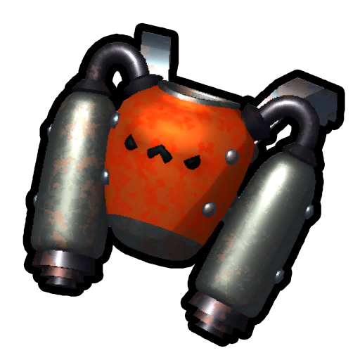

# 2.2.a

 Patch v2.2.a
Release date
August 18, 2026
Steam link
[Go to Steam](https://store.steampowered.com/news/app/3527290/view/715661584899246642)
Discord link
[Go to Discord](https://discord.com/channels/1368870708335083650/1371457189709090836/1539328414392127528)
Version chronology
[**←  Previous**
2.1.a](2.1.a.md)
[**Next  →**
 2.3.a](2.3.a.md)
[Version history](Version%20history.md)

## Message from LandCrab

***Hey scouts!***
Apologies for the bugged amulet spawn location yesterday... This patch should prevent that from happening again! We also nerfed the frogs yet again, hopefully the last one?

## Patch Notes

### BALANCE CHANGES

- Reduced number of [Clown Luggages](https://peak.wiki.gg/wiki/Clown_Luggage) needed to complete the Jester Achievement from 3 -> 2. May rework this achievement entirely later.
- In the last patch we introduced a nerf to ropes by making it cost stamina to start grabbing them based on your distance from the rope. Since exploiting that lack of stamina cost is mostly a speedrunner technique and otherwise doesn't affect gameplay much, we've reverted this change. Go nuts!
- MORE [FROG](Frog.md) NERFS (fine you guys win)- Max Tongue Distance 22m->18m
  - Max Tongue Angle 16°->14°
  - Cooldown 10s->12s
-  [Pandora's Lunchbox](Pandora%27s%20Lunchbox.md) can now add some  [Curse](Stamina%20bar.md#Curse) to you sometimes. Use at your own risk…
- Pandora's Lunchbox will ignore  [Invincibility](Stamina%20bar.md#Invincibility) when adding statuses to you. It was just a bit too good, sorry!!
- Cooking the [Book of Bones](https://peak.wiki.gg/wiki/Book_of_Bones) will no longer provide any benefit.

### FIXES

- Improved map generation to prevent [Amulet Statues](Amulet%20Statue.md) spawning inside of rocks and making the [Amulet](Amulets.md) unobtainable.
- Basic scout hats and berets should now be properly textured to match new costumes.
- The  [Scout's Generosity](Scout%27s%20Generosity.md) amulet can no longer clone  [Scout Effigy](Scout%20Effigy.md). As a note, the  [Checkpoint Flag](Checkpoint%20Flag.md) and other [Amulets](Amulets.md) are also not cloneable.
- [Color Blindness Mode](Color%20Blindness%20Mode.md) will now make the [Arrow Shooter](The%20Citadel.md#Arrow_Traps) “laser“ more visible for those with red-green color blindness.
- [Anti-gravity spheres](Anti-Zooka.md#Anti-gravity_spheres) shot from the  [Anti-Zooka](Anti-Zooka.md) now only last one minute to prevent soft-locks by placing one atop an unlit campfire.
- Fixed the sprite that appears when unlocking the [sash](Cosmetics.md#Sashes) after completing [Ascent 8](Ascents.md#Ascent_8).
- Fixed a localization issue where Traditional Chinese text would display in Simplified Chinese.
- Fixed the Bing Bong Airlines logo appearing backwards on the helicopter :)
- Thickened the colliders on wrought-iron [fences](Gloom.md#Wrought-Iron_Fences) to reduce the likelihood of the player [ragdoll](Scout.md#Ragdoll_State) getting stuck in them.
- Fixed another scenario where the  [Checkpoint Flag](Checkpoint%20Flag.md) could leave scouts in a broken state on another player's screen.
- [Looker](https://peak.wiki.gg/wiki/The_Looker) rocks should once again match the biome they're in
- Fixed an issue where cloning the  [jetpack](Jetpack.md) with  [Scout's Generosity](Scout%27s%20Generosity.md) created a jetpack with maximum fuel.
-  [Glider](Glider.md) fixes:- The Glider no longer gives forward momentum when [ragdolled](Scout.md#Ragdoll_State), such as when using the [Play Dead](Emotes.md#Page_1) [emote](Emotes.md).
  - Fixed the Glider's networking so the positions of players using it are synced properly.
  - The glider now rotates forward in your hands when out of stamina as a visual indicator of its power being disabled.
  - The Glider now protects you from the sun's heat in [MESA](Mesa.md).
- [Big Ghosts](Big%20Ghost.md) will now avoid spawning directly underneath players better.
- Fixed an issue where Big Ghosts could sometimes spawn slightly too high underground, giving you less time to react to them after they spawned.
