# Airport/es-419

Aeropuerto
[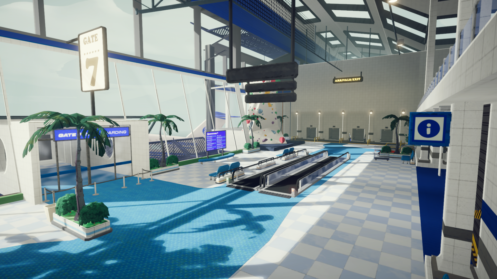](https://peak.wiki.gg/wiki/File%3AAirport_Location.png)
Detalles
Tipo
[Sala de Espera](Locations_es-419.md#Sala_de_Espera)

El **Aeropuerto** es la sala de espera en *[PEAK](Peak%20%28game%29_es-419.md)*. Los [Exploradores](Scout_es-419.md) son llevados aquí al iniciar una partida o al terminar una expedición. Esta es la única [ubicación](Locations_es-419.md) en la que los Exploradores no pueden recibir [Efectos de Estado](https://peak.wiki.gg/wiki/Status_Effects) (a excepción del  [Peso](Stamina%20bar.md#Weight)).

A los [Exploradores](Scout_es-419.md) se les otorga un  [Pasaporte](Passport.md) en el Aeropuerto, lo que les permite [personalizar](Cosmetics_es-419.md) su apariencia, incluyendo su color y los cosméticos que usan.

El Aeropuerto pertenece a una compañía ficticia llamada "*Aerolíneas [BingBong](Bing%20Bong.md)*" (*BingBong Airlines*), y allí pueden realizarse diversas actividades mientras se espera a abordar el vuelo.

## Características

### Elevadores

---

[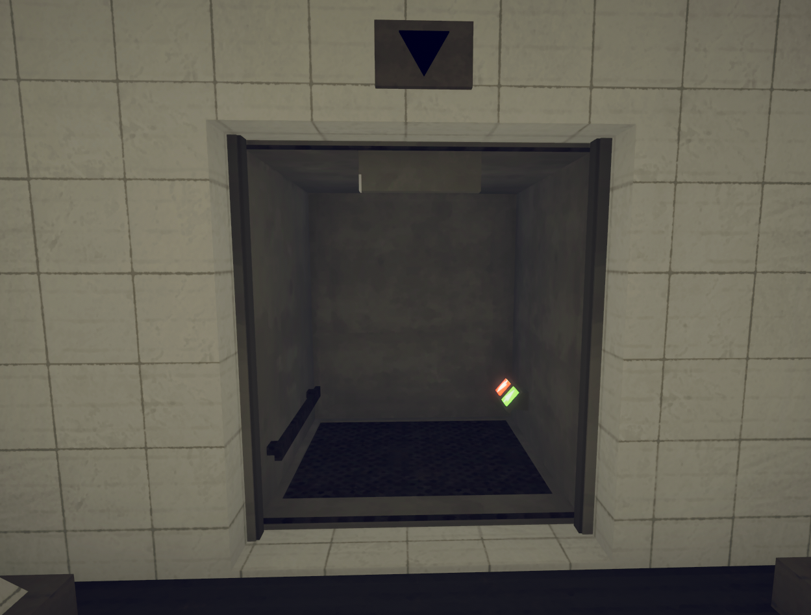](https://peak.wiki.gg/wiki/File%3AAirport_elevator.png)

Los **elevadores** son el lugar en el que los [Exploradores](Scout_es-419.md) aparecen al llegar al Aeropuerto. Estos comienzan con sus puertas cerradas y, luego de unos segundos, se abren.

### Muro de escalada

---

[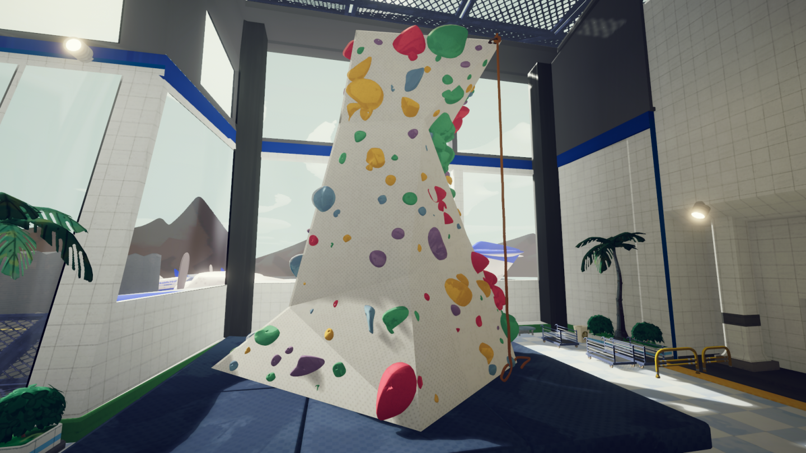](https://peak.wiki.gg/wiki/File%3AAirport_tower.png)

A la derecha de los [elevadores](#Elevadores) se encuentra un **muro de escalada** blanco con rocas de varios tamaños y colores. Los [Exploradores](Scout_es-419.md) pueden practicar su habilidad para escalar mientras esperan a abordar el vuelo. También tiene una [cuerda](Rope%20Spool.md) atada arriba del muro, que puede usarse para subir rápidamente.

### Cintas transportadoras

---

[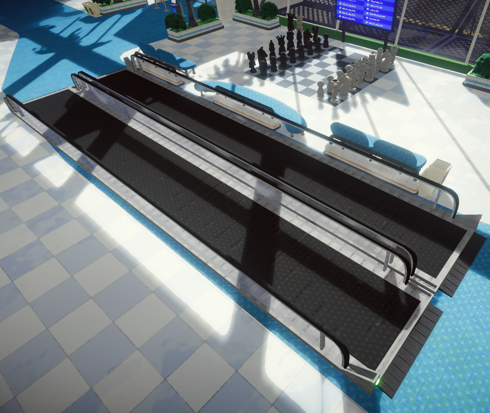](https://peak.wiki.gg/wiki/File%3AAirport_conveyor.png)

En el medio del Aeropuerto se encuentran dos **cintas transportadoras** moviéndose en direcciones contrarias. Los [Exploradores](Scout_es-419.md) encima de ellas son transportados lentamente en la dirección correspondiente.

### Espejo

---

[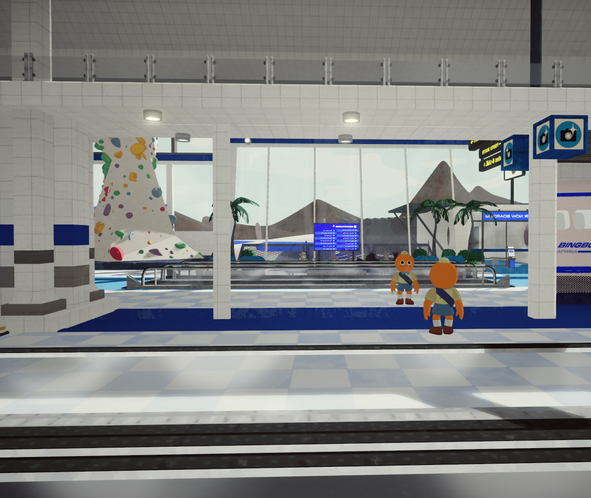](https://peak.wiki.gg/wiki/File%3AAirport_mirror.png)

Un **espejo** se encuentra del lado izquierdo de las [cintas transportadoras](#Cintas_transportadoras). Este permite a los [Exploradores](Scout_es-419.md) verse a sí mismos.

### Tablero de ajedrez

---

[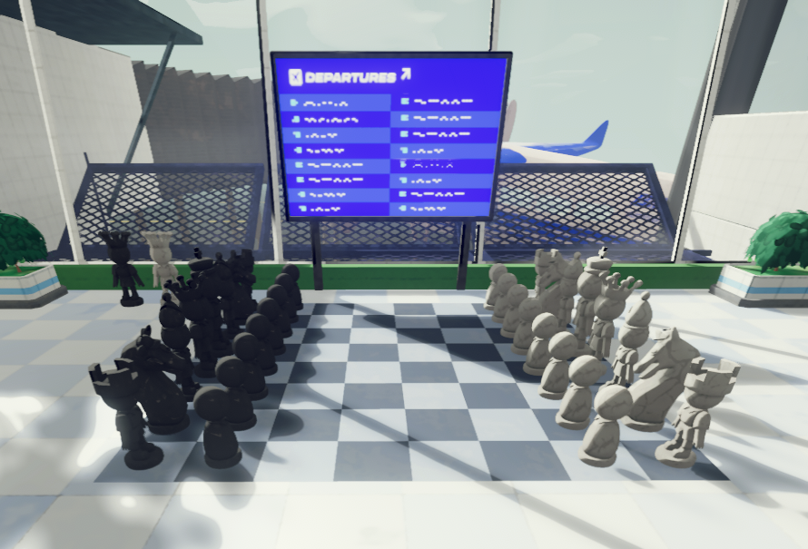](https://peak.wiki.gg/wiki/File%3AAirport_chess_board.png)

Del lado izquierdo de las [cintas transportadoras](#Cintas_transportadoras) se encuentra un **tablero de ajedrez**. Cada [pieza](https://peak.wiki.gg/wiki/Category%3AChess_pieces) puede recogerse, moverse y soltarse en cualquier lado, pero no puede guardarse en el inventario. Dos [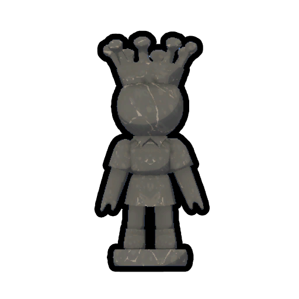](Queen.md) [Reinas](Queen.md) adicionales se pueden encontrar a la izquierda del tablero, una negra y otra blanca.

### Cabina fotográfica

---

- [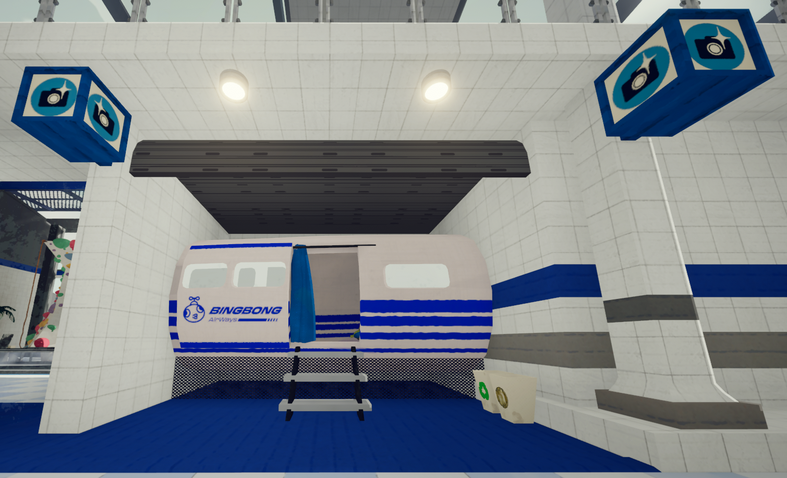](https://peak.wiki.gg/wiki/File%3AAirport_photo_booth_exterior.png)
  Exterior
- [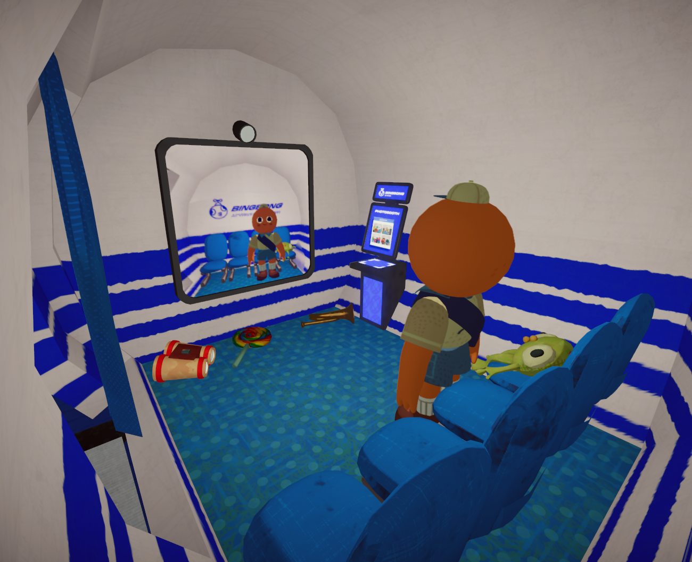](https://peak.wiki.gg/wiki/File%3AAirport_photo_booth_interior.png)
  Interior

Una **cabina fotográfica** se encuentra a la derecha del [espejo](#Espejo). En ella, los [Exploradores](Scout_es-419.md) pueden tomarse fotos interactuando con el [quiosco](#Quioscos) dentro. La cabina fotográfica tomará un total de 4 fotos, con una cuenta regresiva de **3 segundos** antes de cada una. Luego, las fotos se mostrarán a los Exploradores y se les tomará una captura de pantalla para que queden guardadas en [Steam](https://es.wikipedia.org/wiki/Steam).

También hay unos [objetos](Items_es-419.md) de utilería dentro de la cabina para usar en las fotos, aunque estos son diferentes a sus versiones normales y la mayoría no pueden usarse:

-  [Binoculares](Binoculars.md) (no permite ver a través de ellos)
-  [Bing Bong](Bing%20Bong.md) (mirará en la misma dirección que el [Explorador](Scout_es-419.md) sosteniéndolo)
-  [Paleta Grande](Big%20Lollipop.md) (no se puede lamer, por más de que la acción para hacerlo aparezca)
-  [Clarín](Bugle.md) (no produce sonido)

### Quioscos

---

- [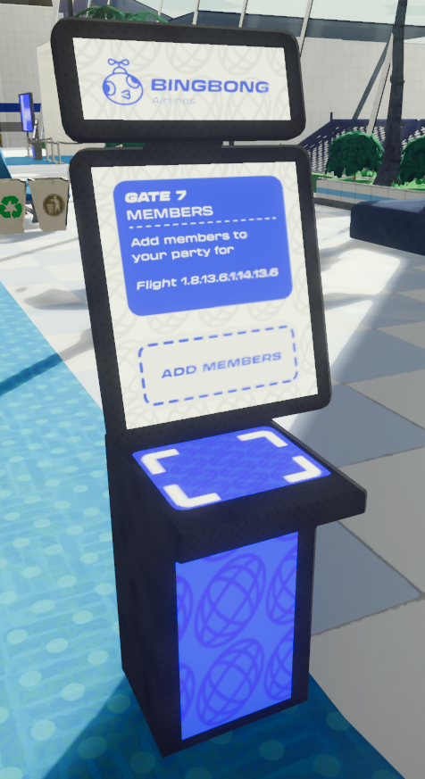](https://peak.wiki.gg/wiki/File%3AKiosk_invitation.png)
  Quiosco para invitaciones
- [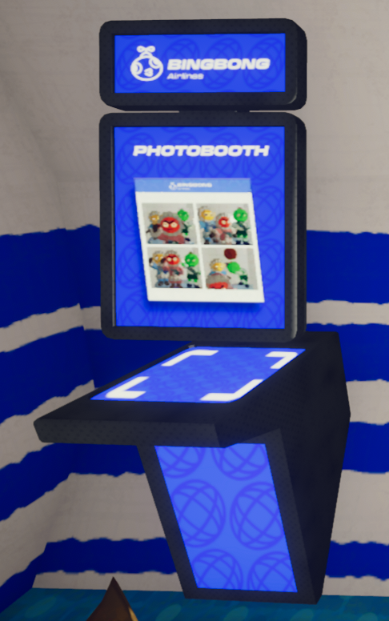](https://peak.wiki.gg/wiki/File%3AAirport_photo_booth_kiosk.png)
  Quiosco de la [cabina fotográfica](#Cabina_fotográfica)
- [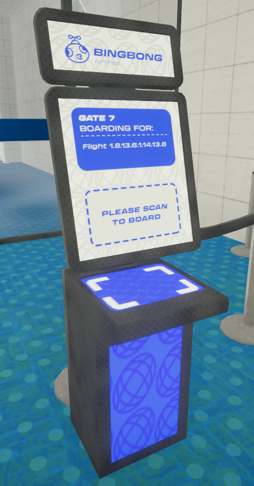](https://peak.wiki.gg/wiki/File%3AKiosk_boarding.png)
  Quiosco de la sala

El Aeropuerto tiene tres **quioscos** interactuables, cada uno con su función:

- El **quiosco para invitaciones** permite al anfitrión de la tropa invitar a otros [Exploradores](Scout_es-419.md) mediante el sistema de amigos de [Steam](https://es.wikipedia.org/wiki/Steam). Este quiosco no aparece al expedicionar en solitario.
- El **quiosco de la cabina fotográfica** permite a cualquier Explorador iniciar la cuenta regresiva de la [cabina fotográfica](#Cabina_fotográfica).
- El **quiosco de la sala** permite a los Exploradores comenzar una expedición en el [Ascenso](Ascents_es-419.md) elegido o una [expedición personalizada](Custom%20Expedition.md).

### Cancha de básquet

---

- [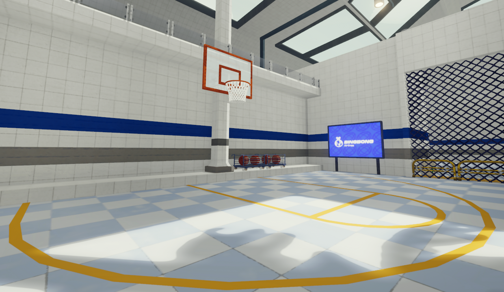](https://peak.wiki.gg/wiki/File%3AAirport_basketball_court.png)
  La cancha
- [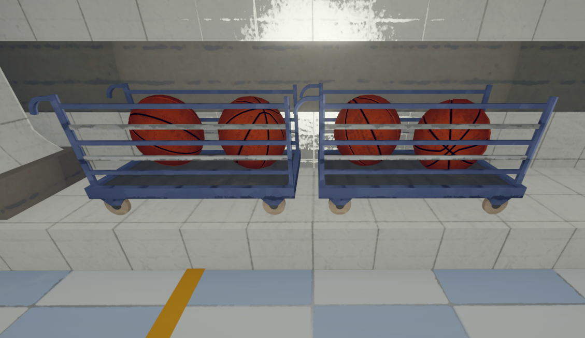](https://peak.wiki.gg/wiki/File%3AAirport_basketball_trays.png)
  Los carritos de [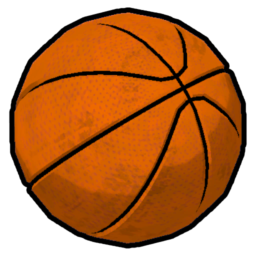](Basketball.md) [Básquetbol](Basketball.md)

Al final del Aeropuerto se encuentra una **cancha de básquet** miniatura. Tiene un aro de básquet y una hilera de cuatro  [Básquetbols](Basketball.md) en dos carritos para que los [Exploradores](Scout_es-419.md) las recojan. Los Exploradores driblearán automáticamente al caminar o correr con un Básquetbol en la mano. Cuando un [objeto](Items_es-419.md) entra en el aro de básquet, se reproducirá un efecto de sonido y lloverá confeti desde él.

## Curiosidades

[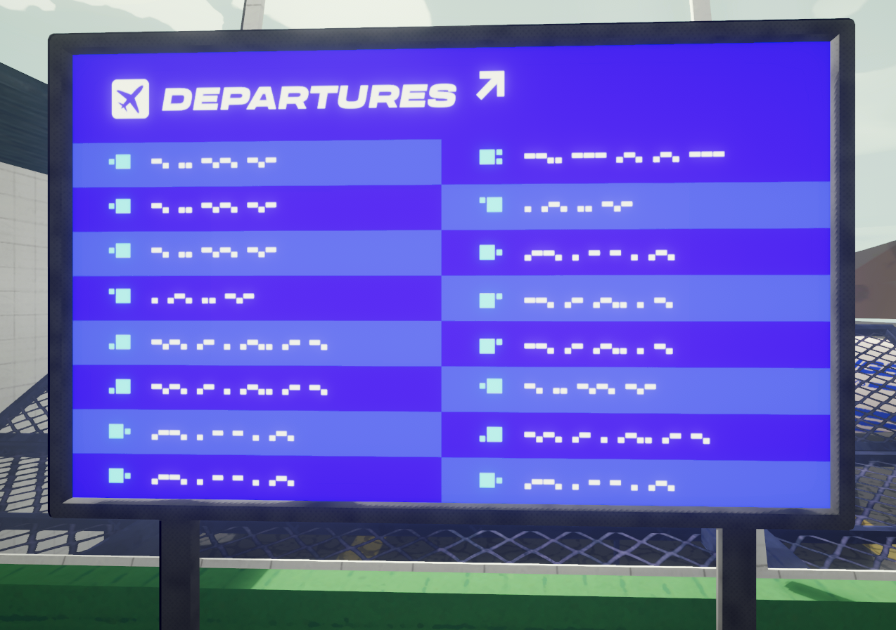](https://peak.wiki.gg/wiki/File%3AAirport_schedule.png)

Nombres en [código morse](https://es.wikipedia.org/wiki/Código_morse)- La [cuerda](Rope%20Spool.md) del [muro de escalada](#Muro_de_escalada) no aparecerá al volver al Aeropuerto luego de una expedición, dejando únicamente un nudo de cuerda en el gancho arriba del muro.
- El [quiosco para invitaciones](#Quioscos) y el [quiosco de la sala](#Quioscos) muestran que el número de vuelo es **1.8.13.6.1.14.13.6**. Si los números se descifran con el [alfabeto de Base32](https://es.wikipedia.org/wiki/Base32#Alfabeto_de_Base32), el número de vuelo forma la palabra **BINGBONG**.
- El panel de horarios de salida muestra nombres de [desarrolladores](https://peak.wiki.gg/wiki/Developers) en [código morse](https://es.wikipedia.org/wiki/Código_morse):- `--.. --- .-. .-. ---` "ZORRO"
  - `-.-. .- . .-.. .- -.` "CAELAN"
  - `.--. . - - . .-.` "PETTER"
  - `. .-. .. -.-` "ERIK"
  - `-. .. -.-. -.-` "NICK"
  - `--. .- .-.. . -.` "GALEN"
  - `.-- .. .-.. .... . .-.. --` "WILHELM"
- El pase de abordar que se muestra al interactuar con el [quiosco de la sala](#Quioscos) contiene algunos secretos:- Del lado izquierdo, la [página de PEAK](http://peakpeakpeak.com) oficial está cifrada en un código de barras [PDF417](https://es.wikipedia.org/wiki/PDF417).
  - El vuelo parte desde **ACG**, las siglas de [Aggro Crab Games](https://en.wikipedia.org/wiki/Aggro_Crab), un desarrollador de *[PEAK](Peak%20%28game%29_es-419.md)*.
  - El vuelo va hasta **LFG**, que proviene de [Landfall Games](https://en.wikipedia.org/wiki/Landfall_Games), el otro desarrollador de *[PEAK](Peak%20%28game%29_es-419.md)*.
- Se puede encontrar un modelo en pose A del [Jefe de Tropa Myres](Scoutmaster%20Myres.md) en una sala normalmente inaccesible.

## Galería

- [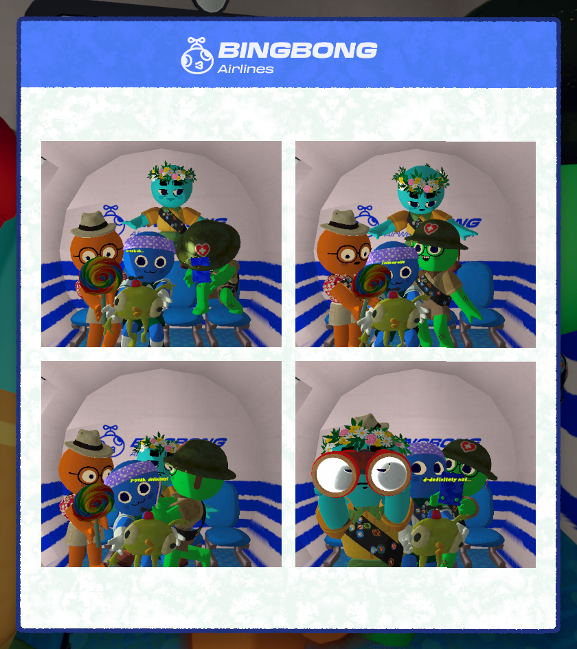](https://peak.wiki.gg/wiki/File%3AAirport_photo_booth_photos.png)
  Fotos de una tropa de cuatro [Exploradores](Scout_es-419.md) y  [Bing Bong](Bing%20Bong.md) en la [cabina fotográfica](#Cabina_fotográfica).
- [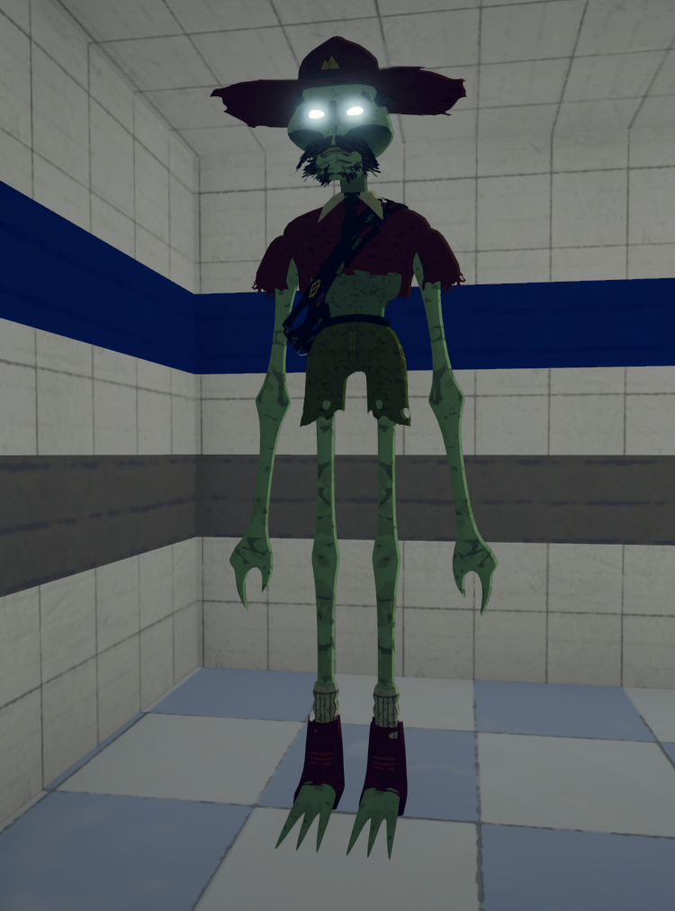](https://peak.wiki.gg/wiki/File%3AMyres_tpose.png)
  El modelo en pose A del [Jefe de Tropa Myres](Scoutmaster%20Myres.md) en una sala inaccesible del Aeropuerto.

## Historial de versiones

 **[1.0](1.0.md) (2025-06-16):** Se introdujo el Aeropuerto, junto con los [elevadores](#Elevadores), el [muro de escalada](#Muro_de_escalada), las [cintas transportadoras](#Cintas_transportadoras), el [espejo](#Espejo), el [quiosco para invitaciones](#Quioscos) y el [quiosco de la sala](#Quioscos).

 **[1.2.a](1.2.a.md) (2025-06-18):** Se arregló un error por el cual el pulsa para hablar se podía romper al viajar a la [isla](Island_es-419.md) desde el aeropuerto.

 **[1.6.a](1.6.a.md) (2025-07-04):**

- Se arregló un error por el cual el  [Pasaporte](Passport.md) no actualizaba tus [cosméticos](Cosmetics_es-419.md) correctamente al volver al aeropuerto luego de ganar.
- Se eliminó una extraña línea verde y fina en el Aeropuerto.

 **[1.30.a](1.30.a.md) (2025-09-23):**

- Se añadió el [Ajedrez](#Tablero_de_ajedrez) al Aeropuerto.
- Se añadió el [Básquet](#Cancha_de_básquet) al Aeropuerto.
- Se añadió una [Cabina fotográfica](#Cabina_fotográfica) al Aeropuerto.

 **[1.31.a](1.31.a.md) (2025-09-25):**

- El [Bing Bong](Bing%20Bong.md) del aeropuerto ahora muestra la acción de Preguntar correctamente.
- El aro de [básquet](#Cancha_de_básquet) ahora contará como una canasta y reproducirá los efectos correspondientes a cualquier [objeto](Items_es-419.md) que se enceste, incluso si no es un  [Básquetbol](Basketball.md).
- La cámara de la [cabina fotográfica](#Cabina_fotográfica) ahora se apaga cuando no estás cerca de la cabina para optimizar rendimiento.- Además, las fotos no se mostrarán en tu pantalla si no estás en la cabina en el momento en que se tomaron.

 **[1.35.a](1.35.a.md) (2025-10-31):** El aeropuerto es tenebroso ahora.

 **[1.40.a](1.40.a.md) (2025-11-05):** El aeropuerto ya no es tenebroso. **(Cambio no documentado)**

 **[1.50.a](1.50.a.md) (2025-12-16):**

- La sala de espera del Aeropuerto se ve un poco más festiva.
- El aeropuerto y gran parte de la [montaña](Island_es-419.md) ya no deberían desaparecer al usar DirectX12 con una tarjeta gráfica integrada.

 **[1.52.a](1.52.a.md) (2026-01-06):** Se eliminaron los cambios del evento festivo (a excepción de los [montículos de nieve](https://peak.wiki.gg/wiki/Snow_Pile), que todavía se pueden encontrar en la [Zona Alpina](Alpine.md)).
