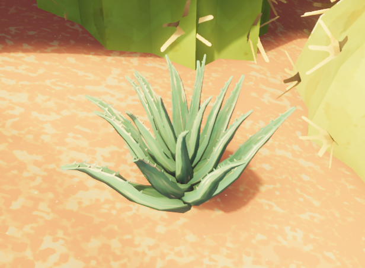

# Aloe Vera

Aloe Vera

[Item type](Items.md)- [Consumable](https://peak.wiki.gg/wiki/Consumable)
Biome- [Mesa](Mesa.md)
Weight
 **2.5**
Base Status Effects
Heat
-50
Cooked Bonuses
Bonus Stamina
10 (10 total)

The **Aloe Vera** is a [consumable](https://peak.wiki.gg/wiki/Consumable) item in *[PEAK](Peak%20%28game%29.md)* found growing in the [Mesa](Mesa.md). Using the Aloe Vera will remove  **50** [Heat](Stamina%20bar.md#Heat).

## Gallery

- 
  A close-up of an Aloe Vera.

## Patch history

 **[1.20.a](1.20.a.md) (2025-08-11):** Introduced.
