# Alpine

Alpine
[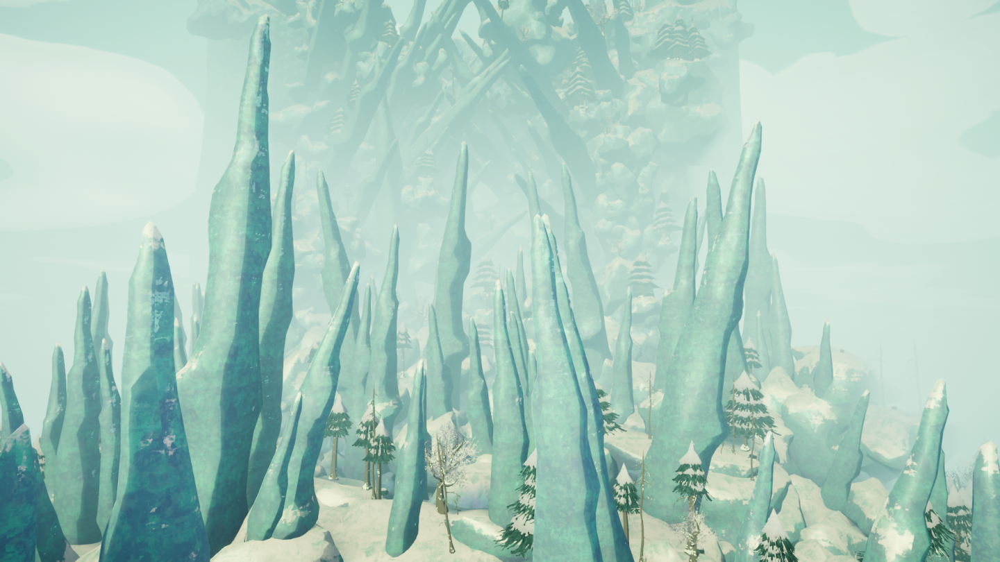](https://peak.wiki.gg/wiki/File%3AAlpine_Location.png)
Details
Type
[Biome](https://peak.wiki.gg/wiki/Biome)
Region
**3**/6

The **Alpine** is one of the two possible third [biomes](https://peak.wiki.gg/wiki/Biome) in *[PEAK](Peak%20%28game%29.md)*, replacing the [Mesa](Mesa.md) every second day. It follows the [Tropics](Tropics.md) or the [Roots](Roots.md) and precedes the [Caldera](Caldera.md) or [Gloom](Gloom.md). It is a snowy, hilly area with a cliffside full of caves.

Reaching the top and lighting the [campfire](Campfire.md) dispels the fog to the next biome and grants all living [Scouts](Scout.md) the  [Alpinist Badge](https://peak.wiki.gg/wiki/Alpinist_Badge) if they haven't already obtained it. Additionally, players who have never had more than  **20** [Cold](Stamina%20bar.md#Cold) at any time during their climb through the Alpine receive the  [Bundled Up Badge](https://peak.wiki.gg/wiki/Bundled_Up_Badge).

## Features

### Trees

---

#### Pine Trees

[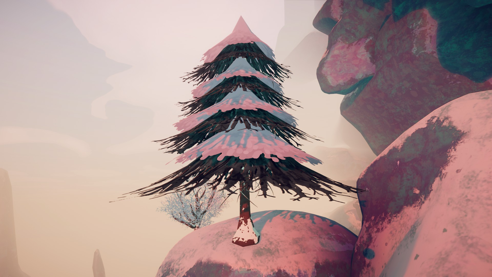](https://peak.wiki.gg/wiki/File%3AAlpine_tree_1.jpg)

**Pine Trees** can be found throughout the Alpine. Some of these trees are dead and lack foliage. Although some variants visually resemble the [Redwood Trees](Roots.md#Redwood_Trees) found in the [Roots](Roots.md), players cannot stand on any part of these trees' canopies.

#### Pine Shrubs

**Pine Shrubs** are small dome shaped bushes that can be stood on.

#### Winterberry Trees

[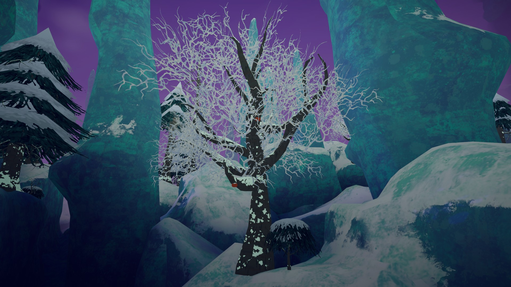](https://peak.wiki.gg/wiki/File%3AAlpine_tree_2.jpg)

**Winterberry Trees** adorn the Alpine with their mycelium-like foliage. These trees have branches thick enough to be stood upon. Most of these trees are fruitless, but it is not uncommon to find trees with multiple  [Orange Winterberries](Orange%20Winterberry.md) hanging off their branches. Extremely rarely, a player might find a tree that bears  [Yellow Winterberries](Yellow%20Winterberry.md).

### Caves

---

- [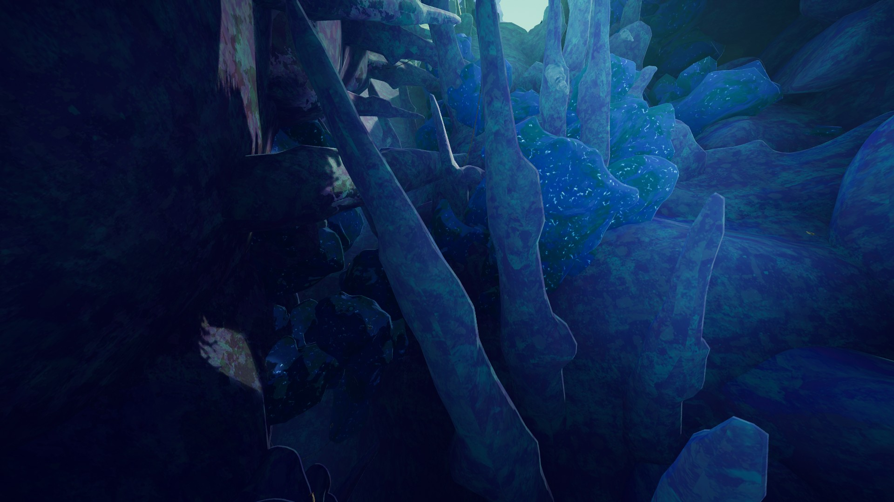](https://peak.wiki.gg/wiki/File%3AAlpine_caves.jpg)
- [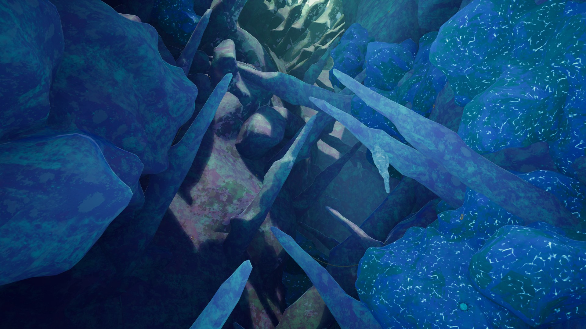](https://peak.wiki.gg/wiki/File%3AAlpine_caves2.jpg)

The Alpine's cliffside can house large, open **Caves**. Trees with [Winterberries](https://peak.wiki.gg/wiki/Winterberry) on them can often be found growing in these caves.

### Hot Spring

---

[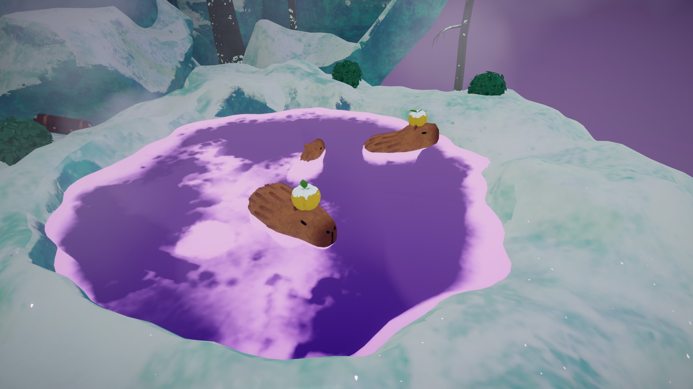](https://peak.wiki.gg/wiki/File%3AAlpine_hot_spring.jpg)

A **Hot Spring** can be found higher up the Alpine's cliffside. It is a small pool of steaming water housing three [capybaras](Capybara.md). Standing in the water will remove  [Cold](Stamina%20bar.md#Cold) with time and protect you from [blizzards](https://peak.wiki.gg/wiki/Blizzards). One to three of the capybaras will have a  [Yellow Winterberry](Yellow%20Winterberry.md) resting on their heads.

The Hot Spring is the Alpine's equivalent to the [Oasis](Mesa.md#Oasis) in the [Mesa](Mesa.md).

### Rusty Pitons

---

A rusty [Piton](Piton.md)

**[Rusty Pitons](Piton.md#Rusty_Pitons)** can be found embedded in the walls of the Alpine's caves. [Scouts](https://peak.wiki.gg/wiki/Scouts) can grab onto the handle of a Rusty Piton to recover stamina identical to a normal  [Piton](Piton.md), but will break after being held onto for **6 seconds**.

The Rusty Pitons are the Alpine's equivalent to the [Pickaxes](Mesa.md#Pickaxes) found in the [Mesa](Mesa.md).

## Hazards

| Hazard | Image | Description |
| --- | --- | --- |
| **[Blizzards](Blizzard.md)** | [Blizzard 1.jpg](https://peak.wiki.gg/wiki/File%3ABlizzard_1.jpg) | **[Blizzards](Blizzard.md)** are the main hazard of the Alpine. Periodically, a blizzard will move through almost the entire biome (excluding deep caves), inflicting [Cold](Stamina%20bar.md#Cold) [Cold](Stamina%20bar.md#Cold) rapidly on any [Scout](Scout.md) caught in it. [Scouts](https://peak.wiki.gg/wiki/Scouts) can hide from the blizzard by hiding below the Alpine's surface or inside the caves. Blizzards also severely reduce visibility and have winds that slightly push you. |
| **Icicles** | [Alpine Icicle.png](https://peak.wiki.gg/wiki/File%3AAlpine_Icicle.png) | **Icicles** can be found hanging within the Alpine's caves. Climbing on one may cause it to shake before falling a short time later. |
| **[Ice Rocks](Ice%20Rocks.md)** | [Ice rock with piton.png](https://peak.wiki.gg/wiki/File%3AIce_rock_with_piton.png) | **[Ice Rocks](Ice%20Rocks.md)** are giant rocks in the walls of the Alpine's cliffside and caves that inflict [Cold](Stamina%20bar.md#Cold) [Cold](Stamina%20bar.md#Cold) on [Scouts](https://peak.wiki.gg/wiki/Scouts) standing on them or climbing them. Climbing inflicts much more [Cold](https://peak.wiki.gg/wiki/Cold) than simply standing on [Ice Rocks](Ice%20Rocks.md). |
| **[Flash Bulbs](Flash%20Bulbs.md)** | [Flashpod.png](https://peak.wiki.gg/wiki/File%3AFlashpod.png) | **[Flash Bulbs](Flash%20Bulbs.md)** are flowers found in the Alpine's caves. Upon making contact with a [Scout](Scout.md), the Flashpod will open up and cover all nearby [Scout's](Scout.md) screens with fog, effectively blinding them. |
| **[Geysers](https://peak.wiki.gg/wiki/Geysers)** | [Geyser.png](https://peak.wiki.gg/wiki/File%3AGeyser.png) | **[Geysers](https://peak.wiki.gg/wiki/Geysers)** can also be found on the cliffside, more often within the caves. They can spontaneously erupt when there are [Scouts](https://peak.wiki.gg/wiki/Scouts) nearby, inflicting [Heat](Stamina%20bar.md#Heat) [Heat](Stamina%20bar.md#Heat) on them and sending them flying if they are too close. |
| [Napberry Plants](https://peak.wiki.gg/wiki/Napberry_Plant) | [Napberry Plant.png](https://peak.wiki.gg/wiki/File%3ANapberry_Plant.png) | [Napberry plants](https://peak.wiki.gg/wiki/Napberry_Plant) will inflict [Drowsy](Stamina%20bar.md#Drowsy) [Drowsy](Stamina%20bar.md#Drowsy) onto any Scouts nearby until the [Napberry](Napberry.md) is picked. |

## Variants

The Alpine generates as one of the following variants, each with an equal chance of appearing:

- [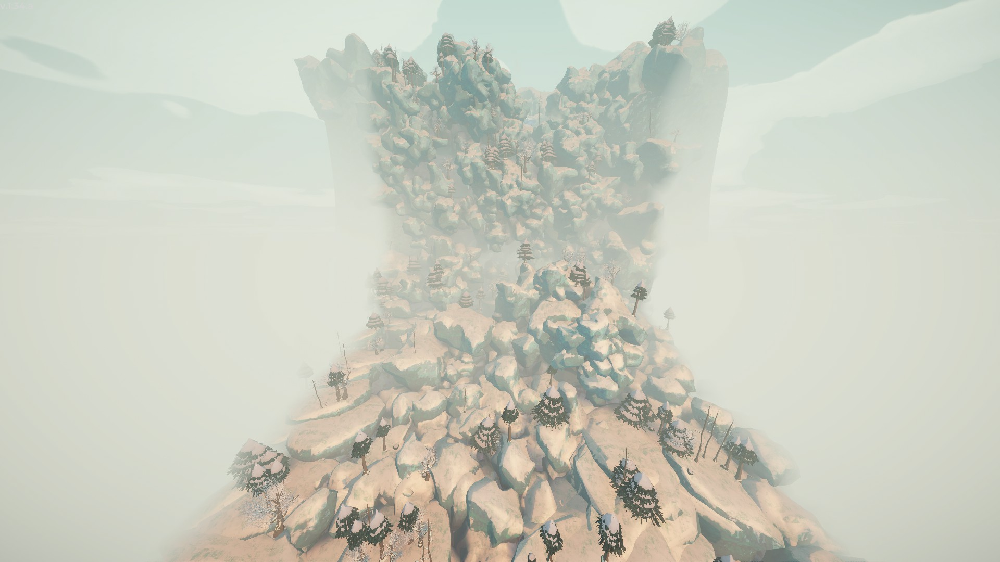](https://peak.wiki.gg/wiki/File%3AAlpine_Default.jpg)
  Default variant.
- [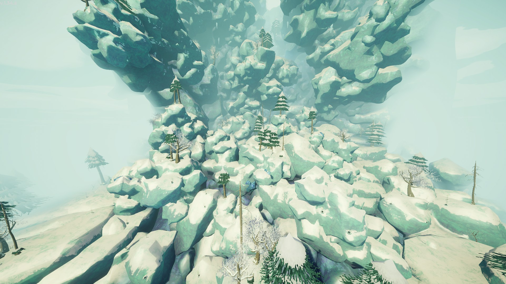](https://peak.wiki.gg/wiki/File%3AAlpine_Geyser_Hell.jpg)
  **"Geyser Hell":**
  Significantly more geysers spawn.
- [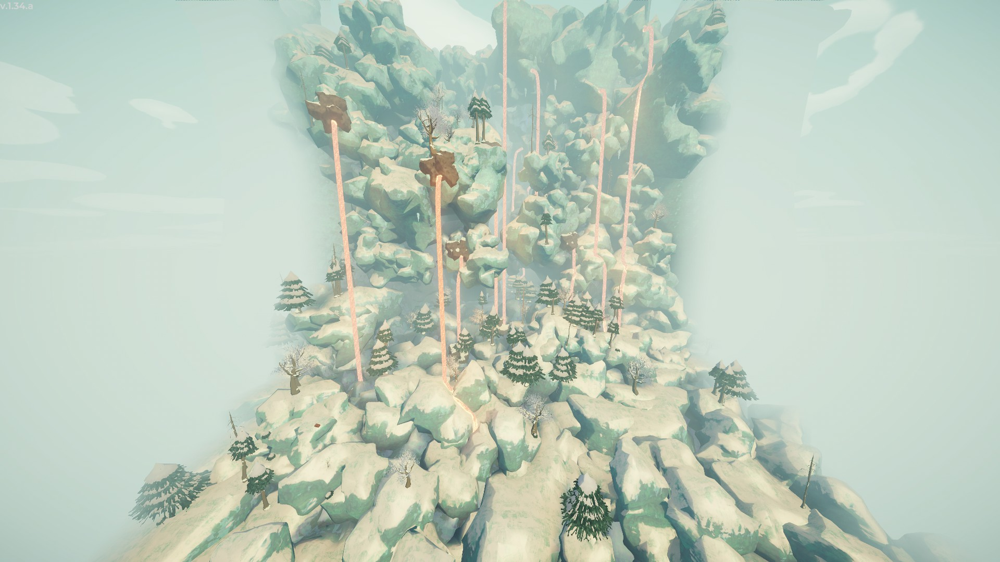](https://peak.wiki.gg/wiki/File%3AAlpine_Lava.jpg)
  **"Lava":**
  Generates with [Lava Tubes](https://peak.wiki.gg/wiki/Lava_Tube).
- [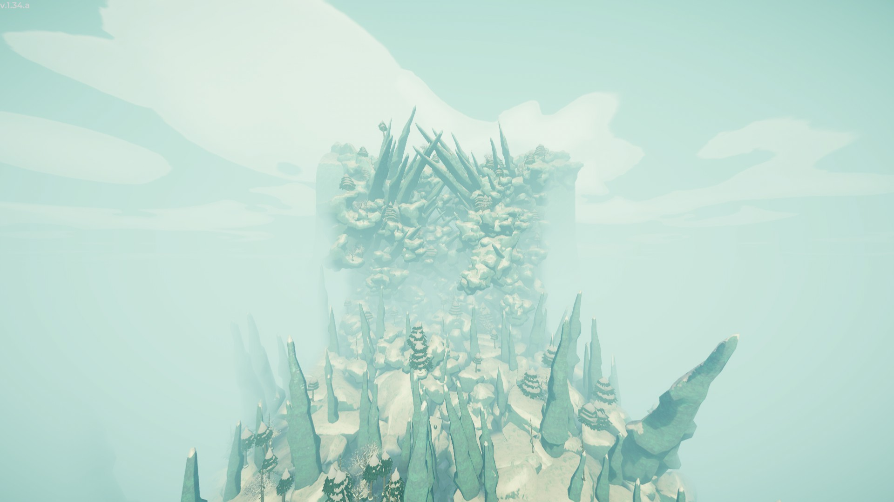](https://peak.wiki.gg/wiki/File%3AAlpine_Spikes.jpg)
  **"Spikes":**
  Generates with giant ice spikes.

## Food

The following food items can be found in the Alpine, excluding packaged food from [luggage](Luggage.md):

-  [Orange Winterberry](Orange%20Winterberry.md)
-  [Yellow Winterberry](Yellow%20Winterberry.md) ( [Bonus stamina](Stamina%20bar.md#Bonus_stamina))
-  [Napberry](Napberry.md) ( [Drowsy](Stamina%20bar.md#Drowsy) among other effects)

## Natural Items

The following natural items can appear in the Alpine:

-  [Shelf Fungus](Shelf%20Fungus.md)
-  [Remedy Fungus](Remedy%20Fungus.md)
-  [Warp Fungus](Warp%20Fungus.md)
-  [Magic Bean](Magic%20Bean.md)

## Tips & Tricks

- [Scouts](https://peak.wiki.gg/wiki/Scouts) can huddle up together to increase the speed at which  [Cold](Stamina%20bar.md#Cold) fades. When in a group, always find cover that can house everyone in the event of a [blizzard](Blizzard.md).
- If possible, bringing  [Scorchberries](Scorchberry.md) from the [Tropics](Tropics.md) can help with fighting the Blizzard's cold, especially alone, as the  [Heat](Stamina%20bar.md#Heat) gained from them will cancel out the [cold](https://peak.wiki.gg/wiki/Cold).
- A [geyser's](Geyser.md) imminent eruption can be foretold by the sound of steam building up and a shaking screen. Once this starts to happen, you have a short amount of time to get away from the [geyser](Geyser.md).

## Trivia

- This is the biome that [Scoutmaster Myres](Scoutmaster%20Myres.md) was left behind in, after he passed out from the effects of a  [Napberry](Napberry.md).
- When you are in this biome, your Steam Now Playing will say "Weathering the Alpine".

## Gallery

- [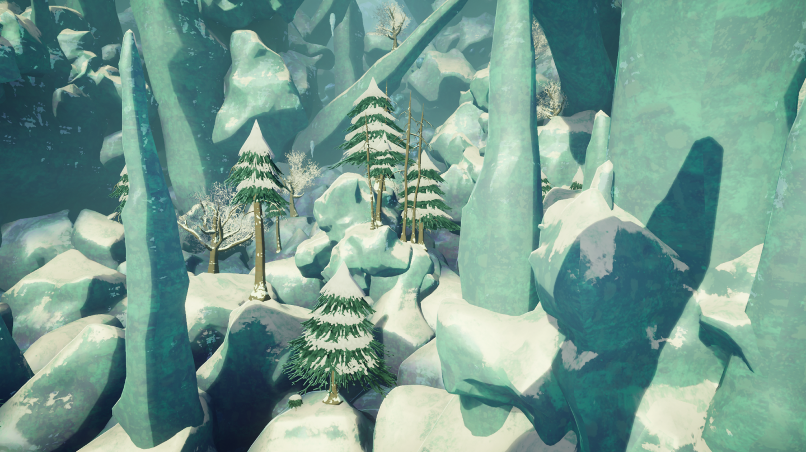](https://peak.wiki.gg/wiki/File%3AAlpine_2.png)
  Alpine trees amidst giant stalagmites.
- [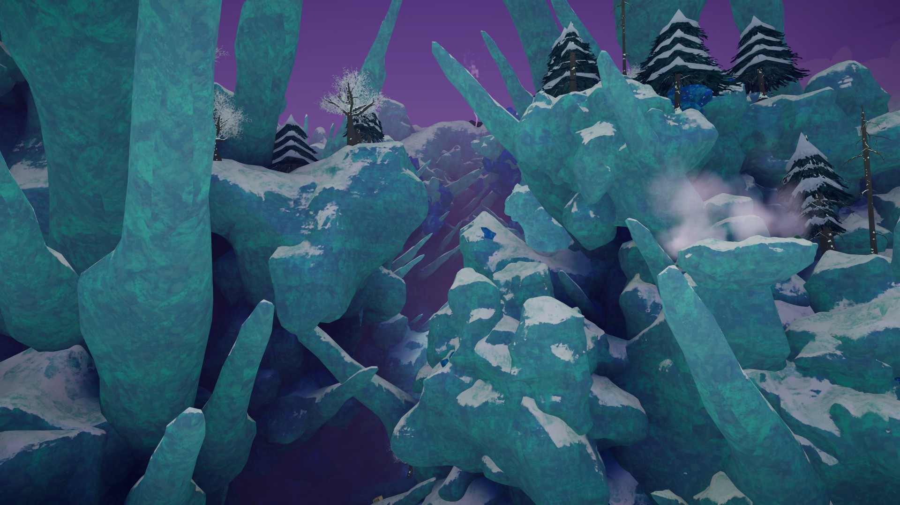](https://peak.wiki.gg/wiki/File%3AAlpine_3.jpg)
  As before, closer to the clifftop.
- [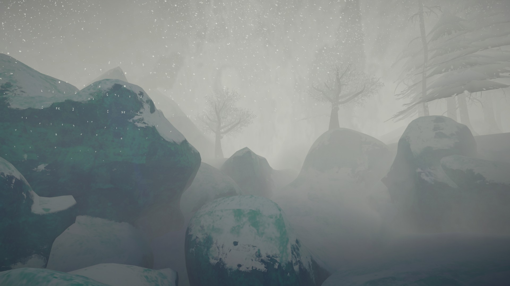](https://peak.wiki.gg/wiki/File%3ABlizzard_2.jpg)
  The Alpine during a [blizzard](Blizzard.md).
- [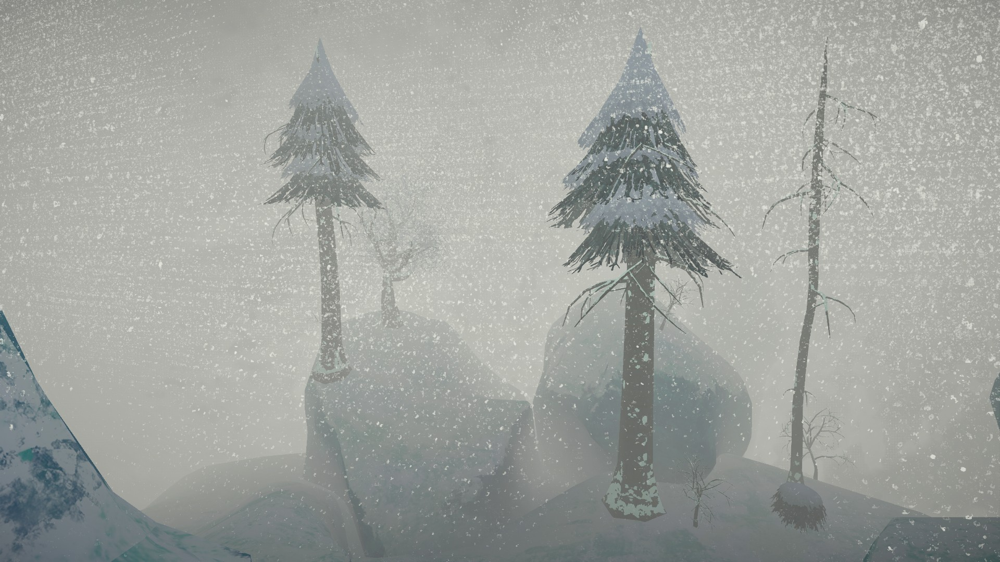](https://peak.wiki.gg/wiki/File%3ABlizzard_3.jpg)
  As before, with more visible particles.
- [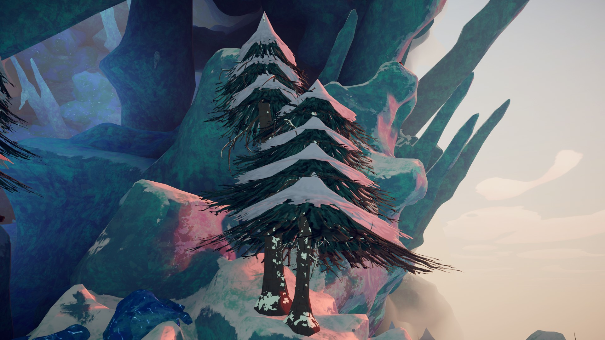](https://peak.wiki.gg/wiki/File%3AAlpine_trees.jpg)
  Two alpine trees fused together.
- 
  A lone alpine tree.
- 
  A withered alpine tree bearing some  [Orange Winterberries](Orange%20Winterberry.md).
- [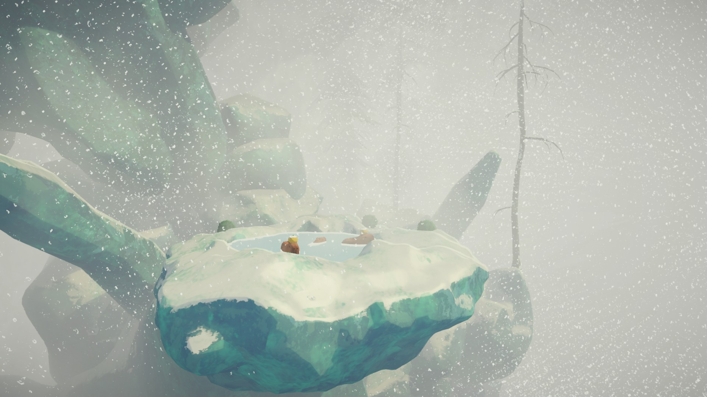](https://peak.wiki.gg/wiki/File%3AAlpine_hot_spring_blizzard.jpg)
  The hot spring during a blizzard.
- [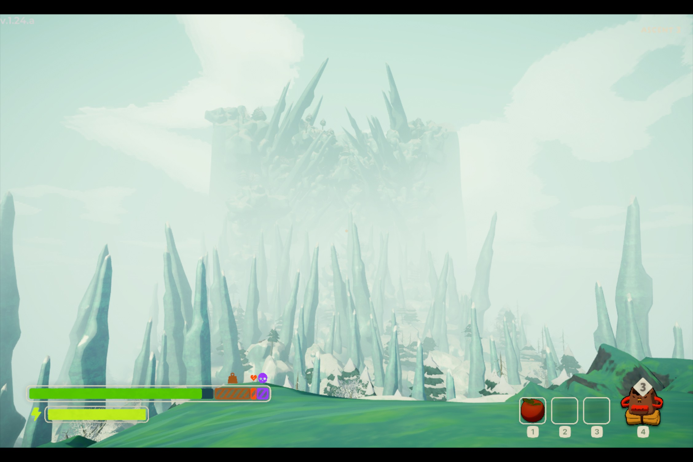](https://peak.wiki.gg/wiki/File%3AAlpine_1.24.a.jpg)
  Alpine in [1.24.a](1.24.a.md).

## Patch history

 **[1.0](1.0.md) (2025-06-16):** Introduced.
 **[1.2.a](1.2.a.md) (2025-06-18):** Added new items that spawn on the island: [Shelf Fungus](Shelf%20Fungus.md), [Remedy Fungus](Remedy%20Fungus.md), and [Magic Bean](Magic%20Bean.md).
 **[1.20.a](1.20.a.md) (2025-08-11):** Added a new biome that replaces the Alpine: the [MESA](https://peak.wiki.gg/wiki/MESA). The MESA will be present in every run for the next week - after which future maps will [rotate](Island.md) randomly between the Mesa and Alpine.
 **[1.24.a](1.24.a.md) (2025-08-18):** The Alpine has been re-added to the rotation. That's it!
 **[1.27.a](1.27.a.md) (2025-08-27):** The ALPINE and the MESA will now alternate every other day.
 **[1.50.a](1.50.a.md) (2025-12-16):** Added [Snowballs](Snowball.md) as part of the Holiday update to all biomes preceding [Caldera](Caldera.md).
 **[1.52.a](1.52.a.md) (2026-01-06):** [Snowballs](Snowball.md) remained exclusively in Alpine permanently following the Holiday update.
