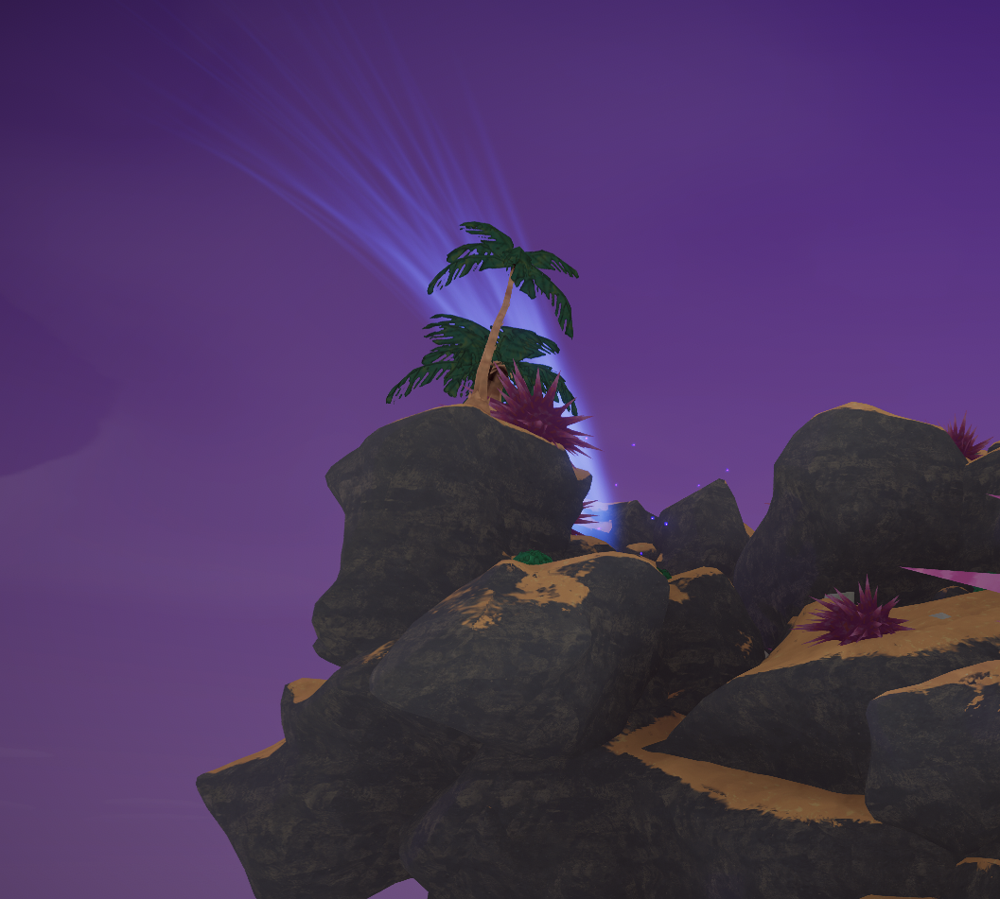
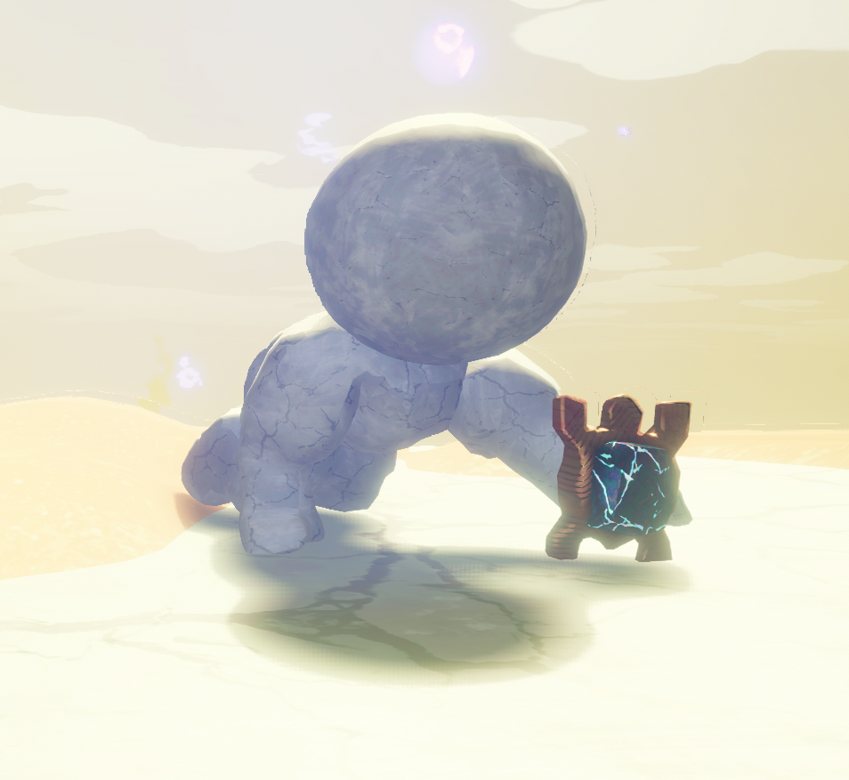
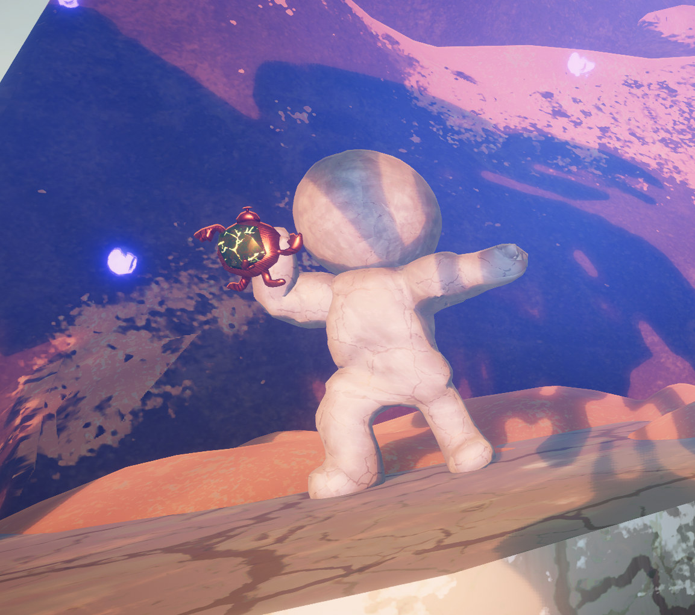
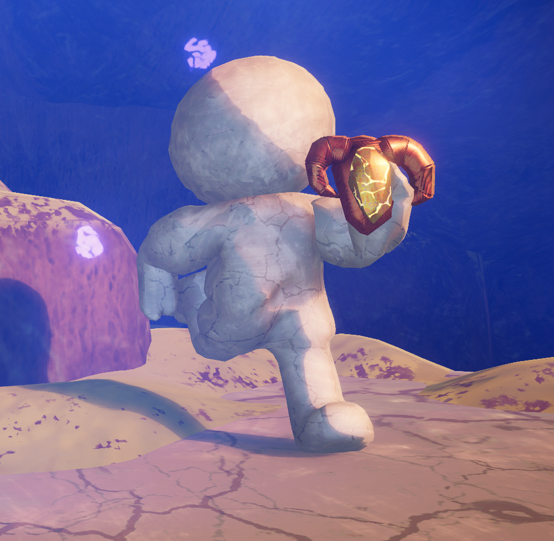
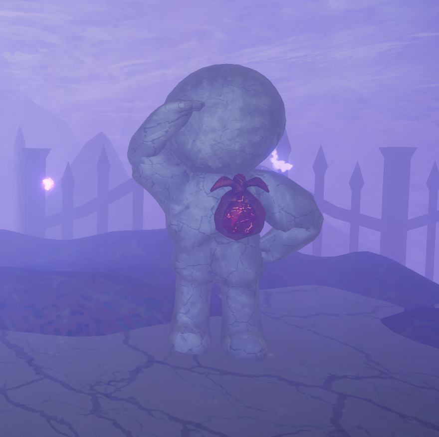

# Amulet Statue

This page is a [stub](https://support.wiki.gg/wiki/Stub). You can help **PEAK Wiki** by expanding it.

Spoilers ahead!

This page contains **spoilers** for *[PEAK](Peak%20%28game%29.md)*. View at your own discretion.

Not to be confused with [Ancient Statues](https://peak.wiki.gg/wiki/Ancient_Statues).

The **Amulet Statues** are landmarks in *[PEAK](Peak%20%28game%29.md)*. They are four stone statues of faceless [Scouts](https://peak.wiki.gg/wiki/Scouts) with each holding one of the four Scout's [Amulets](Amulets.md). One appears in each [biome](https://peak.wiki.gg/wiki/Biome) (excluding [The Kiln](The%20Kiln.md) and [The Citadel](The%20Citadel.md)) in a random order determined by the map generation seed.

## Behavior

- To remove the [Amulet](Amulets.md) from a statue, a player must grab it directly.
- A statue's [Amulet](Amulets.md) cannot be removed from the statue by environmental hazards or items like  [Dynamite](Dynamite.md) or the  [Rescue Claw](Rescue%20Claw.md).
- Particles and long strands of blue light radiate from the base of an Amulet Statue, making it easy to spot from far away. Once a player removes the [Amulet](Amulets.md) from an Amulet Statue, the visual effects will slowly disappear.

## Trivia

- According to the patch notes of [2.0.a](2.0.a.md), the statues are tied to the Scouts of Troop 437, [Scoutmaster Myres](Scoutmaster%20Myres.md)' troop.[[1]](#cite_note-1) Whether they directly depict them or simply embody the traits they had is unclear.
- Each statue has a different pose that corresponds with the statue's held [Amulet](Amulets.md).

## Gallery

- 
  An Amulet Statue's visual effects visible from afar.
- 
  An Amulet Statue holding the  [Scout's Tenacity](Scout%27s%20Tenacity.md)
- 
  An Amulet Statue holding the  [Scout's Generosity](Scout%27s%20Generosity.md).
- 
  An Amulet Statue holding the  [Scout's Ambition](Scout%27s%20Ambition.md).
- 
  An Amulet Statue holding the  [Scout's Initiative](Scout%27s%20Initiative.md).

## Patch history

 **[2.0.a](2.0.a.md) (2026-08-11):** Introduced.
 **[2.2.a](2.2.a.md) (2026-08-18):** Improved map generation to prevent Amulet Statues spawning inside of rocks and making the Amulet unobtainable.

## References

- [↑](#cite_ref-1) ["Mysterious statues have begun appearing all over the island… no one is quite sure, but they seem to have a connection to the Scoutmaster’s original lost troop… and that’s all I’m gonna tell you! Have fun!"](2.0.a.md#Patch_notes)
