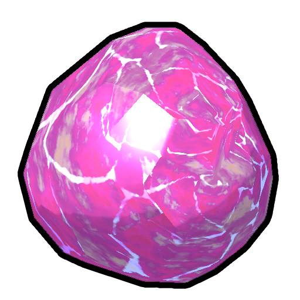
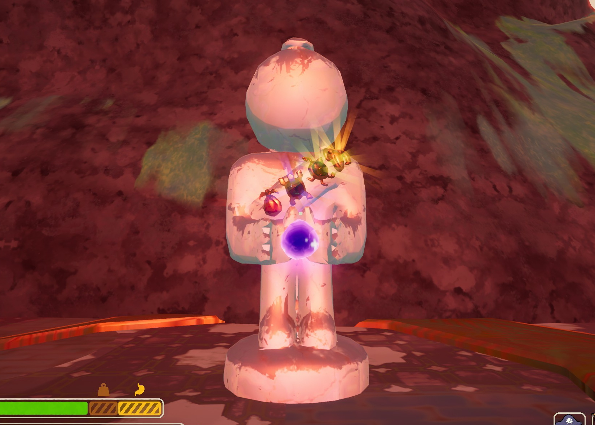

# Amulets

**Amulets** are four special [Mystical items](https://peak.wiki.gg/wiki/Mystical_items) which can be found at [Amulet Statues](https://peak.wiki.gg/wiki/Amulet_Statues). One can be found in each of the first four biomes of the island (i.e. [Shore](Shore.md), [Tropics](Tropics.md)/[Roots](Roots.md), [Alpine](Alpine.md)/[Mesa](Mesa.md), and [Caldera](Caldera.md)/[Gloom](Gloom.md)). Each of them provides a beneficial effect at the cost of inflicting  [Petrify](Stamina%20bar.md#Petrify) upon the user. Amulets do not have a usage limit.

## List

### Scout's Ambition.png Scout's Ambition

Main article: [Scout's Ambition](Scout%27s%20Ambition.md)

Generates an aura with a radius of **9.6 meters** around the user for **8 seconds**. Scouts within the aura gain  [Infinite Stamina](Stamina%20bar.md#Infinite_Stamina) while within the radius for the duration of the effect. The user is inflicted  **30** [Petrify](Stamina%20bar.md#Petrify) per activation.

### Scout's Generosity.png Scout's Generosity

Main article: [Scout's Generosity](Scout%27s%20Generosity.md)

Duplicates a targeted item, inflicting  [Petrify](Stamina%20bar.md#Petrify) based on the type of item;  **25** for a regular item and  **45** for a mystical item.

### Scout's Initiative.png Scout's Initiative

Main article: [Scout's Initiative](Scout%27s%20Initiative.md)

Lifts Scouts within **12.8 meters** of the user (including the user) into the air, then gives them [wind walking](Wind%20walking.md) for **3 seconds**. Inflicts  **7** [Petrify](Stamina%20bar.md#Petrify) per use.

### Scout's Tenacity.png Scout's Tenacity

Main article: [Scout's Tenacity](Scout%27s%20Tenacity.md)

Heals up to a total of **60** of  [Injury](Stamina%20bar.md#Injury),  [Spores](Stamina%20bar.md#Spores),  [Poison](Stamina%20bar.md#Poison),  [Cold](Stamina%20bar.md#Cold),  [Heat](Stamina%20bar.md#Heat), and  [Drowsy](Stamina%20bar.md#Drowsy), then applies  [Invincibility](Stamina%20bar.md#Invincibility) for **10 seconds**. Afterwards inflicts **10-30**  [Petrify](Stamina%20bar.md#Petrify), based on the amount healed. Can be used on oneself or another Scout.

## Other Uses

 **Spoilers!** - The following section contains spoilers for *[PEAK](Peak%20%28game%29.md)*.- If all four Amulets are brought to the [Peak](Peak%20%28biome%29.md) they can be bestowed upon the [Stone Scout](https://peak.wiki.gg/wiki/Stone_Scout), to transform the  [Strange Gem](Strange%20Gem.md) into  [Scout's Honor](Scout%27s%20Honor.md), granting access to [Nadir](Nadir.md).- Entering Nadir is required for the  [Rule Zero Badge](https://peak.wiki.gg/wiki/Rule_Zero_Badge) and winning a run on [Ascent 8](https://peak.wiki.gg/wiki/Ascent_8).
- Picking up an Amulet counts towards the  [Esoterica Badge](https://peak.wiki.gg/wiki/Esoterica_Badge).

## Gallery

- 
  The Stone Scout, with all four Amulets.
