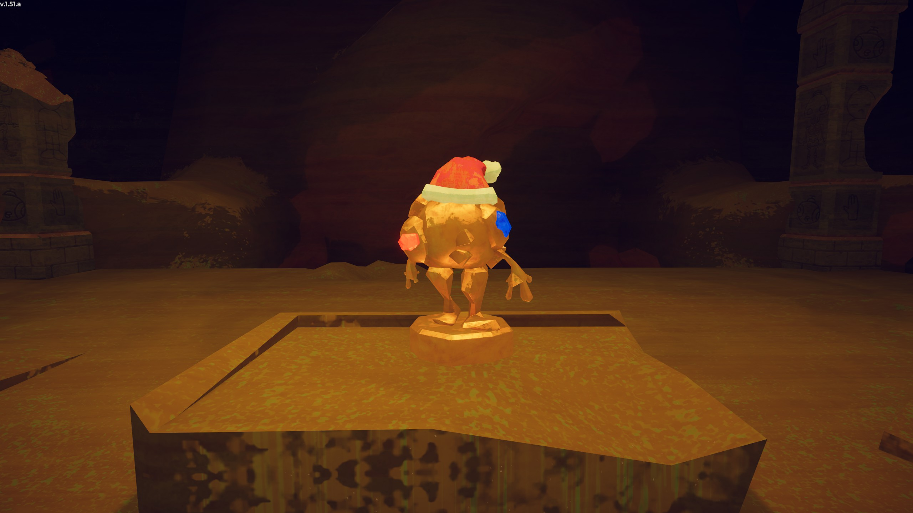

# Ancient Idol

Spoilers ahead!

This page contains **spoilers** for *[PEAK](Peak%20%28game%29.md)*. View at your own discretion.

Ancient Idol

[Item type](Items.md)- [Mystical item](https://peak.wiki.gg/wiki/Mystical_item)
Biome- [Mesa](Mesa.md)
Location- [Tomb](Tomb.md)
Weight
 **40**
Base Status Effects
Invincibility
While being held

The **Ancient Idol** is a [mystical item](https://peak.wiki.gg/wiki/Mystical_item) in *[PEAK](Peak%20%28game%29.md)*. It is found inside of the [Mesa](Mesa.md)'s [Tomb](Tomb.md) after completing the challenge chamber.

Although the Ancient Idol cannot be found inside [Ancient Luggage](https://peak.wiki.gg/wiki/Ancient_Luggage) or obtained from [Ancient Statues](Ancient%20Statue.md), it is still considered mystical and grants the  [Esoterica Badge](https://peak.wiki.gg/wiki/Esoterica_Badge) upon picking it up.

Actively holding the idol grants the player  [Invincibility](Stamina%20bar.md#Invincibility).

Throwing the Ancient Idol into the lava of [The Kiln](The%20Kiln.md) or the lava cauldron in [The Citadel](The%20Citadel.md) destroys the idol and unlocks the  [24 Karat Badge](https://peak.wiki.gg/wiki/24_Karat_Badge).

The Ancient Idol cannot be cooked.

## Tips & Tricks

The Ancient Idol does not travel very far when thrown. However, when placed inside of a  [Backpack](Backpack.md), the idol can be thrown much farther. This can make transporting the heavy idol much more manageable.

## Trivia

- The Ancient Idol is a golden recreation of  [Bing Bong](Bing%20Bong.md) standing atop a small pedestal.
- The Ancient Idol is the heaviest item in the game.
- During the [2025 Holiday Season](1.50.a.md), the Ancient Idol wore a Santa hat that was not golden.

## Gallery

- 
  The Ancient Idol wearing a Santa hat during the [2025 Holiday Season](1.50.a.md).

## Patch history

 **[1.20.a](1.20.a.md) (2025-08-11):** Introduced.
 **[1.23.a](1.23.a.md) (2025-08-13):** Weight of [REDACTED] reduced from 50 to 40.
 **[1.44.a](1.44.a.md) (2025-11-13):** Fixed an issue where holding the Ancient Idol while having [thorns](https://peak.wiki.gg/wiki/Thorns) stuck on you could cause erratic stuff to happen to your [status bar](Stamina%20bar.md).
