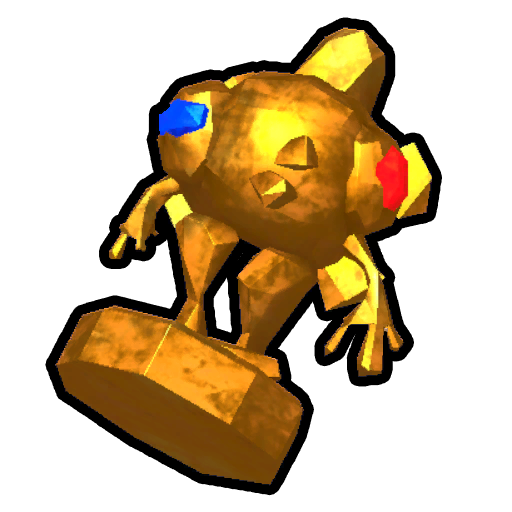

# Ancient

This is a disambiguation page for "Ancient".

The following is a list of links related to Ancient.

**Ancient** may refer to:

- [Ancient Statue](Ancient%20Statue.md) - A landmark which can revive players (on difficulties below [Ascent 7](Ascents.md)) or otherwise provide a [mystical item](https://peak.wiki.gg/wiki/Mystical_item).
- [Ancient Luggage](https://peak.wiki.gg/wiki/Ancient_Luggage) - A type of luggage that provides a mystical item at the cost of inflicting  [Injury](Stamina%20bar.md#Injury) on the opening Scout.
-  [Ancient Idol](Ancient%20Idol.md) - An item that prevents negative [status effects](https://peak.wiki.gg/wiki/Status_effects) while actively held.
