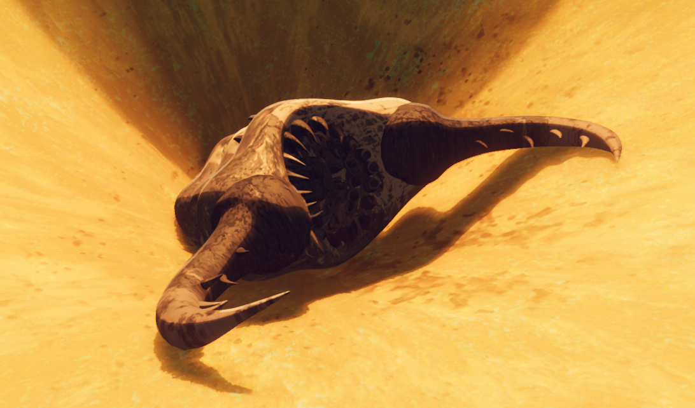
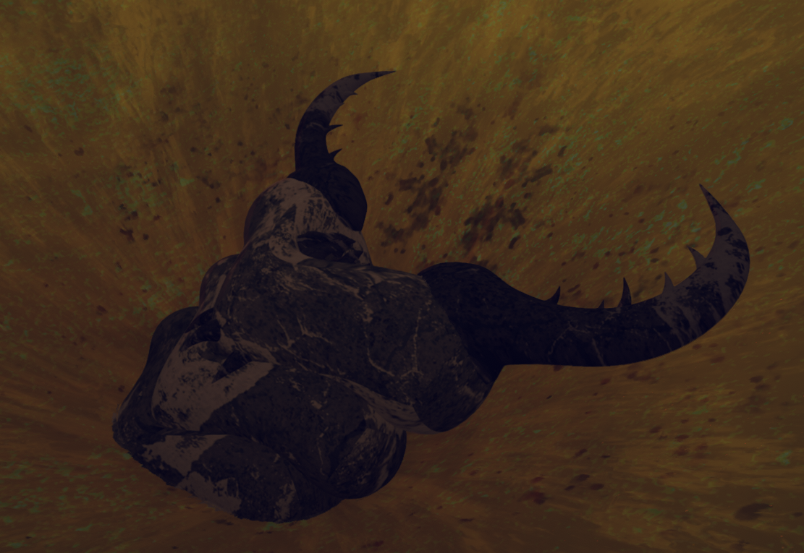
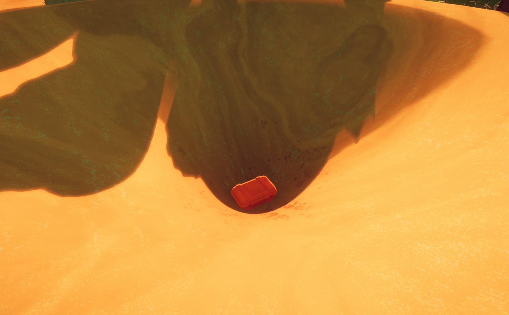
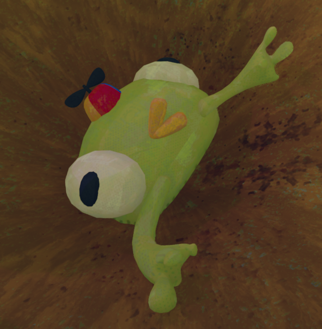

# Antlion

Antlion

General
Type
[Enemy](https://peak.wiki.gg/wiki/Enemy)
Biome- [Mesa](Mesa.md)

The **Antlion** is a hostile creature in *[PEAK](Peak%20%28game%29.md)*, exclusive to the [Mesa](Mesa.md). It hides at the bottom of a funnel-shaped trap, leaving a fake [Explorer's Luggage](https://peak.wiki.gg/wiki/Explorer%27s_Luggage) as bait for careless players.

## Mechanics

When a player comes within **19.2 meters** of the Antlion, it will activate, causing the fake luggage to disappear into the sands. The Antlion appears from the sand and attacks every **0.15 seconds**, dealing  **20** [Injury](Stamina%20bar.md#Injury) to the nearest player within **8 meters** and knocking them back.

While the Antlion is active, the sand within its trap flows downwards, pulling all players within towards the center of the funnel.

Once there are no players within **25.6 meters** of the Antlion, it will retreat back under the sand, ending the attack. The fake luggage does not return, but the Antlion will return if players head into the trap again.

Any player who takes damage in an Antlion attack and gets at least **48 meters** away from the Antlion without dying will receive the  [Megaentomology Badge](https://peak.wiki.gg/wiki/Megaentomology_Badge).

## Gallery

- 
  Back view.
- 
  Antlion's trap. A fake [Explorer's Luggage](https://peak.wiki.gg/wiki/Explorer%27s_Luggage) can be seen in the middle.
- 
  Antlion with [Bug Phobia Mode](Bug%20Phobia%20Mode.md) enabled.
