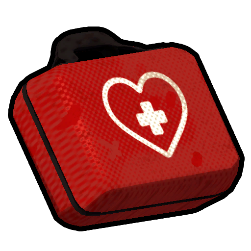
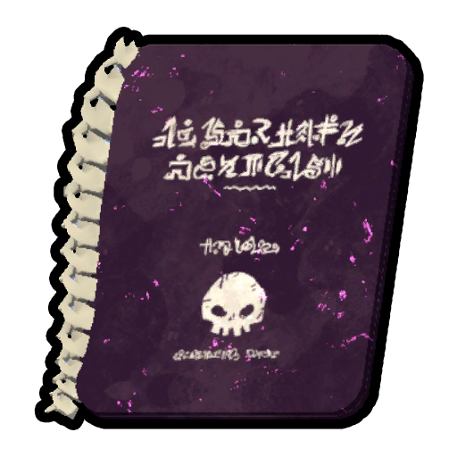
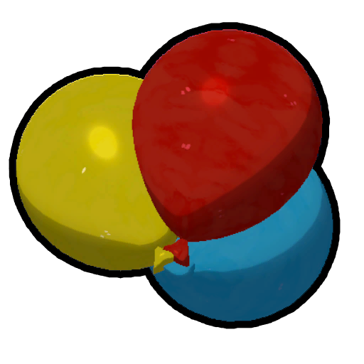
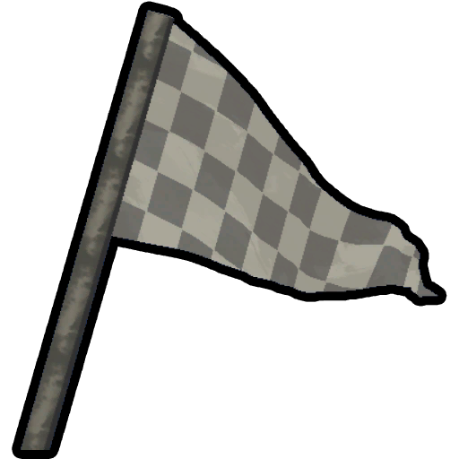
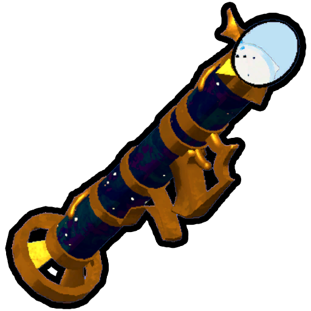
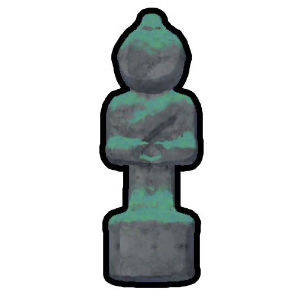

# Ascents

**Ascents** serve as the difficulty system for *[PEAK](Peak%20%28game%29.md)*. By default, only *Tenderfoot* and *Peak* Ascents are available. Completing an expedition on *Peak* unlocks the first Ascent, and each Ascent completed unlocks the next, with each Ascent adding compounding challenges to the expedition. The Ascents are selected at the Gate Kiosk in the [Airport](Airport.md) when starting the game.

Only one player in the group needs to have an Ascent unlocked to start the game, and all players receive the relevant rewards on completion, even if they haven't cleared the prior Ascents. For example, if a new player joins another player on an Ascent 5 run, they would unlock ascents 1-6 and ranks up to Owl Scout if their group escapes the island (even if the new player doesn't).

[Badges](Badges.md) can be earned regardless of the active Ascent, with the exception of  [Undead Encounter Badge](https://peak.wiki.gg/wiki/Undead_Encounter_Badge) and  [Mentorship Badge](https://peak.wiki.gg/wiki/Mentorship_Badge), as [Zombies](Zombie.md) and [Scoutmaster Myres](Scoutmaster%20Myres.md) cannot spawn on Tenderfoot.

[Custom Expeditions](Custom%20Expedition.md) allow for more detailed customization, but do not allow you to earn [Badges](Badges.md) or Sashes.

## List of Ascents

List of Ascents, their description and rewards.

| Name | Description | Rewards for completion |
| --- | --- | --- |
| **Tenderfoot** | - Climbing takes less [Stamina](https://peak.wiki.gg/wiki/Stamina). (30% lower consumption) - [Hunger](Stamina%20bar.md#Hunger) [Hunger](Stamina%20bar.md#Hunger) grows more slowly. (30% slower growth) - No [time limit](Fog.md) nor [Zombies](Zombie.md). - No [Scoutmaster Myres](Scoutmaster%20Myres.md). - No [Big Ghost](Big%20Ghost.md). | None |
| **Peak** | - The [Island](Island.md)'s default difficulty. | [Tadpole Scout Sash](Cosmetics.md#Sashes) [Tadpole Scout Sash](Cosmetics.md#Sashes) |
| **Ascent 1** | - [Injury](Stamina%20bar.md#Injury) [Fall damage](Stamina%20bar.md#Injury) is greater. (all fall damage is multiplied by 2) | [Rabbit Scout Sash](Cosmetics.md#Sashes) [Rabbit Scout Sash](Cosmetics.md#Sashes) |
| **Ascent 2** | - [Hunger](Stamina%20bar.md#Hunger) [Hunger](Stamina%20bar.md#Hunger) grows faster. (60% faster growth) - *And all previous modifiers.* | [Raccoon Scout Sash](Cosmetics.md#Sashes) [Raccoon Scout Sash](Cosmetics.md#Sashes) |
| **Ascent 3** | - Items have increased [Weight](Stamina%20bar.md#Weight) [Weight](Stamina%20bar.md#Weight). (flat +2.5 weight for all items) - *And all previous modifiers.* | [Mule Scout Sash](Cosmetics.md#Sashes) [Mule Scout Sash](Cosmetics.md#Sashes) |
| **Ascent 4** | - There are no  [Flares](Flare.md) atop the [Peak](Peak%20%28biome%29.md). (You must bring your **own** Flare) - *And all previous modifiers.* | [Kangaroo Scout Sash](Cosmetics.md#Sashes) [Kangaroo Scout Sash](Cosmetics.md#Sashes) |
| **Ascent 5** | - The [Night](https://peak.wiki.gg/wiki/Night) is [Cold](Stamina%20bar.md#Cold) [Cold](Stamina%20bar.md#Cold). (~100 Cold damage total, or 2.5 Cold every 5 seconds) - *And all previous modifiers.* | [Owl Scout Sash](Cosmetics.md#Sashes) [Owl Scout Sash](Cosmetics.md#Sashes) |
| **Ascent 6** | - Climbing takes additional [stamina](https://peak.wiki.gg/wiki/Stamina). (40% higher consumption) - *And all previous modifiers.* | [Wolf Scout Sash](Cosmetics.md#Sashes) [Wolf Scout Sash](Cosmetics.md#Sashes) |
| **Ascent 7** | - Start [Curse](Stamina%20bar.md#Curse) [Cursed](Stamina%20bar.md#Curse) and take more curse from revival. (Players spawn with 10 Curse and get +15 when revived using the [Ancient statue](https://peak.wiki.gg/wiki/Ancient_statue)) - *And all previous modifiers.* | [Goat Scout Sash](Cosmetics.md#Sashes) [Goat Scout Sash](Cosmetics.md#Sashes)  [Goat Horns](https://peak.wiki.gg/wiki/Goat_Horns) |
| **Ascent 8** | - You must free [The Scoutmaster](https://peak.wiki.gg/wiki/The_Scoutmaster)'s soul to win. You must bring all [Amulets](Amulets.md) to the [Peak](Peak%20%28biome%29.md), and put the amulets on the ancient statue to go through [Nadir](Nadir.md) to escape the island. - *And all previous modifiers.* | [Scoutmaster Sash](Cosmetics.md#Sashes) [Scoutmaster Sash](Cosmetics.md#Sashes) |

## Tips

Below are tips for beating each of the game's Ascents. Most tips from lower ascents apply to those above.

### Tenderfoot

---

Carry less [food](Food.md). You'll usually only need at *most* around 2 food items per player if you take advantage of natural food. Oftentimes, a single box of the  [Scout Cookies](Scout%20Cookies.md) can be enough to get through an entire [biome](https://peak.wiki.gg/wiki/Biome) solo because of its multiple uses.

Because there's no [fog](Fog.md), feel free to open any [Luggage](Luggage.md) you see if you deem it worth the effort. This is the best mode to have a casual run or memorize the environment before proceeding with harder challenges.

### Peak

---

**Check the [tutorial](How%20to%20play.md).**

Although the [Fog](Fog.md) is intimidating, don't rush things. It is quite generous for its slow speed, only triggering after you reach a certain height or when enough time has passed. A panicking player is more likely to fail from an irrational decision.

When playing with other [Scouts](Scout.md), remember to spread out your items across your team. This makes it so it isn't catastrophic if one of you dies. Have everyone carry a little food, a little [healing](https://peak.wiki.gg/wiki/Healing), and a little [equipment](Equipment.md). As the fog doesn't rise in [Shore](Shore.md) for a set amount of time, you can look around for [Luggage](Luggage.md) in the surface level before making it upward, which will then trigger the fog.

Don't hesitate to let the best of you carry higher value items like  [Chain Launchers](Chain%20Launcher.md) and those less experienced carry items like the  [Fortified Milk](Fortified%20Milk.md) or  [First Aid Kit](First%20Aid%20Kit.md) to save them from an otherwise [lethal fall](Stamina%20bar.md#Fall_damage).

Sometimes instead of a difficult path, there's a far easier route you didn't notice. Whenever you feel stuck, try climbing sideways to a new spot.

### Ascent 1

---

The [Fog](Fog.md) will always be the same speed regardless of the Ascent moving forward, so you have plenty of time to plan things out.

Try to carry at least 1 item that can heal  [Injury](Stamina%20bar.md#Injury). The  [Remedy Fungus](Remedy%20Fungus.md) is great for this, as it can heal everyone within its radius. Try to make less risks when jumping, look around for safer spots to land if you can.

Using the  [Book of Bones](https://peak.wiki.gg/wiki/Book_of_Bones) is much riskier on Ascent 1+, since with the total of 16x fall damage, any amount of fall damage becomes instantly lethal.

### Ascent 2

---

Take advantage of [natural food](https://peak.wiki.gg/wiki/Natural_food). Hunger is the silent killer. Never leave food behind, it's better to recover  **2.5** [Hunger](Stamina%20bar.md#Hunger) while "wasting" food than to recover nothing from the food. Consider eating  [poisonous](Stamina%20bar.md#Poison) foods occasionally, since  [Poison](Stamina%20bar.md#Poison) heals over time, while  [Hunger](Stamina%20bar.md#Hunger) does not.

Instead of using foods that greatly reduce  [Hunger](Stamina%20bar.md#Hunger) just to bolster your  [Bonus stamina](Stamina%20bar.md#Bonus_stamina), save them and eat weaker, cooked foods instead like  [Yellow Crispberries](Yellow%20Crispberry.md). You'll often find many of these at [campfires](Campfire.md).

### Ascent 3

---

While it may seem counterintuitive, prefer carrying [heavier](https://peak.wiki.gg/wiki/Weight) items over lighter ones as the weight penalty is a flat increase, rather than being based on the item's original weight. It can be helpful to check the hunger-to-weight ratio for [food](Food.md).

Keep in mind you don't necessarily have to fill every slot in your inventory. Many items often end up being thrown away, left unused, or used immediately. Dropping unneeded items is the best way to reduce your  [Weight](Stamina%20bar.md#Weight).

The  [Balloon Bunch](Balloon%20Bunch.md), while very rare, is extremely valuable, as it reduces your weight by 12.5 even after the weight penalty. Searching for [Clown Luggages](https://peak.wiki.gg/wiki/Clown_Luggage) is the best way to find them.

### Ascent 4

---

**Always** grab the  [Flare](Flare.md) at the [crash site](https://peak.wiki.gg/wiki/Crash_site), and give it to the player who is the most likely to survive. If you forget, you may find another in a [Luggage](Luggage.md), but know the risk of not encountering a spare. With the flare equipped, you effectively lose an item slot for the entire game, so it is advised you use more items to make room for better ones. Being revived by a  [Checkpoint Flag](Checkpoint%20Flag.md) while a flare is in your inventory or  [Backpack](Backpack.md) will prevent the item from being lost.

Don't drop the  [Flare](Flare.md) or a  [Backpack](Backpack.md) containing one near  [Heat](Stamina%20bar.md#Heat) hazards or risky spots like near edges or very close to walls, as you could risk losing it or cooking it. If a  [Flare](Flare.md) is cooked, it will explode,  [injuring](Stamina%20bar.md#Injury) nearby [Scouts](Scout.md).

Once you reach the [Peak](Peak%20%28biome%29.md), you must light your own  [Flare](Flare.md) in that area. If you do not have one ready by then, you have **lost the run**.

If the player successfully traverses [Nadir](Nadir.md), they do not require a  [Flare](Flare.md) to complete the Ascent, as there is always one at the top.

### Ascent 5

---

Try to always carry an item that can relieve you of  [Cold](Stamina%20bar.md#Cold), such as the  [Lantern](Lantern.md) at the [crash site](https://peak.wiki.gg/wiki/Crash_site). You should not be wasteful of the lantern, as it only lasts for 60 active seconds. Use it sparingly, just enough to last the night.

Take advantage of [huddling](https://peak.wiki.gg/wiki/Huddling), as it can heat players faster than the night chills, meaning you can focus less on heating items. If you can endure the rest of the night with high [stamina](https://peak.wiki.gg/wiki/Stamina), you can unequip your  [Backpack](Backpack.md) and items at a safe spot and intentionally fall unconscious from the cold, warming up in the morning.

Since  [Heat](Stamina%20bar.md#Heat) counteracts  [Cold](Stamina%20bar.md#Cold), you can burn yourself with hot [hazards](Hazards.md) like [campfires](Campfire.md), [geysers](Geyser.md), or the [Sun](https://peak.wiki.gg/wiki/Sun) in the [Mesa](Mesa.md) (during sunset) to ward off the cold. Inversely, avoid cold hazards during the night such as [Ice Rocks](Ice%20Rocks.md). Feel free to drop heating items once you enter the [Caldera](Caldera.md) or [Gloom](Gloom.md), as the night is no longer cold from that point onward.

### Ascent 6

---

Take advantage of tricks like using the  [Rope](Rope%20Spool.md) to boost you up before climbing, combining an  [Energy Drink](Energy%20Drink.md) and a  [Big Lollipop](Big%20Lollipop.md), or learning advanced climbing techniques. Look out for items like  [Anti-Rope Spool](Anti-Rope%20Spool.md) and  [Anti-Zooka](Anti-Zooka.md) for their high mobility and low weight.

[Bonus stamina](https://peak.wiki.gg/wiki/Bonus_stamina) is a powerful tool, don't be afraid to use it to reach otherwise impossible locations.

Don't forget that you can boost your friends by letting them stand on your head while you're crouching and then jumping.

### Ascent 7

---

Try to get rid of the starting  [Curse](Stamina%20bar.md#Curse) and avoid accumulating more. The section on  [Curse](Stamina%20bar.md#Curse) lists ways of lifting it and the associated item pages provide usage tips.

In bigger teams, it's recommended to have the *best* players remove their starting  [Curse](Stamina%20bar.md#Curse) first because the less experienced players, being more likely to die, will keep getting more back upon revivals. This way it is more likely that at least one player makes it to the top and is thus able to revive others.

When available, instead of [Ancient Statues](Ancient%20Statue.md), take advantage of alternative ways to revive teammates. The  [Scout Effigy](Scout%20Effigy.md) and  [Checkpoint Flag](Checkpoint%20Flag.md) don't inflict any  [Curse](Stamina%20bar.md#Curse). Unfortunately, the  [Book of Bones](https://peak.wiki.gg/wiki/Book_of_Bones) inflicts the full  **15** [Curse](Stamina%20bar.md#Curse) when used on the skeleton of a dead scout to revive them.

### Ascent 8

---

 **Spoilers!** - The following section contains spoilers for *[PEAK](Peak%20%28game%29.md)*.
The added challenge in this Ascent comes in the form of having to babysit multiple key items that bloat your inventory space and being forced to go to certain, sometimes undesirable, places to reach the [Scout Statues](https://peak.wiki.gg/wiki/Scout_Statue). You can alleviate this in multiple ways:- Bring more [Scouts](Scout.md) to carry more [items](Items.md).
- Prefer to keep the [Amulets](Amulets.md) in backpacks to make it less likely they are lost.
- Plan your routes around grabbing the Amulets from their statues **before** you start climbing the [biome](https://peak.wiki.gg/wiki/Biome).

Remember that the Amulets are not just bricks for you to lug to the summit. They have extremely useful abilities (shown below). Give them to the players who will make the best use of them. Know that using them comes at a  [cost](Stamina%20bar.md#Petrify), however. Keep in mind that players will recover  **20** [Petrify](Stamina%20bar.md#Petrify) whenever a campfire is lit.

-  [Scout's Ambition](Scout%27s%20Ambition.md): Assists climbing.
-  [Scout's Generosity](Scout%27s%20Generosity.md): Generates more items.
-  [Scout's Initiative](Scout%27s%20Initiative.md): Can be used to save yourself from falls or cross horizontal gaps.
-  [Scout's Tenacity](Scout%27s%20Tenacity.md): Helps to recover from or momentarily prevent incoming damage.

*For full details, check the main articles for each Amulet.*

A  [Flare](Flare.md) is not required to escape, as [Nadir](Nadir.md) triggers the ending cutscene immediately after interacting with the gate, freeing up an additional inventory slot compared to the other Ascents.

Lastly, teamwork is **paramount** in this Ascent. Losing a teammate could very well mean losing the run instantly. In the face of such an adversity, it's more important than ever to ***never abandon a friend in need!***

## Patch history

 **[1.0](1.0.md) (2025-06-16):** Introduced
 **[2.0.a](2.0.a.md) (2026-08-11):**

- Added Ascent 8.
- Changed Ascent 7.- No longer disables reviving, but start the run with Curse and increase amount of Curse from reviving.
