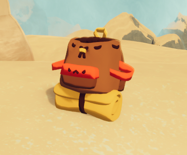
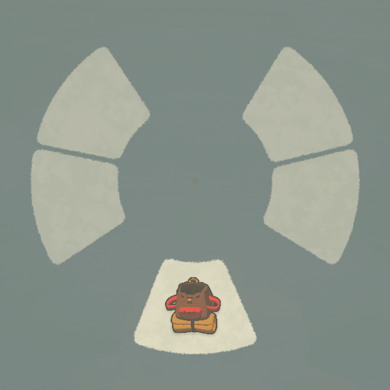
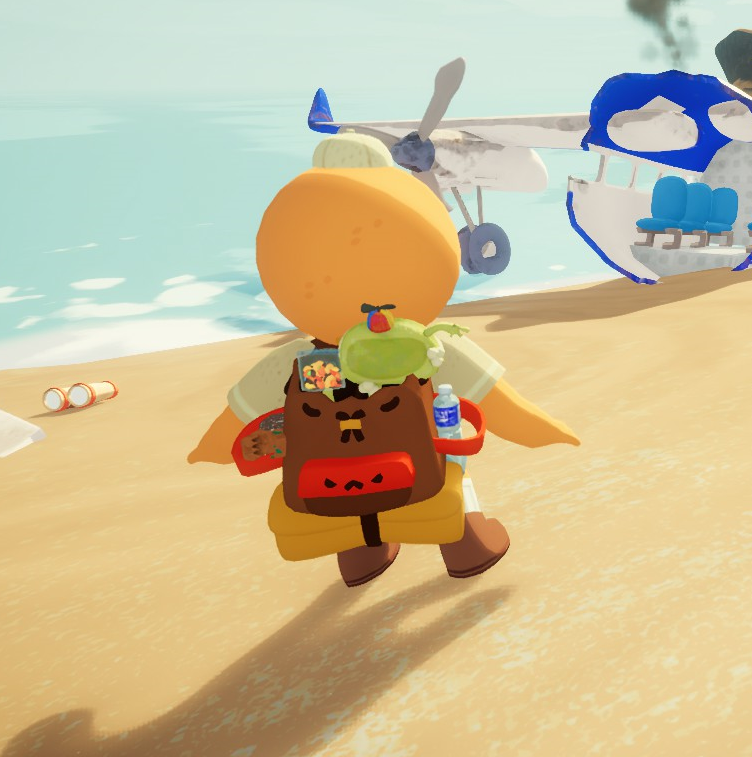

# Backpack

This page is a [stub](https://support.wiki.gg/wiki/Stub). You can help **PEAK Wiki** by expanding it.

For information about usage and mechanics, see [How to play](How%20to%20play.md#Inventory_&_Backpack).
Backpack

[Item type](Items.md)- [Equipment](Equipment.md)
Location- [Crash Site](https://peak.wiki.gg/wiki/Crash_Site)
- [Campfires](https://peak.wiki.gg/wiki/Campfires)
Weight
 **0**

The **Backpack** is an [equipment](Equipment.md) item that expands Scouts' available item storage, offering four new item spaces, allowing players to carry a lot more items during their climb. The Backpack always occupies the fourth inventory slot, reserved for equipment that can be attached to the Scout. One backpack can be found at the [Crash Site](Shore.md#Crash_Site) and an additional backpack can be found at each [Campfire](Campfire.md), except in [The Kiln](The%20Kiln.md) and [The Citadel](The%20Citadel.md). [Cooking](Cooking.md) a backpack does not affect its functionality but it does cook all the items inside.

## Gallery

- 
  A naturally spawning Backpack found near the [campfire](Campfire.md) of the [Shore](Shore.md) [biome](https://peak.wiki.gg/wiki/Biome).
- 
  The Backpack's inventory UI.
- 
  Scout wearing a Backpack with four items inside.

## Patch history

 **[1.0](1.0.md) (2025-06-16):** Introduced.
 **[1.2.a](1.2.a.md) (2025-06-18):**

- Fixed issue where backpacks near the campfire could despawn when lighting the campfire.
- Cooked items will now show up as cooked in the backpack UI.
- Fixed an issue where you couldn't interact with your backpack during the endgame countdown.

 **[1.6.a](1.6.a.md) (2025-07-04):** Added a potential fix for the rare issue where backpacks disappear when dropped.
 **[1.7](1.7.md) (2025-07-10):** Fixed an issue where backpacks would become non-interactable.
 **[1.8](1.8.md) (2025-07-21):** Fixed an issue where the guidebook wouldn't disappear on your back in first-person if you put it in a backpack.
 **[1.9.a](1.9.a.md) (2025-07-22):**

- Added a failsafe that will return a dropped backpack to its original position if it moves too far away too quickly (unless thrown). Also attempted to improve backpack stability generally.
- Fixed an issue where backpacks could disappear after a lengthy pause in Offline Mode.
- Fixed an issue where backpack UI wouldn't repond to pressing the button to hold your backpack.

 **[1.20.a](1.20.a.md) (2025-08-11):** Prevented players from interacting with their backpack while passed out.
 **[1.22.a](1.22.a.md) (2025-08-11):**

- Fixed issue where dynamite would not explode if placed in a backpack.
- Fixed issue where if the hosting player was dead, sometimes new backpacks would de-spawn when lighting campfires

 **[1.25.a](1.25.a.md) (2025-08-21):** You can no longer put the Beehive or a lit Flare in the Backpack.
 **[1.28.a](1.28.a.md) (2025-09-08):** Added new physics for the backpack that should prevent more cases where people would lose their backpack.
 **[1.43.a](1.43.a.md) (2025-11-07):** The Cursed Skull and Book of Bones ambient sfx are now muted when in the backpack.
