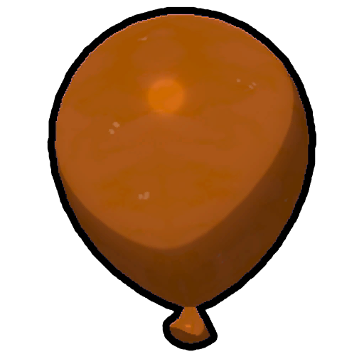
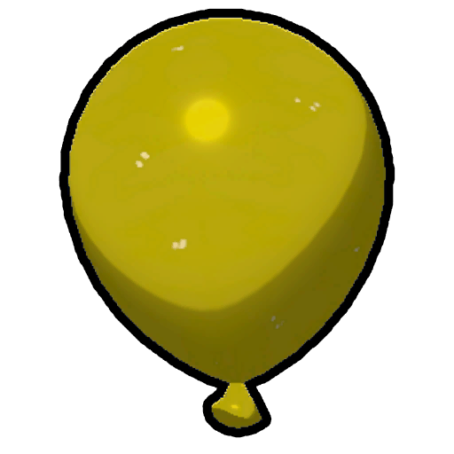
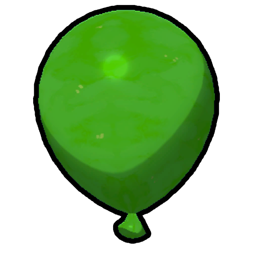
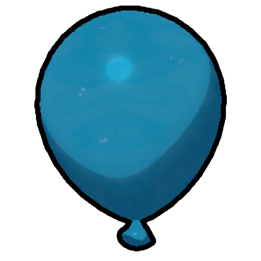
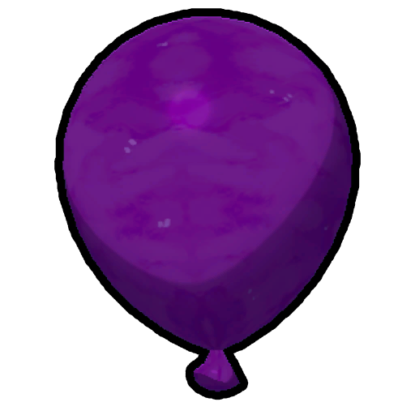

# Balloon

Balloon
Red
Orange
Yellow
Green
Blue
Purple

[Item type](Items.md)- [Consumable](https://peak.wiki.gg/wiki/Consumable)
Rarity
[Epic](https://peak.wiki.gg/wiki/Epic)
Source- [Regular Luggage](https://peak.wiki.gg/wiki/Regular_Luggage)
- [Big Luggage](https://peak.wiki.gg/wiki/Big_Luggage)
- [Clown Luggage](https://peak.wiki.gg/wiki/Clown_Luggage)
Weight
 **−5**

The **Balloon** is a [consumable](https://peak.wiki.gg/wiki/Consumable) item in *[PEAK](Peak%20%28game%29.md)* found in [Luggage](Luggage.md). Using it attaches a single balloon to the player. Dropping the balloon causes it to fly away.

While the inventory icon appears red, the balloon model itself can appear in six colors: red, orange, yellow, green, blue, and purple.

Cooking a balloon causes it to pop, destroying the item.

Having 6 or more balloons attached at any moment grants the player the  [Aeronautics Badge](https://peak.wiki.gg/wiki/Aeronautics_Badge).

The  [Balloon Bunch](Balloon%20Bunch.md) is a separate item that gives the players 3 balloons that can be attached all at once or carried in a single inventory slot.

## Mechanics

A balloon will stay attached to the player for **2 minutes** from the moment it's attached or until the player ascends **160 meters**, whichever comes first.

The weight reduction is only applied to the [stamina bar](Stamina%20bar.md) when the balloon is in the inventory, hand, or in the  [Backpack](Backpack.md). Balloons attached to the player do not reduce the carried [weight](https://peak.wiki.gg/wiki/Weight).

Each attached balloon reduces the effect of gravity by **18%**. With **6** or more attached balloons, an additional **-100% gravity** effect is applied, causing the player to fly upwards until the balloons pop. Note that the weightless effect is only applied once the player is not grounded, requiring the player to jump or walk off a ledge to begin ascending. If the player loses consciousness or performs the Play dead [emote](Emotes.md) while in flight, the gravity reduction effect will no longer be applied and the player will plummet.

Having **1** balloon attached caps [fall damage](https://peak.wiki.gg/wiki/Fall_damage) to **7.5** and having **2** balloons attached caps [fall damage](https://peak.wiki.gg/wiki/Fall_damage) to **5**. Having **3** or more attached balloons makes the player completely immune to fall damage, but not  [Injury](Stamina%20bar.md#Injury) from other sources such as  [Dynamite](Dynamite.md) or [Zombies](Zombie.md).

The strong winds of the [Roots](Roots.md) will push players faster and further if they have balloons attached, similar to an open  [Parasol](Parasol.md).

## Patch history

 **[1.20.a](1.20.a.md) (2025-08-11):** Introduced.
 **[1.40.a](1.40.a.md) (2025-11-05):** [Cooking](Cooking.md) overhaul. (Cooking the balloon will now cause it to pop.)
 **[1.44.a](1.44.a.md) (2025-11-13):** Removed the ability to fly if you have the [wind walking](Wind%20walking.md) ability from a [Shroomberry](Shroomberry.md) and one balloon. You now need at least three balloons.
