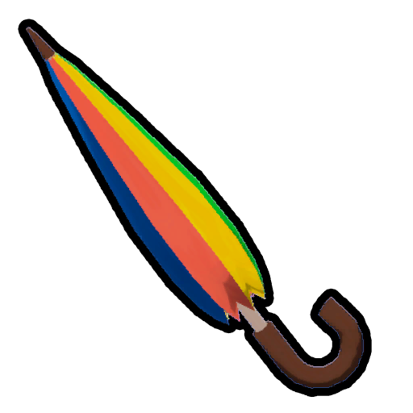

# Balloon/Mechanics

A balloon will stay attached to the player for **2 minutes** from the moment it's attached or until the player ascends **160 meters**, whichever comes first.

The weight reduction is only applied to the [stamina bar](Stamina%20bar.md) when the balloon is in the inventory, hand, or in the  [Backpack](Backpack.md). Balloons attached to the player do not reduce the carried [weight](https://peak.wiki.gg/wiki/Weight).

Each attached balloon reduces the effect of gravity by **18%**. With **6** or more attached balloons, an additional **-100% gravity** effect is applied, causing the player to fly upwards until the balloons pop. Note that the weightless effect is only applied once the player is not grounded, requiring the player to jump or walk off a ledge to begin ascending. If the player loses consciousness or performs the Play dead [emote](Emotes.md) while in flight, the gravity reduction effect will no longer be applied and the player will plummet.

Having **1** balloon attached caps [fall damage](https://peak.wiki.gg/wiki/Fall_damage) to **7.5** and having **2** balloons attached caps [fall damage](https://peak.wiki.gg/wiki/Fall_damage) to **5**. Having **3** or more attached balloons makes the player completely immune to fall damage, but not  [Injury](Stamina%20bar.md#Injury) from other sources such as  [Dynamite](Dynamite.md) or [Zombies](Zombie.md).

The strong winds of the [Roots](Roots.md) will push players faster and further if they have balloons attached, similar to an open  [Parasol](Parasol.md).
