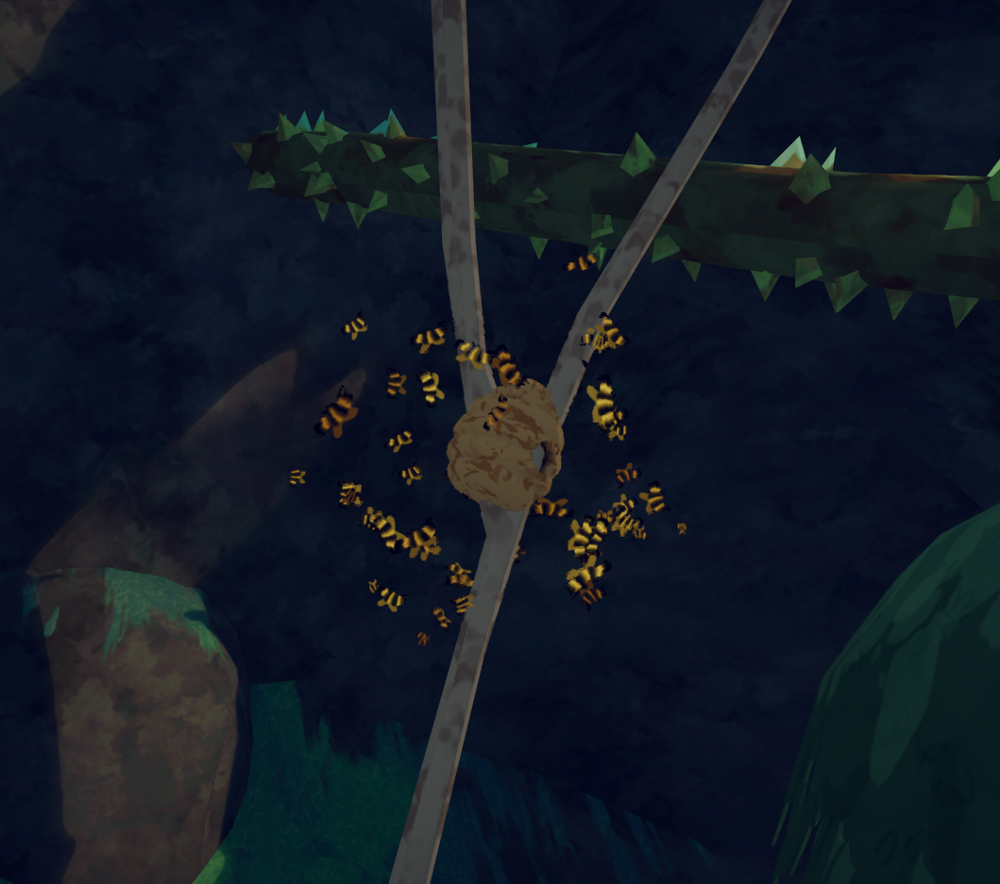
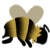
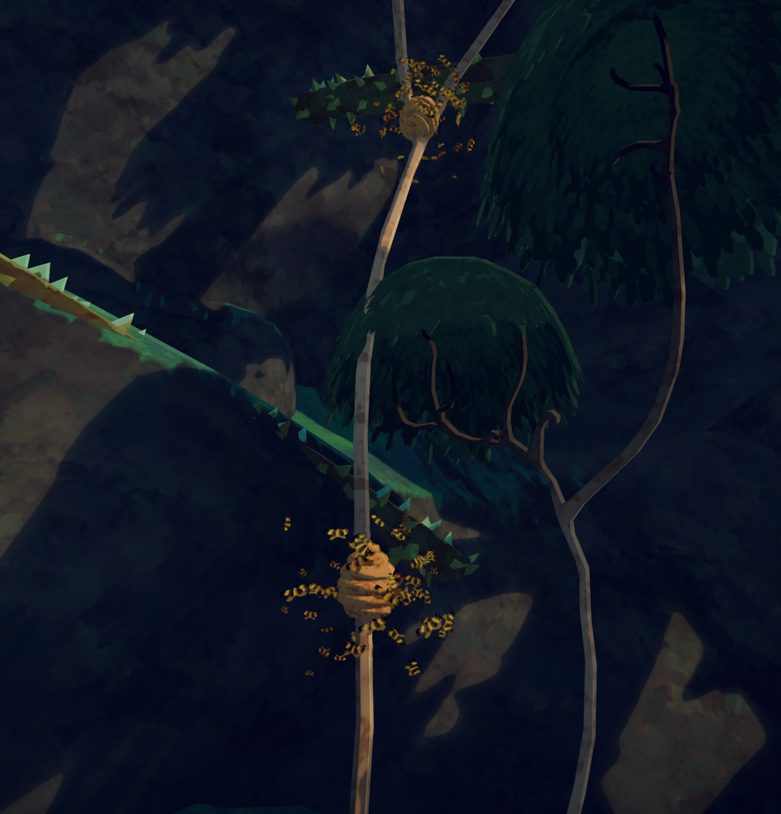
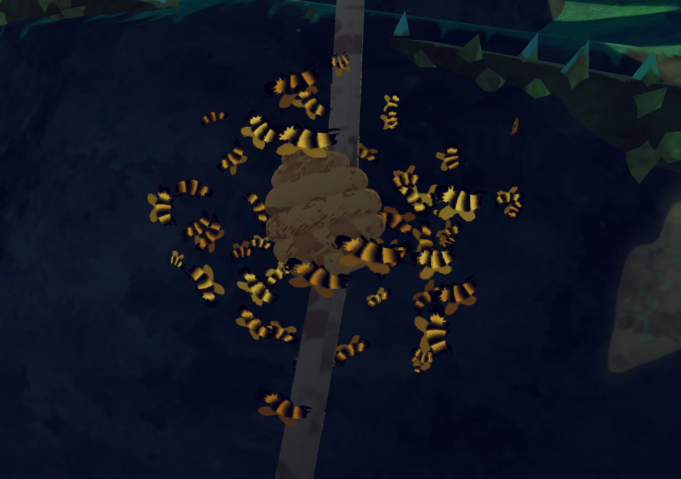
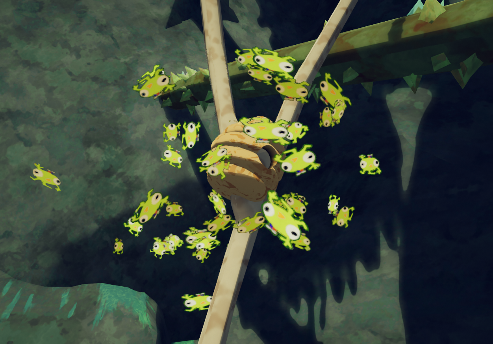

# Beehive

Beehive

[Item type](Items.md)- [Misc](Misc.md)
Biome- [Tropics](Tropics.md)
Weight
 **10**

The **Beehive** is an [item](https://peak.wiki.gg/wiki/Item) in *[PEAK](Peak%20%28game%29.md)* found on trees in the [Tropics](Tropics.md). A beehive can be broken open to receive four  [Honeycombs](Honeycomb.md).

[Cooking](Cooking.md) a Beehive applies its cooking level to the contained  [Honeycombs](Honeycomb.md).

A beehive found on a tree in the [Tropics](Tropics.md).

## Behavior

Bees swarm around their Beehive, attacking any player that gets close to it, or takes it.

When the bees aggravate, it will start chasing the nearest player, dealing  **2.5** [Poison](Stamina%20bar.md#Poison) every second.

The bees only de-aggravate when the player drops the Beehive and is far enough away.

Normally, when close to a Beehive, the player can hear a buzzing sound. If [Bug Phobia Mode](Bug%20Phobia%20Mode.md) is enabled, the swarm will repetitively squeak instead.

## Tips

-  [Honeycombs](Honeycomb.md) is needed for the [Gourmand Badge](https://peak.wiki.gg/wiki/Gourmand_Badge).

## Strategy

In order to de-aggravate the bees, you will have to throw the beehive, making sure it breaks upon hitting the ground. If it does not break, then the bees will *NOT* dissipate.

Once the [Honeycomb](Honeycomb.md) are on the ground, get far enough away from the bees, where they will leave you alone and return to the Honeycombs.

After waiting some time, the bees should dissipate, after which you will be able to grab the Honeycombs.

They can also dissipate when the player brings the beehive far away enough from them (even if it is still in your hands).

## Gallery

- 
  Bee sprite
- 
  Two beehives on a single tree
- 
  A close-up of bees
- 
  A beehive with [Bug Phobia Mode](Bug%20Phobia%20Mode.md) enabled
- 
  Bee sprite with Bug Phobia Mode enabled

## Patch history

 **[1.0](1.0.md) (2025-06-16):** Introduced.
 **[1.2.a](1.2.a.md) (2025-06-18):**

- The bees' reign of terror is over. Significantly adjusted beehavior:- Poison damage and bee speed are much more reduced when NOT angry (ie the hive has been stolen/destroyed)
  - Bees will no longer continue stinging you when your status is already over 100%
  - Bees will tend to leave unconscious players behind and return to the hive instead of guarding their bodies forever.
  - Bees will forgive you faster if you drop the hive and leave them alone
  - Reduced bee speed and aggro distance by a bit generally.

 **[1.25.a](1.25.a.md) (2025-08-21):** You can no longer put the Beehive or a lit [Flare](Flare.md) in the [Backpack](Backpack.md).
