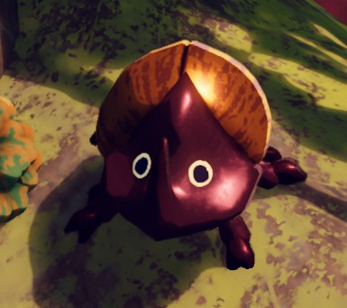

# Beetle

Beetle

General
Type
[Enemy](https://peak.wiki.gg/wiki/Enemy)
Biome- [Roots](Roots.md)

**Beetles** are large insects found in the [Roots](Roots.md). They wander around aimlessly until a player walks by, in which case they will run up to them and attempt to throw them. However, they will never stray too far from their initial spawn point, and as such quickly lose interest in fleeing players. Beetles may sometimes spawn in groups.

When a player is thrown, they are [ragdolled](Scout.md#Ragdoll_State) for **1 second** and launched diagonally upwards and away from the Beetle. The attack deals no damage by itself, but the player could be thrown off a cliff, causing  [Injury](Stamina%20bar.md#Injury) from [fall damage](https://peak.wiki.gg/wiki/Fall_damage).

When [Bug Phobia Mode](Bug%20Phobia%20Mode.md) is turned on, Beetles turn into [Bing Bong](Bing%20Bong.md) but still have the same behavior.

## Patch history

 **[1.40.a](1.40.a.md) (2025-11-05):** Introduced.
 **[1.45.a](1.45.a.md) (2025-11-17):** Beetles knock you slightly less far and put you in [ragdoll state](Scout.md#Ragdoll_State) for less time, making it less likely they stunlock you.
 **[1.50.a](1.50.a.md) (2025-12-16):**

- Beetles and scorpions will no longer attempt to DDoS non-host players by sending 1 million data over the network.
- Beetles shouldn't be able to stunlock and juggle a single player any more.

## Gallery

- 
  Beetle with [bug phobia mode](Bug%20Phobia%20Mode.md) on
