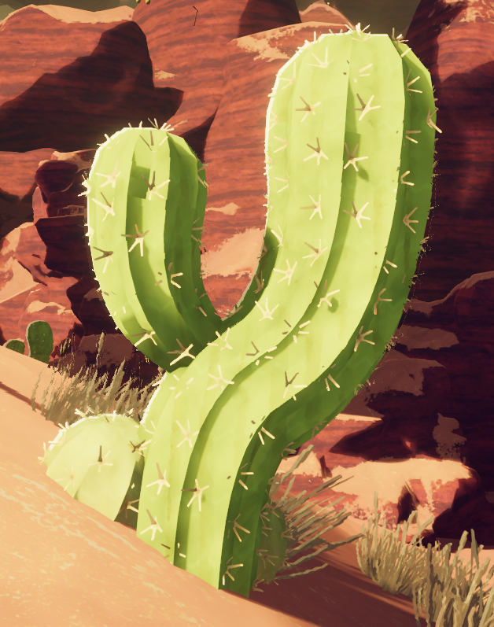
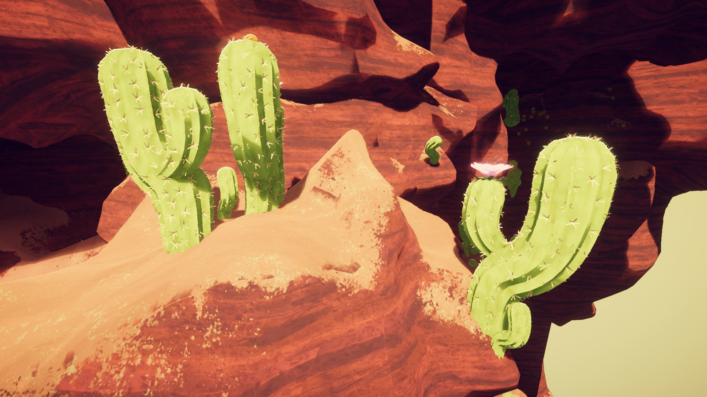
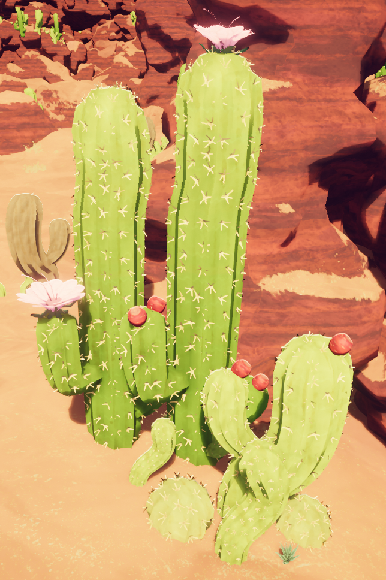
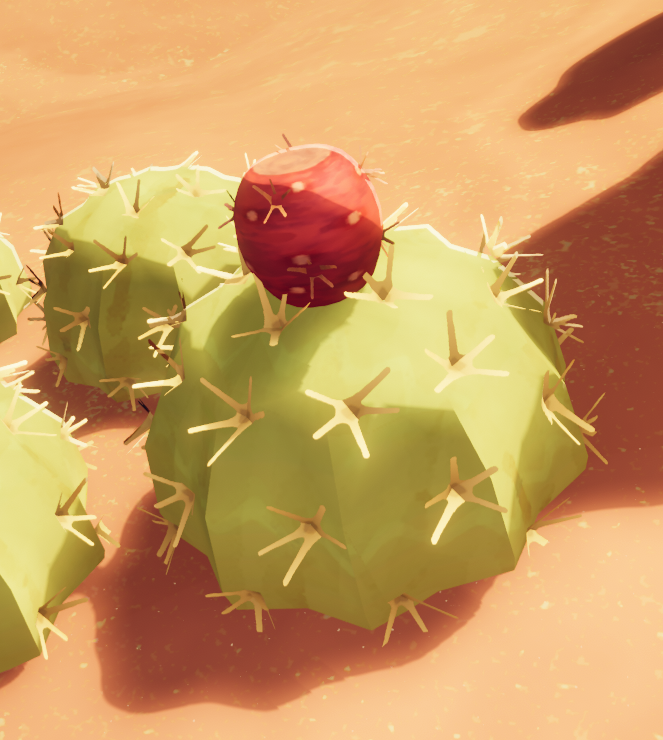
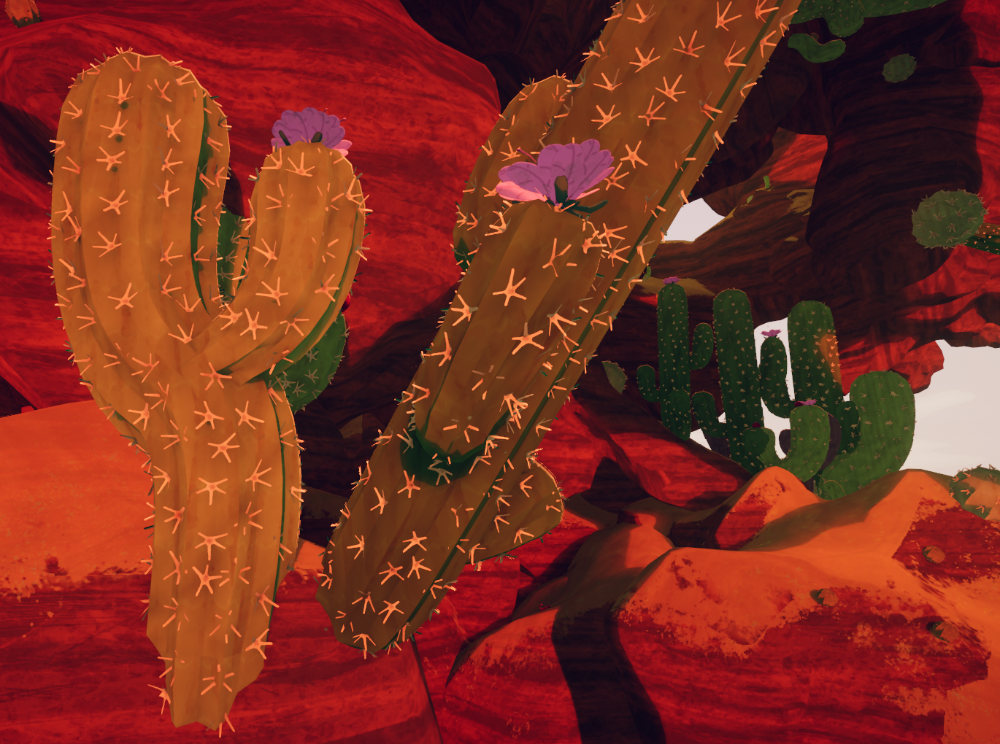
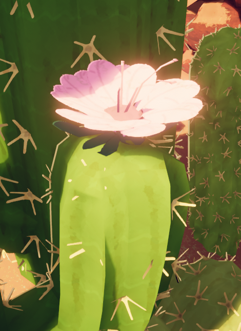

# Big Cacti

Not to be confused with a smaller  [Cactus](Cactus.md) also found in the [Mesa](Mesa.md).
Big Cacti

General
Type
Environmental hazard
Biome- [Mesa](Mesa.md)

**Big Cacti** are an environmental hazard found all throughout the [Mesa](Mesa.md). Some Big Cacti are big and tall, while others are much smaller and shaped like a ball.

Touching a Big Cactus makes the player temporarily stick to it, while also inflicting  [Thorns](Stamina%20bar.md#Thorns) on them.

 [Red Prickleberry](Red%20Prickleberry.md) and  [Gold Prickleberry](Gold%20Prickleberry.md) can be found growing on Big Cacti.

## Tips

- Pressing the helping hand hotkey ( **Right Click**) can get other scouts unstuck from a cactus.

## Gallery

- 
  Multiple Big Cacti in the [Mesa](Mesa.md).
- 
  Tall Big Cacti with [Red Prickleberry](Red%20Prickleberry.md) growing on them.
- 
  A ball-shaped Big Cactus with a [Red Prickleberry](Red%20Prickleberry.md) growing on it.
- 
  Lots of Big Cacti.
- 
  A close-up of a Big Cactus's flower.1

## Patch history

 **[1.20.a](1.20.a.md) (2025-08-11):** Introduced.
 **[1.32.a](1.32.a.md) (2025-10-02):** It turns out you could use the helping hand to unstick YOURSELF from cactuses, not just your friends, so that's fixed lmao.
