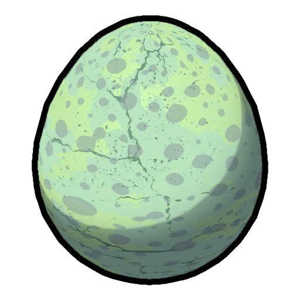
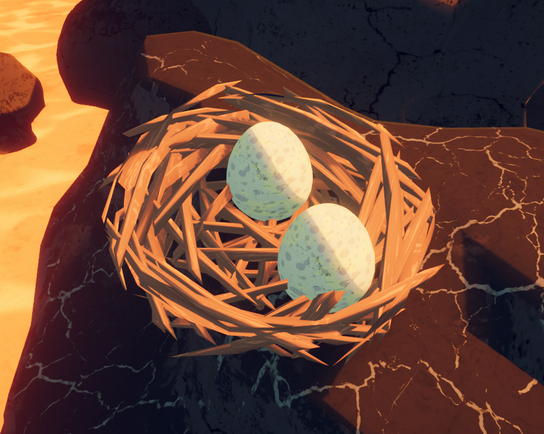
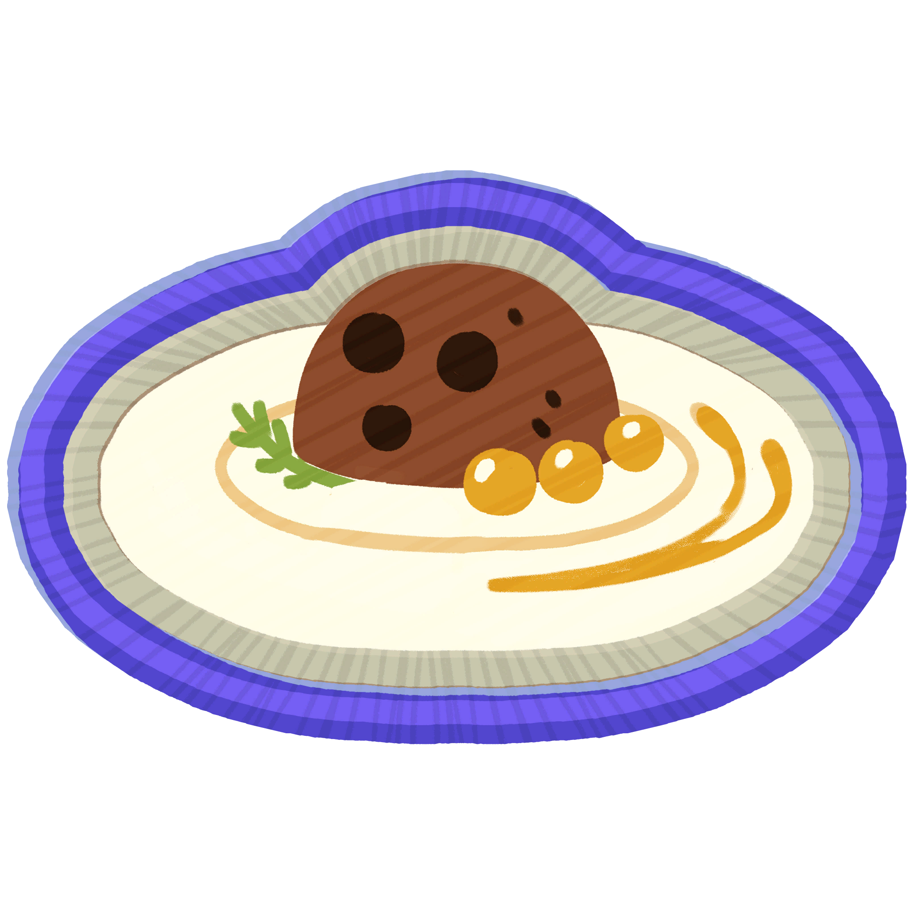

# Big Egg

Big Egg

[Item type](Items.md)- [Misc](Misc.md)
Biome- [Caldera](Caldera.md)
Weight
 **5**

The **Big Egg** is an [item](https://peak.wiki.gg/wiki/Item) in *[PEAK](Peak%20%28game%29.md)* found in nests on rocks in the [Caldera](Caldera.md), including those patrolled by [Condors](Condor.md).

Two Big Eggs in a nest in [Caldera](Caldera.md).

A Big Egg can be cracked by throwing it to make an  [Egg](Egg.md) or, with a 10% chance, a  [Cooked Bird](Cooked%20Bird.md). Cooking an  [Egg](Egg.md) is required for the  [Gourmand Badge](https://peak.wiki.gg/wiki/Gourmand_Badge), as the  [Cooked Bird](Cooked%20Bird.md) will not count.

[Cooking](Cooking.md) a Big Egg will transfer its cooking level to the item inside (with the exception of a would-be uncooked bird).

## Trivia

- Paradoxically, a Big Egg is lighter than the  [Cooked Bird](Cooked%20Bird.md) that may be inside it (Cooked Bird's  **10** [Weight](Stamina%20bar.md#Weight) vs. Big Egg's  **5** [Weight](Stamina%20bar.md#Weight)).
- Throwing a Big Egg at a wall causes the produced  [Egg](Egg.md) to stick to that wall. The egg item does not inherit this property.
- Throwing a Big Egg on top of a player causes the produced  [Egg](Egg.md) to float, allowing players to use it as a platform.
- Although impractical, a Big Egg can also be cracked by throwing other items at it.

## Patch history

 **[1.0](1.0.md) (2025-06-16):** Introduced.
 **[1.27.a](1.27.a.md) (2025-08-27):** Nest Eggs now weigh more to match the weight of the Egg inside.
