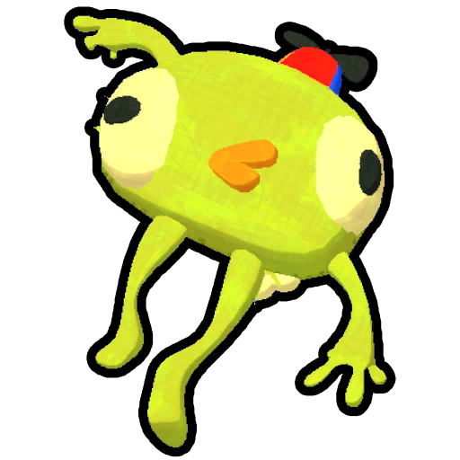
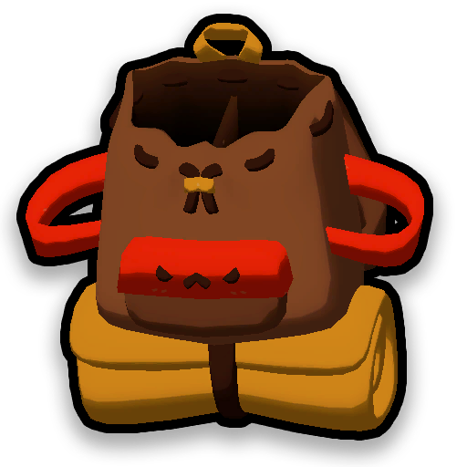
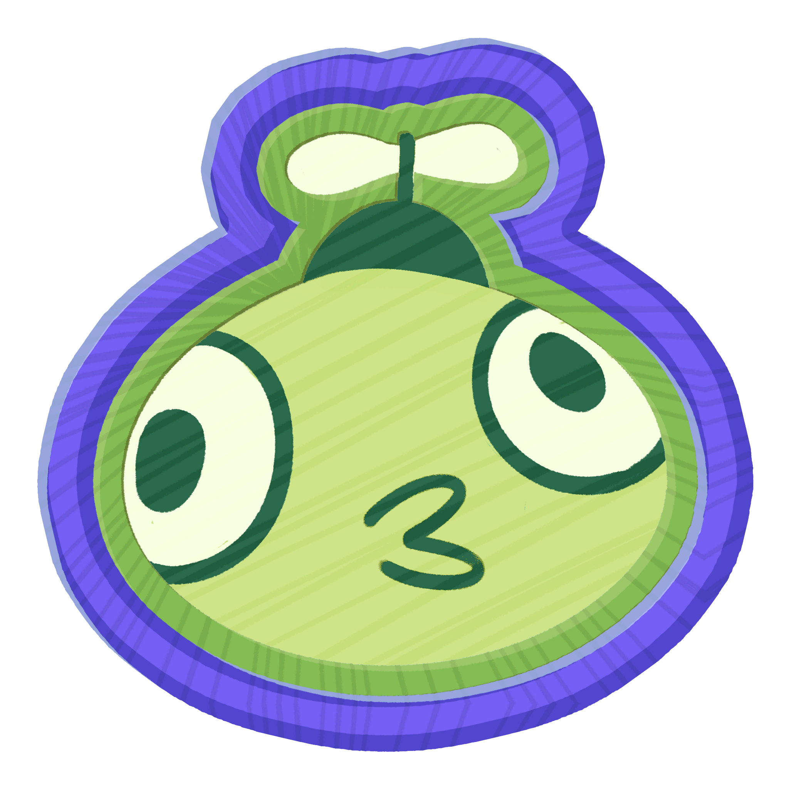
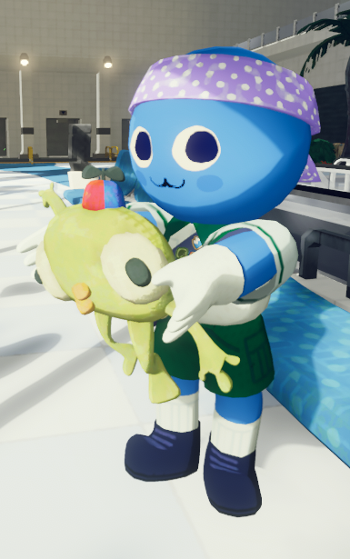
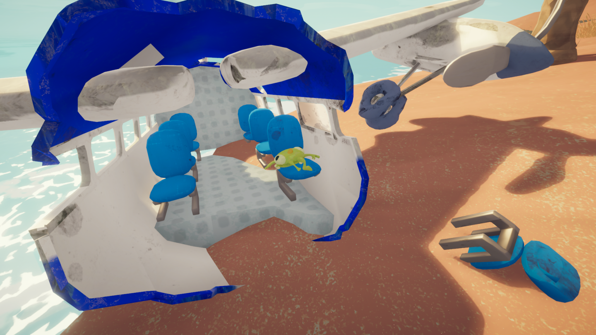
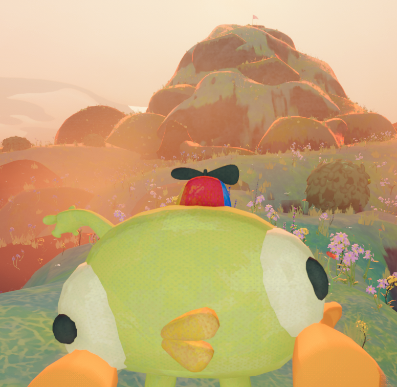
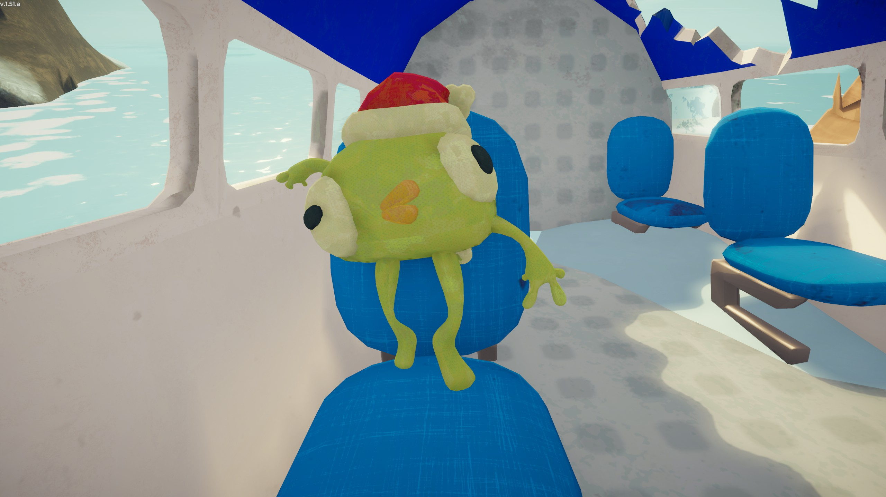
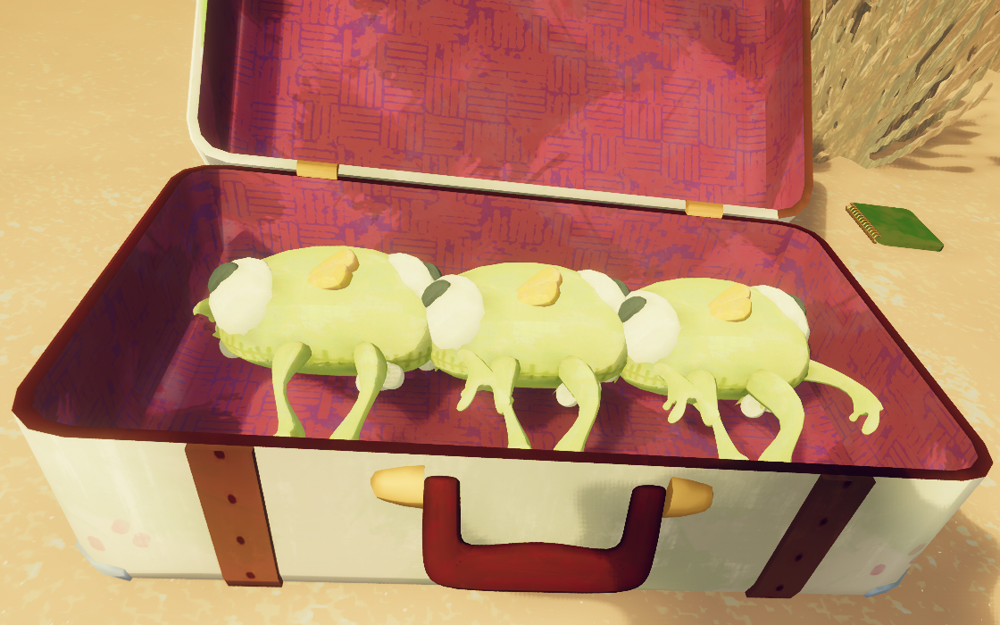
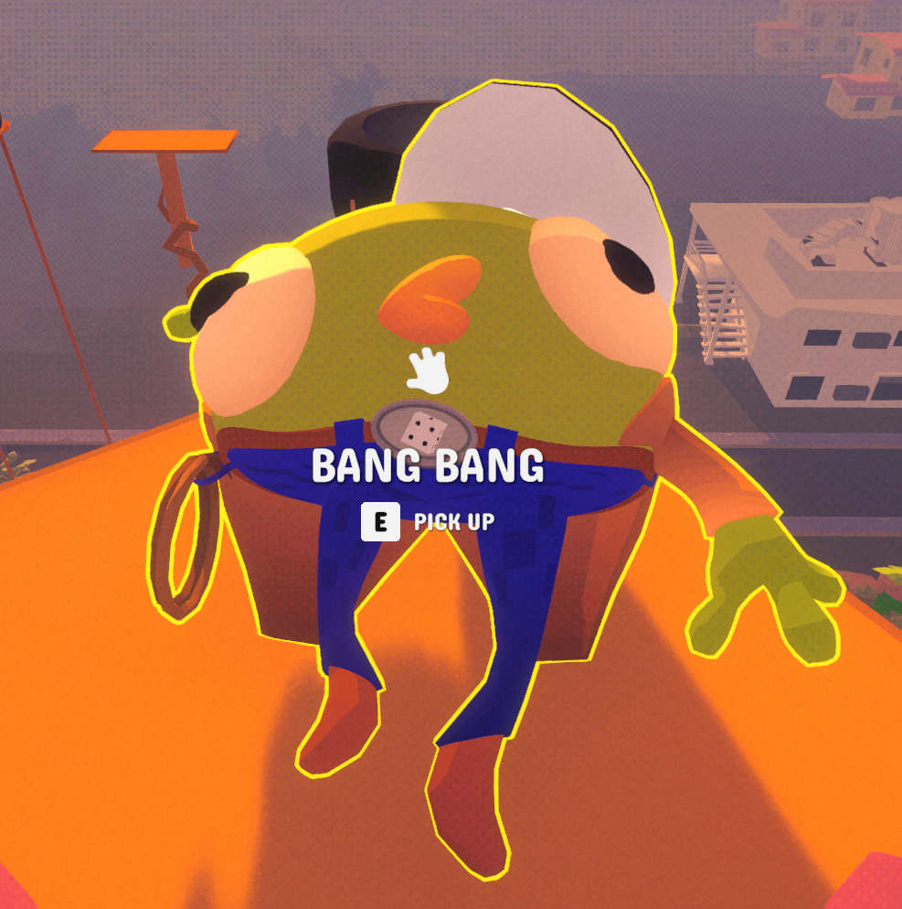

# Bing Bong

Bing Bong

[Item type](Items.md)- [Misc](Misc.md)
Biome- [Airport](Airport.md)
- [Shore](Shore.md)
Location- [Photobooth](https://peak.wiki.gg/wiki/Photobooth)
- [Crash Site](https://peak.wiki.gg/wiki/Crash_Site)
Weight
 **5**

**Bing Bong** is an [item](https://peak.wiki.gg/wiki/Item) in *[PEAK](Peak%20%28game%29.md)*. It is a stuffed plushie of the [BingBong Airlines](https://peak.wiki.gg/wiki/BingBong_Airlines) mascot. It can always be found at the [crash site](Shore.md#Crash_Site) on the [Shore](Shore.md) as well as inside the [Airport](Airport.md)'s [photobooth](Airport.md#Photobooth). Another Bing Bong can be found inside of the monochrome plane in [Nadir](Nadir.md).

Pressing  Left Click while holding out Bing Bong will squeeze it and play a random voice line meant to respond to a question from a player; being a positive, negative, uncertain or irrelevant response. All responses (not response types) are equally likely.

[Cooking](Cooking.md) Bing Bong causes his voice lines to lower in both pitch and volume each time. Cooking Bing Bong 4 times incinerates him, causing him to stop speaking. Putting away a Bing Bong that's been incinerated once and bringing him back out will cause him to start speaking again, but cooking him a 5th time will silence him permanently.

Escaping the island with Bing Bong in a [Scout](Scout.md)'s inventory or  [Backpack](Backpack.md) unlocks the  [Bing Bong Badge](https://peak.wiki.gg/wiki/Bing_Bong_Badge) for all players in the group.

If all items that can spawn in [Luggage](Luggage.md) or from an [Ancient Statue](Ancient%20Statue.md) are removed from the spawn pool in a [Custom Expedition](Custom%20Expedition.md), additional Bing Bongs will spawn in their place.

## Voice lines

- **Positive responses**- *"i guess so..."*
  - *"i think it's fine..."*
  - *"if you wanna..."*
  - *"okay..."*
  - *"s...sure..."*
  - *"y...yeah..."*
  - *"y-yeah, definitely!"*
  - *"yes!"*
- **Negative responses**- *"d-definitely not..."*
  - *"don't do it..."*
  - *"i think that's a bad idea..."*
  - *"nah..."*
  - *"no."*
  - *"NO!!!!!!"*
  - *"no no no no no"*
  - *"n-nuh uh..."*
  - *"p...please don't..."*
- **Uncertain responses**- *"i dunno"*
  - *"if i say yes, will you take me with you?"*
  - *"i'm not comfortable answering that..."*
  - *"i'm... not sure..."*
  - *"maaaaaaaaybe"*
  - *"uh...uhhhhh..."*
  - *"you should ask your friends for help!"*
- **Irrelevant responses**- *"i miss my wife"*
  - *"i'm bing bong"*

## Notes

- When scaling the [Island](Island.md), Bing Bong will face towards the [Scout](Scout.md) holding it. When inside the [Airport](Airport.md), Bing Bong will face away from them, in order for its face to be seen in [photobooth](Airport.md#Photobooth) photos.
- When the [Bug Phobia Mode](Bug%20Phobia%20Mode.md) is turned on in the game's [settings](Settings.md#Accessibility), all [antlions](Antlion.md), [bees](https://peak.wiki.gg/wiki/Bee), [scorpions](Scorpion.md), [beetles](Beetle.md), [spiders](Spider.md) and [ticks](Tick.md) will have their appearance and sounds changed to that of Bing Bong, while roughly keeping their own shape and size.
- The Bing Bong in NADIR is similar to the Airport Bing Bong, as it will face away from you if you hold it out, and it cannot be put in a backpack or inventory, only held.

## Trivia

- Bing Bong is divorced from an individual named Miriam. Miriam and Bing Bong are on good terms now.- Miriam is seeing in a new relationship. Miriam's partner and Bing Bong get along and will sometimes go out for beer to watch The Game together.
  - As per the Roots update changeover, it has been revealed Bing Bong is a father, and that he was granted visitation rights to his kids on the weekend.
  - as per the Final Ascent update, it has been revealed that he is a father of two kids.
- For a short time after *[PEAK](Peak%20%28game%29.md)'*s initial release, the [developers](https://peak.wiki.gg/wiki/Developers) could take control of Bing Bong and communicate with the players through this item. This feature required the player to be publicly sharing the game (e.g. by streaming). This feature was removed mid-June 2025.[[1]](#cite_note-1)
- During the [2025 Holiday Season](1.50.a.md), Bing Bong wore a Santa hat instead of his usual [propeller beanie](https://en.wikipedia.org/wiki/Beanie_(seamed_cap)#Propellerhead).
- Since the release of *PEAK*, Bing Bong has appeared in other games.- [*A Pinball Game That Makes You Mad*](https://store.steampowered.com/app/3796230/A_Pinball_Game_That_Makes_You_Mad/) includes him as a playable character, with permission from Landfall and AggroCrab.
  - [*Fortnite*](https://en.wikipedia.org/wiki/Fortnite) has him included in the [*PEAK Pack* Back Bling](https://fortnite.weirdgloop.org/w/Peak_Pack) as well as the [*Bing Bong* Wrap](https://fortnite.weirdgloop.org/w/Bing_Bong) as part of the official [*PEAK* collaboration set](https://fortnite.weirdgloop.org/w/Category:PEAK_Set).
  - [*Super Meat Boy 3D*](https://en.wikipedia.org/wiki/Super_Meat_Boy_3D) includes him as a playable character.
  - [*Flock Around*](https://store.steampowered.com/app/3618030/Flock_Around/) features a [secret cave drawing](https://flockaround.wiki.gg/wiki/Points_of_Interest_(Goose_Lake)#Woodland_Cave_Painting) featuring Bing Bong and other easter eggs.
  - [*Slay the Spire 2*](https://en.wikipedia.org/wiki/Slay_the_Spire_II) has a [Bing Bong relic](https://slaythespire.wiki.gg/wiki/Slay_the_Spire_2:Bing_Bong) that can be acquired from the [*Doll Room* event](https://slaythespire.wiki.gg/wiki/Slay_the_Spire_2:Doll_Room). The card grants additional copies of cards you acquire in your run.
  - [*Crashout Crew*](https://store.steampowered.com/app/3583210/Crashout_Crew/), another game from AggroCrab, features him.
  - [*Sledding Game*](https://store.steampowered.com/app/3438850/Sledding_Game/) features a Bing Bong plush close to camping tents.
  - [*Teeto*](https://store.steampowered.com/app/2783370/Teeto/) features Bing Bong in a side quest referencing *PEAK*.
  - [*How to Fish*](https://store.steampowered.com/app/4001890/How_to_Fish/) features Bing Bong as a secret catch on Island 3.[[2]](#cite_note-2)
  - [Gamble With Your Friends](https://store.steampowered.com/app/3892270/Gamble_With_Your_Friends/) includes a cowboy variant called "Bang Bang" at the top of the climbing challenge.

## Gallery

- 
  Bing Bong being held at the [Airport](Airport.md).
- 
  Bing Bong at the [crash site](https://peak.wiki.gg/wiki/Crash_Site).
- 
  Bing Bong being carried towards the [Peak](Peak%20%28biome%29.md).
- 
  Bing Bong wearing a Santa hat during the [2025 Holiday Season](1.50.a.md).
- 
  Three Bing Bongs in a Big Luggage during a Custom Run with all possible items removed from the spawn pool.
- 
  Bing Bong's texture
- 
  "Bang Bang" at the top of the climbing challenge in [Gamble With Your Friends](https://store.steampowered.com/app/3892270/Gamble_With_Your_Friends/)

## References

- [↑](#cite_ref-1) <https://www.youtube.com/watch?v=kgWKv_iQ1Vg>
- [↑](#cite_ref-2) <https://www.ign.com/wikis/how-to-fish/How_to_Catch_Bing_Bong>
