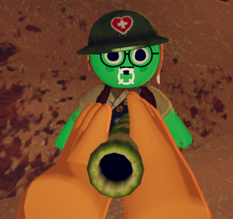
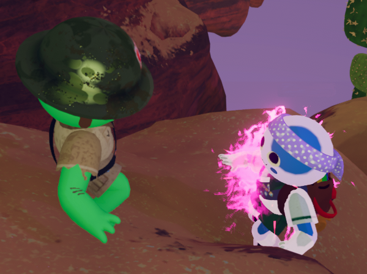

# Blowgun

Blowgun

[Item type](Items.md)- [Consumable](https://peak.wiki.gg/wiki/Consumable)
Rarity
[Mythic](https://peak.wiki.gg/wiki/Mythic)
Source- [Regular Luggage](https://peak.wiki.gg/wiki/Regular_Luggage)
- [Big Luggage](https://peak.wiki.gg/wiki/Big_Luggage)
Weight
 **2.5**
Base Status Effects
Drowsy
120
Removes all status effects except  [Curse](Stamina%20bar.md#Curse) [Curse](https://peak.wiki.gg/wiki/Curse).
Cooked Bonuses
Bonus Stamina
10 (10 total)

The **Blowgun** is a [consumable](https://peak.wiki.gg/wiki/Consumable) item in *[PEAK](Peak%20%28game%29.md)* found in regular and big [luggages](Luggage.md) while playing multiplayer. It can be used to shoot a dart at another [Scout](Scout.md) to clear all statuses except  [Curse](Stamina%20bar.md#Curse) and  [Petrify](Stamina%20bar.md#Petrify).

The Blowgun causes the shot Scout to fall asleep due to them receiving  **120** [Drowsy](Stamina%20bar.md#Drowsy). This will prevent earning the  [Survivalist Badge](https://peak.wiki.gg/wiki/Survivalist_Badge), as the Scout will invariably lose consciousness.

([Cooking](Cooking.md) a blowgun causes it to inflict  **150** [Heat](Stamina%20bar.md#Heat) instead of  **120** [Drowsy](Stamina%20bar.md#Drowsy). Additionally, the user gains  **10** [Bonus stamina](Stamina%20bar.md#Bonus_stamina).) This is currently bugged and gives  **120** [Drowsy](Stamina%20bar.md#Drowsy) even when cooked, along with  **10** [Bonus stamina](Stamina%20bar.md#Bonus_stamina).

## Gallery

- 
  A Blowgun aimed at another [Scout](Scout.md).
- 
  The particle effect and [drowsy](https://peak.wiki.gg/wiki/Drowsy) effect coloration created by the Blowgun when a Scout is shot.

## Patch history

 **[1.0](1.0.md) (2025-06-16):** Introduced.
 **[1.8](1.8.md) (2025-07-21):** Blowgun no longer spawns in Solo Play.
