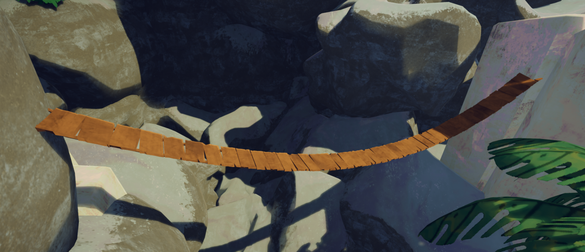
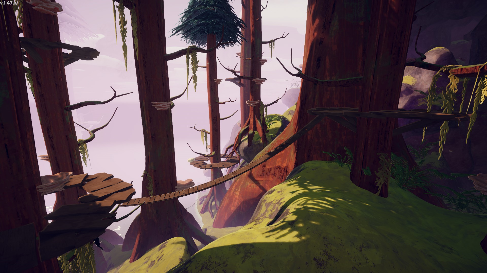

# Bridge

Bridge

General
Type
Traversal utility, Environmental hazard
Biome- [Shore](Shore.md)
- [Roots](Roots.md)

**Bridges** can be found in the [Shore](Shore.md) and [Roots](Roots.md). They can be useful for traversing the terrain, but can also present a danger if too many Scouts try to walk on them at the same time.

The two biomes' bridges are slightly different, with Shore bridges being wider and hanging higher, while Roots bridges are skinnier and hang much lower. Despite their different shapes and appearances, they both function identically.

## Mechanics

At the start of the game, every bridge gets assigned a random number between **1 and 5** as the number of players required to break the bridge. If at any point at least that number of players stands on the bridge, it will start to shake and will break shortly after, dropping all Scouts standing on it in the process.

## Gallery

- 
  A bridge connecting two locations in the [Shore](Shore.md).
- 
  A bridge found in the [Roots](Roots.md).
