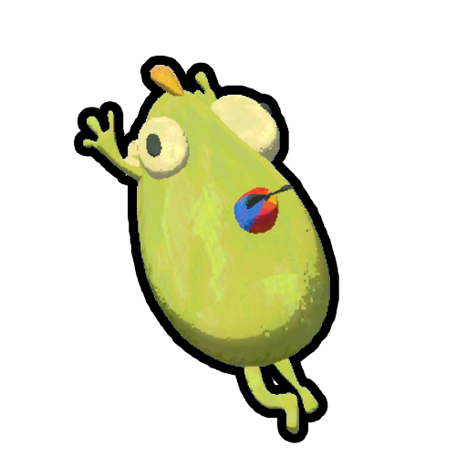
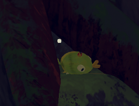

# Bug Phobia Mode

**Bug Phobia Mode** is an option in *[PEAK](Peak%20%28game%29.md)* which allows players to replace various depictions of bugs with [Bing Bong](Bing%20Bong.md) to make the game less scary. It can be toggled in the settings.

Bug Phobia Mode has no effect on the gameplay and only changes the visuals and sounds of certain creatures.

## Gallery

- 
  An [Antlion](Antlion.md) with Bug Phobia Mode enabled
- 
  [Bees](https://peak.wiki.gg/wiki/Bees) with Bug Phobia Mode enabled
- 
  "**Bee**ng Bong" texture
- 
  Bug Phobia Mode [Tick](Tick.md) item icon
- 
  Bug Phobia Mode [Scorpion](Scorpion.md) item icon
- 
  A [Beetle](Beetle.md) with Bug Phobia Mode turned on.

## Patch history

 **[1.20.a](1.20.a.md) (2025-08-11):** Introduced.
 **[1.27.a](1.27.a.md) (2025-08-27):** Replaced [bees](https://peak.wiki.gg/wiki/Bees) sounds in Bug Phobia Mode.
