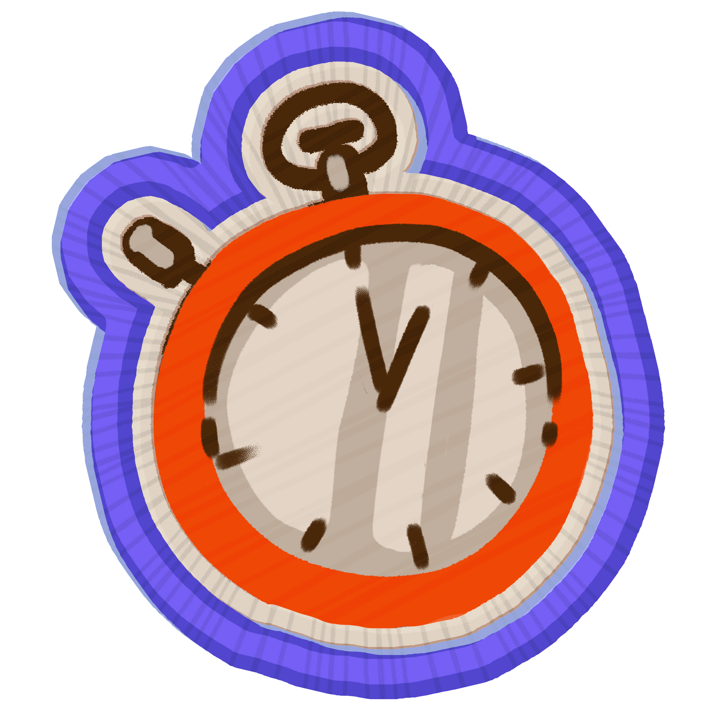
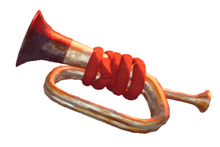

# Bugle?

Disabled item

This item was part of a time-limited event and is no longer available for use.

Bugle?

[Item type](Items.md)- [Equipment](Equipment.md)
Biome- [Shore](Shore.md)
Weight
 **0**

The **Bugle?** is an time-limited item in *[PEAK](Peak%20%28game%29.md)* that was available during the [PEAK x bbno$ concert](PEAK%20x%20bbno%24%20concert.md) event. It could be found on a statue on the [Shore](Shore.md). Using the bugle for roughly 1 second provided a full [morale boost](https://peak.wiki.gg/wiki/Morale_boost) and initiates the Bbno$ concert. After being used once, it cannot be used again. Probably for the best.

The Bugle? shares its model with, and makes a similar distorted noise to the  [Scoutmaster's Bugle](Scoutmaster%27s%20Bugle.md).

## Patch history

 **[1.48.a](1.48.a.md) (2025-12-10):** Introduced.
 **[1.50.a](1.50.a.md) (2025-12-16):** Disabled.
