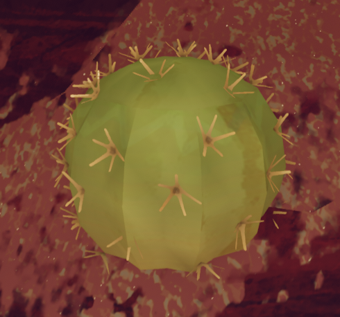
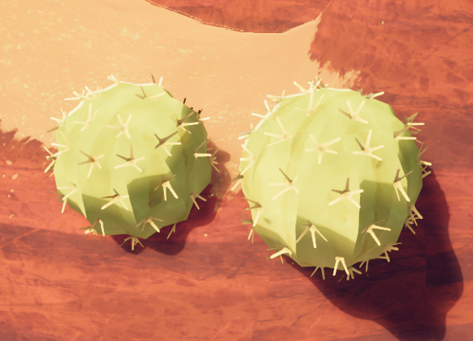

# Cactus

Not to be confused with [Big Cacti](Big%20Cacti.md), a much bigger variant of cacti also found in the [Mesa](Mesa.md).
Cactus

[Item type](Items.md)- [Misc](Misc.md)
Biome- [Mesa](Mesa.md)
Weight
 **0**
Base Status Effects
Thorns
20

The **Cactus** is an [item](https://peak.wiki.gg/wiki/Item) in *[PEAK](Peak%20%28game%29.md)* found in the [Mesa](Mesa.md). A Cactus will stick to the player and will apply  **20** [Thorns](Stamina%20bar.md#Thorns) until thrown or picked off the player's body. It must be thrown (40% or higher throw power) and cannot be dropped due to its sticky attribute.

Having 5 or more Cacti stuck to the player grants the  [Needlepoint Badge](https://peak.wiki.gg/wiki/Needlepoint_Badge). Held Cacti do not count towards this total.

[Prickleberries](Prickleberry.md) do not grow on small Cacti.

## Gallery

- 
  A close-up of a Cactus
- 
  Two Cacti close together
- 
  A lot of Cacti in the [Mesa's caves](Mesa.md#Caves)

## Patch history

 **[1.20.a](1.20.a.md) (2025-08-11):** Introduced.
