# Caldera

Caldera
[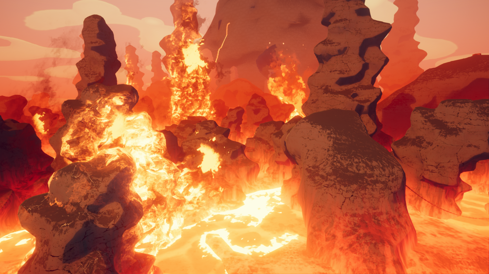](https://peak.wiki.gg/wiki/File%3ACaldera_Location.png)
Details
Type
[Biome](https://peak.wiki.gg/wiki/Biome)
Region
**4**/6

The **Caldera** is one of two possible fourth [biomes](https://peak.wiki.gg/wiki/Biomes) (along with [Gloom](Gloom.md)) in *[PEAK](Peak%20%28game%29.md)*, following the [Alpine](Alpine.md) or [Mesa](Mesa.md) and preceding [The Kiln](The%20Kiln.md). It is a large lake of [lava](Lava.md) with various tall rock formations.

The main hazard of the Caldera is its [lava](#Lava), which rises and falls periodically. Condors also dwell within the Caldera, which scouts must be vigilant of.

At the end of the Caldera is a [temple](#Temple) with an [Ancient Statue](Ancient%20Statue.md). The temple leads into a tunnel in the side of a volcano. Lighting the [campfire](Campfire.md) inside the tunnel dispels the [fog](Fog.md) wall blocking access to [The Kiln](The%20Kiln.md) and grants all living [Scouts](https://peak.wiki.gg/wiki/Scouts) the  [Volcanology Badge](https://peak.wiki.gg/wiki/Volcanology_Badge).

The Caldera does not have any additional time pressure mechanics, such as the [fog](Fog.md) or [The Kiln](The%20Kiln.md)'s rising lava. Cold nights from [Ascent 5](https://peak.wiki.gg/wiki/Ascent_5) and later have no effect in the Caldera.

## Areas

### Rock Towers

---

The Caldera primarily consists of big tall **rock towers**. [Luggage](Luggage.md) and [bird nests](Big%20Egg.md) can sometimes be found on these rocks. Even though the rocks are tall, they usually feature many horizontal surfaces where [Scouts](https://peak.wiki.gg/wiki/Scouts) can rest. Some of these towers may be **hot rock towers**.

Chains connecting two neighboring rock towers can often be found. They function identically to the [vines](Vines.md) in the [Tropics](Tropics.md).

Occasionally, the rocks will [start to glow and burn](#Flare-ups), inflicting  [Heat](Stamina%20bar.md#Heat) on all [Scouts](https://peak.wiki.gg/wiki/Scouts) standing too close or caught directly in the fire.

### Temple

---

[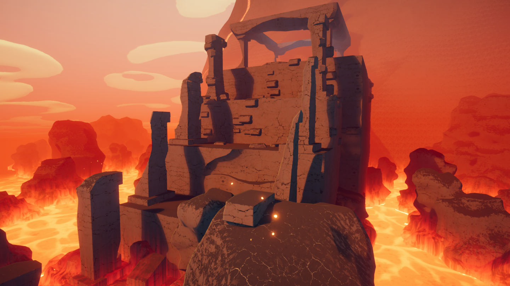](https://peak.wiki.gg/wiki/File%3ACaldera_temple.png)

On the opposite end of the Caldera is a large **temple**. [Scouts](https://peak.wiki.gg/wiki/Scouts) will need to climb up multiple vertical walls to reach the top of the temple. The top of the temple houses an [Ancient Statue](Ancient%20Statue.md) and multiple [luggage](Luggage.md) boxes.

Behind the statue is a large bridge that leads into a tunnel within the side of the volcano, leading to the [campfire](Campfire.md) before [The Kiln](The%20Kiln.md).

## Hazards

| Hazard | Image | Description |
| --- | --- | --- |
| **Lava** | [Caldera lava closeup.png](https://peak.wiki.gg/wiki/File%3ACaldera_lava_closeup.png) | The **lava** in the Caldera will rise and fall periodically, occasionally uncovering the burning hot ground. The lava is able to heat up the rocks, which will then inflict [Heat](Stamina%20bar.md#Heat) [Heat](Stamina%20bar.md#Heat) on the [Scouts](https://peak.wiki.gg/wiki/Scouts) standing on them. Rocks closer to the lava deal more [Heat](https://peak.wiki.gg/wiki/Heat) damage. The lava also inflicts [Injury](Stamina%20bar.md#Injury) [Injury](Stamina%20bar.md#Injury) upon direct contact. Lava can also [cook](Cooking.md) dropped and held items if they are sufficiently close. |
| **Eruptions** | [Caldera burning rocks.png](https://peak.wiki.gg/wiki/File%3ACaldera_burning_rocks.png) | **Eruptions** may occur in all parts of the Caldera. Occasionally, rocks will begin to glow with heat before bursting into a vertical inferno of flames shorty after. The inferno inflicts a significant amount of [Heat](Stamina%20bar.md#Heat) [Heat](Stamina%20bar.md#Heat) on [Scouts](https://peak.wiki.gg/wiki/Scouts) caught in it. Eruptions subside after a short amount of time. Standing on the heating-up rocks can also deal a moderate amount of [Heat](Stamina%20bar.md#Heat) [Heat](Stamina%20bar.md#Heat) damage.  Despite their appearance, they do not cook food. |
| **Hot Rock Towers** | [Caldera Hot Rock.png](https://peak.wiki.gg/wiki/File%3ACaldera_Hot_Rock.png) | **Hot Rock Towers** can be found generating alongside normal Rock Towers in The Caldera, dealing [Heat](Stamina%20bar.md#Heat) [Heat](Stamina%20bar.md#Heat) damage on contact or when staying nearby. Condor nests will always generate atop these towers, and a Condor will always be circling around them. A total of three of these towers will spawn in the Caldera in random locations (each with an accompanying Condor). |
| **[Condors](Condor.md)** | [Condor Flying.png](https://peak.wiki.gg/wiki/File%3ACondor_Flying.png) | **[Condors](Condor.md)** will fly around, circling the hot rock towers their nests are built upon. If players get too close to the towers, the Condor may dive down and kidnap them, flying them up to its nest and dropping them inside. Condor nests are always atop hot rock towers; nests generating on normal rock towers or elsewhere are unguarded. |

## Food

There are only two natural [food](Food.md) items that can appear in the Caldera:

-  [Egg](Egg.md)
-  [Cooked Bird](Cooked%20Bird.md)

## Tips & Tricks

- The Caldera is often very tricky (or outright impossible) to pass without walking on the burning hot ground uncovered whenever the lava level falls. Plan your route when the lava is high, and begin moving as soon as it falls again. You will take some  [Heat](Stamina%20bar.md#Heat) damage, but you should be fine as long as you have enough [stamina](https://peak.wiki.gg/wiki/Stamina) to climb back up again, away from the rising lava.  [Energy Drinks](Energy%20Drink.md) and  [Sports Drinks](Sports%20Drink.md) can also help mitigate the heat.
- Be careful with dropped [equipment](Equipment.md) near the lava, as it may [cook](Cooking.md) it, destroying it in the process.
- Whilst [Condors](Condor.md) don't directly harm players, the drop into the nest may cause  [Injury](Stamina%20bar.md#Injury), and the dangerous locations of the nests atop hot rock towers could provide a challenge if players are kidnapped, so it is best to try to avoid them. However, the nests will usually contain  [Eggs](Egg.md) so if players are desperately hungry and can't locate any nearby nests or [luggage](Luggage.md), having a Condor kidnap a player may prove tactical.
- A  [Book of Bones](https://peak.wiki.gg/wiki/Book_of_Bones) will make most of the hazards in this area trivial, as you can walk through hot areas with no consequence as long as you avoid contact with the lava itself. A [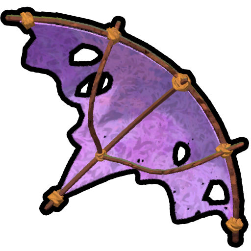](Glider.md) [Glider](Glider.md) will allow players to glide above much of the lava floor between rocks.

## Gallery

- 
  A nest with  [Big Eggs](Big%20Egg.md) inside.
- [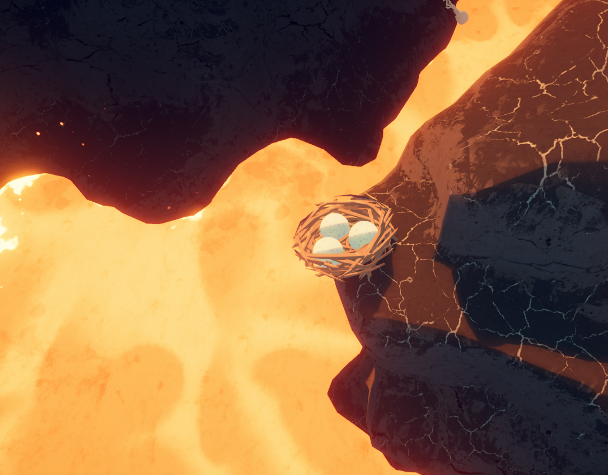](https://peak.wiki.gg/wiki/File%3APeak_egg_nest.png)
  Ditto.
- [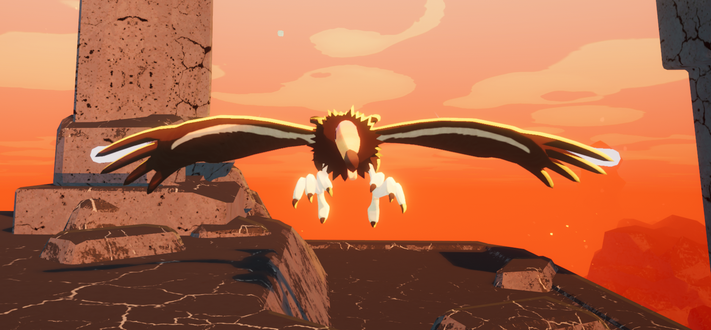](https://peak.wiki.gg/wiki/File%3ACondor_Strike.png)
  A [Condor](Condor.md) about to strike a player.
- [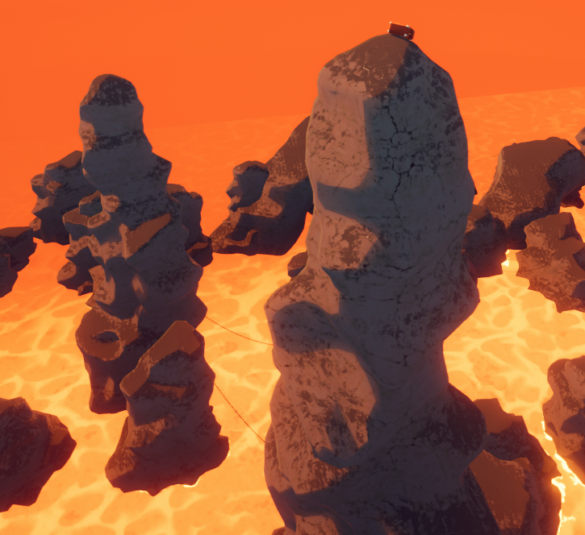](https://peak.wiki.gg/wiki/File%3ACaldera_rock_towers.png)
  Rock towers.
- [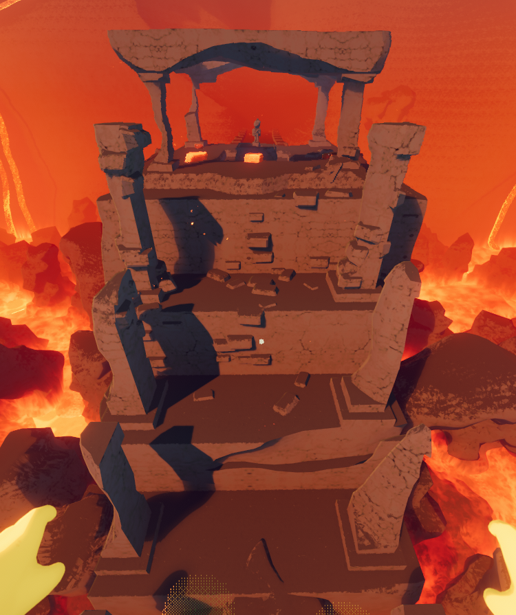](https://peak.wiki.gg/wiki/File%3ACaldera_temple_front.png)
  A front view of temple.
- [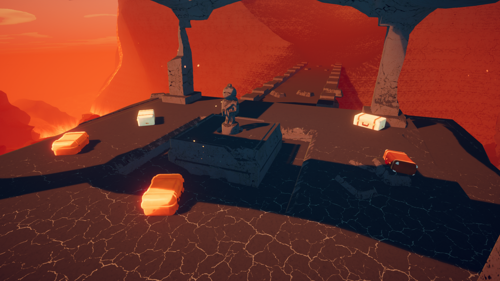](https://peak.wiki.gg/wiki/File%3ACaldera_temple_top.png)
  The top of the temple.
- [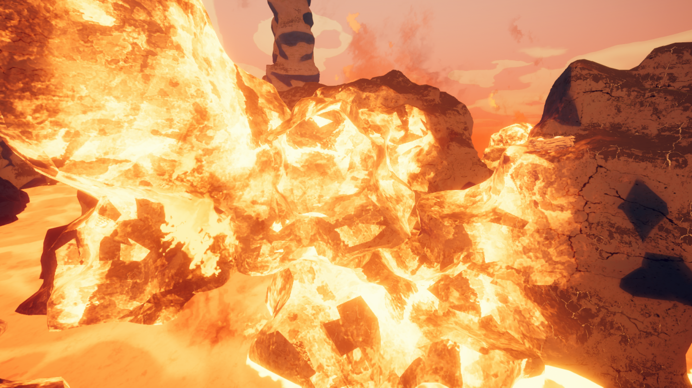](https://peak.wiki.gg/wiki/File%3ACaldera_burning_rocks_2.png)
  A flare-up shortly before it bursts into flames.
- [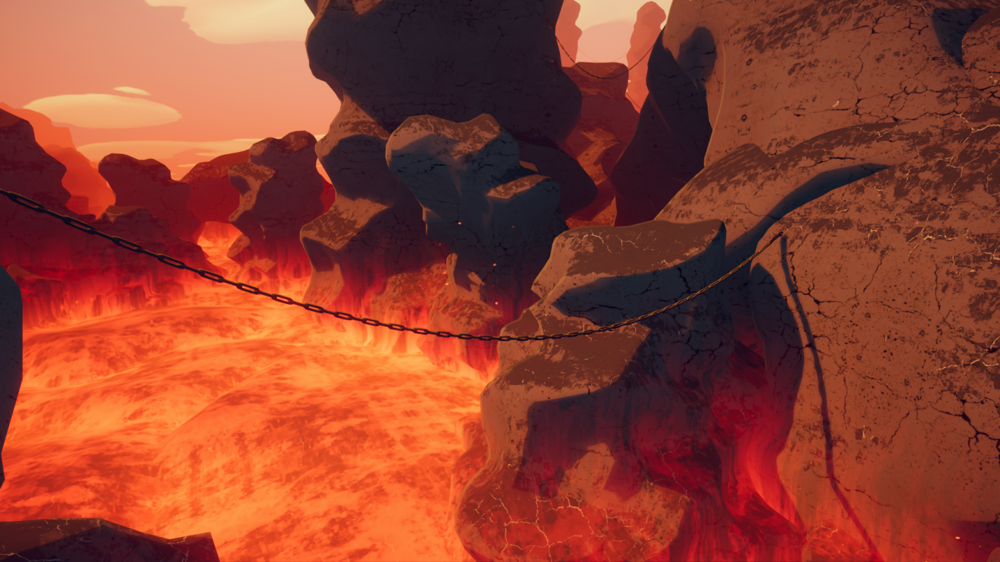](https://peak.wiki.gg/wiki/File%3ACaldera_chain.png)
  The burning ground revealed when the lava lowers, visible behind the chain.
- [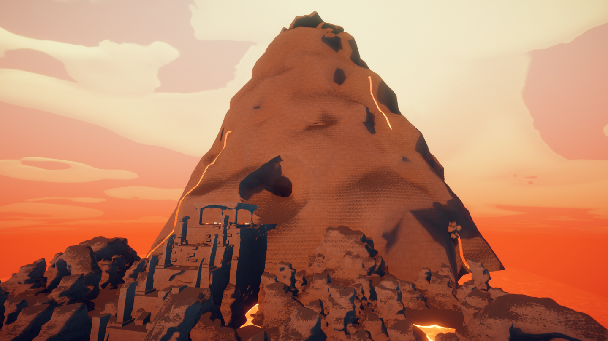](https://peak.wiki.gg/wiki/File%3AVolcano.png)
  The volcano, the exterior of [The Kiln](The%20Kiln.md).
- [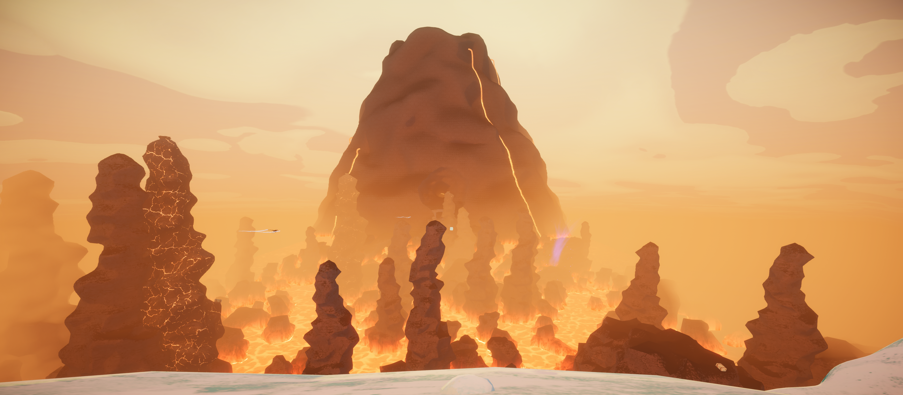](https://peak.wiki.gg/wiki/File%3ACaldera_Overlook.png)
  An overlook of the Caldera from the [Alpine](Alpine.md) campfire.

## Trivia

- In geology, a [caldera](https://en.wikipedia.org/wiki/Caldera) is "a large, cauldron-like hollow that forms shortly after the emptying of a magma chamber in a volcanic eruption."
- When you are in this biome, your Steam Now Playing will say "Crossing the Caldera".

## Patch history

 **[1.0](1.0.md) (2025-06-16):** Introduced.
 **[1.2.a](1.2.a.md) (2025-06-18):** Lowered the Scout Statue in the Caldera temple.
 **[1.8](1.8.md) (2025-07-21):** We've improved performance in the Caldera and Kiln. To folks noting the abnormally low framerate in these areas, please let us know if it's still happening. (We don't have access to a big variety of computer specs!)
 **[1.20.a](1.20.a.md) (2025-08-11):** The Heat status will now decay faster, but it will take a bit longer to start decaying, and the hot rocks in the Caldera will inflict more Heat on you.
 **[1.44.a](1.44.a.md) (2025-11-13):** You will now be able to walk in the Caldera lava if you are invincible.
 **[2.4.a](2.4.a.md) (2026-09-02):**

- Condors now fly around the CALDERA. Ever wonder why those big nests were around? Don’t get kidnapped!
- Added 2 more luggages in the spawner for THE KILN and removed 1 luggage from the statue area at the end of the CALDERA, but made it guaranteed to spawn better luggage.
- Added Hot Rock Towers. **(Undocumented)**
