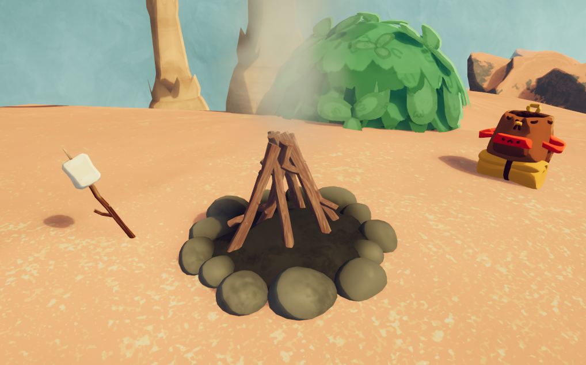
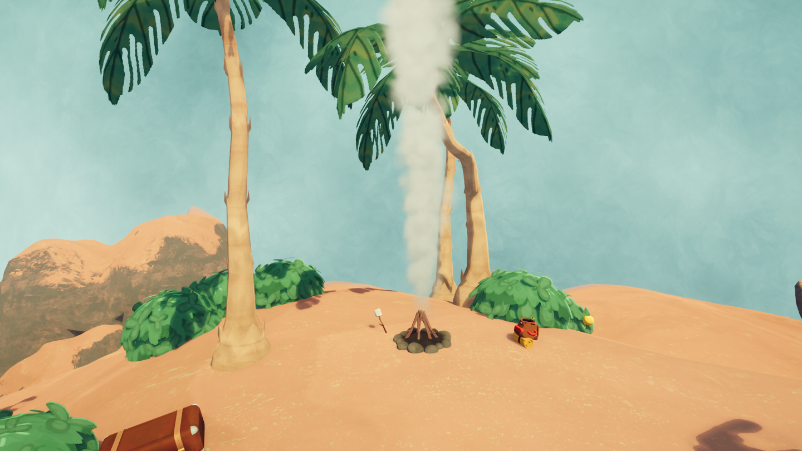
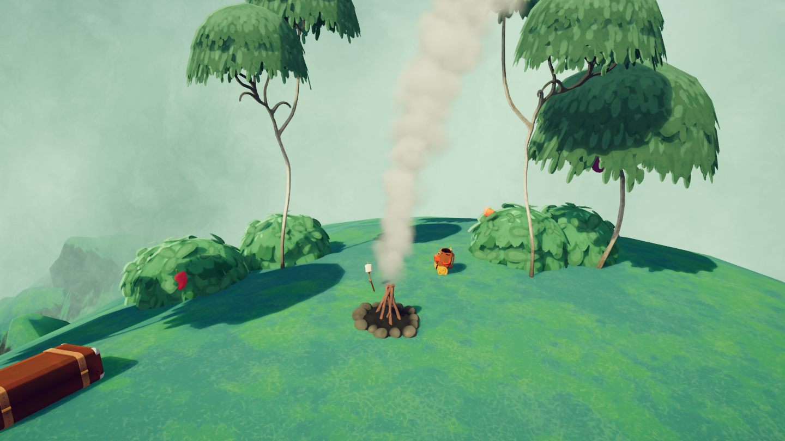
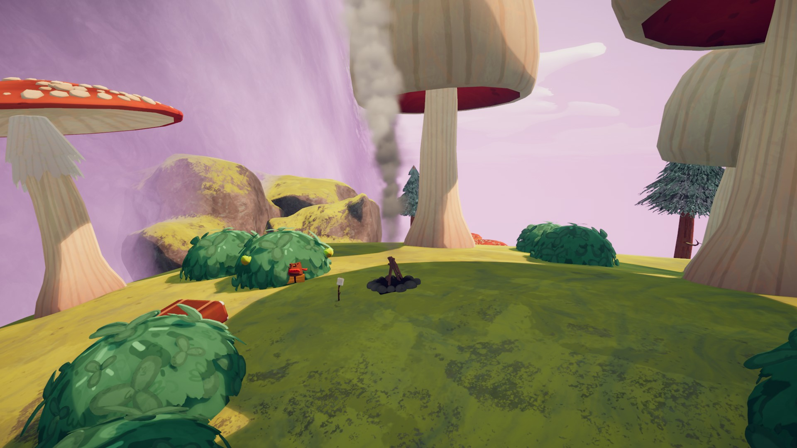
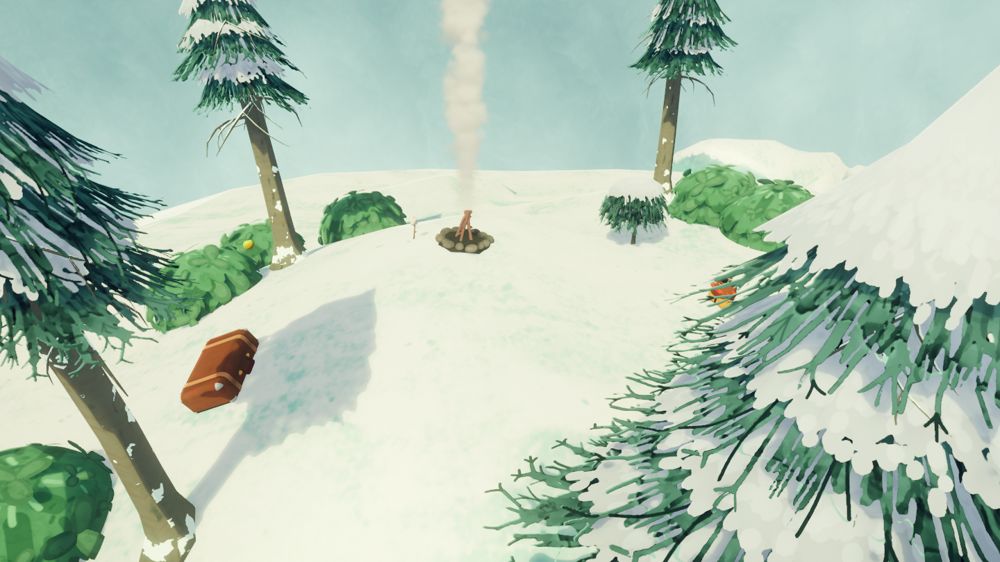
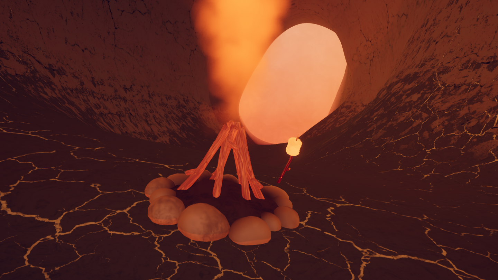

# Campfire

Campfire
Lit
Unlit

General
Type
Landmark

**Campfires** are landmarks in *[PEAK](Peak%20%28game%29.md)* found at the top of every [biome](https://peak.wiki.gg/wiki/Biome). They mark the players' progression through the [map](https://peak.wiki.gg/wiki/Map) and allow access to the next biome. Campfires also autosave the game and allow you to continue that game later.

Once every player is within **19.2 meters** of the campfire, it can be lit by one of them. Once lit, it can be used to [cook](https://peak.wiki.gg/wiki/Cook) any items the players may want to. Lighting a campfire also grants the following effects to each nearby player:

- A [Morale Boost](Morale%20Boost.md) granting  **25** [Bonus stamina](Stamina%20bar.md#Bonus_stamina).
- Heal  **20** [Injury](Stamina%20bar.md#Injury).
- Clear  **20** [Petrification](Stamina%20bar.md#Petrify).
- Prevents any hunger or the fog from rising until a Scout leaves the Campfire area.

Shortly after a Campfire is lit, the fog wall that blocks access to the next biome will dissipate, allowing further progression.

While at least one player is outside the **19.2 meter** protection radius of the campfire, it advances its internal timer. Once the timer reaches **60 seconds**, the campfire will burn out, providing no further benefits.

Campfires are surrounded by the current biome's flora and are guaranteed to have an empty  [Backpack](Backpack.md) nearby, with the exception of those at the end of the [Caldera](Caldera.md) and [Gloom](Gloom.md).

 [Marshmallows](Marshmallow.md) *(62.5% chance)* and  [Hot Dogs](Hot%20Dog.md) *(37.5% chance)* also spawn nearby, one for each player. Next to campfires at the end of the first three biomes, a  [Scroll](Scroll.md) can be found.

## Trivia

- The [Kiln](https://peak.wiki.gg/wiki/Kiln) and [Citadel](https://peak.wiki.gg/wiki/Citadel) do not feature a Campfire.
- There was a map generation bug that allowed the Campfire at the end of [Tropics](Tropics.md) to spawn on top of a nearby tree, which soft-locked players who did not have adequate [Equipment](Equipment.md)[[1]](#cite_note-1). A map [update](1.28.a.md) was pushed soon after with the [developers](https://peak.wiki.gg/wiki/Developers) promising the bug "won't happen again".
- [Luggage](Luggage.md) also occasionally spawns on top of trees.[[2]](#cite_note-2)
- [Gloom](Gloom.md) is the only biome to have a different Campfire appearance.

## Gallery

- 
  [Shore](Shore.md)
- 
  [Tropics](Tropics.md)
- 
  [Roots](Roots.md)
- 
  [Alpine](Alpine.md)
- 
  [Caldera](Caldera.md)

## Patch history

 **[1.0](1.0.md) (2025-06-16):** Introduced.
 **[1.1.a](1.1.a.md) (2025-06-17):** [Morale Boosts](Morale%20Boost.md) no longer scale with number of nearby [scouts](https://peak.wiki.gg/wiki/Scouts)
 **[1.2.a](1.2.a.md) (2025-06-18):** Fixed issue where [backpacks](Backpack.md) near the campfire could despawn when lighting the campfire.
 **[1.6.a](1.6.a.md) (2025-07-04):** Fixed an issue where [scrolls](Scroll.md) wouldn't spawn properly at campsites, preventing players from more easily getting the  [Bookworm Badge](https://peak.wiki.gg/wiki/Bookworm_Badge).
 **[1.7](1.7.md) (2025-07-10):** Fixed an issue where the campfire would not be lightable if a friend reconnected to the game.
 **[1.8](1.8.md) (2025-07-21):** Yet another potential fix for rare cases where the campfire was unable to be lit. Hopefully it really works this time.
 **[1.20.a](1.20.a.md) (2025-08-11):** **(Undocumented)** Moved the [Caldera](Caldera.md) campfire to inside of the volcano just before the Kiln.
 **[1.44.a](1.44.a.md) (2025-11-13):** Fixed an issue where the campfires would no longer burn players.
 **[1.60.a](1.60.a.md) (2026-03-30):** Added the Chill campfire buff, and added campfire autosaves
 **[2.0.a](2.0.a.md) (2026-08-11):** Campfires now give Morale Boosts to solo players.

## References

- [↑](#cite_ref-1) [A Reddit post featuring the bug](https://www.reddit.com/r/PeakGame/comments/1nb65ck/campfire_in_jungle_september_7/)
- [↑](#cite_ref-2) [Reddit post featuring Luggage on top of a tree](https://www.reddit.com/r/PeakGame/comments/1m2qb62/its_mocking_me/)
