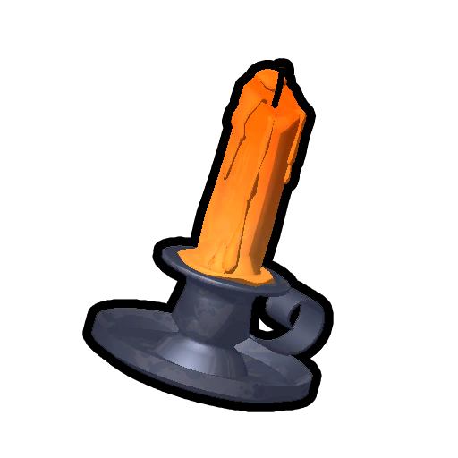

# Candlestick

Candlestick

[Item type](Items.md)- [Equipment](Equipment.md)
Biome- [Gloom](Gloom.md)
- [The Citadel](The%20Citadel.md)
Source- [Luggage](Luggage.md)
- [Big Luggage](https://peak.wiki.gg/wiki/Big_Luggage)
Weight
 **2.5**

The **Candlestick** is an [item](Items.md) in *[PEAK](Peak%20%28game%29.md)*. It can only be found in luggage in the [Gloom](Gloom.md) or [The Citadel](The%20Citadel.md).

While lit, all players within **7 meters** of the candle are immune to the  [Drowsy](Stamina%20bar.md#Drowsy) inflicted by the [Sleepy Gloom](https://peak.wiki.gg/wiki/Sleepy_Gloom), and the visuals of the Gloom are dispelled within **4 meters**. The Candlestick can be lit for **30 seconds** before running out of usage.

A Candlestick can be used to burn [The Ghost](https://peak.wiki.gg/wiki/The_Ghost), granting the player the  [Exorcist Badge](https://peak.wiki.gg/wiki/Exorcist_Badge).

[Cooking](Cooking.md) a Candlestick has no effect.

## Patch history

 **[2.0.a](2.0.a.md) (2026-08-11):** Introduced. **(Undocumented)**
