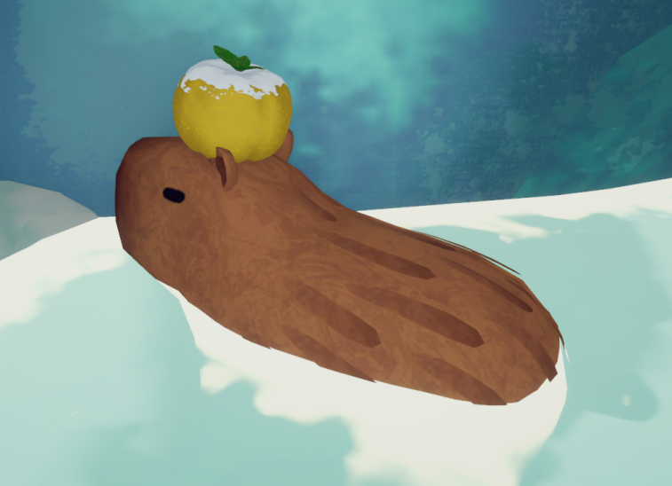
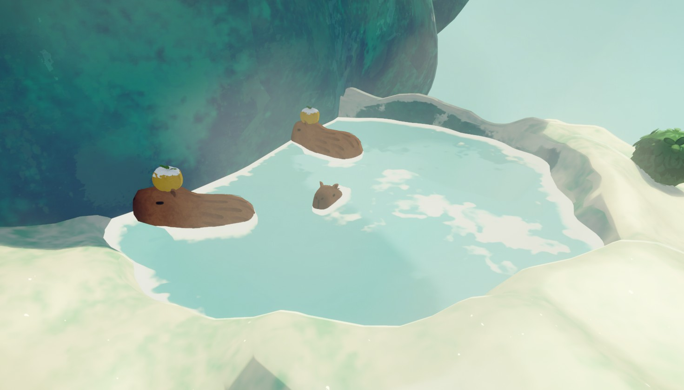
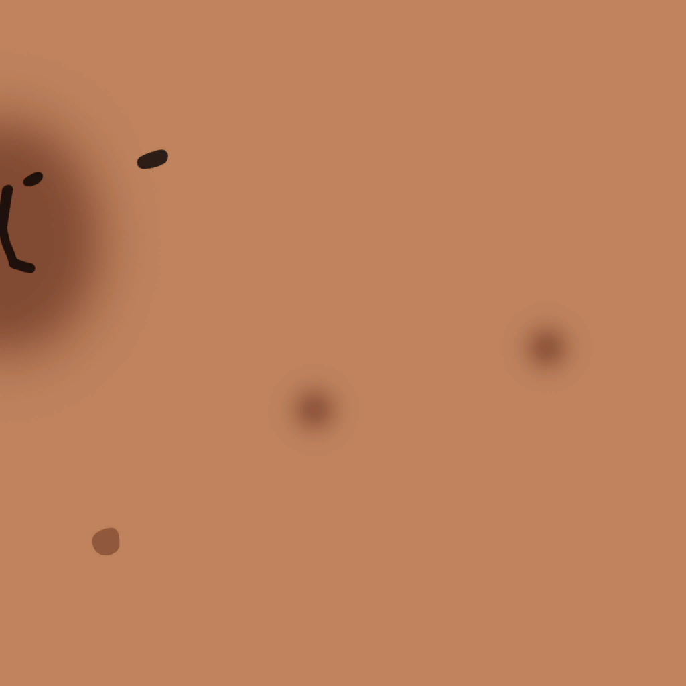

# Capybara

Capybara

General
Type
[NPC](https://peak.wiki.gg/wiki/NPC)
Biome- [Alpine](Alpine.md)
- [Mesa](Mesa.md)

**Capybaras** are animals in *[PEAK](Peak%20%28game%29.md)* that spawn exclusively in either the [Alpine](Alpine.md)'s [Hot Spring](Alpine.md#Hot_Spring) or the [Mesa](Mesa.md)'s [Oasis](Mesa.md#Oasis).

## Uses

Capybaras are utilized in the completion of multiple [Badges](Badges.md).

For the  [Animal Serenading Badge](https://peak.wiki.gg/wiki/Animal_Serenading_Badge), the player must use a [Bugle](Bugle.md), [Bugle of Friendship](Bugle%20of%20Friendship.md), or [Scoutmaster's Bugle](Scoutmaster%27s%20Bugle.md) to play music near the Capybaras.

For the  [Gourmand Badge](https://peak.wiki.gg/wiki/Gourmand_Badge), the player must acquire a [Yellow Winterberry](Yellow%20Winterberry.md) which can always be found on the head of at least one of the Capybaras in a group.

## Trivia

- The location of the [Hot Spring](Alpine.md#Hot_Spring) or [Oasis](Mesa.md#Oasis) (and thus the location of Capybaras) is randomized with every map seed.
- One way to locate the Hot Springs before beginning your climb is to look closely at the cliffs to see rising smoke. Besides the campfire at the top, the hot springs are the only source of smoke in the Alpine. The [Binoculars](Binoculars.md) can assist with this task.
- In the [Mesa](Mesa.md), they can be seen as a mirage which will disappear once the player is close enough.

## Gallery

- 
  Capybaras in Alpine
- 
  Capybara texture

## Patch history

 **[1.0](1.0.md) (2025-06-16):** Introduced.
