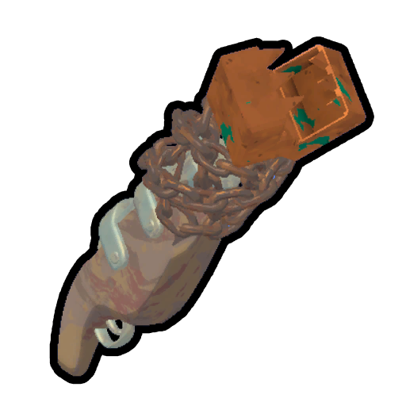
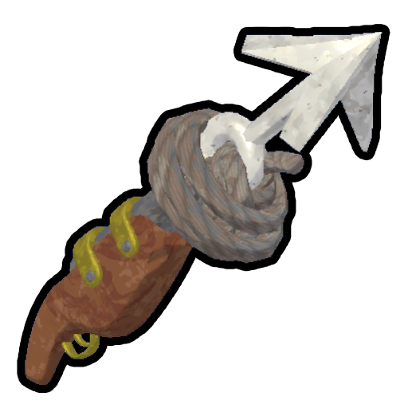

# Chain Launcher

Chain Launcher

[Item type](Items.md)- [Deployable](https://peak.wiki.gg/wiki/Deployable)
Rarity
[Legendary](https://peak.wiki.gg/wiki/Legendary)
Source- [Regular Luggage](https://peak.wiki.gg/wiki/Regular_Luggage)
- [Big Luggage](https://peak.wiki.gg/wiki/Big_Luggage)
- [Explorer's Luggage](https://peak.wiki.gg/wiki/Explorer%27s_Luggage)
Weight
 **2.5**

The **Chain Launcher** is a [deployable](https://peak.wiki.gg/wiki/Deployable) item in *[PEAK](Peak%20%28game%29.md)* found in Regular and Big [Luggages](Luggage.md) past the [Shore](Shore.md) and [Explorer's Luggages](https://peak.wiki.gg/wiki/Explorer%27s_Luggage) anywhere. Using the chain launcher while grounded allows the player to deploy a chain connecting their current location with a wall up to **80 meters** away, consuming the chain launcher. You cannot use a chain launcher if you are looking too far up or down.

[Cooking](Cooking.md) a Chain Launcher immediately incinerates it, making it unusable.

## Physics

Unlike the  [Rope Cannon](Rope%20Cannon.md), the Chain Launcher deploys its chain instantaneously, fixed on both ends by hooks embedded into the surface at the firing [Scout](Scout.md)'s position and the target surface. However, the slack of the chain is indeterminate. There is the possibility that the chain will spawn sagging too low to the ground, which can pose a problem on certain biomes such as [Tropics](Tropics.md) and [Caldera](Caldera.md), where the way across may potentially be obstructed by hazards.

## Patch history

 **[1.0](1.0.md) (2025-06-16):** Introduced.
 **[1.7](1.7.md) (2025-07-10):**

- Potentially fixed an issue where Chain Shooters would spawn with nothing in the chamber.
- Chain Launchers now cannot be shot above or below a certain angle past the horizon line. This is to remove unintended use cases where a chain launcher shot directly upwards would get you much further than other items – it’s intended to be used for lateral traversal!

 **[1.8](1.8.md) (2025-07-21):** Fixed an issue where the chain launcher would sometimes spawn as a broken version that didn't launch a chain when used.
 **[1.50.a](1.50.a.md) (2025-12-16):** Fixed bug where players were going 1/2 speed on Chain Launcher chains.
