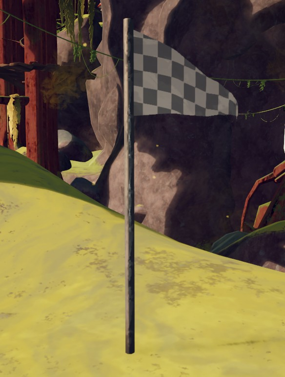

# Checkpoint Flag

Checkpoint Flag

[Item type](Items.md)- [Deployable](https://peak.wiki.gg/wiki/Deployable)
Source- [Regular Luggage](https://peak.wiki.gg/wiki/Regular_Luggage)
- [Big Luggage](https://peak.wiki.gg/wiki/Big_Luggage)
- [Explorer's Luggage](https://peak.wiki.gg/wiki/Explorer%27s_Luggage)
Weight
 **2.5**
Cooked Bonuses
Bonus Stamina
10 (10 total)

The **Checkpoint Flag** is a [deployable](https://peak.wiki.gg/wiki/Deployable) item in *[PEAK](Peak%20%28game%29.md)* found in [Luggages](Luggage.md). It is a placeable flag that provides a single respawn checkpoint for the player who places it. When placed, it is tinted to match the color of the scout who placed it.

Checkpoint Flags can only be [cooked](Cooking.md) using explosives, such as the ones created by  [Dynamite](Dynamite.md). Explosives advance the Checkpoint Flag's cooking stage by two (from uncooked to Well-Done to Incinerated).

## Mechanics

- When a Checkpoint Flag is placed, it saves the player's current [status effects](https://peak.wiki.gg/wiki/Status_effects), excluding  [Weight](Stamina%20bar.md#Weight).
- When the player dies, they immediately respawn at their most recently placed Checkpoint Flag and revert to the saved status effects. [Bonus stamina](Stamina%20bar.md#Bonus_stamina) is preserved after dying. This does not prevent status over time effects from continuing to apply status effects to the player.- The Checkpoint Flag will not revive [cannibalised](Cannibalism.md) Scouts and will not be destroyed in this scenario.
- Any items that the player dropped when they fell unconscious are returned to their inventory, so long as those items are still on the ground. Items will preserve their [cooking stage](Cooking.md#Cooking_stages) at the time of the player's death.
- An equipped backpack stays equipped after revival. A held backpack is not retained.
- A player's [skeleton](The%20Book%20of%20Bones.md) status is not changed during revival, including if the player became a skeleton after placing the flag.
- All placed Checkpoint Flags are destroyed when a campfire is lit.

## Gallery

- 
  A placed Checkpoint Flag.

## Patch history

 **[1.40.a](1.40.a.md) (2025-11-05):** Introduced.
 **[1.44.a](1.44.a.md) (2025-11-13):** The Checkpoint Flag now respawns [Scouts](https://peak.wiki.gg/wiki/Scouts) slightly above the ground to reduce clipping/physics issues upon respawning.
