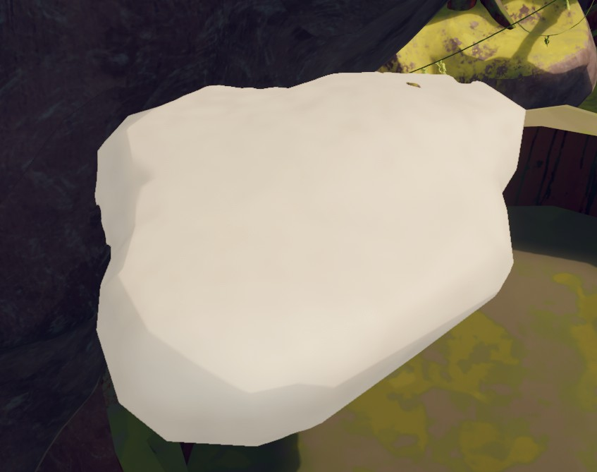

# Cloud Fungus

Cloud Fungus

[Item type](Items.md)- [Deployable](https://peak.wiki.gg/wiki/Deployable)
Biome- [Roots](Roots.md)
Weight
 **2.5**

The **Cloud Fungus** is an [deployable](https://peak.wiki.gg/wiki/Deployable) item in *[PEAK](Peak%20%28game%29.md)* that can be found on the sides of redwoods in the [Roots](Roots.md). It can be used to create a walkable platform similar to the  [Shelf Fungus](Shelf%20Fungus.md) in midair.

## Mechanics

When thrown, the Cloud Fungus will create a platform if the following conditions are met:

- At least half a second has passed since the Cloud Fungus was thrown.
- The Cloud Fungus has a downwards velocity.

Once placed, the Cloud Fungus becomes a floating platform approximately 3 meters across. Despite its appearance, the platform does not prevent [fall damage](https://peak.wiki.gg/wiki/Fall_damage).

## Tips

- It is very difficult to avoid activating the Cloud Fungus when dropping it or setting it on the ground, so players are advised to exercise caution when picking one up with a full inventory or low health.

## Gallery

- 
  A Cloud Fungus after being placed.

## Patch history

 **[1.40.a](1.40.a.md) (2025-11-05):** Introduced.
