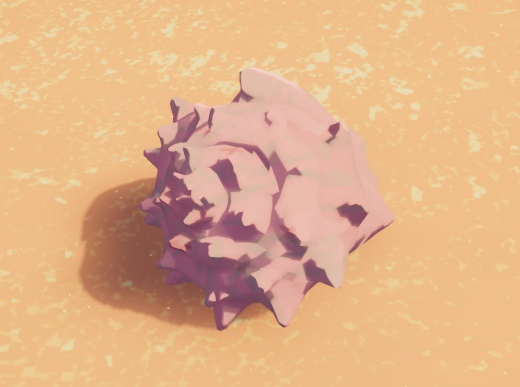

# Conch

Conch

[Item type](Items.md)- [Misc](Misc.md)
Biome- [Shore](Shore.md)
Weight
 **5**

A close-up of a Conch

The **Conch** is an [item](https://peak.wiki.gg/wiki/Item) in *[PEAK](Peak%20%28game%29.md)*. Several conch shells can be found scattered across the beach of the [Shore](Shore.md). Conches can be cooked for no effect aside from visual. Conches have no practical uses.

## Trivia

- The conch is reminiscent of the shell worn by Krill, the protagonist in AggroCrab's 2024 soulslike game, *[Another Crab's Treasure](https://en.wikipedia.org/wiki/Another_Crab%27s_Treasure)*.

## Patch history

 **[1.0](1.0.md) (2025-06-16):** Introduced.
