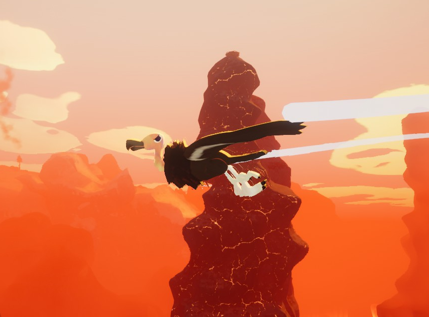
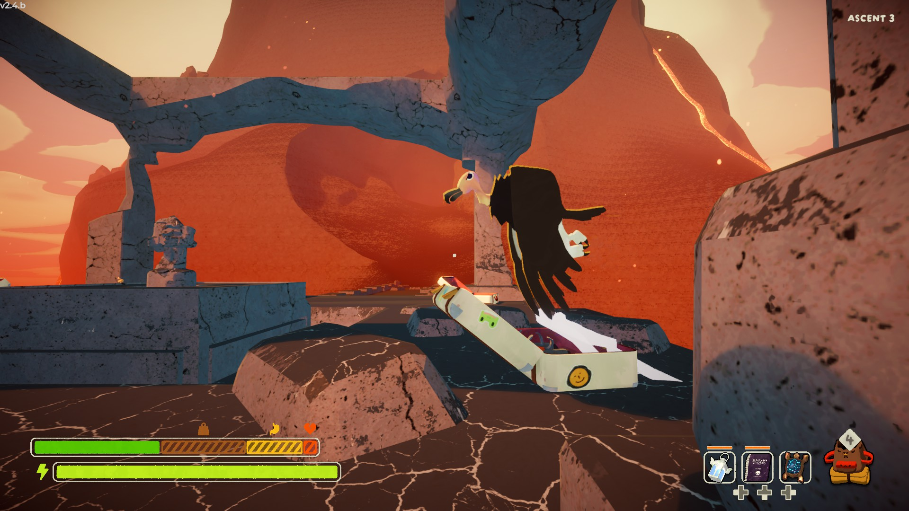

# Condor

Condor

General
Type
[Enemy](https://peak.wiki.gg/wiki/Enemy)
Biome- [Caldera](Caldera.md)

The **Condor** is a hostile [NPC](https://peak.wiki.gg/wiki/NPC) that spawn in the [Caldera](Caldera.md), that cruise through the air circling around their nests built upon hot rock towers. If players get too close, they will swoop down and start flapping furiously before grabbing a [Scout](Scout.md), flying them up to its nest and dropping them inside. Condor nests are always atop hot rock towers; nests generating on normal rock towers or elsewhere are unguarded.

Players cannot wiggle free from a Condor's grasp; however, the  [Rescue Claw](Rescue%20Claw.md) can be used to free yourself and other teammates.

Whilst Condors don't directly harm players, the drop into the nest may cause  [Injury](Stamina%20bar.md#Injury), and the dangerous locations of the nests atop hot rock towers could provide a challenge if players are kidnapped, so it is best to try to avoid them. However, the nests will usually contain  [Big Eggs](Big%20Egg.md) so if players are desperately hungry and can't locate any nearby nests or [luggage](Luggage.md), having a Condor kidnap a player may prove tactical.

A total of three Condors and hot rock towers will spawn in the Caldera in random locations, and they will always fly anti-clockwise around their towers at the same speed.

## Gallery

- 
  A Condor in the Caldera's Temple
- 
  A Condor about to strike a player.

## Patch history

 **[2.4.a](2.4.a.md) (2026-09-02):** Introduced.
