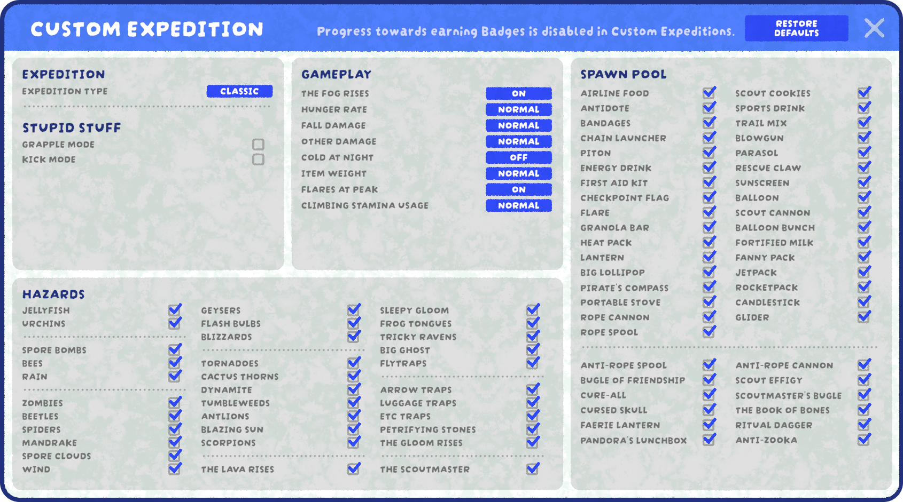

# Custom Expedition

Custom Expedition settings.

**Custom Expeditions** were added in version [1.60.a](1.60.a.md) ("The Play It Your Way Update"). They provide numerous options to adjust [item](https://peak.wiki.gg/wiki/Item) spawns, enabled [hazards](Hazards.md), and other gameplay elements.

Earning [Badges](Badges.md) and [Sashes](Ascents.md) is disabled in Custom Expeditions.

## Details

In a Custom Expedition, most [items](Items.md) can be removed from the spawn pool. Since items spawn is based on [weights](Rarity.md), other items become more common, with the  [Dynamite](Dynamite.md) being especially notable. If a [Luggage](Luggage.md) or [Ancient Statue](Ancient%20Statue.md) is opened with no available items,  [Bing Bong](Bing%20Bong.md) will be spawned as a fallback.

| Setting | Options | Details |
| --- | --- | --- |
| **Expedition Type** | - Classic - Mini Run | - Climb all the way to the [PEAK](Peak%20%28biome%29.md). - Climb a single [biome](https://peak.wiki.gg/wiki/Biome) to win. |
| **Mini Run Biome** | - Biome 1 - Biome 2 - Biome 3 - Biome 4 - Biome 5 | Which one of today's [map](https://peak.wiki.gg/wiki/Map) [biomes](https://peak.wiki.gg/wiki/Biome) will be used for the mini run. |
| **Grapple Mode** | On / Off | *"Start with an infinite-use Rescue Claw...but you suck at climbing."* All players spawn with a golden variant of the  [Rescue Claw](Rescue%20Claw.md), which has infinite durability. If not disabled, [stamina](https://peak.wiki.gg/wiki/Stamina) usage is set to 4x the usual. |
| **Kick Mode** | On / Off | Players lose access to Helping Hand, with the control instead triggering a kick, knocking away hit [Scouts](Scout.md). |
| **The Fog Rises** | On / Off | Enable or disable the [Fog](Fog.md). Does not affect the [Kiln](https://peak.wiki.gg/wiki/Kiln)'s [rising lava](Lava.md). |
| **Hunger Rate** | - Off - Low - Normal - High | Depending on the chosen setting, multiplies gained [Hunger](Stamina%20bar.md#Hunger) [Hunger](Stamina%20bar.md#Hunger) by **0**, **0.7**, **1** (unchanged), or **1.6**. "Low" and "High" are identical to the changes in [Tenderfoot](Ascents.md) and [Ascent 2](Ascents.md), respectively. |
| **Fall Damage** | - Off - Low - Normal - High | Depending on the chosen setting, can halve, double, or disable [fall damage](https://peak.wiki.gg/wiki/Fall_damage). High is identical to the change in [Ascent 1](Ascents.md). |
| **Other Damage** | - Off - Low - Normal - High | Includes [Injury](Stamina%20bar.md#Injury) [Injury](Stamina%20bar.md#Injury), [Curse](Stamina%20bar.md#Curse) [Curse](Stamina%20bar.md#Curse), [Poison](Stamina%20bar.md#Poison) [Poison](Stamina%20bar.md#Poison), [Spores](Stamina%20bar.md#Spores) [Spores](Stamina%20bar.md#Spores), [Cold](Stamina%20bar.md#Cold) [Cold](Stamina%20bar.md#Cold), [Heat](Stamina%20bar.md#Heat) [Heat](Stamina%20bar.md#Heat), [Drowsy](Stamina%20bar.md#Drowsy) [Drowsy](Stamina%20bar.md#Drowsy). Can disable, halve, or double the received amount of all of these [effects](https://peak.wiki.gg/wiki/Effects). |
| **Cold At Night** | On / Off | Identical to the effect of [Ascent 5](Ascents.md). |
| **Item Weight** | - Off - Normal - High | If set to high, all items gain a flat [Weight](Stamina%20bar.md#Weight) **2.5** [Weight](Stamina%20bar.md#Weight), identical to [Ascent 3](Ascents.md). |
| **Flares at Peak** | On / Off | Identical to the effect of [Ascent 4](Ascents.md) when set to "Off". |
| **Climbing Stamina Usage** | - Off - Low - Normal - High | Depending on the chosen setting, multiplies [stamina](https://peak.wiki.gg/wiki/Stamina) usage while climbing by **0**, **0.7**, **1** (unchanged), or **1.4**. "Low" and "High" are identical to the changes in [Tenderfoot](Ascents.md) and [Ascent 6](Ascents.md), respectively. |

## Hazards

The following hazards can be toggled off:

- [Jellyfish](https://peak.wiki.gg/wiki/Jellyfish)
- [Urchins](https://peak.wiki.gg/wiki/Urchin)

---

- Spore Bombs (Includes all three variants found in the [Tropics](Tropics.md) and [Roots](Roots.md))
- [Bees](https://peak.wiki.gg/wiki/Bees)
- [Rain](https://peak.wiki.gg/wiki/Rain)

---

- [Zombies](Zombie.md)
- [Beetles](Beetle.md)
- [Spiders](Spider.md)
- [Mandrake](Mandrake.md)
- [Spore Clouds](Spore%20emitter.md)
- [Wind](Roots.md#Wind)

---

- [Geysers](Geyser.md)
- [Flash Bulbs](Flash%20Bulbs.md)
- [Blizzards](Blizzard.md)

---

- [Tornadoes](Tornado.md)
- [Cactus Thorns](https://peak.wiki.gg/wiki/Thorns) ([Cacti](https://peak.wiki.gg/wiki/Cacti) still generate, but do not inflict any status]
- [Dynamite](Dynamite.md)
- [Tumbleweeds](Tumbleweed.md)
- [Antlions](Antlion.md)
- [Blazing Sun](Mesa.md#Blazing_Sun)
- [Scorpions](Scorpion.md)

---

- [The Lava Rises](Lava.md)

---

- [Sleepy Gloom](https://peak.wiki.gg/wiki/Sleepy_Gloom)
- [Frog Tongues](Frog.md)
- [Tricky Ravens](Tricky%20Ravens.md)
- [Big Ghost](Big%20Ghost.md)
- [Flytraps](Flytrap.md)

---

- [Arrow Traps](https://peak.wiki.gg/wiki/Arrow_Trap)
- [Luggage Traps](Luggage.md#Luggage_Trap)
- [Etc Traps](The%20Citadel.md#Hazards)
- [Petrifying Stones](https://peak.wiki.gg/wiki/Petrifying_Stones)
- [The Gloom Rises](Fog.md#Gloom)

---

- [The Scoutmaster](Scoutmaster%20Myres.md)
