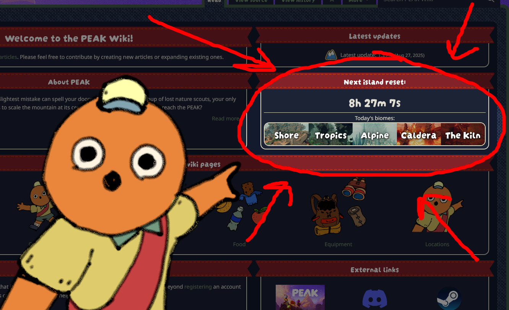

# Daily

*Hold up, Scout! Please read this:*

If you're looking for daily locations, you'd probably be better off looking [here](https://qwojtpl.github.io/PeakMap/WebApp/) or in the game's official [Discord](https://discord.gg/peakgame) or [subreddit](https://www.reddit.com/r/PeakGame/).

We do not provide daily [Capybara](Capybara.md) locations, [Beehive](Beehive.md) locations, [Mushroom](https://peak.wiki.gg/wiki/Mushroom) locations, or any other daily locations. We also do not know if the [Tomb](Tomb.md) is open today or not or if it's accessible.

Why? Because we have no way to query this information automatically (if we *did*, you would not be reading this text). Moreover, we can't even datamine it effectively, so the only way is for someone to go through all 14 (or sometimes 15...) maps in the [rotation](Island.md) and find and document these locations *manually*. I hope you can imagine how much time that would take. Keep in mind that because of the way map generation works currently, these locations would have to be updated *every time the devs release a patch/update*. Yep.

So unless we somehow gain a literal army of selfless contributors willing to find all of these locations and document them for the good of the community, we have to rely on an automatic JS script that queries your system time and displays today's [biomes](https://peak.wiki.gg/wiki/Biome) based on [Alpine](Alpine.md)/[Mesa](Mesa.md) alternation introduced in Patch [1.27.a](1.27.a.md). (even that has a bit of a problem, apparently) Should this behavior be changed in any way, the script will have to be updated ASAP.

Unfortunately, that means that if you really want the daily locations, then we can only redirect you over to the mentioned resources, where (hopefully) someone will have already found the info you're looking for.

P.S.: If you think you have an army of contributors or some other clever way to solve this issue, please let us know either on the [talk page](https://peak.wiki.gg/wiki/Talk%3ADaily) or on the wiki Discord (see sidebar).

Notes:

- Old daily map locations link: <https://steamcommunity.com/sharedfiles/filedetails/?id=3553972295>
