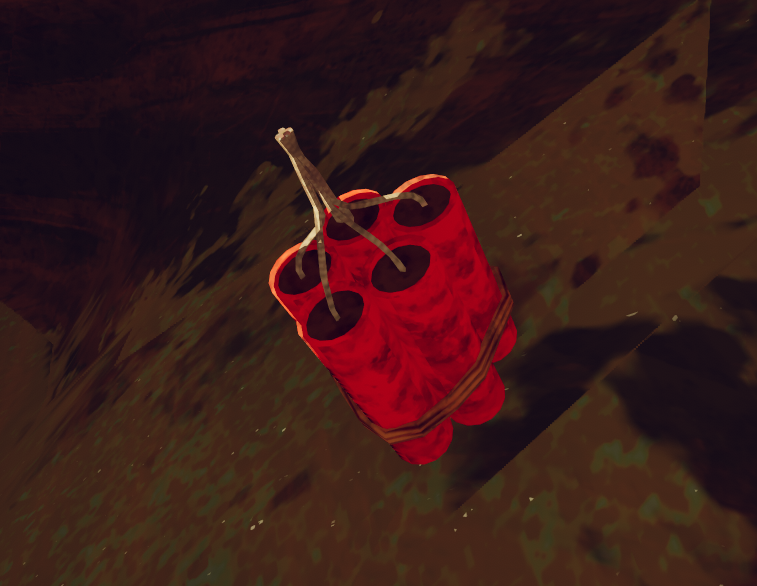
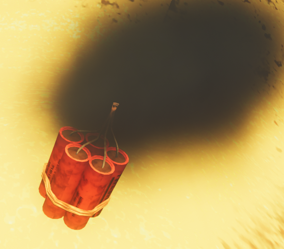
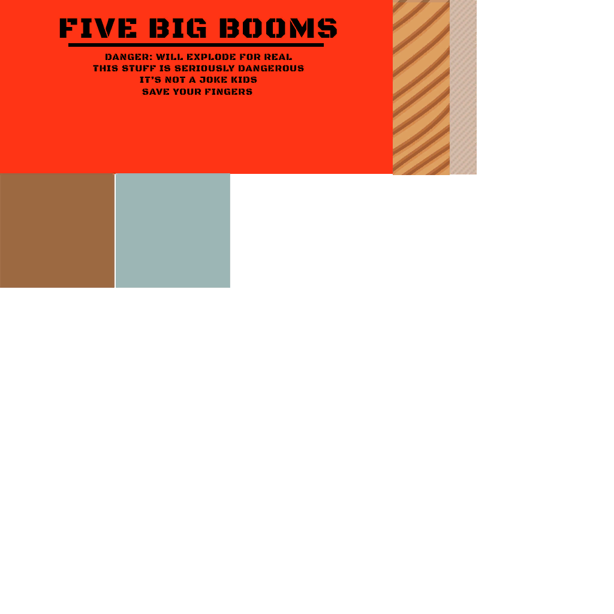

# Dynamite

Dynamite

[Item type](Items.md)- [Consumable](https://peak.wiki.gg/wiki/Consumable)
Rarity
[Legendary](https://peak.wiki.gg/wiki/Legendary)
Biome- [Mesa](Mesa.md)
Location- On ground
- In [Luggage](Luggage.md)
Source- [Regular Luggage](https://peak.wiki.gg/wiki/Regular_Luggage)
- [Big Luggage](https://peak.wiki.gg/wiki/Big_Luggage)
- [Clown Luggage](https://peak.wiki.gg/wiki/Clown_Luggage)
Weight
 **0**
Base Status Effects
Injury
52.5

The **Dynamite** is a [consumable](https://peak.wiki.gg/wiki/Consumable) item in *[PEAK](Peak%20%28game%29.md)* found in [luggage](Luggage.md) or on the ground of the [Mesa](Mesa.md), or rarely in other biomes inside [Clown Luggages](https://peak.wiki.gg/wiki/Clown_Luggage). If a scout is within **8 meters** of the dynamite (or it is found inside a luggage) the fuse will be automatically lit, exploding after 5 seconds. The explosion can cause up to  **27.5** [Injury](Stamina%20bar.md#Injury) to players within **9.6 meters**, and an additional  **25** [Injury](Stamina%20bar.md#Injury) if held.

It is possible to pick up and throw Dynamite, should there be no safe place to retreat from it or too many clueless [Scouts](https://peak.wiki.gg/wiki/Scouts) nearby.

Attempting to [cook](Cooking.md) Dynamite will cause it to immediately detonate. Dynamite explosions cook other items in close proximity, which can cause chain reactions if those items happen to be more Dynamite.

The Dynamite can also be used as a fuel for [Jetpacks](Jetpack.md) making it useful and non-dangerous if timed right

The label text "FIVE BIG BOOMS" may be a reference to [this meme.](https://youtu.be/wHryuEcgSXY)

Dynamite can be found on the ground in [Mesa](Mesa.md).

## Label text

**FIVE BIG BOOMS**

DANGER: WILL EXPLODE FOR REAL

THIS STUFF IS SERIOUSLY DANGEROUS

IT'S NOT A JOKE KIDS

SAVE YOUR FINGERS

## Gallery

- 
  Lit Dynamite
- 
  Dynamite texture

## Patch history

 **[1.20.a](1.20.a.md) (2025-08-11):** Introduced.
 **[1.22.a](1.22.a.md) (2025-08-11):**

- Fixed issue where dynamite would not explode if placed in a backpack.
- Fixed issue where dynamite explosion caused performance issues.

 **[1.22.a](1.22.a.md) (2025-08-11):**

- Dynamite now spawns in luggage slightly less often.
- Dynamite will no longer damage you through walls.

 **[1.25.a](1.25.a.md) (2025-08-21):** Fixed the issue where biome-specific items such as the Dynamite and [Heat Pack](Heat%20Pack.md) could show up in the [Caldera](Caldera.md) onwards.
 **[1.44.a](1.44.a.md) (2025-11-13):**

- Fixed an issue caused by the cooking update where dynamite would create two explosions.
- Dynamite explosions slightly more optimized.

 **[1.50.a](1.50.a.md) (2025-12-16):** Dynamite should be less likely to blow up a player's entire computer when it goes off.
