# Emotes

Emotes
[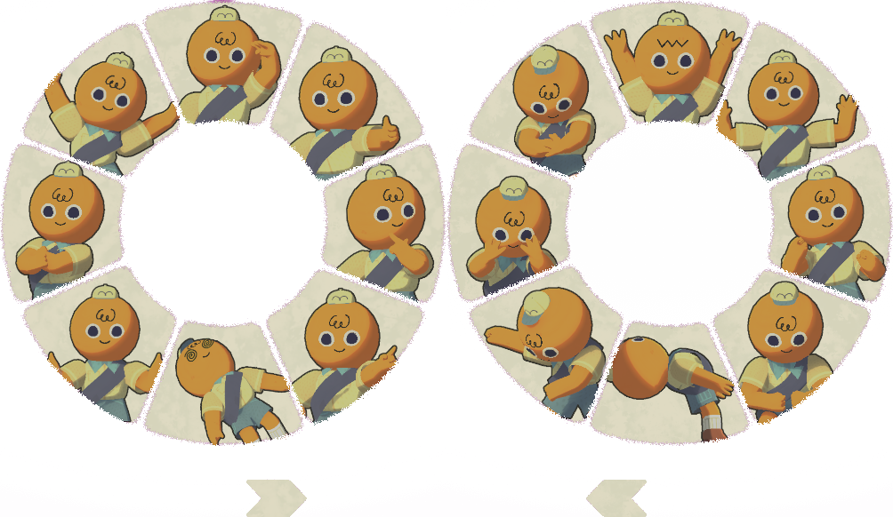](https://peak.wiki.gg/wiki/File%3AEmote_wheel.png)

**Emotes** are expressive actions that the player can have their [Scout](Scout.md) perform. These can be performed by opening the emote wheel by holding  then moving the mouse to the chosen emote. Most emotes last around **2.5 seconds** before returning to the Scout's default stance. The play dead emote lasts longer at roughly **4 seconds** long.

## List of Emotes

In order of appearance in the emote wheel, clockwise starting from the top center.

### Page 1

- [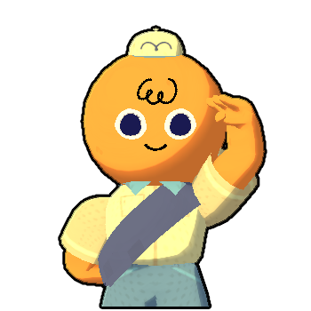](https://peak.wiki.gg/wiki/File%3AEmote_Salute.png)
  Salute
- [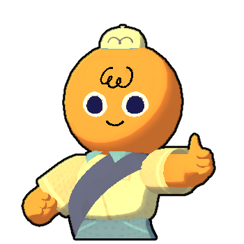](https://peak.wiki.gg/wiki/File%3AEmote_ThumbsUp.png)
  Thumbs up
- [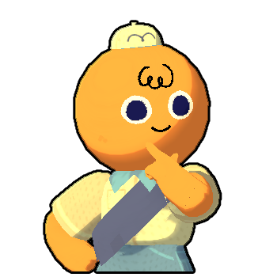](https://peak.wiki.gg/wiki/File%3AEmote_Think.png)
  Think
- [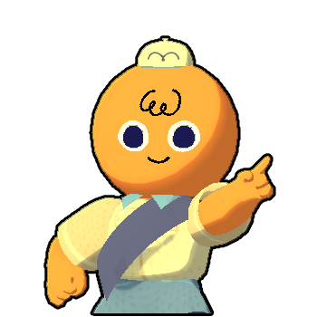](https://peak.wiki.gg/wiki/File%3AEmote_Nono.png)
  No-no
- [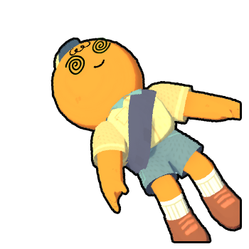](https://peak.wiki.gg/wiki/File%3AEmote_PlayDead.png)
  Play dead
- [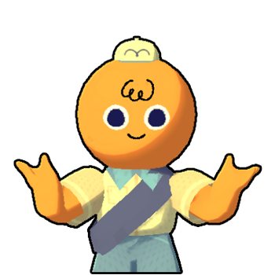](https://peak.wiki.gg/wiki/File%3AEmote_Shrug.png)
  Shrug
- [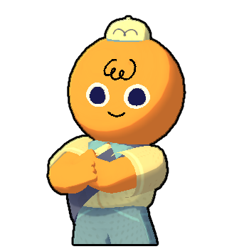](https://peak.wiki.gg/wiki/File%3AEmote_CrossedArms.png)
  Crossed arms
- [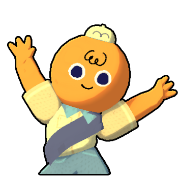](https://peak.wiki.gg/wiki/File%3AEmote_Dance.png)
  Dance

### Page 2

- [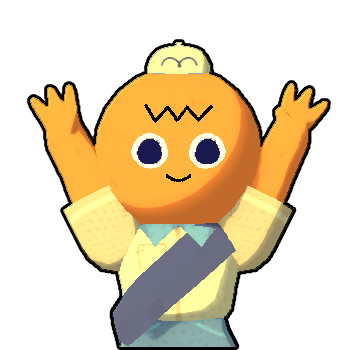](https://peak.wiki.gg/wiki/File%3AEmote_Wave.png)
  Wave
- [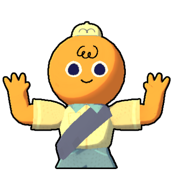](https://peak.wiki.gg/wiki/File%3AEmote_Cinema.png)
  Cinema
- [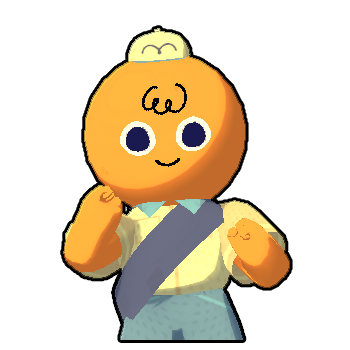](https://peak.wiki.gg/wiki/File%3AEmote_Shimmy.png)
  Shimmy
- [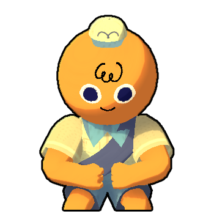](https://peak.wiki.gg/wiki/File%3AEmote_Flex.png)
  Flex
- [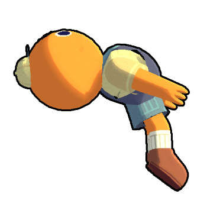](https://peak.wiki.gg/wiki/File%3AEmote_Backflip.png)
  Backflip
- [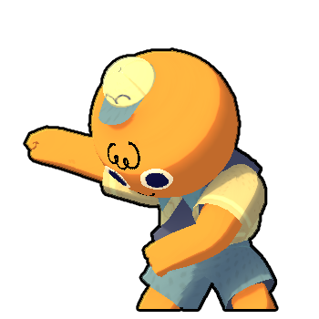](https://peak.wiki.gg/wiki/File%3AEmote_Crashout.png)
  Crashout
- [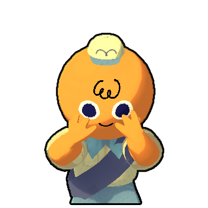](https://peak.wiki.gg/wiki/File%3AEmote_Despair.png)
  It's so over
- [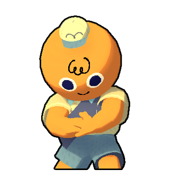](https://peak.wiki.gg/wiki/File%3AEmote_Bully.png)
  Bully

## Trivia

- Using an emote does not restrict a Scout's ability to [point or extend a helping hand](How%20to%20play.md). These actions can thus be combined to create more unique poses.- The only exception to this is the *Play dead* emote, during which any motion of the hands is not displayed to other Scouts.
- While unconscious (also while being carried), all emotes play for a very short period of time before the Scout transitions to the expected pose.
- The Backflip emote has a 50% chance to [ragdoll](Scout.md#Ragdoll_State) the Scout instead of landing the flip.
- The Backflip emote is disabled if the Scout opens the emote wheel while they are not grounded. If the Scout opened the emote wheel while they grounded, they can perform a backflip midair if something, such as the [wind in the Roots](Roots.md#Wind), causes them to fall while the emote wheel remains open.

## Patch history

 **[1.0](1.0.md) (2025-06-16):** Introduced.
 **[1.40.a](1.40.a.md) (2025-11-05):** Added 8 new Emotes.
 **[1.44.a](1.44.a.md) (2025-11-13):** The Emote wheel can no longer be accessed as a [Ghost](https://peak.wiki.gg/wiki/Ghost).
