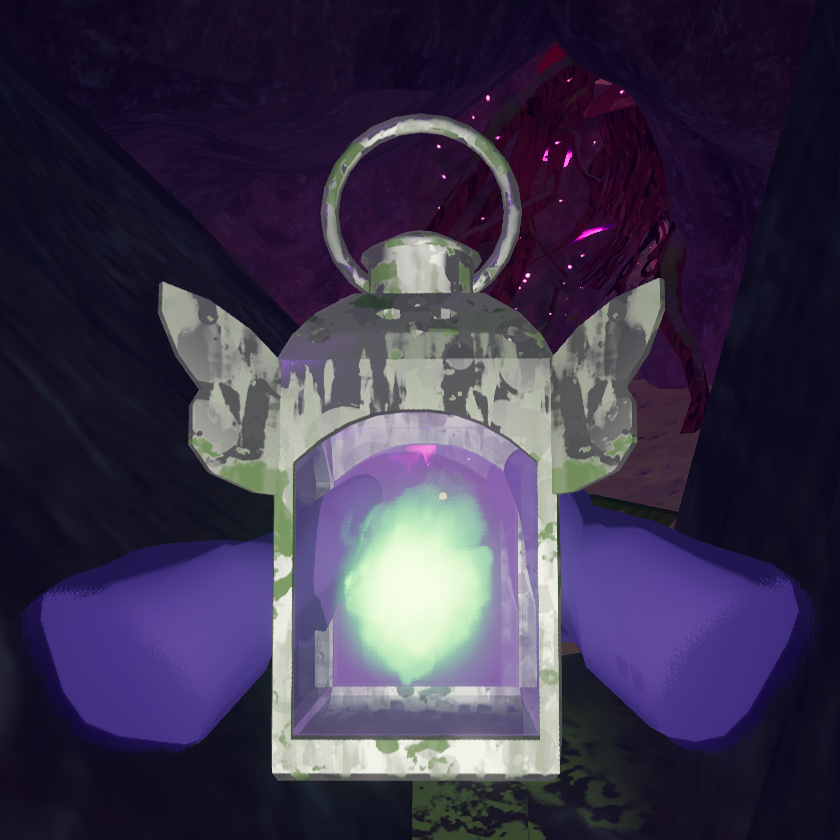

# Faerie Lantern

Faerie Lantern

[Item type](Items.md)- [Equipment](Equipment.md)
- [Mystical item](https://peak.wiki.gg/wiki/Mystical_item)
Rarity
[Legendary](https://peak.wiki.gg/wiki/Legendary)
Source- [Ancient Luggage](https://peak.wiki.gg/wiki/Ancient_Luggage)
- [Ancient Statue](Ancient%20Statue.md)
Weight
 **5**
Base Status Effects
Heat
-75
Cold
-150
Poison
-75
Drowsy
-150
Injury
-75
Spores
-75

The **Faerie Lantern** is a [mystical](https://peak.wiki.gg/wiki/Mystical) [equipment](Equipment.md) item in *[PEAK](Peak%20%28game%29.md)*. While lit, all players within **7.2 meters** of the lantern recover  **2.5** [Heat](Stamina%20bar.md#Heat),  **5** [Cold](Stamina%20bar.md#Cold),  **2.5** [Poison](Stamina%20bar.md#Poison),  **5** [Drowsy](Stamina%20bar.md#Drowsy), and  **2.5** [Injury](Stamina%20bar.md#Injury) each second, and are immune to the Fog. The Faerie Lantern can be lit for up to **30 seconds** before running out of fuel.

The Lantern will stay lit when dropped or when placed into a dropped backpack. It is automatically extinguished if it is put away, if the containing backpack is picked up, or if it is taken out of a containing backpack.

The Faerie Lantern can be used to burn [The Ghost](https://peak.wiki.gg/wiki/The_Ghost) in the [Gloom](Gloom.md), granting the player the  [Exorcist Badge](https://peak.wiki.gg/wiki/Exorcist_Badge).

[Cooking](Cooking.md) a Faerie Lantern while it has remaining fuel causes it to explode, restoring up to  **25** [Poison](Stamina%20bar.md#Poison),  **25** [Spores](Stamina%20bar.md#Spores),  **25** [Cold](Stamina%20bar.md#Cold),  **25** [Heat](Stamina%20bar.md#Heat),  **25** [Drowsy](Stamina%20bar.md#Drowsy),  **25** [Thorns](Stamina%20bar.md#Thorns) to scouts within **4.8 meters**, depending on their distance.

## See also

-  [Lantern](Lantern.md)

## Gallery

- 
  A lit Faerie Lantern in a scout's hands.

## Patch history

 **[1.0](1.0.md) (2025-06-16):** Introduced.
 **[1.40.a](1.40.a.md) (2025-11-05):** Faerie Lantern now explodes when cooked.
 **[2.0.a](2.0.a.md) (2026-08-11):** Changed the grip of Faerie Lantern
