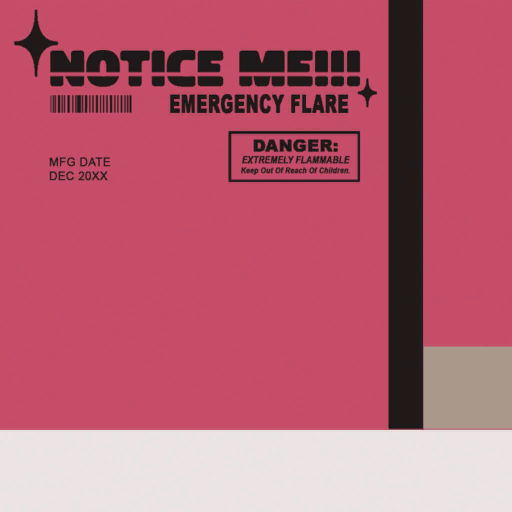
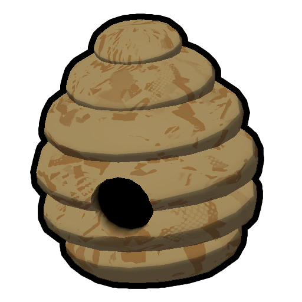

# Flare

Flare

[Item type](Items.md)- [Consumable](https://peak.wiki.gg/wiki/Consumable)
Rarity
[Legendary](https://peak.wiki.gg/wiki/Legendary)
Location- [Crash Site](https://peak.wiki.gg/wiki/Crash_Site)
- [Peak](Peak%20%28biome%29.md)
Source- [Regular Luggage](https://peak.wiki.gg/wiki/Regular_Luggage)
- [Big Luggage](https://peak.wiki.gg/wiki/Big_Luggage)
Weight
 **0**

The **Flare** is a [consumable](https://peak.wiki.gg/wiki/Consumable) item in *[PEAK](Peak%20%28game%29.md)*. It can be found at the [crash site](Shore.md#Crash_Site), in [Luggage](Luggage.md), and in a small crate full of them at the [PEAK](Peak%20%28biome%29.md) while not doing [Ascent 4+](Ascents.md).

A flare can be lit to display a tall column of colourful smoke matching the colour of the scout who uses it. Lighting a flare at the [PEAK](Peak%20%28biome%29.md) signals the rescue helicopter, completing the expedition. Once a flare is lit, it can no longer be stored in the player's inventory or in a  [Backpack](Backpack.md).

[Cooking](Cooking.md) a flare causes it to explode, dealing up to  **20** [Injury](Stamina%20bar.md#Injury) to scouts within **4.8 meters**, depending on distance.

## Label text

**NOTICE ME!!!**

EMERGENCY FLARE

---

**DANGER:**

*EXTREMELY FLAMMABLE*

*Keep Out Of Reach Of Children*

---

MFG DATE

DEC 20XX

## Gallery

- 
  Flare texture

## Patch history

 **[1.0](1.0.md) (2025-06-16):** Introduced.
 **[1.25.a](1.25.a.md) (2025-08-21):** You can no longer put the  [Beehive](Beehive.md) or a lit  Flare in the  [Backpack](Backpack.md).
 **[1.40.a](1.40.a.md) (2025-11-05):** Cooking a flare now causes it to explode.
