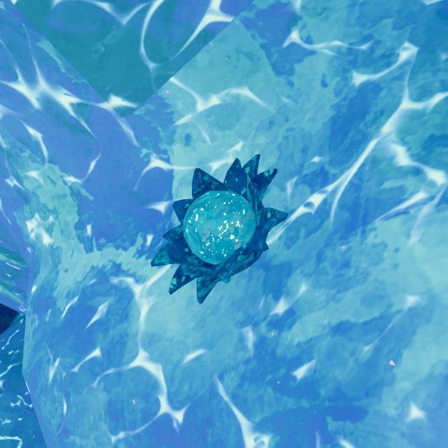
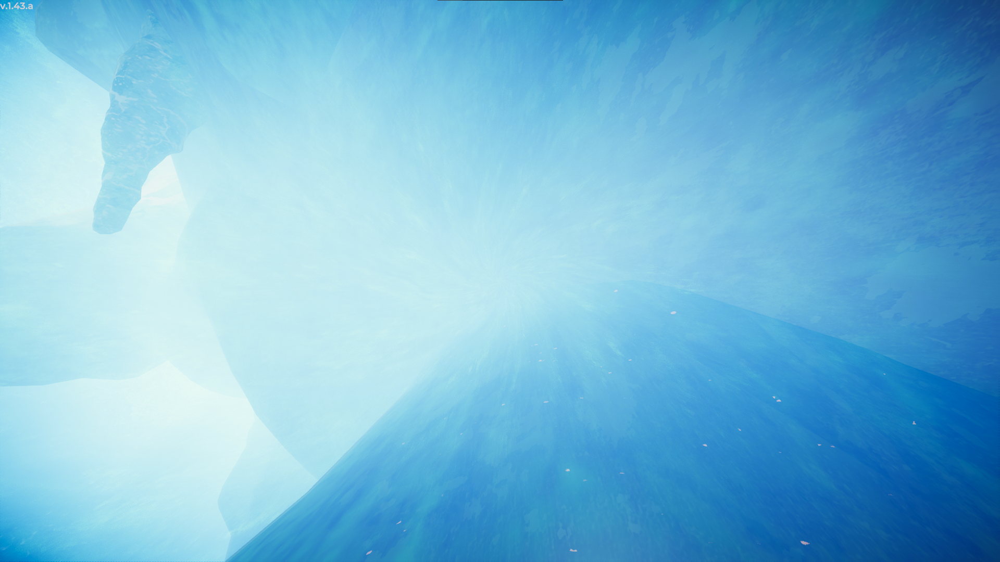
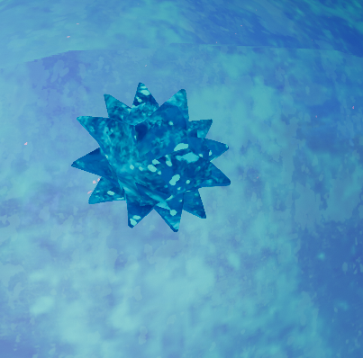

# Flash Bulbs

Flash Bulb

General
Type
Environmental hazard
Biome- [Alpine](Alpine.md)

Flash Bulbs are an environmental hazard found in the [Alpine](Alpine.md). When any player touches a Flash Bulb, it explodes. When this happens, all players within **6.4 meters** of the Flash Bulb are blinded for up to **45 seconds**, depending on their distance.

## Gallery

- 
  A player's vision while blinded by a Flash Bulb.
- 
  A [Scout](Scout.md) after being blinded by a Flash Bulb.
- 
  A Flash Bulb after exploding.
