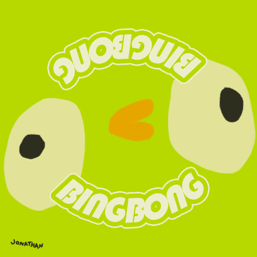

# Flying Disc

Flying Disc

[Item type](Items.md)- [Misc](Misc.md)
Source- [Crash Site](https://peak.wiki.gg/wiki/Crash_Site)
Weight
 **0**

The **Flying Disc** is an [item](https://peak.wiki.gg/wiki/Item) in *[PEAK](Peak%20%28game%29.md)*, found exclusively at the [crash site](Shore.md#Crash_Site) in [Shore](Shore.md). When thrown at a player, the flying disc is able to bonk them, causing them to enter a [ragdoll](https://peak.wiki.gg/wiki/Ragdoll) state.

Catching the Flying Disc when it has been thrown from over 100 meters away unlocks the  [Ultimate Badge](https://peak.wiki.gg/wiki/Ultimate_Badge).

## Trivia

- The Flying Disc was added as a tribute to "[Jonathan Frisbee](https://www.youtube.com/watch?v=IWMHUEc8_dM)", a character played by Flowerland in videos posted by Nucknom. Clips of the character went viral on TikTok and have been featured in numerous *[PEAK](Peak%20%28game%29.md)* clips.- "JONATHAN" can be seen written in black marker on the underside of the Flying Disc.

## Gallery

- 
  The texture for the Flying Disc.

## Patch history

 **[1.8](1.8.md) (2025-07-21):** Introduced.
 **[1.20.a](1.20.a.md) (2025-08-11):** Added the Ultimate Badge for catching the Flying Disc from 100 meters away. **(Undocumented change)**
 **[1.44.a](1.44.a.md) (2025-11-13):** Fixed an issue where a frisbee that landed in the water would still be considered "in flight" for purposes of the Ultimate Badge.
