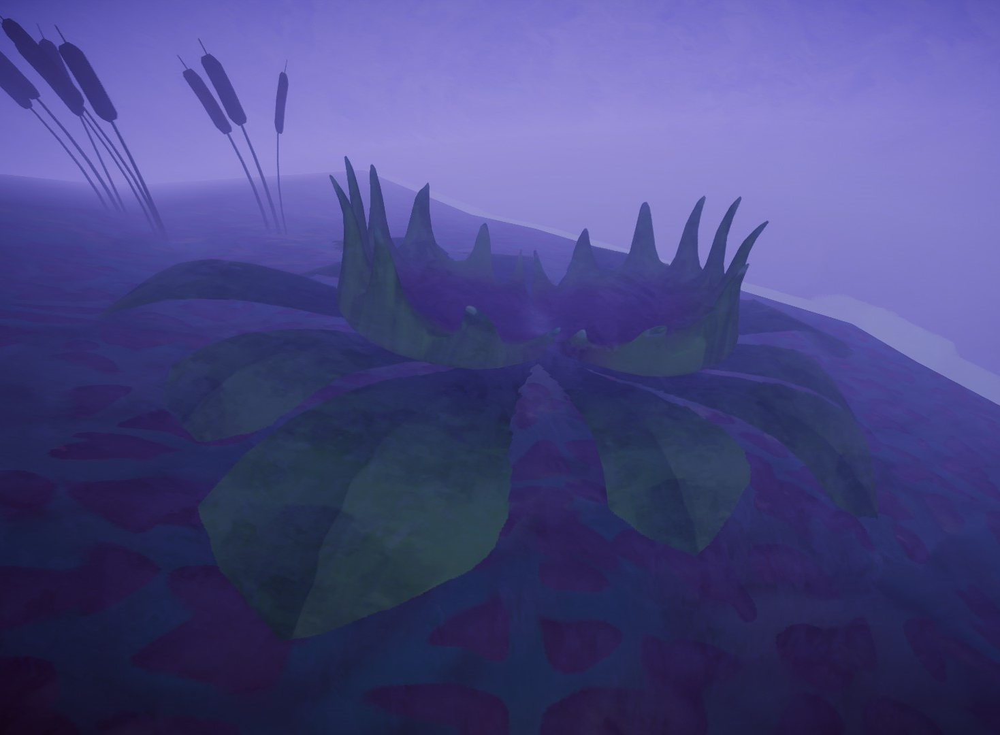
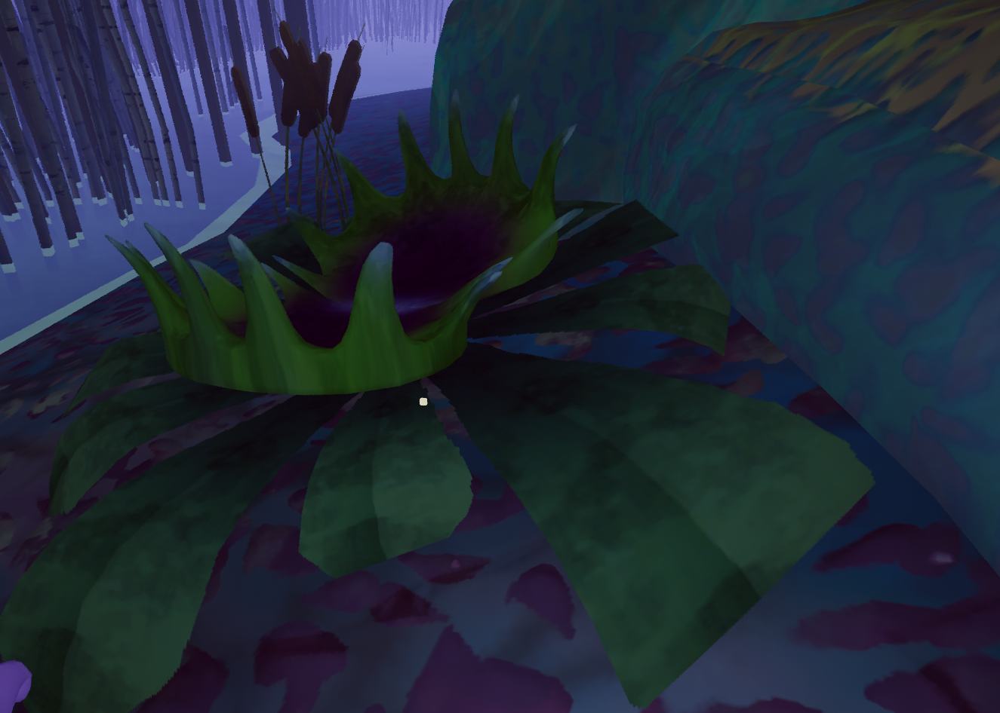

# Flytrap

Flytrap

General
Type
[Enemy](https://peak.wiki.gg/wiki/Enemy)
Biome- [Gloom](Gloom.md)

**Flytraps** are hostile [NPCs](https://peak.wiki.gg/wiki/NPC) found in the [Gloom](Gloom.md). They can trap unaware [Scouts](https://peak.wiki.gg/wiki/Scouts) in their jaws, inflicting  [Poison](Stamina%20bar.md#Poison) until the Scout escapes.

## Mechanics

When a [Scout](Scout.md) walks on top of a Flytrap, it will close its jaws and trap the Scout who touched it. The trapped Scout is immediately inflicted with  **30** [Flytrap](Stamina%20bar.md#Flytrap). The trapped Scout can struggle out of the jaws by pressing jump (), removing  **2.5** [Flytrap](Stamina%20bar.md#Flytrap) per press of the key. Note that struggling requires [stamina](https://peak.wiki.gg/wiki/Stamina) and stamina is still regained while trapped. A trapped Scout cannot use any items or access their [backpack](Backpack.md).

Once the Flytrap has trapped its victim, it will begin dealing  **5** [Poison](Stamina%20bar.md#Poison) to them every second.

Other [Scouts](https://peak.wiki.gg/wiki/Scouts) can also free a trapped Scout by grabbing them with **Helping Hand**.

## Interactions

- A player with [invincibility](Stamina%20bar.md#Invincibility) will be immediately released after being trapped by a flytrap. This will still briefly knock the player down.
- A player that is trapped can be freed from afar by shooting them with a  [Blowgun](Blowgun.md).
- A player can also be freed by being fed a  [Napberry](Napberry.md). If the trapped player is close enough to be fed, it is probably best to instead use **Helping Hand**.

## Gallery

- 
  A Flytrap sitting on the rocks of the Gloom

## Patch History

 **[2.0.a](2.0.a.md) (2026-08-11):** Introduced.
 **[2.1.a](2.1.a.md) (2026-08-13):**

- Fixed issue where players would stay muffled after dying to a Flytrap.
- [Skeleton Scouts](https://peak.wiki.gg/wiki/Skeleton_Scouts) are now affected by [spiders](Spider.md), flytraps, and arrow traps. (Be especially careful around the arrow traps…)
