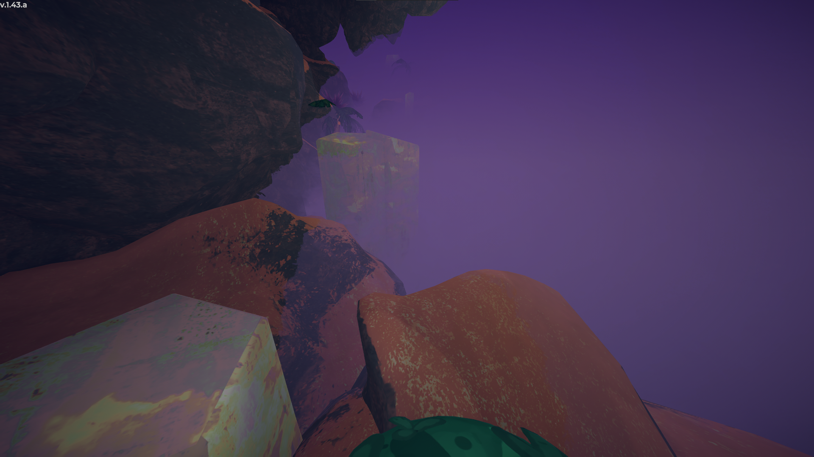
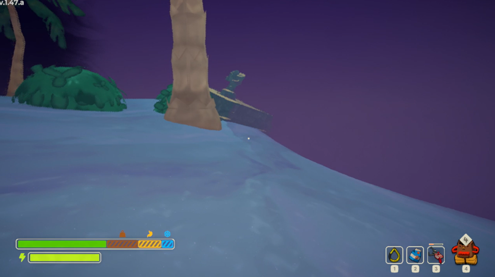
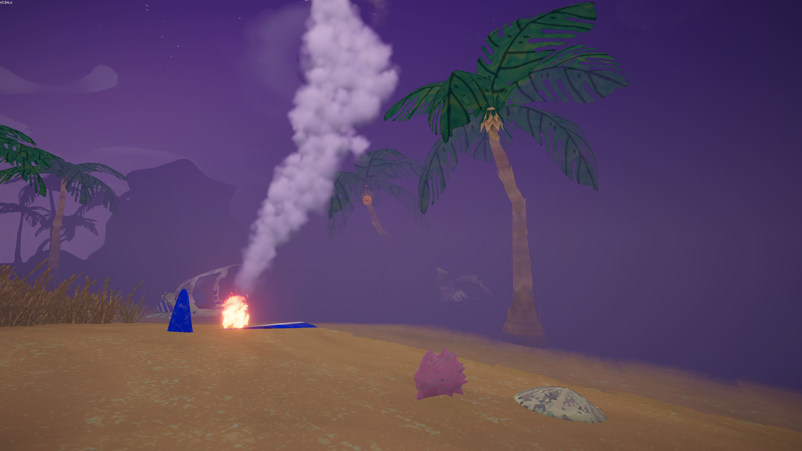
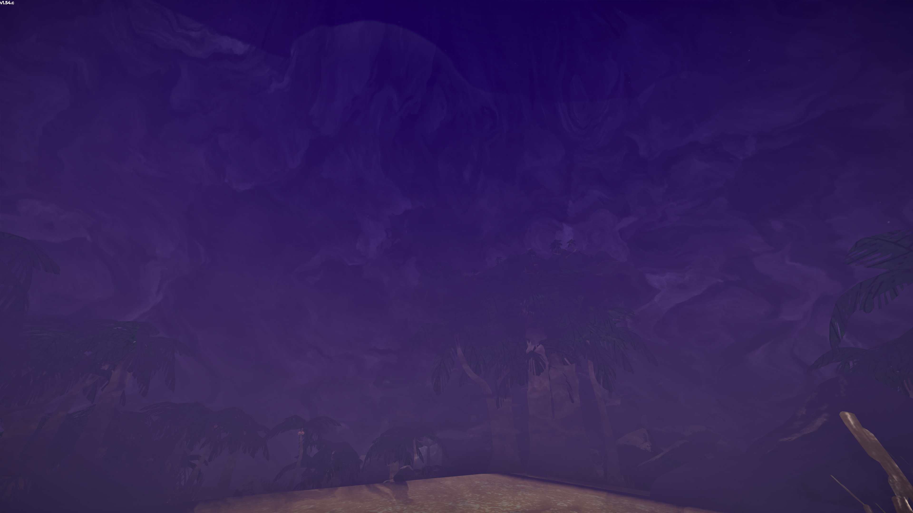
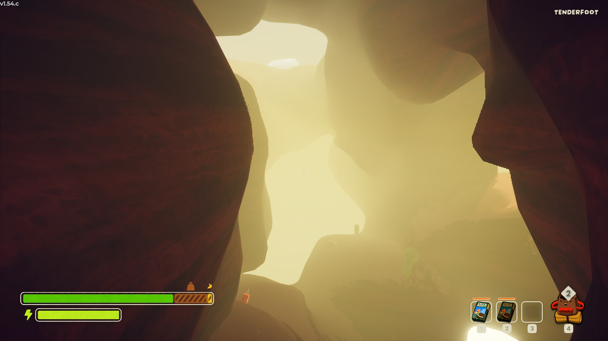

# Fog

Fog

General
Biome- [Shore](Shore.md)
- [Tropics](Tropics.md)
- [Roots](Roots.md)
- [Alpine](Alpine.md)
- [Mesa](Mesa.md)
- [The Kiln](The%20Kiln.md)
- [The Citadel](The%20Citadel.md)

The **Fog** is a  [freezing](Stamina%20bar.md#Cold) hazard present on all [Ascents](Ascents.md) above [Tenderfoot](https://peak.wiki.gg/wiki/Tenderfoot) in all [biomes](https://peak.wiki.gg/wiki/Biomes) except [Caldera](Caldera.md) and [Gloom](Gloom.md). It acts as a time limit and barrier.

## Behavior

### Rising

---

The Fog will begin rising after all [Scouts](Scout.md) have passed a certain height/distance in the biome, or after 16 minutes and 40 seconds (1000 seconds) have passed. It will close in as a shrinking sphere at a linear rate until a certain radius around the [campfire](Campfire.md).

Being in the Fog will inflict ****2.5**[Cold](Stamina%20bar.md#Cold)** every ~2.4 seconds[[1]](#cite_note-1). On living [skeletons](The%20Book%20of%20Bones.md#Skeleton_behavior), it will deal  [Injury](Stamina%20bar.md#Injury) instead at the same rate. It will also obscure the screen and make it extremely difficult to see.

### Barrier

---

A barrier of Fog will block the next biome until the [campfire](Campfire.md) is lit, in which case it will instead block the previous. The former can be overcome via the [Cannon exploit](Exploits.md#List_of_known_exploits), and the latter by simply walking along it. However, getting past the barrier blocking the next biome will make the game register the player as being in the next biome without loading it. Additionally, walking off the edge of the barrier blocking the previous biome will cause the player to fall into the void, where the bottom of the [Island](Island.md) can be seen.

Contact with this form of Fog will not inflict  [Cold](Stamina%20bar.md#Cold).

### Lava

---

In [The Kiln](The%20Kiln.md), the Fog will be replaced by rising [Lava](Lava.md). It will start rising 3 minutes after lighting the [campfire](Campfire.md), and stop rising once it reaches the top after 20 minutes. Being in the lava will deal ****25**[Injury](Stamina%20bar.md#Injury)** and about ****30**[Heat](Stamina%20bar.md#Heat)** per second.

### Gloom

---

In [The Citadel](The%20Citadel.md), the Fog will be replaced by rising [Gloom](Gloom.md#Hazards). Being in the Gloom will inflict  **2.5** [Drowsy](Stamina%20bar.md#Drowsy) every ~2.75 seconds. Holding a burning [Candlestick](Candlestick.md) will alleviate the  [Drowsy](Stamina%20bar.md#Drowsy), but will not increase visibility like in the [Sleepy Gloom](Gloom.md#Hazards).

## Gallery

- 
  The Fog stopped around a [Campfire](Campfire.md).
- 
  The Fog slowly approaching, on the [Shore](Shore.md).
- 
  The visual effect of the Fog, making it harder to see.
- 
  The yellow Fog of the [Mesa](Mesa.md).

## Notes

- [↑](#cite_ref-1) The actual rate is 1.05 per second, which comes out to 2.5 every 2.380952381 seconds.
