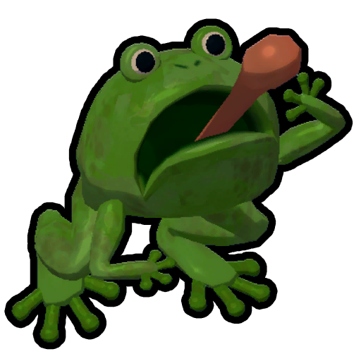
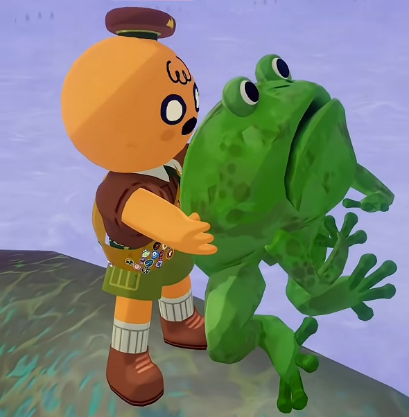
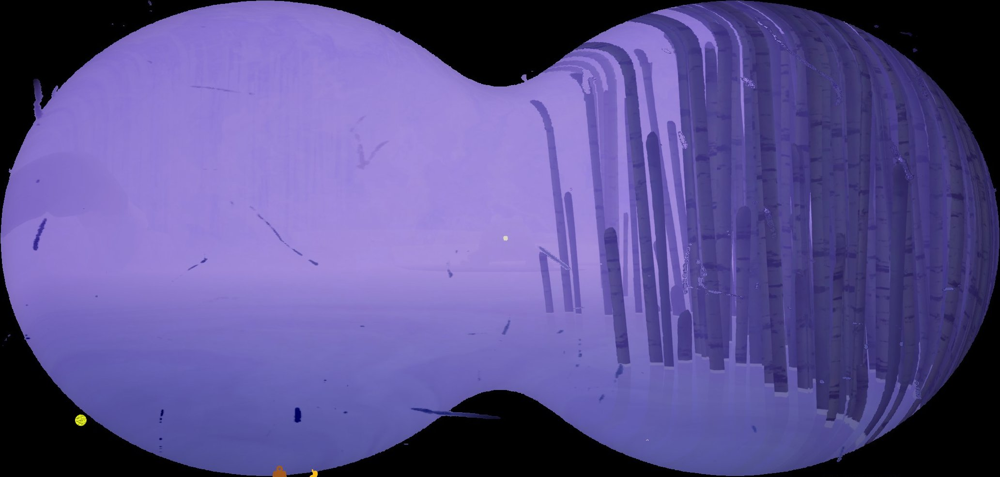
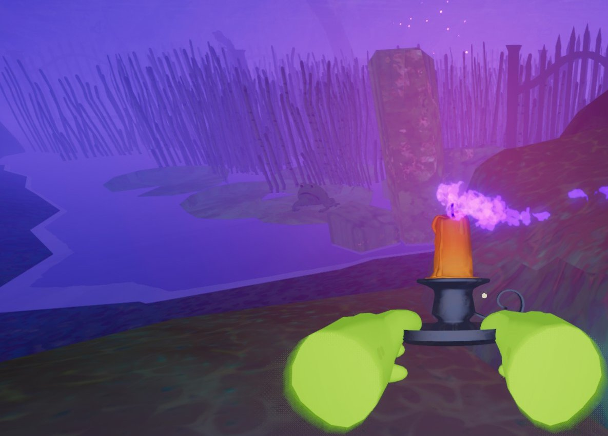
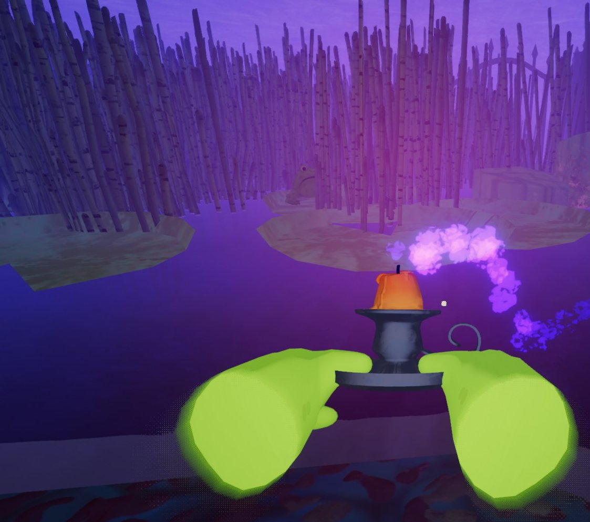

# Frog

This page is a [stub](https://support.wiki.gg/wiki/Stub). You can help **PEAK Wiki** by expanding it.

Frog

[Item type](Items.md)- [Enemy](https://peak.wiki.gg/wiki/Enemy)
Biome- [Gloom](Gloom.md)
Weight
 **5**

The **Frog** is a creature found in [Gloom](Gloom.md). It occasionally hops around aimlessly until a [Scout](Scout.md) gets too close to it, at which point it will grab the scout with its long tongue to pull them closer to it. Frogs are usually unseen in unlit gloom until a player well within their grab range, though are easily spotted in dispelled gloom. Their frequent ribbit sound gives away their positions more reliably.

## Mechanics

When a Frog spots a Scout within **28.8 meters** of it, it will attempt to shoot its tongue at the Scout, making the Scout lose control as it drags the Scout towards it for 2 seconds. It will then proceed to hop away, and apply a **12 second** cooldown to any tongue shooting to all Frogs in the Gloom.

A scout can pick up the frog. Once thrown, the frog will use its tongue to grab the Scout shortly after, pulling the Scout in the direction it was thrown. This can be used intentionally to traverse the Gloom.

Frogs can be [cooked](https://peak.wiki.gg/wiki/Cooked) into  [Frog Legs](Frog%20Legs.md).

## Gallery

- 
  A Scout holding a frog while standing in the Gloom.
- 
  A frog barely visible in the gloom via binoculars.
- 
  A frog sitting on a lily pad just about in range to grab a player. More visible with a lit candle.
- 
  A frog lurking on a lily pad behind reeds just after grabbing a player. More visible with a lit candle.

## Patch history

 **[2.0.a](2.0.a.md) (2026-08-11):** Added.
 **[2.01.a](https://peak.wiki.gg/wiki/2.01.a) :** Frogs now have a global cooldown where no other frog can grab you if you’ve recently been grabbed.
 **[2.02.a](https://peak.wiki.gg/wiki/2.02.a) :**

- MORE FROG NERFS (fine you guys win)- Max Tongue Distance 22m->18m
  - Max Tongue Angle 16°->14°
  - Cooldown 10s->12s
