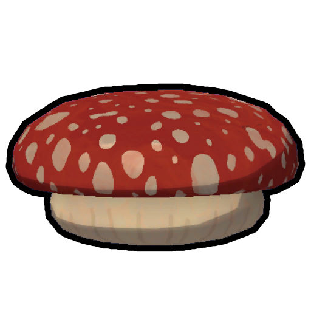
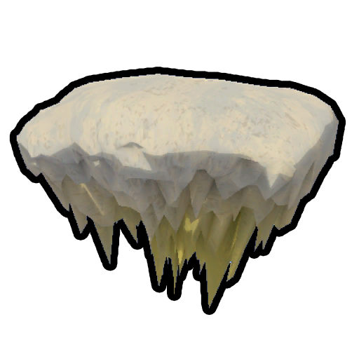

# Fungus (disambiguation)

This is a disambiguation page for "Fungus".

The following is a list of links related to Fungus.

**Fungus** may refer to:

-  [Bounce Fungus](Bounce%20Fungus.md) - creates a bouncy platform when contacting a surface.
-  [Cloud Fungus](Cloud%20Fungus.md) - creates a usable platform in the air or when contacting a surface.
-  [Remedy Fungus](Remedy%20Fungus.md) - can heal various [status effects](https://peak.wiki.gg/wiki/Status_effects).
-  [Shelf Fungus](Shelf%20Fungus.md) - creates a usable platform when contacting a surface.
-  [Warp Fungus](Warp%20Fungus.md) - teleports the player to the spot it lands on.
