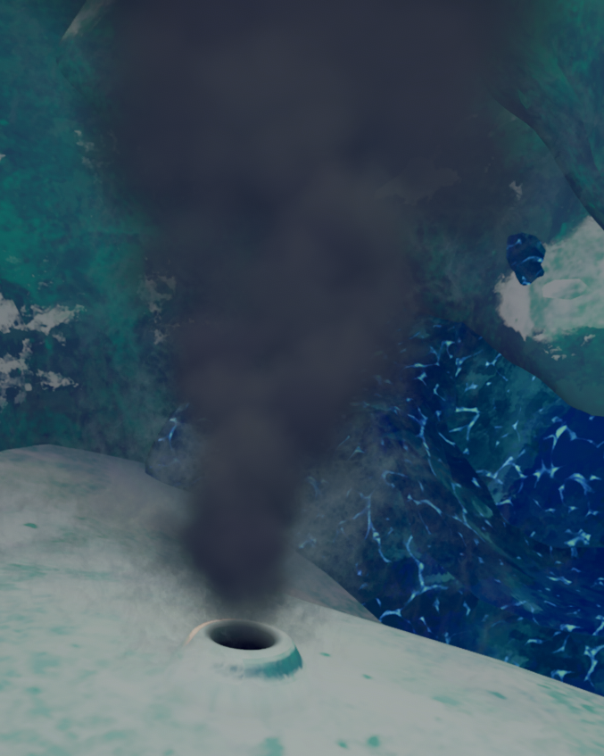

# Geyser

Geyser

General
Type
Environmental hazard
Biome- [Alpine](Alpine.md)

**Geysers** are an environmental hazard found in the [Alpine](Alpine.md). They both provide  [Heat](Stamina%20bar.md#Heat) and can erupt, sending nearby players flying.

When a player comes within **9.6 meters** of a Geyser, it has a **33.3%** chance to trigger. When this happens, nearby players' screens will start shaking, and a sound effect will play before the Geyser erupts **2 seconds** later. Upon eruption, all players within **6.4 meters** of the Geyser will be launched, entering a [ragdoll](https://peak.wiki.gg/wiki/Ragdoll) state and receiving up to  **30** [Heat](Stamina%20bar.md#Heat), depending on their distance.

Geysers will passively warm any players within **3.2 meters** of them, removing up to  **5** [Cold](Stamina%20bar.md#Cold) every **0.5 seconds** (10 Cold every second) depending on their distance from the Geyser.

## Gallery

- 
  An erupting Geyser

## Patch History

 **[1.0](1.0.md) (2025-06-16):** Introduced.
