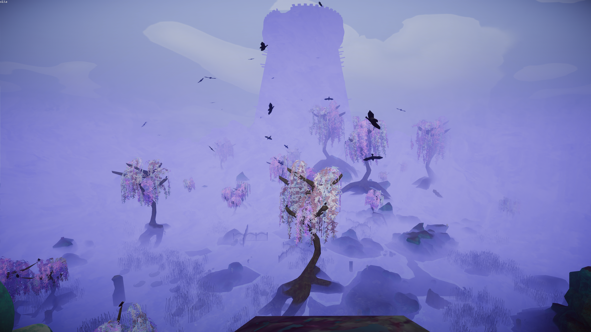
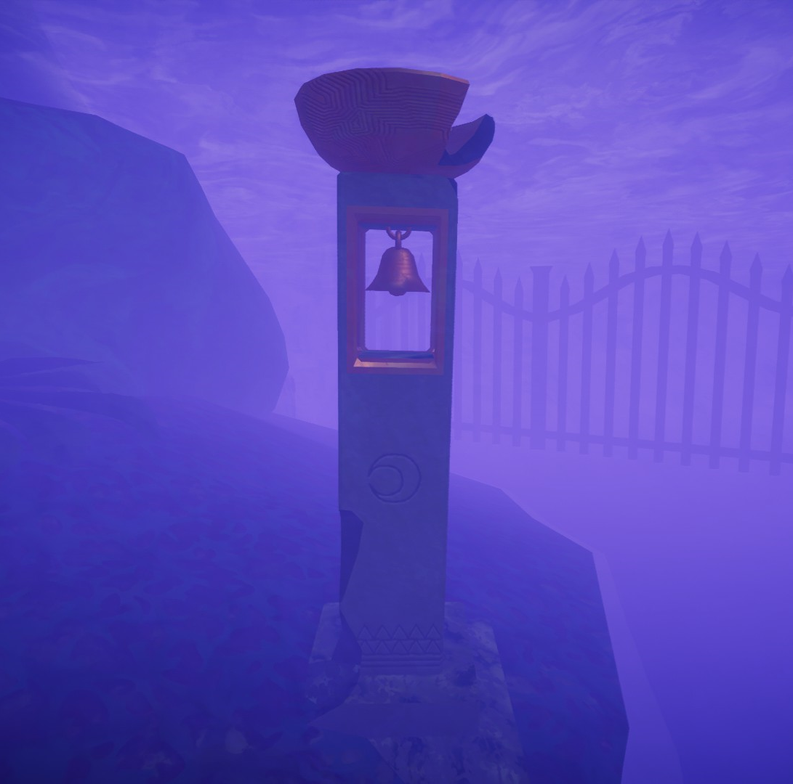
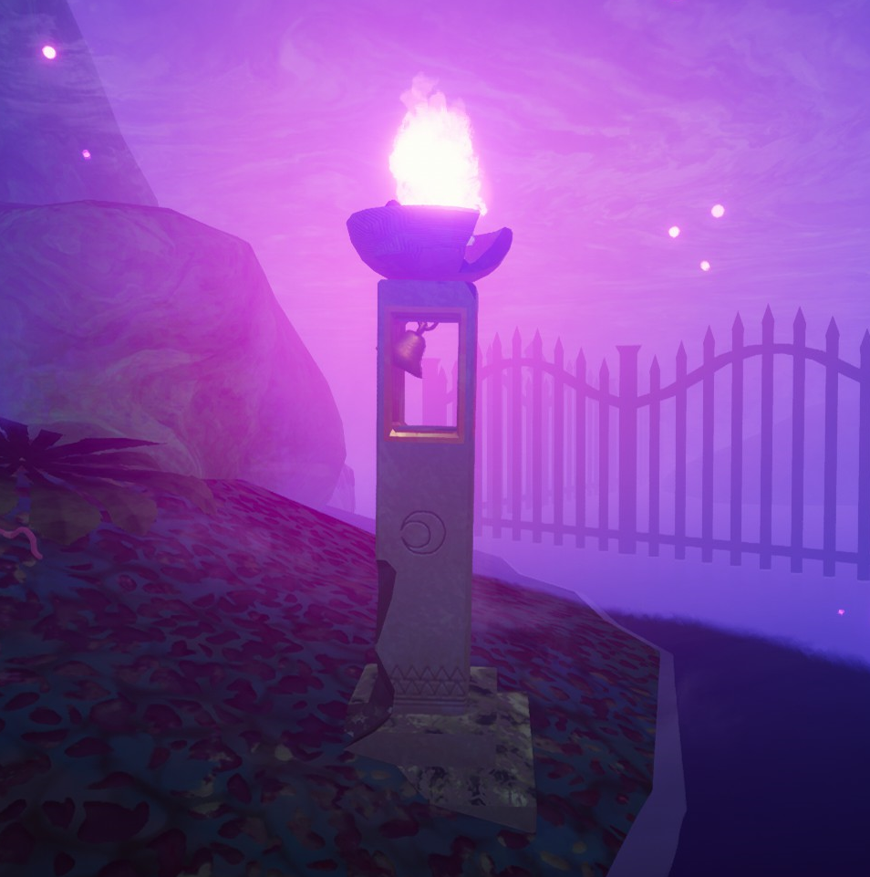
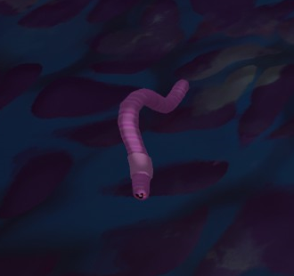
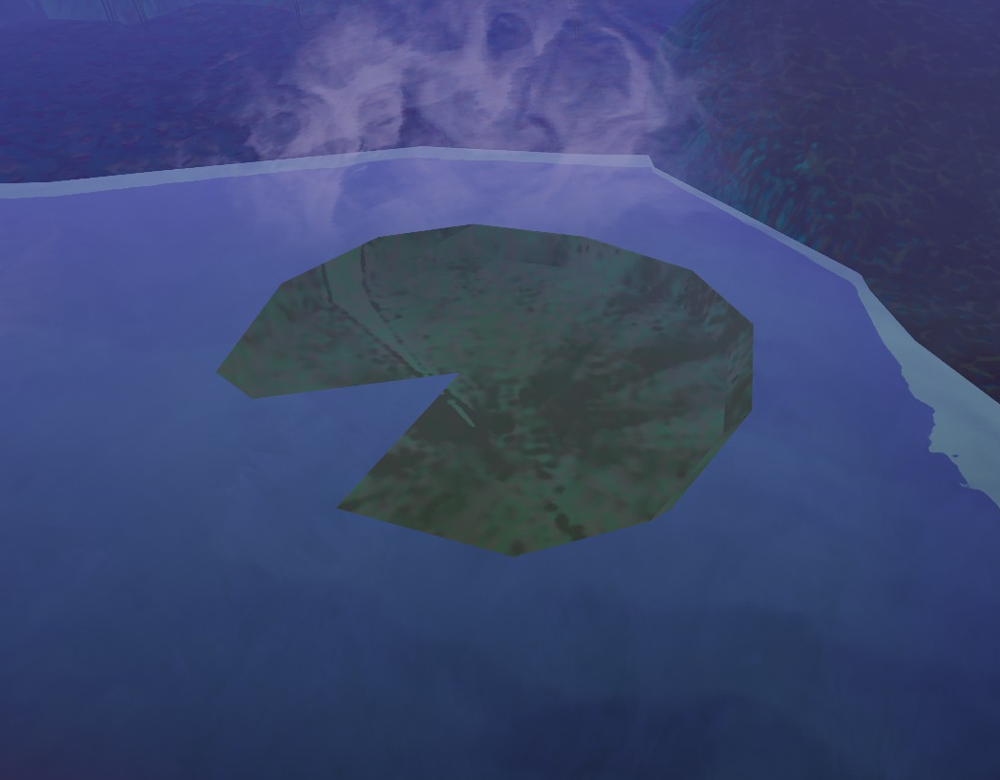
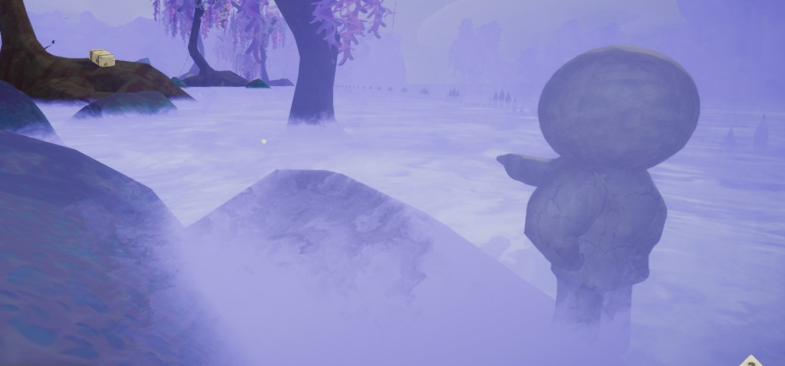
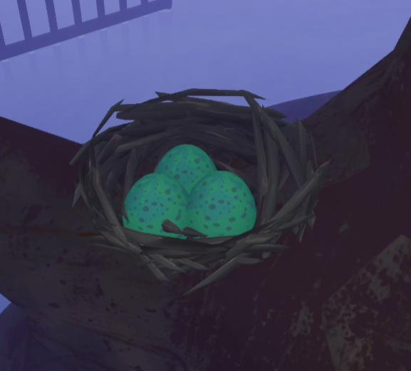
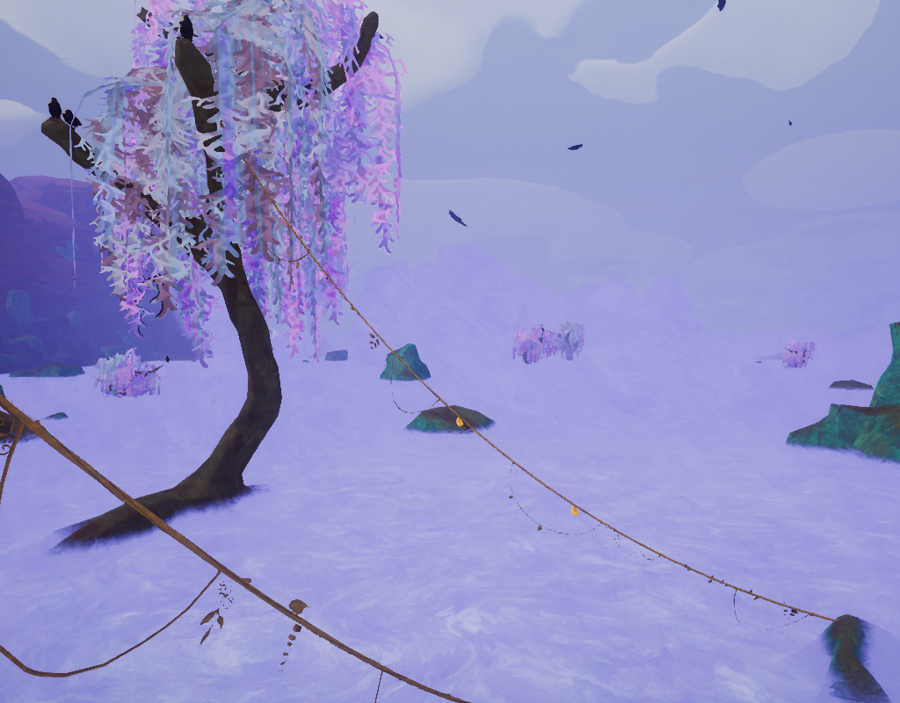
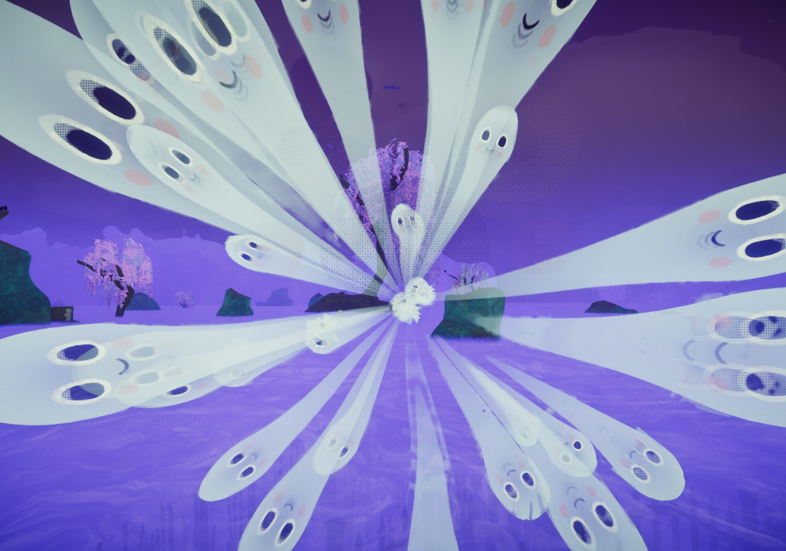
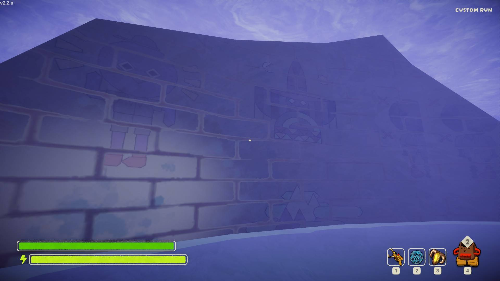

# Gloom

This article is about the biome. For the rising hazard, see [The Citadel](The%20Citadel.md#Hazards).
Gloom

Details
Type
[Biome](https://peak.wiki.gg/wiki/Biome)
Region
**4**/6

The **Gloom** is one of the two possible fourth biomes (the other being the [Caldera](Caldera.md)) in *[PEAK](Peak%20%28game%29.md)*, following the [Alpine](Alpine.md) or [Mesa](Mesa.md) and preceding [The Citadel](The%20Citadel.md). It is a haunted swampland covered with a purple fog, and filled with Ghosts that can be seen rising out of the mist. Across the gloom is a massive tower, [The Citadel](The%20Citadel.md) itself.

Reaching the tower and lighting the [campfire](Campfire.md) within the entrance hall dispels the [fog](Fog.md) wall blocking access to [The Citadel](The%20Citadel.md) and grants all living [Scouts](Scout.md) the  [Wanderer Badge](https://peak.wiki.gg/wiki/Wanderer_Badge).

The Gloom does not have additional time pressure mechanics, such as the [fog](Fog.md) or [The Citadel](The%20Citadel.md)'s rising gloom. Cold nights from [Ascent 5](https://peak.wiki.gg/wiki/Ascent_5) and later have no effect in the Gloom.

## Areas

### Citadel Entrance

---

On the other side of the Gloom is the entrance to **The Citadel**, with a ruined staircase leading to a long entrance hallway. In the middle of the hallway is a small bowl of sticks that serve as the Gloom's [campfire](Campfire.md). To the left of the fire is a room containing an [Ancient Statue](Ancient%20Statue.md) for reviving or a [mystical item](https://peak.wiki.gg/wiki/Mystical_item), while to the right is a room with three [luggage](Luggage.md) protected by an arrow trap, requiring Scouts to crouch under it to avoid being shot.

## Features

### Belltowers

---

- 
- 

**Belltowers** can be found while inside the sleepy gloom. Interacting with them will light them, permanently dispelling the hazard within a short radius. A sound cue plays whenever they are lit.

Lighting five of them in a single expedition will grant all scouts the  [Bellringer Badge](https://peak.wiki.gg/wiki/Bellringer_Badge).

### Early Worm

---

The **Early Worm** can be found in various locations across the Gloom. They move in a small circle until picked up by a player.
Consuming an Early Worm grants the player who ate it the  [Well Rested Badge](https://peak.wiki.gg/wiki/Well_Rested_Badge).

### Lilypads

---

**Lilypads** can be found in the Gloom's water. Standing on them removes the water's debuff.

### Petrified Scouts

---

**Petrified Scouts** can be found all across the Gloom, bearing a striking appearance to the player Scouts. Each one points towards a piece of [luggage](Luggage.md), though a scout above the Gloom might point towards luggage inside the Gloom, and the opposite can also occur.

### Raven Nests

---

**Raven Nests** can be found across the Gloom, typically in trees or on pillars. Ravens can be found perched on the nests, but will not attack the player.
A raven's nest can contain up to five  [Small Eggs](Small%20Egg.md).

### Vines

---

**Vines** can be found throughout the gloom, connecting various parts of the terrain. They can be grappled onto similar to [chains](Chain.md), taking very little [stamina](https://peak.wiki.gg/wiki/Stamina) while doing so. Moving along or resting on the vines consumes some stamina, but not as much as climbing.

Various [Berrynanas](Berrynana%20%28disambiguation%29.md) can occasionally be found hanging on them, like the vines in the [Tropics](Tropics.md).

## Hazards

| Hazard | Image | Description |
| --- | --- | --- |
| **Sleepy Gloom** | [Sleepy gloom.png](https://peak.wiki.gg/wiki/File%3ASleepy_gloom.png) | **Sleepy Gloom** is the main hazard of the Gloom, being a purple fog that covers the majority of the biome aside from the small islands and giant trees that pierce through its top. While inside the Sleepy Gloom, Scouts gain [Drowsy](Stamina%20bar.md#Drowsy) **2.5** [Drowsy](Stamina%20bar.md#Drowsy) every **~2.75 seconds**. Available stamina points will roughly correlate to how many seconds you can spend in the Sleepy Gloom before falling asleep. |
| **Gloom Water** | [Gloom water.png](https://peak.wiki.gg/wiki/File%3AGloom_water.png) | **Gloom Water** slows down [Scouts](Scout.md)' movement speed by **50%** while walking in it, making it harder to traverse the Gloom. Movement speed is instead reduced by **70%** while jumping, and jump height is reduced by **50%**. |
| **[Flytraps](https://peak.wiki.gg/wiki/Flytraps)** | [Flytrap.png](https://peak.wiki.gg/wiki/File%3AFlytrap.png) | **Flytraps** are stationary enemy plants that rest on the ground of the Gloom. If a Scout walks on top of an open Flytrap, it will catch and ensnare them, filling their stamina bar with a moderate amount of [Flytrap](Stamina%20bar.md#Flytrap) [Flytrap](Stamina%20bar.md#Flytrap) and inflicting [Poison](Stamina%20bar.md#Poison) [Poison](Stamina%20bar.md#Poison) over time while they are trapped. The Scout's voice will be muffled while they are within the Flytrap. The trapped Scout can struggle out on their own with enough available stamina, or be rescued them by another scout using Helping Hand to pull them out. |
| **[Big Ghost](Big%20Ghost.md)** | [Big ghost (hiquality).png](https://peak.wiki.gg/wiki/File%3ABig_ghost_%28hiquality%29.png) | **The Big Ghost** is a hostile enemy that spawns when Scouts spend too long inside of the Sleepy Gloom. It will begin to manifest with a unique sound cue, before chasing the nearest Scout, pathing through terrain if necessary to get to them. Once caught up, the Ghost will explode, inflicting [Cold](Stamina%20bar.md#Cold) [Cold](Stamina%20bar.md#Cold) and Blindness. The explosion launches affected targets, potentially leading to additional [Injury](Stamina%20bar.md#Injury) [Injury](Stamina%20bar.md#Injury). Light sources such as the  [Candlestick](Candlestick.md),  [Faerie Lantern](Faerie%20Lantern.md), and the Belltowers can be used to burn the Ghost, despawning it and rewarding the responsible Scouts the [Exorcist Badge](https://peak.wiki.gg/wiki/Exorcist_Badge) [Exorcist Badge](https://peak.wiki.gg/wiki/Exorcist_Badge). |
| **[Frogs](https://peak.wiki.gg/wiki/Frogs)** | [Frog.png](https://peak.wiki.gg/wiki/File%3AFrog.png) | **[Frogs](Frog.md)** are creatures that are scattered around the Gloom. If a Scout enters a Frog's line of sight, it will shoot its tongue out from a great distance. If it hits a Scout with its tongue, it will turn the Scout to its direction then fling them towards itself, while also [ragdolling](Scout.md#Ragdoll_State) them. Frogs can be picked up by Scouts and tossed, but cannot be stored, similarly to the  [Scorpion](Scorpion.md). Frogs can be [cooked](https://peak.wiki.gg/wiki/Cooked) into  [Frog Legs](Frog%20Legs.md). A thrown Frog will often pull the thrower immediately, allowing them to be used as an unorthodox traversal tool. |
| **[Tricky Ravens](Tricky%20Ravens.md)** | [Tricky raven.png](https://peak.wiki.gg/wiki/File%3ATricky_raven.png) | **Tricky Ravens** are creatures that are scattered around the Gloom, perched on sign posts and their nests. After spending enough time in the fog of the Gloom, a perched Raven currently unseen by all players will steal their voice. While this effect is active, any time that Scout talks, the voice will instead originate from the Raven, with it visibly speaking. The effect will end if the Scout leaves the gloom or the Raven leaves its perch. Ravens will be spooked and fly off if a Scout gets close. |
| **Wrought-Iron Fences** | [Fencing.png](https://peak.wiki.gg/wiki/File%3AFencing.png) | **Wrought-Iron Fences** appear as railings scattered across the Gloom that serve as obstacles that may block direct paths to the next island. They cannot be climbed on. Touching the top of the Fencing will deal [Injury](Stamina%20bar.md#Injury) **2.5** [Injury](Stamina%20bar.md#Injury) per second. |

## Food

There are five natural food items that can appear in the Gloom:

-  [Egg](Egg.md)
-  [Cooked Bird](Cooked%20Bird.md)
-  [The Early Worm](The%20Early%20Worm.md)
-  [Hot Dog](Hot%20Dog.md)
-  [Yellow Berrynana](Yellow%20Berrynana.md)

## Tips and Tricks

- Planning your route each time you ascend from the sleepy gloom is advised to minimize the amount of  [Drowsy](Stamina%20bar.md#Drowsy) you could accumulate.
- As any active light source can dispel the Sleepy Gloom, items such as  [candlesticks](Candlestick.md) or  [Faerie Lanterns](Faerie%20Lantern.md) are recommended for extended travel.- Although the  [Lantern](Lantern.md) won't stop you from growing  [Drowsy](Stamina%20bar.md#Drowsy), it will still dispel the fog, helping visibility.
- If you manage to grab a frog, it is possible to throw it and have it pull you in a certain direction[[1]](#cite_note-1). This is not always reliable, as the frog often runs away after tonguing a scout, and if thrown too far up can lead to big enough falls that can cause  [Injury](Stamina%20bar.md#Injury).
- Similar to the Caldera, the Gloom can easily be cheesed with the  [Book of Bones](https://peak.wiki.gg/wiki/Book_of_Bones) or the  [Ancient Idol](Ancient%20Idol.md), preventing the  [Drowsy](Stamina%20bar.md#Drowsy) earned inside the Sleepy Gloom.
- There is a hole directly above both the ancient statue and the chest room at the [The Citadel](The%20Citadel.md)'s entrance. Dropping or throwing any anti-gravity items in those areas could cause them to float away.

## Gallery

- 
  The big ghost's explosion.
- 
  An unweathered version of the wall textures found across bricks in both the Gloom and The Citadel.
- 
  Two Yellow Berrynanas growing on a vine in the Gloom.

## Trivia

- The Gloom, alongside The Citadel, were the final two biomes added to *Peak* post-launch.
- When Gloom was first released alongside The Citadel, it was locked into rotation for three weeks, preventing them from cycling with the Caldera and The Kiln.
-  [Hot Dogs](Hot%20Dog.md) can rarely be found among the ornamental cattails, which is a pun on an alternative name for cattails, "water sausages." Unlike ordinary  [Hot Dogs](Hot%20Dog.md), these are skewered axially and straight, which can make them easier to overlook. Their inventory sprite, however, remains curved.
- When you are in this biome, your Steam Now Playing will say "Wandering the Gloom".

## Patch history

 **[2.0.a](2.0.a.md) (2026-08-11):** Introduced.
 **[2.02.a](https://peak.wiki.gg/wiki/2.02.a) :** Thickened the colliders on wrought-iron fences to reduce the likelihood of the player [ragdoll](Scout.md#Ragdoll_State) getting stuck in them.

## Notes

- [↑](#cite_ref-1) [[1]](https://www.youtube.com/shorts/QcmFc3PYYuY) "HOW TO HANDLE THE FROGS"
