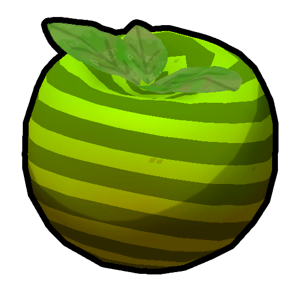

# Green Crispberry

Green Crispberry
Normal
Colorblind

[Item type](Items.md)- [Food](Food.md)
- [Natural food](https://peak.wiki.gg/wiki/Natural_food)
- [Berry](https://peak.wiki.gg/wiki/Berry)
Biome- [Shore](Shore.md)
- [Tropics](Tropics.md)
- [Roots](Roots.md)
- [Mesa](Mesa.md)
- [Alpine](Alpine.md)
- [Peak](Peak%20%28biome%29.md)
Weight
 **2.5**
Base Status Effects
Hunger
-5
Poison
10
Cooked Bonuses
Hunger
-5 (-10 total)
Bonus Stamina
10 (10 total)

The **Green Crispberry** is a [natural food](https://peak.wiki.gg/wiki/Natural_food) in *[PEAK](Peak%20%28game%29.md)* found growing on bushes in the [Shore](Shore.md) and [Tropics](Tropics.md). It sometimes also appears on the bushes around the [Campfire](Campfire.md) at the top of the [Roots](Roots.md) and [Alpine](Alpine.md), around the [Hot Spring](Alpine.md#Hot_Spring) in the Alpine and [Oasis](Mesa.md#Oasis) in the [Mesa](Mesa.md), and at the foot of the [Peak](Peak%20%28biome%29.md). Eating it restores  **5** [Hunger](Stamina%20bar.md#Hunger) and inflicts  **10** [Poison](Stamina%20bar.md#Poison) over the course of 4 seconds, beginning 2 seconds after eating it.

[Cooking](Cooking.md) a Green Crispberry removes the  [Poison](Stamina%20bar.md#Poison) effect.

## Patch history

 **[1.0](1.0.md) (2025-06-16):** Introduced.
 **[1.40.a](1.40.a.md) (2025-11-05):** Cooked poisonous berries will now be safe to eat.

[Food](Food.md)
Natural food
Berries
Berrynanas-  [Yellow Berrynana](Yellow%20Berrynana.md)
-  [Pink Berrynana](Pink%20Berrynana.md)
-  [Blue Berrynana](Blue%20Berrynana.md)
-  [Brown Berrynana](Brown%20Berrynana.md)
Clusterberries-  [Red Clusterberry](Red%20Clusterberry.md)
-  [Yellow Clusterberry](Yellow%20Clusterberry.md)
-  [Black Clusterberry](Black%20Clusterberry.md)
Crispberries-  Green Crispberry
-  [Yellow Crispberry](Yellow%20Crispberry.md)
-  [Red Crispberry](Red%20Crispberry.md)
Kingberries-  [Green Kingberry](Green%20Kingberry.md)
-  [Yellow Kingberry](Yellow%20Kingberry.md)
-  [Purple Kingberry](Purple%20Kingberry.md)
Prickleberries-  [Red Prickleberry](Red%20Prickleberry.md)
-  [Gold Prickleberry](Gold%20Prickleberry.md)
Shroomberries-  [Red Shroomberry](Red%20Shroomberry.md)
-  [Yellow Shroomberry](Yellow%20Shroomberry.md)
-  [Green Shroomberry](Green%20Shroomberry.md)
-  [Blue Shroomberry](Blue%20Shroomberry.md)
-  [Purple Shroomberry](Purple%20Shroomberry.md)
Winterberries-  [Orange Winterberry](Orange%20Winterberry.md)
-  [Yellow Winterberry](Yellow%20Winterberry.md)
Other-  [Napberry](Napberry.md)
-  [Scorchberry](Scorchberry.md)
Campfire food-  [Marshmallow](Marshmallow.md)
-  [Hot Dog](Hot%20Dog.md)
Mushrooms-  [Bugle Shroom](Bugle%20Shroom.md)
-  [Button Shroom](Button%20Shroom.md)
-  [Chubby Shroom](Chubby%20Shroom.md)
-  [Cluster Shroom](Cluster%20Shroom.md)
Mystical food-  [Cure-All](Cure-All.md)
-  [Pandora's Lunchbox](Pandora%27s%20Lunchbox.md)
Other-  [Cooked Bird](Cooked%20Bird.md)
-  [Egg](Egg.md)
-  [Frog Legs](Frog%20Legs.md)
-  [Honeycomb](Honeycomb.md)
-  [Half-Coconut](Half-Coconut.md)
-  [Medicinal Root](Medicinal%20Root.md)
-  [Mandrake](Mandrake.md)
-  [Scorpion](Scorpion.md)
-  [Tick](Tick.md)
-  [The Early Worm](The%20Early%20Worm.md)
Packaged food
All packaged foods-  [Airline Food](Airline%20Food.md)
-  [Big Lollipop](Big%20Lollipop.md)
-  [Energy Drink](Energy%20Drink.md)
-  [Fortified Milk](Fortified%20Milk.md)
-  [Granola Bar](Granola%20Bar.md)
-  [Scout Cookies](Scout%20Cookies.md)
-  [Sports Drink](Sports%20Drink.md)
-  [Trail Mix](Trail%20Mix.md)
