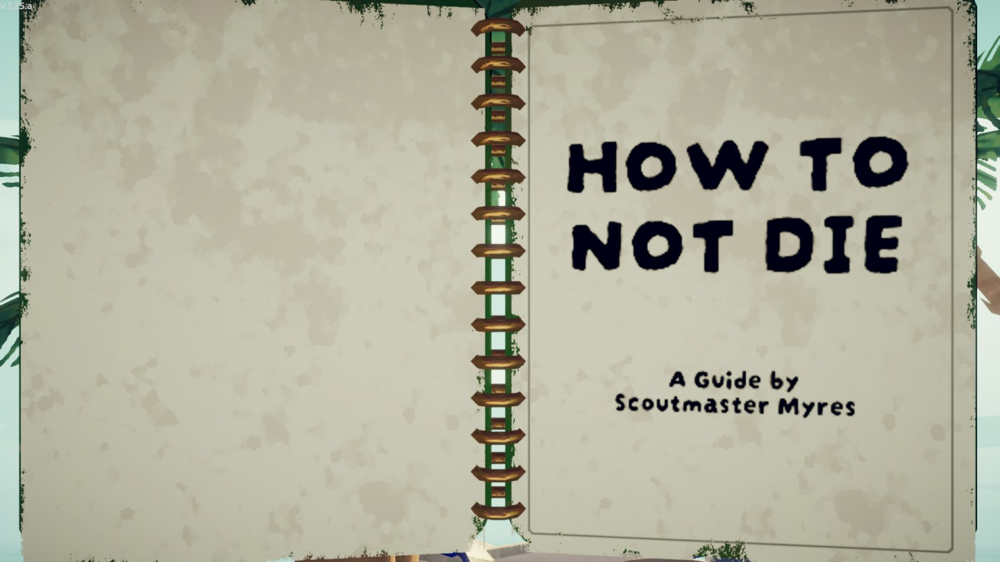
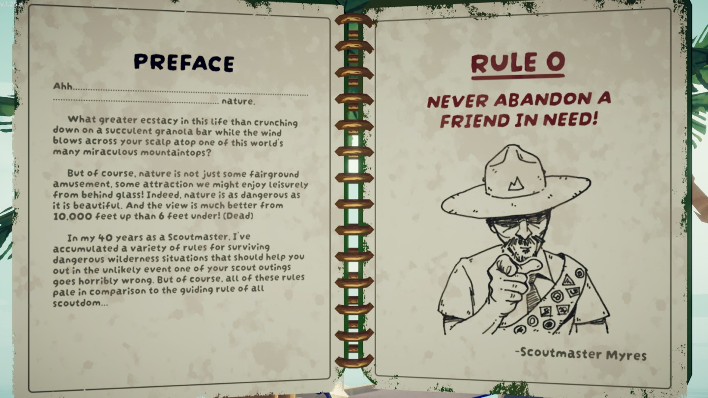
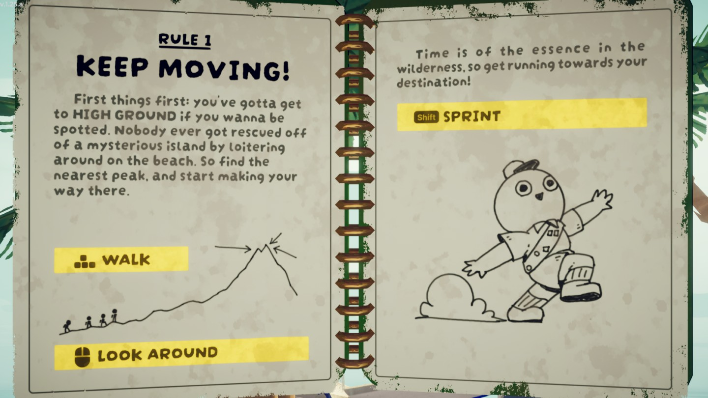
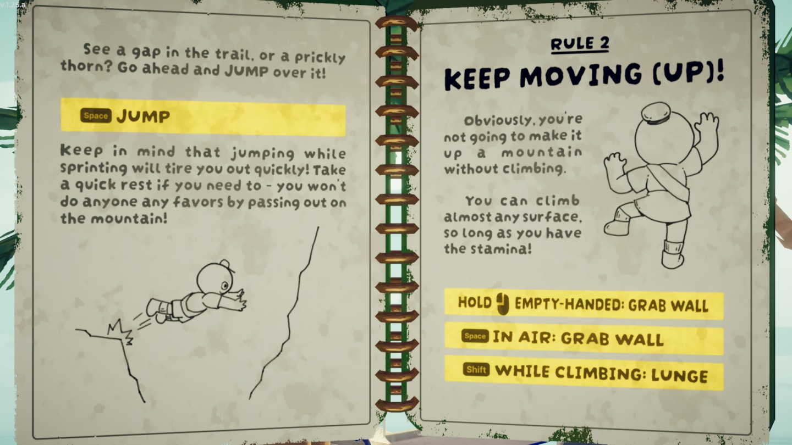
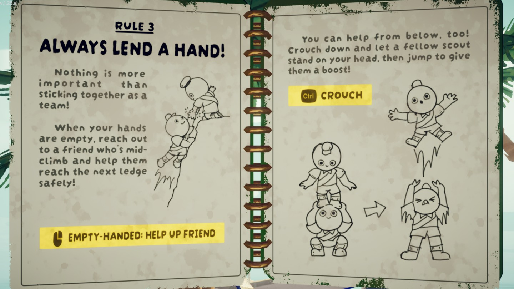
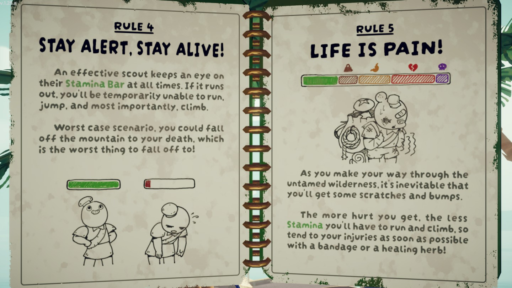
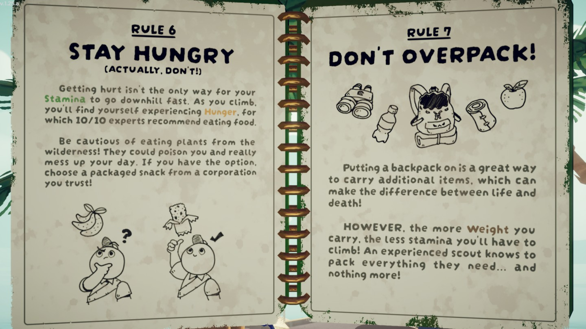
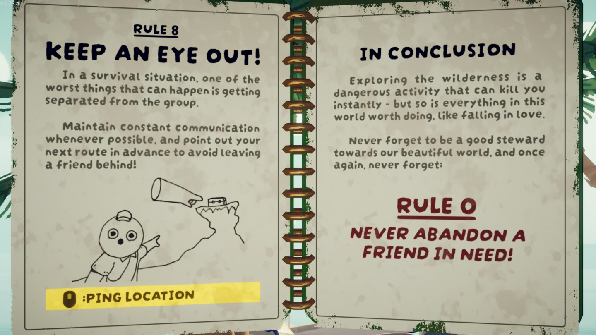

# Guidebook

Guidebook

[Item type](Items.md)- [Equipment](Equipment.md)
Biome- [Shore](Shore.md)
Location- [Crash Site](https://peak.wiki.gg/wiki/Crash_Site)
Weight
 **0**

The **Guidebook** is an [equipment](Equipment.md) item in *[PEAK](Peak%20%28game%29.md)*. It is found exclusively at the crash site in [Shore](Shore.md).

It serves as a readable tutorial for the game, explaining various gameplay mechanics such as the [Stamina bar](Stamina%20bar.md) and cooking food. It was written by [Scoutmaster Myres](Scoutmaster%20Myres.md).

When [cooked](Cooking.md), the Guidebook is incinerated and can no longer be opened or closed. If the Guidebook was already open prior to cooking, the player can continue to flip through its pages. Dropping or stashing the Guidebook away will close it and prevent it from being reopened.

## Gallery

- 
  Page 1
- 
  Page 2
- 
  Page 3
- 
  Page 4
- 
  Page 5
- 
  Page 6
- 
  Page 7
- 
  Page 8

## See Also

- [Scroll](Scroll.md)

## Patch history

 **[1.0](1.0.md) (2025-06-16):** Introduced.
 **[1.1.a](1.1.a.md) (2025-06-17):** Guidebooks are now synced across clients, allowing your friends to read over your shoulder.
 **[1.7](1.7.md) (2025-07-10):** Fixed an issue where guidebook SFX was not spatialized.
 **[1.8](1.8.md) (2025-07-21):** Fixed an issue where the guidebook wouldn't disappear on your back in first-person if you put it in a backpack.
