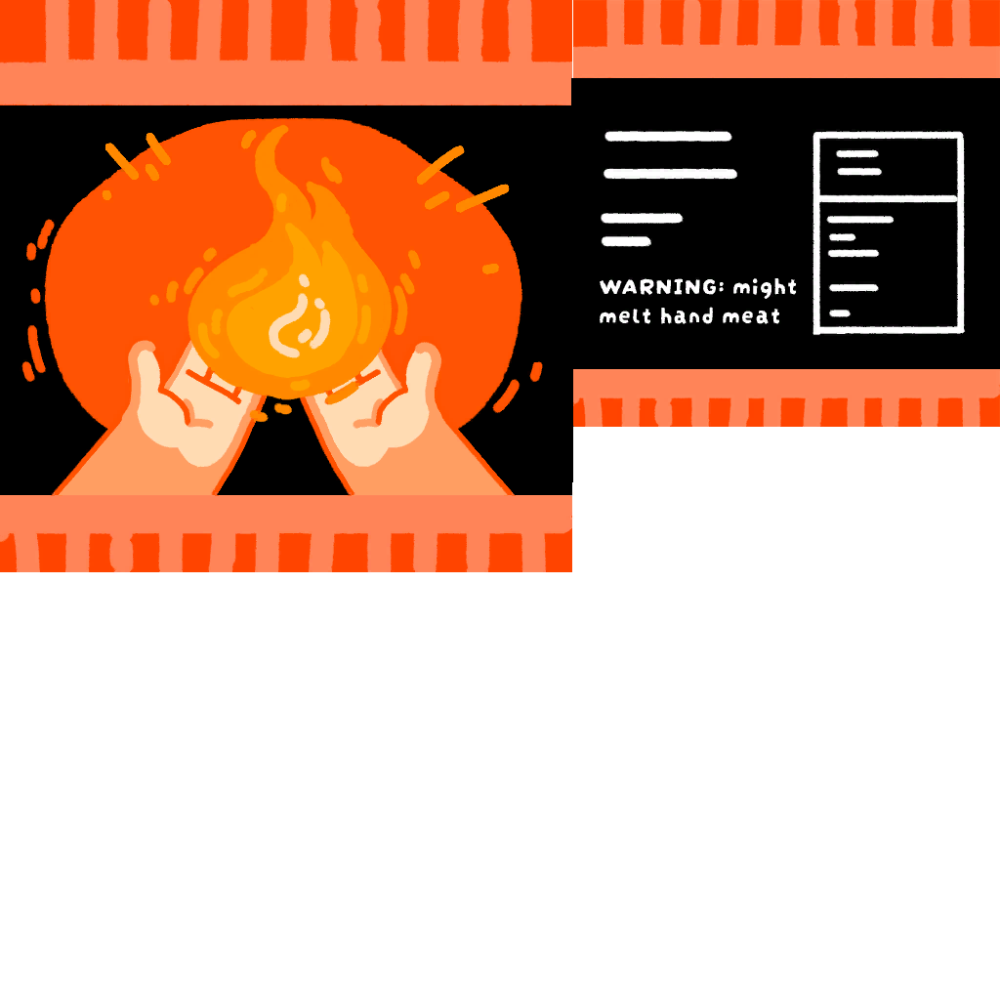

# Heat Pack

Heat Pack

[Item type](Items.md)- [Consumable](https://peak.wiki.gg/wiki/Consumable)
Rarity
[Common](https://peak.wiki.gg/wiki/Common)
Biome- [Alpine](Alpine.md)
Source- [Regular Luggage](https://peak.wiki.gg/wiki/Regular_Luggage)
- [Big Luggage](https://peak.wiki.gg/wiki/Big_Luggage)
Weight
 **0**
Base Status Effects
Cold
-360
**WARNING:** might melt hand meat

The **Heat Pack** is a [consumable](https://peak.wiki.gg/wiki/Consumable) item in *[PEAK](Peak%20%28game%29.md)*. Using a Heat Pack removes  **6** [Cold](Stamina%20bar.md#Cold) per second for the next 60 seconds. Heat packs only spawn in [luggages](Luggage.md) in the [Alpine](Alpine.md).

[Cooking](Cooking.md) a Heat Pack causes it to explode, dealing up to  **20** [Injury](Stamina%20bar.md#Injury) to players within **4.8 meters**, depending on their distance.

## Gallery

- 
  Heat Pack texture.

## Patch history

 **[1.0](1.0.md) (2025-06-16):** Introduced.
 **[1.6.a](1.6.a.md) (2025-07-04):** Fixed an issue where eating a [lollipop](Big%20Lollipop.md) after using a heat pack would cause a ton of cold damage over time.
 **[1.25.a](1.25.a.md) (2025-08-21):** Fixed the issue where biome-specific items such as the [Dynamite](Dynamite.md) and Heat Pack could show up in the [Caldera](Caldera.md) onwards.
 **[1.40.a](1.40.a.md) (2025-11-05):** Cooking a heat pack now causes it to explode.
